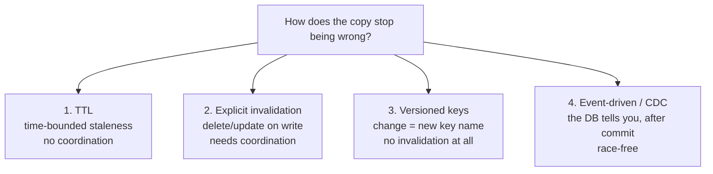
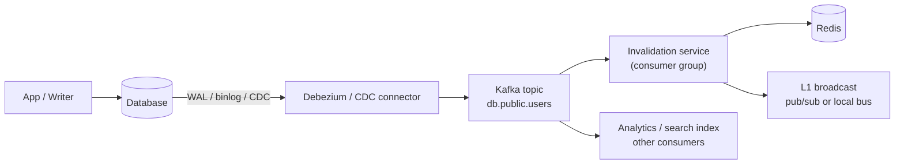

# Cache Invalidation & Consistency — Stampede, CDC, and the Hardest Problem

> **TL;DR** — "There are only two hard things in computer science: cache invalidation and naming things" is a joke because it is true. A cache is a copy, and the moment the original changes, the copy is a lie — for however long your TTL, your event pipeline, or your luck allows. There are exactly four mechanisms: **TTL** (bounded staleness, no coordination), **explicit invalidation** (delete/update on write, needs coordination), **versioned keys** (the change produces a new name, no invalidation needed at all), and **event-driven invalidation via CDC** (the database tells you, after commit, so you cannot race it). The failure modes — stampede, dogpile, thundering herd, stale repopulation, and cross-region divergence — are all consequences of using the wrong mechanism for the wrong guarantee.

> **60-second interview answer:** "My default is versioned, immutable cache keys plus TTLs, because then a change produces a new key and there is nothing to invalidate — that is why content-hashed asset URLs exist. For data that cannot be versioned I use explicit invalidation on write, deleting rather than updating because a delete is race-safe while two concurrent updates can leave the older value cached until the TTL. But application-driven delete has a specific bug: if the read after the delete hits a lagging replica, it repopulates the cache with stale data and that value sticks for the whole TTL — so for anything correctness-sensitive I drive invalidation from change-data-capture, so the invalidation happens after the write is durably committed rather than from the application. And every cache needs a stampede plan: single-flight on the recompute, jittered TTLs, probabilistic early expiry, and stale-while-revalidate so nobody ever waits."

---

## 1. Definition & mental model

**Plain English.** Cache invalidation is the problem of making a copy stop being wrong. Consistency is the question of *how* wrong it is allowed to be, and for how long.

**The analogy.** Think of a **supermarket price tag versus the checkout computer**.

- The shelf tag is the cache; the checkout system is the database.
- If a price changes, the shelf tag must change. If it does not, a customer reads a lie (**stale read**).
- The store could reprint every tag nightly (**TTL**), but then it is wrong for up to a day.
- It could radio the shelf staff on every price change (**explicit invalidation**), but the staff might be busy (**queue lag**), or two price changes might arrive out of order (**out-of-order update**).
- It could print a *date-stamped* tag, so a changed price is a new tag rather than a correction to an existing one (**versioned keys**) — and the old tag simply expires.
- And when a popular item is out of stock and everyone asks at once, the staff all run to the stockroom simultaneously and collide (**stampede**).

The transcript puts it plainly: the database gets updated, the cache does not, the user reads from the cache, and gets wrong data. That is the whole problem. Everything else in this file is a mechanism or a failure mode.

**The framing that matters in interviews:** invalidation is not a technical choice, it is a **product decision about staleness**. You cannot design it until someone says how stale is acceptable. A like count can be minutes stale; an inventory count cannot be seconds stale; a bank balance cannot be stale at all.

---

## 2. Why it exists — the problem it solves

### The problem

```
t0  Cache: user:1001 → {name: "Ada",  plan: "free"}
t1  DB:    user:1001 → {name: "Ada",  plan: "pro"}     ← user upgraded
t2  Read  → cache HIT → returns plan: "free"
t3  The user is denied a Pro feature they just paid for.
```

The cache is doing exactly what it was designed to do. That is what makes it hard: the failure is silent, intermittent, and depends on timing, so it survives testing and shows up as a support ticket.

### Why it is genuinely hard

1. **Two writes, no transaction.** You cannot atomically write to a database and a cache in different systems. Any two-step sequence can fail between the steps.
2. **Replication lag** means the database you read from on a miss may not have the write you are trying to invalidate.
3. **Concurrency** means the delete and the repopulate can interleave in any order.
4. **Distribution** means N app instances, multiple cache nodes, and possibly multiple regions must all converge.
5. **Failure is invisible.** A stale read is a 200 OK with the wrong body. There is no error rate to alert on.
6. **Cache eviction is invisible too.** A key you did not invalidate disappeared, a request repopulated it from a lagging replica, and now the wrong value is back.

### What it buys you to get it right

Reliable invalidation is what lets you use *aggressive* TTLs and *large* caches. The better your invalidation, the longer your TTLs can be, and the higher the hit ratio — which is the whole economic argument for caching. Teams that do not solve invalidation end up with 30-second TTLs and a 60% hit ratio, which is a cache in name only.

---

## 3. Internal mechanics — how it actually works

### 3.1 The four mechanisms



| Mechanism | Staleness bound | Coordination needed | Race risk | Best for |
|---|---|---|---|---|
| **TTL** | Up to TTL | None | None | Reference data, tolerates staleness, cheap |
| **Versioned keys** | Zero (new key is the new truth) | A version source (build hash, DB version column) | None | Static assets, immutable records, config |
| **Explicit delete on write** | Milliseconds (until the next read) | App must delete on every write path | **Yes — repopulation race** | General cache-aside |
| **Explicit update on write** | Milliseconds | App must write every field correctly | **Yes — out-of-order writes** | Rarely; only with versioning |
| **CDC / event-driven** | Event latency (10 ms–seconds) | A pipeline, but no write-path changes | Low (ordered per key) | Correctness-sensitive, multi-service |
| **Write-through** | Zero for the writing client | Write path must write both | Moderate | Small data where read-your-write matters |
| **Cache tag / surrogate key** | Milliseconds | Tagging discipline | Low | Content-driven invalidation (a product page) |

### 3.2 TTL — the baseline

```
SET user:1001 <value> EX 300
```

- Bounds staleness to 300 seconds. No coordination, no race, no pipeline.
- **Always jitter it:** `300 + rand(0..30)`. Without jitter, a batch of keys written at the same instant expires at the same instant, producing an avalanche.
- TTL is the *fallback* for every other mechanism, not a replacement. Even with perfect event-driven invalidation, keep a TTL, because events get lost.
- **Anti-pattern:** making the TTL so short that the cache does nothing (TTL 1 second on a key read 50 times a second is worse than no cache, because every second the first reader pays the miss penalty). Either lengthen the TTL or add `stale-while-revalidate` semantics.

### 3.3 Versioned keys — the mechanism that eliminates the problem

```
# Instead of invalidating /logo.png, publish a new name:
/static/logo.9f3c1a2b.png        ← Cache-Control: immutable, max-age=31536000

# Instead of invalidating cache key "user:1001", read "user:1001:v{version}"
```

**Three ways to get the version:**
1. **Build-time content hash** — a bundler hashes the file contents into the name. The best option; no runtime cost.
2. **A database version column** — `SELECT version, data FROM users WHERE id=1001`; the cache key is `user:1001:{version}`. The version is cheap to fetch, and there is nothing to invalidate — a new version is a new key, and the old one expires.
3. **A monotonic generation counter** — a single counter bumped on any change to a namespace (`config:gen`), included in the key. Coarse but extremely effective for config and reference data. This is the "global version stamp" trick: one `GET` of a tiny counter, and any data change invalidates everything under that namespace atomically.

**The HTML/asset pattern is the canonical example:** the HTML references `/app.9f3c1a2b.js`; the HTML itself has a short TTL (`max-age=0, s-maxage=60`) or is versioned too. Deploy → new hash → new filename → every browser and CDN fetches it immediately, with zero purges.

**Limits:** versioned keys do not help for a *shared mutable row* whose key must stay stable (a user's profile fetched by ID from many services), and they do not help for aggregates (a feed containing many items). And they grow the keyspace — the old versions linger until they expire or are evicted, so bound the number of generations or the TTL.

### 3.4 Explicit invalidation: delete vs update, and the race

**Delete on write (the default):**

```
db.write(key, value)
cache.delete(key)      ← the next read repopulates correctly
```

**Update on write:**

```
db.write(key, value)
cache.set(key, value)  ← the cache is immediately correct, no miss
```

| | Delete | Update |
|---|---|---|
| Extra DB read on next access | Yes (the miss penalty) | No |
| Race safety | Better: a repopulate reads the *current* DB state | **Worse:** two concurrent writers can leave the older value in the cache until TTL |
| Cost on write-heavy data | Lower — writes that are never read cost nothing | Higher — every write serialises the full value into the cache |
| **Verdict** | **Default** | Only with a version/CAS check or a single-writer guarantee |

**The out-of-order update race, concretely:**

```
t0  Writer A: DB write v2
t1  Writer B: DB write v3
t2  B: cache.set(key, v3)
t3  A: cache.set(key, v2)       ← A is slow; B's newer value is overwritten by A's older one
→ the cache holds v2 indefinitely (until TTL), while the DB holds v3
```

A delete-on-write avoids this because both writers delete, and the next read fetches whatever the DB currently has.

**The stale-repopulation race** (the one that really bites, with read replicas):

```
t0  Writer: DB write v2 → primary
t1  Writer: cache DELETE key
t2  Reader: cache GET → MISS
t3  Reader: DB read → REPLICA (has not replicated v2 yet) → returns v1
t4  Reader: cache SET key = v1
→ v1 is cached for the full TTL, long after the replica caught up.
  Nothing will invalidate it, because there is no further write.
```

Fixes, in increasing order of robustness:

1. **Delayed double delete** — delete, wait 300–500 ms, delete again. Catches most races; simple; the standard pragmatic fix.
2. **Read-your-writes routing** — after a user's write, route *that user's* reads to the primary for a short window (`primary_for(user_id, 2s)`).
3. **Version-stamped values** — store `{version, data}`; on repopulate, only write if `version` ≥ the version already in the cache (a CAS via Lua). Prevents an older read from overwriting a newer value.
4. **CDC-driven invalidation** — invalidation is emitted by the database itself after commit, so it cannot be raced by the app.
5. **Cache only what the primary serves** for the correctness-critical subset.

### 3.5 Event-driven invalidation — the Kafka pattern

This is the mechanism the transcript names: **database change events are published to Kafka, and a cache service consumes them and invalidates the cache.**



| Property | Detail |
|---|---|
| **Ordering** | Kafka guarantees order per partition. Partition by the entity key (`user_id`) so all changes to one entity arrive in order — this is what prevents the out-of-order update problem. |
| **Delivery** | At-least-once; the invalidation must therefore be **idempotent** (delete is naturally idempotent) |
| **Lag** | Typically 10 ms–2 s. This is the staleness bound you are accepting. |
| **Consumers** | The cache invalidation service is one consumer group; the search indexer, analytics, and notification services are others — one event stream, many derived views |
| **Failure handling** | Consumer lag is the metric. A dead consumer means the cache silently goes stale. Alert on lag, not on errors. |
| **Advantage** | The write path does not change. Every writer — including a cron job, a DBA's `UPDATE`, a migration — invalidates the cache automatically. Application-driven deletes only cover writes that go through the application. |

**The outbox pattern** is the transactional alternative when you cannot use CDC: write the change and an "outbox" row in the *same* database transaction, then a relay process publishes the outbox rows to Kafka. This guarantees that if the change is committed, the event will eventually be published — solving the "the app crashed after the DB write and before the cache delete" gap without needing binlog access.

```
BEGIN;
  UPDATE users SET plan='pro' WHERE id=1001;
  INSERT INTO outbox (topic, key, payload) VALUES ('user-changes','1001','{"event":"user.updated"}');
COMMIT;                     ← atomic: both or neither
-- relay: SELECT * FROM outbox ORDER BY id; publish to Kafka; DELETE from outbox
```

**Which CDC tooling:** Debezium on Postgres (logical replication / WAL), MySQL (binlog), MongoDB (change streams), DynamoDB Streams, or the database's native logical replication. Each requires the right replication permissions and a slot or stream that must be monitored — a stalled replication slot on Postgres can fill the primary's disk.

### 3.6 Cache tags / surrogate keys

For content that spans entities, a per-key delete is not enough. A product page contains the product, its category, its seller, and its reviews. If the seller's name changes, every page containing that seller is stale.

```
# Tag the response
Surrogate-Key: product-42 category-7 seller-99

# Invalidate by tag
POST /purge {"tags": ["seller-99"]}
```

This is **the best invalidation mechanism for content-driven caches** (CDNs, page caches) because it inverts the question: instead of "what keys contain this entity?", you record the answer at write time. The cost is a tag index (which keys carry which tags) — usually a Redis set per tag — and the need to keep it consistent (a TTL on the index is the pragmatic answer).

### 3.7 Cache stampede / dogpile / thundering herd — the full treatment

**Definition:** a hot key becomes invalid — by expiry, eviction, or explicit delete — and many concurrent requests miss simultaneously, all recompute, and all write back.

```
t=0.000   key "feed:home:user42" expires
t=0.001   3,000 concurrent requests: GET → nil
t=0.002   3,000 identical DB queries arrive
          connection pool (100) saturates → queue
t=0.5     p99 latency 8 s → upstream timeouts → 504s
t=1.2     all 3,000 responses return the same value; 2,999 writes to Redis
```

**The three variants, distinguished for precision:**

| Name | Situation | Consequence |
|---|---|---|
| **Stampede / dogpile** | One hot key expires; many concurrent recomputes | Burst on one query |
| **Thundering herd** | Many keys expire together (or a fleet restarts) | Broad load spike |
| **Cache avalanche** | A whole cache layer is lost (flush, restart, mass invalidation) | Database takes 100% of traffic |

**Fixes, and when each applies:**

#### (a) Single-flight / mutex — the primary fix

```python
def get_with_single_flight(key):
    v = cache.get(key)
    if v is not None:
        return v
    token = str(uuid4())
    # only one caller wins the lock; the rest wait briefly
    if cache.set(f"lock:{key}", token, nx=True, ex=10):
        try:
            v = db.query(key)
            cache.set(key, v, ex=ttl_with_jitter())
            return v
        finally:
            release_lock_if_token_matches(f"lock:{key}", token)
    else:
        # someone else is computing — wait a little, then retry
        for _ in range(20):                      # ~200 ms budget
            time.sleep(0.01)
            v = cache.get(key)
            if v is not None:
                return v
        # budget exhausted: do NOT block the user forever
        return db.query(key)                     # fall through, accept the load
```

**Design rules that make or break single-flight:**
1. **Never block a read indefinitely on a lock.** Bound the wait (~50–200 ms) and fall through to the database. A deadlock in the cache becomes a latency outage.
2. **Always set a TTL on the lock** so a crashed holder does not block the key forever.
3. **Release with a token check** so you do not delete someone else's lock ([see Redis](03-redis-deep-dive.md) §3.9).
4. **In-process single-flight is often enough.** With 20 app instances, an in-process lock reduces the herd from 3,000 to 20 — a 99.3% reduction with no distributed coordination. Combine in-process single-flight with a short-TTL local cache and you rarely need a distributed lock at all.

#### (b) Probabilistic early expiration (the XFetch algorithm)

Instead of "recompute exactly at expiry and stampede", each request recomputes with a probability that rises as expiry approaches. The first request to roll the dice recomputes; everyone else gets the cached value.

```python
def get_probabilistic(key, beta=1.0):
    value, expiry, compute_time = cache.get_with_meta(key)
    if value is None:
        return recompute_and_store(key)
    # gap grows as expiry approaches; earlier for expensive computes
    ttl_remaining = expiry - now()
    gap = compute_time * beta * math.log(random.random())   # negative value, large magnitude when random() is small
    if -gap > ttl_remaining:
        asynchronously_recompute(key)      # this request triggers the refresh
    return value
```

- **Effect:** exactly one request (usually) triggers the refresh, and it happens *before* expiry, so no reader ever misses.
- **Tuning:** `beta` controls how early; `beta=1.0` is the standard. The `compute_time` factor means expensive recomputes start refreshing earlier, which is exactly right.
- Requires storing metadata (`expiry`, `compute_time`) alongside the value.

#### (c) Jittered TTLs

```python
ttl = 300 + random.randint(0, 30)          # ±10%
```

- Prevents *synchronised* expiry across many keys — the thundering-herd variant.
- **Always do this.** It is one line and it eliminates an entire class of incident.

#### (d) Refresh-ahead

A background job refreshes the hottest keys before they expire. Needs a known hot set — from your access logs or an LFU-evicted-key report. Removes the miss entirely for predictable traffic.

#### (e) stale-while-revalidate (at the HTTP/CDN layer)

```
Cache-Control: public, max-age=60, stale-while-revalidate=600
```

- The cache serves the stale copy instantly to everyone and refreshes in the background. No user ever waits.
- The equivalent for Redis is: instead of `EXPIRE`, store data with a *logical* expiry inside the value, serve it past that point, and trigger a background refresh.

#### (f) Serve-stale-on-error

```python
try:
    v = db.query(key)
except (Timeout, ConnectionError):
    v = cache.get_stale(key)          # even if past TTL — keep a shadow copy with a longer TTL
    if v is None:
        raise
```

- Turns a database blip into "slightly stale content" rather than an error page.
- Implementation: keep two expiries — a "fresh until" and a "usable until" (e.g. 60 s fresh, 1 h usable).

#### (g) Lock-free alternatives worth naming

- **Per-key request coalescing in the client library** (single-flight in Go's `singleflight`, `async` in Node) — coalesces identical in-flight requests in one process.
- **A queue for recomputation** — the first miss enqueues a job and returns a placeholder; workers recompute. Good for expensive recomputes where waiting is unacceptable.
- **The "stale + refresh token" pattern** — the first reader gets the stale value and atomically claims the refresh.

### 3.8 Cross-region invalidation

```
Region A (write) ──▶ Region A cache DELETE
                 └──▶ Kafka (cross-region) ──▶ Region B cache DELETE   ← lag: 50–500 ms
Region B reads stale value during that window
```

**The honest design:** with multi-region caches, you get **eventual consistency bounded by the cross-region event latency**. Options:

| Approach | Trade-off |
|---|---|
| Replicate the cache (Redis active-active / CRDT) | Fast, but conflict resolution is complex and can resurrect deleted values |
| Publish invalidation events cross-region | Simple; staleness bounded by the regional link (50–500 ms) |
| Version the key with a region-visible counter | Requires a globally consistent version source — expensive |
| Write to one primary region, read locally | Reads in other regions can be stale by the replication lag |
| Read-your-writes routing for the writing user | The write path stays correct; other users tolerate staleness |

**The pragmatic production recipe:** short TTLs (30–120 s) *plus* a cross-region invalidation stream *plus* read-your-writes routing for the user who made the change. Users generally notice staleness in their *own* data far more than in other people's — "I updated my profile and it still shows the old photo" is the ticket that matters, and it is fixed by read-your-writes, not by global consistency.

### 3.9 Cache consistency levels, named precisely

| Level | Guarantee | Mechanism |
|---|---|---|
| **Strong (linearizable)** | A read always returns the latest committed write | No cache between reader and writer, or a cache with CAS-validated versioning and a single writer |
| **Read-your-writes** | A client sees its own writes | Route that client to the primary briefly, or version and validate |
| **Monotonic reads** | A client never goes backwards in time | Session-pinned replicas, or versioned reads that reject older versions |
| **Bounded staleness** | Staleness ≤ T | TTL, with clock discipline |
| **Eventual** | Converges eventually | Invalidation events with at-least-once delivery + a TTL safety net |
| **Consistent prefix** | Writes appear in order | Partition the invalidation stream by entity key |

**Say which one you are choosing.** "Eventually consistent with a 60-second bound" is a design decision; "we cache it" is not.

### 3.10 The practical production recipe

```
┌─ Immutable content ─────────────────────────────────────────────┐
│ Content-hashed filenames, 1-year TTL, no invalidation needed.   │
│ Deploys create new names. Purge is never required.              │
└─────────────────────────────────────────────────────────────────┘
┌─ Mutable entities ──────────────────────────────────────────────┐
│ Cache-aside on the primary. DELETE on write (not update).        │
│ TTL 300 s ± 10% jitter as a safety net.                          │
│ CDC → Kafka (partitioned by entity id) → invalidation service.   │
│ Single-flight on the recompute, bounded wait, fall through.      │
│ Read-your-writes routing for the writer for 2 s.                 │
└─────────────────────────────────────────────────────────────────┘
┌─ Aggregates / feeds ────────────────────────────────────────────┐
│ Precompute into a store you own (Redis ZSet, a feed table).      │
│ Invalidate by tag when a member entity changes.                  │
└─────────────────────────────────────────────────────────────────┘
┌─ Counters ──────────────────────────────────────────────────────┐
│ Write-back in Redis, batch-flush to the DB every 1–5 s.          │
│ Accept the loss window; the counter is approximate by design.    │
└─────────────────────────────────────────────────────────────────┘
┌─ L1 (in-process) ───────────────────────────────────────────────┐
│ TTL 5–30 s only. Pub/sub broadcast on change. Never long TTLs.   │
└─────────────────────────────────────────────────────────────────┘
```

---

## 4. Variants & taxonomy

| Mechanism | Description |
|---|---|
| **TTL expiry** | Time-bounded staleness; no coordination |
| **TTL with jitter** | ±10% to avoid synchronised expiry |
| **Explicit delete on write** | The cache-aside default; race-safe-ish |
| **Explicit update on write** | Immediate correctness; out-of-order risk |
| **Write-through** | Both written synchronously |
| **Write-back + flush** | Cache first, batched durable write |
| **Versioned keys** | Content hash, DB version column, generation counter |
| **Global version stamp** | One counter that invalidates a whole namespace |
| **Cache tags / surrogate keys** | Invalidate by entity across many keys |
| **CDC / binlog → Kafka** | Race-free, covers non-application writers |
| **Transactional outbox** | Atomic write + event without binlog access |
| **Pub/sub broadcast** | Fast L1 invalidation; fire-and-forget |
| **Keyspace notifications** | Redis-native expiry/change events; not for correctness |
| **Refresh-ahead** | Proactive refresh of known hot keys |
| **Probabilistic early expiry** | Recompute before expiry with rising probability |
| **stale-while-revalidate** | Serve stale, refresh in the background |
| **Serve-stale-on-error** | Degrade to stale during an origin/database failure |
| **Single-flight / request coalescing** | One recompute for N concurrent misses |
| **Write-around** | Skip the cache on write |
| **Read-through with loader** | Cache owns the load |
| **Cache warming** | Populate before traffic arrives |

---

## 5. Pros / Cons

| Mechanism | Pros | Cons |
|---|---|---|
| **TTL** | Trivial; no coordination; no race | Staleness up to TTL; short TTLs kill the hit ratio |
| **Versioned keys** | Zero staleness; no invalidation needed; cache-friendly forever | Keyspace growth; needs a version source; unusable for stable-key shared rows |
| **Delete on write** | Simple; race-safe on repopulate | Extra DB read; misses the repopulation race with replicas; only covers application writes |
| **Update on write** | No miss after a write | Out-of-order writes leave old values; write amplification |
| **CDC / outbox** | Race-free; covers every writer; one stream feeds many views | Pipeline to build and operate; consumer lag is a new failure mode; schema coupling |
| **Tags** | Handles cross-entity invalidation | Tag index to maintain; tagging discipline at write time |
| **Single-flight** | Collapses a stampede to one query | Adds a lock; a bad lock implementation is worse than the stampede |
| **Probabilistic early expiry** | No misses for hot keys; no coordination | Requires metadata; tuning `beta`; a thundering herd if misconfigured |
| **stale-while-revalidate** | Nobody ever waits | Users see stale data by design — must be a product decision |

---

## 6. Exceptions, edge cases & failure modes

### 6.1 The stampede (restated as a failure to plan for)

Already covered in §3.7. The interview-critical sentence: **"I never block a read on a lock, I bound the wait, and I fall through to the database."** Candidates who describe a mutex without a timeout are describing a new outage.

### 6.2 Lost invalidation events

Kafka at-least-once plus an idempotent delete is robust, but these still happen:
- The consumer is down for an hour; on restart it resumes from the committed offset (fine) — *unless* the retention window passed and the offset is gone, in which case it jumps to the head and **skips every event in between**. The cache stays stale until the TTL. **Fix:** alert on consumer lag; keep retention well above the maximum expected downtime; keep a TTL as a safety net.
- The invalidation service throws on one event and skips it. **Fix:** a dead-letter topic and a monitored DLQ depth.
- The topic is partitioned by a key different from the cache key, so ordering is not per entity. **Fix:** partition by the entity id.

### 6.3 Delete happens but the value comes back

Any of these repopulate a deleted key with stale data:
- The read-replica race (§3.4).
- A second app instance that read the old value *before* the delete and wrote it back *after*. **Fix:** CAS on a version, or accept it and rely on the TTL.
- A warm-up job that repopulates from a replica or a stale export.
- A cache library with an asynchronous write-back queue that flushes a stale value after the delete.

### 6.4 Invalidation storms

A bulk update — a migration touching 5 million rows, a batch job — produces 5 million invalidation events in a minute. The cache empties, the database takes the full read load, and the pipeline itself becomes a load source.

**Fixes:**
- **Coalesce events** per key (dedupe within a window; only the last one matters).
- **Batch invalidations** and apply them in bulk (`UNLINK` a batch, or `DEL` in a pipeline).
- **Rate-limit the invalidation consumer** so it does not empty faster than the database can refill.
- **Use the global version stamp** for the namespace instead of per-key events — one counter write invalidates a million keys atomically, and the database sees a controlled, ramped refill.
- **Schedule bulk invalidation off-peak**, and pre-warm afterwards.

### 6.5 TTL is not invalidation: the exact-memory and lazy-expiry gap

- Expired keys are reclaimed lazily and by sampling, so memory is not returned exactly at expiry.
- On a **replica**, expiry is driven by the primary's `DEL`, so a replica can serve a logically expired value if it is disconnected. Replicas do not expire keys themselves (for consistency with the primary's view).
- Therefore: **never rely on expiry for correctness.** If a value must not be served after time T, enforce T in the application (check a timestamp inside the value) or delete explicitly.

### 6.6 The "cache is correct but the derivation is wrong" case

A cached value can be stale not because the source changed, but because **the code that computed it changed**. Deploy a fix to a pricing calculation and the cache keeps serving the old calculation's output for the whole TTL.

**Fix:** include a **schema/computation version in the key** — `price:v7:sku123`. Deploying a new computation is a new namespace, and the old one expires. This is the same trick as schema-versioned keys for format changes, applied to logic changes, and it is one of the highest-value habits in this file.

### 6.7 Cross-region divergence and the "resurrect" problem

With active-active caches, a delete in region A and a write in region B can interleave so that B's write wins and the deleted value reappears. Classic last-write-wins problems.

**Fixes:** tombstone deletes with a timestamp and let the tombstone win for a window; or route writes for an entity to one region (a home region per entity, decided by a hash of the key); or accept that resurrection is possible within the TTL and size the TTL accordingly.

### 6.8 Thundering herd on cache restart

Restarting the whole Redis fleet (or a failover that promotes an empty replica) means the database takes 100% of traffic. If reads are 50k QPS and the database does 5k, this is instant collapse.

**Fixes:** rolling restarts; warm before serving; a cluster-aware client that retries with backoff and jitter; **request hedging is dangerous here** — do not amplify; and a circuit breaker at the database client so the database is protected from the app even if the app is not protected from itself.

### 6.9 The consistency question nobody asks: what if the cache is *more* correct?

A cache can also be *ahead* of a lagging replica. A read that hits the cache returns the newest value; a read that misses hits a stale replica and returns an older one — so **the same user sees the value go backwards** (a monotonicity violation). This confuses debugging enormously: "it was right, then it was wrong."

**Fix:** read-your-writes routing, or version-stamped values that refuse to regress, or route correctness-sensitive reads to the primary.

### 6.10 Multi-writer / multi-service invalidation gaps

If five services write to `users`, and only three of them delete the cache key, the other two silently leave stale entries. This is the strongest argument for CDC-based invalidation: the database emits the event regardless of who wrote.

### 6.11 Other failure modes worth naming

- **Clock skew in TTL.** A node with a fast clock writes entries that outlive their intended TTL; a slow clock expires them early. Use the cache server's clock (`redis.call('TIME')`) for expiry decisions where it matters.
- **Cache poisoning via invalidation.** A client that can trigger arbitrary invalidations (a purge API without authorisation) can flush your cache at will — a self-inflicted DoS. Authenticate and rate-limit purge endpoints.
- **The `FLUSHALL` reflex.** "The cache is wrong" → flush everything → the database takes 100% of traffic. Never flush without a warming plan.
- **Invalidating on read-modify-write.** A read-modify-write that reads from the cache, modifies, and writes to the DB can persist a stale base value. Read-modify-write must read from the source of truth (or use an atomic DB operation like `SET x = x + 1`).
- **Caching an authorisation decision too long.** A user removed from a group keeps access until the TTL. Cap it (30–300 s) or invalidate on the permission-change event.
- **The "we'll just shorten the TTL" death spiral.** Each incident shortens the TTL; the hit ratio falls; the database load rises; the next incident is easier. Fix the invalidation instead.

---

## 7. When to use / When NOT to use

### Use TTL when
- Data tolerates bounded staleness (reference data, profiles, catalogues).
- You want zero coordination and zero race risk.
- It is the safety net underneath a better mechanism.

### Use versioned keys when
- Content is immutable once written (build assets, encoded media, model weights).
- You have a cheap version source (content hash, a `version` column, a generation counter).
- You want a zero-staleness guarantee with no invalidation infrastructure.

### Use explicit delete on write when
- You have a normal cache-aside setup and one primary.
- Writes all go through your application.
- A short staleness window is tolerable.

### Use CDC / outbox when
- Multiple writers (services, jobs, DBAs, migrations) touch the same data.
- Correctness matters and the repopulation race is unacceptable.
- One event stream can serve several derived views (cache, search index, analytics).
- You can operate a pipeline (Kafka, a consumer, lag monitoring).

### Use tags when
- Content spans entities (a page containing a product, a seller, a category).
- You can record tags at write time.

### Do NOT use a cache at all when
- The value must be exactly right and there is no reliable invalidation path — use the database with a conditional update.
- Reads are unique (no reuse) — there is nothing to invalidate because nothing is reused.
- The cost of a stale read exceeds the cost of the latency — state this explicitly.

### Decision table

| Requirement | Mechanism |
|---|---|
| Deploy a new JS bundle instantly | Content-hashed filename, `immutable`, 1-year TTL |
| User updates their profile and must see it immediately | Read-your-writes routing + delete on write |
| Product price changes must propagate in < 1 s | CDC → invalidation service + short TTL |
| A seller's name change must update 500 product pages | Cache tags / surrogate keys |
| A migration rewrites 5M rows | Global version stamp, ramped warm-up, coalesced events |
| Hot key with an expensive recompute | Single-flight + probabilistic early expiry + refresh-ahead |
| Like counts | Write-back counter, batched flush, accept the loss window |
| Feature flag flip | Pub/sub broadcast + short L1 TTL |
| Multi-region with local caches | Short TTL + cross-region invalidation stream + read-your-writes |
| Financial balance | **No cache.** Conditional update in the database. |
| Search index freshness | Consume the same CDC stream |
| Authorisation decision | Cache 30–300 s max; invalidate on the permission event |

---

## 8. Numbers, defaults & tuning

| Quantity | Typical | Reasoning |
|---|---|---|
| TTL jitter | ±10% | Prevents synchronised expiry |
| Single-flight wait budget | 50–200 ms | Bounded so a dead recompute cannot stall readers |
| Single-flight lock TTL | 10 s (≫ expected compute) | Prevents a stuck lock |
| In-process single-flight reduction | 3,000 → 20 concurrent recomputes with 20 instances | In-process is often enough |
| Probabilistic early expiry `beta` | 1.0 | Standard XFetch tuning |
| Delayed second delete | 300–500 ms | Catches the replica race in practice |
| Read-your-writes window | 1–5 s | Long enough for replication, short enough not to hurt |
| CDC lag target | < 500 ms p99 | Alert above 5 s |
| Kafka retention vs consumer downtime | Retention ≫ max expected downtime | Or the consumer skips events on resume |
| Cache tag fan-out | A page may carry 5–20 tags | Tag index size grows with it |
| Invalidation event size | Keep small: `{entity, id, version, op}` | Large events make the pipeline the bottleneck |
| Coalescing window | 100 ms–1 s per key | Only the last invalidation of a burst matters |
| Bulk invalidation ramp | ≤ 10% of DB capacity per minute | Do not empty faster than you can refill |
| Serve-stale window | fresh 60 s / usable 1 h | Two expiries: freshness and usefulness |
| Cross-region event latency | 50–500 ms | The staleness bound for multi-region |
| Postgres `max_slot_wal_keep_size` | Set it (e.g. 10 GB) | A stalled logical slot can fill the primary's disk |
| Outbox relay interval | 100 ms–1 s | Latency of the transactional outbox |
| Auth decision cache TTL | 30–300 s | Revocation latency vs auth load |
| Schema version in keys | Bump on any format *or* logic change | Prevents post-deploy wrong answers and 500s |
| Stampede amplification factor | N concurrent misses → N DB queries (or 1 with single-flight) | The number to quote |
| Cache restart impact | DB sees 100% of traffic | Always warm and roll |

---

## 9. Interview Q&A

**Q1 (easy). Why is cache invalidation considered hard?**
Because you are keeping two copies of the truth in two systems that cannot be updated atomically, and the failure is silent — a stale read is a successful response with the wrong body, so there is no error rate to alert on. Add replication lag, N concurrent writers, N cache nodes and multiple regions, and the number of interleavings that produce a wrong answer is huge while the number that produce an error is zero.

**Q2 (easy). What are the ways to invalidate a cache?**
Four. TTL, which bounds staleness but does not eliminate it. Explicit invalidation, where the write path deletes or updates the key. Versioned keys, where a change produces a new key name so there is nothing to invalidate — that is why asset filenames are content-hashed. And event-driven invalidation, where the database publishes a change event to something like Kafka and a consumer invalidates the cache, which is race-free because the event happens after the commit.

**Q3 (easy). Delete or update the cache on write?**
Delete, by default. With delete, the next read fetches whatever the database currently has, so it is naturally race-safe. With update, two concurrent writers can write out of order and leave the older value cached until the TTL — writer A writes v2, writer B writes v3, B's cache set lands first, A's lands second, and the cache now holds v2 while the database holds v3. I would only update on write if I have a version check or a single-writer guarantee.

**Q4 (medium). What is a cache stampede and what are the fixes?**
A hot key expires or is deleted and many concurrent requests all miss at once, so they all issue the same database query. With thousands of concurrent readers, the connection pool saturates and you get timeouts. The primary fix is single-flight: one caller wins a lock and recomputes, the others wait briefly and pick up the result. I bound that wait to a couple of hundred milliseconds and fall through to the database if it expires, because blocking a read indefinitely on a lock converts a load spike into a latency outage. Around that I use jittered TTLs so keys do not expire together, probabilistic early expiration so the refresh happens before expiry, refresh-ahead for known hot keys, and stale-while-revalidate so nobody waits at all.

**Q5 (medium). How does versioned-key invalidation work?**
Instead of invalidating a key, you make a change produce a different key. For static assets the bundler hashes the file contents into the filename, so a deploy produces `/app.9f3c1a2b.js` and every browser and CDN fetches the new file immediately with a one-year `immutable` TTL, and no purge is ever needed. For database rows you can include a version column in the key — `user:1001:v42` — so an update bumps the version and the new version is a miss while the old one expires harmlessly. The cost is that the keyspace grows with each version, so you need a TTL or a bounded number of generations, and it does not work for a shared mutable row whose key must stay stable.

**Q6 (medium). How do you invalidate a cache when the data is written by something other than your application?**
Application-driven deletes only cover writes that go through the application, so a cron job, a DBA's manual update, or a migration leaves the cache stale. The answer is to drive invalidation from the database itself — change data capture from the WAL or binlog, published to Kafka, consumed by an invalidation service. The database emits the event for every writer, so correctness does not depend on remembering to delete in each code path. If I cannot get binlog access, the transactional outbox pattern gets most of the benefit: write the change and an outbox row in the same transaction, and a relay process publishes the outbox.

**Q7 (medium). What is stale-while-revalidate and when would you use it?**
It tells a cache it may serve a copy that is past its freshness window for a further period while refreshing in the background. The user gets an instant, slightly stale response and the refresh happens behind them, so nobody ever waits on a revalidation. I use it for HTML and API responses where a minute of staleness is invisible but a 200-millisecond wait is not, and I pair it with `stale-if-error` so that if the origin is down we keep serving the last good copy instead of an error page.

**Q8 (hard). Explain the read-replica race that leaves permanently stale data in the cache.**
The writer updates the primary and then deletes the cache key. A reader then misses and reads from a replica that has not caught up, so it reads the *old* value and writes it back into the cache. Because there is no further write to that key, nothing invalidates it, so the stale value sits there for the entire TTL — long after the replica caught up. The pragmatic fixes are a delayed second delete a few hundred milliseconds later, which catches the race in practice; routing that user's reads to the primary for a short window after their write; storing a version with the value and refusing to write back an older version than what is already cached; and most robustly, driving invalidation from change data capture so the invalidation is emitted after the write is durably committed rather than by the application.

**Q9 (hard). Design invalidation for a multi-region system.**
I accept bounded eventual consistency rather than pretending to have global coherence. Short TTLs of 30 to 120 seconds, plus a cross-region invalidation stream so a write in one region propagates a delete to the others with a lag of 50 to 500 milliseconds, plus read-your-writes routing for the user who made the change, because users notice staleness in their own data far more than in other people's. Versioned keys help where I can use them, because a new version is a new key and every region misses independently. The failure mode I watch for with active-active caches is resurrection — a delete in region A racing a write in region B, so a deleted value reappears — and I handle that with tombstones that win for a window, or by giving each entity a home region for writes.

**Q10 (hard, testing §6). A deploy changed the response format and now the API returns 500s for five minutes after every release. Why?**
Because the cache still contains objects serialised in the old format and the new code cannot deserialise them. It lasts exactly one TTL and then self-heals, which is the tell. The fix is to namespace the cache by schema version, so a release reads a new namespace and the old objects simply expire — `v2:user:1001` rather than `user:1001`. The same trick applies to a change in *logic*, not just format: if I fix a pricing calculation, the cached outputs of the old calculation are wrong even though they are well-formed, so the computation version belongs in the key too. It is one of the cheapest habits in caching and it prevents a whole class of post-deploy incident.

**Q11 (hard, testing §6). A nightly batch job rewrites five million rows and your cache empties. What do you do?**
That is an invalidation storm: five million events in a minute empty the cache, the database takes the full read load, and the pipeline itself becomes a load source. I would coalesce the events per key so only the last change in a window matters, batch the deletes, and rate-limit the invalidation consumer so it cannot empty the cache faster than the database can refill it. If the job touches an entire namespace, the best answer is a global version stamp — bump one counter and the whole namespace is logically invalidated atomically, with reads ramping naturally rather than collapsing. And I would move the job off-peak, pre-warm the hot set afterwards, and check whether the job actually needed to touch every row.

**Q12 (hard, testing §6). The cache says the value is new but the API returns an old one. How?**
That is a monotonicity violation — the two paths disagree because one of them is reading a lagging replica. A cache hit returns the newest value, and a cache miss reads a replica that has not caught up, so the same user sees the value go backwards: right, then wrong. It is very confusing to debug because the behaviour looks random. I fix it by routing correctness-sensitive reads to the primary, or by version-stamping values and refusing to serve a version older than one the client already saw, or by read-your-writes routing for that user. The general lesson is that a cache plus a replica means you have two independent freshness sources and you must decide which one wins.

**Q13 (hard). How would you invalidate content that spans multiple entities, like a product page that includes a seller and a category?**
Per-key deletion does not work, because I would have to know every page containing that seller. The answer is cache tags, or surrogate keys: at write time I record which entities a response depends on — `Surrogate-Key: product-42 category-7 seller-99` — and then I invalidate by tag. A seller rename is one tag invalidation that clears every page mentioning them. The cost is maintaining the tag index, which is usually a Redis set per tag, and keeping it consistent — a TTL on the index is the pragmatic answer. It is the standard mechanism for content-driven cache invalidation and it is what CDN purge-by-tag exposes.

**Q14 (hard). When would you decide not to cache at all?**
When the cost of a stale read exceeds the value of the latency, and when I cannot build a reliable invalidation path. A bank balance, an inventory count at the moment of purchase, a seat reservation, an authorisation decision on a sensitive action — these are cases where being wrong is a business incident, not a slow page. In those cases I optimise the query, add a read replica, or use a conditional update in the database, and I say explicitly that I am giving up the cache. I would also not cache something whose reads are unique, because there is no reuse to exploit and a miss costs more than no cache at all.

**Q15 (hard). What is the practical production recipe you would actually ship?**
Four tiers. Immutable content gets content-hashed names and a one-year TTL, so there is nothing to invalidate. Mutable entities get cache-aside on the primary, delete on write rather than update, a 300-second TTL with ten percent jitter as a safety net, change-data-capture through Kafka partitioned by entity ID driving an idempotent invalidation consumer, and single-flight on recomputes with a bounded wait and a fall-through. Aggregates and feeds get precomputed into a store I own and are invalidated by tag. Counters get write-back in Redis with a batched flush, accepting a few seconds of loss because a like count is approximate by design. And every in-process L1 cache gets a five-to-thirty-second TTL and a pub/sub broadcast, never a long TTL, because there is no cheap way to make twenty copies coherent.

---

## 10. Common mistakes candidates make

1. **Saying "we'll use TTL" as the whole invalidation story.** TTL bounds staleness; it does not invalidate.
2. **Not naming versioned keys.** It is the mechanism that makes the problem disappear, and it is how every build pipeline works.
3. **Updating the cache on write without mentioning the out-of-order race.**
4. **Forgetting the read-replica repopulation race**, which is the specific bug that makes cache-aside unsafe with replicas.
5. **Describing a single-flight lock with no timeout** — that is a latency outage in disguise.
6. **Not mentioning jittered TTLs.** One line, eliminates a whole class of incident.
7. **Assuming invalidation events are always delivered.** At-least-once, DLQs, lag, and retention gaps all need mentioning.
8. **Ignoring non-application writers** (cron jobs, migrations, DBAs) — which is the argument for CDC.
9. **Forgetting the schema/computation version in the key**, and then being surprised by post-deploy wrong answers.
10. **Not stating the consistency level you are choosing.** "Eventually consistent with a 60-second bound" is a design; "we cache it" is not.
11. **Treating multi-region as a solved problem.** Resurrection, tombstones and home regions are the real content.
12. **Proposing a full flush as an invalidation strategy.** That is a self-inflicted cold start.
13. **Missing tag-based invalidation** for content that spans entities.
14. **Not connecting staleness tolerance to the product.** The interviewer wants to hear that you asked how stale is acceptable.
15. **Caching authorisation decisions for long TTLs** without naming the revocation-latency trade-off.

---

## 11. Cheat-sheet summary

| Concept | One-line truth |
|---|---|
| The problem | Two copies, two systems, no atomic update, silent failure |
| TTL | Bounds staleness; **always jitter ±10%** |
| Versioned keys | A change produces a new key; nothing to invalidate |
| Content-hashed assets | The canonical versioned-key pattern; `immutable`, 1-year TTL |
| Version column | `user:1001:v42` — new version is a new key |
| Global version stamp | One counter invalidates a whole namespace atomically |
| Delete on write | The default; race-safe because the next read fetches current state |
| Update on write | Out-of-order risk; only with a version/CAS check |
| Replica repopulation race | A stale replica read repopulates the cache for the whole TTL |
| Delayed double delete | Delete, wait 300–500 ms, delete again — the pragmatic fix |
| Read-your-writes routing | Send the writer's reads to the primary for 1–5 s |
| CDC → Kafka | Race-free invalidation; covers every writer; partitioned by entity |
| Transactional outbox | Atomic write + event without binlog access |
| Cache tags / surrogate keys | Invalidate by entity across many keys; the content-cache answer |
| Stampede / dogpile | One hot key expires; N concurrent recomputes |
| Thundering herd | Many keys expire together |
| Cache avalanche | The whole layer is lost; the DB takes 100% |
| Single-flight | One recompute for N misses; **bounded wait, then fall through** |
| Probabilistic early expiry | XFetch: recompute before expiry with rising probability, `beta=1.0` |
| Refresh-ahead | Refresh known hot keys before they expire |
| stale-while-revalidate | Serve stale, refresh behind the user; nobody waits |
| Serve-stale-on-error | Degrade to stale during an outage instead of erroring |
| Invalidation storm | Bulk update empties the cache; coalesce, batch, rate-limit, use a version stamp |
| Schema/computation version | `price:v7:sku123` — prevents post-deploy wrong answers |
| Consistency levels | Linearizable → read-your-writes → monotonic → bounded staleness → eventual |
| Monotonicity violation | Cache is newer than the replica; the value goes backwards |
| Resurrection | Active-active delete races a write; use tombstones or home regions |
| Consumer lag | The metric that tells you invalidation has silently stopped |
| Kafka retention | Must exceed the longest consumer outage, or events are skipped |
| Multi-writer gap | Application deletes only cover application writes — hence CDC |
| Never | Full flush without a warming plan; caching an auth decision for an hour |

**"If the interviewer says X → answer Y"**

| Interviewer says | You say |
|---|---|
| "How do you invalidate?" | "Versioned keys first; delete-on-write otherwise; CDC when correctness matters; TTL as the safety net" |
| "The cache is stale" | "Which layer, and which mechanism failed — check the replication race, consumer lag, or a missing version bump" |
| "Hot key keeps stampeding" | "In-process single-flight with a bounded wait, jittered TTL, probabilistic early expiry, refresh-ahead" |
| "A batch job rewrote everything" | "Coalesce events, rate-limit the consumer, use a global version stamp, warm afterwards" |
| "Multi-region" | "Short TTLs, cross-region invalidation stream, read-your-writes, tombstones for resurrection" |
| "Deploys cause 500s for one TTL" | "Schema version in the cache key — `v2:...` — and the same for logic changes" |
| "Data is written by jobs and DBAs too" | "CDC/binlog invalidation, or a transactional outbox" |
| "A product page depends on five entities" | "Cache tags / surrogate keys, and invalidate by tag" |
| "How stale can it be?" | "That is a product decision — I need the answer before I choose a mechanism" |

---

## 12. Cross-links

- [Caching Strategies and Layers](02-caching-strategies-and-layers.md) — the strategies this file invalidates
- [Redis Deep Dive](03-redis-deep-dive.md) — Lua, `UNLINK`, pub/sub vs Streams, lock correctness
- [Sharding, Replication and Consistency](05-sharding-replication-and-consistency.md) — replication lag, CAP, quorums, idempotency
- [Load Balancers](01-load-balancers.md) — consistent hashing and the cache locality it buys
- [CDN Deep Dive](../02-networking/02-cdn-deep-dive.md) — purge, surrogate keys, `stale-while-revalidate` at the edge
- [API Gateway and Rate Limiting](../02-networking/04-api-gateway-and-rate-limiting.md) — response caching and quota durability
- [SQL Deep Dive](../04-data/01-sql-deep-dive.md) — WAL, binlog and logical replication as the CDC source
- [Instagram News Feed](../../Case-Studies/HLD/04-instagram-news-feed.md) — feed invalidation and the like-count write-back
- [Notification System](../../Case-Studies/HLD/03-notification-system.md) — deduplication and idempotent consumers
- [Scaling, Caching and DB Cheatsheet](../../Cheat-Sheets/03-scaling-caching-db-cheatsheet.md)
