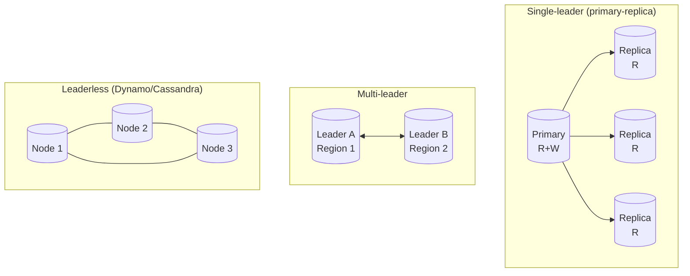
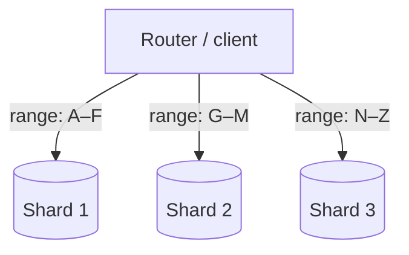
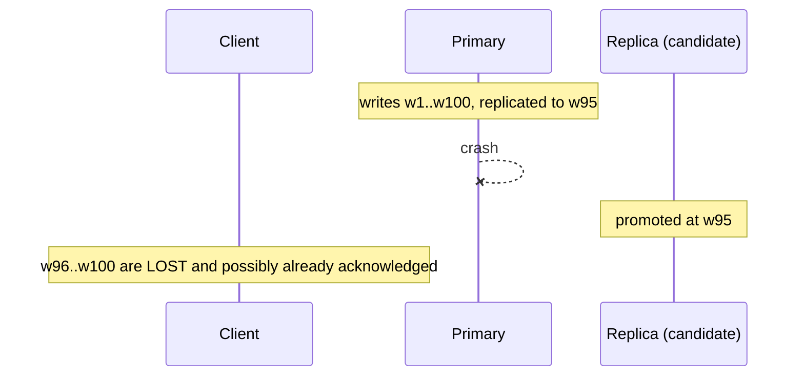

# Sharding, Replication & Consistency — Scaling the Data Layer

> **TL;DR** — When one machine cannot hold your data or serve your write load, you have exactly two moves: **replicate** (copy the same data to more machines — scales reads, buys availability, costs you consistency) and **shard** (split the data across machines — scales writes and storage, costs you cross-shard queries and rebalancing pain). Almost every hard data-layer question reduces to which of those you did, what key you chose, and what consistency guarantee you traded away. Replication gives you lag, failover windows, and split brain. Sharding gives you hot partitions, cross-shard joins, and the resharding project you did not plan for. The theory — CAP, PACELC, quorums, ACID vs BASE, idempotency — exists to let you reason about those trades instead of discovering them in production.

> **60-second interview answer:** "Vertical scaling buys time but has a ceiling, so I scale horizontally in two directions. Replication copies the same data to more nodes: read replicas scale reads and give me failover, at the cost of replication lag — so I need read-your-writes routing for the writer and I accept bounded staleness elsewhere. Sharding splits the data: I pick a shard key with high cardinality and even access distribution, ideally one that also appears in most query predicates, so most queries hit a single shard. I get writes and storage scaling, at the cost of cross-shard queries, distributed transactions, and rebalancing. For the consistency question, I would cite PACELC rather than just CAP — during a partition I choose availability or consistency, but the everyday trade is latency versus consistency, which is why quorums matter: with W plus R greater than N, a read set and a write set always overlap."

---

## 1. Definition & mental model

**Plain English.**
- **Replication** = the same data on more than one machine. Purpose: more read throughput, higher availability, lower read latency (put a copy near the user), disaster recovery.
- **Sharding** (a.k.a. horizontal partitioning / partitioning) = *different* data on different machines. Purpose: more write throughput, more storage, smaller indexes.
- **Consistency** = the rules about what a reader is allowed to see, given that writes propagate asynchronously.

**The analogy: a chain of public libraries.**

- **Vertical scaling** is making one library bigger — more floors, more shelves, a faster lifts. Works until the building cannot get taller, and the whole library closes if the lifts break.
- **Replication** is opening branch libraries with *identical* copies of every book. Now more people can read at once. But when a book is revised, the copies are updated by courier — so for a while one branch has the new edition and another has the old, and a reader who borrows from two branches sees the change happen backwards. That is replication lag and monotonicity violation.
- **Sharding** is splitting the collection by subject: all science books in one building, all history in another. Storage and shelving capacity scale forever. But a reader who wants "everything about the history of science" now has to visit two buildings — that is a cross-shard query — and if you later decide to split history into ancient and modern, you must physically move books while the library stays open — that is resharding.
- **The shard key** is the rule you split by. Choose "first letter of the author's surname" and every book by an author starting with S lands in one building — a **hot shard**.
- **Consistency** is the promise you make to the reader about whether they will see the new edition if they walk to another branch right now.

**The one-line version:** replication is about *how many copies*, sharding is about *which piece*, consistency is about *how wrong a reader is allowed to be*.

---

## 2. Why it exists — the problem it solves

### The two walls

**Wall 1 — reads.** A single database does ~5,000 simple reads/sec on good hardware. A social app needs 50,000. You cannot buy your way past that indefinitely, and adding a bigger box has a super-linear price curve and a hard ceiling.

**Wall 2 — writes and size.** Writes cannot be parallelised by replication, because every replica must apply every write. If your write load is 20,000/sec and one node does 5,000, replication does not help at all. And a table past a few hundred gigabytes makes indexes stop fitting in memory, at which point write throughput collapses — an index B-tree insert that misses RAM costs a random disk read.

### What breaks without this

| Symptom | Cause | Fix |
|---|---|---|
| Read QPS pins the primary's CPU | All reads on one node | **Read replicas** |
| Primary CPU pegged by writes, replicas idle | Write-bound | **Shard** |
| Table too big; index no longer fits RAM | Storage-bound | **Shard** (or partition) |
| A single node failure = full outage | No redundancy | **Replicate** (and automatic failover) |
| Users in Sydney see 250 ms latency on every query | Data is far away | **Geo-replicas** |
| A migration lock blocks production | Schema change on a huge table | **Shard**, then migrate shard by shard |
| Backup window exceeds the night | Data volume | **Shard**, back up per shard |

### The cost of each

Replication does not reduce write load, and it introduces lag, failover windows, and split brain. Sharding does not fix a bad query or a missing index, it multiplies operational surface (N shards × M replicas), and it makes cross-shard transactions your problem.

**The escalation ladder most teams actually follow:**

```
1. Add indexes, fix N+1 queries              → 10–100× on the same hardware
2. Add a cache in front of the database      → offload 80–95% of reads
3. Vertical scale the primary                → 2–4×
4. Add read replicas for read scaling        → 3–10× reads
5. Partition the biggest tables              → manageability, cheap wins
6. Shard                                      → 10–1000× writes and storage
7. Polyglot: move a workload to a different store (search, KV, OLAP)
```

Most interviews do not need step 6. Saying "I would shard first" when a cache and an index would do is a red flag; so is failing to shard when the write load demands it.

---

## 3. Internal mechanics — how it actually works

### 3.1 Replication: the topologies



| Topology | Writes | Reads | Conflict handling | Typical use |
|---|---|---|---|---|
| **Single-leader** | One node | Any replica | None needed | Default for Postgres/MySQL |
| **Multi-leader** | Several nodes | Any node | Last-write-wins, CRDTs, app logic | Multi-region active-active |
| **Leaderless / quorum** | Any node | Read from R of N | Version vectors, LWW | Dynamo, Cassandra, Riak |

### 3.2 Replication modes and what each costs you

| Mode | Primary waits for | Write latency | Data loss on primary failure | Throughput cost |
|---|---|---|---|---|
| **Synchronous** | All replicas ack | Highest (slowest replica sets the pace) | Zero | High — one slow replica stalls everything |
| **Semi-synchronous** | At least 1 replica ack | Medium | Zero if a sync replica survives | Medium |
| **Asynchronous** | Nobody | Lowest | **Up to the replication lag window** | Lowest |
| **Quorum (W of N)** | W acks | Tunable | Tunable by W | Tunable |

**MySQL semi-sync:** the primary waits for one replica to acknowledge receipt of the binlog event (not its application). `rpl_semi_sync_master_timeout` (default 10,000 ms) degrades to async if no replica acks in time — a silent consistency downgrade worth naming.

**Postgres:** `synchronous_standby_names = 'ANY 1 (r1, r2)'`, `synchronous_commit = on | remote_apply | local | off`. `remote_apply` is the strongest — the replica has *applied* the change, so a read there is guaranteed to see it.

**The critical distinction candidates miss:** acknowledging *receipt* of the WAL/binlog is not the same as having *applied* it. A replica that has received but not replayed a change will still serve the old value. If you need read-your-writes on a replica, you need `remote_apply` (or a log-sequence check on the read).

### 3.3 Replication lag: measuring it and reasoning about it

```sql
-- Postgres: how far behind is this replica, in bytes of WAL?
SELECT client_addr, state, sent_lsn, write_lsn, flush_lsn, replay_lsn,
       (sent_lsn - replay_lsn) AS replay_lag_bytes
FROM pg_stat_replication;

-- Postgres, from the replica: how many seconds behind?
SELECT now() - pg_last_xact_replay_timestamp() AS replay_age;
```

**Causes of lag, ranked:**
1. **A long-running read on the replica** holds a snapshot and blocks WAL replay of conflicting changes.
2. **A big transaction** on the primary (a bulk `UPDATE` of 5M rows) arrives as one huge record.
3. **A single-threaded SQL thread** (`slave_parallel_workers = 0`) cannot apply faster than the primary wrote.
4. **Network saturation** between primary and replica.
5. **Replica hardware inferior** to the primary.
6. **DDL** — a schema change replays serially and can stall everything.

**Consequences you must design around:**
- **Read-your-writes violation.** The user updates their profile and the next page load reads a replica → old data. Fix: route that user's reads to the primary for a few seconds, or check the replica's replay position against the write's LSN.
- **Monotonic read violation.** A user's reads hit different replicas with different lag and the value goes backwards in time.
- **Stale-replica cache repopulation** — the bug described in [Cache Invalidation](04-cache-invalidation-and-consistency.md) §3.4.
- **Failover data loss.** Async replication means the promoted replica may be missing the last N seconds of writes.

### 3.4 Sharding: the strategies



| Strategy | How | Pros | Cons |
|---|---|---|---|
| **Range** | `user_id < 1M` → shard 1 | Range scans are single-shard; simple | **Hot spots** on monotonic keys (auto-increment, timestamps) |
| **Hash** | `hash(key) mod N` | Even distribution | Range scans fan out; `mod N` breaks on resize |
| **Consistent hashing** | Ring + virtual nodes | Only `1/N` of keys move on resize | More complex; vnodes needed for balance |
| **Directory / lookup** | A table maps key → shard | Fully flexible; easy migration | The lookup table is a SPOF and a hot path; extra hop |
| **Geo** | Shard by region | Data residency, locality | Cross-region users; rebalancing if a region grows |
| **Composite** | `(tenant_id, hash(user_id))` | Tenant isolation + balance | Slightly more complex keys |
| **Time-based** | `logs_2026_09` | Cheap expiry (drop the partition) | Recency hot spot; every write hits the newest shard |
| **Entity-group** | Shard by `tenant_id` so a tenant's data is co-located | Single-shard transactions per tenant | Large tenants become hot shards |

**Virtual nodes, concretely:** with plain consistent hashing, 3 nodes over a ring can be wildly unbalanced (one node may own 60% of the ring). Fix: give each node 100–1,000 virtual positions on the ring. With 150 vnodes per node, the load imbalance drops to a few percent, and removing a node spreads its keys across all survivors rather than dumping them on one neighbour.

### 3.5 The shard key: the decision that determines everything

**Criteria, in priority order:**

1. **Cardinality** — must have far more distinct values than shards. Sharding by `country` (200 values) into 64 shards means shards with millions of rows and shards with none.
2. **Even access distribution** — not just even *storage*. A key can be balanced by row count and wildly unbalanced by QPS.
3. **Query alignment** — the key should appear in the `WHERE` clause of most queries, so most queries are single-shard. This is the single most important criterion and the one most often forgotten.
4. **Immutability** — if the key can change, changing it means moving the row between shards.
5. **No monotonicity** — an auto-increment ID or a timestamp routes all new writes to one shard (the "append-only hot spot").
6. **Co-location of related rows** — rows joined together should share a shard, so joins stay single-shard.

**Shard-key disasters:**

| Bad key | Why it fails |
|---|---|
| `created_at` | Every new write hits the newest shard; the rest idle |
| `auto_increment id` | Same append-only problem |
| `country` / `status` | Low cardinality → a few gigantic shards |
| `is_premium (bool)` | Two shards, one of them tiny and one enormous |
| `user_id` for a feed read by follower | A celebrity's followers span all shards — fan-out is cross-shard |
| `session_id` when queries are by `user_id` | Every query fans out to all shards |
| `tenant_id` with one whale tenant | One shard carries 40% of the load — the "celebrity" problem at company scale |

**The celebrity/hot-partition problem and its fixes:**
- **Split the hot key**: `celebrity_42` → `celebrity_42#0..celebrity_42#9`, with readers picking a suffix at random and aggregating. Writes must fan out to all suffixes.
- **Cache the hot entity** so reads never reach the shard ([see Caching](02-caching-strategies-and-layers.md)).
- **Two-level sharding**: shard by `(hash(key), key)` so a hot key can be split further.
- **Isolate the whale**: give a large tenant a dedicated shard or a dedicated database. Ugly, effective, common in B2B SaaS.
- **Precompute the aggregate**: maintain a counter instead of scanning the hot partition.

### 3.6 Rebalancing without downtime — the four-phase migration

This is the part most candidates cannot describe. Moving data while serving traffic:

```
Phase 1 — DUAL WRITE
  Writes go to BOTH the old shard and the new shard.
  Reads still come from the old shard. (New shard is a shadow.)

Phase 2 — BACKFILL
  A batch job copies historical rows from old → new,
  tracking the migration watermark. Rate-limit it to protect production.

Phase 3 — SHADOW READ / VERIFY
  Read from both, compare, log mismatches. Do not serve the new value yet.
  Verify row counts and checksums. This is where you catch bugs.

Phase 4 — CUT OVER (per key-range, not globally)
  Flip reads for a small key range. Watch error rates and latency.
  Then flip the range permanently and stop dual-writing it.
  Drain ranges gradually; the old shard serves fewer and fewer keys.

Phase 5 — DECOMMISSION
  After a soak period (days), drop the migrated data from the old shard.
```

**Rules:** cut over per key-range, never globally; keep the old shard as the fallback for a rollback window; make every step resumable and idempotent; and never run the backfill at full speed against a production primary.

**Consistent hashing versus modulo:** with `mod N`, going from 4 to 5 shards moves ~80% of keys. With consistent hashing and vnodes, going from 4 to 5 moves ~20%. With fixed logical shards (see below), you move only the shards you reassign.

**Fixed logical shards (the Vitess / Citus / DynamoDB trick):** do not shard into N physical nodes, shard into 4,096 logical shards and map logical → physical. Growing the cluster means reassigning logical shards, not rehashing keys. Splitting a hot logical shard means splitting *within* it (`-80..` → `-80a..`, `-80b..`). This makes the shard count a physical detail and the routing layer the only thing that changes.

### 3.7 Quorums: the arithmetic

With N replicas, W write acks required, R read replicas contacted:

```
W + R > N   →  the read set and the write set must overlap
              →  at least one read replica has the latest write
```

| N | W | R | Property |
|---|---|---|---|
| 3 | 2 | 2 | Balanced — tolerates 1 node down for both R and W |
| 3 | 3 | 1 | Read-optimised, write-fragile (any node down blocks writes) |
| 3 | 1 | 3 | Write-optimised, read-fragile |
| 5 | 3 | 3 | Tolerates 2 failures; the cross-region standard |
| 3 | 1 | 1 | Fast, effectively eventual |

**Important fine print:**
- `W + R > N` gives **strong consistency only under the assumption of a single write per key at a time**. Concurrent writes with LWW can still lose data.
- It does not give you **linearizability** by itself, because a write can be acknowledged and then lost if the W nodes that acked crash before propagating (Dynamo-style hinted handoff makes this unlikely but not impossible).
- **Sloppy quorums** (accepting writes on non-home nodes during a partition) improve availability but *break* the overlap guarantee. Say this if the topic comes up.
- Quorum reads cost the **slowest of R replicas** — so R=3 costs the p100 of three nodes. Lower R for latency, higher for confidence.

### 3.8 CAP, PACELC, and what they actually mean

**CAP:** under a network **P**artition you must choose **C**onsistency or **A**vailability. It says nothing about the 99.99% of the time there is no partition. It is widely misused — "we chose AP" does not describe a system without a partition.

**PACELC** is the useful version:

```
if Partition:  choose Availability or Consistency
else (E):      choose Latency or Consistency
```

| System | P → | E → | Meaning |
|---|---|---|---|
| **Postgres (sync replica)** | C | C | Blocks rather than diverge |
| **Postgres (async replica)** | A (reads stale) | L | Fast reads, lag |
| **DynamoDB** | A | L (eventually consistent reads) / C (strong reads at 2× cost) | Tunable per request |
| **Cassandra** | A | L (tunable by quorum) | Always available, tunable |
| **MongoDB (majority write concern + majority read)** | C | C | Blocks on lag |
| **Spanner** | C | C (with TrueTime wait) | Consistent, pays ~7 ms per commit |
| **Redis (async replica)** | A | L | Lag and loss window |

**The sentence to say:** "CAP is about partitions only. The everyday trade is PACELC's 'else' branch — whether I pay latency for consistency. In practice I choose per operation: strong consistency for money and inventory, eventual for feeds and counters."

### 3.9 ACID vs BASE and isolation levels

**ACID:** Atomicity (all or nothing), Consistency (constraints hold), Isolation (concurrent transactions do not interfere), Durability (committed survives a crash).

**BASE:** Basically Available, Soft state, Eventual consistency. A marketing term for "we traded isolation for availability."

**Isolation levels and the anomalies they permit:**

| Level | Dirty read | Non-repeatable read | Phantom read | Lost update | Write skew |
|---|---|---|---|---|---|
| **Read uncommitted** | Yes | Yes | Yes | Yes | Yes |
| **Read committed** (Postgres default) | No | Yes | Yes | Yes (prevented by row locks on UPDATE) | Yes |
| **Repeatable read** (MySQL default; Postgres = snapshot isolation) | No | No | **No in Postgres** / Yes in MySQL (gap locks prevent it) | No | **Yes** |
| **Serializable** | No | No | No | No | No (via SSI) |

**Write skew, the anomaly most candidates cannot describe:** two transactions each read a condition, and each writes based on what they read, and the combination violates an invariant that neither violated alone. Classic example: two doctors on call, both check "is another doctor on call?" → both see yes → both go off call → now nobody is on call. Snapshot isolation permits this; only serializable prevents it.

**Two-phase commit (2PC)** is a blocking consensus protocol: a coordinator asks all participants to prepare, all say yes, then all commit. If the coordinator dies after prepare, participants hold locks indefinitely. It is correct but operationally fragile, and it does not survive a coordinator crash without a recovery log. This is why microservices prefer **Sagas**.

### 3.10 Sagas: distributed transactions without 2PC

A saga breaks a distributed transaction into local steps with **compensating actions** for rollback:

```
BookSeat:   reserve seat      → compensate: release seat
PaySeat:    charge card       → compensate: refund
IssueTicket: create ticket    → compensate: void ticket

Failure at PaySeat → run BookSeat's compensation (release the seat)
```

| Saga style | How | Trade-off |
|---|---|---|
| **Orchestration** | A central orchestrator drives the steps | Visibility, easy to reason about; the orchestrator is a new component |
| **Choreography** | Each service emits an event that triggers the next | No central point; harder to see the overall state |

**Sagas give you ACD (Atomicity, Consistency, Durability) but not Isolation** — intermediate states are visible to other readers. So every step must be designed to be tolerable in isolation: a seat *held* but not paid is a legitimate, visible state with a timeout. This is exactly why [BookMyShow](../../Case-Studies/HLD/07-bookmyshow-seat-booking.md) uses seat holds with expiry rather than a distributed lock.

### 3.11 Idempotency and delivery semantics

```
at-most-once   →  send and forget. Possible loss, no duplicates.
at-least-once  →  retry until acked. No loss, possible duplicates.
exactly-once   →  at-least-once delivery + idempotent processing.
```

True exactly-once *delivery* over a network is impossible (the two-generals problem). What you build is **at-least-once delivery plus idempotent handling**, and that is what "exactly-once semantics" means in Kafka and Flink.

**Idempotency keys, the production pattern:**

```http
POST /v1/payments
Idempotency-Key: 7f3c1a2b-...        ← client-generated UUID

→ server: SET idem:7f3c1a2b {status: in_progress} NX EX 86400
   if the key already exists:
       • in_progress → return 409 Conflict (or 425 Too Early)
       • completed   → return the stored original response, byte-for-byte
```

Rules: the key must come from the client; store the **response**, not just a flag, so retries return the same body; set a TTL (24 h is typical); scope the key to the operation and the account (`idem:{account}:{key}`) so one tenant cannot collide with another; and make the key-check and the state change atomic (the same transaction or a Lua script).

### 3.12 Distributed ID generation

| Scheme | Size | Ordered | Notes |
|---|---|---|---|
| **Auto-increment** | 8 B | Yes | Requires a single writer — unusable across shards |
| **UUIDv4** | 16 B | No | Random; index-unfriendly (random inserts into a B-tree) |
| **Snowflake** | 8 B | Yes | `41b timestamp | 10b machine | 12b sequence` — 4,096 ids/ms/machine, ~69 years |
| **ULID** | 16 B | Yes | 48-bit timestamp + 80-bit randomness, lexicographically sortable |
| **UUIDv7** | 16 B | Yes | Timestamp-prefixed UUID; the modern default |
| **Ticket server** | 8 B | Yes | Flickr-style; a SPOF unless there are odd/even pairs |
| **Segment/range allocation** | 8 B | Yes | Each node claims a range of 1,000 ids; batch, no per-id round trip |

**Why ordered matters:** a random UUID primary key inserts at random positions in the B-tree, causing page splits and poor cache locality — writes can be 2–5× slower than a sequential key. Snowflake, ULID, and UUIDv7 fix this by putting time first. **The clock-skew trap:** Snowflake assumes monotonic clocks. An NTP step backwards can produce duplicate IDs, so implementations refuse to generate while `now < last_timestamp` and wait it out. Say that and you look like you have run it.

---

## 4. Variants & taxonomy

| Variant | Description |
|---|---|
| **Single-leader replication** | One writer, many readers; the default |
| **Multi-leader** | Writes in several regions; conflicts resolved by LWW/CRDT |
| **Leaderless / quorum** | Any node reads or writes; R/W quorums |
| **Synchronous replication** | Zero loss, highest latency |
| **Semi-synchronous** | At least one ack; degrades to async on timeout |
| **Asynchronous replication** | Fastest; a loss window on failover |
| **Cascading replication** | Replicas replicate from replicas, offloading the primary |
| **Logical replication** | Replicate selected tables/rows; the basis of CDC |
| **Physical replication** | Byte-for-byte WAL streaming; the whole cluster |
| **Chain replication** | A pipeline of replicas; strong consistency with high throughput |
| **Range sharding** | Contiguous key ranges; good for scans |
| **Hash sharding** | Even distribution; fan-out scans |
| **Consistent hashing + vnodes** | Minimal key movement on resize |
| **Directory-based sharding** | A lookup service maps key → shard |
| **Geo sharding** | Shard by region for residency and latency |
| **Fixed logical shards** | 4,096 logical units mapped to physical nodes (Vitess, DynamoDB) |
| **Table partitioning** | Splitting one table into partitions *within* a node — cheaper than sharding |
| **Read replicas + routing** | Replica selection, lag-aware or read-your-writes |
| **2PC** | Blocking distributed commit |
| **Saga** | Compensating-action workflow |
| **CRDT** | Conflict-free replicated data types; convergent by construction |

---

## 5. Pros / Cons

| Approach | Pros | Cons |
|---|---|---|
| **Vertical scaling** | Nothing changes in the app; no distributed bugs | Ceiling; super-linear cost; still a SPOF |
| **Read replicas** | Scales reads 3–10×; failover; geo-locality | Lag; read-your-writes problems; does nothing for writes |
| **Sync replication** | No data loss | Latency; one slow replica stalls the primary |
| **Async replication** | Fast writes | Loss window; stale reads |
| **Multi-leader** | Low-latency writes everywhere | Conflict resolution is application work |
| **Quorum** | Tunable | Sloppy quorums break the guarantee; R reads cost the slowest |
| **Range sharding** | Scans are single-shard | Hot spots on monotonic keys |
| **Hash sharding** | Even | Every scan fans out; `mod N` breaks on resize |
| **Consistent hashing** | Minimal movement | Complexity; vnodes required for balance |
| **Directory sharding** | Total flexibility | Lookup is a SPOF and a hot path |
| **Sharding generally** | Writes and storage scale | Cross-shard joins and transactions; N× ops; resharding projects |
| **2PC** | Correct distributed commit | Blocking; coordinator SPOF |
| **Sagas** | No blocking; works across services | No isolation; compensating actions are real code |
| **Exactly-once semantics** | No duplicates for the consumer | Requires idempotent handling; never truly "once" on the wire |

---

## 6. Exceptions, edge cases & failure modes

### 6.1 Split brain

Two nodes both believe they are the primary — usually after a network partition where each side promoted a leader, or after a fencing failure. Both accept writes. When the partition heals, the two histories are irreconcilable.

**Fixes:**
1. **Fencing tokens** — every leader takes a monotonically increasing token from a consensus store (etcd/ZooKeeper); storage rejects writes with a stale token. This is the correct fix.
2. **STONITH** — shoot the other node in the head; the old primary is forcibly powered off before promotion.
3. **Quorum-based leader election** — a leader needs a majority, so two leaders cannot coexist in one partition.
4. **`min-replicas-to-write`** in Redis, `synchronous_standby_names` in Postgres — refuse writes when you cannot confirm you are the real leader.
5. **Witness/arbiter nodes** in a two-node cluster, to make majorities possible.

**Detection is the hard part**: both sides think they are healthy. The metric to watch is divergent write counts per node, or a fencing-token rejection rate.

### 6.2 Failover: the data-loss window and the thundering herd



- **The loss window** equals the replication lag at the moment of failure. With async replication and 2 s of lag, 2 seconds of acknowledged writes vanish. Report this number; do not say "async is fine".
- **Split brain on failover** if the old primary returns and still thinks it is primary.
- **Thundering herd on promotion:** every connection in the pool reconnects to the new primary at once. With 500 app instances × 20 connections, that is 10,000 connection attempts. Fix: exponential backoff with jitter on reconnect, a connection proxy (PgBouncer) that absorbs the storm, and a DNS/hostname that does not need every client to re-resolve at the same instant.
- **Failover takes time:** detection (5–30 s) + election (1–10 s) + promotion + client reconnection + connection pool refill. Budget 30–60 s of degraded service, and make sure your timeouts and retries survive it.
- **Replica promotion may need to replay** pending WAL first — a replica promoted while 500 MB behind is unavailable for that duration.

### 6.3 Hot shards / hot partitions

Covered in §3.5. Additional production notes:
- **Detect it:** per-shard QPS, per-shard CPU, and per-partition write rate in DynamoDB/Cassandra. A single shard at 100% while others idle is the signature.
- **DynamoDB specifics:** a partition supports ~1,000 WCU and ~3,000 RCU, and 10 GB. Exceeding it produces `ProvisionedThroughputExceededException` even if your table-level capacity looks fine.
- **Cassandra specifics:** a partition over 100 MB or 100,000 rows is a smell; over 1 GB is a problem.
- **The celebrity write problem is worse than the read problem** — reads can be cached, but every write must reach the shard.

### 6.4 Cross-shard queries and distributed transactions

- **A query without the shard key** fans out to all shards and merges — `SELECT * FROM orders WHERE status='pending'` on 64 shards is 64 queries plus a merge, with no global `ORDER BY` or `LIMIT` pushdown (you must fetch `LIMIT × shards` and re-sort).
- **`COUNT(*)`** becomes 64 counts and a sum; **`OFFSET` pagination** becomes meaningless — use keyset/cursor pagination instead.
- **JOINs across shards** require an application-level join or a denormalised copy.
- **Distributed transactions** require 2PC or a Saga, as above.
- **Uniqueness constraints** no longer work: a `UNIQUE(email)` constraint cannot span shards. Solutions: a dedicated index shard keyed by the unique field, or a "uniqueness service" that reserves the value first. This surprises people who have only used a single node.

### 6.5 Resharding disasters

- **Resharding under peak load** — the backfill competes with production for IO and replication bandwidth. Rate-limit it (`pg_dump` with throttling, or a bounded worker pool) and expect it to take days for large datasets.
- **A non-idempotent backfill** that double-inserts on retry. Every step must be safely re-runnable.
- **Cutover without a rollback plan.** Always keep the old shard readable until the soak period ends.
- **Sequences and auto-increment collisions** after resharding: two shards both generate id 500,000. Use Snowflake/ULID before you shard, not after.
- **Forgetting the secondary indexes and derived stores** — the search index and the analytics warehouse need resharding too.

### 6.6 Replication lag: the specific consequences

- **Read-your-writes** breaks. Fix: primary routing for the writer, or LSN-checked reads.
- **Cache repopulation with stale data** ([see Cache Invalidation](04-cache-invalidation-and-consistency.md) §3.4).
- **A read replica used for reporting slows replay** — a long analytics query on a replica can stall it for minutes. Use a dedicated replica for reporting, and set `max_standby_streaming_delay` to bound how long replay is blocked before conflicting queries are cancelled.
- **Replica promotion with unreplayed WAL** means a longer outage.
- **Cascading replication** amplifies lag (each hop adds latency) but offloads the primary. Watch the chain's deepest node.

### 6.7 Clock skew

- **Snowflake IDs** duplicate or go backwards on an NTP step.
- **LWW conflict resolution** picks the wrong winner because "last" was decided by a skewed clock.
- **TTL expiry** in a cache written by one node and read by another is inconsistent.
- **Distributed locks** expire early or late.
- **Fix:** never trust wall clocks for ordering. Use logical clocks (Lamport, version vectors), or a monotonic clock for durations, and treat wall-clock timestamps as *metadata* rather than as truth. Spanner's TrueTime is the industrial answer — bounded uncertainty plus a deliberate wait.

### 6.8 Lost updates and write skew

- **Lost update:** two transactions read a counter, both increment, both write — one increment vanishes. Fix: `UPDATE ... SET n = n + 1` (atomic in the database), or optimistic concurrency with a version column (`WHERE version = 5` and check `rows_affected`), or a row lock.
- **Write skew:** described in §3.9 — needs serializable isolation or an explicit constraint.
- **The optimistic-concurrency retry loop** must have a bounded retry count and jitter, or it becomes a retry storm under contention.

### 6.9 Sloppy quorums and hinted handoff

To stay available during a partition, Dynamo-style systems accept writes on nodes that are not the home replicas for a key, storing a "hint" to deliver later. Availability improves; the `W + R > N` overlap guarantee is void during that window — a quorum read can miss the write entirely. **Name this trade-off if quorums come up.** It is exactly the kind of detail that separates a top answer.

### 6.10 Other failure modes worth naming

- **Connection pool exhaustion** — every instance holds N connections; 500 instances × 20 = 10,000 connections against a database that handles 500. Fix: PgBouncer in transaction pooling mode, or a smaller pool per instance.
- **The unbounded `IN` query** — a fan-out that grows with data (all followers of a celebrity) becomes a query that never returns. Bound it and paginate.
- **Migration locks** — `ALTER TABLE` on a 500M-row table takes a lock; use `pt-online-schema-change`/`gh-ost` in MySQL or `ALTER TABLE ... ADD COLUMN` without a default rewrite in modern Postgres.
- **Replica reads that are not actually read-only** — a misconfigured replica accepting writes diverges silently and fails on promotion.
- **The "one big table" anti-pattern** — sharding a table that actually needed partitioning or an archive strategy. Partitioning within a node is far cheaper than sharding; exhaust it first.
- **Cross-region synchronous replication** — a 150 ms RTT makes every write 150+ ms. Cross-region is async or quorum, never sync to a single remote replica.
- **Failover tests that never happen** — an untested failover is not a failover, it is a hope. Game-day it, and measure the actual recovery time.
- **`SELECT ... FOR UPDATE` without a timeout** — a lock wait that never ends becomes a connection pile-up and a full outage. Set `lock_timeout` and `statement_timeout`.

---

## 7. When to use / When NOT to use

### Replicate when
- Reads dominate and you need more read throughput.
- You need availability through a node failure.
- You need a copy for backups, analytics, or disaster recovery.
- You need data physically near users.

### Shard when
- **Writes** exceed what one node can handle (replication cannot help).
- Data size exceeds what one node can store or index comfortably (rule of thumb: past ~1–2 TB, or when the working set no longer fits in RAM).
- You need to spread load across regions or tenants for isolation.
- Backups, migrations, or maintenance windows are unmanageable on one node.

### Do NOT shard when
- A cache would absorb the read load — cache first, always.
- A missing index or a bad query is the real problem.
- Partitioning within a single node would do (cheaper, no application changes).
- The team cannot operate N shards × M replicas — sharding without operational maturity is worse than a big box.
- The workload has no good shard key. A bad key is worse than no sharding.

### Decision table

| Situation | Answer |
|---|---|
| Read QPS 10× the DB's capacity | Cache first; then read replicas |
| Write QPS 4× the DB's capacity | **Shard** — replicas do not help |
| Table is 3 TB, indexes no longer fit RAM | Shard (or partition + archive) |
| 40% of reads are the same 1% of rows | Cache + replica; not a sharding problem |
| Users need read-your-writes | Route to primary briefly; LSN checks |
| Multi-region, low-latency local reads | Async geo-replicas + bounded staleness |
| Multi-region, correct local writes | Multi-leader with conflict handling, or a home region per key |
| Money transfer | Single-shard transaction where possible; otherwise 2PC or a Saga with idempotency keys |
| Cross-shard reporting | Stream to an OLAP store (Kafka → warehouse), do not query the shards |
| Celebrity user's feed | Fan-out on read + cache; do not fan out on write to all shards |
| Unique email across all users | Dedicated uniqueness index shard or a reservation service |
| Global ordering of events | Single partition for the ordering scope (Kafka partition), or a logical clock |
| Tenant isolation requirement | Shard by `tenant_id`; isolate whales on dedicated shards |

---

## 8. Numbers, defaults & tuning

| Quantity | Typical | Reasoning |
|---|---|---|
| Single-node simple read throughput | 5,000–15,000 QPS | The number behind "why cache" |
| Single-node write throughput | 1,000–5,000 TPS | Depends on fsync policy |
| Shard-count starting point | 2–4× your current need | Room to grow without resharding |
| Fixed logical shards | 1,024–4,096 | Reassignment instead of rehashing |
| Virtual nodes per node | 100–1,000 (150 common) | Balances the ring to a few percent |
| Replication lag alert | > 5 s p99 | 100 ms is normal, 5 s is an incident |
| `max_standby_streaming_delay` | 30 s | Bounds how long replay is blocked by a query |
| MySQL `rpl_semi_sync_master_timeout` | 10,000 ms | Silent downgrade to async after this |
| Postgres `synchronous_standby_names` | `ANY 1 (r1, r2)` | Semi-sync |
| Quorum (cross-region) | N=5, W=3, R=3 | Tolerates 2 node failures |
| Failover detection (Patroni/etcd) | 5–30 s | Budget it in the SLA |
| Total failover time | 30–60 s incl. client reconnect | The number to promise |
| Connection pool per instance | 5–20 | 500 instances × 20 = 10,000 conns — use PgBouncer |
| PgBouncer default pool | `default_pool_size=20` | Per database/user pair |
| DynamoDB partition limits | ~1,000 WCU, ~3,000 RCU, 10 GB | Per partition, not per table |
| Cassandra partition size | < 100 MB, < 100k rows | Bigger means unbounded scans and GC pressure |
| Cassandra `gc_grace_seconds` | 864,000 (10 days) | Tombstone lifetime |
| Cassandra compaction | STCS default; LCS for read-heavy | Compaction is the write-amplification source |
| Snowflake ID | 41b ts + 10b machine + 12b seq | 4,096 ids/ms/machine, ~69 years |
| ULID / UUIDv7 | 16 bytes, time-ordered | Sortable, index-friendly |
| Idempotency key TTL | 24 h | Long enough for client retries |
| Optimistic-concurrency retries | 3–5 with jitter | Unbounded retries are a retry storm |
| Shard backfill rate | ≤ 10% of spare IO | Never compete with production |
| Cutover batch size | One key range at a time | Rollback granularity |
| Postgres `lock_timeout` | 1–5 s | Prevents lock pile-ups |
| Postgres `statement_timeout` | 30 s (OLTP) | Prevents runaway queries |
| Spanner TrueTime commit wait | ~7 ms | The price of external consistency |
| `max_connections` (Postgres) | 100–500 | Every connection costs ~10 MB |
| Sharding threshold | ~1–2 TB per node, or indexes > RAM | The practical trigger |

---

## 9. Interview Q&A

**Q1 (easy). What is the difference between replication and sharding?**
Replication puts the *same* data on multiple machines; sharding puts *different* data on different machines. Replication scales reads and gives you availability, but every replica still applies every write, so it does nothing for write throughput. Sharding scales writes and storage, because each node only handles its share. Replication gives you lag and failover problems; sharding gives you cross-shard queries, hot partitions, and rebalancing. Most systems do both: shard for write scale, then replicate each shard for read scale and availability.

**Q2 (easy). Why do read replicas not help with write-heavy workloads?**
Because every write must be applied to every replica. Adding replicas multiplies the number of places a write has to go, so at best it is neutral and at worst it adds replication overhead. If your bottleneck is write throughput, the only solutions are sharding, a faster storage engine, or batching and removing write amplification — not more replicas.

**Q3 (easy). What is replication lag and what breaks because of it?**
It is the delay between a write committing on the primary and appearing on a replica — normally milliseconds, sometimes seconds or minutes when a replica is overloaded. It breaks read-your-writes, so a user updates their profile and the next request shows the old value. It breaks monotonic reads, so a user's value goes backwards. And it can permanently poison a cache, because a read from a lagging replica repopulates the cache with stale data that nothing will invalidate. I handle it with primary routing for a writer's own reads for a few seconds, by checking the replica's replay position against the write's log sequence number, and by using a cache invalidation path that cannot race the replica read.

**Q4 (medium). How do you pick a shard key?**
I look for high cardinality, even access distribution — not just even storage — and, most importantly, a key that appears in the `WHERE` clause of most queries so they stay single-shard. It should be immutable, because changing it means moving the row, and it should not be monotonic, because an auto-increment ID or a timestamp routes every new write to one shard. If related rows are joined together, they should share a shard so the joins stay local. Then I list the queries that will not have the key and decide whether I can tolerate the fan-out or need a secondary index shard.

**Q5 (medium). Explain CAP and PACELC.**
CAP says that during a network partition you must choose consistency or availability — it says nothing about the normal case, which is why it is so often misused. PACELC extends it: during a Partition choose Availability or Consistency, Else, when there is no partition, choose Latency or Consistency. The second half is the part that describes everyday life — a synchronous replica costs write latency, an eventually consistent read saves it. In practice I choose per operation rather than per system: strong consistency for payments and inventory, eventual consistency for feeds and counters, and I state which one applies to which.

**Q6 (medium). What is the quorum formula and what does it actually guarantee?**
With N replicas, requiring W acknowledgements for a write and contacting R replicas for a read, `W + R > N` guarantees the read set and the write set overlap, so a read will see the latest acknowledged write. With N=3, W=2, R=2, that holds and I can tolerate one node down for both reads and writes. The fine print matters: it assumes one write per key at a time, it does not give linearizability, and sloppy quorums — where a partition lets writes land on non-home nodes — break the overlap guarantee entirely.

**Q7 (medium). How do you rebalance shards without downtime?**
Four phases. Dual-write to the old and new shards while reads still come from the old one, so the new shard is a shadow. Backfill historical data with a throttled, resumable, idempotent job. Shadow-read and compare to verify, without serving the new values. Then cut over reads per key range, not globally, with the old shard kept as a rollback path for a soak period before decommissioning. The two rules that make it work are per-range cutover so a rollback is granular, and never running the backfill at full speed against a production primary.

**Q8 (medium). What is a hot shard and how do you fix it?**
A shard receiving a disproportionate share of traffic — usually from a monotonic key, a low-cardinality key, or one enormous tenant. You detect it with per-shard QPS and CPU metrics: one shard at 100% while the rest idle. Fixes depend on the cause: split the hot key into suffixes and have readers pick one at random, cache the hot entity so reads never reach the shard, isolate the whale on a dedicated shard or database, precompute the aggregate instead of scanning, or shard on a composite key that includes a hash so a single logical key can be spread.

**Q9 (hard). Explain exactly-once semantics.**
Exactly-once *delivery* over a network is impossible — the two-generals problem means you can always lose the final acknowledgement. What systems call exactly-once is at-least-once delivery combined with idempotent or transactional processing, so duplicates are received but have no additional effect. Concretely, that means an idempotency key from the client, stored with the original response and a TTL, and the key-check plus the state change in the same atomic step. Kafka's transactional producer and Flink's checkpointing are the same idea — at-least-once delivery plus deduplication and atomic output commits.

**Q10 (hard, testing §6). Your primary fails and you promote a replica. What can go wrong?**
Four things. First, data loss — with asynchronous replication the promoted replica may be missing writes that were already acknowledged to clients, and the size of that window is the replication lag at the moment of failure, so I would report that number rather than say "async is fine". Second, split brain — if the old primary comes back and still believes it is primary, both accept writes, and the fix is fencing tokens from a consensus store plus STONITH, not hope. Third, a connection thundering herd, because every instance's pool reconnects at once — with 500 instances and 20 connections that is 10,000 attempts, so I need jittered backoff and ideally a connection proxy. Fourth, the promotion itself takes time — detection, election, possibly replaying pending WAL — so I budget thirty to sixty seconds of degraded service in the SLA, and I test the failover in a game day rather than discovering the timing in an incident.

**Q11 (hard, testing §6). Two users on different shards both need a unique username. How?**
A `UNIQUE` constraint cannot span shards, which is the class of problem sharding introduces that people do not expect. I would add a dedicated uniqueness service — a small, strongly consistent store keyed by the unique value, with a conditional put so only one reservation succeeds. The registration flow reserves the username there first, then writes the user row on the appropriate shard. If the second step fails, the reservation expires by TTL. Alternatively I could shard usernames themselves by hash and look them up first, which is the same idea with the index colocated. Either way the point is that uniqueness needs its own global authority once you shard, and I would say that explicitly rather than implying the database just handles it.

**Q12 (hard, testing §6). What is write skew and why does snapshot isolation not prevent it?**
Write skew is when two transactions each read a condition, each decide they are safe, and each write — and the combination breaks an invariant neither broke alone. The classic example is two doctors on call who each check "is another doctor on call?", both see yes, and both go off call, leaving nobody on call. Snapshot isolation gives each transaction a consistent snapshot, but the two snapshots are taken at different times and neither sees the other's write, so there is no write-write conflict for the isolation mechanism to detect. Only serializable isolation — in Postgres, serializable snapshot isolation with predicate locks — or an explicit materialised conflict prevents it.

**Q13 (hard). How would you run a distributed transaction across services?**
Not with two-phase commit if I can avoid it, because it blocks and has a coordinator single point of failure. I would use a saga: a sequence of local transactions with compensating actions for rollback — reserve the seat, charge the card, issue the ticket, and if the charge fails, release the seat. The critical property to state is that sagas give atomicity, consistency and durability but **not isolation**: intermediate states are visible, so every step has to be a legitimate state on its own. That is why a held seat has a timeout and a visible "pending" status rather than being hidden behind a lock. On top of that, every step takes an idempotency key so retries are safe.

**Q14 (hard). What is the practical escalation ladder from a single database to a sharded one?**
Indexes and query fixes first, which are usually worth ten to a hundred times on the same hardware. Then a cache, which offloads eighty to ninety-five percent of reads. Then vertical scaling for a quick two to four times. Then read replicas for read scaling. Then partitioning the largest tables, which is far cheaper than sharding and requires no application routing. Only then sharding, and only when writes or storage genuinely exceed one node. And the last step is polyglot persistence — moving a specific workload to a different store, like search to OpenSearch or analytics to a columnar warehouse. Most interviews do not need the sharding step, and saying you would shard without exhausting the earlier ones is a common mistake.

**Q15 (hard). How do you generate IDs across shards?**
Time-ordered identifiers, because a random UUID primary key inserts at random positions in a B-tree and causes page splits and poor cache locality — writes can be two to five times slower. Snowflake is the classic: 41 bits of timestamp, 10 bits of machine, 12 bits of sequence, giving 4,096 IDs per millisecond per machine for about 69 years. ULID and UUIDv7 are the modern equivalents that keep the time prefix and stay sortable. The trap to name is clock skew — Snowflake assumes monotonic clocks, and an NTP step backwards produces duplicates, so implementations refuse to generate while the clock is behind and wait it out. And I would choose this before sharding, not after, because otherwise two shards both generate the same auto-increment ID.

---

## 10. Common mistakes candidates make

1. **Saying "I'll shard" before considering a cache or an index.** The escalation ladder exists; walk it.
2. **Confusing replication with sharding** in the write-scaling answer.
3. **Claiming async replication has no data-loss window.** It does; quantify it.
4. **Ignoring replication lag entirely** — no read-your-writes story, no stale-cache story.
5. **Picking a shard key without checking query alignment**, so every query fans out.
6. **Choosing an auto-increment or timestamp shard key** and creating an append-only hot shard.
7. **Never mentioning the celebrity/hot-partition problem** for feeds and multi-tenant systems.
8. **Describing a resharding plan that involves downtime** or a global cutover.
9. **Forgetting that `UNIQUE` constraints and cross-shard joins stop working.**
10. **Quoting CAP and stopping there** — PACELC's latency/consistency branch is the everyday trade.
11. **Using "eventually consistent" without a bound.** Say the number of seconds.
12. **Assuming exactly-once delivery exists on the wire.**
13. **Missing idempotency keys** when describing retries or payment flows.
14. **Not mentioning split brain or fencing tokens** when describing failover.
15. **Treating distributed transactions as free** — 2PC blocks, and sagas have no isolation.

---

## 11. Cheat-sheet summary

| Concept | One-line truth |
|---|---|
| Replication | Same data, more machines — scales reads, not writes |
| Sharding | Different data, different machines — scales writes and storage |
| Vertical scaling | The first move; a hard ceiling and a SPOF |
| Sync replication | No loss, highest latency, one slow replica stalls the primary |
| Semi-sync | At least one ack; degrades to async on timeout (MySQL default 10 s) |
| Async replication | Fast; loss window = the lag at failure |
| Replication lag | Breaks read-your-writes, monotonic reads, and cache correctness |
| Single-leader | The default; one writer, many readers |
| Multi-leader | Multi-region writes; conflicts become application work |
| Leaderless | Any node; R/W quorums; version vectors |
| Quorum | `W + R > N` ⇒ overlap; not linearizability; sloppy quorums break it |
| CAP | During a partition: C or A. Says nothing about the normal case |
| PACELC | Partition → A or C; **Else** → Latency or Consistency |
| ACID vs BASE | Constraints and isolation vs availability and convergence |
| Write skew | Snapshot isolation permits it; only serializable prevents it |
| Lost update | Fix with `SET n = n + 1`, optimistic versioning, or a lock |
| 2PC | Blocking; coordinator SPOF; needs a recovery log |
| Saga | Compensating actions; ACD but **not isolation** |
| Idempotency key | Client-generated; store the *response*; TTL 24 h; atomic check |
| Exactly-once | At-least-once delivery + idempotent processing |
| Shard key criteria | Cardinality, even *access*, query alignment, immutability, no monotonicity |
| Hash sharding | Even, but scans fan out and `mod N` breaks on resize |
| Range sharding | Scans are local; monotonic keys create hot shards |
| Consistent hashing | `1/N` movement on resize; vnodes (100–1,000) for balance |
| Directory sharding | Flexible; the lookup is a SPOF and a hot path |
| Fixed logical shards | 1,024–4,096 logical → physical; reassign instead of rehash |
| Hot shard | One shard at 100%, rest idle; split, cache, isolate the whale |
| Resharding | Dual-write → backfill → shadow-read → per-range cutover → decommission |
| Uniqueness across shards | Needs its own global authority |
| Snowflake | 41b ts + 10b machine + 12b seq; 4,096/ms/machine; clock skew waits |
| UUIDv7 / ULID | Time-ordered 16-byte IDs; index-friendly |
| Random UUID PK | Page splits and poor locality; 2–5× slower writes |
| Split brain | Two primaries; fix with fencing tokens, quorum election, STONITH |
| Failover | 30–60 s including client reconnect; test it |
| Connection storm | 500 instances × 20 conns = 10,000; use PgBouncer + jittered backoff |
| DynamoDB partition | ~1,000 WCU, ~3,000 RCU, 10 GB per partition |
| Cassandra partition | Keep under 100 MB / 100k rows |
| Clock skew | Never order by wall clock; use logical clocks or TrueTime |
| Lock timeout | Always set `lock_timeout`; an unbounded wait is an outage |

**"If the interviewer says X → answer Y"**

| Interviewer says | You say |
|---|---|
| "Reads are too slow" | "Cache first, then read replicas, then look at the query plan" |
| "Writes are too slow" | "Replicas do not help — shard, batch, or remove write amplification" |
| "How do you scale the DB?" | Walk the ladder: index → cache → vertical → replicas → partition → shard → polyglot |
| "What consistency do you need?" | "Per operation — quorum/RYW for money, eventual with a bound for feeds" |
| "What about a network partition?" | "CAP applies only then; PACELC's else-branch is the everyday latency/consistency trade" |
| "Pick a shard key" | "Cardinality, even access, query alignment, immutability, no monotonicity" |
| "A celebrity user breaks it" | "Fan-out on read plus a cache; split the hot key if writes are the problem" |
| "What if the primary dies?" | "Loss window = lag; fencing tokens against split brain; jittered reconnect; 30–60 s" |
| "How do you rebalance?" | "Dual-write, backfill, shadow-read, per-range cutover, decommission after a soak" |
| "Do you need a distributed transaction?" | "Prefer a saga with compensations; 2PC blocks and has a coordinator SPOF" |
| "Retries?" | "Idempotency keys, exponential backoff with jitter, a DLQ, and bounded attempts" |
| "Generate IDs across shards" | "Snowflake or UUIDv7 — time-prefixed; and note the clock-skew guard" |

---

## 12. Cross-links

- [Cache Invalidation and Consistency](04-cache-invalidation-and-consistency.md) — the replica race, CDC, and stale repopulation
- [Caching Strategies and Layers](02-caching-strategies-and-layers.md) — why you cache before you shard
- [Redis Deep Dive](03-redis-deep-dive.md) — Cluster slots, `WAIT`, failover loss, distributed locks
- [Load Balancers](01-load-balancers.md) — consistent hashing, health checks, connection draining
- [SQL Deep Dive](../04-data/01-sql-deep-dive.md) — indexes, MVCC, isolation levels, PgBouncer
- [NoSQL Deep Dive](../04-data/02-nosql-deep-dive.md) — DynamoDB partition keys, Cassandra tombstones, tunable consistency
- [Vector Databases](../04-data/03-vector-databases.md) — sharding and replication for embedding indexes
- [Choosing a Database](../04-data/05-choosing-a-database-decision-guide.md) — the decision framework this file feeds
- [Uber Ride Hailing](../../Case-Studies/HLD/06-uber-ride-hailing.md) — geo sharding, hot partitions, trip state machine
- [BookMyShow Seat Booking](../../Case-Studies/HLD/07-bookmyshow-seat-booking.md) — saga, seat holds, double-booking prevention
- [API Gateway and Rate Limiting](../02-networking/04-api-gateway-and-rate-limiting.md) — distributed counters and idempotent gateways
- [Scaling, Caching and DB Cheatsheet](../../Cheat-Sheets/03-scaling-caching-db-cheatsheet.md)
