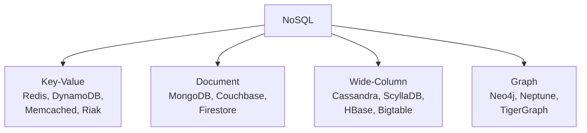

# NoSQL Deep Dive — Four Families, One Trade

> **TL;DR** — "NoSQL" is not a technology, it is a trade: you give up joins, multi-row transactions, and a schema enforced by the database, and in exchange you get horizontal write scaling, a flexible shape per record, and a data model designed around a single access pattern. There are four families and you must name them precisely: **key-value** (Redis, DynamoDB), **document** (MongoDB, Couchbase), **wide-column** (Cassandra, HBase, ScyllaDB), and **graph** (Neo4j, Neptune). The single most important design decision in all of them is the **partition key** — it determines whether your workload spreads evenly or lands on one hot node, and it determines whether your query is a lookup or a full-cluster scatter-gather. The second most important is what consistency you ask for: most of these systems are tunable per request, and "eventually consistent" without a bound is not an answer.

> **60-second interview answer:** "I choose NoSQL when I have a known access pattern at a scale a single relational node cannot take — typically very high write throughput or a genuinely polymorphic schema. I name the four families and pick by access pattern: key-value for point lookups at extreme scale, document when one entity is read and written as a whole with a varying shape, wide-column for time-series and write-heavy append workloads, and graph when the query is a traversal rather than a lookup. Then the whole design is the partition key: high cardinality, even access, and present in the query predicate, so requests are single-partition instead of scatter-gather. And I say what consistency I'm choosing — for example DynamoDB eventually consistent reads by default at half the cost, strongly consistent where correctness needs it, or Cassandra with `QUORUM` reads and writes."

---

## 1. Definition & mental model

**Plain English.** A NoSQL database is a store that drops one or more of the relational guarantees — a fixed schema, joins, or multi-record ACID transactions — in order to scale horizontally in writes and storage, and to let each record have its own shape.

Note the name is misleading: **"Not Only SQL"**, not "no SQL". Most of these systems have a query language (Cassandra has CQL, DynamoDB has PartiQL), and some have transactions (DynamoDB `TransactWriteItems`, MongoDB multi-document transactions). The distinction is about guarantees and scaling model, not about syntax.

**The analogy: a chain of warehouses versus one central archive.**

- A **relational database** is the central archive: one place, everything cross-referenced, a clerk who can answer any question, and a fire that destroys everything.
- **Key-value** is a coat check: give a number, get your coat. Blindingly fast, and you had better know the number.
- **Document** is a folder per person: everything about that person in one folder, in whatever shape fits them. You cannot easily ask "which folders mention Birmingham?" without opening all of them.
- **Wide-column** is a sorted set of index cards per topic, appended to forever: perfect for "give me the last 100 entries for sensor 42 in time order", and the cards for one sensor all live in the same drawer.
- **Graph** is a corkboard with pins and string: the question "how are these two people connected?" is one walk along the string, whereas the archive would need a dozen joins.

**The one-line version:** NoSQL is *denormalized, partition-key-first, query-pattern-driven* storage — you model backwards from the queries instead of forwards from the entities.

---

## 2. Why it exists — the problem it solves

### The three pressures

**1. Write throughput beyond one node.** A relational primary does 1,000–5,000 writes/sec. A Cassandra cluster of 20 nodes does hundreds of thousands. Replication does not help writes ([see Sharding](../03-scaling/05-sharding-replication-and-consistency.md)), and sharding a relational database is a project. A system that was *designed* to be partitioned — where every node can accept writes for its own keys — scales writes nearly linearly.

**2. Schema flexibility.** The transcript's example is exactly right: on a social platform, one user's document has a name, age, city, followers, interests, devices; another user has an entirely different set of fields. A rigid SQL schema makes this awkward — you either add nullable columns forever, or use an entity-attribute-value table that is painful to query. A document store just stores a different shape for each user.

**3. Data volume and shape.** Millions of writes per second of sensor readings, click events, or chat messages. These are append-only, never updated, and queried as "the last N for this key, in time order" — a shape that wide-column stores handle natively.

### What breaks without it

| Symptom | Cause | NoSQL answer |
|---|---|---|
| Writes saturate the primary | Single-writer architecture | Partitioned, multi-writer stores |
| Schema migration every sprint | Polymorphic entities | Flexible per-document schema |
| Time-series table grows forever | Row-store can't archive cheaply | TTL + per-partition compaction |
| Deep traversal queries take a dozen joins | Relational model | Graph database |
| Point lookups at 1M QPS | Per-query overhead and locking | Key-value store |
| 10 TB of JSON blobs with varying keys | `jsonb` at scale, index bloat | Document store |

### The honest cost

You give up: **joins** (you denormalize and duplicate), **multi-record transactions** (you use single-partition operations plus idempotency, or a limited transaction API), **enforced schema** (the application owns validation, and bad data will get in), **ad-hoc query freedom** (you model for known queries and a new query may require a new index or a new table), and usually **strong consistency** (you get tunable or eventual consistency).

**The line to say in an interview:** "NoSQL is not better, it is differently constrained. You pay for write scale by giving up query freedom and cross-record guarantees."

---

## 3. Internal mechanics — how it actually works

### 3.1 The four families



| Family | Data model | Query by | Strength | Weakness | Examples |
|---|---|---|---|---|---|
| **Key-value** | `key → opaque value` | Key only | Extreme throughput and low latency; trivially partitionable | No queries on the value; no secondary access | Redis, DynamoDB, Memcached, Riak, etcd |
| **Document** | `key → JSON document` | Key, plus secondary indexes into the document | Flexible schema; one entity in one read; nested data | Multi-document joins are weak; documents can grow unbounded | MongoDB, Couchbase, Firestore, DocumentDB |
| **Wide-column** | `(partition key, clustering key) → columns` | Row key (partition + sort) | Massive write throughput; time-ordered data; per-partition sorted storage | Query-first modelling; no ad-hoc queries; tombstones/compaction complexity | Cassandra, ScyllaDB, HBase, Bigtable |
| **Graph** | Nodes + edges with properties | Traversals from a start node | Relationship-heavy queries; variable-depth paths | Hard to partition (edges cross nodes); smaller scale ceiling | Neo4j, Neptune, JanusGraph, TigerGraph |

**The key-value family splits in two, and interviews reward distinguishing them:**
- **In-memory KV** (Redis, Memcached): data in RAM, durability is a secondary concern, sub-millisecond latency, dataset bounded by memory.
- **Persistent KV** (DynamoDB, Riak, etcd): data on disk with replication, unbounded dataset, millisecond latency.

### 3.2 The partition key: the decision that determines everything

```
DynamoDB:  (partition key)  or  (partition key + sort key)
Cassandra: (partition key)  +  (clustering key)     = the full primary key
MongoDB:   the shard key (a field or a hashed field)

hash(partition_key) mod N  →  which node owns this item
```

**What the partition key controls:**

| Property | Determined by the partition key |
|---|---|
| Load distribution | A hot partition limits you to that partition's capacity, no matter the cluster size |
| Query locality | Whether a query is a single-partition lookup or a scatter-gather across all nodes |
| Sorting | Everything with the same partition key is stored together, sorted by the sort/clustering key |
| Transaction scope | Single-partition operations are usually atomic; cross-partition ones are not (or cost more) |
| Scaling ceiling | Number of distinct partition keys = how widely you can spread |

**The design procedure, in order:**
1. **List every access pattern as a query**, with its predicate and its ordering.
2. For each, ask: can this be answered from a single partition? If not, can I denormalize so it can?
3. Choose the partition key so the most important queries are single-partition.
4. Verify even distribution: high cardinality, and no single key dominating traffic.
5. Choose the sort key so the ordering is free and range queries are efficient.
6. Add secondary indexes (GSI/LSI in DynamoDB, materialized views or side tables in Cassandra) for the remaining patterns — and accept they are eventually consistent and separately provisioned.

**The concrete DynamoDB examples:**

```
Single-table design for a chat app:

PK                    SK                      Attributes
USER#42               PROFILE                 {name, email}
USER#42               MSG#2026-09-27T10:00Z   {text, to: 99}
CONV#42#99            MSG#2026-09-27T10:00Z   {text, from: 42}
CONV#42#99            METADATA                {last_message_at}
```

- `PK=USER#42, SK begins_with MSG#` → a user's messages, time-ordered, one partition.
- `PK=CONV#42#99` → the whole conversation, time-ordered, one partition.
- **The GSI trap:** an index in DynamoDB is partitioned by *its own* key. A GSI on `status` with no other key is a classic hot-partition disaster — every `status='pending'` item lands on one partition.

**The Cassandra equivalent, query-first:**

```sql
-- Query: "get the last 50 messages in this conversation"
CREATE TABLE messages_by_conversation (
    conversation_id uuid,
    bucket          date,          -- optional: prevents unbounded partitions
    message_id      timeuuid,      -- clustering key: time-ordered
    sender_id       uuid,
    body            text,
    PRIMARY KEY ((conversation_id, bucket), message_id)
) WITH CLUSTERING ORDER BY (message_id DESC)
  AND default_time_to_live = 7776000;   -- 90 days

-- Query: "get all messages from user X in a conversation"
CREATE TABLE messages_by_sender (
    conversation_id uuid,
    sender_id       uuid,
    message_id      timeuuid,
    body            text,
    PRIMARY KEY ((conversation_id, sender_id), message_id)
) WITH CLUSTERING ORDER BY (message_id DESC);
```

**The defining characteristic of Cassandra modelling: one table per query.** Duplicate the data, write to two tables, and accept that they are denormalized copies. This is "query-first modelling" and it is the opposite of relational design.

### 3.3 The Dynamo paper lineage — replication, quorums and hinted handoff

Amazon's 2007 Dynamo paper is the ancestor of Cassandra, Riak, and DynamoDB's design philosophy. Its ingredients:

| Mechanism | What it does |
|---|---|
| **Consistent hashing + virtual nodes** | Keys spread over a ring; adding a node moves `1/N` of the keys |
| **Replication factor N** | Each key is stored on the N nodes that follow it on the ring (the "preference list") |
| **Tunable quorums (R, W)** | `W + R > N` gives read-your-writes ([see Sharding](../03-scaling/05-sharding-replication-and-consistency.md) §3.7) |
| **Vector clocks** | Detects concurrent versions rather than silently overwriting |
| **Hinted handoff** | If a target node is down, another node holds the write and delivers it later |
| **Anti-entropy with Merkle trees** | Background comparison of replica ranges to repair divergence |
| **Gossip** | Nodes learn cluster membership and health from each other, no central registry |
| **Sloppy quorum** | During a partition, writes land on non-preference nodes — availability at the cost of the quorum guarantee |

**Say this in an interview:** "Dynamo's key idea is that availability wins during a partition, so it uses sloppy quorums and hinted handoff, and it repairs divergence in the background with anti-entropy. That is why it is an AP system, and why the `W + R > N` guarantee is not absolute."

### 3.4 Cassandra: storage, tombstones, compaction

```
Write path:
  app → coordinator node (any node)
      → hash the partition key → ring position → replica nodes
      → append to the commit log (durability)
      → write to the memtable (in memory, sorted)
      → periodically flush the memtable to an immutable SSTable on disk
      → compaction merges SSTables

Read path:
  coordinator → hash the key → the fastest replica (or a quorum of them)
              → check the row cache, then the memtable, then newest-to-oldest
                SSTables (bloom filters + partition index skip most of them)
              → merge versions by timestamp → return the newest
```

**Tombstones — the Cassandra-specific failure mode.** A delete in Cassandra does not remove data; it writes a tombstone with a timestamp. The tombstone propagates to all replicas, and only after `gc_grace_seconds` (default **864,000 seconds = 10 days**) can compaction purge it.

**Why the 10-day default exists:** it must exceed the maximum window in which a replica could be offline and then return with stale data. If you purge the tombstone before the offline replica returns, that replica's old value **resurrects** — the delete is undone. This is exactly why the rule is "never delete in Cassandra, design with TTLs" and why the notorious anti-pattern is:

```
❌ INSERT ... ; DELETE (row) ; INSERT ... (same key)   ← a "delete then insert" pattern
   → every cycle leaves a tombstone that lives 10 days
   → a hot key accumulates millions of tombstones
   → reads must scan past all of them → 5–50× slower reads
   → "tombstone overload" warning, then read timeouts
✅ Instead: append with a new clustering key and query with LIMIT,
   never overwrite the same key repeatedly.
```

**Compaction strategies:**

| Strategy | Mechanism | Best for | Cost |
|---|---|---|---|
| **STCS** (Size-Tiered) | Merge similar-sized SSTables | Write-heavy; few reads | High space amplification (needs ~2× disk free) |
| **LCS** (Leveled) | Tiers with bounded overlap, like an LSM | Read-heavy; predictable latency | High write amplification |
| **TWCS** (Time-Window) | Windows by time | Time-series with TTL | Requires a time-based clustering key |
| **UCS** (Unified) | Adaptive with a sharding-based structure | General purpose (Cassandra 4.0+) | Newer |

**Lightweight transactions (LWT)** — `INSERT ... IF NOT EXISTS` / `UPDATE ... IF` — provide linearizable compare-and-set using Paxos across the replicas. They cost **~4 round trips** instead of 1 and are 3–10× slower. **Rule:** only use LWT for genuinely rare operations (account creation, uniqueness), never in a hot path.

### 3.5 MongoDB: documents, indexes, and the schema patterns

**The document model:**

```javascript
// A user with an embedded array of devices
{ _id: ObjectId("..."), name: "Ada", email: "ada@x.com",
  devices: [ { os: "iOS", push_token: "..." }, { os: "Android", push_token: "..." } ] }
```

| Pattern | Description | Use |
|---|---|---|
| **Embed** | Nest related data in the parent document | Data read together, bounded size, 1-to-few |
| **Reference** | Store an `_id` and resolve with `$lookup` | Unbounded arrays, many-to-many, independently updated |
| **Bucket** | Group many small documents into one | Time-series: 1,000 readings per bucket document |
| **Outlier** | Keep the 99% normal, move exceptions to a side collection | A celebrity with 10M followers |
| **Computed** | Store precomputed aggregates | Avoid recomputing on read |
| **Extended reference** | Copy the 3 fields you actually need | Avoid a `$lookup` for a display name |
| **Subset** | Keep the most recent N items in the parent | "Latest 10 reviews on the product page" |
| **Schema version** | A `schemaVersion` field per document | Online migrations without downtime |

**The 16 MB document limit** is a fundamental constraint: a document containing an unbounded array will eventually hit it. **The unbounded-array anti-pattern** is the most common MongoDB modelling mistake — a `comments: []` array inside a post grows without limit until writes start failing.

**Indexes:** B-tree, plus `text` (full-text), `2dsphere` (geospatial), `hashed` (for sharding), and **TTL indexes** (`expireAfterSeconds`) which are the standard way to expire sessions, OTPs, and events. A **compound index** follows the same leftmost-prefix and ESR rule as SQL: **E**quality, then **S**ort, then **R**ange.

**Read concern and write concern** are how MongoDB tunes consistency per operation:

| Write concern | Meaning | Latency |
|---|---|---|
| `w: 0` | Fire and forget | Fastest; can lose data |
| `w: 1` | Acknowledged by the primary | Fast; loses data on primary failure |
| `w: "majority"` | Acknowledged by a majority of voting nodes | Slower; survives a failover |
| `w: "majority", j: true` | Majority + journaled | Slowest; survives a crash |

| Read concern | Meaning |
|---|---|
| `local` | Whatever this node has (can be rolled back) |
| `majority` | Only data acknowledged by a majority |
| `linearizable` | Strongest; confirms you are reading the latest |
| `snapshot` | A consistent snapshot (used with transactions) |

**The useful combination:** `w: "majority"` writes with `r: "majority"` reads gives you no-rollback reads and no lost writes on failover, at the cost of latency. `w:1, r:local` is the fast default and can lose or roll back the last writes.

### 3.6 Tunable consistency, per request

This is the defining feature of the leaderless/wide-column family — you choose the guarantee at call time:

| Setting | Cassandra | DynamoDB | Effect |
|---|---|---|---|
| Fastest, weakest | `ONE` | Eventually consistent read | Reads the nearest replica; may be stale |
| Middle | `LOCAL_QUORUM` | (n/a) | A quorum within the local datacenter; no cross-region latency |
| Strongest | `ALL` / `QUORUM` | Strongly consistent read | Costs more; blocks on the slowest replica |
| Write strength | `ONE` / `QUORUM` / `ALL` | `TransactWriteItems` | Durability and conflict behaviour |

**DynamoDB's concrete cost:** an eventually consistent read costs **0.5 RCU** per 4 KB, a strongly consistent read costs **1 RCU**. So strong reads are literally double the price — a design decision with a bill attached.

**The formula to remember:** `R + W > N` for read-your-writes, with the caveats from [Sharding](../03-scaling/05-sharding-replication-and-consistency.md) §3.7 — it assumes a single writer per key, and sloppy quorums void it.

### 3.7 Hot partitions and write amplification

**Hot partitions** are the NoSQL scaling failure mode:

```
DynamoDB: a partition has a hard limit of ~1,000 WCU / ~3,000 RCU and 10 GB.
          Exceeding it throws ProvisionedThroughputExceededException
          even when the table-level capacity looks fine.

Cassandra: a partition over ~100 MB or ~100k rows causes
           slow reads, GC pressure, and repair problems.

Cause:     a low-cardinality partition key, a monotonic key (date, auto-increment),
           or one enormous tenant.
```

**Fixes:** add a shard suffix to the key (`2026-09-27#7` → `2026-09-27#7-{0..9}`) with readers picking one at random; composite keys that spread; cache the hot item; isolate the whale; or write to a random-bucketed key and aggregate on read.

**Write amplification** — the same write is physically written more times than you issued it:

| Source | Amplification |
|---|---|
| Cassandra replication factor 3 | ×3 |
| Local quorum across 2 datacenters (RF 3+3) | ×6 |
| Compaction (LCS worst case) | ×10 or more on disk writes |
| DynamoDB GSIs | One item write = a write to every GSI, and each GSI write is billed |
| MongoDB secondary indexes | One document write = one B-tree update per index |

**The billing consequence:** in DynamoDB, a write to a table with 3 GSIs can cost 4× the WCU. Designing fewer, better GSIs is a cost decision, not a taste decision.

### 3.8 The graph model

```cypher
// Neo4j: "friends of friends who like jazz, excluding people I already follow"
MATCH (me:User {id: $id})-[:FOLLOWS]->(f)-[:FOLLOWS]->(fof)
WHERE NOT (me)-[:FOLLOWS]->(fof) AND fof.id <> $id
  AND EXISTS { (fof)-[:LIKES]->(:Genre {name:'jazz'}) }
RETURN fof.name, count(f) AS mutuals
ORDER BY mutuals DESC LIMIT 20
```

**Why relational is bad at this:** the depth is variable. A SQL query for depth 3 is three self-joins; depth 5 is five. The cost grows as `O(degree^(depth-1))` because each join re-scans. A graph database stores edges as physical pointers, so a traversal is pointer-chasing: **index-free adjacency**. The cost is proportional to the number of edges actually visited, not to the size of the dataset.

**Why graph databases are hard to scale:** edges cross partitions. Partitioning by node means most traversals cross a network boundary; partitioning by edge means the same node exists in many partitions. Most graph databases therefore scale **reads** via replicas but scale **writes** poorly — Neo4j's classic topology is one primary with read replicas, not a sharded cluster. Say this if graph comes up: it is the family with the lowest write-scale ceiling.

---

## 4. Variants & taxonomy

| Variant | Description |
|---|---|
| **In-memory key-value** | Redis, Memcached — RAM-resident, sub-ms |
| **Persistent key-value** | DynamoDB, Riak, etcd — disk-backed, replicated |
| **Document store** | MongoDB, Couchbase, Firestore |
| **Wide-column** | Cassandra, ScyllaDB, HBase, Bigtable |
| **Graph** | Neo4j, Neptune, JanusGraph, TigerGraph |
| **Search engine as a store** | OpenSearch, Elasticsearch — documents plus inverted indexes |
| **Time-series** | InfluxDB, TimescaleDB (Postgres-based), Prometheus |
| **Columnar OLAP** | ClickHouse, DuckDB, BigQuery — analytical, not OLTP |
| **Vector store** | Milvus, Qdrant, pgvector ([see Vector DBs](03-vector-databases.md)) |
| **Multi-model** | ArangoDB, Cosmos DB, MongoDB — several families in one engine |

**Managed-service naming (worth knowing for interviews):** DynamoDB (KV/document), DocumentDB (MongoDB-compatible), Keyspaces (Cassandra-compatible), Neptune (graph), MemoryDB (Redis-compatible), Bigtable (wide-column), Firestore (document), Cosmos DB (multi-model with five tunable consistency levels ranging from strong to eventual).

**Cosmos DB's five levels** are a good thing to name because they make the consistency spectrum concrete: Strong, Bounded Staleness, Session, Consistent Prefix, Eventual — defaulting to Session, which gives read-your-writes within a session.

---

## 5. Pros / Cons

| Aspect | Pros | Cons |
|---|---|---|
| **Write scaling** | Near-linear with nodes; multi-writer architecture | Eventual consistency and conflict resolution become your problem |
| **Schema flexibility** | Per-record shape; no migration to add a field | Nothing prevents bad data; validation lives in the application |
| **Partitioning** | Built in, not bolted on | A bad partition key is unfixable without a migration |
| **Query model** | Single-partition lookups at extreme scale | New queries need new indexes or new tables; no ad-hoc joins |
| **Transactions** | Single-partition atomicity is usually free | Multi-partition transactions are limited, slow, or absent |
| **Consistency** | Tunable per request — pay for what you need | Easy to accidentally choose the weak setting everywhere |
| **Operations** | Managed services hide repair and failover | Compaction, tombstones, repair, and hot partitions still bite |
| **Uniqueness/constraints** | — | No cross-partition `UNIQUE`; needs a separate authority |
| **Aggregations** | — | No `GROUP BY` over the cluster; use a separate analytics store |
| **Cost model** | Pay per request, scales down | RCU/WCU pricing punishes inefficient access patterns and GSIs |

---

## 6. Exceptions, edge cases & failure modes

### 6.1 The hot partition

Covered in §3.7. The interview-critical structure: "DynamoDB partitions have a hard per-partition limit of about 1,000 WCU and 3,000 RCU, so a hot partition throttles you even when your table capacity is fine" — those numbers make the answer credible.

### 6.2 Cassandra tombstones and the delete-then-insert bug

Covered in §3.4. The specific anti-pattern: a queue-like workload that inserts and deletes the same key repeatedly. Every delete leaves a tombstone that lives for `gc_grace_seconds`. Reads must merge past all of them, so latency climbs monotonically until reads time out — and the fix is not to tune, it is to change the model.

**Also:** a `SELECT *` on a partition with many tombstones triggers `TombstoneOverwhelmingException` and the query fails outright. `nodetool tablestats` shows `tombstone_count` and the maximum tombstone scan ratio (warn at 1,000, fail at 100,000 by default).

### 6.3 Unbounded partition growth

A partition keyed only by `conversation_id` grows forever; a document with a `comments: []` array grows to the 16 MB limit. Both are silent until they are not.

**Fixes:** a **bucketing key** — include a time bucket in the partition key (`(conversation_id, month)`) so each partition is bounded and old buckets can be dropped; or the MongoDB bucket pattern; or a TTL.

```
PRIMARY KEY ((device_id, month), recorded_at)   ← bounded by month; old months expire
```

**The cost of bucketing:** a query spanning two months touches two partitions and must be merged in the application. That is the trade.

### 6.4 Read-modify-write and lost updates

```
❌ read the document → modify the counter in the app → write the whole document
   → two concurrent writers both read 100, both write 101, one increment is lost

✅ DynamoDB:  UpdateExpression "ADD views :one"      (atomic server-side)
✅ MongoDB:   $inc, or findOneAndUpdate with a filter on the version
✅ Cassandra: a counter column (with the caveats below), or LWT (slow)
```

**The general rule for all NoSQL stores:** never read-modify-write a whole document when the database offers an atomic partial update. This is the same problem as the SQL lost update, but with fewer guardrails — most NoSQL stores do not have row locks to save you.

**Cassandra counters specifically:** counters are a special column type, are not idempotent, can lose updates if a coordinator fails mid-operation, and cannot be mixed with non-counter columns in the same table. Prefer a time-series of increments and aggregate, or use LWT if the volume permits.

### 6.5 Eventual consistency surprises

- **Read-your-own-write fails.** A user posts a comment and it is not there on reload. Fix: route that user's read to the primary, or use `ConsistentRead: true` / `LOCAL_QUORUM` for their own reads.
- **Monotonicity violation.** A value goes backwards between two reads against different replicas.
- **Counters and aggregates drift.** A `COUNT` on DynamoDB is eventually consistent, so a "10,000 members" badge flickers.
- **GSIs are always eventually consistent.** DynamoDB global secondary indexes do not support strongly consistent reads at all. A query "does this email exist?" against a GSI can say no for a new item. **This is why uniqueness checks must be done with a conditional write on the base table, not a GSI read.**
- **Deletes reappear.** In an AP system with hinted handoff, a read during a partition can miss the delete, and the value can reappear until anti-entropy repairs it.

### 6.6 Split brain in an AP system

Covered in [Sharding](../03-scaling/05-sharding-replication-and-consistency.md) §6.1. NoSQL-specific consequences: divergent replicas both accept writes, and repair (read-repair, hinted handoff, Merkle-tree anti-entropy) resolves them by **last-write-wins on the timestamp** — so clock skew decides the winner, and a genuinely concurrent update means one writer's data is silently discarded while both were told they succeeded.

**If you need to avoid that**, use a store with conflict detection (Riak's vector clocks, Cassandra's LWT) rather than LWW.

### 6.7 Query patterns that cannot be served

The defining constraint of the wide-column family: **no ad-hoc queries.**

```
❌ SELECT * FROM messages WHERE sender_id = ?        -- without a table keyed that way
❌ SELECT * FROM messages WHERE body LIKE '%invoice%'
❌ SELECT count(*) FROM messages                     -- full cluster scan
❌ SELECT * FROM messages ORDER BY created_at LIMIT 10  -- no global ordering
```

**Fixes:** a second table (Cassandra), a GSI (DynamoDB), a materialized view, or an external index (Elasticsearch fed by CDC). **The point to make in an interview:** if you cannot enumerate the queries up front, a wide-column store is the wrong choice — that is the trade you accepted.

### 6.8 Cross-partition transactions

DynamoDB's `TransactWriteItems` covers up to **100 items** across up to **4 MB**, and costs **double** the WCU. MongoDB multi-document transactions exist but have a default 60-second lifetime and materially reduce throughput. Cassandra has no cross-partition transactions — only LWT within a partition.

**Design rule:** model so that the operations requiring atomicity are **single-partition**, and use idempotency plus sagas for the rest ([see Sharding](../03-scaling/05-sharding-replication-and-consistency.md) §3.10). This is the NoSQL equivalent of "shard on the key that keeps your transactions local".

### 6.9 Compaction and repair: the operational load nobody mentions

- **Compaction** runs constantly and consumes IO and CPU. If compaction cannot keep up with the write rate, SSTables accumulate, read amplification grows, and latency degrades. `nodetool compactionstats` and pending-compaction metrics are the ones to watch.
- **Repair** (`nodetool repair`) reconciles divergence and must run within `gc_grace_seconds` on every table. A repair that takes longer than 10 days on a large table is an operational impossibility — which is why the default exists and why large clusters tune it, use incremental repair, or use TWCS with TTLs.
- **Bootstrapping a new node** streams its whole range — which can take hours and saturate the network. Snapshot-and-restore is often faster than `nodetool bootstrap`.
- **Decommissioning a node** streams its data to others; do it during low traffic.
- **`nodetool repair -pr`** (primary range only) is the standard practice to avoid repairing the same data N times.

### 6.10 Cost failure modes

- **Scan instead of query.** A DynamoDB `Scan` reads every item and bills for all of it — one careless scan per request can cost more than the entire rest of the workload.
- **GSI write amplification.** Every item write propagates to every GSI. Three GSIs on a write-heavy table multiplies the write bill.
- **Strongly consistent reads everywhere.** Double the RCU cost for no benefit in places where staleness is invisible.
- **Large items.** DynamoDB bills by 4 KB chunks for reads and 1 KB for writes, so a 100 KB item costs 25 RCU per strongly consistent read. Store large blobs in S3 and keep a pointer ([see Blob Storage](04-blob-and-object-storage.md)).
- **Hot partition throttling** with retries — retries amplify load and cost on an already-throttled partition.
- **On-demand vs provisioned** — on-demand has no capacity planning but a higher per-request price; provisioned with autoscaling is cheaper for predictable load.

### 6.11 Other failure modes worth naming

- **No `UNIQUE` constraint.** Two users can register the same email. Fix: a separate uniqueness authority — DynamoDB conditional write on a `UNIQUE#email` item, or a SQL table — not a GSI read.
- **Unbounded fan-out from a document read.** A document with a 10,000-element array is a 1 MB read every time; move it to a side collection.
- **Secondary index drift.** A GSI built with the wrong key cannot be fixed in place — you build a new one and backfill.
- **Consistency of a materialized view in Cassandra** — views are updated asynchronously and are *not* consistent with the base table. Do not use them where correctness matters.
- **Schema-on-read failures.** A field renamed in the application but still present in old documents causes null-pointer errors in production. Use a `schemaVersion` field and migrate lazily.
- **Key size limits.** DynamoDB partition keys are limited to 2,048 bytes and items to 400 KB. A long string used as a key silently breaks.
- **Time-to-live is not instant.** DynamoDB TTL, MongoDB TTL indexes, and Cassandra TTLs expire on a background sweep — items can persist for up to 48 hours after expiry in DynamoDB. Never use TTL for correctness (for example, for a lock or a seat hold); store an explicit expiry timestamp and check it.
- **Backup and restore semantics.** Point-in-time recovery exists in most managed services, but a restore creates a *new* table/cluster with a new endpoint — the cutover is your problem.

---

## 7. When to use / When NOT to use

### Use key-value when
- The access pattern is a point lookup by a known key, at very high QPS.
- You need session storage, feature flags, a cache, or a shopping cart.
- Sub-millisecond latency matters (in-memory) or an unbounded dataset with replication does (DynamoDB-class).

### Use document when
- One entity is read and written as a whole, and its shape varies per record.
- The transcript's example applies: a user profile with a different field set per user.
- You want nested data without joins and you can tolerate limited cross-document querying.

### Use wide-column when
- Write throughput is the primary constraint (millions of writes/sec).
- The workload is append-only or time-series and queries are "recent N for a key, in order".
- You can enumerate the queries up front and denormalize for each one.
- You need multi-region, always-on writes with tunable consistency.

### Use graph when
- The question is a traversal: shortest path, recommendations, fraud rings, "people you may know".
- Depth is variable and unknown at query time.
- The dataset is moderate and mostly read.

### Do NOT use NoSQL when
- You need joins and ad-hoc queries that will change next quarter.
- You need multi-record ACID transactions across entities (inventory, ledger, booking).
- You need enforced schema and referential integrity.
- Uniqueness across the whole dataset is required.
- The data fits on one node and a cache would solve the read problem.
- You need cluster-wide aggregation and reporting — add an OLAP store instead.

### Decision table

| Requirement | Choice |
|---|---|
| Session storage, 100k writes/sec | **Redis** (in-memory KV) |
| Shopping cart, high durability, huge scale | **DynamoDB** (persistent KV) |
| User profile with a per-user field set | **Document** (MongoDB) |
| Product catalogue with flexible attributes | **Document** or SQL + `jsonb` + GIN |
| Chat message history, millions of writes/sec | **Wide-column** (Cassandra/Cassandra-compatible) |
| IoT sensor readings, 1M writes/sec | **Wide-column** with a bucketed, TTL'd key |
| Click/event stream | Kafka → columnar store; wide-column if you must store raw |
| Friends-of-friends, fraud rings | **Graph** |
| Full-text search over 200M docs | **Search engine**, fed by CDC — not a document store |
| "Total revenue by region" | **OLAP** (ClickHouse, warehouse) |
| Money transfer | **SQL.** Not NoSQL |
| Seat booking | **SQL** with row locks or a conditional update |
| Uniqueness of an email | SQL, or a dedicated uniqueness item with a conditional write |
| Leaderboard / ranking | **Redis ZSet** |
| Feature store for ML | Redis or a KV store with a low-latency read path |
| Embeddings | **Vector DB** or `pgvector` ([see Vector DBs](03-vector-databases.md)) |
| A query you cannot enumerate today | **SQL** — you have not earned the right to NoSQL yet |

---

## 8. Numbers, defaults & tuning

| Quantity | Value | Reasoning |
|---|---|---|
| DynamoDB per-partition limit | ~1,000 WCU, ~3,000 RCU, 10 GB | The hard ceiling; exceeding it throttles regardless of table capacity |
| DynamoDB item size | 400 KB max | Larger → store in S3 |
| DynamoDB partition key size | 2,048 bytes max | Long keys break silently |
| DynamoDB read billing | 1 RCU = 4 KB strongly consistent; 0.5 RCU eventually consistent | Strong reads cost 2× |
| DynamoDB write billing | 1 WCU = 1 KB | Small items are rounded up |
| DynamoDB `TransactWriteItems` | ≤ 100 items, ≤ 4 MB, 2× WCU | Use sparingly |
| DynamoDB TTL accuracy | Within ~48 hours | Never use TTL for correctness |
| DynamoDB `Scan` | Reads and bills every item | The classic cost accident |
| Cassandra `gc_grace_seconds` | 864,000 (10 days) | Must exceed the longest node outage |
| Cassandra replication factor | 3 (typical) | Tolerates 1 node down at quorum |
| Cassandra partition size | < 100 MB, < 100k rows | Above this: slow reads, GC, repair pain |
| Cassandra `read_request_timeout` | 5 s default | Lower it (1–2 s) to fail fast |
| Cassandra `write_request_timeout` | 2 s default | |
| Cassandra `commitlog_sync` | `periodic` (default), `batch` for zero-loss | Periodic = a small loss window |
| Cassandra tombstone warning | ratio > 1,000 | Fail at 100,000 |
| Cassandra LWT cost | ~4 round trips, 3–10× slower | Rare operations only |
| Cassandra `compaction_throughput_mb_per_sec` | 16 default | Raise on fast disks, or compaction falls behind |
| MongoDB document limit | **16 MB** | Bounds unbounded arrays |
| MongoDB default write concern | `w: 1` | Use `majority` for no rollback |
| MongoDB transactions | 60 s default lifetime | Reduces throughput |
| MongoDB TTL monitor | Runs every 60 s | Expiry is not exact |
| MongoDB `w: "majority"` latency | Roughly 1.5–3× `w:1` | The price of no rollback |
| Cosmos DB default consistency | **Session** | Read-your-writes within a session |
| Neo4j traversal depth | Practical limit ~3–5 hops | Beyond that, cost explodes |
| Redis dataset ceiling | RAM | Durability is secondary ([see Redis](../03-scaling/03-redis-deep-dive.md)) |
| Quorum for read-your-writes | `R + W > N` | With the sloppy-quorum caveat |
| Hot-key shard suffixes | 10–100 | Spread one logical key across many partitions |
| Bucketing window | Month or day for time series | Bounds partition size |

---

## 9. Interview Q&A

**Q1 (easy). What are the four types of NoSQL database?**
Key-value, like Redis and DynamoDB, where you can only query by key. Document, like MongoDB, where the value is a JSON document with a flexible shape and you can index fields inside it. Wide-column, like Cassandra and HBase, where a row is identified by a partition key plus a clustering key and the data within a partition is sorted — built for very high write throughput and time-ordered data. And graph, like Neo4j, where the model is nodes and edges and the queries are traversals. Each one exists because a different access pattern does not fit the relational model well.

**Q2 (easy). Why not just use NoSQL for everything?**
Because you give up a lot: joins, multi-record transactions, a schema the database enforces, uniqueness constraints, and ad-hoc queries. If you cannot enumerate your queries up front, a wide-column store will fail you because you cannot query it any other way. And if your operation needs atomicity across entities — a transfer, a booking, an inventory decrement — most NoSQL stores make that slow or impossible. So I use NoSQL when a specific pressure justifies the trade: write throughput beyond one node, a genuinely polymorphic schema, or an access pattern I can name precisely.

**Q3 (easy). What is a partition key and why does it matter so much?**
It is the field the database hashes to decide which node stores an item, and it controls three things at once. It determines load distribution, so a low-cardinality or monotonic key creates a hot partition that caps your throughput no matter how big the cluster is. It determines query locality, because a query that includes the partition key is a single-partition lookup while one that does not is a scatter-gather across the whole cluster. And it determines the scope of atomic operations, since single-partition operations are usually atomic and cross-partition ones are not. So the partition key is the design.

**Q4 (medium). How do you model data in Cassandra?**
Query-first, which is the opposite of relational modelling. I start by writing down every query the application will run, then create one table per query, denormalizing freely — the same data is written to several tables with different keys. Each table's primary key is a partition key followed by clustering keys, where the partition key determines which node stores the row and the clustering keys determine the sort order within the partition. Then I check that partitions stay bounded, which usually means adding a time bucket to the partition key. And I accept that the duplicate copies can drift, so repair and TTLs matter.

**Q5 (medium). What is a tombstone and why is it a problem?**
A delete in Cassandra does not remove anything immediately — it writes a tombstone, which is a marker with a timestamp saying this data is deleted as of now. The tombstone has to propagate to all replicas, and it cannot be purged by compaction until `gc_grace_seconds` has passed, which defaults to ten days, because that window must exceed the longest a replica could be offline and come back with stale data. If you purge too early, the old value resurrects. The problem is the anti-pattern of repeatedly deleting and re-inserting the same key: every cycle leaves a tombstone that lives ten days, so a hot key accumulates millions of them, every read has to scan past all of them, and latency climbs until reads time out. The fix is to change the data model — append with a new clustering key and query with `LIMIT`, and use TTLs instead of deletes.

**Q6 (medium). Explain eventual consistency and how you would handle it in an application.**
It means that after a write, different replicas may briefly disagree, and reads can return an older value until the write propagates. I handle it by being specific per operation rather than globally. For the user who just wrote something, I need read-your-writes, so I route their read to the primary or use a strongly consistent read or a local quorum. For everyone else, eventual consistency with a short bound is usually invisible. And I avoid building correctness on the weak path — for example, DynamoDB global secondary indexes are always eventually consistent, so an existence check against a GSI can say "no" for an item that was just written, which is why a uniqueness check must be a conditional write on the base table rather than a GSI read.

**Q7 (medium). What is the Dynamo paper and what did it contribute?**
It is Amazon's 2007 paper describing the design behind DynamoDB's philosophy and, later, Cassandra and Riak. Its core ideas are consistent hashing with virtual nodes to place data on a ring, a replication factor N where each key lives on the next N nodes, tunable quorums with R and W where `R + W > N` gives read-your-writes, vector clocks for detecting concurrent versions, hinted handoff so a write to a temporarily down node is held elsewhere and delivered later, Merkle-tree anti-entropy for background repair, and gossip for membership. The most important thing it established is that availability wins during a partition — sloppy quorums and always-writable design — which is why these systems are AP and why the quorum guarantee is not absolute during a partition.

**Q8 (hard). How do you detect and fix a hot partition?**
Detection is per-partition metrics rather than table-level ones: in DynamoDB, CloudWatch shows throttled requests by partition, and in Cassandra `nodetool tablestats` and per-node load show one node far above the others. The signature is one partition at its limit while the cluster is mostly idle. For DynamoDB the limit is roughly 1,000 WCU and 3,000 RCU per partition, so once you hit that, adding capacity does nothing. Fixes depend on the cause. If the key is monotonic, like a date or an auto-increment ID, I add a shard suffix — write to `date#0` through `date#9` and have readers pick one at random or fan out and merge. If it is one enormous tenant, I isolate the whale on a dedicated table or account. If it is a hot item, I cache it so reads never reach the store. And if it is a GSI with a low-cardinality key, I redesign the index key.

**Q9 (hard). How would you guarantee uniqueness in a NoSQL store?**
You cannot do it with a normal write, because the partition key determines placement and two different partition keys can live on different nodes with no coordination. I use a dedicated uniqueness item: for an email, a separate item whose key is `UNIQUE#email#<hash>` and whose value is the user ID, written with a conditional write that fails if the item exists. The create-user flow writes that item first as a reservation, then writes the user record, and releases the reservation if the second step fails — or lets it expire. That gives me atomicity for the uniqueness check itself, which is the part that must be atomic, while keeping the rest of the flow as an ordinary write. The important point is that a read-then-write check is not safe, and a GSI read is not safe either because GSIs are eventually consistent.

**Q10 (hard, testing §6). A Cassandra cluster that was fast is now slow on reads, and the write rate has not changed. What do you check?**
Tombstones first. If the application repeatedly deletes and re-inserts the same keys — a queue-like pattern, or an upsert that is implemented as delete-then-insert — then tombstones accumulate and every read has to merge past them, so latency climbs even though throughput is flat. `nodetool tablestats` shows the tombstone count and the maximum tombstone scan ratio, and the read path can even fail with `TombstoneOverwhelmingException`. Second, compaction: if compaction cannot keep up, SSTables accumulate and read amplification grows, which shows up in `nodetool compactionstats` as a growing pending-task count. Third, partition size — if a partition has grown past roughly 100 MB or 100,000 rows, reads within it get slow. And fourth, a read repair or a repair job running concurrently.

**Q11 (hard, testing §6). How would you model a chat system in DynamoDB or Cassandra?**
In Cassandra I would model it query-first. The primary query is "the last N messages in this conversation", so I make a table with partition key `(conversation_id, bucket)` and clustering key `message_id` as a timeuuid, ordered descending, so the query is a slice from the top of one partition and needs no sorting. The bucket — usually a month or a week — keeps the partition bounded so it does not grow forever, and lets me drop old data wholesale. The second query is "messages from this sender", so I make a second table partitioned by `(conversation_id, sender_id)` with the same clustering key, and I write both tables in the same request. In DynamoDB the same thing is a single-table design with `PK=CONV#42#99` and `SK` starting with a timestamp, plus a GSI for the other pattern. Either way the crucial points are that the partition key makes the main query single-partition, the clustering key makes the ordering free, and the bucketing prevents unbounded growth.

**Q12 (hard, testing §6). What happens to a MongoDB document with a growing array?**
It hits the 16 MB document limit and writes start failing, which usually happens in production at the worst possible moment. That is the unbounded-array anti-pattern and it is the most common MongoDB modelling mistake — someone embeds `comments: []` in a post, or `events: []` in a device document. The fixes are to reference instead of embed for the unbounded part, moving comments to their own collection with an index on `post_id`; or to use the subset pattern, keeping only the most recent N items in the parent and archiving the rest; or, for time-series data, the bucket pattern, grouping readings into documents with a bounded number of entries per bucket. The rule is that anything that grows without limit must not be embedded.

**Q13 (hard). When is NoSQL the wrong choice?**
When I need joins or ad-hoc queries that I cannot enumerate today, because wide-column and key-value stores can only answer the queries they were modelled for, and a new query means a new table or a migration. When I need multi-record ACID transactions across entities — payments, inventory, bookings — because DynamoDB transactions are capped at 100 items and double the cost, MongoDB transactions cap at 60 seconds and cut throughput, and Cassandra has none. When I need enforced schema or referential integrity, because in most NoSQL stores the database will happily accept garbage and the application is the only validator. And when the real problem is a missing cache or a missing index on a dataset that fits on one node — then NoSQL is solving a problem I do not have.

**Q14 (hard). How do you handle reporting and aggregation on a NoSQL store?**
You do not, in general. Aggregations over a whole cluster are either impossible or a full scan — `SELECT count(*)` in Cassandra scans everything, and a DynamoDB `Scan` bills for every item read. So I stream the data out with change data capture into a store built for analysis: Kafka to a columnar warehouse, or DynamoDB Streams to Lambda to S3 and then Athena. Precomputed aggregates that must be fast at read time are maintained as their own items — a counter item updated with an atomic `ADD`, or a Redis sorted set for a leaderboard. The principle is the same one that applies to SQL: never run analytics on the operational store; move the data to the store shaped for the question.

**Q15 (hard). You are choosing between DynamoDB and Cassandra for a 500,000 writes/sec time-series workload. How do you decide?**
Both can do it, so it comes down to operational model and cost. DynamoDB is fully managed — no compaction, repair, or capacity planning to run — but it has hard per-partition limits of about 1,000 WCU per partition, it bills per request, and the write cost scales with item size rounded up to 1 KB, so a 4 KB item is four times the cost. Cassandra is self-managed or managed-but-tunable, gives me control over compaction, and has a predictable cost on commodity hardware, but I have to operate repair, compaction, and capacity — and repair has to complete within `gc_grace_seconds`, which is ten days, so very large clusters need incremental repair or a time-window compaction strategy with TTLs. For a team without deep Cassandra operations experience I would choose DynamoDB with a bucketed partition key and a TTL; for a team with that experience and a cost-sensitive, very high-volume workload, Cassandra or ScyllaDB. Either way the design is the same: bucket the partition key by time so partitions stay bounded, cluster by timestamp for ordering, and set a TTL instead of deleting.

---

## 10. Common mistakes candidates make

1. **Saying "NoSQL" without naming the family.** The four families behave completely differently.
2. **Treating "schemaless" as "no schema."** The schema moved into the application; it did not disappear.
3. **Choosing a partition key by cardinality only**, ignoring query locality and access distribution.
4. **Forgetting the hot-partition problem** — no shard suffix, no whale isolation, no mention of per-partition limits.
5. **Designing a relational model and then picking NoSQL.** The model must be query-first.
6. **Assuming strong consistency by default.** Most families give eventual consistency and charge extra for strong.
7. **Missing that GSIs are eventually consistent** and cannot be used for uniqueness checks.
8. **Embedding unbounded arrays** in MongoDB documents.
9. **Ignoring tombstones and compaction** in Cassandra.
10. **Proposing a graph database for a workload that is really a lookup.**
11. **Saying NoSQL has no transactions** — DynamoDB, MongoDB, and Firestore all have them, with limits worth naming.
12. **Using TTL for correctness** (locks, holds, seats) when expiry is not exact.
13. **Forgetting write amplification** from replication, compaction, and GSIs when estimating cost and capacity.
14. **Running aggregations on the operational store** instead of streaming to an analytical one.
15. **Not knowing the numbers** — 400 KB items, 16 MB documents, 10-day `gc_grace_seconds`, 1,000 WCU per partition.

---

## 11. Cheat-sheet summary

| Concept | One-line truth |
|---|---|
| NoSQL | A trade: query freedom and guarantees for write scale and flexibility |
| Four families | Key-value, document, wide-column, graph |
| Key-value | Redis, DynamoDB — point lookups only |
| Document | MongoDB — one entity per read, flexible shape |
| Wide-column | Cassandra, HBase — one table per query, huge write throughput |
| Graph | Neo4j — index-free adjacency for variable-depth traversal |
| Partition key | Decides distribution, query locality, and transaction scope |
| Sort/clustering key | Decides ordering within a partition; makes range queries free |
| Query-first modelling | One table per query; denormalize freely |
| Bucketing | Add a time bucket to the partition key to bound partition size |
| Hot partition | DynamoDB ~1,000 WCU / ~3,000 RCU / 10 GB per partition |
| Shard suffix | `key#0..key#9` to spread one logical key |
| Dynamo paper | Consistent hashing, vnodes, R/W quorums, hinted handoff, Merkle anti-entropy, gossip |
| Sloppy quorum | Availability during a partition; voids `R+W>N` |
| Cassandra write path | Commit log → memtable → SSTable → compaction |
| Tombstone | A delete marker; lives `gc_grace_seconds` = 10 days |
| Delete-then-insert | The tombstone anti-pattern; reads get slower forever |
| Compaction | STCS (write-heavy), LCS (read-heavy), TWCS (time-series) |
| LWT | Paxos CAS; ~4 round trips, 3–10× slower; rare operations only |
| Cassandra counters | Not idempotent; can lose updates; prefer an increment log |
| MongoDB document limit | 16 MB — the reason unbounded arrays fail |
| MongoDB patterns | Embed, reference, bucket, outlier, computed, subset, schema version |
| MongoDB write concern | `w:1` fast and losable; `majority` no-rollback and slower |
| Read/write concern | Tune consistency per operation |
| DynamoDB read cost | 0.5 RCU eventual, 1 RCU strong per 4 KB |
| DynamoDB GSI | Always eventually consistent; write amplification per GSI |
| DynamoDB transactions | ≤ 100 items, ≤ 4 MB, 2× WCU |
| DynamoDB TTL | Within ~48 hours — never for correctness |
| Cosmos DB default | Session consistency — read-your-writes per session |
| Quorum | `R + W > N` for read-your-writes |
| Lost update | Never read-modify-write; use `ADD`, `$inc`, or a conditional write |
| Uniqueness | A dedicated item with a conditional write, never a GSI read |
| Graph scaling | Reads scale with replicas; writes do not (edges cross partitions) |
| Aggregation | Stream to an OLAP store; never scan the operational one |
| The rule | If you cannot list the queries, you cannot use NoSQL |

**"If the interviewer says X → answer Y"**

| Interviewer says | You say |
|---|---|
| "SQL or NoSQL?" | "Which pressure — write scale, polymorphic schema, or a traversal — and here is what I give up" |
| "Design a chat store" | "Cassandra, partition by `(conversation_id, bucket)`, cluster by timeuuid descending, one table per query" |
| "This partition is throttling" | "Hot partition — shard suffix, composite key, cache, or isolate the whale" |
| "How do you keep it unique?" | "A dedicated uniqueness item with a conditional write; a GSI read is not safe" |
| "Reads got slow, writes are flat" | "Cassandra tombstones from delete-then-insert, or compaction falling behind" |
| "Do you need strong consistency?" | "Per operation; DynamoDB strong reads cost 2×, so I only pay it where it matters" |
| "The document write failed" | "16 MB limit — the unbounded-array anti-pattern" |
| "How do you report on it?" | "CDC to a warehouse; never scan the operational store" |
| "Does NoSQL have transactions?" | "Limited ones — DynamoDB 100 items at 2× cost, MongoDB 60 s, Cassandra none cross-partition" |
| "How do you expire data?" | "TTL for housekeeping; an explicit expiry field for correctness" |
| "Graph database?" | "Only for variable-depth traversal; writes do not scale because edges cross partitions" |

---

## 12. Cross-links

- [SQL Deep Dive](01-sql-deep-dive.md) — the guarantees you are trading away
- [Vector Databases](03-vector-databases.md) — the fifth family, and how vectors are stored
- [Blob and Object Storage](04-blob-and-object-storage.md) — where the 400 KB+/16 MB+ payloads go
- [Choosing a Database](05-choosing-a-database-decision-guide.md) — the decision framework across all families
- [Sharding, Replication and Consistency](../03-scaling/05-sharding-replication-and-consistency.md) — partition keys, quorums, split brain
- [Redis Deep Dive](../03-scaling/03-redis-deep-dive.md) — the in-memory key-value family in detail
- [Cache Invalidation](../03-scaling/04-cache-invalidation-and-consistency.md) — CDC out of the operational store
- [WhatsApp Chat System](../../Case-Studies/HLD/02-whatsapp-chat-system.md) — message storage and ordering
- [Instagram News Feed](../../Case-Studies/HLD/04-instagram-news-feed.md) — fan-out and the celebrity problem
- [Uber Ride Hailing](../../Case-Studies/HLD/06-uber-ride-hailing.md) — geospatial storage at write scale
- [Scaling, Caching and DB Cheatsheet](../../Cheat-Sheets/03-scaling-caching-db-cheatsheet.md)
