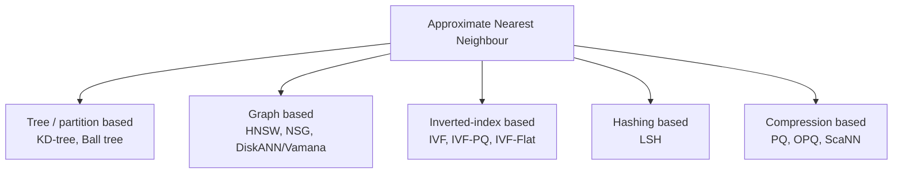

# Vector Databases — ANN Indexes, Recall, and the RAG Storage Layer

> **TL;DR** — A vector database stores embeddings and answers one question fast: *which vectors are closest to this one?* Exact search is a linear scan — 1 billion vectors × 1,536 dimensions is 1.5 trillion multiply-adds per query — so every production system uses an **approximate nearest neighbour** index that trades recall for latency. The three knobs are always the same: **recall** (did we find the true neighbours?), **latency** (how fast?), and **memory** (how much RAM?). You can have two. HNSW gives the best recall/latency and the worst memory; IVF-PQ and its descendants give the best memory and lose recall; DiskANN trades RAM for SSD latency. Everything else — quantisation, filtering, sharding — is a technique for moving along that triangle.

> **60-second interview answer:** "A vector database exists to do similarity search over embeddings — the RAG flow is chunk the document, embed each chunk, store the vectors, then at query time embed the question and retrieve the nearest neighbours. Exact search is a scan, so I use an ANN index; in practice HNSW, with `M` around 16 to 32 and `efConstruction` 200, and I tune `efSearch` at query time to trade latency for recall. My headline numbers are that a 1,536-dimension float32 vector is about 6 KB, so a billion vectors is roughly 6 TB before the index, and HNSW costs another 1.5 to 2 times that in graph overhead — which is why quantisation and DiskANN exist. The two things people get wrong are that metadata filtering interacts badly with ANN unless the index is filter-aware, and that the embedding model version must be part of the key, because vectors from two different models are not comparable."

---

## 1. Definition & mental model

**Plain English.** An embedding turns an item — a sentence, an image, a user, a product — into a list of floats, positioned in a high-dimensional space so that *similar items are near each other*. A vector database stores those vectors along with metadata, and answers "find the k nearest vectors to this query vector". It is a database whose index is built for distance rather than for equality and range.

**The analogy: a city map with pins versus a filing cabinet.**

- A **relational index** is a filing cabinet: you look up an exact label and get one drawer. It answers "where is *this* document?" perfectly and answers "which documents are *about* this?" not at all.
- A **vector search** is a map with a pin for every document, placed so that documents about similar things are physically close. Asking a question means dropping a pin for your question and finding the nearest documents on the map.
- **Exact search** is measuring the distance from your pin to every pin in the city — exact, and hopeless at city scale.
- **ANN** is the trick of building roads and neighbourhoods: you do not need the exact nearest pin, you need a very close one, found in milliseconds. **HNSW** is a road network with expressways on top and local streets at the bottom — you travel fast at the top and refine at the bottom.
- **Quantisation** is compressing the map: instead of exact coordinates for every pin, you store which of 256 grid squares it is in. The map is ten times smaller, and you might mistake a pin one square over.
- **Metadata filtering** is asking "nearest pin *that is also a restaurant*". If the filter is applied after the search, you may get ten pins and none are restaurants — that is post-filtering, and it is the classic bug.

**The one-line version:** a vector database is a purpose-built index for "approximately nearest", and every design decision is a point on the recall/latency/memory triangle.

---

## 2. Why it exists — the problem it solves

### The RAG pipeline, concretely

```
1. INGEST
   document → chunk (200–1,000 tokens, 10–20% overlap)
            → embed each chunk with an embedding model (e.g. 1,536 dims)
            → store {vector, text, metadata} in the vector DB

2. QUERY
   question → embed with the SAME model → 1 query vector
            → ANN search for top-k (k = 10–50)
            → optional rerank (a cross-encoder over the candidates)
            → stuff the top-n chunks into the LLM prompt
            → generate
```

### What breaks without a vector database

| Need | Without it |
|---|---|
| "Find semantically similar documents" | Full-text search misses paraphrases — "car" does not match "automobile" |
| Sub-100 ms search over 100M vectors | A linear scan over 100M × 6 KB = 600 GB read per query |
| Persistence and updates | An in-memory FAISS index rebuilt from scratch every restart |
| Metadata filtering | Filtering after the fact produces fewer than k results |
| Multi-tenant isolation | One flat index; every query searches every tenant's data |
| Hybrid search | Two separate systems with no way to fuse the scores |

### Why exact search does not work

```
Distance computation per pair at 1,536 dims:  ~1,536 multiply-adds ≈ 1.5 µs
1,000,000 vectors  →   1.5 s per query          (unusable)
1,000,000,000      →   1,500 s per query        (absurd)
```

Even a perfect SIMD kernel at 10× speed leaves a billion-vector scan at 150 s. **Approximation is not an optimisation, it is the only approach that works.** And it is acceptable because the downstream consumer is an LLM that is itself tolerant of an imperfect retrieval set — missing the 11th-nearest chunk is not a correctness failure.

### What a vector DB gives you beyond an ANN library

This distinction matters in interviews: **FAISS is a library, not a database.** A vector *database* adds:

| Feature | Why it matters |
|---|---|
| Persistence and crash recovery | FAISS in RAM loses everything on restart |
| Incremental insert/update/delete | FAISS `IndexFlat` cannot delete; you rebuild |
| Metadata storage and filtering | Needed for tenant, date, source filters |
| Sharding and replication | Beyond one machine's RAM |
| Multi-tenancy and access control | Namespaces, per-tenant isolation |
| A query API and consistency model | Reads after writes |
| Hybrid search (BM25 + vector) | Recall on exact terms like part numbers |
| Operational metrics | Recall monitoring, index build status |

---

## 3. Internal mechanics — how it actually works

### 3.1 Embeddings and distance metrics

An embedding model maps text to a vector in `R^d`. The geometry encodes meaning: `king − man + woman ≈ queen` is the canonical illustration. Dimensions range from 384 (small models) to 1,536 (OpenAI `text-embedding-3-small`) to 3,072 (`text-embedding-3-large`) and beyond.

| Metric | Formula | Range | When |
|---|---|---|---|
| **Cosine similarity** | `(a·b) / (‖a‖‖b‖)` | −1 to 1 | The default for text embeddings — magnitude is usually an artefact, direction is the meaning |
| **Dot product** | `a·b` | unbounded | When magnitudes are meaningful — some models (e.g. OpenAI) are trained for it and are already normalised |
| **Euclidean (L2)** | `√Σ(aᵢ−bᵢ)²` | ≥ 0 | Images, coordinates, and models trained with an L2 objective |
| **Manhattan (L1)** | `Σ|aᵢ−bᵢ|` | ≥ 0 | Rare; more robust to outliers in some domains |
| **Hamming** | differing bits | integer | Binary quantised vectors |

**The relationship worth knowing:** for **normalised** vectors, cosine similarity, dot product, and L2 are equivalent orderings — `‖a−b‖² = 2 − 2·(a·b)` when `‖a‖=‖b‖=1`. So if you normalise on write, you can use whichever is fastest in your index.

**The two rules that cause real bugs:**
1. **Use the metric the model was trained with.** A model trained with cosine, queried with raw dot product against unnormalised vectors, will rank long documents higher just because they have larger magnitude.
2. **Never mix embeddings from two models.** Vectors from `text-embedding-3-small` and `bge-large` occupy different spaces; comparing them produces confident nonsense. **Store the model name and version with every vector, and index it as part of the namespace or key.** Re-embedding after a model upgrade is a full reindex job — plan for it.

### 3.2 Storage and dimensionality arithmetic

```
Storage per vector = dimensions × bytes per component

float32 (4 bytes):
  384 dims   →  1,536 B  ≈ 1.5 KB
  768 dims   →  3,072 B  ≈ 3 KB
  1,536 dims →  6,144 B  ≈ 6 KB
  3,072 dims → 12,288 B  ≈ 12 KB

int8 quantised (1 byte):
  1,536 dims → 1,536 B ≈ 1.5 KB      (4× smaller)

binary quantised (1 bit):
  1,536 dims →   192 B               (32× smaller)
```

**The headline table — raw vector data only:**

| Vectors | 768d float32 | 1,536d float32 | 1,536d int8 | 1,536d binary |
|---|---|---|---|---|
| 1 M | 3 GB | 6 GB | 1.5 GB | 0.2 GB |
| 10 M | 30 GB | 60 GB | 15 GB | 1.9 GB |
| 100 M | 300 GB | 600 GB | 150 GB | 19 GB |
| 1 B | 3 TB | 6 TB | 1.5 TB | 192 GB |

**Then add the index and the process overhead:**

- **HNSW** adds the graph: each node stores up to `M × 2 × 4` bytes of neighbour links (HNSW stores up to `2M` links at layer 0). At `M=32` that is **~256 bytes per vector** on top of the vector data. Plus the ID mapping and metadata.
- **Rule of thumb:** budget **1.5–2× the raw vector size** for an HNSW index in memory, plus the metadata store, plus 20–30% headroom for the process, the query scratch space, and fragmentation.
- **Worked example:** 10 M vectors at 1,536 dims. Raw = 60 GB. HNSW at `M=32` = +2.5 GB. Metadata (~200 B/doc) = 2 GB. Total ≈ 65 GB, so plan for a **96–128 GB RAM instance** with headroom. The reference figure of "10 M vectors at 1,536 dims ≈ 80 GB RAM" is this calculation plus overhead — quote it and then show the arithmetic.

**The point of quantisation is to change the row you are in.** int8 takes 10 M @ 1,536 from 60 GB to 15 GB; binary takes it to 1.9 GB.

### 3.3 ANN algorithms



#### HNSW — Hierarchical Navigable Small World

The default choice, and the one to be able to explain in detail.

```
Layer 2:        A ──────────────── F              ← expressway: few nodes, long hops
Layer 1:   A ── C ──── E ──── F ─── H
Layer 0:   A─B─C─D─E─F─G─H─I─J─K─L─M─N─O─P       ← every node, short hops

Search:
  1. Enter at the top layer's entry point
  2. Greedily move to the neighbour closest to the query until no neighbour is closer
  3. Drop down a layer, carrying the current best as the entry point
  4. Repeat to layer 0
  5. At layer 0, run a best-first search keeping a candidate pool of size efSearch
  6. Return the top k from the pool

Insert:
  1. Sample a random maximum layer for the new node (exponentially distributed)
  2. Search from the top down to find its neighbours at each layer
  3. Connect it to the M closest neighbours at each layer (and back-links)
  4. Prune each neighbour's list if it exceeds the limit, keeping the most diverse links
```

**Why it works:** the upper layers are a "skip list for space" — long hops get you near the answer fast, and the lower layers refine. Expected search complexity is **O(log N)** rather than O(N).

**The parameters, and what each actually does:**

| Parameter | Typical | Build or query | Effect of increasing |
|---|---|---|---|
| **`M`** | 16–64 (32 common) | Build | More links per node → better recall, more memory, slower build. `M` is the primary memory knob: memory ≈ `M × 8` bytes per vector at layer 0 |
| **`efConstruction`** | 100–500 (200 common) | Build | Better graph quality → better recall at query time; slower build (roughly linear in `efConstruction`) |
| **`efSearch`** | 50–200 | **Query** | Higher recall, higher latency, more distance computations. **This is the knob you tune at runtime.** |
| **`m_L`** | `1/ln(M)` | Build | The level-assignment normaliser; rarely changed |

**The tuning procedure:** fix `M` and `efConstruction` for the build (based on your memory budget and build-time tolerance), then tune `efSearch` per query to hit your recall target. Recall rises steeply up to `efSearch ≈ k`, and `efSearch = 10 × k` is a common starting point. `efSearch < k` is a bug — you cannot return k results from a pool smaller than k.

**HNSW's properties:**
- Excellent recall/latency — usually the best of any pure in-memory index.
- **Incremental inserts work well** (the graph is updated in place), though frequent deletes require marking and periodic compaction.
- **Memory is the weakness** — the whole graph and all vectors must be in RAM.
- **Build time** — roughly linear in `N × efConstruction`; hundreds of millions of vectors can take many hours.
- **Deletion is a tombstone** — the node stays in the graph but is filtered from results, which degrades recall over time. Plan periodic rebuilds.
- **Thread-safety** — concurrent inserts on the same node need locking or a sharded index; query-time search is read-only and parallelises well.

#### IVF — Inverted File Index

```
1. Run k-means over the dataset to produce nlist centroids
2. Assign every vector to its nearest centroid  → nlist inverted lists (buckets)
3. Query: find the nprobe nearest centroids to the query vector,
          then scan only those nprobe inverted lists
```

| Parameter | Typical | Effect |
|---|---|---|
| **`nlist`** | `√N` to `4√N` (e.g. 4,096 for 10 M) | More lists = finer partition, faster search, more training time |
| **`nprobe`** | 1–10% of `nlist` | The query-time recall/latency knob; more probes = higher recall |

**Trade-offs:** much less memory than HNSW (no graph), simpler, and it composes with quantisation. But recall is lower for the same latency, it needs a training pass over a representative sample, and **inserts are awkward** — a new vector goes into an existing list, but the centroids are fixed, so heavy insert traffic degrades the partition quality and requires periodic retraining.

#### Product Quantisation (PQ)

The memory-reduction technique that makes billion-scale feasible.

```
Split a 1,536-dim vector into 96 sub-vectors of 16 dims each.
For each sub-space, run k-means with 256 centroids (8 bits).
Encode the vector as 96 bytes — one centroid ID per sub-space.

1,536 × 4 B = 6,144 B  →  96 B      a 64× reduction
```

- **Distance computation happens in the compressed domain** using precomputed lookup tables: for a query, compute the distance from each sub-space's centroids once (96 × 256 entries), then a single ADC (asymmetric distance computation) pass per candidate is 96 table lookups and adds. This is *faster* than computing exact distances, not just smaller.
- **`IVF-PQ`** is the classic combination: coarse quantisation to prune, product quantisation to compress.
- **The cost is recall** — typically 5–15 percentage points lower than HNSW at the same latency, depending on how aggressively you compress.
- **Variants:** `OPQ` (a learned rotation before PQ, improving it), **scalar quantisation (int8)** which is a much milder 4× compression with almost no recall loss, and **binary quantisation** with 32× compression and a large recall loss compensated by oversampling and reranking.

#### ScaNN and DiskANN

| System | Idea | Where it wins |
|---|---|---|
| **ScaNN** (Google) | Anisotropic vector quantisation — penalises errors in the direction that affects ranking more | Highest recall-per-byte at large scale; used in Vertex AI Vector Search |
| **DiskANN / Vamana** (Microsoft) | A graph index stored on **SSD**, with all vectors compressed in RAM and full vectors fetched from disk | **90–95% RAM reduction.** The reference point: 100 M vectors at 1,536 dims that would need ~1 TB of RAM with HNSW runs on a single 64 GB machine with an SSD |
| **Filtered-DiskANN** | The graph is built to keep same-filter nodes adjacent | Makes filtered search efficient rather than a post-filter |

**DiskANN's trade:** single-digit-millisecond latency becomes low-tens-of-milliseconds, and you need fast NVMe. For a billion vectors, that is the difference between a feasible system and an impossible bill.

### 3.4 The recall / latency / memory triangle

```
              recall
               /\
              /  \
             /    \
            /      \
       latency ——— memory

Pick two. Every technique is a point in this space:

  HNSW (all in RAM)        high recall, low latency, high memory
  IVF-PQ                   medium recall, medium latency, low memory
  DiskANN                  high recall, medium latency, low memory (needs SSD)
  Binary quant + rerank    medium recall, medium latency, very low memory
  Flat (exact)             perfect recall, terrible latency, highest memory
```

| Configuration | Recall@10 | Latency (10 M, 1,536d) | RAM |
|---|---|---|---|
| Flat (exact) | 1.00 | 500–2,000 ms | 60 GB |
| HNSW `M=32, efSearch=128` | 0.97–0.99 | 1–5 ms | 65 GB |
| HNSW `M=16, efSearch=64` | 0.93–0.97 | < 1 ms | 35 GB |
| IVF-PQ (`nlist=4096, nprobe=32`) | 0.80–0.92 | 2–10 ms | 5–8 GB |
| Binary quant + rerank top 1,000 | 0.90–0.96 | 5–20 ms | 2 GB |
| DiskANN | 0.95–0.98 | 5–20 ms | 4 GB RAM + 60 GB SSD |

**The interview sentence:** "I would start with HNSW if the dataset fits in RAM, because it gives the best recall at the lowest latency with no tuning beyond `efSearch`. If the dataset does not fit, I move to quantisation — int8 first since it costs almost no recall — and then DiskANN or IVF-PQ if I need another order of magnitude."

### 3.5 Filtering: pre, post, and hybrid

This is the most under-discussed and most practically important part of vector search.

```
Query: "find the 10 nearest vectors to q WHERE tenant_id = 42 AND year = 2026"
```

| Strategy | How | Failure |
|---|---|---|
| **Post-filter** | ANN search top-k, then drop non-matching | If 1% of vectors match the filter, top-100 yields ~1 result. You asked for 10 and got 1. **The classic bug** |
| **Over-fetch post-filter** | Search top-(k × 100), then filter | Fixes the count but explodes latency and can still fail for very selective filters |
| **Pre-filter** | Restrict the candidate set first, then search | Correct, but a graph index cannot "skip" nodes cheaply — searching a filtered HNSW subgraph degrades to a near-scan, and IVF cannot prune by centroid at all. Latency can be 10–100× worse |
| **Filter-aware index** | Filtered-DiskANN, Qdrant's filterable HNSW, Weaviate's ACORN, pgvector's partial indexes | The right answer. The index is built with the filter in mind |
| **Partition by filter** | A separate collection/index per tenant or per shard key | Best for high-cardinality filters like `tenant_id` — the filter disappears entirely |
| **Two-stage** | ANN over-fetch, then an exact rerank on the filtered subset | Good balance; the standard practical compromise |

**The design rule:** **the primary filter should be the partition, not a predicate.** If every query is scoped to a tenant, the tenant should be a namespace or a separate collection, so the ANN search only ever sees that tenant's vectors. Then the remaining filters (date, source, tag) are secondary and can be handled by a filter-aware index or a rerank.

**pgvector's approach** is worth naming because it is the most common production choice at small scale: `ivfflat` and `hnsw` index types, and because Postgres can combine a B-tree predicate with a vector index, a **partial index** (`WHERE tenant_id = 42`) gives a genuinely pre-filtered HNSW graph at almost no cost. That is a real advantage of having your vectors in the same database as your metadata.

### 3.6 Hybrid search: dense plus sparse

Pure vector search is bad at exact tokens — part numbers, error codes, proper nouns, rare words. Pure BM25 is bad at paraphrase.

```
Score = α × normalize(vector_score) + (1 − α) × normalize(bm25_score)

normalize: min-max, or Reciprocal Rank Fusion:
   RRF(d) = Σ_r 1 / (k + rank_r(d))        with k = 60 typically
```

**Reciprocal Rank Fusion** is the standard because it needs no score calibration between two incomparable scales — it uses ranks only. Run both retrievals, fuse the ranked lists, then rerank.

**Where this lives:** OpenSearch/Elasticsearch support both BM25 and kNN in one query; Weaviate, Qdrant, and Milvus have hybrid APIs; and the pragmatic version is BM25 filtering followed by a vector rerank over the candidates.

### 3.7 Sharding, replication and incremental updates

**Sharding a vector index** is different from sharding a key-value store, because a nearest-neighbour query is inherently a scatter-gather: the nearest vector could be on any shard.

| Approach | Mechanism | Trade-off |
|---|---|---|
| **Replicate everything** | Every node holds every vector | Simple, but bounded by one machine's RAM |
| **Shard by a filter key** | Tenant A on shard 1, tenant B on shard 2 | Queries stay single-shard **only if** they carry the key; global queries fan out |
| **Random shard + fan-out** | Search all shards, merge the top-k | Latency = the slowest shard; recall is exact (each shard returns its local top-k) |
| **Two-level** | Coarse centroids first, then only the relevant shards | The IVF idea extended across machines; complex |

**The critical correctness point for fan-out merging:** each shard must return its **local top-k**, and the coordinator merges — that gives the exact global top-k. If a shard returned fewer than k, or the coordinator dropped candidates too early, recall suffers. And `k × num_shards` candidates come back over the network for every query, which is the real cost.

**Replication** is straightforward: each shard has replicas, reads are load-balanced, and writes go to the primary. Replication lag means a just-upserted vector may not be searchable immediately — usually acceptable in RAG, but not for a "search my just-uploaded document" flow. Name it.

**Incremental updates:**

| Operation | HNSW | IVF | Notes |
|---|---|---|---|
| Insert | Good (in-place graph update) | Awkward (centroids are fixed) | HNSW is much better for live data |
| Update | Delete + insert | Reassign | Changes the vector, so the old node must go |
| Delete | Tombstone (recall degrades) | Remove from list | Compaction/rebuild is required eventually |
| Full reindex | Hours for 10⁸ vectors | Faster | Needed after a model upgrade |

**The reindex cost is the operational reality of vector search.** Changing the embedding model, changing the chunking strategy, or changing the dimensions all invalidate the entire index and require re-embedding every chunk — which costs real money in embedding API calls and real time in index building. **Always version the index**: `docs_v2_bge_large_1024` alongside `docs_v1_ada_002_1536`, build the new one in the background, verify recall, then cut over.

### 3.8 Evaluation: measuring recall, not vibes

```python
# Recall@k against a ground truth computed by brute force
def recall_at_k(index, queries, k=10, sample=1000):
    ground_truth = brute_force_topk(queries[:sample], k)     # exact, from the raw vectors
    approx = index.search(queries[:sample], k)
    hits = sum(len(set(gt) & set(ap)) for gt, ap in zip(ground_truth, approx))
    return hits / (sample * k)
```

**Recall@k is the metric to quote.** `recall@10 = 0.95` means 95% of the true top-10 were returned, averaged over the query set.

| Metric | Measures |
|---|---|
| **Recall@k** | Overlap with the exact top-k. The core ANN metric |
| **Latency p50/p95/p99** | At the chosen `efSearch`/`nprobe` |
| **QPS at target recall** | The throughput/latency curve |
| **End-to-end answer quality** | The only metric that actually matters — faithfulness, answer relevance, human preference |
| **Context precision/recall** | Did the chunks we retrieved contain the answer? |

**The trap: high recall does not mean good RAG.** If the chunking split the answer across two chunks, or the embedding model does not understand your domain, recall@10 can be 0.98 with the answer missing from the retrieved set. **Evaluate retrieval end-to-end with a held-out question set**, not just index metrics.

**Also evaluate the reranker separately.** A cross-encoder reranker over 50 candidates frequently improves answer quality more than raising recall from 0.95 to 0.99 — and it costs 20–100 ms of latency.

---

## 4. Variants & taxonomy

| Variant | Description | Notes |
|---|---|---|
| **FAISS** | Facebook's ANN **library** | Fastest raw indexes; no persistence, no filtering, no server. You build the database |
| **pgvector** | Postgres extension | Vectors next to your relational data; `hnsw` and `ivfflat`; partial indexes for filtering; strong choice below ~10 M vectors |
| **Milvus** | Distributed, purpose-built | Multiple index types, GPU support, scales to billions; heavier ops |
| **Qdrant** | Rust, filterable HNSW | Strong metadata filtering, payload indexes; fast |
| **Weaviate** | Multimodal, GraphQL API | Built-in vectorisers and hybrid search |
| **Pinecone** | Fully managed cloud | Zero ops; serverless and pod-based tiers; no self-hosting |
| **Chroma** | Lightweight, embedded | Prototypes, notebooks, small apps |
| **LanceDB** | Embedded, columnar (Lance format) | Disk-based, good for local and multimodal |
| **Elasticsearch / OpenSearch kNN** | Vector search in a search engine | Hybrid BM25 + kNN in one system; slower than dedicated vector DBs at scale |
| **Redis (RediSearch)** | Vector index in Redis | Great when the data is already in Redis and the set is small ([see Redis](../03-scaling/03-redis-deep-dive.md)) |
| **Vespa** | Search + ranking + vectors | Industrial-scale hybrid and ranking pipelines |
| **MongoDB Atlas Vector Search** | Vectors in a document store | Vectors next to documents; convenient if MongoDB is already the source of truth |
| **Vertex AI Vector Search / Bedrock Knowledge Bases** | Managed, ScaNN-based | Managed RAG plumbing |
| **Turbopuffer / S3 Vectors** | Object-storage-backed vector search | Very cheap at rest; higher latency |

**Selection heuristic:**
- **Under 10 M vectors and you already run Postgres** → `pgvector`. This is the right answer far more often than candidates admit.
- **Need filtering at scale** → Qdrant or Milvus.
- **Need hybrid search and already run a search engine** → OpenSearch kNN.
- **Do not want to operate anything** → Pinecone.
- **A notebook or a local prototype** → Chroma or FAISS.
- **Billions of vectors on a budget** → DiskANN-style or object-storage-backed.

---

## 5. Pros / Cons

| Aspect | Pros | Cons |
|---|---|---|
| **Semantic search** | Finds paraphrases and synonyms; no keyword engineering | Cannot do exact tokens well; needs hybrid |
| **HNSW recall** | 0.95–0.99 at 1–5 ms | 1.5–2× memory over raw vectors |
| **Quantisation** | 4×–32× memory reduction | Recall loss; binary needs oversample + rerank |
| **DiskANN** | 90–95% less RAM | Needs fast NVMe; latency rises |
| **Filtering** | Enables multi-tenant and scoped search | Post-filtering breaks result counts; pre-filtering can be 10–100× slower |
| **Incremental updates** | HNSW inserts in place | Deletes are tombstones; recall degrades; periodic rebuild needed |
| **Operational simplicity** | `pgvector` is just Postgres | Dedicated vector DBs add a new system to operate |
| **Evaluation** | Recall@k is measurable | High recall ≠ good answers; needs end-to-end evaluation |
| **Model coupling** | — | An embedding model change forces a full reindex; vectors from two models are incomparable |
| **Cost** | Scales down with quantisation | RAM at scale is the dominant cost; re-embedding costs API money |

---

## 6. Exceptions, edge cases & failure modes

### 6.1 Post-filtering returns too few results

The most common production bug. A tenant filter matching 0.5% of the corpus, with `k=10` and no filter awareness, returns ≈0.05 results — so the RAG pipeline gets one chunk and the LLM hallucinates.

**Fixes, in order:** partition the index by the filter key so the filter disappears; use a filter-aware index; or over-fetch aggressively (`k × 100`) and accept the latency. **Never ship a filtered vector search without testing it on a selective filter.**

### 6.2 Recall collapse after a delete-heavy period

HNSW deletes are tombstones: the node remains in the graph, is traversed during search, and is filtered from results. Over months of churn, the graph fills with dead nodes, search traverses them, and recall silently degrades. **Nothing errors; answers just get worse.**

**Fix:** monitor **index size vs live vector count** and alert when the ratio exceeds ~1.3. Rebuild periodically, or use an index that supports real deletion.

### 6.3 Model version drift

```
Vector stored with bge-large (1024 dims)
Query embedded with text-embedding-3-small (1536 dims)
→ dimension mismatch: an error, at least
→ or, worse, the same dimension count with a different model:
  no error, and every result is garbage with high confidence
```

**The fix is non-negotiable:** store the model ID and version with every vector, namespace the collection by model, and require the query path to use the same model ID as the collection. A mismatch should be a hard error, not a best-effort search.

**The reindex project:** upgrading the model means re-embedding every chunk, which is the single most expensive routine operation in a vector system. Budget it: embedding cost (per-token pricing × corpus size), index build time (hours for 10⁸ vectors), and a dual-running period where both indices exist.

### 6.4 Dimension and metric mismatch

- Querying a 1,536-dim index with a 1,024-dim vector errors at the API level (good).
- Querying with the wrong **metric** does not error: cosine against an index built with L2 returns *plausible but wrong* neighbours. Store the metric with the index and validate it.
- Forgetting to normalise when the model requires it is the same class of silent failure.

### 6.5 Memory blowup and cold start

- **The index must be in RAM for HNSW.** A process restart reloads it from disk — for a 100 GB index on SSDs that is **minutes to tens of minutes** of unavailability, and during the reload the queries either fail or scan the disk. Load it from a snapshot with memory-mapped files (FAISS `IndexHNSW` supports this via serialisation to a file) rather than rebuilding.
- **The build is CPU- and time-intensive.** 100 M vectors at `efConstruction=200` can take many hours of a large machine; you cannot rebuild on deploy.
- **Overcommit kills.** If the host sets `vm.overcommit_memory` and the index grows, the OOM killer takes the process. Size for 1.5× the index.

### 6.6 Chunking is where retrieval quality is actually decided

The vector index faithfully retrieves whatever chunks you gave it. Bad chunks produce bad RAG regardless of index quality.

| Chunking strategy | When |
|---|---|
| Fixed-size (256–1,024 tokens) with overlap | The simple default |
| Recursive character splitting | Respects paragraph and sentence boundaries |
| Semantic chunking | Split where embedding similarity between adjacent sentences drops |
| Document-structure aware | Markdown headers, HTML sections, code blocks |
| Parent-document / small-to-big | Embed small chunks, retrieve the parent for context — **one of the highest-value tricks** |
| Sentence-window | Embed a sentence, return it with its neighbours |

**Rules:** chunk size 200–1,000 tokens, overlap 10–20%, never split a table or a code block, and always store the parent document ID so you can expand context. **Chunking and overlap choices affect answer quality more than `efSearch` does** — say that in an interview and you sound like you have shipped RAG.

### 6.7 The metadata store is not optional

A vector index stores IDs and vectors. You need the **text** and the metadata (source, page, timestamp, tenant, permissions). Two failure modes:

1. **The ID mapping breaks.** Rebuilding the index renumbers the vectors; if the ID map is not rebuilt too, every result points at the wrong text. Silent and catastrophic (wrong citations).
2. **Stale metadata after an update.** The document changed, the vector was updated, and a denormalised copy of the title in the index was not. Keep the authority in one place and reference it.

**And permissions:** if the metadata store does not carry the ACL, your vector search will happily retrieve documents the user is not allowed to read. Filter at query time on the ACL, and consider a per-tenant index for anything sensitive.

### 6.8 Cost surprises

- **Re-embedding the whole corpus** after a chunking or model change — often the largest single line item.
- **RAM at scale** dominates self-hosted cost; quantisation is a cost decision, not just a latency one.
- **Managed per-vector-hour pricing** — Pinecone-style pricing is per pod/serverless unit; an idle large index still bills.
- **Dimensionality**: `text-embedding-3-large` at 3,072 dims costs 2× the storage and 2× the distance computation of 1,536 dims, for a modest quality gain. **Matryoshka embeddings** let you truncate a 1,536-dim vector to 256 and keep most of the quality — a free 6× storage reduction that is worth naming.
- **Over-fetching for filters** multiplies both cost and latency.

### 6.9 Other failure modes worth naming

- **Duplicate and near-duplicate chunks** inflate the index and crowd out diversity in the top-k. Deduplicate by content hash at ingest.
- **The top-k results are all from the same document**, so the LLM gets no diversity. Add a diversity constraint (MMR — maximal marginal relevance) or limit per-document results.
- **Embedding an empty or boilerplate chunk** produces a vector near the centroid of nothing, and it can match everything. Drop chunks below a length threshold.
- **Query/document asymmetry.** Some models have distinct `embed_query` and `embed_document` methods. Using the wrong one for a given side degrades results measurably.
- **Very long queries.** Embedding a 2,000-token question produces a mushy vector. Summarise or split the query; consider multi-query retrieval and fusion.
- **The "lost in the middle" effect.** LLMs attend less to context in the middle of a long prompt, so *ordering* the retrieved chunks matters — put the best first or last.
- **Rebuilding under load.** An index build consumes all cores and can starve query serving on the same host. Build on a dedicated node and swap.
- **No ground truth, no evaluation.** Without a labelled question set you cannot tell whether a change improved or degraded retrieval. Build the eval set before optimising.
- **Filtering on a field with no payload index** forces a full payload scan per candidate — a silent 100× latency regression.

---

## 7. When to use / When NOT to use

### Use a vector database when
- You need semantic similarity over unstructured content (text, images, audio, code).
- You are building RAG, semantic search, deduplication, recommendation, or clustering.
- You need approximate nearest-neighbour search at a scale where exact search is too slow (beyond ~100k vectors, definitely beyond 1M).
- You need metadata filtering combined with similarity search.
- You need hybrid retrieval (dense + sparse).

### Do NOT use a vector database when
- **Exact keyword matching is what you need** — a part number, a SKU, an error code. Use a search engine; add vectors only for the semantic part.
- **The dataset is tiny and static** (< 100k vectors) — a NumPy cosine scan over a matrix is a few milliseconds and needs no new system.
- **The retrieval set is already structured** — "the last 10 orders for this user" is a SQL query with an index, not a vector search.
- **You have no evaluation set.** You cannot tune what you cannot measure.
- **You are using it as a general-purpose database.** It is not a source of truth; it is an index over data that lives elsewhere ([see Choosing a Database](05-choosing-a-database-decision-guide.md)).
- **Permissions are complex and you have no plan to filter.** A vector index that ignores ACLs is a data leak.

### Decision table

| Situation | Answer |
|---|---|
| < 100k vectors, static | NumPy/FAISS flat scan; no database needed |
| < 10M vectors, Postgres already in use | **`pgvector`** with an HNSW index |
| Multi-tenant with per-tenant filters | A namespace/collection per tenant, or Qdrant/Milvus filter-aware indexes |
| 100M+ vectors, RAM is the constraint | **DiskANN** or IVF-PQ with quantisation |
| Need exact-token + semantic together | **Hybrid** with RRF — OpenSearch kNN or a dedicated hybrid API |
| No ops team | **Pinecone** or another managed service |
| Vectors already in Redis, small set | Redis vector index |
| Notebook prototype | Chroma or FAISS |
| Model upgrade coming | Version the collection; dual-run the new index; evaluate before cutover |
| Filters are highly selective | Partition by the filter key; never rely on post-filtering |
| Retrieval quality is poor | Check chunking and the embedding model **before** tuning `efSearch` |
| Need the source text and permissions | A metadata store beside the vector index — the index is not the source of truth |

---

## 8. Numbers, defaults & tuning

| Quantity | Value | Reasoning |
|---|---|---|
| Common dimensions | 384, 768, 1,024, 1,536, 3,072 | Small models to large |
| float32 storage per vector | `dims × 4` bytes | 1,536 dims = 6 KB |
| int8 storage | `dims × 1` — 4× smaller | ~1–2% recall loss |
| Binary storage | `dims / 8` — 32× smaller | Large recall loss; needs oversample + rerank |
| 1 M @ 1,536d float32 | 6 GB raw | Before index overhead |
| 1 B @ 1,536d float32 | 6 TB raw | Why quantisation exists |
| HNSW memory overhead | ×1.5–2.0 over raw vectors | Graph links: ~`M × 8` bytes/vector at layer 0 |
| HNSW `M` | 16–64; **32 common** | Recall and memory knob |
| HNSW `efConstruction` | 100–500; **200 common** | Build quality vs build time |
| HNSW `efSearch` | 50–200; start at `10 × k` | The runtime recall/latency knob |
| HNSW expected search complexity | O(log N) | Versus O(N) for flat |
| HNSW build time | Hours for 10⁸ vectors | Cannot rebuild on deploy |
| `efSearch < k` | **A bug** | The candidate pool must exceed k |
| IVF `nlist` | `√N` to `4√N` | 4,096 for 10 M |
| IVF `nprobe` | 1–10% of `nlist` | Recall knob |
| PQ sub-vectors | 96 for 1,536 dims (16 dims each) | 256 centroids each = 8 bits |
| PQ compression | 64× (6,144 B → 96 B) | With 5–15 points of recall loss |
| DiskANN RAM reduction | 90–95% vs HNSW | The billion-scale enabler |
| DiskANN latency | 5–20 ms vs 1–5 ms | The SSD round trip |
| Chunk size | 200–1,000 tokens | Small enough to be specific, large enough to be meaningful |
| Chunk overlap | 10–20% | Prevents splitting an answer across the boundary |
| Default `k` (retrieval) | 10–50 | 50 with a reranker; 10 without |
| Reranker input | 50–100 candidates | Cross-encoder over the ANN output |
| Reranker latency | 20–100 ms | The quality/latency trade |
| RRF constant | `k = 60` | The standard reciprocal-rank-fusion value |
| Recall@10 target | ≥ 0.95 | The number to quote |
| Index size / live vector ratio | Alert above 1.3 | Tombstone accumulation |
| Index reload time | Minutes to tens of minutes for a large index | Cold-start planning |
| Memory headroom | 1.25–1.5× the index | Fragmentation, scratch space, metadata |
| Normalisation | Required for cosine equivalence | `‖a−b‖² = 2 − 2·a·b` when normalised |
| Matryoshka truncation | 1,536 → 256 keeps most quality | A free 6× storage reduction |
| Embedding cost driver | Corpus tokens × re-embeds | The biggest routine line item |

---

## 9. Interview Q&A

**Q1 (easy). What is a vector database and why do you need one?**
It stores embeddings — numeric representations of content where similar items are close together — and answers "which vectors are nearest to this query vector". You need one because the RAG flow is chunk the document, embed each chunk, store the vectors, then at query time embed the question and retrieve the nearest chunks to put in the LLM's prompt. Exact nearest-neighbour search is a linear scan, which is 1.5 seconds per query over a million vectors at 1,536 dimensions, so production systems use an approximate index that trades a little recall for a thousand-fold speedup. A vector database adds the things an ANN library does not have: persistence, incremental updates, metadata filtering, and sharding.

**Q2 (easy). Which similarity metric would you use?**
Cosine similarity for text embeddings, because the direction carries the meaning and the magnitude is usually an artefact of the model. Dot product when the model was trained for it and vectors are normalised — and the useful fact is that for normalised vectors cosine, dot product and Euclidean distance produce the same ordering, because `‖a−b‖² = 2 − 2·a·b` when both have unit length. L2 for images or coordinate-like data. The rule that matters is to use the metric the model was trained with, and to never mix vectors from two different models, because they occupy different spaces and comparing them gives confident nonsense.

**Q3 (easy). How much memory does a billion vectors take?**
At 1,536 dimensions in float32, each vector is 1,536 times 4 bytes — about 6 KB. A billion of those is 6 terabytes of raw vector data. Then HNSW adds roughly 1.5 to 2 times that in graph links and IDs, so you are looking at 10 to 12 TB of RAM, which is not a machine you can buy. That is exactly why quantisation and DiskANN exist: int8 takes it to 1.5 TB, binary to about 192 GB, and DiskANN keeps the compressed vectors in RAM and the full vectors on SSD for a 90 to 95% RAM reduction.

**Q4 (medium). Explain HNSW.**
It is a hierarchical graph. At the top there are a few nodes connected by long links — like an expressway — and each layer down has more nodes and shorter links, with layer zero containing every vector. A search enters at the top, greedily walks to the closest neighbour, drops down a layer carrying the current best as the entry point, and repeats. At layer zero it runs a best-first search keeping a candidate pool of size `efSearch` and returns the top k. Insertion samples a random maximum layer for the new node, searches down to find its neighbours at each layer, and connects it to the M closest, pruning the neighbour lists to keep links diverse. The expected search complexity is logarithmic in the number of vectors, which is why it is fast. The parameters are `M` for links per node, `efConstruction` for build quality, and `efSearch` for the query-time recall/latency trade.

**Q5 (medium). What are `M`, `efConstruction` and `efSearch`?**
`M` is the number of bidirectional links each node keeps, and it is the memory knob — more links means better recall and more RAM, roughly `M × 8` bytes per vector at layer zero, and 32 is a good default. `efConstruction` is how large a candidate pool the build keeps when connecting a new node; higher means a better-quality graph and a slower build. `efSearch` is the query-time candidate pool size; higher means more distance computations, higher recall and higher latency, and it is the one you tune at runtime without rebuilding. I fix `M` and `efConstruction` from the memory budget and build-time tolerance, then tune `efSearch` to hit a recall target. A common starting point is `efSearch` around ten times k, and anything below k is a bug because you cannot return k results from a smaller pool.

**Q6 (medium). What is product quantisation?**
It is a compression technique. You split a high-dimensional vector into sub-vectors — 1,536 dimensions into 96 sub-vectors of 16 dimensions — and for each sub-space you run k-means with 256 centroids, so each sub-vector can be encoded as a single byte identifying its nearest centroid. A 6 KB vector becomes 96 bytes, a 64-fold reduction. The clever part is that distance computation also happens in the compressed domain using precomputed lookup tables, so it is not just smaller but also faster — you compute the query's distance to all 256 centroids per sub-space once and then each candidate is 96 table lookups and adds. The cost is recall: typically 5 to 15 percentage points lower than HNSW at the same latency, depending on how hard you compress.

**Q7 (medium). What is the recall/latency/memory triangle?**
You can have two of the three. HNSW gives high recall and low latency but needs all the vectors and the graph in RAM. IVF with product quantisation gives low memory but lower recall. DiskANN gives high recall and low memory by putting the graph on SSD, at the cost of higher latency. So the design question is which one your workload tolerates: for a RAG system where the LLM is the downstream consumer, a couple of points of recall rarely changes the answer, so quantisation is usually worth it; for a deduplication system where a missed match is a real error, you might pay for HNSW in RAM.

**Q8 (hard). How does metadata filtering interact with ANN search?**
Badly, unless the index is built for it. Post-filtering — searching the top k and then dropping the ones that fail the filter — is the classic bug: if only 1% of vectors match, a top-100 search yields about one result, so you asked for 10 and got 1, and the LLM hallucinates from insufficient context. Over-fetching to `k × 100` fixes the count but explodes latency and still fails for very selective filters. Pre-filtering is correct but a graph index cannot cheaply skip nodes, so searching a filtered subgraph degrades toward a full scan — IVF cannot prune by centroid at all. The real answers are a filter-aware index like Filtered-DiskANN or Qdrant's filterable HNSW, or — better — making the primary filter the partition itself. If every query is scoped to a tenant, the tenant should be a namespace or a separate collection, so the filter disappears entirely and only secondary filters remain.

**Q9 (hard). Walk me through the full RAG pipeline and where the quality actually comes from.**
Ingest: chunk the documents, 200 to 1,000 tokens with 10 to 20% overlap, respecting structure and never splitting tables or code blocks; embed each chunk with the same model I will use for queries; store the vector, the text and the metadata, including the parent document ID so I can expand context later. Query: embed the question with the same model, run an ANN search for the top 10 to 50, optionally rerank with a cross-encoder over the top 50 to 100, then order the survivors so the best are first or last because of the lost-in-the-middle effect, and put them in the prompt. Where quality comes from, in order: the chunking strategy, then the embedding model, then hybrid retrieval with BM25 fused by reciprocal rank fusion, then the reranker, and last the ANN tuning. `efSearch` is at the bottom of that list — people tune it first because it is the most visible knob, but it is the least important.

**Q10 (hard, testing §6). Your filtered vector search returns one result when you ask for ten. What is wrong?**
That is post-filtering. The ANN search ran over the whole index, returned the top ten, and the filter dropped nine of them because only a small fraction of the corpus matched. The fix is to make the filter part of the search rather than a check afterwards. The best answer is to partition by the filter key — a separate collection or namespace per tenant — so the search never sees non-matching vectors at all. Otherwise I need a filter-aware index, or a pre-filter with the knowledge that it may be much slower. And I would add a regression test that runs the search with a deliberately selective filter, because this bug does not appear on a small test corpus where most vectors match.

**Q11 (hard, testing §6). Retrieval quality has slowly degraded over six months with no code change. What do you check?**
Three things. First, tombstone accumulation — HNSW deletes leave the node in the graph, so over months of churn the graph fills with dead nodes that are traversed but filtered out, and recall silently falls. I would check the ratio of index size to live vector count and alert above about 1.3, then rebuild. Second, embedding model drift — if someone changed the embedding model on the ingest path but not the query path, or if two versions are now in the same collection, results degrade without any error. Third, the corpus itself: duplicate and near-duplicate chunks crowd out diversity in the top k, and an ingestion bug can flood the index with boilerplate. And the meta-point is that without a labelled evaluation set I cannot tell any of these apart, so building that set is the actual prerequisite for fixing it.

**Q12 (hard, testing §6). What happens when you change the embedding model?**
Every stored vector becomes incomparable with every new query vector, so the entire index must be rebuilt — re-embedding every chunk, which costs real money at per-token pricing and takes hours of index build time for a large corpus. And there is a nastier version: if the new model happens to have the same dimensions, you get no error at all, just confident garbage. So I treat the model as part of the schema. The collection name includes the model and version, the query path asserts that the model ID matches the collection, and a mismatch is a hard error. Then the upgrade is a background job that builds the new collection, a recall and answer-quality evaluation against the held-out set, and a cutover — the same dual-run pattern as a database migration.

**Q13 (hard). When would you not use a vector database?**
When the query is not semantic. If someone is searching for a part number or an error code, a BM25 search or a SQL exact match is better, cheaper and exact — vectors would be strictly worse. When the dataset is tiny and static, a cosine scan over a NumPy matrix is a couple of milliseconds and does not justify a new system. When the retrieval set is already structured — "the last ten orders for this user" is a SQL query with an index. And when there is no evaluation set, because I cannot tune or compare anything without ground truth. The broader point is that a vector index is an index, not a source of truth — the documents, the permissions and the metadata live elsewhere, and if I do not have that authority store the vector index is not a database.

**Q14 (hard). How would you scale vector search to a billion vectors?**
First I would question whether I need a billion in one index — usually the data is partitioned by tenant or language, so the effective index is much smaller and that is the cheapest answer. If it is genuinely one global index, the constraint is RAM: a billion vectors at 1,536 dimensions is 6 TB of raw float32, so I quantise. int8 first, because it is 4× smaller with barely any recall loss; binary if I need 32×, with oversampling and reranking to recover recall. Then DiskANN, which keeps the compressed vectors in RAM and the full vectors on NVMe for a 90 to 95% RAM reduction — that is the technique that makes 100 M vectors at 1,536 dimensions fit on a 64 GB machine instead of a terabyte of RAM. And then sharding, with the awareness that a nearest-neighbour query is inherently a scatter-gather: each shard returns its local top k and the coordinator merges, so latency is bounded by the slowest shard and the network carries `k × shards` candidates per query. Caching the hot query vectors and precomputing common queries is the next lever.

**Q15 (hard). How do you evaluate a vector search system?**
Recall@k against a brute-force ground truth, computed on a sample of queries — that tells me whether the index is doing its job. Latency at p50, p95 and p99 at that recall, because a mean hides the tail. And then, separately, end-to-end answer quality on a held-out question set, because high recall does not mean good RAG: if the chunking split the answer across two chunks, recall@10 can be 0.98 while the answer is missing. I would also evaluate the reranker independently, since a cross-encoder over 50 candidates often improves answer quality more than raising recall from 0.95 to 0.99 and costs 20 to 100 milliseconds. The mistake is optimising `efSearch` and calling it retrieval quality work.

---

## 10. Common mistakes candidates make

1. **Confusing an ANN library with a database.** FAISS has no persistence, filtering, or deletes.
2. **Not being able to state the storage arithmetic.** 1,536 dims × 4 bytes = 6 KB per vector, 1 B vectors = 6 TB.
3. **Ignoring the HNSW memory overhead** (1.5–2× the raw vectors).
4. **Tuning `efSearch` before looking at chunking and the embedding model.**
5. **Post-filtering without mentioning the result-count collapse.**
6. **Assuming the filter works** without a filter-aware index or partitioning.
7. **Mixing embeddings from two models** or forgetting to version the collection.
8. **Proposing vectors for exact-match search** where BM25 or SQL is strictly better.
9. **Forgetting that deletes are tombstones** and recall degrades until a rebuild.
10. **Saying "recall is 0.95 so the RAG is good"** without end-to-end evaluation.
11. **No metadata store** — the vector index is not the source of truth, and it has no ACLs.
12. **Ignoring the reindex cost** of a model or chunking change.
13. **Forgetting hybrid search**, so part numbers and rare tokens are unretrievable.
14. **Not knowing DiskANN** when the interviewer says "a billion vectors."
15. **Overlooking the lost-in-the-middle effect** when ordering retrieved context.

---

## 11. Cheat-sheet summary

| Concept | One-line truth |
|---|---|
| Embedding | A vector where similar meanings are near each other |
| Similarity | Cosine for text; dot for trained models; L2 for images |
| Normalised equivalence | Cosine ≈ dot ≈ L2 ordering when `‖v‖ = 1` |
| Storage per vector | `dims × 4` bytes; 1,536 dims = 6 KB |
| The headline number | 1 B × 1,536d float32 = **6 TB** raw |
| HNSW overhead | ×1.5–2.0 over raw vectors |
| 10 M @ 1,536d | ~60 GB raw, ~65 GB indexed → ~80 GB RAM with headroom |
| ANN | Approximate search; O(log N) instead of O(N) |
| HNSW | Hierarchical graph; greedy descent; the default choice |
| HNSW `M` | 16–64 (32 default) — the memory knob |
| HNSW `efConstruction` | 100–500 (200) — build quality |
| HNSW `efSearch` | 50–200 — the runtime recall/latency knob; `10 × k` to start |
| `efSearch < k` | A bug |
| IVF | k-means `nlist` centroids; query `nprobe` lists |
| PQ | Sub-vectors, 256 centroids each → 64× compression |
| int8 quantisation | 4× smaller, ~1–2% recall loss — start here |
| Binary quantisation | 32× smaller; needs oversample + rerank |
| DiskANN | Graph on SSD; 90–95% less RAM; 5–20 ms |
| ScaNN | Anisotropic quantisation; best recall per byte |
| The triangle | Recall, latency, memory — pick two |
| Recall@10 target | ≥ 0.95 |
| Post-filter | Returns fewer than k results — the classic bug |
| Pre-filter | Correct but can be 10–100× slower on a graph |
| The real fix | Partition by the filter key (tenant → namespace) |
| Hybrid search | Dense + BM25 fused with RRF (`k = 60`) |
| Reranker | Cross-encoder over 50–100; 20–100 ms; big quality win |
| Chunking | 200–1,000 tokens, 10–20% overlap, respect structure |
| Parent-document retrieval | Embed small, return the parent for context |
| Model versioning | Store the model ID with every vector; mismatch = hard error |
| Reindex | A model or chunking change = re-embed everything |
| Tombstones | Deletes degrade HNSW; alert when size/live > 1.3 |
| pgvector | Postgres + HNSW/IVFFlat; the right answer under ~10 M |
| Metadata store | Mandatory — the index has no text and no ACLs |
| Lost in the middle | Order retrieved chunks; best first or last |
| Scatter-gather | Each shard returns local top-k; merge at the coordinator |

**"If the interviewer says X → answer Y"**

| Interviewer says | You say |
|---|---|
| "Design RAG" | Chunk → embed → store with metadata → embed the query → ANN top-50 → rerank → order → prompt |
| "How much memory for 1B vectors?" | "6 TB raw; int8 1.5 TB; DiskANN 90–95% less RAM" |
| "Search is slow" | "Lower `efSearch`, or quantise, or shard — and check whether the filter is post-filtering" |
| "Results are bad" | "Chunking and the embedding model first; then hybrid + rerank; `efSearch` last" |
| "Filter returns too few" | "Post-filtering — partition by the filter key or use a filter-aware index" |
| "Which vector DB?" | "`pgvector` under 10 M if Postgres is there; Qdrant/Milvus for filtering; Pinecone if no ops" |
| "New embedding model?" | "Full reindex, versioned collection, dual-run, evaluate, then cut over" |
| "Quality dropped over time" | "Tombstone accumulation, model drift, or corpus duplication — check size/live ratio" |
| "Exact part number search" | "BM25 or SQL; vectors are strictly worse for exact tokens" |
| "How do you evaluate it?" | "Recall@k against brute force, plus end-to-end answer quality on a held-out set" |

---

## 12. Cross-links

- [NoSQL Deep Dive](02-nosql-deep-dive.md) — where vectors live if not in a dedicated store
- [SQL Deep Dive](01-sql-deep-dive.md) — `pgvector` and the advantages of colocating vectors with metadata
- [Blob and Object Storage](04-blob-and-object-storage.md) — where the source documents and model weights live
- [Choosing a Database](05-choosing-a-database-decision-guide.md) — the decision framework
- [Redis Deep Dive](../03-scaling/03-redis-deep-dive.md) — Redis as a small vector index and a semantic cache
- [Sharding, Replication and Consistency](../03-scaling/05-sharding-replication-and-consistency.md) — scatter-gather and shard-key selection
- [Cache Invalidation](../03-scaling/04-cache-invalidation-and-consistency.md) — semantic caching and versioned keys
- [Instagram News Feed](../../Case-Studies/HLD/04-instagram-news-feed.md) — candidate generation with embeddings
- [YouTube Upload and Recommendation](../../Case-Studies/HLD/05-youtube-upload-and-recommendation.md) — retrieval and ranking at scale
- [Scaling, Caching and DB Cheatsheet](../../Cheat-Sheets/03-scaling-caching-db-cheatsheet.md)
