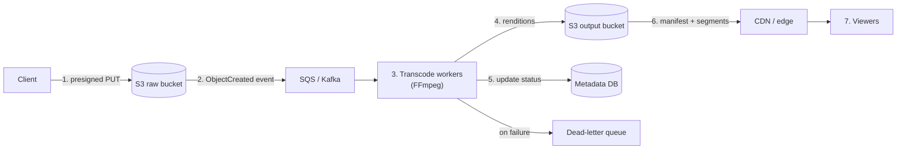

# Blob & Object Storage — S3, Durability, and the Media Pipeline

> **TL;DR** — Object storage is a flat namespace of immutable blobs accessed over HTTP, and its defining property is that it *decouples durability from the server*: S3's eleven-nines durability comes from erasure-coding every object across multiple facilities, not from any single machine being reliable. You interact with it through a small vocabulary — bucket, key, object, multipart upload, presigned URL, lifecycle policy, storage class — and you must know its limits: **3,500 PUT/s and 5,500 GET/s per partitioned prefix** (and there is no per-prefix limit any more in modern S3, which is itself a famous story), a 5 TB maximum object, and the fact that **egress, not storage, is usually the bill**. The architecture pattern that matters in interviews is the media pipeline: upload to blob storage with a presigned URL, emit an event, transcode asynchronously, write a manifest, serve through a CDN with adaptive bitrate.

> **60-second interview answer:** "Object storage is for large unstructured blobs — images, video, audio, PDFs, model weights, backups — where I never need to modify a byte in place and I only ever read the whole thing. S3's eleven nines of durability come from erasure-coding objects across multiple availability zones rather than replicating whole copies, which is why I can store a petabyte and not think about disk failures. The parts that actually matter operationally: uploads go through presigned URLs so the bytes never touch my API servers, anything over about 100 MB uses multipart upload with retry per part, large objects are served through a CDN because egress is the dominant cost, and the consistency model is now strongly consistent for reads after writes including overwrites and deletes — which it was not before 2020."

---

## 1. Definition & mental model

**Plain English.** Object storage stores *whole objects* addressed by a *key* in a *flat namespace* called a bucket, accessible over HTTP. You can `PUT` an object, `GET` an object, and delete it. You cannot seek into the middle of it and modify 100 bytes — an object is immutable, and "editing" means writing a new version under the same key.

**The analogy: a valet coat check versus a personal locker room.**

- **Block storage** (EBS, a disk) is a locker room: you get a fixed-size locker and you can rearrange anything inside it, any time, byte by byte. The database lives here.
- **File storage** (EFS, NFS, SMB) is a shared filing cabinet with folders and a path — other people can open the same file and see your changes. A shared code directory lives here.
- **Object storage** (S3, GCS, Azure Blob) is a **valet coat check**: you hand over a coat with a **ticket number** (the key), and you get the whole coat back later. The check room has no aisles or shelves you can browse — there is no directory tree, only a ticket number, even though the ticket can *look* like a path (`photos/2026/09/cat.jpg` is one flat key with slashes in the name). You cannot ask the valet to change one button on the coat; you hand in a new coat and get a new ticket.

**The insight that follows:** everything about object storage is a consequence of immutability. Immutability enables erasure coding (any part can be reconstructed from others), versioning (an old version is just another object), CDN caching (a key's content never changes, so cache it forever), and cheap durability (no in-place consistency to maintain). It also means you cannot use it as a filesystem, a database, or a place to append to a file.

---

## 2. Why it exists — the problem it solves

### The three storage types side by side

| | Block | File | Object |
|---|---|---|---|
| Unit | Fixed-size blocks | Files in a hierarchy | Whole objects with a key |
| Access | Via a filesystem on an OS | Via NFS/SMB path | Via HTTP API (`GET`/`PUT`) |
| Address | LBA / block number | Path (`/mnt/data/x.txt`) | Bucket + key |
| Modify in place | Yes | Yes | **No** — replace the whole object |
| Scale | Terabytes per volume | Petabytes, but a single namespace | Effectively unlimited |
| Latency | Microseconds (local/NVMe) | Sub-millisecond to ms | 20–200 ms |
| Throughput | Very high, low-level | High | High with parallelism |
| Cost | Highest per GB | Middle | Lowest per GB |
| Typical use | Databases, VMs | Shared code/config, legacy apps | Media, backups, data lakes, model weights |
| Examples | EBS, PVC, local NVMe | EFS, NFS, SMB, CIFS | S3, GCS, Azure Blob, MinIO |

### Why object storage specifically exists

1. **Scale beyond a filesystem.** A POSIX filesystem has to maintain a consistent tree, permissions and metadata; the bigger it gets, the more expensive every operation is. A flat namespace with an HTTP API has no such coupling — 100 billion objects is a normal S3 bucket.
2. **Durability without reliable hardware.** Individual disks fail. Instead of replicating whole copies, S3 erasure-codes every object across multiple AZs, so the loss of any single component is recoverable. The advertised **99.999999999% (11 nines) durability** means that if you store 10 million objects, you would expect to lose one object every 10,000 years.
3. **Cheap, tiered storage.** Storage classes let you put hot data on fast storage and cold data on archival storage at a fraction of the cost, with lifecycle rules moving objects automatically.
4. **It is the boundary of the system.** CDNs, transcoders, data warehouses, ML training jobs and backup tools all speak "object storage" as a common interface — so it becomes the interchange point for large data.

### The transcript's decision rule

The course's framing is simple and worth stating verbatim: **if the data type is a file, image or video, use blob storage.** Vector DB for AI text similarity search, SQL for structured data and relationships, NoSQL for flexible high-scale data — and blob storage for the large unstructured payloads. That is the whole taxonomy, and the rest of this file is the operational detail behind it.

### What breaks without it

| Need | Without object storage |
|---|---|
| Store 500 TB of video | A filesystem that takes hours to list and fails under concurrency |
| Serve a viral clip to 10M viewers | Your origin's bandwidth bill and network interfaces |
| Store model checkpoints | Expensive block storage, unshareable between training nodes |
| Back up a database | Tape or a filesystem snapshot chain |
| User file uploads | Bytes routed through your API servers, filling their disks |
| Data lake for analytics | A relational database that cannot hold the volume |

---

## 3. Internal mechanics — how it actually works

### 3.1 The data model

```
s3://my-bucket/photos/2026/09/27/cat.jpg
    └── bucket ─┘└────────── key ──────────┘
                  └─ a "prefix" is just a prefix of the key ─┘

Bucket:  globally unique name, region-scoped, holds objects
Key:     up to 1,024 bytes UTF-8, flat — the "/" characters are not directories
Object:  key + data + metadata + version id
         size 0 bytes to 5 TB per object
Metadata: user-defined key-value pairs (up to 2 KB total for system-defined)
```

**The single most misunderstood fact:** there are **no directories**. The console shows a tree by splitting keys on `/`, and APIs like "list with prefix" exist, but `photos/2026/` is not an entity — deleting it does nothing unless you delete every object whose key starts with that prefix. This is why "rename a folder" in S3 is a copy of every object plus a delete of every original, and why it costs money and time.

**The consequence for key design:** the prefix determines partitioning and therefore throughput and cost patterns. A key layout of `year/month/day/hour/...` distributes writes across many prefixes; `user_id/...` concentrates them.

### 3.2 Consistency: the 2020 change

| Era | Model |
|---|---|
| Pre-December 2020 | **Read-after-write** consistency for new PUTs; **eventual** for overwrites and deletes. LIST was eventually consistent |
| Post-December 2020 | **Strong read-after-write for all operations** — PUT, overwrite, DELETE, and LIST |

**Why the old model was painful:** you wrote an object, immediately listed the prefix to confirm it, and the listing did not show it. You deleted an object and kept reading it. Data pipelines were built with retry loops and sleeps to work around it, and every one of those workarounds is now unnecessary — but you will still see them in production code written before 2021. **Knowing this history in an interview is a strong signal.**

**What was never guaranteed and still is not:**
- **List ordering across the whole bucket** — `ListObjectsV2` returns keys in lexicographic order *per page*, and pagination is by continuation token.
- **Cross-region consistency** — a bucket in one region is strongly consistent within it; a cross-region replicated copy lags.
- **Atomic multi-object operations** — there is no transaction across objects.

### 3.3 Durability, availability, and how 11 nines is achieved

```
Durability  = "the data still exists"     → S3 Standard: 99.999999999% (11 nines)
Availability = "I can read it right now"  → S3 Standard: 99.99% (SLA)

Durability ≠ availability. A bucket can be 99.99% available and 11 nines durable:
the data is safe, but you cannot reach it for four hours a year.
```

**The mechanism: erasure coding, not whole-copy replication.**

```
An object is split into k data fragments and m parity fragments.
With, say, k=10, m=4: any 10 of the 14 fragments reconstruct the object.
→ tolerates the loss of any 4 fragments
→ 1.4× storage overhead instead of 3× for triple replication
→ fragments are spread across multiple AZs and multiple fault domains
```

**Compare with replication:** three full copies give 3× overhead and tolerate two failures. Erasure coding with 10+4 gives 1.4× overhead and tolerates four failures. That is why object storage is cheaper than a replicated block volume for the same durability.

**Durability per storage class:**

| Class | Durability | Availability SLA | AZs |
|---|---|---|---|
| S3 Standard | 11 nines | 99.99% | ≥ 3 |
| S3 Standard-IA | 11 nines | 99.9% | ≥ 3 |
| S3 One Zone-IA | 11 nines | 99.5% | **1** — data lost if the AZ is lost |
| S3 Glacier Instant Retrieval | 11 nines | 99.9% | ≥ 3 |
| S3 Glacier Flexible / Deep Archive | 11 nines | 99.99% | ≥ 3 |

**The `One Zone-IA` trade is worth naming:** same durability number, but the durability is *within a single AZ*. If that AZ is destroyed, the data is gone. It is 20% cheaper and appropriate only for reproducible data.

### 3.4 Throughput: the prefix limits and the famous story

**The historical limits (all AWS regions, before ~2018):**

```
Per prefix (a key prefix, i.e. a "directory"):
   3,500 PUT/COPY/POST/DELETE per second
   5,500 GET/HEAD per second

And a per-account aggregate of 3,500 PUT and 5,500 GET per second per
AWS region for the whole bucket, BEFORE 2018.
```

**The 2018 change and the S3 scaler.** In July 2018, AWS removed the per-account limit, introduced an internal "S3 request scaler" that automatically splits hot prefixes, and revised the guidance: instead of randomising key prefixes (`a7f3/photos/...`) you should now use **sequential, date-like prefixes** because S3 can partition them automatically. This **inverted** years of best practice — a fantastic interview anecdote, because it shows a well-known optimisation becoming an anti-pattern overnight.

| Era | Advice for hot prefixes |
|---|---|
| Before 2018 | **Randomise the prefix** — `f3a9/user/photo.jpg` — to spread load across partitions |
| After 2018 | **Use the natural, sequential order** — `user/f3a9/photo.jpg` — the scaler splits it for you |

**Modern reality:** the per-prefix limit still applies conceptually (there is a fixed ceiling per partition, and S3 splits partitions as needed), but you no longer need to engineer key names for throughput in most cases. **When it still matters:** very high sustained rates (millions of requests/second), or with non-AWS S3-compatible systems (some MinIO, Ceph, or on-prem gateways) where the scaler is not as aggressive. If an interviewer asks about prefix limits, saying "the 2018 change removed the account-level limit and the prefix randomisation advice, but I would still verify the request rate against the per-partition ceiling, especially on a non-AWS implementation" is the strong answer.

### 3.5 Multipart upload

For anything above roughly 100 MB, and mandatory above 5 GB:

```
1. CreateMultipartUpload  → returns an UploadId
2. UploadPart (part 1..N) → each part 5 MB – 5 GB, with its own ETag
3. (retry individual failed parts independently)
4. CompleteMultipartUpload with the list of {part number, ETag}
   → S3 assembles the parts into one object atomically
   → the object is invisible until Complete succeeds

AbortMultipartUpload cleans up incomplete uploads (otherwise you pay
for the orphaned parts — the classic silent storage bill).
```

**The rules and gotchas:**

| Property | Value |
|---|---|
| Minimum part size | 5 MB (except the last part) |
| Maximum part size | 5 GB |
| Maximum parts | 10,000 |
| Maximum object | 5 TB |
| Part size for a 5 TB object | Must be ≥ 500 MB |
| Recommended part size | 8–64 MB |
| Max concurrent parts | 10,000, but 4–16 in practice per client |
| Parallelism benefit | Throughput scales roughly linearly with concurrency up to the client's bandwidth |

**Why multipart matters beyond size:** it makes uploads **resumable**. A failed 4 GB upload only needs to retry the failed parts, not the whole thing. That is the property mobile clients and flaky-network uploads depend on.

**The orphaned-parts failure mode:** an upload that is never completed and never aborted leaves its parts in the bucket, and **you are billed for them**. They are not visible in a normal listing. Fix: a lifecycle rule `AbortIncompleteMultipartUpload` after 7 days — one of the highest-value, least-known cost rules.

### 3.6 Presigned URLs: uploads that never touch your servers

```
Client → API:  "I want to upload report.pdf"
API    → S3:   generate a presigned PUT URL, expiry 15 min
               (the API's credentials sign it; no credentials go to the client)
API    → Client: { upload_url: "https://bucket.s3...&X-Amz-Signature=..." }
Client → S3:   PUT the bytes directly
S3     → Client: 200 OK + ETag
Client → API:  "done, ETag abc123"
API:           verify (HEAD the object), record the key in the database
```

| Property | Detail |
|---|---|
| What is signed | Method, bucket, key, expiry, and any conditions (content-type, size range, ACL) |
| Expiry | 1–15 minutes for uploads; up to 7 days maximum. Short is better |
| Download URLs | The same mechanism with `GET`, for private objects |
| The security property | Credentials never leave the server; the URL is a capability |
| Presigned POST | Adds policy conditions — enforced max size, key prefix, content type |

**Why this architecture is the right answer in an interview:** the bytes take the shortest path from client to storage. Your API servers do not need bandwidth, disk, or memory proportional to the file size, so a 5 GB upload does not consume an application worker for ten minutes. It also means the API is not a bandwidth bottleneck and does not pay egress twice.

**The failure modes:**
- **Unbounded size** — a presigned PUT with no content-length condition lets a client upload 5 TB. Use a presigned POST with a `content-length-range` condition, or validate with a `HEAD` after upload and reject.
- **Content-type confusion** — a client uploads `.html` with `image/jpeg` and the CDN serves it as an image. Enforce the content type in the policy.
- **The orphan window** — the client uploads but never calls back, so the database has no record. A reconciliation job that lists the prefix and cleans up orphans handles it.
- **Overwriting another user's key** — the key must include the user's ID, derived server-side, never taken from the client.

### 3.7 Storage classes and lifecycle policies

| Class | Retrieval | Min duration | Relative cost | Use |
|---|---|---|---|---|
| **S3 Standard** | Instant | — | 1× | Hot data, frequently accessed |
| **S3 Intelligent-Tiering** | Instant | — | 1× + a small monitoring fee | Unknown or changing access patterns |
| **S3 Standard-IA** | Instant | 30 days | ~0.55× | Backups, older media, disaster recovery |
| **S3 One Zone-IA** | Instant | 30 days | ~0.44× | Reproducible data only |
| **S3 Glacier Instant Retrieval** | Instant | 90 days | ~0.18× | Archive accessed a few times a year |
| **S3 Glacier Flexible** | Minutes–hours | 90 days | ~0.16× | Archive, non-urgent |
| **S3 Glacier Deep Archive** | 12 hours | 180 days | ~0.04× (1/25th) | Compliance, long-term retention |

**Lifecycle policy, the standard four-rule pattern:**

```json
{
  "Rules": [
    { "ID": "transition-to-ia", "Status": "Enabled",
      "Filter": { "Prefix": "uploads/" },
      "Transitions": [
        { "Days": 30,  "StorageClass": "STANDARD_IA" },
        { "Days": 90,  "StorageClass": "GLACIER_IR" },
        { "Days": 365, "StorageClass": "DEEP_ARCHIVE" }
      ] },
    { "ID": "expire-temp", "Status": "Enabled",
      "Filter": { "Prefix": "tmp/" },
      "Expiration": { "Days": 7 } },
    { "ID": "abort-incomplete", "Status": "Enabled",
      "Filter": {},
      "AbortIncompleteMultipartUpload": { "DaysAfterInitiation": 7 } },
    { "ID": "expire-old-versions", "Status": "Enabled",
      "Filter": {},
      "NoncurrentVersionExpiration": { "NoncurrentDays": 90 } }
  ]
}
```

**The two cost traps in lifecycle policies:**
1. **Minimum storage duration charges.** Moving an object to Standard-IA and deleting it after 10 days still bills for 30 days. Transitioning too early *costs more* than leaving it in Standard.
2. **Transition request costs.** Each transition is a billable request plus a retrieval charge when it happens. A policy that transitions millions of tiny objects can cost more in requests than it saves in storage. **Transition only objects above ~128 KB.**

**Intelligent-Tiering** is the right default when access patterns are unknown: it moves objects automatically between tiers based on observed access, with no retrieval fees and no minimum duration, for a small per-object monitoring charge (which is why it is bad for millions of tiny objects).

### 3.8 The cost model — where the money actually goes

```
Total cost = storage (GB-month)
           + requests (per 1,000 PUT/GET/LIST)
           + egress (GB out to the internet)
           + retrieval (GB out of an archive class)
           + transition requests
           + replication (cross-region)
```

| Component | Rough relative magnitude | Lever |
|---|---|---|
| **Storage** | $0.023/GB-month (Standard) | Lifecycle to IA/Glacier |
| **Egress to the internet** | **$0.09/GB** — the big one | **CDN** (which often has cheaper egress and is where caching happens) |
| PUT requests | $0.005 per 1,000 | Batch, avoid small-object churn |
| GET requests | $0.0004 per 1,000 | CDN caching absorbs the vast majority |
| Egress to a CDN | Often $0.00 (origin fetch is free with many CDNs) | The reason CDN integration is nearly always correct |
| Glacier retrieval | $0.01–$0.03/GB + a per-request fee | Batch, use the right tier |

**The canonical worked example:**

```
1 PB stored in S3 Standard:
   storage:  1,048,576 GB × $0.023         = ~$24,000/month
   requests: negligible if the CDN absorbs them
   egress:   if 10% of it is served to the internet each month (105 TB):
             107,520 GB × $0.09             = ~$9,700/month   ← 40% of the bill

   Move 90% of it to Glacier IR:  ~$4,000/month storage instead of $24,000
   Serve the hot 10% through a CDN:  egress drops to CDN rates (~$0.01–0.02/GB)
```

**Three cost traps to name in an interview:**
1. **Egress dominance.** Storage is cheap; moving data out is not. This is why the CDN exists ([see CDN](../02-networking/02-cdn-deep-dive.md)) and why a "we'll just serve it from S3" answer is immediately expensive.
2. **Small-object overhead.** A million 4 KB objects costs the same storage as 4 GB but pays a request charge per object and, with Intelligent-Tiering, a monitoring charge per object. Bundle small objects, or move them to a database.
3. **Cross-AZ and cross-region traffic.** Reading from a bucket in another AZ or region incurs transfer charges and latency. Colocate compute with the bucket.

### 3.9 Event notifications and the media pipeline

```
S3 Event Notification  →  SQS / SNS / Lambda / EventBridge
  s3:ObjectCreated:*, s3:ObjectRemoved:*, s3:ObjectRestore:*, replication events
```

**The full media pipeline — the pattern that appears in almost every video/image system design:**



**Why it is asynchronous:** transcoding a 2-hour 4K video into five renditions takes 30–120 minutes of CPU. No HTTP request can hold that. The API accepts the upload, returns a job ID, and the client polls or receives a push notification. This is the CI/CD-shape of the pipeline the roadmap names — the same "trigger → build stages → artifacts → publish" structure.

**The components:**
1. **Presigned upload** (§3.6) so the API is not in the data path.
2. **An event** on `ObjectCreated` — do not poll the bucket.
3. **A queue** in front of workers, so a traffic spike does not spawn 10,000 FFmpeg processes. This is a **bulkhead and a buffer** ([see Load Balancers](../03-scaling/01-load-balancers.md)).
4. **Workers** that are idempotent (a retried job must not double-charge or double-publish), with a **dead-letter queue** for repeated failures.
5. **A metadata record** for the job: state machine (`uploaded → queued → processing → ready → failed`), progress percentage, and the output keys. **The database is the source of truth about a media object; S3 is where the bytes are.**
6. **A manifest** for streaming (below).
7. **The CDN** in front of the output bucket, because the renditions are immutable and therefore perfectly cacheable.

### 3.10 Serving video: HLS, DASH and adaptive bitrate

```
Naive approach: one 4 GB MP4 file
  → the viewer must download a lot before playback starts
  → no quality adaptation: a mobile user on 3G gets 4K frames they cannot decode
  → seeking requires range requests against a huge file

Streaming approach: HLS / MPEG-DASH
  video → transcoded into renditions:  240p, 480p, 720p, 1080p, 1440p, 4K
        → each rendition segmented into 2–10 second chunks (.ts or .m4s)
        → a manifest lists the renditions and their segments

  master.m3u8              ← lists the variant playlists
    └── 1080p/index.m3u8   ← lists segments: seg0.ts, seg1.ts, ...
    └── 720p/index.m3u8
    └── 480p/index.m3u8
```

**Adaptive bitrate (ABR):** the player measures its own download rate and switches rendition between segments. On a degrading connection, segment N is 1080p and segment N+1 is 480p — the video keeps playing at lower quality instead of stalling.

| Format | Standard | Container | Notes |
|---|---|---|---|
| **HLS** | Apple | `.m3u8` + `.ts`/`.m4s` | The most widely supported; the default |
| **MPEG-DASH** | Open | `.mpd` + `.m4s` | Codec-agnostic; common on Android/Web |
| **CMAF / fMP4** | — | Fragmented MP4 | Shared segments for both HLS and DASH — encode once |

**The architectural consequences:**
- **Segment size is the key tuning knob.** 2 s segments = fast adaptation and low startup latency but many more requests (and more request cost). 10 s segments = fewer requests, slower adaptation, higher startup latency. **6 s is the classic compromise; 2 s for low-latency live.**
- **Segments are immutable and cacheable forever.** This is why a CDN hit ratio for video is often 95%+.
- **Only the manifest changes** when you add a rendition, so it gets a short TTL and the segments get a long one.
- **Live streaming** adds a sliding window of segments, a low-latency protocol (LL-HLS with partial segments), and a packaging step that must keep up in real time.
- **Storage math:** a 1-hour video in 5 renditions at ~1.5× real-time bitrate total is roughly 1.5–4 GB of segments from a 1 GB source.

### 3.11 Blob storage in AI systems

The transcript names model weights explicitly, and this is now one of the highest-volume uses.

| Artifact | Typical size | Pattern |
|---|---|---|
| **Model weights** | 1 GB (7B int4) to 1.5 TB (frontier MoE) | Versioned keys, immutable; pulled by inference nodes at startup |
| **Tokenizer / config files** | KB | Versioned with the model |
| **Training datasets** | 100 GB – 100 TB | Often webdataset/tar shards; read in parallel by many workers |
| **Checkpoints** | 10 GB – 1 TB each, dozens per run | Write every N steps; lifecycle to expire old ones |
| **Embedding snapshots** | 6 KB × N vectors | The source of truth a vector index is rebuilt from ([see Vector DBs](03-vector-databases.md)) |
| **RAG source documents** | KB–MB each | The authority; the vector index stores pointers |
| **Evaluation artifacts / logs** | GB | Cheapest class; expire aggressively |
| **LoRA adapters / PEFT weights** | 10–500 MB | Versioned per adapter; served alongside the base model |

**The patterns that matter:**

1. **Immutable, content-addressed model keys.** `models/llama-3-8b/{sha256}/model.safetensors`. A model is never modified; a new model is a new key. This makes caching trivial and rollback instant — the same versioned-key principle as CDN assets ([see Cache Invalidation](../03-scaling/04-cache-invalidation-and-consistency.md)).
2. **The weight-loading cold start.** Pulling a 140 GB model over the network at 1 GB/s takes 140 seconds *before* the GPU is useful. Mitigations: keep a warm pool of pre-loaded nodes, use a local NVMe cache on each node, use `s5cmd`/`aws s3 cp` with high concurrency (multipart + parallel GETs), and consider [LazyTensor-style](https://arxiv.org/abs/2109.05264) or memory-mapped loading. **Say this and you sound like you have actually deployed inference.**
3. **Training data locality.** Reading a dataset from S3 across regions can be the bottleneck; colocate compute with the bucket and stream with high parallelism.
4. **Checkpoint writing is a burst.** Writing a 500 GB checkpoint every 30 minutes saturates the upload path. Multipart upload with parallelism, and consider writing to a local disk first and uploading asynchronously.
5. **The dataset is the source of truth; the index is derived.** A vector index, a search index, and a feature store are all rebuildable from the blobs. This is what makes a full reindex a background job rather than a disaster.

---

## 4. Variants & taxonomy

| Variant | Description |
|---|---|
| **S3 Standard** | The default hot tier |
| **S3 Standard-IA** | Infrequent access, 30-day minimum |
| **S3 One Zone-IA** | Single-AZ, 20% cheaper, less resilient |
| **S3 Intelligent-Tiering** | Automatic tiering by observed access |
| **S3 Glacier Instant / Flexible / Deep Archive** | Archive tiers from instant to 12-hour retrieval |
| **S3 Express One Zone** | A directory bucket for single-digit-ms latency at very high request rates |
| **S3 Object Lambda** | Transform objects on read |
| **S3 Select** | Query inside a CSV/Parquet object without downloading it |
| **S3 Access Points** | Named network endpoints with their own policies and VPC restrictions |
| **S3 Vectors** | Native vector storage for similarity search at low cost |
| **Versioning** | Keeps every overwrite as a noncurrent version |
| **Object Lock / WORM** | Immutability for compliance (governance and compliance modes) |
| **Cross-Region Replication (CRR)** | Async replication to another region |
| **Same-Region Replication (SRR)** | Replicate within a region (log aggregation, test copies) |
| **Multipart upload** | Parallel, resumable uploads |
| **Transfer Acceleration** | Uploads via CloudFront edge locations |
| **GCS** | Google's equivalent; buckets, classes, and strong consistency |
| **Azure Blob** | Hot/Cool/Cold/Archive tiers, block/append/page blobs |
| **MinIO / Ceph RGW** | S3-compatible on-premises implementations |
| **Tigris / Cloudflare R2 / Backblaze B2** | S3-compatible with **zero egress fees** — the cost-motivated alternative |
| **CDN-origin pull** | The layer that turns object storage into a fast global read path |

**The `R2`/`B2` category deserves a sentence:** the "no egress fees" S3-compatible stores exist specifically because egress is the dominant line item. If an interviewer asks how you would reduce a $50k/month egress bill, "a CDN with free origin fetch, or an S3-compatible store with no egress charges" is the answer.

---

## 5. Pros / Cons

| Aspect | Pros | Cons |
|---|---|---|
| **Scale** | Effectively unlimited objects and size | No filesystem semantics; no in-place edits |
| **Durability** | 11 nines via erasure coding | One Zone-IA is single-AZ despite the same number |
| **Cost** | Cheapest per GB; deep archive at 1/25th | **Egress dominates the bill** |
| **Consistency** | Strong read-after-write since 2020 | Cross-region replicas lag; no multi-object transactions |
| **Access** | Simple HTTP API; every tool speaks it | 20–200 ms latency — not for hot metadata |
| **Durability vs. availability** | Both are strong, and independently so | An outage can make durable data unreachable |
| **Uploads** | Presigned URLs keep bytes off your servers | Orphaned multipart parts cost money silently |
| **Versioning** | Rollback; protects against accidental deletes | Every version is stored and billed; needs a lifecycle rule |
| **Event-driven** | Native events make pipelines clean | At-least-once delivery; consumers must be idempotent |
| **Lock-in** | S3 API is a de facto standard | Egress fees make leaving expensive; newer APIs are less portable |

---

## 6. Exceptions, edge cases & failure modes

### 6.1 Egress cost shock

The most common S3 surprise. A service that serves media directly from S3 to the internet pays $0.09/GB. At 100 TB/month that is $9,000 — often more than all the storage.

**Fixes, in order:** put a CDN in front (origin fetch is usually free and the CDN's egress rate is lower, and the cache absorbs 90–99% of requests); use an S3-compatible store with no egress fees for large public datasets; compress and use modern image/video formats (AVIF/WebP, H.265/AV1) to serve fewer bytes; and check for accidental cross-region or cross-AZ traffic in the bill.

### 6.2 The orphaned multipart upload

An upload that fails midway and is never aborted leaves parts in the bucket. They are invisible in the console's normal listing, they are billed as storage, and they accumulate forever.

**Detection:** `ListMultipartUploads` (or a CloudWatch metric on incomplete uploads).
**Fix:** a lifecycle rule with `AbortIncompleteMultipartUpload: DaysAfterInitiation: 7`. **This is a one-line change that has saved companies five-figure annual sums, and it is a great answer to "what would you check in an S3 bill?"**

### 6.3 Versioning cost explosion

Enabling versioning means every overwrite and every delete keeps the old version. A workload that rewrites the same key 100 times a day stores 100 copies — and a "delete" only adds a delete marker, leaving all the data.

**Fix:** `NoncurrentVersionExpiration` in the lifecycle policy (30–90 days is typical), plus a rule to expire delete markers. **The specific gotcha:** without a noncurrent-version rule, a bucket that is heavily overwritten can grow without bound while every listing shows only one object.

### 6.4 Event notification storms and the duplicate-object problem

`ObjectCreated` fires for **every** object, including each part of a multipart upload in some configurations and every version. A pipeline that writes an output into a bucket that triggers the same pipeline loops forever — **the classic infinite-loop bug**: the transcoder writes its output to a prefix that has a `s3:ObjectCreated:*` notification pointing back at the transcoder.

**Fixes:** separate source and output buckets (or prefixes) and never notify on the output; filter by suffix (`"suffix": ".mp4"`); use a distinct prefix for temporary artifacts; and set a budget alert on the queue depth so a loop is detected in minutes rather than at the end of the month.

**The related bug: non-idempotent consumers.** S3 notifications are **at-least-once**, so the same event can be delivered twice. A consumer that charges a card or sends an email on each event will double-fire. Every consumer needs an idempotency key (the object's key + version ID + ETag is a natural one) ([see Sharding & Replication](../03-scaling/05-sharding-replication-and-consistency.md) §3.11).

### 6.5 The 5 TB / 10,000-part wall

A very large object must satisfy `part_size × num_parts ≈ object_size` with at most 10,000 parts and a minimum part size of 5 MB. For a 5 TB object, the minimum part size is 500 MB — so a client hardcoded to 8 MB parts can never upload an object larger than 80 GB.

**Fix:** compute the part size from the object size: `max(8 MB, ceil(size / 10000))`. And know the numbers: 5 MB minimum, 5 GB maximum per part, 10,000 parts, 5 TB maximum object.

### 6.6 Consistency surprises that persist

Since 2020 S3 is strongly consistent, but these remain:
- **Cross-region replication lag** — a CRR copy is eventually consistent, so a read in the DR region can miss a just-written object.
- **CloudFront/third-party caches** in front of the bucket will happily serve a stale copy of an overwritten key unless you invalidate ([see CDN](../02-networking/02-cdn-deep-dive.md)).
- **Analytics over the bucket** (Athena, S3 Inventory) is a snapshot, not live.
- **Non-AWS implementations** — several S3-compatible stores are only eventually consistent. **Verify before you assume.**

### 6.7 Presigned URL misuse

- **Long expiry** turns a capability into a permanent public link. Keep uploads at 5–15 minutes.
- **No size limit** lets a client upload terabytes. Use a presigned POST with `content-length-range`.
- **Client-controlled keys** allow path traversal (`../../other-user/secret`) or overwriting another tenant's object. The key must be derived server-side.
- **Shared URLs leak** — anyone with the URL has access. For anything sensitive, use short expiry plus a per-user key, or serve through an authenticated API instead.
- **A presigned URL is not a download authorisation check** — if you grant a 7-day GET URL for a private document, revoking the user's access does not revoke the URL. Cap the expiry at the session length.

### 6.8 The "S3 as a filesystem" anti-pattern

- **Renaming a directory** is a copy of every object plus a delete — expensive and slow.
- **Appending to a file** requires rewriting the whole object. Log shipping that appends per line is a disaster; use multipart upload to build the object, or write one object per batch.
- **Frequent small writes with read-modify-write** means downloading, modifying and re-uploading — a race condition and enormous cost.
- **Listing a huge prefix** is paginated at 1,000 keys per call; a bucket with 100M keys under one prefix takes 100,000 calls to enumerate. Use S3 Inventory for bulk listings.
- **Per-object metadata as a database** — S3 cannot query metadata; you need an external index.

**The rule:** object storage is a blob store, not a filesystem. If you need POSIX semantics, use a filesystem, and if you need a filesystem *on top of* object storage, use a real solution (Mountpoint for S3, JuiceFS, s3fs with the caveats) and accept degraded semantics.

### 6.9 Deletion and compliance

- **Deleting a bucket** requires it to be empty — including all noncurrent versions and delete markers. A versioned bucket that "looks empty" will refuse deletion.
- **Object Lock** (WORM) makes objects immutable for a retention period. **You cannot delete them, including by accident or by an attacker with credentials** — which is the point, but it also means a mistake is permanent until the retention expires.
- **MFA Delete** adds a second factor for version deletion.
- **Replication of deletes** — a CRR rule without delete-marker replication leaves the DR copy with data you thought you deleted, which is a compliance problem as much as a cost one.

### 6.10 Other failure modes worth naming

- **Throttling (`503 SlowDown`)** on a hot prefix or a non-AWS implementation. Fix: retry with exponential backoff and jitter, and (historically) spread across prefixes.
- **Eventual listing in analytics** — a daily report that lists the bucket may miss the last few minutes.
- **Lifecycle transition to Glacier then an immediate read** — the object is inaccessible until restored, which takes minutes to 12 hours. A pipeline that archives then reads gets a nasty surprise. **Use Glacier Instant Retrieval if reads are possible.**
- **Retrieval cost from an archive tier** — $0.01–0.03/GB plus per-request fees, and a restore job that pulls 100 TB costs more than a year of storage in that tier.
- **Small-file explosion in a data lake** — millions of 4 KB JSON files make every analytics query slow and every listing expensive. Compact into 100–500 MB Parquet files.
- **Public bucket misconfiguration** — the single most common cloud data breach. Block public access at the account level, and use CloudFront with an Origin Access Control instead of a public bucket.
- **Cross-region replication of a workload you did not mean to replicate** — CRR bills for storage, requests, and inter-region transfer on every object, and it replicates *everything* matching the rule, including logs.
- **Multipart part minimum and the last part** — the final part may be smaller than 5 MB (it is exempt), but every other part must be at least 5 MB. Generating many small parts fails at `CompleteMultipartUpload` with `EntityTooSmall`, and the error does not tell you which part.
- **Uploading a directory with a naive script** — one request per file serially. Use `s5cmd` or `aws s3 sync` with concurrency; the throughput difference is 50–100×.

---

## 7. When to use / When NOT to use

### Use object storage when
- The data is large and unstructured: images, video, audio, PDFs, archives.
- The data is never modified in place — write once, read whole.
- You need durability and scale beyond a filesystem.
- You need cheap long-term retention with tiered storage.
- You are building the ingestion end of a media, ML or analytics pipeline.
- You want to keep large payloads out of your database rows and out of your API servers.
- The transcript's rule applies: it is a file, image, video, model weight, or backup.

### Do NOT use object storage when
- You need to modify bytes in place (a database file, a log being appended).
- You need low-latency random reads at high QPS (a metadata store, a session store).
- You need POSIX semantics — locking, rename, append, directory operations.
- You need to query the contents by attribute — use a database or a search engine.
- You need the data on the hot path within 1 ms — cache it or use a local disk.
- You are storing small structured records that you need to query — that is a database.

### Decision table

| Situation | Answer |
|---|---|
| User profile photos | Object storage + CDN; the URL in the database |
| Video upload and playback | Presigned upload → object storage → queue → transcode → HLS on CDN |
| Model weights for serving | Versioned, content-addressed objects; local NVMe cache on inference nodes |
| Training dataset | Object storage in the same region as compute; parallel reads |
| Session data at 100k QPS | **Not** object storage — Redis |
| Database backups | Object storage with lifecycle to Glacier; PITR snapshots |
| Log aggregation | Object storage, but as compacted Parquet, not per-line files |
| A 4 KB user record queried by email | **Not** object storage — a database |
| RAG source documents | Object storage is the authority; the vector DB stores pointers |
| Embeddings snapshot | Object storage; the vector index is rebuilt from it |
| Static site assets | Object storage + CDN with content-hashed keys |
| Compliance WORM archive | Object Lock + Deep Archive |
| A shared filesystem for compute nodes | **File storage** (EFS/NFS), not object storage |
| A database's data directory | **Block storage** (EBS/NVMe) |

---

## 8. Numbers, defaults & tuning

| Quantity | Value | Reasoning |
|---|---|---|
| Max object size | **5 TB** | The hard ceiling |
| Max single PUT | 5 GB | Above this, multipart is mandatory |
| Multipart minimum part | 5 MB (last part exempt) | `EntityTooSmall` if violated |
| Multipart maximum part | 5 GB | |
| Multipart maximum parts | **10,000** | Drives the part-size formula |
| Recommended part size | 8–64 MB | Balance of parallelism and overhead |
| Part size for a 5 TB object | ≥ 500 MB | `size / 10,000` |
| Concurrent parts per client | 4–16 | Bottleneck is usually the client's uplink |
| Key length limit | 1,024 bytes UTF-8 | |
| Durability | 11 nines (99.999999999%) | Erasure-coded across AZs |
| Availability SLA | 99.99% Standard; 99.9% IA; 99.5% One Zone | Durability ≠ availability |
| List page size | 1,000 keys | 100M keys = 100,000 calls |
| Presigned URL expiry (upload) | 5–15 min | Short to limit misuse |
| Presigned URL max expiry | 7 days (SigV4) | |
| Prefix request rate (legacy) | 3,500 PUT/s, 5,500 GET/s | Account-level limit removed in 2018 |
| S3 Standard price | ~$0.023/GB-month | |
| Internet egress | **~$0.09/GB** | The dominant cost |
| Egress to CloudFront | Often $0.00 | The reason to front everything with a CDN |
| Glacier Deep Archive | ~$0.00099/GB-month (1/25th) | 12-hour retrieval, 180-day minimum |
| Standard-IA minimum duration | 30 days | Early delete still bills 30 days |
| Glacier IR minimum duration | 90 days | |
| Deep Archive minimum duration | 180 days | |
| Transition threshold | Only objects > 128 KB | Request costs dominate below it |
| Incomplete-multipart abort | 7 days | The orphaned-parts fix |
| Noncurrent version expiry | 30–90 days | The versioning cost fix |
| HLS segment length | 6 s (2 s for low latency) | Adaptation vs request count |
| Typical video renditions | 240p/480p/720p/1080p/1440p/4K | 5–6 variants |
| CDN hit ratio for video | 95%+ | Segments are immutable |
| Model weight pull at 1 GB/s | 140 s for a 140 GB model | The cold-start number |
| Small-file target in a data lake | 100–500 MB per file | Parquet, not per-record JSON |
| Sync tooling concurrency | `s5cmd`/`aws s3 sync` | 50–100× faster than a serial loop |

---

## 9. Interview Q&A

**Q1 (easy). What is object storage and when do you use it?**
It stores whole immutable blobs addressed by a key in a flat namespace, over an HTTP API. You use it for large unstructured data — images, video, audio, PDFs, model weights, backups — where you write the object once and read the whole thing back. The transcript's rule is the right one: if the data type is a file, image or video, use blob storage; vector DB for similarity search, SQL for structured relationships, NoSQL for flexible high-scale data. What you would not use it for is anything you modify in place, anything you query by attribute, or anything on a hot path that needs sub-millisecond access.

**Q2 (easy). Why is S3 considered so durable?**
Because durability comes from erasure coding across multiple availability zones rather than from reliable disks. An object is split into data and parity fragments — roughly ten data and four parity for a common configuration — and any ten of the fourteen reconstruct the whole object, spread across fault domains. That tolerates four simultaneous fragment losses with only 1.4 times the storage overhead, compared to three full copies for the same resilience. The advertised figure is eleven nines, which means if you store ten million objects you would expect to lose one every ten thousand years. The distinction I would make is between durability and availability: eleven nines durable means the data exists, but the availability SLA for S3 Standard is four nines, so it can be unreachable for about four hours a year while being perfectly safe.

**Q3 (easy). How do you upload a 10 GB file?**
With multipart upload. I create the upload, upload parts in parallel — typically 8 to 64 MB each, sized so the total stays under the 10,000-part limit — and then complete the upload with the list of part numbers and ETags, at which point S3 assembles them into a single object atomically. The object is not visible until the completion succeeds. The important property beyond size is that it is resumable: if one part fails, only that part retries rather than the whole 10 GB. And I need a lifecycle rule to abort incomplete multipart uploads after a few days, because otherwise the orphaned parts sit in the bucket, invisible in a normal listing, being billed.

**Q4 (medium). How do you let users upload files without routing the bytes through your API?**
Presigned URLs. The client asks my API for permission to upload; the API uses its own credentials to sign a URL covering the method, the bucket, the key, the expiry and any policy conditions, and returns it. The client then PUTs the bytes directly to S3, and afterwards calls back with the ETag so I can record it. The credentials never leave the server, so the URL is a capability with a bounded lifetime. The architecture benefit is that my API servers never need bandwidth, disk or memory proportional to the file, so a 5 GB upload does not occupy an application worker for ten minutes. The things I have to be careful about are enforcing a maximum size with a presigned POST policy, deriving the key server-side from the authenticated user rather than trusting the client, and keeping the expiry short — five to fifteen minutes.

**Q5 (medium). Explain the media pipeline for a video platform.**
The client gets a presigned URL and uploads directly to a raw bucket. An `ObjectCreated` event on that bucket goes to a queue. Transcode workers consume the queue and run FFmpeg to produce multiple renditions — 240p through 4K — segmented for HLS, plus a manifest. The output goes to a separate bucket, which is fronted by a CDN, and the worker updates a metadata record with the job state and the output keys. Failures go to a dead-letter queue. The reasons for each piece: it is asynchronous because transcoding a two-hour video takes thirty to a hundred minutes of CPU and no HTTP request can hold that; there is a queue in front of the workers so a traffic spike does not spawn ten thousand FFmpeg processes; the workers are idempotent because events are at-least-once; and the output bucket must not trigger the same pipeline, or it loops forever.

**Q6 (medium). What is adaptive bitrate streaming and why segment the video?**
Instead of one large file, the video is transcoded into several renditions and each rendition is cut into short segments, typically six seconds, with a manifest listing them. The player measures its own download throughput and picks a rendition per segment, so on a degrading connection segment N is 1080p and segment N+1 is 480p — the video drops quality instead of stalling. Segmenting also makes seeking cheap, since the player fetches only the segments it needs, and it makes caching extremely effective because segments are immutable, which is why the CDN hit ratio for video is usually above 95%. The main tuning knob is segment length: shorter segments adapt faster and start sooner but multiply the request count and cost, longer segments are cheaper but adapt sluggishly. Six seconds is the classic compromise, two seconds for low-latency live.

**Q7 (medium). How would you reduce a large S3 bill?**
First I would find out which line item dominates, because it is usually egress, not storage. If it is egress, the answer is a CDN — origin fetch from S3 to most CDNs is free, the CDN's egress rate is lower, and the cache absorbs the vast majority of requests. If it is storage, lifecycle policies: move cold data to Infrequent Access or Glacier Instant Retrieval, keeping in mind the thirty-day minimum on IA and the ninety-day minimum on Glacier IR, and only transitioning objects above about 128 KB because otherwise the request costs exceed the savings. Then I would check the two silent leaks: incomplete multipart uploads, which are fixed with an `AbortIncompleteMultipartUpload` lifecycle rule, and noncurrent versions piling up in a versioned bucket, fixed with a noncurrent-version expiration. And I would check for accidental cross-region replication and for serving media directly from S3 rather than through a CDN.

**Q8 (hard). What changed about S3 consistency, and why does it matter?**
Before December 2020, S3 gave read-after-write consistency for new objects but only eventual consistency for overwrites and deletes, and listings were eventually consistent. That meant you could write an object, list the prefix, and not see it — so every data pipeline in the world had sleep-and-retry loops, and every test suite had flaky assertions. In December 2020 AWS made all S3 operations strongly consistent, which made all of those workarounds unnecessary but also meant a lot of legacy code carries pointless retries. What is still not consistent: cross-region replicas lag, so a read in the disaster-recovery region can miss a just-written object; third-party caches in front of the bucket can serve stale copies of overwritten keys; and non-AWS S3-compatible implementations may still be eventually consistent, which I would verify before relying on it.

**Q9 (hard, testing §6). A transcoding pipeline is generating an enormous bill and the queue never drains. What is wrong?**
The classic infinite loop: the transcoder writes its output into a bucket or prefix that has an `ObjectCreated` notification pointing back at the transcoder, so each output triggers another job, which produces more output. The tell is that the queue depth grows monotonically and the storage bill grows faster than the upload volume. The fixes are structural — separate the source and output buckets, or at minimum use a distinct prefix with no notification, and filter notifications by suffix so only `.mov` and `.mp4` uploads trigger the pipeline. I would also add a budget alert and a queue-depth alarm, because without one you find out at the end of the month. The related bug in the same pipeline is a non-idempotent consumer, since S3 notifications are at-least-once, so the same event can be delivered twice and charge or publish twice — every consumer needs an idempotency key, and the object's key plus version ID plus ETag is a natural one.

**Q10 (hard, testing §6). A user deleted a file but the storage bill did not go down. Why?**
Almost certainly versioning. With versioning enabled, a delete does not remove data — it writes a delete marker, and every previous version is still stored and still billed. A workload that overwrites the same key repeatedly accumulates one version per write, and a listing shows only the current state, so the bucket looks much smaller than it is. The fix is a `NoncurrentVersionExpiration` rule and a rule to expire delete markers. The second possibility is that the data moved to a storage class with a minimum duration, so an early delete still bills for the minimum — thirty days for Standard-IA, ninety for Glacier Instant Retrieval, a hundred and eighty for Deep Archive. Third, incomplete multipart uploads from failed uploads of that same file, which are invisible in a normal listing. And fourth, cross-region replication copies, so deleting the source leaves the replica.

**Q11 (hard, testing §6). Why can't I just append to a file in S3?**
Because objects are immutable — the API has no append operation. To add a byte you download the object, modify it, and write a new object, which is expensive and a race condition if two writers do it. That is why log shipping per line into a single object is a disaster, and why the correct pattern for building a large object incrementally is multipart upload: you accumulate parts client-side and complete once, or you write one object per batch and compact later. The same immutability is why renaming a "directory" is a copy of every object plus a delete of every original, and why there are no directories at all — the slashes in a key are just characters, and the console fakes the tree by splitting on them. If you genuinely need POSIX semantics you want a filesystem, or a filesystem on top of object storage, and you should accept that the semantics are degraded.

**Q12 (hard). How do you serve model weights efficiently to inference nodes?**
I make the keys content-addressed and immutable — `models/llama-3-8b/{sha256}/model.safetensors` — so a model is never modified, a new model is a new key, rollback is instant, and any node's local cache is trivially valid. Then the real problem is the cold start: pulling a 140 GB model at 1 GB per second takes 140 seconds before the GPU is useful, which is unacceptable for autoscaling. So I keep a warm pool of nodes with the weights already on local NVMe, and I load from a local cache rather than the network wherever possible. When I do have to pull, I use high-concurrency multipart downloads — `s5cmd` or parallel ranged GETs — because the throughput scales with concurrency. And I treat the model as versioned like any other immutable artifact, so a rollout is "point at the new hash and drain the old nodes", which is the same pattern as a content-hashed static asset.

**Q13 (hard). Compare block, file, and object storage.**
Block storage is a raw volume of fixed-size blocks attached to one machine, and it is what a database or a VM uses — microseconds of latency, in-place modification, highest cost per gigabyte. File storage is a shared hierarchical namespace over NFS or SMB, where multiple machines see the same files and see each other's changes — a shared code directory or a legacy application's data. Object storage is a flat namespace of immutable whole objects accessed over HTTP, with the lowest cost per gigabyte, effectively unlimited scale, and twenty to two hundred milliseconds of latency. The choice follows from the access pattern: in-place random writes at microsecond latency means block; a shared tree that multiple writers modify means file; write-once, read-whole, at massive scale and low cost means object. And in a typical system you use all three at once — block for the database, file for shared configuration, object for the media and the backups.

**Q14 (hard). What are the throughput limits of S3 and how do you work around them?**
Historically each prefix supported about 3,500 writes and 5,500 reads per second, and there was a per-account aggregate of the same numbers across a whole region, so the standard advice was to randomise key prefixes to spread load across partitions. In July 2018 AWS removed the account-level limit and added an internal request scaler that splits hot prefixes automatically, and at the same time inverted the guidance — you should now use natural, sequential prefixes because the scaler handles it. That is a nice example of a well-known optimisation becoming an anti-pattern overnight, and it is why you still see random-prefix code in older systems. In practice I no longer engineer key names for throughput, but I would still check the sustained request rate against the per-partition ceiling if I were pushing millions of requests per second, and especially on a non-AWS S3-compatible implementation where the scaler may not be as aggressive.

**Q15 (hard). How would you design storage for a RAG system?**
Object storage is the authority and the vector database is a derived index. The source documents — PDFs, HTML, transcripts — are stored as immutable, content-addressed objects, versioned by hash. A pipeline chunks them and embeds each chunk, and the vector store keeps the embedding plus a pointer back to the object key and the chunk offset. That separation matters for three reasons: the vector index can always be rebuilt from the blobs, so a model upgrade or a chunking change is a background reindex rather than data loss; the source text and the permissions are not duplicated into the index, so access control has one authority; and the large payloads never sit in the vector database. The embedding snapshot itself — the vectors in their raw form — also goes to object storage, so the index can be rebuilt without re-calling the embedding API, which is usually the most expensive part of a rebuild.

---

## 10. Common mistakes candidates make

1. **Saying "store it in S3" and stopping** — no CDN, no lifecycle, no consideration of egress cost.
2. **Ignoring egress** when estimating cost, and being surprised it is the dominant line item.
3. **Routing uploads through the API** instead of presigned URLs.
4. **Forgetting multipart upload** for large files, and its resumability benefit.
5. **Not mentioning `AbortIncompleteMultipartUpload`** — the silent bill.
6. **Enabling versioning without a noncurrent-version expiry rule.**
7. **Assuming eventual consistency** (pre-2020) or assuming cross-region consistency (still not strong).
8. **Treating S3 as a filesystem** — append, rename, directory semantics.
9. **No idempotency** in the event-driven consumer, despite at-least-once delivery.
10. **Not separating source and output buckets**, creating an infinite pipeline loop.
11. **Storing large blobs in database rows** instead of object storage with a pointer.
12. **Not knowing the numbers**: 5 TB max object, 5 GB single PUT, 10,000 parts, 11 nines.
13. **Proposing object storage for a hot metadata path** where latency rules it out.
14. **Serving video as one MP4** instead of segmented HLS/DASH with ABR.
15. **Ignoring the model-weight cold start** when designing an inference platform.

---

## 11. Cheat-sheet summary

| Concept | One-line truth |
|---|---|
| Object storage | Flat namespace of immutable blobs over HTTP |
| Bucket / key / object | Global bucket name, flat key (slashes are not directories) |
| Immutability | No append, no partial write; "edit" means write a new version |
| Block vs file vs object | Databases vs shared directories vs media and backups |
| Durability | 11 nines via erasure coding across ≥ 3 AZs |
| Erasure coding | k data + m parity; any k reconstruct; ~1.4× overhead vs 3× replication |
| Durability ≠ availability | 11 nines durable, 99.99% available |
| Consistency | **Strong read-after-write for everything since Dec 2020** |
| Still not consistent | Cross-region replicas, CDN caches, non-AWS implementations |
| Max object | **5 TB**; single PUT 5 GB; multipart above that |
| Multipart | 5 MB min part, 5 GB max part, **10,000 max parts** |
| Part-size formula | `max(8 MB, ceil(size / 10000))` |
| Orphaned parts | Billed and invisible → `AbortIncompleteMultipartUpload: 7 days` |
| Presigned URL | Client uploads directly to S3; credentials never leave the server |
| Presigned POST | Adds a `content-length-range` so uploads are bounded |
| Prefix limits (legacy) | 3,500 PUT/s, 5,500 GET/s per prefix |
| The 2018 change | Account limit removed; scaler added; **random prefixes became an anti-pattern** |
| Egress | ~$0.09/GB — usually the dominant cost → **use a CDN** |
| Egress to CDN | Often free — the reason everything gets fronted |
| Storage classes | Standard → IA (30 d) → Glacier IR (90 d) → Deep Archive (180 d) |
| Deep Archive | ~1/25th the price; 12-hour retrieval |
| One Zone-IA | Single AZ; 20% cheaper; same durability *number* |
| Intelligent-Tiering | Automatic tiering; a per-object monitoring fee |
| Transition threshold | Only objects > 128 KB, or request costs exceed savings |
| Minimum duration | Early delete still bills 30/90/180 days |
| Versioning | Every overwrite stored → add `NoncurrentVersionExpiration` |
| Delete in a versioned bucket | Adds a delete marker; data remains and is billed |
| Object Lock | WORM; undeletable until retention expires |
| Event notifications | At-least-once → idempotent consumers required |
| Pipeline loop | Output bucket with the same notification → infinite transcoding |
| Media pipeline | Presigned upload → event → queue → transcode → manifest → CDN |
| HLS / DASH | Segmented renditions + a manifest; immutable segments |
| Segment length | 6 s typical; 2 s for low-latency live |
| ABR | The player switches rendition per segment by measured bandwidth |
| Model weights | Content-addressed immutable keys; local NVMe cache |
| Cold start | 140 GB at 1 GB/s = 140 s; use a warm pool |
| RAG storage | Blobs are the authority; the vector index is derived and rebuildable |
| Not for | Hot metadata, POSIX semantics, in-place edits, attribute queries |

**"If the interviewer says X → answer Y"**

| Interviewer says | You say |
|---|---|
| "Where do the files go?" | "Object storage, presigned upload, CDN in front, lifecycle to IA/Glacier" |
| "The bill is huge" | "Check egress first, then incomplete multipart uploads and noncurrent versions" |
| "Upload a 10 GB video" | "Multipart, 8–64 MB parts, resumable, `AbortIncompleteMultipartUpload` rule" |
| "How does the client upload?" | "Presigned URL — bytes never touch the API; key derived server-side" |
| "Serve video to millions" | "HLS with 6-second segments, 5–6 renditions, ABR, immutable segments on a CDN" |
| "Is S3 consistent?" | "Strong read-after-write since Dec 2020 for everything; CRR still lags" |
| "S3 as a filesystem?" | "No append, rename is copy+delete, no directories — use a real filesystem" |
| "Model weights?" | "Content-addressed keys, warm pool, local NVMe, parallel ranged GETs" |
| "Store embeddings?" | "Blobs are the authority; the vector index is derived and rebuildable" |
| "Archive old data" | "Lifecycle to Glacier IR; remember 90-day minimum and only > 128 KB objects" |
| "Where do RAG documents live?" | "Object storage, with a pointer from the vector DB — never the reverse" |

---

## 12. Cross-links

- [Vector Databases](03-vector-databases.md) — the index that is derived from these blobs
- [NoSQL Deep Dive](02-nosql-deep-dive.md) — keeping large payloads out of items
- [SQL Deep Dive](01-sql-deep-dive.md) — the database's own storage (block, not object)
- [Choosing a Database](05-choosing-a-database-decision-guide.md) — where object storage sits in the framework
- [CDN Deep Dive](../02-networking/02-cdn-deep-dive.md) — the layer that makes object storage fast and cheap
- [Instagram News Feed](../../Case-Studies/HLD/04-instagram-news-feed.md) — the photo upload and media pipeline
- [YouTube Upload and Recommendation](../../Case-Studies/HLD/05-youtube-upload-and-recommendation.md) — the full transcode and streaming pipeline
- [WhatsApp Chat System](../../Case-Studies/HLD/02-whatsapp-chat-system.md) — media messages via blob storage
- [Cache Invalidation](../03-scaling/04-cache-invalidation-and-consistency.md) — content-hashed immutable keys
- [Scaling, Caching and DB Cheatsheet](../../Cheat-Sheets/03-scaling-caching-db-cheatsheet.md)
