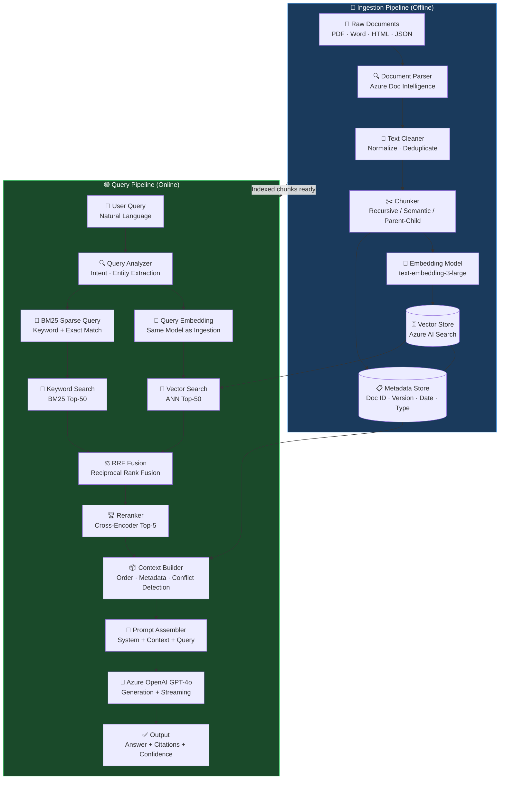

# RAG Architecture Mastery — Brit Insurance Interview Prep

> **Interview Question:** *"Explain RAG architecture in detail with code?"*
> **Follow-up:** *"There was a RAG code, and they asked me to explain it to them and what improvement can I offer?"*

---

## Table of Contents

1. [Complete RAG Architecture Explanation](#1-complete-rag-architecture-explanation)
2. [Production RAG Code Example (Python)](#2-production-rag-code-example-python)
3. [Chunking Strategies — Deep Dive](#3-chunking-strategies--deep-dive)
4. [Embedding Models](#4-embedding-models)
5. [Vector Search — Deep Dive](#5-vector-search--deep-dive)
6. [Hybrid Search — Critical for Insurance](#6-hybrid-search--critical-for-insurance)
7. [Reranking](#7-reranking)
8. [RAG Evaluation Metrics](#8-rag-evaluation-metrics)
9. [Production RAG Challenges & Solutions](#9-production-rag-challenges--solutions)
10. [RAG Code Review — What to Look For](#10-rag-code-review--what-to-look-for)
11. [Insurance-Specific RAG Considerations](#11-insurance-specific-rag-considerations)
12. [Sample Interview Q&A](#12-sample-interview-qa)

---

## 1. Complete RAG Architecture Explanation

### What is RAG?

**Retrieval-Augmented Generation (RAG)** is an architecture pattern that enhances LLM responses by grounding them in retrieved, relevant documents at inference time — solving the fundamental problems of:

- **Hallucination**: LLMs generate plausible but wrong facts
- **Knowledge cutoff**: LLMs don't know about recent events/documents
- **No source traceability**: You can't audit where the answer came from
- **Cost**: You can't fine-tune a 175B-parameter model every time a policy changes

> [!IMPORTANT]
> RAG is not a single algorithm — it's a **pipeline architecture** with multiple independently tunable components. Each component has its own failure modes and improvement levers.

---

### The Two Pipelines

RAG has two distinct pipelines that run at different times:

#### Ingestion Pipeline (Offline / Batch)

```
Raw Documents
     │
     ▼
Document Loading     ← PDFs, Word, HTML, structured data
     │
     ▼
Parsing & Extraction ← Text, tables, images (multimodal)
     │
     ▼
Cleaning             ← Remove headers/footers, normalize whitespace
     │
     ▼
Chunking             ← Split into retrievable units
     │
     ▼
Embedding            ← Convert chunks → dense vectors
     │
     ▼
Vector Store Index   ← HNSW/IVF index + sparse BM25 index
     │
     ▼
Metadata Store       ← Document ID, version, date, policy type
```

#### Query Pipeline (Online / Real-time)

```
User Query
     │
     ▼
Query Understanding  ← Intent detection, entity extraction
     │
     ▼
Query Embedding      ← Same embedding model as ingestion!
     │
     ▼
Hybrid Search        ← Dense (semantic) + Sparse (BM25) retrieval
     │
     ▼
Reranking            ← Cross-encoder re-scores top-50 → top-5
     │
     ▼
Context Construction ← Order chunks, handle conflicts, add metadata
     │
     ▼
Prompt Assembly      ← System prompt + context + user query
     │
     ▼
LLM Generation       ← Azure OpenAI GPT-4o with streaming
     │
     ▼
Output + Citations   ← Answer with traceable source references
```

---

### Architecture Diagram



---

## 2. Production RAG Code Example (Python)

> [!NOTE]
> This implementation uses Azure AI Search for hybrid retrieval + Azure OpenAI for embeddings and generation. It demonstrates production patterns: retry logic, batching, structured logging, error handling, and full type annotations.

### Project Structure

```
rag_system/
├── config.py          # Configuration & constants
├── ingestion/
│   ├── loader.py      # Document loading
│   ├── chunker.py     # Chunking strategies
│   └── indexer.py     # Embedding + indexing
├── retrieval/
│   ├── searcher.py    # Hybrid search
│   └── reranker.py    # Cross-encoder reranking
├── generation/
│   └── generator.py   # Prompt assembly + LLM call
├── evaluation/
│   └── evaluator.py   # RAGAS metrics
└── pipeline.py        # End-to-end orchestration
```

---

### `config.py` — Configuration

```python
"""
config.py — Centralized configuration for RAG system.

Design decision: All magic numbers live here so changing chunk_size=512
doesn't require hunting through 5 files. Validated at startup.
"""
import os
from dataclasses import dataclass, field
from typing import Optional
import logging

logger = logging.getLogger(__name__)


@dataclass
class AzureOpenAIConfig:
    """Azure OpenAI service configuration."""
    endpoint: str = field(
        default_factory=lambda: os.environ["AZURE_OPENAI_ENDPOINT"]
    )
    api_key: str = field(
        default_factory=lambda: os.environ["AZURE_OPENAI_API_KEY"]
    )
    api_version: str = "2024-02-01"
    
    # Deployment names (not model names — Azure uses deployment names)
    embedding_deployment: str = "text-embedding-3-large"
    chat_deployment: str = "gpt-4o"
    
    # Embedding dimensions — text-embedding-3-large supports 256, 1024, 3072
    # 1536 is a good balance: quality vs storage/latency
    embedding_dimensions: int = 1536


@dataclass
class AzureSearchConfig:
    """Azure AI Search service configuration."""
    endpoint: str = field(
        default_factory=lambda: os.environ["AZURE_SEARCH_ENDPOINT"]
    )
    api_key: str = field(
        default_factory=lambda: os.environ["AZURE_SEARCH_API_KEY"]
    )
    index_name: str = "insurance-policies-v2"
    
    # Hybrid search weights: how much to weight vector vs keyword
    # semantic_weight=0.5 means 50/50 blend via RRF
    semantic_weight: float = 0.5
    semantic_configuration: str = "insurance-semantic-config"


@dataclass  
class ChunkingConfig:
    """Chunking parameters — tuned for insurance documents."""
    # Insurance policies have dense, structured text
    # 512 tokens ≈ a policy clause; small enough to be precise,
    # large enough to contain complete clauses
    chunk_size: int = 512
    chunk_overlap: int = 64       # ~12.5% overlap prevents boundary splits
    min_chunk_size: int = 100     # Discard tiny orphaned chunks
    
    # For parent-child chunking:
    parent_chunk_size: int = 2048  # Full context window
    child_chunk_size: int = 256    # Fine-grained retrieval unit


@dataclass
class RetrievalConfig:
    """Retrieval pipeline parameters."""
    # Retrieve many candidates, then rerank to a small precise set
    # NEVER retrieve just top-5 directly — precision at retrieval is poor
    initial_top_k: int = 50       # Retrieve top-50 candidates
    rerank_top_k: int = 5         # Keep top-5 after reranking
    
    # Score threshold — below this, say "I don't know" not hallucinate
    min_relevance_score: float = 0.75
    
    # Maximum context tokens to send to LLM
    # GPT-4o supports 128k but cost scales linearly; 8k is pragmatic
    max_context_tokens: int = 8000


@dataclass
class RAGConfig:
    """Master configuration object."""
    azure_openai: AzureOpenAIConfig = field(default_factory=AzureOpenAIConfig)
    azure_search: AzureSearchConfig = field(default_factory=AzureSearchConfig)
    chunking: ChunkingConfig = field(default_factory=ChunkingConfig)
    retrieval: RetrievalConfig = field(default_factory=RetrievalConfig)
    
    # Operational settings
    max_retries: int = 3
    retry_base_delay: float = 1.0   # seconds, doubles each retry (exponential backoff)
    request_timeout: int = 30       # seconds
    
    def validate(self) -> None:
        """Fail fast if config is invalid — better than cryptic errors later."""
        required_vars = [
            "AZURE_OPENAI_ENDPOINT", "AZURE_OPENAI_API_KEY",
            "AZURE_SEARCH_ENDPOINT", "AZURE_SEARCH_API_KEY"
        ]
        missing = [v for v in required_vars if not os.environ.get(v)]
        if missing:
            raise EnvironmentError(
                f"Missing required environment variables: {missing}\n"
                f"Set these before running the RAG pipeline."
            )
        logger.info("Configuration validated successfully.")
```

---

### `ingestion/chunker.py` — Chunking Strategies

```python
"""
chunker.py — Multiple chunking strategies for insurance documents.

Key insight: Chunking strategy dramatically affects RAG quality.
A chunk should be semantically self-contained — a retriever should be
able to determine relevance from the chunk alone, without surrounding context.
"""
import re
import logging
from abc import ABC, abstractmethod
from dataclasses import dataclass
from typing import Generator, Optional
from langchain.text_splitter import RecursiveCharacterTextSplitter

logger = logging.getLogger(__name__)


@dataclass
class Chunk:
    """A retrievable unit of text with full provenance metadata."""
    chunk_id: str           # Unique ID: "{doc_id}_{chunk_index}"
    document_id: str        # Parent document identifier
    text: str               # The actual chunk content
    token_count: int        # Approximate token count (chars/4)
    metadata: dict          # Doc type, section, page, date, version
    parent_chunk_id: Optional[str] = None  # For parent-child chunking


class BaseChunker(ABC):
    """Abstract base — all chunkers must implement chunk()."""
    
    @abstractmethod
    def chunk(self, text: str, document_id: str, metadata: dict) -> list[Chunk]:
        """Split text into retrievable chunks."""
        pass
    
    def _make_chunk_id(self, doc_id: str, index: int) -> str:
        return f"{doc_id}_{index:04d}"
    
    def _count_tokens(self, text: str) -> int:
        # Approximation: 1 token ≈ 4 characters for English text
        # For production: use tiktoken for exact counts
        return len(text) // 4


class FixedSizeChunker(BaseChunker):
    """
    Strategy 1: Fixed-size chunking.
    
    How it works: Split every N characters, with M characters of overlap.
    
    Pros:
    - Simple, predictable chunk sizes
    - Easy to reason about index size and costs
    
    Cons:
    - Breaks mid-sentence, mid-clause — destroys semantic coherence
    - "The policy covers £5,000 for... [SPLIT] ...accidental damage" is broken
    
    When to use: Prototype/baseline only. Never for production insurance RAG.
    """
    
    def __init__(self, chunk_size: int = 512, overlap: int = 64):
        self.chunk_size = chunk_size
        self.overlap = overlap
    
    def chunk(self, text: str, document_id: str, metadata: dict) -> list[Chunk]:
        chunks = []
        start = 0
        index = 0
        
        while start < len(text):
            end = start + self.chunk_size
            chunk_text = text[start:end]
            
            if len(chunk_text) >= 50:  # Discard tiny tail chunks
                chunks.append(Chunk(
                    chunk_id=self._make_chunk_id(document_id, index),
                    document_id=document_id,
                    text=chunk_text,
                    token_count=self._count_tokens(chunk_text),
                    metadata={**metadata, "chunk_strategy": "fixed_size"}
                ))
                index += 1
            
            start = end - self.overlap  # Step back by overlap
        
        logger.debug(f"FixedSizeChunker: {document_id} → {len(chunks)} chunks")
        return chunks


class RecursiveChunker(BaseChunker):
    """
    Strategy 2: Recursive / sentence-aware chunking.
    
    How it works: Try to split on paragraph → sentence → word boundaries,
    in that order. Only splits on smaller units if the larger unit exceeds
    chunk_size. Uses LangChain's RecursiveCharacterTextSplitter.
    
    Pros:
    - Preserves sentence and paragraph integrity
    - Much better semantic coherence than fixed-size
    - Standard choice for most RAG applications
    
    Cons:
    - Variable chunk sizes make cost estimation harder
    - Can still break mid-table or mid-list in structured documents
    
    When to use: Default choice for prose-heavy documents.
    Insurance policy narrative sections, exclusion clauses.
    """
    
    def __init__(self, chunk_size: int = 512, overlap: int = 64):
        # Separator hierarchy: try larger units first
        self.splitter = RecursiveCharacterTextSplitter(
            separators=["\n\n", "\n", ". ", "! ", "? ", ", ", " ", ""],
            chunk_size=chunk_size * 4,   # chars, not tokens (approx)
            chunk_overlap=overlap * 4,
            length_function=len,
            is_separator_regex=False,
        )
    
    def chunk(self, text: str, document_id: str, metadata: dict) -> list[Chunk]:
        raw_chunks = self.splitter.split_text(text)
        chunks = []
        
        for index, raw_chunk in enumerate(raw_chunks):
            if len(raw_chunk.strip()) < 50:
                continue  # Skip near-empty chunks
            
            chunks.append(Chunk(
                chunk_id=self._make_chunk_id(document_id, index),
                document_id=document_id,
                text=raw_chunk.strip(),
                token_count=self._count_tokens(raw_chunk),
                metadata={**metadata, "chunk_strategy": "recursive"}
            ))
        
        return chunks


class ParentChildChunker(BaseChunker):
    """
    Strategy 3: Parent-child chunking (Small-to-Big retrieval).
    
    How it works:
    - RETRIEVAL uses small child chunks (256 tokens) for precision
    - CONTEXT uses their large parent chunk (2048 tokens) for completeness
    
    The child chunk is embedded and stored in the vector index.
    At retrieval time, the system fetches the PARENT of any matched child.
    
    Pros:
    - Best of both worlds: precise retrieval + rich context
    - Prevents "snippet" problem where retrieved chunk is too small
    
    Cons:
    - More complex indexing logic
    - Requires metadata linking child → parent
    
    When to use: IDEAL for insurance policies. A specific clause is small,
    but to answer correctly, you need the full section surrounding it.
    Example: "Does my policy cover X?" needs the clause + definitions section.
    """
    
    def __init__(
        self,
        parent_size: int = 2048,
        child_size: int = 256,
        overlap: int = 32
    ):
        self.parent_splitter = RecursiveCharacterTextSplitter(
            chunk_size=parent_size * 4,
            chunk_overlap=0,        # Parents don't overlap — they're complete sections
        )
        self.child_splitter = RecursiveCharacterTextSplitter(
            chunk_size=child_size * 4,
            chunk_overlap=overlap * 4,
        )
    
    def chunk(self, text: str, document_id: str, metadata: dict) -> list[Chunk]:
        """Returns both parent and child chunks.
        
        Only CHILD chunks are embedded/indexed for retrieval.
        PARENT chunks are stored in a document store (e.g., Cosmos DB)
        and fetched by parent_chunk_id at query time.
        """
        all_chunks = []
        parent_texts = self.parent_splitter.split_text(text)
        
        for p_idx, parent_text in enumerate(parent_texts):
            parent_id = self._make_chunk_id(document_id, p_idx)
            
            # Create parent chunk (stored in doc store, NOT vector index)
            parent_chunk = Chunk(
                chunk_id=parent_id,
                document_id=document_id,
                text=parent_text,
                token_count=self._count_tokens(parent_text),
                metadata={
                    **metadata,
                    "chunk_strategy": "parent",
                    "is_parent": True,
                }
            )
            all_chunks.append(parent_chunk)
            
            # Create child chunks (embedded and put in vector index)
            child_texts = self.child_splitter.split_text(parent_text)
            for c_idx, child_text in enumerate(child_texts):
                if len(child_text.strip()) < 30:
                    continue
                child_chunk = Chunk(
                    chunk_id=f"{parent_id}_c{c_idx:03d}",
                    document_id=document_id,
                    text=child_text.strip(),
                    token_count=self._count_tokens(child_text),
                    metadata={
                        **metadata,
                        "chunk_strategy": "child",
                        "is_parent": False,
                    },
                    parent_chunk_id=parent_id  # Key link: child knows its parent
                )
                all_chunks.append(child_chunk)
        
        logger.info(
            f"ParentChildChunker: {document_id} → "
            f"{sum(1 for c in all_chunks if c.metadata.get('is_parent'))} parents, "
            f"{sum(1 for c in all_chunks if not c.metadata.get('is_parent'))} children"
        )
        return all_chunks


class SemanticChunker(BaseChunker):
    """
    Strategy 4: Semantic chunking.
    
    How it works: Embed each sentence, then split where cosine similarity
    between adjacent sentences drops below a threshold. Chunks together
    topically coherent text, regardless of character count.
    
    Pros:
    - Semantically coherent chunks — no arbitrary splits
    - Handles variable-density text well
    
    Cons:
    - Expensive: requires embedding every sentence during ingestion
    - Unpredictable chunk sizes
    - Overkill for well-structured documents with clear section headers
    
    When to use: Unstructured, flowing text (regulatory guidance documents,
    claim descriptions). Not ideal for tabular policy schedules.
    """
    
    def __init__(self, embedding_client, similarity_threshold: float = 0.5):
        self.embedding_client = embedding_client
        self.threshold = similarity_threshold
    
    def chunk(self, text: str, document_id: str, metadata: dict) -> list[Chunk]:
        import numpy as np
        
        # Split into sentences as atomic units
        sentences = self._split_sentences(text)
        if not sentences:
            return []
        
        # Embed all sentences in one batch call
        embeddings = self.embedding_client.embed_batch(sentences)
        
        # Find split points where semantic similarity drops
        chunks_text = []
        current_chunk = [sentences[0]]
        
        for i in range(1, len(sentences)):
            # Cosine similarity between adjacent sentence embeddings
            cos_sim = self._cosine_similarity(embeddings[i-1], embeddings[i])
            
            if cos_sim < self.threshold:
                # Semantic break detected — end current chunk, start new one
                chunks_text.append(" ".join(current_chunk))
                current_chunk = [sentences[i]]
            else:
                current_chunk.append(sentences[i])
        
        if current_chunk:
            chunks_text.append(" ".join(current_chunk))
        
        return [
            Chunk(
                chunk_id=self._make_chunk_id(document_id, i),
                document_id=document_id,
                text=ct,
                token_count=self._count_tokens(ct),
                metadata={**metadata, "chunk_strategy": "semantic"}
            )
            for i, ct in enumerate(chunks_text)
            if len(ct) >= 50
        ]
    
    def _split_sentences(self, text: str) -> list[str]:
        """Simple sentence splitter. Production: use spaCy or NLTK."""
        return [s.strip() for s in re.split(r'(?<=[.!?])\s+', text) if s.strip()]
    
    def _cosine_similarity(self, a: list[float], b: list[float]) -> float:
        import math
        dot = sum(x * y for x, y in zip(a, b))
        norm_a = math.sqrt(sum(x**2 for x in a))
        norm_b = math.sqrt(sum(x**2 for x in b))
        return dot / (norm_a * norm_b + 1e-10)
```

---

### `ingestion/indexer.py` — Embedding & Indexing

```python
"""
indexer.py — Batch embedding and Azure AI Search indexing.

Critical patterns demonstrated here:
1. BATCH embedding (never embed one-at-a-time in a loop)
2. Exponential backoff retry on rate limits
3. Structured logging for observability
4. Index field mapping with metadata preservation
"""
import time
import logging
import hashlib
from typing import Optional
from openai import AzureOpenAI
from azure.search.documents import SearchClient
from azure.search.documents.indexes import SearchIndexClient
from azure.search.documents.indexes.models import (
    SearchIndex, SearchField, SearchFieldDataType,
    VectorSearch, HnswAlgorithmConfiguration, VectorSearchProfile,
    SemanticConfiguration, SemanticSearch, SemanticPrioritizedFields,
    SemanticField, SimpleField, SearchableField
)
from azure.core.credentials import AzureKeyCredential
from config import RAGConfig
from ingestion.chunker import Chunk

logger = logging.getLogger(__name__)


class EmbeddingClient:
    """
    Wraps Azure OpenAI embeddings with batching and retry logic.
    
    COMMON MISTAKE in RAG code:
    
    # ❌ WRONG: Embeds one at a time — 1000 chunks = 1000 API calls
    for chunk in chunks:
        embedding = openai_client.embed(chunk.text)
    
    # ✅ CORRECT: Batch up to 2048 texts per API call
    embeddings = openai_client.embed_batch([c.text for c in chunks])
    """
    
    # Azure OpenAI text-embedding-3-large max batch size
    MAX_BATCH_SIZE = 2048
    
    def __init__(self, config: RAGConfig):
        self.config = config
        self.client = AzureOpenAI(
            azure_endpoint=config.azure_openai.endpoint,
            api_key=config.azure_openai.api_key,
            api_version=config.azure_openai.api_version,
        )
        self.deployment = config.azure_openai.embedding_deployment
        self.dimensions = config.azure_openai.embedding_dimensions
    
    def embed_batch(self, texts: list[str]) -> list[list[float]]:
        """
        Embed a list of texts in optimal batches.
        Returns embeddings in the same order as input texts.
        """
        if not texts:
            return []
        
        # Clean inputs — empty strings cause API errors
        texts = [t.strip() if t.strip() else "." for t in texts]
        
        all_embeddings = []
        total_batches = (len(texts) + self.MAX_BATCH_SIZE - 1) // self.MAX_BATCH_SIZE
        
        for batch_idx in range(total_batches):
            start = batch_idx * self.MAX_BATCH_SIZE
            end = min(start + self.MAX_BATCH_SIZE, len(texts))
            batch = texts[start:end]
            
            logger.info(
                f"Embedding batch {batch_idx + 1}/{total_batches} "
                f"({len(batch)} texts)"
            )
            
            batch_embeddings = self._embed_with_retry(batch)
            all_embeddings.extend(batch_embeddings)
        
        return all_embeddings
    
    def _embed_with_retry(
        self, 
        texts: list[str], 
        max_retries: int = 3
    ) -> list[list[float]]:
        """
        Exponential backoff retry — critical for production stability.
        
        Azure OpenAI rate limits (TPM/RPM) will be hit in production.
        Without retry, your ingestion pipeline just fails.
        """
        last_error = None
        
        for attempt in range(max_retries):
            try:
                response = self.client.embeddings.create(
                    model=self.deployment,
                    input=texts,
                    dimensions=self.dimensions,  # Only for text-embedding-3-*
                )
                
                # Sort by index in case API returns out of order (it can)
                sorted_data = sorted(response.data, key=lambda x: x.index)
                return [item.embedding for item in sorted_data]
                
            except Exception as e:
                last_error = e
                if attempt < max_retries - 1:
                    # Exponential backoff: 1s, 2s, 4s
                    delay = (2 ** attempt) * self.config.retry_base_delay
                    logger.warning(
                        f"Embedding attempt {attempt + 1} failed: {e}. "
                        f"Retrying in {delay:.1f}s..."
                    )
                    time.sleep(delay)
                else:
                    logger.error(
                        f"All {max_retries} embedding attempts failed for "
                        f"batch of {len(texts)} texts."
                    )
        
        raise RuntimeError(
            f"Failed to embed batch after {max_retries} retries: {last_error}"
        )


class SearchIndexer:
    """
    Creates Azure AI Search index and uploads embedded chunks.
    
    Azure AI Search supports:
    - Vector fields for dense semantic search
    - Searchable fields for BM25/keyword search (BOTH needed for hybrid!)
    - Filterable fields for metadata filtering
    - Semantic configuration for L2 reranking
    """
    
    def __init__(self, config: RAGConfig, embedding_client: EmbeddingClient):
        self.config = config
        self.embedding_client = embedding_client
        
        credential = AzureKeyCredential(config.azure_search.api_key)
        
        self.index_client = SearchIndexClient(
            endpoint=config.azure_search.endpoint,
            credential=credential
        )
        self.search_client = SearchClient(
            endpoint=config.azure_search.endpoint,
            index_name=config.azure_search.index_name,
            credential=credential
        )
    
    def create_index(self) -> None:
        """
        Create the search index schema.
        
        Field design decisions:
        - 'id': unique chunk identifier (required by Azure Search)
        - 'content': the chunk text (searchable for BM25, stored for retrieval)
        - 'content_vector': the embedding (vector field for ANN search)
        - metadata fields: filterable + facetable for production queries
        """
        fields = [
            # Key field — must be string, unique per document
            SimpleField(
                name="id",
                type=SearchFieldDataType.String,
                key=True,
                filterable=True
            ),
            # The chunk text — searchable enables BM25 over this field
            SearchableField(
                name="content",
                type=SearchFieldDataType.String,
                analyzer_name="en.microsoft"  # English language analyzer
            ),
            # Dense vector for semantic similarity search
            SearchField(
                name="content_vector",
                type=SearchFieldDataType.Collection(SearchFieldDataType.Single),
                searchable=True,
                vector_search_dimensions=self.config.azure_openai.embedding_dimensions,
                vector_search_profile_name="insurance-hnsw-profile"
            ),
            # Metadata fields — critical for filtering and auditability
            SimpleField(name="document_id", type=SearchFieldDataType.String, filterable=True),
            SimpleField(name="document_type", type=SearchFieldDataType.String, filterable=True, facetable=True),
            SimpleField(name="policy_number", type=SearchFieldDataType.String, filterable=True),
            SimpleField(name="effective_date", type=SearchFieldDataType.DateTimeOffset, filterable=True, sortable=True),
            SimpleField(name="version", type=SearchFieldDataType.String, filterable=True),
            SimpleField(name="section", type=SearchFieldDataType.String, filterable=True),
            SimpleField(name="page_number", type=SearchFieldDataType.Int32, filterable=True),
            SimpleField(name="parent_chunk_id", type=SearchFieldDataType.String, filterable=True),
            SimpleField(name="chunk_strategy", type=SearchFieldDataType.String, filterable=True),
            # Title field — used by semantic reranker for context
            SearchableField(name="title", type=SearchFieldDataType.String),
        ]
        
        # HNSW vector search configuration
        # ef_construction=400: higher = better recall during indexing, slower build
        # m=4: number of bidirectional links per node (higher = more memory, better recall)
        vector_search = VectorSearch(
            algorithms=[
                HnswAlgorithmConfiguration(
                    name="insurance-hnsw",
                    parameters={
                        "m": 4,
                        "ef_construction": 400,
                        "ef_search": 500,     # Higher = better query recall, slower
                        "metric": "cosine"    # cosine similarity for normalized embeddings
                    }
                )
            ],
            profiles=[
                VectorSearchProfile(
                    name="insurance-hnsw-profile",
                    algorithm_configuration_name="insurance-hnsw"
                )
            ]
        )
        
        # Semantic search configuration
        # Tells the semantic reranker which fields contain the important content
        semantic_config = SemanticConfiguration(
            name=self.config.azure_search.semantic_configuration,
            prioritized_fields=SemanticPrioritizedFields(
                content_fields=[SemanticField(field_name="content")],
                title_field=SemanticField(field_name="title"),
                keywords_fields=[
                    SemanticField(field_name="document_type"),
                    SemanticField(field_name="section"),
                ]
            )
        )
        
        index = SearchIndex(
            name=self.config.azure_search.index_name,
            fields=fields,
            vector_search=vector_search,
            semantic_search=SemanticSearch(configurations=[semantic_config])
        )
        
        # create_or_update — idempotent, safe to call on reruns
        self.index_client.create_or_update_index(index)
        logger.info(f"Created/updated index: {self.config.azure_search.index_name}")
    
    def index_chunks(self, chunks: list[Chunk]) -> None:
        """
        Embed and upload chunks in batches.
        
        Only indexes CHILD chunks (not parents) — parents are stored
        in a separate document store and fetched by ID at query time.
        """
        # Filter: only embed leaf/child chunks for the vector index
        index_chunks = [
            c for c in chunks 
            if not c.metadata.get("is_parent", False)
        ]
        
        if not index_chunks:
            logger.warning("No chunks to index after filtering parents.")
            return
        
        logger.info(f"Indexing {len(index_chunks)} chunks...")
        
        # Batch embed all chunk texts
        texts = [c.text for c in index_chunks]
        embeddings = self.embedding_client.embed_batch(texts)
        
        # Build search documents with full metadata
        search_docs = []
        for chunk, embedding in zip(index_chunks, embeddings):
            search_doc = {
                "id": self._sanitize_id(chunk.chunk_id),
                "content": chunk.text,
                "content_vector": embedding,
                "document_id": chunk.document_id,
                "document_type": chunk.metadata.get("document_type", "unknown"),
                "policy_number": chunk.metadata.get("policy_number", ""),
                "effective_date": chunk.metadata.get("effective_date"),
                "version": chunk.metadata.get("version", "1.0"),
                "section": chunk.metadata.get("section", ""),
                "page_number": chunk.metadata.get("page_number"),
                "parent_chunk_id": chunk.parent_chunk_id or "",
                "chunk_strategy": chunk.metadata.get("chunk_strategy", "unknown"),
                "title": chunk.metadata.get("title", ""),
            }
            search_docs.append(search_doc)
        
        # Upload in Azure Search batches (max 1000 per request)
        UPLOAD_BATCH_SIZE = 1000
        for i in range(0, len(search_docs), UPLOAD_BATCH_SIZE):
            batch = search_docs[i:i + UPLOAD_BATCH_SIZE]
            results = self.search_client.upload_documents(documents=batch)
            
            # Check for individual document failures
            failed = [r for r in results if not r.succeeded]
            if failed:
                logger.error(
                    f"Failed to upload {len(failed)} documents: "
                    f"{[r.key for r in failed[:5]]}"  # Show first 5 failures
                )
            else:
                logger.info(f"Uploaded batch of {len(batch)} chunks successfully.")
    
    def _sanitize_id(self, chunk_id: str) -> str:
        """
        Azure AI Search keys must be URL-safe strings.
        Hash any IDs that contain special characters.
        """
        safe_chars = set('abcdefghijklmnopqrstuvwxyzABCDEFGHIJKLMNOPQRSTUVWXYZ0123456789-_=')
        if all(c in safe_chars for c in chunk_id):
            return chunk_id
        return hashlib.md5(chunk_id.encode()).hexdigest()
```

---

### `retrieval/searcher.py` — Hybrid Search

```python
"""
retrieval/searcher.py — Hybrid search combining dense vector + sparse BM25.

Why hybrid search ALWAYS beats semantic-only for insurance:
- Policy number "POL-2024-789234" → pure semantic search misses this (no semantics)
- "Section 4.2(b) exclusions" → BM25 finds this; semantic search doesn't understand codes
- "£5,000 accidental damage limit" → exact monetary amounts need exact matching
- Medical procedure codes, legal references → BM25 handles these naturally

Azure AI Search implements hybrid via RRF (Reciprocal Rank Fusion).
"""
import logging
from dataclasses import dataclass
from typing import Optional
from azure.search.documents import SearchClient
from azure.search.documents.models import (
    VectorizedQuery,
    QueryType,
    QueryCaptionType,
    QueryAnswerType,
    SemanticErrorMode
)
from azure.core.credentials import AzureKeyCredential
from config import RAGConfig
from ingestion.indexer import EmbeddingClient

logger = logging.getLogger(__name__)


@dataclass
class SearchResult:
    """A single retrieved document with its relevance score."""
    chunk_id: str
    document_id: str
    content: str
    score: float            # RRF combined score
    rerank_score: Optional[float] = None  # Set after reranking
    metadata: dict = None
    
    def __post_init__(self):
        if self.metadata is None:
            self.metadata = {}


class HybridSearcher:
    """
    Hybrid search: dense vector search + sparse BM25 + semantic reranking.
    
    Search modes available in Azure AI Search:
    1. Keyword only (BM25): fast, exact, no semantic understanding
    2. Vector only (ANN): semantic understanding, misses exact terms
    3. Hybrid (BM25 + Vector + RRF): best of both worlds ✅
    4. Hybrid + Semantic Reranking: adds L2 cross-encoder reranking ✅✅
    """
    
    def __init__(self, config: RAGConfig, embedding_client: EmbeddingClient):
        self.config = config
        self.embedding_client = embedding_client
        
        self.search_client = SearchClient(
            endpoint=config.azure_search.endpoint,
            index_name=config.azure_search.index_name,
            credential=AzureKeyCredential(config.azure_search.api_key)
        )
    
    def search(
        self,
        query: str,
        top_k: int = 50,
        filters: Optional[str] = None,
        use_semantic_reranking: bool = True,
    ) -> list[SearchResult]:
        """
        Execute hybrid search and return top_k results.
        
        Args:
            query: Natural language user query
            top_k: Number of results to retrieve (before reranking)
            filters: OData filter expression, e.g.:
                     "policy_number eq 'POL-2024-001' and document_type eq 'motor'"
            use_semantic_reranking: Apply Azure semantic reranker (L2)
        
        Returns:
            List of SearchResult ordered by combined score (descending)
        """
        if not query.strip():
            raise ValueError("Search query cannot be empty")
        
        # Step 1: Embed the query using the SAME model used for ingestion
        # This is critical — mismatched models produce garbage results
        query_embedding = self.embedding_client.embed_batch([query])[0]
        
        # Step 2: Build vector query component
        vector_query = VectorizedQuery(
            vector=query_embedding,
            k_nearest_neighbors=top_k,  # Return top-k from vector search
            fields="content_vector",    # Which field to search
            # exhaustive=True would use brute-force exact search
            # (slower but 100% recall) — use for debugging only
        )
        
        # Step 3: Build the combined search request
        search_kwargs = {
            "search_text": query,           # Enables BM25 keyword search
            "vector_queries": [vector_query],  # Enables vector search
            "top": top_k,                   # Total results after RRF fusion
            "select": [                     # Fields to retrieve
                "id", "content", "document_id", "document_type",
                "policy_number", "effective_date", "version",
                "section", "page_number", "parent_chunk_id", "title"
            ],
            "filter": filters,
        }
        
        # Step 4: Add semantic reranking (Azure's built-in L2 reranker)
        if use_semantic_reranking:
            search_kwargs.update({
                "query_type": QueryType.SEMANTIC,
                "semantic_configuration_name": (
                    self.config.azure_search.semantic_configuration
                ),
                "query_caption": QueryCaptionType.EXTRACTIVE,
                "query_answer": QueryAnswerType.EXTRACTIVE,
                "semantic_error_mode": SemanticErrorMode.PARTIAL,
            })
        
        logger.info(
            f"Executing hybrid search: query='{query[:80]}...', "
            f"top_k={top_k}, semantic={use_semantic_reranking}, "
            f"filters={filters}"
        )
        
        # Step 5: Execute search with retry
        results = self._search_with_retry(**search_kwargs)
        
        # Step 6: Parse and return results
        search_results = []
        for doc in results:
            result = SearchResult(
                chunk_id=doc["id"],
                document_id=doc.get("document_id", ""),
                content=doc["content"],
                score=doc.get("@search.score", 0.0),
                rerank_score=doc.get("@search.reranker_score"),
                metadata={
                    "document_type": doc.get("document_type", ""),
                    "policy_number": doc.get("policy_number", ""),
                    "effective_date": str(doc.get("effective_date", "")),
                    "version": doc.get("version", ""),
                    "section": doc.get("section", ""),
                    "page_number": doc.get("page_number"),
                    "parent_chunk_id": doc.get("parent_chunk_id", ""),
                    "title": doc.get("title", ""),
                    "captions": getattr(doc, "@search.captions", []),
                }
            )
            search_results.append(result)
        
        logger.info(f"Retrieved {len(search_results)} results")
        return search_results
    
    def _search_with_retry(self, **kwargs) -> list:
        """Retry search on transient failures."""
        import time
        last_error = None
        
        for attempt in range(self.config.max_retries):
            try:
                results = list(self.search_client.search(**kwargs))
                return results
            except Exception as e:
                last_error = e
                if attempt < self.config.max_retries - 1:
                    delay = (2 ** attempt) * self.config.retry_base_delay
                    logger.warning(f"Search attempt {attempt + 1} failed: {e}. Retry in {delay}s")
                    time.sleep(delay)
        
        raise RuntimeError(f"Search failed after {self.config.max_retries} retries: {last_error}")
```

---

### `retrieval/reranker.py` — Cross-Encoder Reranking

```python
"""
retrieval/reranker.py — Cross-encoder reranking of initial retrieval results.

WHY RERANKING IS NECESSARY:
Initial retrieval is a coarse filter — it maximizes RECALL (find all possibly
relevant chunks), but PRECISION suffers. The top-50 results will contain noise.

Bi-encoder (embedding model) = encodes query and document INDEPENDENTLY
  → Fast to search (pre-computed), but misses fine-grained query-document interaction
  
Cross-encoder = reads query and document TOGETHER in one forward pass
  → Slower (can't pre-compute), but much better relevance scoring
  
Pattern: Retrieve top-50 with bi-encoder → Rerank with cross-encoder → Keep top-5
"""
import logging
from typing import Optional
from retrieval.searcher import SearchResult

logger = logging.getLogger(__name__)


class AzureSemanticReranker:
    """
    Uses Azure AI Search's built-in semantic reranker (Microsoft's model).
    This is already applied during search when query_type=SEMANTIC.
    This class handles the POST-search reranking pass.
    """
    
    def rerank(
        self,
        results: list[SearchResult],
        top_k: int = 5,
        min_score: float = 0.0
    ) -> list[SearchResult]:
        """
        Re-order results by reranker score if available.
        Azure semantic reranker scores range from 0 to 4.
        """
        # Sort by reranker score (if available) or fall back to search score
        scored = [
            r for r in results
            if (r.rerank_score or r.score) >= min_score
        ]
        
        scored.sort(
            key=lambda r: r.rerank_score if r.rerank_score is not None else r.score,
            reverse=True
        )
        
        reranked = scored[:top_k]
        
        logger.info(
            f"Reranked {len(results)} → {len(reranked)} results. "
            f"Top score: {reranked[0].rerank_score if reranked else 'N/A'}"
        )
        return reranked


class CohereReranker:
    """
    Alternative: Cohere's rerank-english-v3.0 model.
    Useful when Azure semantic reranker isn't available or for A/B testing.
    
    Cohere reranker is a cross-encoder: it processes (query, document) pairs
    jointly and outputs a relevance score. Significantly better than bi-encoder
    ranking for nuanced insurance policy questions.
    """
    
    def __init__(self, api_key: str, model: str = "rerank-english-v3.0"):
        try:
            import cohere
            self.client = cohere.Client(api_key=api_key)
            self.model = model
        except ImportError:
            raise ImportError("Install cohere: pip install cohere")
    
    def rerank(
        self,
        query: str,
        results: list[SearchResult],
        top_k: int = 5,
        min_score: float = 0.0
    ) -> list[SearchResult]:
        """
        Send (query, document) pairs to Cohere reranker.
        Returns top_k results ordered by cross-encoder relevance score.
        """
        if not results:
            return []
        
        # Cohere expects raw text documents
        documents = [r.content for r in results]
        
        response = self.client.rerank(
            query=query,
            documents=documents,
            model=self.model,
            top_n=top_k,
            return_documents=False  # We have documents, just need scores
        )
        
        # Map scores back to SearchResult objects
        reranked = []
        for hit in response.results:
            if hit.relevance_score >= min_score:
                result = results[hit.index]
                result.rerank_score = hit.relevance_score
                reranked.append(result)
        
        logger.info(
            f"Cohere reranked {len(results)} → {len(reranked)} results"
        )
        return reranked
```

---

### `generation/generator.py` — Context Construction & Generation

```python
"""
generation/generator.py — Prompt assembly, context management, and LLM generation.

Key responsibilities:
1. Order retrieved chunks optimally (Lost-in-the-middle problem)
2. Detect and handle conflicting information
3. Construct the prompt with citations
4. Stream the response
5. Verify answer against sources (hallucination check)
"""
import logging
import json
import time
from dataclasses import dataclass
from typing import Generator, Optional
from openai import AzureOpenAI
from openai import APIError, RateLimitError, APITimeoutError
from retrieval.searcher import SearchResult
from config import RAGConfig

logger = logging.getLogger(__name__)


@dataclass
class RAGResponse:
    """Structured output from the RAG pipeline."""
    answer: str                         # The generated answer
    sources: list[dict]                 # Citations with metadata
    confidence: float                   # 0-1 confidence estimate
    has_conflict: bool                  # True if retrieved docs conflict
    conflict_description: Optional[str] # What the conflict is
    tokens_used: dict                   # prompt_tokens, completion_tokens


SYSTEM_PROMPT = """You are an expert insurance policy assistant for Brit Insurance.
Your role is to answer questions accurately based ONLY on the provided policy documents.

CRITICAL RULES:
1. ONLY answer based on the provided context. Never use prior knowledge.
2. If the context doesn't contain sufficient information, say: "Based on the available policy documents, I cannot find specific information about [topic]. Please contact your policy administrator."
3. Always cite which document/section your answer comes from.
4. If documents conflict, explicitly state the conflict and recommend clarification.
5. For coverage questions, always state the policy number and effective date.
6. Never speculate about coverage — unsupported claims cause regulatory issues.

Response format:
- Lead with the direct answer
- Follow with supporting details from the policy
- End with citation: [Source: {document_id}, Section {section}, Version {version}]
"""


class RAGGenerator:
    """Orchestrates context construction and LLM generation."""
    
    def __init__(self, config: RAGConfig):
        self.config = config
        self.client = AzureOpenAI(
            azure_endpoint=config.azure_openai.endpoint,
            api_key=config.azure_openai.api_key,
            api_version=config.azure_openai.api_version,
        )
    
    def generate(
        self,
        query: str,
        retrieved_results: list[SearchResult],
        stream: bool = False,
    ) -> RAGResponse:
        """
        Generate an answer given a query and retrieved context.
        """
        if not retrieved_results:
            return RAGResponse(
                answer=(
                    "I was unable to find relevant information in the policy documents "
                    "to answer your question. Please contact your policy administrator."
                ),
                sources=[],
                confidence=0.0,
                has_conflict=False,
                conflict_description=None,
                tokens_used={}
            )
        
        # Step 1: Detect conflicts in retrieved documents
        conflict_info = self._detect_conflicts(retrieved_results)
        
        # Step 2: Order chunks optimally
        # "Lost in the middle" research shows LLMs perform best when
        # most relevant content is at the START and END of context,
        # not buried in the middle
        ordered_results = self._order_for_llm(retrieved_results)
        
        # Step 3: Build context string within token budget
        context_str, used_results = self._build_context(
            ordered_results,
            max_tokens=self.config.retrieval.max_context_tokens
        )
        
        # Step 4: Assemble the prompt
        user_message = self._build_user_message(
            query=query,
            context=context_str,
            conflict_info=conflict_info
        )
        
        messages = [
            {"role": "system", "content": SYSTEM_PROMPT},
            {"role": "user", "content": user_message}
        ]
        
        # Step 5: Call LLM with retry
        response = self._generate_with_retry(
            messages=messages,
            stream=stream
        )
        
        # Step 6: Parse response and build citations
        answer = response.choices[0].message.content
        sources = self._extract_sources(used_results)
        
        return RAGResponse(
            answer=answer,
            sources=sources,
            confidence=self._estimate_confidence(retrieved_results),
            has_conflict=conflict_info.get("has_conflict", False),
            conflict_description=conflict_info.get("description"),
            tokens_used={
                "prompt_tokens": response.usage.prompt_tokens,
                "completion_tokens": response.usage.completion_tokens,
                "total_tokens": response.usage.total_tokens,
            }
        )
    
    def _order_for_llm(self, results: list[SearchResult]) -> list[SearchResult]:
        """
        Order chunks to mitigate 'Lost in the Middle' degradation.
        
        Research (Liu et al., 2023): LLM performance degrades for information
        placed in the middle of long contexts. Best relevant chunks should be
        placed at positions [0] and [-1].
        
        Strategy: Place highest-scored result first, second-highest last,
        remaining in ascending order of relevance in between.
        """
        if len(results) <= 2:
            return results
        
        ordered = [None] * len(results)
        ordered[0] = results[0]    # Best result first
        ordered[-1] = results[1]   # Second best result last
        
        # Fill middle with remaining results in reverse order
        for i, result in enumerate(results[2:]):
            ordered[i + 1] = result
        
        return [r for r in ordered if r is not None]
    
    def _build_context(
        self,
        results: list[SearchResult],
        max_tokens: int
    ) -> tuple[str, list[SearchResult]]:
        """
        Build context string, respecting token budget.
        Returns the context string and which results were included.
        """
        context_parts = []
        used_results = []
        total_chars = 0
        max_chars = max_tokens * 4  # Approximate: 1 token ≈ 4 chars
        
        for result in results:
            chunk_text = self._format_chunk(result)
            chunk_chars = len(chunk_text)
            
            if total_chars + chunk_chars > max_chars:
                logger.warning(
                    f"Context budget reached after {len(used_results)} chunks. "
                    f"Excluding {len(results) - len(used_results)} chunks."
                )
                break
            
            context_parts.append(chunk_text)
            used_results.append(result)
            total_chars += chunk_chars
        
        return "\n\n---\n\n".join(context_parts), used_results
    
    def _format_chunk(self, result: SearchResult) -> str:
        """Format a retrieved chunk with its provenance metadata."""
        meta = result.metadata
        header = (
            f"[Source: {result.document_id} | "
            f"Type: {meta.get('document_type', 'unknown')} | "
            f"Section: {meta.get('section', 'N/A')} | "
            f"Version: {meta.get('version', '?')} | "
            f"Effective: {meta.get('effective_date', 'N/A')}]"
        )
        return f"{header}\n{result.content}"
    
    def _build_user_message(
        self,
        query: str,
        context: str,
        conflict_info: dict
    ) -> str:
        """Assemble the user message with context and conflict warnings."""
        conflict_warning = ""
        if conflict_info.get("has_conflict"):
            conflict_warning = (
                f"\n⚠️ IMPORTANT: The retrieved documents contain conflicting information:\n"
                f"{conflict_info['description']}\n"
                f"Please address this conflict explicitly in your response.\n"
            )
        
        return (
            f"POLICY DOCUMENTS (Use ONLY this context to answer):\n"
            f"{'='*60}\n"
            f"{context}\n"
            f"{'='*60}\n"
            f"{conflict_warning}\n"
            f"QUESTION: {query}\n\n"
            f"Answer based strictly on the policy documents above. "
            f"If unsure, say so rather than speculating."
        )
    
    def _detect_conflicts(self, results: list[SearchResult]) -> dict:
        """
        Heuristic conflict detection: check if the same policy topic
        appears with different values across documents.
        
        For production: use an LLM to do proper conflict detection.
        """
        # Group by document_id
        docs = {}
        for r in results:
            doc_id = r.document_id
            if doc_id not in docs:
                docs[doc_id] = []
            docs[doc_id].append(r)
        
        # Check for same topic across multiple document versions
        versions_seen = set()
        for r in results:
            version = r.metadata.get("version", "")
            if version:
                versions_seen.add(version)
        
        if len(versions_seen) > 1:
            return {
                "has_conflict": True,
                "description": (
                    f"Multiple document versions found in context: {versions_seen}. "
                    f"Different policy versions may contain different coverage terms. "
                    f"Verify which version applies to the specific policy in question."
                )
            }
        
        return {"has_conflict": False, "description": None}
    
    def _generate_with_retry(self, messages: list, stream: bool) -> object:
        """LLM generation with retry on rate limits and timeouts."""
        last_error = None
        
        for attempt in range(self.config.max_retries):
            try:
                response = self.client.chat.completions.create(
                    model=self.config.azure_openai.chat_deployment,
                    messages=messages,
                    temperature=0.0,      # Zero temperature for factual insurance answers
                    max_tokens=2048,
                    stream=stream,
                    timeout=self.config.request_timeout,
                )
                return response
                
            except RateLimitError as e:
                # Rate limit: must wait, not just retry immediately
                delay = (2 ** attempt) * 5  # Longer delays for rate limits
                logger.warning(f"Rate limit hit. Waiting {delay}s before retry...")
                time.sleep(delay)
                last_error = e
                
            except APITimeoutError as e:
                delay = (2 ** attempt) * self.config.retry_base_delay
                logger.warning(f"Timeout on attempt {attempt + 1}. Retry in {delay}s...")
                time.sleep(delay)
                last_error = e
                
            except APIError as e:
                # Non-retryable API error (e.g. 400 bad request)
                logger.error(f"Non-retryable API error: {e}")
                raise
        
        raise RuntimeError(
            f"LLM generation failed after {self.config.max_retries} retries: {last_error}"
        )
    
    def _extract_sources(self, results: list[SearchResult]) -> list[dict]:
        """Build structured citation list from used results."""
        sources = []
        seen_docs = set()
        
        for result in results:
            doc_id = result.document_id
            if doc_id not in seen_docs:
                sources.append({
                    "document_id": doc_id,
                    "section": result.metadata.get("section", ""),
                    "version": result.metadata.get("version", ""),
                    "effective_date": result.metadata.get("effective_date", ""),
                    "policy_number": result.metadata.get("policy_number", ""),
                    "page": result.metadata.get("page_number"),
                    "relevance_score": result.rerank_score or result.score,
                })
                seen_docs.add(doc_id)
        
        return sources
    
    def _estimate_confidence(self, results: list[SearchResult]) -> float:
        """
        Estimate answer confidence from retrieval scores.
        Low confidence → trigger human review in production.
        """
        if not results:
            return 0.0
        
        top_score = results[0].rerank_score or results[0].score
        
        # Azure semantic reranker scores: 0-4 → normalize to 0-1
        if results[0].rerank_score is not None:
            return min(top_score / 4.0, 1.0)
        
        # RRF scores are typically 0.03-0.07; normalize
        return min(top_score * 10, 1.0)
```

---

### `pipeline.py` — End-to-End Orchestration

```python
"""
pipeline.py — End-to-end RAG pipeline orchestration.

This is the entry point that composes all components.
"""
import logging
import time
from dataclasses import dataclass
from config import RAGConfig
from ingestion.chunker import RecursiveChunker, ParentChildChunker, Chunk
from ingestion.indexer import EmbeddingClient, SearchIndexer
from retrieval.searcher import HybridSearcher, SearchResult
from retrieval.reranker import AzureSemanticReranker
from generation.generator import RAGGenerator, RAGResponse

logging.basicConfig(
    level=logging.INFO,
    format="%(asctime)s [%(levelname)s] %(name)s: %(message)s"
)
logger = logging.getLogger(__name__)


class RAGPipeline:
    """
    Complete RAG pipeline: ingest → search → rerank → generate.
    
    Usage:
        pipeline = RAGPipeline()
        
        # Ingest documents (run once / on update)
        pipeline.ingest_document(text, doc_id, metadata)
        
        # Query (run per user question)
        response = pipeline.query("What is the excess for windscreen claims?")
        print(response.answer)
        for source in response.sources:
            print(f"Source: {source['document_id']}")
    """
    
    def __init__(self, config: Optional[RAGConfig] = None):
        self.config = config or RAGConfig()
        self.config.validate()
        
        # Wire up components
        self.embedding_client = EmbeddingClient(self.config)
        self.indexer = SearchIndexer(self.config, self.embedding_client)
        self.searcher = HybridSearcher(self.config, self.embedding_client)
        self.reranker = AzureSemanticReranker()
        self.generator = RAGGenerator(self.config)
        
        # Use parent-child chunking for insurance (best for policy docs)
        self.chunker = ParentChildChunker(
            parent_size=self.config.chunking.parent_chunk_size,
            child_size=self.config.chunking.child_chunk_size,
            overlap=self.config.chunking.chunk_overlap,
        )
        
        logger.info("RAG Pipeline initialized.")
    
    def setup_index(self) -> None:
        """Create the search index (run once before first ingestion)."""
        self.indexer.create_index()
    
    def ingest_document(
        self,
        text: str,
        document_id: str,
        metadata: dict
    ) -> int:
        """
        Ingest a single document into the pipeline.
        Returns the number of chunks indexed.
        """
        start_time = time.time()
        logger.info(f"Ingesting document: {document_id}")
        
        # Chunk the document
        chunks = self.chunker.chunk(text, document_id, metadata)
        
        # Index only child chunks (parents go to doc store)
        child_chunks = [c for c in chunks if not c.metadata.get("is_parent", False)]
        self.indexer.index_chunks(chunks)
        
        elapsed = time.time() - start_time
        logger.info(
            f"Ingested {document_id}: {len(chunks)} total chunks, "
            f"{len(child_chunks)} indexed in {elapsed:.2f}s"
        )
        return len(child_chunks)
    
    def query(
        self,
        query: str,
        policy_number: Optional[str] = None,
        document_type: Optional[str] = None,
    ) -> RAGResponse:
        """
        Execute the full query pipeline.
        
        Args:
            query: User's natural language question
            policy_number: Optional filter by policy number
            document_type: Optional filter by document type (motor, property, etc.)
        
        Returns:
            RAGResponse with answer, sources, confidence, and conflict info
        """
        start_time = time.time()
        logger.info(f"Query: '{query[:100]}'")
        
        # Build OData filter for metadata constraints
        filters = self._build_filters(policy_number, document_type)
        
        # Step 1: Hybrid search (dense + BM25) → top-50 candidates
        search_results = self.searcher.search(
            query=query,
            top_k=self.config.retrieval.initial_top_k,
            filters=filters,
            use_semantic_reranking=True,
        )
        
        # Step 2: Rerank top-50 → top-5 (already done by Azure semantic reranker)
        reranked_results = self.reranker.rerank(
            results=search_results,
            top_k=self.config.retrieval.rerank_top_k,
            min_score=self.config.retrieval.min_relevance_score,
        )
        
        # Step 3: Generate answer
        response = self.generator.generate(
            query=query,
            retrieved_results=reranked_results,
        )
        
        elapsed = time.time() - start_time
        logger.info(
            f"Query completed in {elapsed:.2f}s. "
            f"Retrieved: {len(search_results)}, "
            f"After rerank: {len(reranked_results)}, "
            f"Confidence: {response.confidence:.2f}"
        )
        
        return response
    
    def _build_filters(
        self,
        policy_number: Optional[str],
        document_type: Optional[str]
    ) -> Optional[str]:
        """Build OData filter expression for Azure AI Search."""
        filter_parts = []
        
        if policy_number:
            # Escape single quotes in OData
            safe_policy = policy_number.replace("'", "''")
            filter_parts.append(f"policy_number eq '{safe_policy}'")
        
        if document_type:
            safe_type = document_type.replace("'", "''")
            filter_parts.append(f"document_type eq '{safe_type}'")
        
        return " and ".join(filter_parts) if filter_parts else None


# ─── Example Usage ────────────────────────────────────────────────────────────

if __name__ == "__main__":
    pipeline = RAGPipeline()
    
    # Setup (run once)
    pipeline.setup_index()
    
    # Ingest a sample document
    sample_policy = """
    Motor Insurance Policy — Schedule of Cover
    Policy Number: POL-2024-MOTOR-001
    Effective Date: 2024-01-01
    
    Section 4: Windscreen and Glass Damage
    4.1 Standard Cover: Your policy includes cover for accidental damage to your 
    vehicle's windscreen, windows, and glass sunroof. The standard excess for 
    windscreen claims is £75 if the windscreen requires replacement, or £0 if 
    the windscreen can be repaired without replacement.
    
    4.2 Limitations: Cover is limited to one windscreen replacement per policy year.
    If you require a second replacement within the same policy year, the full 
    windscreen replacement cost will apply, minus the standard excess of £75.
    """
    
    pipeline.ingest_document(
        text=sample_policy,
        document_id="policy_POL-2024-MOTOR-001",
        metadata={
            "document_type": "motor",
            "policy_number": "POL-2024-MOTOR-001",
            "effective_date": "2024-01-01T00:00:00Z",
            "version": "1.0",
            "title": "Motor Insurance Policy Schedule",
        }
    )
    
    # Query
    response = pipeline.query(
        query="What is the excess for windscreen replacement?",
        policy_number="POL-2024-MOTOR-001"
    )
    
    print(f"\n{'='*60}")
    print(f"ANSWER:\n{response.answer}")
    print(f"\nCONFIDENCE: {response.confidence:.0%}")
    print(f"\nSOURCES:")
    for source in response.sources:
        print(f"  - {source['document_id']} | Section {source['section']} | v{source['version']}")
    
    if response.has_conflict:
        print(f"\n⚠️  CONFLICT DETECTED: {response.conflict_description}")
```

---

## 3. Chunking Strategies — Deep Dive

| Strategy | Chunk Size Control | Semantic Coherence | Ingestion Cost | Best For |
|---|---|---|---|---|
| Fixed-size | ✅ Predictable | ❌ Breaks sentences | Low | Prototyping only |
| Recursive | ✅ Configurable | ✅ Sentence-aware | Low | General prose |
| Semantic | ❌ Variable | ✅✅ Topic-coherent | High (embed all sentences) | Unstructured docs |
| Parent-child | ✅ Two sizes | ✅✅ Best precision + context | Medium | Insurance policies ✅ |
| Sliding window | ✅ Fixed + overlap | ✅ Partial | Low | Dense technical docs |
| Late chunking | N/A | ✅✅✅ Full context | High (embed full doc) | Long documents |

### Late Chunking (Advanced)

```python
"""
Late Chunking: Embed the FULL document first, then split the embeddings.
Each chunk's embedding captures the full document context (not just local context).

Key insight: With traditional chunking, "it" in "it is not covered" may not
embed correctly because "it" refers to something 200 tokens back.
Late chunking gives every chunk full document context.

Requires: jina-embeddings-v3 or models that output per-token embeddings.
"""
def late_chunk(full_text: str, chunk_size: int = 512) -> list[tuple[str, list[float]]]:
    # 1. Get token-level embeddings for full document (Jina v3)
    token_embeddings = embed_full_document(full_text)  # shape: [n_tokens, dim]
    
    # 2. Split text into chunks (sentence-aware)
    chunks = recursive_split(full_text, chunk_size)
    
    # 3. Mean-pool the token embeddings for each chunk's span
    chunk_embeddings = []
    token_offset = 0
    for chunk in chunks:
        chunk_token_count = count_tokens(chunk)
        chunk_emb = mean_pool(
            token_embeddings[token_offset:token_offset + chunk_token_count]
        )
        chunk_embeddings.append((chunk, chunk_emb))
        token_offset += chunk_token_count
    
    return chunk_embeddings  # Each chunk has full-document-context embedding
```

---

## 4. Embedding Models

### Comparison Table

| Model | Dimensions | Max Input | Cost | Best For |
|---|---|---|---|---|
| `text-embedding-ada-002` | 1536 (fixed) | 8,192 tokens | ~$0.10/1M tokens | Legacy, migrate away |
| `text-embedding-3-small` | 512–1536 (variable) | 8,192 tokens | ~$0.02/1M tokens | Cost-sensitive at scale |
| `text-embedding-3-large` | 256–3072 (variable) | 8,192 tokens | ~$0.13/1M tokens | **Best quality** ✅ |
| `sentence-transformers/all-MiniLM-L6-v2` | 384 | 512 tokens | Free (self-host) | Local dev, no API costs |
| `BAAI/bge-large-en-v1.5` | 1024 | 512 tokens | Free (self-host) | Best open-source quality |

### Dimensionality Considerations

```python
# text-embedding-3-large supports Matryoshka dimensions
# You can truncate embeddings without re-embedding — smaller = cheaper storage

# 3072 dims → maximum quality, highest storage/latency cost
# 1536 dims → sweet spot for production ✅
# 256 dims  → useful when you have 10M+ chunks and storage is a constraint

# ⚠️ CRITICAL: You CANNOT mix dimensions in the same index
# If you change embedding dimensions, you must re-embed the entire corpus

response = openai_client.embeddings.create(
    model="text-embedding-3-large",
    input=["Policy covers accidental damage"],
    dimensions=1536  # Request only 1536 of the 3072 available dimensions
)
```

### Domain-Adapted Embeddings for Insurance

```python
"""
Insurance documents contain domain-specific terminology that general 
embeddings may not represent well:
- "excess" (insurance deductible) vs "excess" (surplus)
- "material fact" (legal term) vs "material" (substance)
- "utmost good faith" (uberrimae fidei)
- Product codes: "CGLB2024", "MOTO-COMP-001"

Options for domain adaptation:
1. Fine-tune embeddings on insurance corpus (expensive, requires labeled data)
2. Use Azure AI Search semantic reranker with insurance-tuned configuration
3. Augment queries with domain context: "In the context of UK motor insurance, what is..."
4. Use ColBERT-style late interaction models (token-level matching)
"""

# Query augmentation for domain disambiguation
def augment_insurance_query(query: str, policy_type: str) -> str:
    return (
        f"UK {policy_type} insurance policy query: {query}\n"
        f"Context: Brit Insurance commercial policy document"
    )

# Usage:
enhanced_query = augment_insurance_query(
    "What is the excess?",
    "motor"
)
# → "UK motor insurance policy query: What is the excess?\n
#    Context: Brit Insurance commercial policy document"
```

---

## 5. Vector Search — Deep Dive

### HNSW (Hierarchical Navigable Small World)

```
HNSW builds a layered graph structure:

Layer 2 (top): Very few nodes, long-range connections
  [A] ─────────────── [B]
   │                   │
Layer 1: More nodes, medium connections
  [A] ── [C] ── [D] ── [B]
   │      │      │      │
Layer 0 (base): All nodes, short-range connections
  [A]─[E]─[C]─[F]─[G]─[D]─[H]─[B]

Search: Enter at top layer → navigate greedily to approximate nearest →
descend to lower layers for refinement → return candidates from Layer 0

Parameters (Azure AI Search):
- m = 4:           Number of bidirectional links per node
                   Higher → better recall, more memory
- ef_construction: Candidates examined during build. Higher → better index quality
- ef_search:       Candidates examined at query time. Higher → better recall, slower
- metric: "cosine" Normalized embeddings → cosine = dot product (same result)
```

### HNSW vs IVF

| Aspect | HNSW | IVF (Inverted File Index) |
|---|---|---|
| Build time | Slower | Faster |
| Query latency | Faster (graph traversal) | Slower (must scan cluster) |
| Recall at top-1 | Higher | Lower |
| Memory | Higher (stores graph edges) | Lower (just centroids + lists) |
| Good when | Latency matters ✅ | Memory-constrained, huge index |
| Azure AI Search | ✅ Supported (default) | Not directly — use HNSW |

### Similarity Metrics

```python
import numpy as np

def cosine_similarity(a: np.ndarray, b: np.ndarray) -> float:
    """
    Measures the ANGLE between vectors, not their magnitude.
    Use when: Embeddings from text models (magnitudes don't carry meaning).
    Range: -1 to 1 (1 = identical, 0 = orthogonal, -1 = opposite).
    
    For L2-normalized embeddings: cosine_sim = dot_product
    (Azure text-embedding-3-large outputs L2-normalized embeddings)
    """
    return np.dot(a, b) / (np.linalg.norm(a) * np.linalg.norm(b))


def euclidean_distance(a: np.ndarray, b: np.ndarray) -> float:
    """
    L2 distance: geometric distance in embedding space.
    Use when: Embeddings encode absolute magnitude (rare in NLP).
    Smaller = more similar.
    """
    return np.linalg.norm(a - b)


def dot_product(a: np.ndarray, b: np.ndarray) -> float:
    """
    Inner product — equivalent to cosine for normalized vectors.
    Use when: You want magnitude to influence score (e.g., confidence-weighted).
    Larger = more similar.
    """
    return np.dot(a, b)

# ✅ For Azure OpenAI embeddings: use COSINE (already normalized)
# Cosine and dot product give identical ranking for normalized vectors
```

---

## 6. Hybrid Search — Critical for Insurance

### Why Semantic-Only Search Fails Insurance

```
Query: "What is the excess for claim POL-2024-789 under section 4.2(b)?"

Semantic search will:
  ✅ Find "excess" context
  ❌ Miss "POL-2024-789" (a string code with no semantic meaning)
  ❌ Miss "section 4.2(b)" (structured reference)
  
BM25 will:
  ✅ Find exact policy number matches
  ✅ Find exact section references
  ❌ Miss paraphrases: "the deductible" for "the excess"
  ❌ Ignore context: "excess" appears in many unrelated contexts

Hybrid (BM25 + Vector + RRF):
  ✅ Catches both exact codes AND semantic paraphrases
  ✅ Both signals contribute to final ranking via RRF
```

### BM25 Explained

```python
"""
BM25 (Best Match 25) — the probabilistic term-frequency scoring used by
Elasticsearch, Lucene, and Azure AI Search for keyword retrieval.

Score(D, Q) = Σ IDF(qi) × [tf(qi, D) × (k1 + 1)] / [tf(qi, D) + k1 × (1 - b + b × |D|/avgdl)]

Where:
  - IDF(qi)  = log((N - n(qi) + 0.5) / (n(qi) + 0.5))
               N = total docs, n(qi) = docs containing term qi
               Rare terms get higher weight
  - tf(qi, D) = term frequency in document D
  - k1 = 1.2  = controls term frequency saturation (diminishing returns)
  - b  = 0.75 = document length normalization (long docs penalized)
  - |D|       = document length
  - avgdl     = average document length in corpus

Key insight: BM25 naturally handles exact policy numbers, legal codes,
and proper nouns — things that semantic search misses.
"""
```

### RRF (Reciprocal Rank Fusion)

```python
"""
RRF merges rankings from multiple retrievers without needing calibrated scores.

RRF_score(d) = Σ [1 / (k + rank_i(d))]

Where:
  - k = 60 (constant to prevent early ranks from dominating)
  - rank_i(d) = rank of document d in retriever i's result list

Example:
  Doc A: BM25 rank=1, Vector rank=5
    RRF = 1/(60+1) + 1/(60+5) = 0.01639 + 0.01538 = 0.03177

  Doc B: BM25 rank=10, Vector rank=1  
    RRF = 1/(60+10) + 1/(60+1) = 0.01429 + 0.01639 = 0.03068

  Doc C: BM25 rank=2, Vector rank=2
    RRF = 1/(60+2) + 1/(60+2) = 0.01613 + 0.01613 = 0.03226

  Final ranking: C > A > B

RRF advantages:
  - Works even when BM25 and vector scores are on different scales
  - Robust to outliers
  - No tuning needed (vs weighted sum which needs calibration)
"""
```

---

## 7. Reranking

### Bi-Encoder vs Cross-Encoder

```
Bi-Encoder (used for retrieval):
  Query → [Encoder] → q_vec
  Doc   → [Encoder] → d_vec
  Score = cosine(q_vec, d_vec)
  
  ✅ Fast: d_vecs are pre-computed
  ❌ Query and document never "see" each other during encoding
  ❌ Misses fine-grained token-level interactions

Cross-Encoder (used for reranking):
  [Query + Doc] → [Encoder] → relevance_score (0-4)
  
  ✅ Query and document interact at every transformer layer
  ✅ Far better relevance scoring
  ❌ Cannot pre-compute — must run at query time for every (query, doc) pair
  ❌ O(n) per query — can't search millions of docs, only hundreds
  
Pattern: Bi-encoder retrieves top-50 candidates (fast)
         Cross-encoder reranks top-50 → top-5 (high quality)
```

### Reranker Comparison

| Reranker | Type | Latency | Quality | Cost |
|---|---|---|---|---|
| Azure AI Semantic Reranker | Cross-encoder (Microsoft) | ~100ms | Good | Included in Azure Search |
| Cohere rerank-english-v3.0 | Cross-encoder | ~200ms | Excellent | ~$0.002/1K searches |
| BGE-Reranker-v2-m3 | Cross-encoder (open source) | ~50ms (GPU) | Excellent | Self-hosted |
| No reranking | Bi-encoder only | 0ms | Poor | Free |

---

## 8. RAG Evaluation Metrics

### RAGAS Framework

```python
"""
RAGAS (RAG Assessment) — standard evaluation framework for RAG systems.
Reference: https://docs.ragas.io

Four core metrics, each targeting a different failure mode:
"""

# 1. FAITHFULNESS
# "Can every claim in the answer be traced back to the retrieved context?"
# Failure mode: Answer says "excess is £100" but context says "£75"
# Range: 0-1 (1 = all claims supported by context)
#
# How RAGAS computes it:
# → Extract claims from answer (LLM-based)
# → For each claim, check if it's supported by context (LLM-based)
# → Faithfulness = supported_claims / total_claims

# 2. ANSWER RELEVANCY  
# "Does the answer actually address the question?"
# Failure mode: Context is retrieved but answer doesn't address the question
# Range: 0-1 (1 = fully answers the question)
#
# How RAGAS computes it:
# → Generate N synthetic questions from the answer (LLM-based)
# → Compute mean cosine similarity of synthetic questions to original question
# → High similarity = answer is relevant to the question

# 3. CONTEXT PRECISION
# "What fraction of retrieved chunks were actually useful?"
# Failure mode: Retrieved 5 chunks but only 1 was relevant (4 are noise)
# Range: 0-1 (1 = every chunk was useful)
#
# Formula: precision@k = |relevant retrieved| / |retrieved|
# Weighted by position: relevant chunks at position 1 matter more than position 5

# 4. CONTEXT RECALL
# "Were all the necessary chunks retrieved?"
# Failure mode: The answer would require chunk A and B, but only A was retrieved
# Range: 0-1 (1 = all necessary information was retrieved)
#
# Requires ground-truth answers to compute
```

### RAGAS Implementation

```python
from ragas import evaluate
from ragas.metrics import (
    faithfulness,
    answer_relevancy,
    context_precision,
    context_recall,
)
from datasets import Dataset

def evaluate_rag_system(
    questions: list[str],
    answers: list[str],
    contexts: list[list[str]],
    ground_truths: list[str]
) -> dict:
    """
    Evaluate RAG system performance using RAGAS.
    
    Args:
        questions:     User queries
        answers:       RAG-generated answers
        contexts:      List of retrieved chunks per query
        ground_truths: Expected correct answers (for recall computation)
    """
    dataset = Dataset.from_dict({
        "question": questions,
        "answer": answers,
        "contexts": contexts,
        "ground_truth": ground_truths,
    })
    
    results = evaluate(
        dataset=dataset,
        metrics=[faithfulness, answer_relevancy, context_precision, context_recall],
        llm=your_llm_instance,  # Used as judge
    )
    
    print(f"Faithfulness:      {results['faithfulness']:.3f}")
    print(f"Answer Relevancy:  {results['answer_relevancy']:.3f}")
    print(f"Context Precision: {results['context_precision']:.3f}")
    print(f"Context Recall:    {results['context_recall']:.3f}")
    
    return results


# LLM-as-a-Judge pattern for custom insurance metrics
FAITHFULNESS_JUDGE_PROMPT = """
You are evaluating an insurance claims system.

Context (retrieved policy documents):
{context}

Answer generated by the system:
{answer}

Task: For each factual claim in the answer, determine if it is:
1. SUPPORTED: Directly stated or clearly implied in the context
2. UNSUPPORTED: Not present in the context (hallucinated)
3. CONTRADICTED: Explicitly contradicted by the context (dangerous!)

Output JSON:
{
  "claims": [
    {"claim": "...", "verdict": "SUPPORTED|UNSUPPORTED|CONTRADICTED", "evidence": "..."}
  ],
  "faithfulness_score": 0.0-1.0,
  "has_contradictions": true/false
}
"""
```

### Retrieval Metrics

```python
def precision_at_k(retrieved_ids: list[str], relevant_ids: set[str], k: int) -> float:
    """
    Precision@K: Of the top-K retrieved chunks, what fraction are relevant?
    
    Example: Retrieved [A, B, C, D, E], Relevant = {A, C, E}
    Precision@3 = |{A, C} ∩ {A, B, C}| / 3 = 2/3 = 0.667
    Precision@5 = |{A, C, E}| / 5 = 3/5 = 0.600
    """
    top_k = retrieved_ids[:k]
    return len(set(top_k) & relevant_ids) / k


def recall_at_k(retrieved_ids: list[str], relevant_ids: set[str], k: int) -> float:
    """
    Recall@K: Of all relevant chunks, what fraction did we retrieve in top-K?
    
    Example: Retrieved [A, B, C, D, E], Relevant = {A, C, E, F}
    Recall@5 = |{A, C, E}| / |{A, C, E, F}| = 3/4 = 0.75
    """
    if not relevant_ids:
        return 0.0
    top_k = set(retrieved_ids[:k])
    return len(top_k & relevant_ids) / len(relevant_ids)


def mean_reciprocal_rank(
    retrieved_ids: list[str],
    relevant_ids: set[str]
) -> float:
    """
    MRR: What is the reciprocal rank of the FIRST relevant result?
    
    If first relevant result is at rank 3: MRR = 1/3
    MRR measures how quickly we surface any relevant result.
    Critical metric for insurance: is the most critical clause near the top?
    """
    for rank, doc_id in enumerate(retrieved_ids, start=1):
        if doc_id in relevant_ids:
            return 1.0 / rank
    return 0.0  # No relevant document found
```

---

## 9. Production RAG Challenges & Solutions

### Challenge 1: Document Staleness

```python
"""
Problem: Policy updated in January. RAG system still returns January version
         because indexing pipeline failed silently. User gets wrong coverage info.

This is the #1 production risk for insurance RAG.
"""

class StaleDocumentDetector:
    """Detect when indexed documents lag behind source documents."""
    
    def __init__(self, search_client, source_registry):
        self.search_client = search_client
        self.source_registry = source_registry  # Authoritative list of docs + versions
    
    def find_stale_documents(self) -> list[dict]:
        """Compare indexed versions against source registry."""
        stale = []
        
        for doc_id, current_version in self.source_registry.get_all_versions():
            # Query what version is in the index
            results = self.search_client.search(
                search_text="*",
                filter=f"document_id eq '{doc_id}'",
                select=["document_id", "version", "effective_date"],
                top=1
            )
            
            indexed_docs = list(results)
            if not indexed_docs:
                stale.append({"doc_id": doc_id, "issue": "NOT_INDEXED"})
            elif indexed_docs[0]["version"] != current_version:
                stale.append({
                    "doc_id": doc_id,
                    "issue": "VERSION_MISMATCH",
                    "indexed_version": indexed_docs[0]["version"],
                    "current_version": current_version,
                })
        
        return stale
    
    def trigger_reindex(self, doc_id: str) -> None:
        """Re-ingest a specific document and replace old chunks."""
        # 1. Delete all chunks for this document from the index
        self._delete_document_chunks(doc_id)
        # 2. Re-ingest from source
        # (trigger your ingestion pipeline with updated document)
    
    def _delete_document_chunks(self, doc_id: str) -> None:
        """Remove all indexed chunks for a document (before re-indexing)."""
        # Get all chunk IDs for this document
        results = list(self.search_client.search(
            search_text="*",
            filter=f"document_id eq '{doc_id}'",
            select=["id"],
            top=1000
        ))
        chunk_ids = [{"id": r["id"]} for r in results]
        if chunk_ids:
            self.search_client.delete_documents(documents=chunk_ids)
```

### Challenge 2: Conflicting Documents

```python
"""
Problem: Two motor policy documents both cover windscreen claims, but one says 
         £75 excess and another says £100 excess. LLM picks one arbitrarily.

Solution: Detect conflicts at generation time and surface them to the user.
"""

class ConflictDetector:
    
    CONFLICT_DETECTION_PROMPT = """
    You are analyzing insurance policy documents for conflicting information.
    
    Documents:
    {context}
    
    Query: {query}
    
    Task: Determine if any documents contain CONFLICTING information relevant to the query.
    A conflict is when two documents give different values, rules, or answers for the same topic.
    
    Output JSON:
    {
      "has_conflict": true/false,
      "conflicts": [
        {
          "topic": "windscreen excess",
          "doc_1_id": "policy_A",
          "doc_1_says": "£75",
          "doc_2_id": "policy_B", 
          "doc_2_says": "£100",
          "resolution_advice": "Verify policy version effective date to determine which applies"
        }
      ]
    }
    """
    
    def detect(self, query: str, results: list, llm_client) -> dict:
        """Use LLM to detect conflicts (more robust than heuristic approach)."""
        context = "\n\n".join([
            f"[{r.document_id} v{r.metadata.get('version')}]\n{r.content}"
            for r in results
        ])
        
        response = llm_client.chat.completions.create(
            model="gpt-4o",
            messages=[{
                "role": "user",
                "content": self.CONFLICT_DETECTION_PROMPT.format(
                    context=context,
                    query=query
                )
            }],
            response_format={"type": "json_object"},
            temperature=0
        )
        
        import json
        return json.loads(response.choices[0].message.content)
```

### Challenge 3: Embedding Model Drift

```python
"""
Problem: Azure silently updates text-embedding-ada-002. Old embeddings in 
         your index were computed with version N, new queries use version N+1.
         Semantic search quality degrades silently.

Solution: Version-pin your embedding model and monitor embedding quality.
"""

class EmbeddingDriftMonitor:
    """Monitor for embedding model changes and index staleness."""
    
    def __init__(self, config):
        self.config = config
        # Store a "canary" embedding computed at index creation time
        self.canary_text = "Standard motor insurance excess for windscreen replacement"
        self.stored_canary_embedding = None
    
    def set_canary(self, embedding_client) -> None:
        """Record canary embedding at index creation time."""
        self.stored_canary_embedding = embedding_client.embed_batch(
            [self.canary_text]
        )[0]
    
    def check_drift(self, embedding_client) -> dict:
        """
        Compare current embedding model output to stored canary.
        If cosine similarity < 0.999, the model has drifted.
        """
        import numpy as np
        
        current_embedding = embedding_client.embed_batch([self.canary_text])[0]
        
        a = np.array(self.stored_canary_embedding)
        b = np.array(current_embedding)
        similarity = np.dot(a, b) / (np.linalg.norm(a) * np.linalg.norm(b))
        
        has_drift = similarity < 0.999
        
        if has_drift:
            logging.critical(
                f"EMBEDDING DRIFT DETECTED! "
                f"Canary similarity: {similarity:.6f} (expected > 0.999). "
                f"Index re-embedding required!"
            )
        
        return {
            "has_drift": has_drift,
            "similarity": similarity,
            "action_required": "RE_EMBED_ENTIRE_INDEX" if has_drift else "NONE"
        }
```

### Challenge 4: Multi-Tenancy

```python
"""
Problem: Brit Insurance serves multiple corporate clients. Client A must never
         see Client B's policy documents. A single shared index is a data leak risk.

Solutions:
1. Separate indexes per tenant (strong isolation, higher cost)
2. Shared index with strict OData filter enforcement (cost-efficient, requires rigor)
"""

# APPROACH: Shared index with mandatory tenant filter
class TenantAwareSearcher:
    
    def search(
        self,
        query: str,
        tenant_id: str,           # ALWAYS required — never optional
        policy_number: str = None,
    ) -> list:
        """
        Tenant isolation enforced at the search layer.
        The filter is MANDATORY and prepended to any user-provided filters.
        """
        # Never trust user-provided tenant_id — always get from auth context
        # This is validated server-side from the JWT token
        safe_tenant = tenant_id.replace("'", "''")
        
        # This filter is ALWAYS applied — cannot be bypassed
        tenant_filter = f"tenant_id eq '{safe_tenant}'"
        
        # Additional filters from query context
        additional_filter = ""
        if policy_number:
            safe_policy = policy_number.replace("'", "''")
            additional_filter = f" and policy_number eq '{safe_policy}'"
        
        final_filter = tenant_filter + additional_filter
        
        # The search function enforces this filter — it cannot be None
        return self.search_client.search(
            search_text=query,
            filter=final_filter,
            # ...
        )
```

---

## 10. RAG Code Review — What to Look For

> [!WARNING]
> These are the top 10 anti-patterns you'll see in real RAG code. When the interviewer shows you code, scan for these immediately.

---

### Problem 1: Hardcoded magic numbers

```python
# ❌ PROBLEM: Magic numbers scattered everywhere — impossible to tune
results = search(query, top_k=5)
chunks = split_text(doc, chunk_size=500, overlap=50)
if score > 0.8:  # Where did 0.8 come from? No one knows.

# ✅ FIX: Centralized, documented configuration
class Config:
    RETRIEVAL_TOP_K: int = 50        # Initial retrieval before reranking
    RERANK_TOP_K: int = 5            # Final results after reranking  
    CHUNK_SIZE: int = 512            # Tuned for insurance clause density
    CHUNK_OVERLAP: int = 64          # 12.5% overlap prevents boundary splits
    MIN_RELEVANCE_SCORE: float = 0.75 # Below this, return "I don't know"
```

---

### Problem 2: Missing error handling on API calls

```python
# ❌ PROBLEM: Any API hiccup crashes the entire pipeline
def get_answer(query):
    embedding = openai_client.embed(query)
    results = search_client.search(embedding)
    answer = gpt.complete(f"Context: {results}\nQ: {query}")
    return answer

# ✅ FIX: Explicit handling for each failure mode
def get_answer(query: str) -> dict:
    try:
        embedding = embed_with_retry(query, max_retries=3)
    except EmbeddingError as e:
        logger.error(f"Embedding failed: {e}")
        return {"error": "search_unavailable", "answer": None}
    
    try:
        results = search_with_retry(embedding)
        if not results:
            return {"answer": "No relevant policy information found.", "sources": []}
    except SearchError as e:
        logger.error(f"Search failed: {e}")
        return {"error": "search_unavailable", "answer": None}
    
    try:
        answer = generate_with_retry(query, results)
        return {"answer": answer, "sources": results}
    except GenerationError as e:
        logger.error(f"Generation failed: {e}")
        return {"error": "generation_unavailable", "answer": None}
```

---

### Problem 3: Embedding one text at a time

```python
# ❌ PROBLEM: 1000 chunks = 1000 API calls = expensive & slow
embeddings = []
for chunk in chunks:
    emb = openai.embed(chunk.text)  # 1000 separate API calls!
    embeddings.append(emb)

# ✅ FIX: Batch embedding — up to 2048 texts per call
texts = [chunk.text for chunk in chunks]
embeddings = openai.embed_batch(texts)  # 1 API call (or few batches)
# Cost: same. Time: 100x faster.
```

---

### Problem 4: Missing metadata in vector store

```python
# ❌ PROBLEM: Only text stored — no traceability, no filtering
search_docs = [{"id": i, "content": chunk.text} for i, chunk in enumerate(chunks)]

# ✅ FIX: Rich metadata enables filtering, auditing, and citations
search_docs = [{
    "id": chunk.chunk_id,
    "content": chunk.text,
    "content_vector": embedding,
    "document_id": chunk.document_id,
    "document_type": chunk.metadata["document_type"],
    "policy_number": chunk.metadata["policy_number"],
    "effective_date": chunk.metadata["effective_date"],  # For staleness detection!
    "version": chunk.metadata["version"],                # For conflict detection!
    "section": chunk.metadata["section"],                # For precise citations!
    "page_number": chunk.metadata["page_number"],
} for chunk, embedding in zip(chunks, embeddings)]
```

---

### Problem 5: Semantic-only search (missing BM25)

```python
# ❌ PROBLEM: Pure vector search — will miss policy numbers, codes, exact terms
results = search_client.search(
    vector_queries=[VectorizedQuery(vector=query_embedding, fields="content_vector")],
    # NO search_text provided — BM25 disabled
)

# ✅ FIX: Hybrid search — BOTH keyword and vector
results = search_client.search(
    search_text=query,                 # ← Enables BM25 keyword search
    vector_queries=[VectorizedQuery(vector=query_embedding, fields="content_vector")],
    # RRF fusion automatically combines both rankings
)
```

---

### Problem 6: No retry logic

```python
# ❌ PROBLEM: First network hiccup crashes the pipeline
embedding = openai_client.embeddings.create(model="...", input=text)

# ✅ FIX: Exponential backoff retry (shown in indexer.py above)
# Any production code touching network APIs needs retry logic.
# Azure OpenAI SDK has built-in retry: use max_retries parameter
from openai import AzureOpenAI
client = AzureOpenAI(max_retries=3)  # SDK-level retry with exponential backoff
```

---

### Problem 7: Missing reranking

```python
# ❌ PROBLEM: Return top-5 from bi-encoder directly — low precision
results = search(query, top_k=5)
context = "\n".join([r.content for r in results])
answer = generate(query, context)

# ✅ FIX: Retrieve many, rerank to few
# Bi-encoder recall is good but precision is poor
# Cross-encoder precision is excellent
raw_results = search(query, top_k=50)   # Cast a wide net
reranked = cross_encoder_rerank(query, raw_results, top_k=5)  # Precision filter
context = "\n".join([r.content for r in reranked])
answer = generate(query, context)
```

---

### Problem 8: Context ordering not optimized

```python
# ❌ PROBLEM: Chunks in arbitrary order — "lost in the middle" degradation
context = "\n".join([r.content for r in results])  # Just concat in search order

# ✅ FIX: Best chunks at start and end (Liu et al., Lost in the Middle, 2023)
def order_for_llm(results: list) -> list:
    if len(results) <= 2:
        return results
    ordered = [None] * len(results)
    ordered[0] = results[0]    # Best result → position 0
    ordered[-1] = results[1]   # 2nd best → position -1  
    for i, r in enumerate(results[2:]):
        ordered[i + 1] = r
    return [x for x in ordered if x]

context = "\n".join([r.content for r in order_for_llm(results)])
```

---

### Problem 9: Missing hallucination verification

```python
# ❌ PROBLEM: Generate answer, return it, hope it's right
answer = gpt.complete(prompt)
return answer

# ✅ FIX: Verify answer claims against retrieved context
VERIFY_PROMPT = """
Given this context and this answer, identify any claims in the answer 
that are NOT supported by the context. Output JSON:
{"unsupported_claims": ["...", "..."], "is_faithful": true/false}

Context: {context}
Answer: {answer}
"""

def verified_generate(query, context, results):
    answer = gpt.complete(build_prompt(query, context))
    
    verification = gpt.complete(VERIFY_PROMPT.format(
        context=context, answer=answer
    ))
    
    if not verification["is_faithful"]:
        # Flag for human review or return a safe fallback
        trigger_human_review(query, answer, verification["unsupported_claims"])
        return SAFE_FALLBACK_RESPONSE
    
    return answer
```

---

### Problem 10: No evaluation harness

```python
# ❌ PROBLEM: Ship RAG to production with no way to measure if it's working
# How do you know if your chunking change improved or degraded quality?
# How do you know if your new embedding model is better?

# ✅ FIX: Maintain a golden evaluation dataset and run it on every change
class RAGEvaluationHarness:
    
    def __init__(self, golden_dataset_path: str):
        """Load Q&A pairs with ground truth for evaluation."""
        import json
        with open(golden_dataset_path) as f:
            self.dataset = json.load(f)
        # Format: [{"question": "...", "answer": "...", "relevant_doc_ids": [...]}]
    
    def evaluate(self, pipeline) -> dict:
        """Run all golden questions through the pipeline and score results."""
        faithfulness_scores = []
        precision_at_5 = []
        mrr_scores = []
        
        for item in self.dataset:
            response = pipeline.query(item["question"])
            retrieved_ids = [s["document_id"] for s in response.sources]
            relevant_ids = set(item["relevant_doc_ids"])
            
            precision_at_5.append(precision_at_k(retrieved_ids, relevant_ids, k=5))
            mrr_scores.append(mean_reciprocal_rank(retrieved_ids, relevant_ids))
        
        return {
            "precision@5": sum(precision_at_5) / len(precision_at_5),
            "mrr": sum(mrr_scores) / len(mrr_scores),
        }
    
    def regression_check(self, pipeline, baseline_metrics: dict) -> bool:
        """Fail CI/CD if metrics drop below baseline."""
        current = self.evaluate(pipeline)
        for metric, baseline_value in baseline_metrics.items():
            if current.get(metric, 0) < baseline_value * 0.95:  # 5% tolerance
                print(f"REGRESSION: {metric} dropped from {baseline_value:.3f} to {current[metric]:.3f}")
                return False
        return True
```

---

## 11. Insurance-Specific RAG Considerations

### Policy Document Challenges

```
Insurance Policy Structure (Why It's Hard for RAG):

1. DEFINITIONS SECTION (pp. 1-5)
   "Accidental damage means sudden and unexpected physical damage..."
   ← RAG must link this definition to every clause that uses it

2. SCHEDULE OF COVER (tabular)
   | Section | Cover | Limit | Excess |
   | 4.1     | Fire  | £500k | £1,000 |
   ← Tables often parse poorly; cells lose their row/column context

3. EXCLUSIONS (pp. 10-15)
   "We will not pay for... unless the circumstances described in Section 4.2..."
   ← Cross-references within document; chunk isolation breaks this

4. ENDORSEMENTS (amendments stapled to the back)
   "Endorsement E14: Section 4.1 limit increased to £750k"
   ← Supersedes the main schedule — RAG must prioritize endorsements!

5. RENEWAL DOCUMENTS
   ← Same policy number, different effective dates
   ← RAG must serve the CORRECT VERSION for the query date
```

### Regulatory Auditability

```python
"""
UK FCA regulations require that every AI-assisted insurance decision
can be fully audited: what documents were used, what version, what score.

Every RAG response must produce an audit log entry.
"""
import datetime
import json
import uuid

def create_audit_log(
    query: str,
    response: RAGResponse,
    user_id: str,
    tenant_id: str
) -> dict:
    """
    Create a fully auditable log entry for every RAG query.
    Must be immutable and stored in a tamper-evident log store.
    """
    return {
        "audit_id": str(uuid.uuid4()),
        "timestamp": datetime.datetime.utcnow().isoformat() + "Z",
        "user_id": user_id,
        "tenant_id": tenant_id,
        "query": query,
        "answer": response.answer,
        "confidence": response.confidence,
        "has_conflict": response.has_conflict,
        "conflict_description": response.conflict_description,
        "sources": [
            {
                "document_id": s["document_id"],
                "version": s["version"],
                "effective_date": s["effective_date"],
                "section": s["section"],
                "relevance_score": s["relevance_score"],
            }
            for s in response.sources
        ],
        "tokens_used": response.tokens_used,
        "model": "gpt-4o",
        "rag_version": "2.1.0",  # Version of your RAG system
    }
```

### PII Handling

```python
"""
Concern: Retrieved context may contain PII (names, NI numbers, addresses).
Must strip PII before logging audit trails or sending to 3rd-party rerankers.
"""
import re

class PIIRedactor:
    """Basic PII redaction for audit log safety."""
    
    PATTERNS = {
        "ni_number": r'\b[A-Z]{2}\d{6}[A-D]\b',
        "uk_phone": r'\b(?:0\d{4}\s?\d{6}|\+44\s?\d{10})\b',
        "email": r'\b[A-Za-z0-9._%+-]+@[A-Za-z0-9.-]+\.[A-Z|a-z]{2,}\b',
        "uk_postcode": r'\b[A-Z]{1,2}\d[A-Z\d]?\s?\d[A-Z]{2}\b',
    }
    
    def redact(self, text: str) -> str:
        """Replace PII with type labels."""
        for pii_type, pattern in self.PATTERNS.items():
            text = re.sub(pattern, f"[REDACTED_{pii_type.upper()}]", text)
        return text
```

### Human-in-the-Loop for Low-Confidence Answers

```python
class HumanReviewRouter:
    """
    Route low-confidence answers to human reviewers before delivery.
    Critical for insurance: a wrong coverage answer can cause massive claims disputes.
    """
    
    def __init__(self, confidence_threshold: float = 0.80):
        self.threshold = confidence_threshold
    
    def should_route_to_human(self, response: RAGResponse) -> bool:
        """Trigger human review for uncertain or conflicted answers."""
        reasons = []
        
        if response.confidence < self.threshold:
            reasons.append(f"Low confidence: {response.confidence:.2f} < {self.threshold}")
        
        if response.has_conflict:
            reasons.append("Conflicting documents detected")
        
        if not response.sources:
            reasons.append("No source documents retrieved")
        
        if reasons:
            import logging
            logging.warning(f"Routing to human review. Reasons: {reasons}")
            return True
        
        return False
    
    def create_review_ticket(self, query: str, response: RAGResponse) -> str:
        """Create a human review ticket (integrate with your ticketing system)."""
        ticket_id = f"RAG-REVIEW-{uuid.uuid4().hex[:8].upper()}"
        # POST to your ticketing API (Jira, ServiceNow, etc.)
        return ticket_id
```

---

## 12. Sample Interview Q&A

---

### Q1: Explain RAG architecture in detail.

**Answer:**

RAG — Retrieval-Augmented Generation — is an architecture pattern that grounds LLM responses in retrieved documents, solving hallucination, knowledge cutoff, and auditability problems simultaneously.

It has **two pipelines**:

**Ingestion (offline):** Documents are loaded, parsed, cleaned, chunked into retrievable units, embedded into dense vectors using a model like `text-embedding-3-large`, then indexed into a vector store (Azure AI Search) alongside a BM25 sparse index and metadata.

**Query (online):** A user question is embedded with the same model, triggering a **hybrid search** — the query vector finds semantically similar chunks (ANN), while the query text finds exact keyword matches (BM25). The two ranked lists are merged via **Reciprocal Rank Fusion**. A cross-encoder **reranker** then re-scores the top-50 candidates to select the top-5 most relevant chunks. These chunks are inserted into a prompt as context, and an LLM generates a grounded answer with citations.

The key insight is that each component is independently tunable — if precision is low, improve the reranker. If recall is low, improve chunking or expand the initial retrieval.

---

### Q2: How would you handle conflicting policy documents?

**Answer:**

This is a real problem in insurance RAG — two versions of a motor policy might have different excess amounts, or an endorsement might override a clause in the main policy.

My approach has **three layers**:

1. **Detection at retrieval time**: Tag every chunk with `version`, `effective_date`, and `document_id`. If multiple versions of the same policy appear in the retrieved context, flag this as a potential conflict.

2. **LLM-based conflict analysis**: Send the retrieved chunks to the LLM with a specific prompt asking it to identify conflicting claims and their sources — not just produce an answer.

3. **Surface the conflict to the user**: Rather than picking one version arbitrarily (which could expose Brit to mis-selling risk), the system says: *"I found conflicting information between version 1.2 (£75 excess) and version 1.4 (£100 excess). Please verify which version applies to your policy effective date, or contact your administrator."*

The endorsement precedence rule also matters — endorsements always supersede the main schedule. This must be embedded as a retrieval filter: when an endorsement chunk and a main schedule chunk conflict, the endorsement wins. Implement this by adding `is_endorsement: bool` to metadata and applying priority ordering in context construction.

---

### Q3: What's wrong with semantic-only search for insurance documents?

**Answer:**

Semantic search (pure vector) fails insurance in four specific ways:

1. **Policy numbers**: `"POL-2024-MOTOR-789"` has no semantic meaning. The vector for this string will not cluster near "motor insurance policy" in embedding space. BM25 finds exact codes reliably.

2. **Section references**: `"Section 4.2(b)"` is a structured reference. Semantic search will return any chunk about section 4.2 topics, not specifically that reference.

3. **Monetary amounts**: `"£5,000 limit"` — semantic search may return chunks with similar topics but different limits. BM25 will match the exact figure.

4. **Legal terminology**: UK insurance uses precise legal language like "utmost good faith", "material fact", "indemnity basis". A user might query using the exact legal term, and BM25 ensures exact matches surface.

Hybrid search (BM25 + vector + RRF fusion) combines both signals. The BM25 score handles exact structural queries; the vector score handles semantic paraphrases. RRF merges them without requiring calibrated score scales.

---

### Q4: How do you evaluate your RAG system in production?

**Answer:**

I use a multi-layer evaluation strategy:

**Offline (CI/CD):** A golden dataset of 100-200 insurance Q&A pairs with ground-truth answers and known relevant document IDs. On every code change, I run this dataset through the pipeline and measure:
- `Precision@5` and `Recall@5` for retrieval quality
- `MRR` for whether the first relevant result appears near the top
- `Faithfulness` (via RAGAS / LLM-as-judge) for hallucination rate

Any metric dropping >5% from baseline blocks deployment.

**Online (production monitoring):**
- Confidence score distribution — if average confidence drops, retrieval may have degraded
- Human review rate — if >10% of queries are being escalated to humans, something is wrong
- User feedback signals — thumbs up/down on answers
- Token usage per query — spikes indicate context construction issues

**Periodic:**
- Canary embedding check to detect model drift
- Stale document audit comparing indexed versions against source registry
- RAGAS evaluation on recent production queries using LLM-as-judge

The key discipline is: **you cannot improve what you don't measure**. A RAG system without an eval harness is a black box — you'll only discover failures from user complaints.

---

### Q5: What improvements would you make to this RAG code?

*(When shown example code in the interview)*

**My scanning checklist — in order of impact:**

| Check | What I Look For | Impact |
|---|---|---|
| 1 | Is search hybrid (text + vector) or vector-only? | 🔴 High |
| 2 | Is embedding done one-at-a-time in a loop? | 🔴 High (cost/perf) |
| 3 | Is there retry logic on API calls? | 🔴 High (reliability) |
| 4 | Is there reranking after retrieval? | 🟡 Medium |
| 5 | Are magic numbers (chunk_size, top_k) configurable? | 🟡 Medium |
| 6 | Is metadata stored and used for filtering? | 🟡 Medium |
| 7 | Is context ordered for LLM (lost-in-middle)? | 🟡 Medium |
| 8 | Is there an eval harness? | 🟡 Medium |
| 9 | Is there hallucination verification? | 🟡 Medium |
| 10 | Is there an audit log for every response? | 🟡 Medium (critical for insurance) |

For insurance specifically, I'd also check:
- Are document versions tracked? (staleness detection)
- Are conflicts detected and surfaced rather than silently picked?
- Is there a human-in-the-loop for low-confidence answers?
- Is tenant data properly isolated?

---

> [!TIP]
> **Interview tip**: When explaining RAG, always frame improvements in terms of **what failure mode** each improvement addresses — not just "this is better". Interviewers want to see that you understand *why* each component exists.

> [!NOTE]
> **Key numbers to remember**: top-50 retrieve → rerank → top-5. Chunk size 512 tokens, 64 overlap for insurance. text-embedding-3-large at 1536 dims for sweet spot. RRF constant k=60. RAGAS: Faithfulness + Answer Relevancy + Context Precision + Context Recall.

---

*Document version: 1.0 | Prepared for Brit Insurance Senior ML Engineer Interview*
