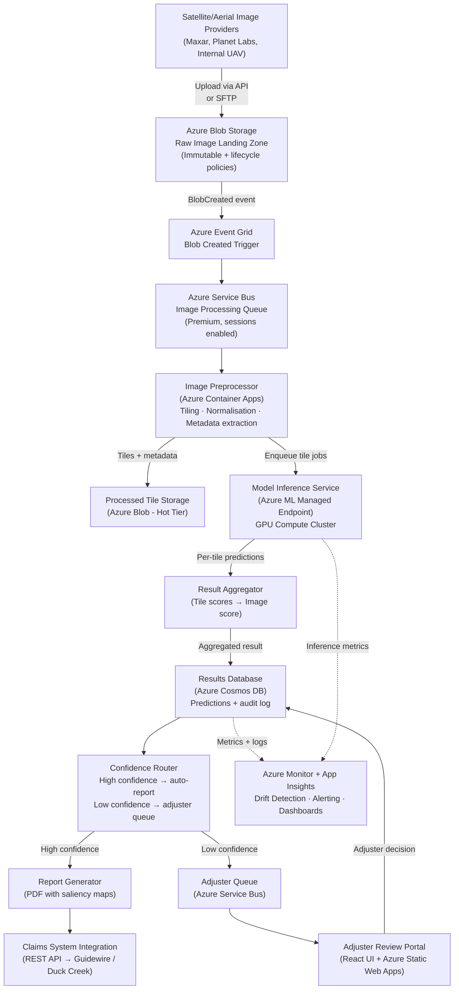
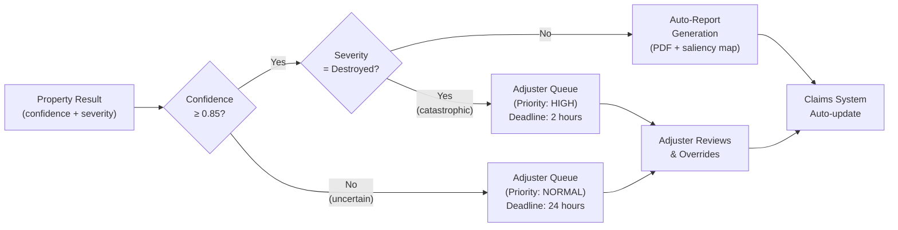
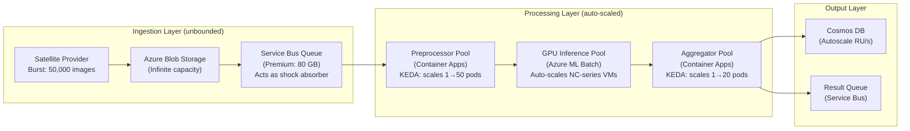
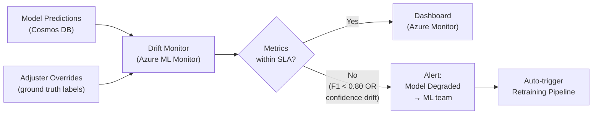
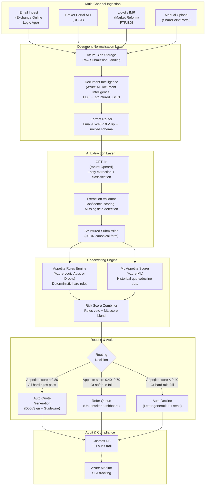
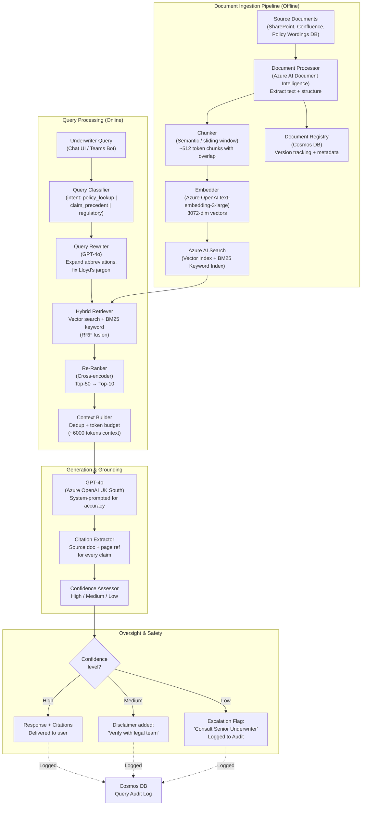
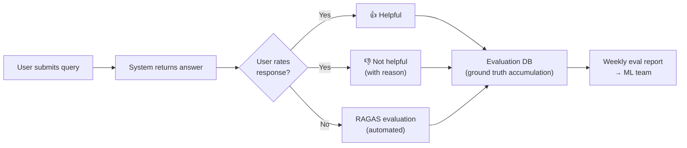
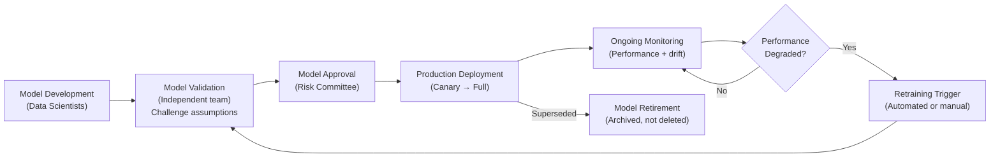
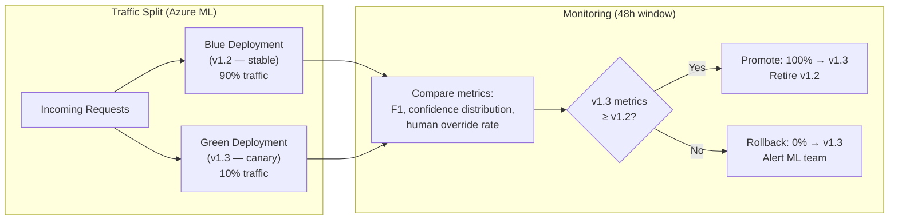

# System Design Exercises — Brit Insurance Interview Prep

> [!IMPORTANT]
> These exercises are built around **real Brit Insurance use cases**. Exercise 1 is the **actual question** asked in interviews. Treat each exercise as a 15-minute live whiteboarding session. Speak your reasoning aloud — interviewers score the *thought process*, not just the final diagram.

---

## Table of Contents

1. [Exercise 1 — Image Anomaly Detection System (The Actual Question)](#exercise-1--image-anomaly-detection-system-the-actual-question)
2. [Exercise 2 — AI-Powered Insurance Submission Processing System](#exercise-2--ai-powered-insurance-submission-processing-system)
3. [Exercise 3 — RAG-Powered Policy Knowledge Assistant](#exercise-3--rag-powered-policy-knowledge-assistant)
4. [System Design Principles for Regulated Insurance AI](#system-design-principles-for-regulated-insurance-ai)
5. [The 4-Dial Framework](#the-4-dial-framework)
6. [Insurance-Specific Design Patterns](#insurance-specific-design-patterns)
7. [Quick-Fire System Design Q&A](#quick-fire-system-design-qa)

---

## EXERCISE 1 — Image Anomaly Detection System (The Actual Question)

### Scenario

> *"Draw a system design diagram, given you have images and you need to run these images through a model for checking anomalies."*

**Context**: After a catastrophe event (hurricane, flood, wildfire), Brit Insurance receives thousands of satellite and aerial images of insured properties. Traditionally, claims adjusters fly out or use desktop-reviewed imagery to assess damage. The AI system must automate this first-pass triage — classifying damage severity, flagging anomalies, and routing cases to human adjusters with AI-generated evidence.

**Business Goals:**
- Reduce claims cycle time from weeks to hours
- Enable **virtual claims adjusting** without on-site visits
- Maintain auditable, explainable outputs for regulatory review
- Handle catastrophe surge (10× normal volume) without SLA degradation

---

### Phase 1 — Requirements Clarification (2 minutes)

> [!TIP]
> **Always start here.** Never jump to diagrams without asking these questions. Interviewers are explicitly scoring whether you gather requirements first. Say: *"Before I draw anything, let me ask a few clarifying questions."*

#### Functional Requirements

| Question | Typical Answer | Design Impact |
|---|---|---|
| How many images per day? | 500 normal / 50,000 per catastrophe | Batch + surge architecture needed |
| What is the latency SLA? | Batch OK (4-hour SLA), not real-time | Async queue-based design |
| What image resolution/size? | 50–500 MB per image (aerial/satellite) | Tiling pipeline required |
| What does the model output? | Damage class, severity score (0–1), bounding boxes | Multi-output model head |
| Do adjusters review every result? | Only low-confidence or high-value claims | HITL routing logic needed |
| Are results used in automated decisions? | No — advisory to adjuster | Lower regulatory bar, but still auditable |
| What's the data source? | Third-party satellite providers (e.g. Maxar, Planet Labs) | External ingestion + data contracts |
| Are there data residency requirements? | UK data must stay in UK | Azure UK South/UK West only |

#### Non-Functional Requirements

- **Scalability**: 10× normal load during catastrophe events
- **Durability**: Zero image loss — every image must be processed or dead-lettered
- **Auditability**: Model version, confidence score, timestamp logged per image
- **Explainability**: Saliency maps generated alongside predictions
- **Availability**: 99.9% for the processing pipeline; 99.5% for the review UI

#### Out of Scope (State this explicitly)
- Real-time streaming inference (drone feeds) — future phase
- Model training pipeline — separate MLOps concern
- Customer-facing portal — separate product team

---

### Phase 2 — High-Level Architecture (3 minutes)

> [!NOTE]
> Walk through this diagram **top-to-bottom**, narrating each component's role. Say: *"Let me sketch the happy path first, then we'll talk about failure modes."*



**Narration script:**
> *"Images land in an immutable Blob Storage landing zone — we never modify the source. Event Grid fires a trigger, which puts a message on a Service Bus queue. This decouples ingestion from processing so catastrophe surges don't overwhelm the model. The preprocessor tiles large images and normalises them. Tiles go to a GPU-backed Azure ML endpoint for inference. A result aggregator reconciles tile-level predictions back to a property-level score. A confidence router either auto-generates a report or sends it to an adjuster queue. Everything writes to Cosmos DB for the audit trail."*

---

### Phase 3 — Component Deep-Dive (5 minutes)

#### 3.1 — Image Ingestion Layer

**Why Azure Blob Storage as the landing zone?**
- Immutable storage policies prevent accidental modification of original imagery
- Lifecycle policies auto-tier images: Hot (0–7 days) → Cool (7–90 days) → Archive (90+ days)
- SAS tokens for time-limited, scoped access by third-party providers
- Geo-redundant storage (GRS) for durability

**Ingestion patterns by source:**

| Source | Method | Auth | Notes |
|---|---|---|---|
| Satellite providers (Maxar) | SFTP push / REST API pull | OAuth2 + IP allowlist | Provider SLA governs freshness |
| Internal UAV/drone | Direct SDK upload | Managed identity | Near-real-time during field ops |
| Adjuster uploaded | Portal upload | Azure AD B2C | Manual supplemental imagery |
| Bulk historical | AzCopy batch | Storage account key (one-time) | Backfill for model training |

**Event Grid → Service Bus bridge:**
- Event Grid catches `BlobCreated` events and writes to Service Bus
- Why not Event Grid directly to processor? Service Bus gives us **dead-letter queues**, **retry policies**, **message sessions** (for grouping all images from one catastrophe event), and **peek-lock** semantics to prevent duplicate processing.

---

#### 3.2 — Image Preprocessing Pipeline

> [!IMPORTANT]
> This is the most **interview-differentiating** component. Satellite images are 50–500 MB. You cannot feed them to a CNN whole. Tiling is mandatory. Show you know this.

**The Tiling Problem:**

A 500 MB GeoTIFF at 30 cm/pixel resolution covering 5 km² cannot be processed as a single tensor. A 224×224 model input means we need to tile the image into overlapping patches.

```
┌─────────────────────────────────┐
│          Raw Image               │  50–500 MB GeoTIFF
│   (e.g., 20,000 × 20,000 px)    │
└─────────────────────────────────┘
             │
             ▼  Tiling with overlap (stride < tile_size)
┌──────┬──────┬──────┬──────┐
│ T1   │ T2   │ T3   │ T4   │  Each tile: 512×512 or 1024×1024
├──────┼──────┼──────┼──────┤  Overlap: 10% to avoid edge artefacts
│ T5   │ T6   │ T7   │ T8   │
├──────┼──────┼──────┼──────┤
│ T9   │ T10  │ T11  │ T12  │
└──────┴──────┴──────┴──────┘
             │
             ▼  Per-tile: normalise, resize to model input
        [224×224 tensors]  ──► Model Inference
```

**Preprocessing steps (in order):**
1. **Read metadata**: CRS (coordinate reference system), resolution, timestamp, provider
2. **Cloud masking**: Remove tiles that are >60% cloud-covered (no signal)
3. **Normalise**: Per-band (R, G, B, NIR) mean/std normalisation using ImageNet stats or domain-specific stats
4. **Tile with overlap**: 512×512 tiles with 64px overlap (stride = 448)
5. **Quality check**: Reject black/blank tiles (sensor dropout)
6. **Enqueue**: Each tile becomes an independent message on the Service Bus

**Technology choice: Azure Container Apps**
- Serverless, auto-scales to zero between events
- KEDA (Kubernetes Event-Driven Autoscaling) scales on Service Bus queue depth
- Cost-efficient: only pay during catastrophe events

---

#### 3.3 — Model Inference Layer

**Architecture decision: Azure Computer Vision vs Custom Model**

| Criterion | Azure AI Vision (Pre-built) | Custom Fine-tuned Model |
|---|---|---|
| Development time | 1 week | 8–16 weeks |
| Domain accuracy | Generic — poor for satellite damage | High — trained on Brit's data |
| Cost | Per-call API pricing | Fixed GPU compute cost |
| Regulatory explainability | Black-box API | Full access to weights/activations |
| Multi-spectral support | RGB only | NIR, SWIR bands supported |
| **Verdict** | POC / MVP only | **Production recommendation** |

> [!NOTE]
> **Recommended architecture**: Fine-tuned **Vision Transformer (ViT-B/16)** or **ResNet-50** backbone with a custom classification head for damage severity (None / Minor / Moderate / Severe / Destroyed). Pre-train on a public disaster dataset (xBD dataset from DARPA), then fine-tune on Brit's labeled historical claims data.

**Azure ML Managed Endpoint setup:**

```
Azure ML Workspace
├── Model Registry
│   ├── damage-detector-v1.2 (production)
│   └── damage-detector-v1.3 (staging — canary 10%)
├── Online Endpoint (real-time, single tile)
│   ├── Deployment: blue (v1.2, 90% traffic)
│   └── Deployment: green (v1.3, 10% traffic)
└── Batch Endpoint (preferred for tile batches)
    └── Deployment: gpu-cluster (NC-series VMs)
```

**Why Batch Endpoint over Online Endpoint for this use case?**
- Batch: high-throughput, cost-efficient, built-in retry, writes results to storage
- Online: low-latency for single predictions — overkill here since SLA is 4 hours

**Model outputs per tile:**

```python
{
  "tile_id": "event_2024_0312_img_00042_tile_0015",
  "damage_class": "severe",          # None|Minor|Moderate|Severe|Destroyed
  "confidence": 0.87,                # Softmax probability of top class
  "class_probabilities": {
      "none": 0.02,
      "minor": 0.04,
      "moderate": 0.05,
      "severe": 0.87,
      "destroyed": 0.02
  },
  "bounding_boxes": [                # YOLO/Faster-RCNN detection heads
      {"label": "roof_damage", "bbox": [120, 45, 380, 290], "confidence": 0.91},
      {"label": "flooding",    "bbox": [0,  200, 512, 512], "confidence": 0.78}
  ],
  "saliency_map_url": "https://storage.blob.core.windows.net/.../tile_0015_gradcam.png",
  "model_version": "damage-detector-v1.2",
  "inference_timestamp": "2024-03-12T14:23:55Z",
  "compute_node": "gpu-cluster-node-003"
}
```

---

#### 3.4 — Result Aggregation

Tile-level predictions must roll up to a **property-level damage assessment**:

```python
def aggregate_tile_predictions(tile_results: list[dict]) -> dict:
    """
    Aggregate tile-level predictions to property-level assessment.
    
    Strategy:
    - Overall severity = worst tile (P99 pessimistic for claims)
    - Confidence = weighted average (weight by tile area coverage)
    - Affected area = % tiles classified as Moderate or above
    """
    severity_order = {"none": 0, "minor": 1, "moderate": 2, "severe": 3, "destroyed": 4}
    
    # Filter out cloud-masked / low-quality tiles
    valid_tiles = [t for t in tile_results if t["quality"] == "valid"]
    
    # Worst-case severity (insurance: always pessimistic in first pass)
    worst_severity = max(valid_tiles, key=lambda t: severity_order[t["damage_class"]])
    
    # Weighted confidence
    total_weight = sum(t["coverage_fraction"] for t in valid_tiles)
    weighted_conf = sum(
        t["confidence"] * t["coverage_fraction"] for t in valid_tiles
    ) / total_weight
    
    # Affected area %
    damaged_tiles = [
        t for t in valid_tiles
        if severity_order[t["damage_class"]] >= severity_order["moderate"]
    ]
    affected_area_pct = len(damaged_tiles) / len(valid_tiles) * 100
    
    return {
        "property_damage_class": worst_severity["damage_class"],
        "property_confidence": round(weighted_conf, 4),
        "affected_area_pct": round(affected_area_pct, 1),
        "total_tiles_processed": len(valid_tiles),
        "worst_tile_id": worst_severity["tile_id"],
        "requires_human_review": weighted_conf < 0.75 or affected_area_pct > 50
    }
```

---

#### 3.5 — Confidence-Based Routing (Human-in-the-Loop)



**Routing thresholds (tunable via feature flags):**

| Condition | Action | Rationale |
|---|---|---|
| Confidence ≥ 0.85 AND severity ≤ Moderate | Auto-report | High confidence, lower value |
| Confidence ≥ 0.85 AND severity = Severe/Destroyed | Priority adjuster queue | High value — human required |
| Confidence 0.60–0.84 | Normal adjuster queue | Uncertain — needs review |
| Confidence < 0.60 | Escalate to senior adjuster | Model very uncertain |
| Confidence < 0.40 | Dead-letter + retrigger | Likely preprocessing error |

---

### Phase 4 — Scaling & Reliability (3 minutes)

#### 4.1 — Catastrophe Surge Handling

> [!IMPORTANT]
> **This is the key scaling challenge.** A catastrophe event (e.g., Hurricane Milton affecting 50,000 properties) can generate 50× normal image volume within 24 hours. Your design must absorb this without dropping messages or degrading SLA.

**Queue-based load leveling diagram:**



**KEDA scaling rule for preprocessor (Service Bus trigger):**

```yaml
# Azure Container Apps scaling rule
triggers:
  - type: azure-servicebus
    metadata:
      queueName: image-processing-queue
      namespace: brit-insurance-bus
      messageCount: "100"       # Scale up when > 100 messages per pod
      activationMessageCount: "1"
    minReplicaCount: 0          # Scale to zero when idle
    maxReplicaCount: 50         # Max pods during catastrophe
```

**GPU auto-scaling (Azure ML):**
- Azure ML Batch Endpoints auto-provision NC-series (T4/V100 GPUs) from a compute cluster
- Cluster min nodes: 0 (cost: £0 when idle)
- Cluster max nodes: 20 (handles 50,000 images/hour)
- Spot instances for non-urgent batch jobs (60–80% cost saving)

#### 4.2 — Failure Modes & Resilience

| Failure | Detection | Recovery |
|---|---|---|
| Model inference timeout | App Insights alert on p99 latency | Retry 3× with exponential backoff; dead-letter after 3 failures |
| GPU node failure mid-batch | Azure ML heartbeat | Batch job checkpointing; resume from last completed tile |
| Cosmos DB throttling | 429 responses | Exponential backoff + jitter; autoscale RU/s enabled |
| Duplicate image submission | Idempotency key (SHA-256 of image bytes) | Cosmos DB unique constraint on image_hash; return cached result |
| Service Bus message loss | Peek-lock + settlement | Lock renewed every 30s during processing; message returned to queue on crash |
| Bad image (corrupt/blank) | Preprocessing validation | Dead-letter with `reason: corrupt_image`; alert to data engineering |

#### 4.3 — Idempotency for Duplicate Images

> [!NOTE]
> During catastrophe events, the same image is often submitted multiple times (provider retries, adjuster re-uploads). Always design for idempotency.

```python
def compute_image_fingerprint(blob_url: str) -> str:
    """Compute SHA-256 of first 10MB of image for fast deduplication."""
    blob_client = BlobClient.from_blob_url(blob_url)
    
    # Read first 10MB as fingerprint (full read too slow for 500MB images)
    stream = blob_client.download_blob(offset=0, length=10_485_760)
    return hashlib.sha256(stream.readall()).hexdigest()

def process_image_idempotent(image_event: dict, db: CosmosClient) -> dict:
    fingerprint = compute_image_fingerprint(image_event["blob_url"])
    
    # Check if already processed
    existing = db.get_by_fingerprint(fingerprint)
    if existing:
        logger.info(f"Duplicate image detected. Returning cached result: {existing['id']}")
        return existing
    
    # Process new image
    result = run_full_pipeline(image_event)
    result["image_fingerprint"] = fingerprint
    db.upsert(result)
    return result
```

---

### Phase 5 — Monitoring & Governance (2 minutes)

#### 5.1 — Audit Trail (Regulatory Requirement)

Every image processed must produce an immutable audit record:

```json
{
  "audit_record": {
    "record_id": "aud-2024-03-12-00042",
    "event": "image_processed",
    "timestamp": "2024-03-12T14:25:01.342Z",
    "image_id": "img-00042",
    "image_source": "maxar-api",
    "image_hash_sha256": "3d4f2a...",
    "model_version": "damage-detector-v1.2",
    "model_endpoint": "brit-ml-endpoint-prod",
    "compute_node": "gpu-cluster-node-003",
    "input_tile_count": 144,
    "valid_tile_count": 138,
    "output_damage_class": "severe",
    "output_confidence": 0.87,
    "routing_decision": "adjuster_queue",
    "routing_rule_version": "routing-config-v4",
    "adjuster_id": null,
    "adjuster_override": null,
    "processing_duration_ms": 4320,
    "compliance_flags": []
  }
}
```

**Storage**: Audit records written to Azure Cosmos DB with **TTL disabled** (infinite retention). Backed up to Azure Blob Archive tier. Write-once via stored procedures — no update or delete operations permitted on audit records.

#### 5.2 — Model Performance Monitoring



**Key metrics to monitor:**

| Metric | Warning Threshold | Critical Threshold | Action |
|---|---|---|---|
| Model F1 score (vs adjuster override) | < 0.85 | < 0.75 | Retrain trigger |
| Average confidence score | < 0.70 | < 0.55 | Check data quality |
| Human override rate | > 20% | > 35% | Model review |
| P99 inference latency | > 30s | > 60s | Scale GPU nodes |
| Dead-letter rate | > 2% | > 5% | Pipeline investigation |
| Queue depth (Service Bus) | > 5,000 | > 20,000 | Scale preprocessors |

#### 5.3 — Explainability: Grad-CAM Saliency Maps

> [!TIP]
> **Always mention explainability in insurance AI design.** Regulators (FCA) and Lloyd's require that automated decisions affecting claims can be explained. Grad-CAM heatmaps are the industry-standard technique for vision model explainability.

```python
import torch
from pytorch_grad_cam import GradCAM
from pytorch_grad_cam.utils.image import show_cam_on_image

def generate_saliency_map(
    model: torch.nn.Module,
    tile_tensor: torch.Tensor,
    target_layer: torch.nn.Module,
    predicted_class_idx: int
) -> np.ndarray:
    """
    Generate Grad-CAM saliency map for model explainability.
    
    Saliency maps show WHICH regions of the tile influenced 
    the damage classification — enabling adjuster verification.
    """
    cam = GradCAM(model=model, target_layers=[target_layer])
    targets = [ClassifierOutputTarget(predicted_class_idx)]
    
    # Generate CAM
    grayscale_cam = cam(
        input_tensor=tile_tensor.unsqueeze(0),
        targets=targets
    )
    
    # Overlay on original tile
    rgb_tile = tile_tensor.permute(1, 2, 0).numpy()
    visualization = show_cam_on_image(rgb_tile, grayscale_cam[0], use_rgb=True)
    
    return visualization  # Save to Blob Storage, URL stored in audit record
```

---

### What to Say if Asked for Code

**Core processing loop (Python pseudocode for interview):**

```python
import asyncio
from azure.servicebus.aio import ServiceBusClient
from azure.storage.blob.aio import BlobServiceClient

QUEUE_NAME = "image-processing-queue"
CONFIDENCE_THRESHOLD = 0.85

async def process_image_worker(service_bus_conn_str: str, model_endpoint_url: str):
    """
    Core worker: dequeue image, preprocess, infer, aggregate, route.
    Runs as Azure Container Apps instance; KEDA scales count based on queue depth.
    """
    async with ServiceBusClient.from_connection_string(service_bus_conn_str) as sb_client:
        async with sb_client.get_queue_receiver(QUEUE_NAME, max_wait_time=30) as receiver:
            async for message in receiver:
                try:
                    # 1. Parse message
                    event = json.loads(str(message))
                    blob_url = event["blob_url"]
                    image_id = event["image_id"]
                    event_id = event["catastrophe_event_id"]
                    
                    # 2. Idempotency check
                    if await is_already_processed(image_id):
                        await receiver.complete_message(message)
                        continue
                    
                    # 3. Preprocess: tile, normalise, cloud-mask
                    tiles = await preprocess_image(blob_url)
                    valid_tiles = [t for t in tiles if t["quality"] == "valid"]
                    
                    if not valid_tiles:
                        await dead_letter_message(receiver, message, "no_valid_tiles")
                        continue
                    
                    # 4. Batch inference (send all tiles to Azure ML endpoint)
                    tile_predictions = await run_batch_inference(
                        endpoint_url=model_endpoint_url,
                        tiles=valid_tiles
                    )
                    
                    # 5. Aggregate tile results to property-level
                    property_result = aggregate_tile_predictions(tile_predictions)
                    property_result["image_id"] = image_id
                    property_result["event_id"] = event_id
                    
                    # 6. Generate saliency maps for worst tiles
                    saliency_urls = await generate_saliency_maps(
                        worst_tiles=get_top_damaged_tiles(tile_predictions, n=5)
                    )
                    property_result["saliency_map_urls"] = saliency_urls
                    
                    # 7. Write to Cosmos DB (audit + results)
                    await write_result_to_db(property_result)
                    
                    # 8. Route based on confidence
                    await route_result(property_result, CONFIDENCE_THRESHOLD)
                    
                    # 9. Acknowledge message (remove from queue)
                    await receiver.complete_message(message)
                    
                except Exception as e:
                    # Return to queue for retry (up to 3 attempts via Service Bus)
                    logger.error(f"Processing failed for {image_id}: {e}")
                    await receiver.abandon_message(message)
```

---

## EXERCISE 2 — AI-Powered Insurance Submission Processing System

### Scenario

Brokers submit insurance **risk submissions** to Brit via multiple channels: email attachments (PDFs, Word docs), API payloads, Excel spreadsheets, and Slip documents (Lloyd's market standard). Each submission contains unstructured data: property descriptions, risk appetite questions, historical loss data, business details.

**The problem**: An underwriter manually reads each submission, extracts key facts, checks them against Brit's underwriting appetite, and decides to quote, refer, or decline. This takes 15–45 minutes per submission and Brit receives hundreds per day.

**Design goal**: Build an AI system that reads multi-format submissions, extracts structured data, scores them against the underwriting appetite, routes them intelligently, and creates a full audit trail.

---

### Requirements

**Functional:**
- Ingest email (with attachments), API JSON, Excel, PDF, Lloyd's Slip format
- Extract: insured name, risk class, coverage limits, location, historical losses, broker details
- Score against underwriting appetite (appetite rules engine)
- Route: auto-quote (high appetite + confidence), refer (borderline), auto-decline (out of appetite)
- Generate structured quote/refer/decline rationale
- Full audit log for FCA compliance

**Non-Functional:**
- Processing SLA: < 10 minutes per submission (vs 30-minute manual)
- Accuracy: ≥ 95% extraction accuracy on key fields
- Volume: 500 submissions/day peak
- Must support UK and International (Lloyd's) market rules

---

### High-Level Architecture



---

### Component Deep-Dive

#### Ingestion: Email Pipeline

```
Exchange Online mailbox: submissions@brit.co.uk
    │
    ▼
Azure Logic App (trigger: new email received)
    │
    ├── Extract: sender, subject, body, attachments
    ├── Store attachments to Blob Storage (raw/)
    ├── Store email body as .txt to Blob Storage (raw/)
    └── Write submission record to Cosmos DB (status: received)
```

**Why Logic Apps for email?** Native Office 365 connector, no custom code for IMAP/SMTP, built-in retry, enterprise-grade authentication.

#### Extraction: Azure AI Document Intelligence + GPT-4o

**Two-stage extraction:**

```
Stage 1: Azure AI Document Intelligence (Layout model)
    Input:  PDF, scanned document, image
    Output: Markdown/JSON with tables, paragraphs, key-value pairs
    Cost:   ~£0.01 per page
    Speed:  2-5s per page

Stage 2: GPT-4o (Azure OpenAI — UK South deployment)
    Input:  Stage 1 output (structured text + tables)
    Prompt: Extract specific insurance fields per schema
    Output: Structured JSON with confidence flags
    Cost:   ~£0.05-0.20 per submission
    Speed:  3-8s per call
```

**GPT-4o extraction prompt (simplified):**

```python
EXTRACTION_SYSTEM_PROMPT = """
You are an expert Lloyd's of London insurance underwriting assistant.
Extract the following fields from the submission document text.
Return ONLY valid JSON matching the schema. If a field is not found,
set it to null and set its confidence to 0.0.
Do not infer or hallucinate values — only extract what is explicitly stated.
"""

EXTRACTION_SCHEMA = {
    "insured_name": {"type": "string", "confidence": "float"},
    "risk_class": {"type": "string", "enum": ["property", "casualty", "marine", "cyber", "specialty"]},
    "tiv": {"type": "number", "description": "Total Insured Value in GBP"},
    "locations": {"type": "array", "items": {"country": "str", "postcode": "str", "occupancy": "str"}},
    "policy_period_start": {"type": "date"},
    "policy_period_end": {"type": "date"},
    "prior_losses_5yr": {"type": "array", "items": {"year": "int", "amount_gbp": "number", "description": "str"}},
    "requested_limits": {"type": "number"},
    "requested_deductible": {"type": "number"},
    "broker_name": {"type": "string"},
    "broker_tob": {"type": "string", "description": "Terms of Business agreement reference"}
}
```

**Extraction validation rules:**

| Field | Validation | On Failure |
|---|---|---|
| `tiv` | Must be positive number | Flag for human review |
| `risk_class` | Must match enum values | Classify as "unknown", refer |
| `policy_period` | Start < End, within 3 years | Flag date anomaly |
| `broker_tob` | Must exist in broker registry | Auto-decline: no TOB |
| `locations[].country` | Sanctions list check (OFAC/HMT) | Hard stop: compliance review |

#### Underwriting Appetite Engine

**Hard Rules (Deterministic — always applied first):**

```python
HARD_DECLINE_RULES = [
    # Sanctioned countries — regulatory compliance
    lambda s: any(loc["country"] in SANCTIONS_LIST for loc in s["locations"]),
    
    # Minimum broker credentials
    lambda s: s["broker_tob"] is None,
    
    # TIV limits — outside reinsurance cover
    lambda s: s["tiv"] > 500_000_000,  # £500M TIV limit
    
    # Excluded risk classes for this division
    lambda s: s["risk_class"] in ["nuclear", "war"],
    
    # Loss ratio threshold
    lambda s: calculate_5yr_loss_ratio(s) > 1.5  # >150% loss ratio
]

def apply_hard_rules(submission: dict) -> tuple[bool, list[str]]:
    """Returns (should_decline, list_of_triggered_rules)."""
    triggered = []
    for rule in HARD_DECLINE_RULES:
        if rule(submission):
            triggered.append(rule.__doc__ or "unnamed_rule")
    return len(triggered) > 0, triggered
```

**ML Appetite Scorer:**
- Trained on 5 years of historical Brit submissions (quote/refer/decline outcomes)
- Features: risk class, TIV bucket, location risk score, broker relationship score, loss history
- Model: XGBoost classifier (interpretable, fast inference, works well on tabular data)
- Output: probability of quoting [0,1]

---

### Scaling Considerations

| Load Pattern | Strategy |
|---|---|
| **Normal load** (500/day) | 2–3 Container App instances; GPT-4o: standard tier |
| **Renewal season peak** (2000/day) | KEDA auto-scale on queue depth; GPT-4o: PTU (provisioned throughput) to avoid rate limits |
| **Document size variability** | 1-page submissions to 500-page risk surveys; per-page cost/time budgeting |
| **GPT-4o rate limits** | Token bucket pattern; queue with priority; fall back to GPT-3.5 for simpler docs |

### Failure Modes

| Failure | Mitigation |
|---|---|
| GPT-4o extraction returns low-confidence field | Re-prompt with targeted question; if still low, route to human |
| GPT-4o hallucination | Cross-validate extracted TIV against document Intelligence table extraction |
| Appetite model stale | Model versioning; scheduled retraining on new quote/decline data |
| Sanctions list stale | Refresh OFAC/HMT list daily via scheduled Azure Function |
| Duplicate submission | Hash of normalised text; return existing decision with reference |

---

## EXERCISE 3 — RAG-Powered Policy Knowledge Assistant

### Scenario

Brit's underwriters need instant access to:
- **Policy wordings**: thousands of clauses, endorsements, exclusions across multiple product lines
- **Underwriting guidelines**: internal rules on appetite, limits, pricing
- **Historical claim precedents**: how similar claims were settled in the past
- **Regulatory guidance**: Lloyd's Market Bulletins, FCA guidance, PRA rules

Today this involves searching SharePoint (ineffective), asking colleagues (slow), or calling the legal team (expensive).

**Design goal**: A RAG-powered chat assistant that retrieves relevant documents and generates accurate, cited answers — with full human oversight for high-stakes queries.

---

### Full RAG Pipeline Diagram



---

### Multi-Tenant Isolation for Underwriting Teams

> [!IMPORTANT]
> Different underwriting teams (Property, Marine, Cyber, Specialty) must NOT see each other's sensitive documents. A Cyber underwriter cannot see Property pricing models or vice versa. This is a **data governance requirement**, not just a nice-to-have.

**Isolation strategies:**

| Approach | Implementation | Trade-off |
|---|---|---|
| **Index-per-team** | Separate Azure AI Search index per team | Strong isolation; high index management overhead |
| **Filter-by-metadata** | Single index; `team_id` field filter on every query | Simpler; risk of filter misconfiguration |
| **Row-level security** | Filter at retrieval layer with user identity | Fine-grained; requires identity integration |
| **Recommended**: Filter + Audit | Single index, mandatory `team_id` + `clearance_level` filters, every query logged | Balance of simplicity and security |

**Implementation:**

```python
from azure.search.documents.aio import SearchClient
from azure.search.documents.models import VectorizedQuery

async def retrieve_documents(
    query_embedding: list[float],
    query_text: str,
    user_context: UserContext  # Contains team_id, clearance_level, user_id
) -> list[SearchResult]:
    """
    Hybrid search with mandatory security filters.
    Filters are applied server-side — cannot be bypassed by the query.
    """
    
    # MANDATORY: security filter — never optional
    security_filter = (
        f"team_id eq '{user_context.team_id}' and "
        f"clearance_level le {user_context.clearance_level} and "
        f"is_active eq true"
    )
    
    # Hybrid search: vector + keyword with RRF fusion
    vector_query = VectorizedQuery(
        vector=query_embedding,
        k_nearest_neighbors=50,
        fields="content_vector"
    )
    
    results = await search_client.search(
        search_text=query_text,         # BM25 keyword search
        vector_queries=[vector_query],   # Vector search
        filter=security_filter,          # Security filter (server-enforced)
        select=["id", "content", "document_title", "page_number", "version"],
        top=50,
        query_type="semantic",
        semantic_configuration_name="brit-semantic-config"
    )
    
    # Log every retrieval attempt for audit
    await audit_log.write({
        "user_id": user_context.user_id,
        "team_id": user_context.team_id,
        "query_hash": hash(query_text),
        "filter_applied": security_filter,
        "result_count": len(results),
        "timestamp": datetime.utcnow().isoformat()
    })
    
    return results
```

---

### Document Versioning Strategy

> [!NOTE]
> Policy wordings change regularly (annually, mid-term endorsements). The system must serve the **current version** for new queries but must be able to answer *"what did Policy Wording v3.2 say about flood exclusions?"* for claims that occurred under that version.

**Versioning scheme:**

```
Document Metadata in AI Search index:
{
    "document_id": "pol-wording-property-001",
    "version": "4.1",
    "effective_from": "2024-01-01",
    "effective_to": null,          ← null means currently active
    "superseded_by": null,
    "document_type": "policy_wording",
    "product_line": "property",
    "team_id": "property-underwriting",
    "is_active": true
}
```

**Versioning rules:**
- When a new version is published: old version gets `is_active = false`, `effective_to = today`, `superseded_by = new_doc_id`
- Default search filter: `is_active eq true` (current docs only)
- Historical query mode: filter by `effective_from le '{claim_date}' and (effective_to ge '{claim_date}' or effective_to eq null)`
- Old versions are **never deleted** from the index (compliance requirement)

---

### Chunking Strategy for Insurance Documents

> [!TIP]
> The chunking strategy significantly impacts RAG quality. Insurance documents have specific structure that naive sliding-window chunking destroys.

**Document-aware chunking:**

```python
def chunk_policy_wording(document: ParsedDocument) -> list[Chunk]:
    """
    Insurance-specific chunking strategy.
    Preserves clause boundaries — do not split a clause across chunks.
    """
    chunks = []
    
    for section in document.sections:
        # Prepend document + section title to every chunk for context
        prefix = f"Document: {document.title} | Section: {section.title}\n\n"
        
        if len(section.text) <= MAX_CHUNK_TOKENS:
            # Small section: one chunk
            chunks.append(Chunk(
                content=prefix + section.text,
                metadata={
                    "section_id": section.id,
                    "section_title": section.title,
                    "clause_numbers": section.extract_clause_numbers()
                }
            ))
        else:
            # Large section: split at paragraph boundaries (not word boundaries)
            paragraphs = section.split_by_paragraph()
            current_chunk_text = prefix
            
            for para in paragraphs:
                if token_count(current_chunk_text + para) > MAX_CHUNK_TOKENS:
                    # Flush current chunk, start new with overlap
                    chunks.append(Chunk(content=current_chunk_text))
                    # Overlap: include last paragraph in next chunk for continuity
                    current_chunk_text = prefix + para
                else:
                    current_chunk_text += "\n\n" + para
            
            if current_chunk_text.strip() != prefix.strip():
                chunks.append(Chunk(content=current_chunk_text))
    
    return chunks
```

---

### Generation & Grounding

**System prompt for GPT-4o (anti-hallucination):**

```python
RAG_SYSTEM_PROMPT = """
You are a specialist insurance knowledge assistant for Brit Insurance, a Lloyd's of London insurer.

CRITICAL RULES:
1. ONLY use information from the provided document excerpts (context).
2. NEVER state facts not present in the provided context.
3. If the context does not contain the answer, say: "I cannot find this in the provided policy documents. Please consult the legal or compliance team."
4. ALWAYS cite your sources using [Document Title, Section X.X, Page Y] format.
5. Distinguish clearly between: (a) what the policy SAYS, and (b) your interpretation.
6. For questions about specific claim decisions, defer to the Claims team.
7. Regulatory guidance may have changed — always recommend verification of time-sensitive rules.

Response format:
- Answer in 2-4 concise paragraphs
- Include citations inline using [Doc: title, p.N] notation
- End with: "Sources: [list of cited documents]"
"""
```

---

### Evaluation Framework

**Offline evaluation (before deployment):**

| Metric | Target | Measurement |
|---|---|---|
| Retrieval Recall@10 | ≥ 0.90 | Does ground-truth chunk appear in top-10 results? |
| Answer Faithfulness | ≥ 0.95 | Does answer contain only info from retrieved context? (LLM judge) |
| Answer Relevance | ≥ 0.90 | Does answer address the question? (LLM judge) |
| Citation Accuracy | ≥ 0.95 | Are cited documents real and relevant? |
| Latency P95 | < 8 seconds | End-to-end query to response |

**Online evaluation (post-deployment):**



---

## System Design Principles for Regulated Insurance AI

### The 5 Non-Negotiables

> [!IMPORTANT]
> Memorise these. Say them at the start of **every** insurance AI system design. They signal senior-level thinking and show you understand the regulatory context.

---

#### Non-Negotiable 1: Auditability

*Every AI-driven decision must be traceable to: what data was used, which model version, with what confidence, at what time, reviewed by whom.*

**Implementation checklist:**
- [ ] Immutable audit records in Cosmos DB (append-only, TTL disabled)
- [ ] Model version captured at inference time (not just model name)
- [ ] Input data hash stored (proves what was fed to the model)
- [ ] Output with confidence stored (not just the decision)
- [ ] Routing decision logic version stored (rules change over time)
- [ ] Human override events logged with adjuster ID and rationale

**Why it matters**: FCA's Consumer Duty requires firms to demonstrate fair outcomes. Lloyd's performance management requires audit trails for significant automated decisions.

---

#### Non-Negotiable 2: Human Oversight (HITL)

*No automated AI decision above a materiality threshold should be final without a human checkpoint.*

**Implementation:**
- Define materiality thresholds by product line (e.g., TIV > £1M requires human review)
- Confidence-based routing: uncertain predictions → human queue
- Human override capability: adjuster can always override AI recommendation
- Override tracking: if adjusters override > 20% of cases, model needs retraining
- Escalation paths: tiered review (junior → senior → committee)

---

#### Non-Negotiable 3: Explainability

*A claims adjuster, underwriter, or regulator must be able to understand why the AI made a decision.*

**By model type:**

| Model Type | Explainability Method | Insurance Use |
|---|---|---|
| Computer Vision (CNN/ViT) | Grad-CAM saliency maps | Highlight damaged areas in property images |
| XGBoost / Tree models | SHAP values | Feature contribution to appetite score |
| GPT-4o (LLM) | Chain-of-thought + citations | Why RAG answer cites specific clause |
| Ensemble models | SHAP on aggregated output | Combined model explanation |

---

#### Non-Negotiable 4: Data Governance

*Strict control over who can access what data, with logging of every access.*

```
Data Classification Tiers at Brit:
├── Public                     (e.g., Lloyd's market bulletins)
├── Internal                   (e.g., underwriting guidelines)
├── Confidential               (e.g., individual policy data)
└── Restricted                 (e.g., claims details, loss data)

Access Control:
├── Azure AD groups → Role-Based Access Control (RBAC)
├── Service-to-service: Managed Identity (no credentials)
├── External partners: OAuth2 with scoped tokens
└── Data residency: UK South + UK West only (no cross-border)
```

---

#### Non-Negotiable 5: Model Risk Management

*AI models degrade over time. Data distributions shift. You must have ongoing monitoring and a retraining strategy.*

**Model risk management lifecycle:**



---

## The 4-Dial Framework

> [!TIP]
> Use this framework explicitly in interviews. Say: *"Every system design involves trade-offs. I think of it as four dials — Accuracy, Latency, Cost, and Reliability. You can't maximise all four simultaneously. Let me tell you which dials I'm optimising for and which I'm trading off."*

```
┌─────────────────────────────────────────────────────────┐
│                   THE 4-DIAL FRAMEWORK                   │
├──────────────┬──────────────┬──────────────┬────────────┤
│  ACCURACY    │   LATENCY    │    COST      │ RELIABILITY│
│              │              │              │            │
│ Model F1,    │ P50, P95,    │ Compute,     │ Uptime,    │
│ Precision,   │ P99 response │ Storage,     │ Durability,│
│ Recall,      │ time         │ API calls,   │ MTTR       │
│ Calibration  │              │ Human review │            │
└──────────────┴──────────────┴──────────────┴────────────┘
```

**Applied to each exercise:**

| System | Primary Dial | Trade-off | Rationale |
|---|---|---|---|
| Image Anomaly Detection | **Accuracy + Reliability** | Latency (batch OK), Cost (GPU expensive but justified) | Wrong damage assessment = incorrect claim payout |
| Submission Processing | **Latency + Accuracy** | Cost (GPT-4o expensive) | Brokers expect fast responses; lost submission = lost business |
| Policy RAG Assistant | **Accuracy + Reliability** | Latency (8s acceptable for lookup) | Hallucinated policy advice = E&O liability |

**Saying this out loud in an interview:**
> *"For the image anomaly detection system, I'm prioritising accuracy and reliability. This is insurance claims — a wrong severity classification could lead to underpaying a legitimate claim or overpaying a fraudulent one. Both are costly. I'm willing to accept higher latency (batch processing is fine; SLA is 4 hours) and higher cost (GPU inference) in exchange for accuracy. Let me design accordingly..."*

---

## Insurance-Specific Design Patterns

### Pattern 1: Guardrail Layers for Automated Decisions

Never let an AI system make final decisions without guardrail layers:

```
Input
  │
  ▼
┌─────────────────────────┐
│   Layer 1: Hard Rules   │  ← Deterministic, always applied first
│   (sanctions, limits,   │     Veto power — if triggered, auto-decline
│    regulatory blocks)   │     No ML model overrides these
└────────────┬────────────┘
             │ Passes
             ▼
┌─────────────────────────┐
│   Layer 2: ML Model     │  ← Probabilistic scoring
│   (appetite, damage,    │     Outputs: score + confidence
│    extraction)          │     Can be retrained; versioned
└────────────┬────────────┘
             │
             ▼
┌─────────────────────────┐
│   Layer 3: Confidence   │  ← Route based on certainty
│   Threshold Router      │     Low confidence → always human
│   (HITL escalation)     │     High confidence → proceed
└────────────┬────────────┘
             │
             ▼
┌─────────────────────────┐
│   Layer 4: Audit Log    │  ← Record everything, regardless of path
│   (immutable, always)   │     Which layers triggered, what scores
└─────────────────────────┘
```

---

### Pattern 2: Dual-Write for Compliance Logging

> [!CAUTION]
> **Never rely on a single write path for audit logs.** If the primary DB is unavailable at the moment of an AI decision, you must not lose the audit record. Use dual-write to ensure durability.

```python
async def record_ai_decision_with_dual_write(
    decision: dict,
    primary_db: CosmosClient,
    audit_queue: ServiceBusClient
) -> None:
    """
    Dual-write pattern: write to primary DB AND to durable queue.
    If primary DB fails, queue persists the record until DB recovers.
    
    This ensures zero audit record loss even during DB downtime.
    """
    audit_record = {
        "id": str(uuid4()),
        "type": "ai_decision_audit",
        "decision": decision,
        "timestamp": datetime.utcnow().isoformat(),
        "schema_version": "2.1"
    }
    
    # Attempt primary write
    primary_success = False
    try:
        await primary_db.create_item(audit_record)
        primary_success = True
    except Exception as e:
        logger.error(f"Primary audit write failed: {e}")
    
    # Always write to Service Bus (durable, 14-day retention)
    # Consumer process reconciles queue → DB on DB recovery
    await audit_queue.send_message(
        ServiceBusMessage(
            body=json.dumps(audit_record),
            message_id=audit_record["id"],
            subject="audit_record",
            application_properties={"primary_written": primary_success}
        )
    )
```

---

### Pattern 3: Confidence Thresholds & Escalation

**Design the escalation matrix before building:**

```
Confidence Band    Action                    SLA         Escalation
─────────────────────────────────────────────────────────────────────
≥ 0.90            Auto-process              Immediate   None
0.75 – 0.89       Auto-process + flag       Immediate   Spot-check 5%
0.60 – 0.74       Human review required     4 hours     Junior analyst
0.40 – 0.59       Senior review required    2 hours     Senior analyst
< 0.40            Escalate + investigate    1 hour      Team lead + engineering
```

**Important design note**: These thresholds must be **configurable at runtime** (feature flags / Azure App Configuration), not hardcoded. Business rules change. You don't want a code deployment every time risk appetite shifts.

---

### Pattern 4: Canary Deployments for Model Updates

> [!WARNING]
> **Never deploy a new model version to 100% of traffic immediately.** Model behaviour can differ subtly from validation metrics. Use canary deployments with automatic rollback.



**Automatic rollback triggers:**
- F1 score drops > 5% vs baseline
- Human override rate increases > 10% vs baseline
- P99 inference latency increases > 20% vs baseline
- Error rate > 1%

---

## Quick-Fire System Design Q&A

> [!TIP]
> These are the **follow-up questions** interviewers ask after you present your design. Practice answering each in under 60 seconds. These test depth beyond the happy path.

---

### Q1: "How would you handle the case where the satellite image covers multiple properties?"

**Model Answer:**

> *"Great question — this is the property-to-image assignment problem. The solution has two parts.*
>
> *First, at ingestion time, we cross-reference the image's geographic bounding box (stored in the GeoTIFF metadata as WGS84 coordinates) against Brit's policy location database using a geospatial query — PostGIS or Azure Maps. This gives us a list of policy IDs that intersect the image.*
>
> *Second, the model outputs bounding boxes for damage regions. We overlay those bounding boxes onto the property footprints (from an OS or Ordnance Survey building footprint dataset) to attribute damage to specific properties.*
>
> *Edge case: if a building straddles two tiles, the overlap in our tiling strategy handles it — we tile with 10% overlap specifically for this reason. The aggregator reconciles duplicate predictions for the overlapping region by taking the max confidence score."*

---

### Q2: "What if the model has never seen this type of disaster before — e.g., first major earthquake claim?"

**Model Answer:**

> *"This is the distribution shift / out-of-distribution problem. Three strategies:*
>
> *One — detect it: monitor the input feature distribution in real-time (e.g., average image entropy, colour distribution). If it diverges significantly from training data distribution, flag as OOD and route everything to human review automatically. Azure ML Model Monitoring supports data drift detection.*
>
> *Two — degrade gracefully: OOD images won't get a confident score from the model. Our confidence threshold routing already sends low-confidence cases to adjusters — so the system degrades gracefully to human-only mode.*
>
> *Three — adapt quickly: label a fast sample of earthquake images (50–100) using active learning — prioritise the images the model is most uncertain about. Fine-tune the model on these + the existing training set. Azure ML pipelines can trigger a retraining job within hours.*
>
> *The key point: the system must have a 'safe default' mode — when uncertain, escalate to humans, never guess."*

---

### Q3: "How would you reduce inference cost without sacrificing accuracy?"

**Model Answer:**

> *"Four techniques:*
>
> *One — model distillation: train a smaller student model (e.g., MobileNet) to mimic the teacher model (ViT-B). The student runs 10× faster and costs 10× less at inference. Acceptable small accuracy drop.*
>
> *Two — tile early-exit: run a fast classifier first. If a tile scores 'none' with > 0.99 confidence, skip full inference. ~40% of tiles after a catastrophe are undamaged — we skip those.*
>
> *Three — spot instances: Azure ML batch clusters support spot (preemptible) instances. 60–80% cheaper. Acceptable for batch processing with a 4-hour SLA since jobs retry automatically.*
>
> *Four — INT8 quantisation: convert model weights from FP32 to INT8 using ONNX Runtime. 4× memory reduction, 2–3× speed increase, < 1% accuracy drop on typical damage classification tasks."*

---

### Q4: "How would you ensure the system is fair and doesn't discriminate against certain property types or locations?"

**Model Answer:**

> *"Fairness in insurance AI is both a regulatory requirement and an ethical imperative. The FCA's Consumer Duty applies here.*
>
> *At model training: slice evaluation metrics by property type, location demographics, and construction type. If F1 is 0.92 for brick construction but 0.70 for timber-frame buildings, the model is biased and must be retrained with more timber-frame examples.*
>
> *At deployment: track model outcomes (damage classifications) by geography and property type in the monitoring dashboard. If certain postcodes consistently receive lower confidence scores, investigate whether those image types are underrepresented in training data.*
>
> *Operationally: for any demographic or geographic slice where model confidence is systematically lower, automatically route to human review — even if confidence exceeds the global threshold.*
>
> *Documentation: maintain a Model Card documenting training data composition, known limitations by demographic slice, and fairness metrics — required for regulatory review."*

---

### Q5: "The queue is backing up during a major catastrophe — what do you do?"

**Model Answer:**

> *"Queue backup means the processing rate is lower than ingestion rate. I'd take a multi-pronged approach:*
>
> *Immediate (< 5 minutes): trigger KEDA scale-out — automatically happens if I've configured it correctly. Scale preprocessors from 10 to 50 pods, scale GPU cluster from 5 to 20 nodes.*
>
> *Triage (< 30 minutes): implement priority queuing — not all images are equal. Properties with existing claims, high TIV, or in areas with declared emergencies get processed first. Reprioritise the queue using Service Bus message sessions with priority ordering.*
>
> *Cost management: switch GPU instances to spot/preemptible to scale aggressively without budget overrun. 60% cost saving means we can run 2.5× more nodes for the same budget.*
>
> *Communication: alert the claims team with real-time queue depth metrics. They can adjust their commitments to adjusters. Transparency beats surprise.*
>
> *Post-event retrospective: analyse the surge pattern — did we hit limits we didn't anticipate? Adjust max replica counts and pre-warm infrastructure before the next forecasted event (e.g., hurricane season)."*

---

### Q6: "How would you handle PII (Personally Identifiable Information) in images and documents?"

**Model Answer:**

> *"PII in property images is actually minimal — we're imaging buildings, not people. But submissions and claims documents contain significant PII: policyholder names, addresses, NI numbers, bank details.*
>
> *Data minimisation: only store what's needed for processing. Strip PII from intermediate processing messages (Service Bus) — only the image ID and result travel through the queue, not raw PII.*
>
> *Encryption: all PII at rest encrypted with customer-managed keys (Azure Key Vault). In transit: TLS 1.3 minimum. Model inference: PII is removed before feeding to any third-party LLM API — we only send redacted text to Azure OpenAI (Microsoft's data residency guarantees apply).*
>
> *Access control: PII fields in Cosmos DB have column-level encryption. Only the claims team service principal can read unencrypted PII fields.*
>
> *GDPR/UK GDPR compliance: data retention policies per data category. Policy data: 7 years. Claims data: 10 years. PII in audit logs: pseudonymised after 2 years (replace name with hashed ID).*
>
> *Right to erasure: maintain a PII map — which records contain a given individual's data — so GDPR deletion requests can be fulfilled without breaking audit trails (pseudonymise, don't delete)."*

---

### Q7: "How would you A/B test two different model architectures in production?"

**Model Answer:**

> *"A proper A/B test in insurance AI has some nuances beyond standard web A/B testing.*
>
> *Traffic splitting: Azure ML Online Endpoints support weighted traffic splits. I'd route 90% to Model A (current), 10% to Model B (new) using the deployment traffic distribution feature. Crucially — use consistent hashing on image ID so the same image always goes to the same model (avoids confounds).*
>
> *Metrics: can't use revenue metrics directly (claim payout takes months). Proxy metrics: prediction confidence distribution, human override rate (lower = better model), processing latency, and model F1 on a holdout evaluation set run nightly.*
>
> *Statistical significance: need enough samples. At 10% traffic split and 50 overrides/day baseline, need ~2 weeks to detect a 5% change in override rate with 80% power.*
>
> *Guard rails: if Model B's error rate or override rate spikes vs Model A, automatically route all traffic back to Model A. Don't wait for a human to notice.*
>
> *Result logging: tag every inference with the model version and experiment ID. This lets us retrospectively analyse performance slices — 'how did Model B perform specifically on Category 5 hurricane images vs Category 3?'"*

---

### Q8: "What's your disaster recovery strategy for this system?"

**Model Answer:**

> *"Disaster recovery has two dimensions: data recovery and service recovery.*
>
> *Data: Azure Blob Storage with geo-redundant storage (GRS) — data replicated to UK West (secondary) automatically. Cosmos DB with multi-region writes — both UK South (primary) and UK West (secondary) are active. RTO target: < 1 hour. RPO target: < 5 minutes.*
>
> *Service: for the model endpoint — Azure ML Managed Endpoints are regional. I'd deploy identical endpoints in UK South and UK West, with Azure Front Door routing traffic. If UK South is down, Front Door health probes detect it and route to UK West within 30 seconds.*
>
> *Queue durability: Service Bus Premium tier persists messages to disk — a zone outage doesn't lose messages. For a full region failure, Service Bus geo-disaster recovery pairs UK South with UK West — failover promotes the secondary namespace.*
>
> *Regular DR testing: we don't just design this — we test it. Quarterly failover drill: simulate UK South outage, verify traffic routes to UK West, verify no message loss, verify UI still functional. Document RTO achieved vs target.*
>
> *Runbooks: for every failure scenario, a documented runbook with step-by-step recovery steps and an on-call rotation. DR plans that aren't tested are just hopes."*

---

### Q9: "How would you explain this system to a non-technical business stakeholder?"

**Model Answer:**

> *"I'd frame it in terms they care about:*
>
> *'After a catastrophe like a hurricane, we currently need adjusters to physically visit or manually review thousands of property photos — that takes weeks and costs significant time and money. Our new system receives satellite images of affected properties automatically within hours of the event. A computer vision model — think of it like a very experienced adjuster who's seen tens of thousands of damaged properties — reviews each image and gives us a damage severity score.*
>
> *For clear cases, it generates a preliminary assessment report automatically. For complex or borderline cases — anything it's not highly confident about — it flags it for a human adjuster with a highlighted image showing exactly which parts of the property look damaged and why.*
>
> *The result: adjusters spend their time on the hard cases that need human expertise, not routine reviews. Claims cycle time drops from 3 weeks to 3 days. Every decision the AI makes is logged, traceable, and can be explained to regulators.*
>
> *And critically — a human is always in the loop for any significant claim. The AI advises; the adjuster decides.'"*

---

### Q10: "If you were starting this project, what would you build first — and what's your MVP?"

**Model Answer:**

> *"I'd resist the urge to build everything at once. The MVP is the smallest thing that delivers genuine business value and proves the concept.*
>
> *Week 1–4 — MVP: Manual trigger pipeline. Upload an image → preprocessing → inference with an existing pre-trained model (Azure Computer Vision or open-source SAM/ViT) → output JSON with damage score to a SharePoint folder. No queue, no auto-scaling, no UI. Just prove the model works on Brit's actual imagery.*
>
> *Week 5–8 — Version 1: Automate ingestion (Blob Storage + Event Grid trigger). Add Service Bus queue. Add Cosmos DB for results. Basic adjuster UI to view results. Still using off-the-shelf model.*
>
> *Week 9–16 — Version 2: Fine-tune model on Brit's labeled data (you'll have labeled some by now from adjuster review). Add confidence routing. Add saliency maps. Add basic audit logging.*
>
> *Month 5+ — Version 3: Full monitoring, drift detection, canary deployments, KEDA auto-scaling, DR setup.*
>
> *Why this order? Each stage delivers value and generates data (adjuster labels) that improves the next stage. You don't need perfect infrastructure before you know if the model is good enough to be useful.*
>
> *The worst outcome is spending 6 months building perfect infrastructure for a model that doesn't work on your actual data."*

---

## Reference: Interview Scoring Rubric

Interviewers typically score on these dimensions — make sure you hit all of them:

| Dimension | Signals | Score Indicators |
|---|---|---|
| **Requirements gathering** | Asks questions before drawing | ✅ Asks 3–5 targeted questions; ❌ Jumps straight to design |
| **Breadth** | Covers all major components | ✅ Hits ingestion, processing, storage, API, monitoring; ❌ Only describes model inference |
| **Depth** | Explains *why* for key decisions | ✅ "I chose Service Bus over Event Grid because..."; ❌ Just names technology |
| **Failure modes** | Proactively discusses what can go wrong | ✅ Dead letters, retry, idempotency, DR; ❌ Only happy path |
| **Scaling** | Addresses volume/surge scenarios | ✅ KEDA, queue depth, GPU auto-scale; ❌ Assumes constant load |
| **Domain awareness** | Shows insurance knowledge | ✅ HITL, auditability, FCA, Lloyd's; ❌ Generic ML design |
| **Trade-offs** | Explicitly states what you're optimising | ✅ 4-Dial framework; ❌ "Best of everything" without trade-offs |
| **Communication** | Structured, clear, paced | ✅ Time-boxes each section; ❌ Rambles on one component |

---

*Document last updated: Brit Insurance Interview Preparation Series*
*File: `06_system_design_exercises.md` | Series: `br_ins/`*
