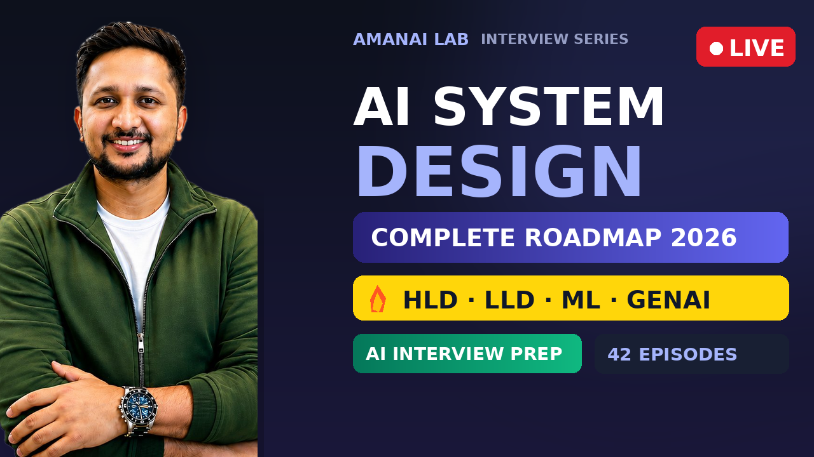

<div align="center">



# 🏗️ AI System Design — Complete Roadmap 2026

**The complete, AI-focused system design roadmap to crack any AI interview.**

From absolute basics to advanced — covering Foundations, HLD, LLD, ML System Design, GenAI & Agentic AI.

[](https://amanailab.com)
[](https://youtube.com)
[](https://github.com/USERNAME/AI-System-Design)

</div>

---

## 📖 What is this?

A free, open roadmap to master **AI System Design** for 2026 interviews. Unlike generic system design content built for backend roles, every topic here is taught with **AI-focused examples** — and it covers all three interview types: **HLD, LLD, and ML/GenAI System Design**. Whatever AI role you're targeting, this roadmap prepares you for it.

> 🎯 **42 episodes · 5 modules · 23 hands-on practice problems**

---

## 🗺️ The Roadmap

<div align="center">

📥 **[Download the full Roadmap PDF →](./roadmap/AI_System_Design_Roadmap_2026.pdf)**

</div>

### `Module 1` — System Design Foundations &nbsp;·&nbsp; Ep 01–12
The building blocks behind every AI system. Load balancing, caching, databases, message queues, scaling, sharding, replication, CAP & PACELC — all explained with AI examples.

### `Module 2` — High Level Design (HLD) &nbsp;·&nbsp; Ep 13–17
Design real systems: YouTube, Uber, Twitter Feed, Search Autocomplete, DynamoDB.

### `Module 3` — Low Level Design (LLD) &nbsp;·&nbsp; Ep 18–27
OOP, SOLID, design patterns → Parking Lot, BookMyShow, LRU Cache, Splitwise, Hotel Management, Ride Sharing.

### `Module 4` — ML, GenAI & Agentic AI &nbsp;·&nbsp; Ep 28–40 &nbsp; ⭐ *The core*
The heart of the series. ML system design, RAG, vector DBs, LLM inference optimization, MCP, A2A, multi-agent orchestration, AI guardrails, evals. **60% of 2026 AI interviews focus here.**

### `Module 5` — Grand Finale &nbsp;·&nbsp; Ep 41–42
AI-specific low-level design + a full 45-minute live mock interview.

---

## 📝 Episode Notes

Detailed notes are added as each episode goes live.

| Day | Topic | Notes |
|:---:|-------|:-----:|
| **0** | Roadmap & Overview | [📄 Read](./notes/day-00-roadmap.md) |
| **1** | System Design Framework + Estimation | *soon* |
| **2** | Networking · CDN · Proxy · API Gateway | *soon* |

---

## 📁 Structure

```
AI-System-Design/
├── README.md
├── roadmap/     →  the complete roadmap PDF
├── notes/       →  episode-by-episode notes (markdown)
├── slides/      →  presentation decks
└── assets/      →  images & banners
```

---

## 🎯 Who is this for?

- 🎓 Students & freshers targeting AI / ML engineer roles
- 💼 Working developers transitioning into AI
- 🚀 Anyone preparing for any AI interview — AI Engineer, ML Engineer, Data Scientist, GenAI roles, and more

---

## 🏢 Companies That Test AI System Design

`OpenAI` `Anthropic` `Google DeepMind` `Meta AI` `xAI` `Google` `Amazon` `Apple` `Microsoft` `Netflix` `Pinecone` `LangChain` `Stripe` `Cursor`

---

## 🤝 Connect

- 🌐 **Website:** [amanailab.com](https://amanailab.com)
- 📺 **YouTube:** AmanAI Lab — *subscribe for new episodes*

---

## 📌 How to use this repo

1. **Star ⭐ this repo** to bookmark it and help others find it
2. **Download the roadmap PDF** and follow along
3. **Watch the series** on YouTube, episode by episode
4. **Read the notes** here for quick revision before interviews

---

<div align="center">

### ⭐ Found this helpful? Star the repo!

*Made with ❤️ by AmanAI Lab · Updated for 2026 AI interviews*

</div>
