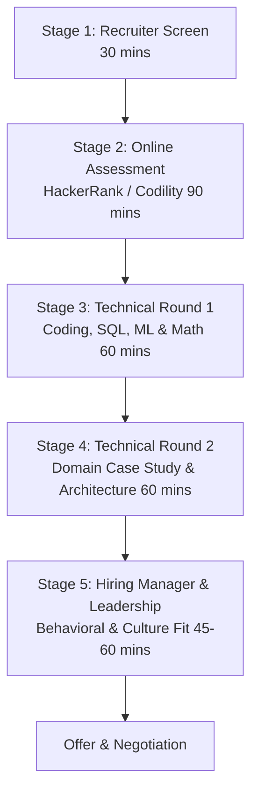
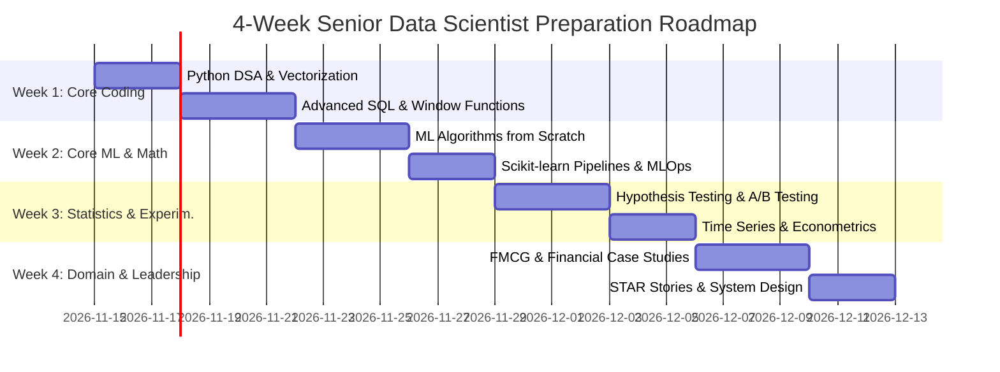

# Master Interview Preparation Guide: Senior Data Scientist
## General Mills India & London Stock Exchange Group (LSEG)

---

## 1. Executive Summary & Purpose

This master guide is a targeted preparation manual for candidates interviewing for **Senior Data Scientist** (and Lead Data Scientist) positions at:
1. **General Mills India Centre (GIC)** — Powai, Mumbai (Fast-Moving Consumer Goods / CPG Analytics)
2. **London Stock Exchange Group (LSEG)** — Bangalore & Mumbai (Financial Services, Market Infrastructure & Quantitative Analytics)

Both organizations recruit heavily in India for global capability centers and engineering hubs. While both expect strong foundations in Python, SQL, and core Machine Learning, their technical rounds, case studies, and business expectations diverge substantially:
* **General Mills** tests heavily on **demand forecasting, supply chain resilience, price elasticity, marketing mix modeling (MMM), trade promotion ROI, and SQL/PySpark data wrangling**.
* **LSEG** tests rigorously on **time-series econometrics, market microstructure, risk modeling (VaR/CVaR), fixed-income math, ESG analytics, financial NLP, and robust production-grade Python engineering**.

---

## 2. Company In-Depth Profile: General Mills India

```
                  ┌──────────────────────────────────────────────┐
                  │          General Mills India (GIC)           │
                  │             Powai, Mumbai Hub                │
                  └──────────────────────┬───────────────────────┘
                                         │
     ┌───────────────────┬───────────────┴───────────────┬───────────────────┐
     ▼                   ▼                               ▼                   ▼
┌──────────────┐  ┌──────────────┐               ┌──────────────┐     ┌──────────────┐
│  Demand &    │  │ Supply Chain │               │ Commercial & │     │  Enterprise  │
│  Consumer    │  │  Logistics   │               │ Trade Promo  │     │  AI/ML COE   │
│  Analytics   │  │  Analytics   │               │  Analytics   │     │ (Azure/Lake) │
└──────────────┘  └──────────────┘               └──────────────┘     └──────────────┘
```

### Overview & Footprint
* **Location:** Hiranandani Business Park, Powai, Mumbai, Maharashtra.
* **Function:** General Mills India Centre (GIC) serves as a global technology, analytics, and business solutions engine supporting North America Retail (NAR), Europe & Australia (EUAU), Asia & Latin America (ASLA), and Pet segment (Blue Buffalo).
* **Global Revenue & Scale:** Fortune 500 enterprise with over $20B in annual revenue, operating across 100+ countries with 30,000+ global employees.
* **Flagship Global & Domestic Brands:**
  * *Cereals & Breakfast:* Cheerios, Lucky Charms, Cinnamon Toast Crunch, Wheaties.
  * *Baking & Flour:* Pillsbury, Betty Crocker, Bisquick.
  * *Snacks:* Nature Valley, Fiber One, Fruit by the Foot, Chex Mix.
  * *Dairy & Meals:* Häagen-Dazs (international), Yoplait, Old El Paso.
  * *Pet Food:* Blue Buffalo, Wilderness.

### Analytics Organization Structure
1. **Consumer & Performance Analytics:** Brand performance tracking, consumer segmentation, Nielsen/IRI syndicated scanner data analytics, sentiment analysis of consumer feedback.
2. **Supply Chain & Logistics Analytics:** Demand sensing, plant-to-DC distribution network optimization, safety stock modeling, On-Time In-Full (OTIF) service level fulfillment.
3. **Commercial & Trade Analytics:** Trade promotion management (TPM), counterfactual baseline sales decomposition, price elasticity of demand (PED), marketing mix modeling (MMM).
4. **Data Science & AI Center of Excellence:** Scalable ML frameworks, automated feature stores, LLM/GenAI automation on corporate data lakehouses.

### Enterprise Tech Stack
* **Cloud Platform:** Microsoft Azure (primary enterprise cloud), with Google Cloud Platform (GCP) used in select marketing and digital media teams.
* **Data Processing & Big Data:** Azure Databricks, Apache Spark, PySpark, Azure Data Factory (ADF), dbt.
* **Languages & Libraries:** Python (`pandas`, `numpy`, `scipy`, `scikit-learn`, `lightgbm`, `statsmodels`), Advanced SQL (T-SQL, Databricks SQL, Snowflake).
* **MLOps & Deployment:** MLflow, Azure Machine Learning Service, Docker, Git / GitHub Actions, CI/CD pipelines.
* **BI & Reporting:** Microsoft Power BI, Tableau.

---

## 3. Company In-Depth Profile: London Stock Exchange Group (LSEG)

```
                  ┌──────────────────────────────────────────────┐
                  │                  LSEG India                  │
                  │           Bangalore & Mumbai Hubs            │
                  └──────────────────────┬───────────────────────┘
                                         │
     ┌───────────────────┬───────────────┴───────────────┬───────────────────┐
     ▼                   ▼                               ▼                   ▼
┌──────────────┐  ┌──────────────┐               ┌──────────────┐     ┌──────────────┐
│  StarMine    │  │  LSEG Tick   │               │     ESG &    │     │  Regulatory  │
│ Quantitative │  │  History &   │               │ Sustainable  │     │ Surveillance │
│  Analytics   │  │ Microstruct. │               │   Finance    │     │ & Compliance │
└──────────────┘  └──────────────┘               └──────────────┘     └──────────────┘
```

### Overview & Footprint
* **Locations:** 
  * *Bengaluru (Bangalore):* Divyasree Technopolis / RMZ EcoWorld / Prestige Tech Park (Major Technology & Data Hub).
  * *Mumbai:* NESCO IT Park, Goregaon / Bandra Kurla Complex (BKC).
* **Function:** LSEG India represents a primary engineering, data platform, and quantitative research center following the landmark $27B acquisition of **Refinitiv** (formerly Thomson Reuters Financial & Risk). It builds core data engines that power global financial markets.
* **Core Business Divisions:**
  * *Data & Analytics:* Enterprise real-time data feeds, pricing services, indices (FTSE Russell).
  * *Capital Markets:* London Stock Exchange, Turquoise, FXall, Tradeweb.
  * *Post Trade:* LCH (leading multi-asset global clearing house).

### Flagship Data Products & Focus Areas
1. **LSEG Workspace (Refinitiv Workspace):** Flagship financial analysis terminal delivering real-time quotes, news, fundamental financial data, and charting.
2. **LSEG Tick History:** Microsecond-level consolidated tick data covering 99+ million financial instruments across 500+ global exchanges.
3. **StarMine Quantitative Analytics:** Leading quantitative factor models (Analyst Revisions, Smart Holdings, Combined Credit Risk, Intrinsic Valuation).
4. **ESG & Sustainable Finance:** Transparent environmental, social, and governance scores across 15,000+ public companies globally.
5. **PermID & Knowledge Graph:** Open, permanent universal identifiers linking legal entities, instruments, organizations, and hierarchical corporate structures.
6. **Risk Intelligence & World-Check:** Financial crime prevention, PEP/sanctions screening, anti-money laundering (AML), and regulatory surveillance.

### Enterprise Tech Stack
* **Cloud Platform:** Multi-cloud with heavy presence on AWS and Microsoft Azure. Strategic 10-year enterprise partnership with Microsoft (Azure OpenAI, Teams/Workspace integration).
* **Data Platforms & Warehousing:** Snowflake, AWS Redshift, Apache Kafka, Apache Spark, Databricks, PostgreSQL, Oracle Exadata.
* **Languages & Libraries:** Python (`pandas`, `numpy`, `scipy`, `statsmodels`, `arch`, `scikit-learn`, `PyTorch`, `transformers`, `QuantLib`), Advanced ANSI SQL, C++ (in low-latency execution engines).
* **AI & NLP Focus:** Large Language Models (LLMs), Retrieval-Augmented Generation (RAG) for financial news, fine-tuned FinBERT for earnings sentiment, time-series forecasting.
* **MLOps & DevOps:** Docker, Kubernetes (EKS/AKS), MLflow, Argo Workflows, Git / GitLab CI/CD.

---

## 4. End-to-End Interview Process Stages



### General Mills India: 5-Stage Selection Pipeline

| Stage | Duration | Format & Platform | Evaluated Competencies |
| :--- | :--- | :--- | :--- |
| **Stage 1: HR / Recruiter Screen** | 30 mins | Phone / MS Teams | Resume projects, FMCG interest, notice period, location (Powai), CTC expectations. |
| **Stage 2: Online Assessment** | 90 mins | HackerRank / TestGorilla | 2 SQL queries (CTEs, joins), 1 Python data manipulation task, 15 MCQs on statistics/ML. |
| **Stage 3: Technical Round 1 (Hands-On)** | 60 mins | MS Teams + CoderPad | Live coding: Pandas aggregation/reshaping, complex SQL window functions, core ML algorithms from scratch. |
| **Stage 4: Technical Round 2 (Domain Case Study)** | 60 mins | MS Teams (Senior DS / Lead) | Demand forecasting case study, price elasticity formulation, trade promo baseline design, past project deep dive. |
| **Stage 5: Managerial / HR Round** | 45-60 mins | MS Teams (Director / HR) | STAR behavioral questions, stakeholder communication, cross-functional collaboration, cultural values. |

### LSEG India: 5-Stage Selection Pipeline

| Stage | Duration | Format & Platform | Evaluated Competencies |
| :--- | :--- | :--- | :--- |
| **Stage 1: Talent Acquisition Screen** | 30 mins | Phone / MS Teams | Quantitative background, tech stack match (PyTorch, SQL, cloud), notice period, Bangalore/Mumbai preference. |
| **Stage 2: Online Coding Assessment** | 90–100 mins | Codility / HackerRank | 3 coding tasks: complex string/date parsing, advanced SQL window functions, algorithmic array/hash map problem. |
| **Stage 3: Technical Round 1 (Foundations)** | 60 mins | MS Teams + Live IDE | Python OOP, clean code, time-series stationarity tests, probability distributions, linear algebra/calculus in ML. |
| **Stage 4: Technical Round 2 (Case Study / Quant)** | 60–75 mins | MS Teams (Quant Lead / Senior Manager)| Financial data case study (VaR calculation, anomaly detection, NLP sentiment on earnings transcripts, ESG factor tilt). |
| **Stage 5: Leadership & Culture Round** | 45 mins | MS Teams (Engineering Director) | Global stakeholder alignment (UK/US time zones), dealing with ambiguous specs, regulatory compliance mindset. |

---

## 5. Commonly Reported Real Interview Questions

### Category A: SQL & Data Wrangling
* **General Mills:**
  1. *"Write a query to calculate the 7-day rolling average sales per store-SKU without using `AVG()` with frame specification."*
  2. *"Find duplicate transactions where customer ID and transaction timestamp match, keeping only the record with the maximum order value."*
  3. *"Given a table of daily retailer orders, compute Days of Inventory (DOI) and flag products with stockout risk (< 5 days)."*
  4. *"Write a query to pivot monthly sales into quarterly columns using `CASE WHEN` and conditional aggregation."*
  5. *"Find top 3 selling SKUs by revenue in each sales territory using `DENSE_RANK()` vs `ROW_NUMBER()`."*
* **LSEG:**
  1. *"Write a query to calculate daily log returns and 30-day annualized rolling volatility for a list of equity tickers."*
  2. *"Detect potential wash-trading: identify instances where Account A sells to Account B and Account B sells back to Account A within a 60-second window."*
  3. *"Compute the bid-ask spread and order book depth at 1-minute intervals from a raw tick trade table."*
  4. *"Implement a recursive CTE to traverse a corporate ownership hierarchy and calculate ultimate beneficial ownership (UBO) percentage."*
  5. *"Explain how to optimize a slow query running over 500 million rows in Snowflake/Databricks (partitioning, clustering, predicate pushdown)."*

### Category B: Machine Learning & Algorithm Theory
* **Common to Both:**
  1. *"Explain the mathematical difference between Ridge (L2) and Lasso (L1) regularization. Why does Lasso produce exact zero coefficients?"*
  2. *"Derive the gradient and update rule for Logistic Regression from the cross-entropy loss function."*
  3. *"How does XGBoost handle missing values during tree splitting compared to LightGBM?"*
  4. *"What is the exact mathematical difference between ROC-AUC and Precision-Recall AUC? When is PR-AUC strictly mandatory?"*
  5. *"Explain the bias-variance trade-off in Random Forests vs Gradient Boosted Trees."*
* **General Mills Specific:**
  1. *"How do you model promotional lift when promotional events are sparse and cause forward buying (pantry loading) in subsequent weeks?"*
  2. *"How do you forecast demand for a new product with zero sales history (cold start)?"*
  3. *"Explain how hierarchical time series forecasting works. How would you reconcile store-level, regional DC-level, and national forecasts?"*
* **LSEG Specific:**
  1. *"Why does standard K-Fold cross-validation cause catastrophic data leakage in financial time series? What is Purged & Embargoed Cross-Validation?"*
  2. *"How do you formulate the Almgren-Chriss optimal execution model for liquidating a large block of shares with minimal market impact?"*
  3. *"How do you handle heavy-tailed, leptokurtic return distributions when estimating Value at Risk (VaR)?"*

### Category C: Applied Statistics & Probability
* **Common to Both:**
  1. *"What is the Central Limit Theorem? What are the regularity conditions, and when does it fail?"*
  2. *"You run an A/B test with 95% confidence. If your product team continuously checks the p-value daily and stops early when p < 0.05, what is the true Type I error rate? (The Peeking Problem)."*
  3. *"Explain Simpson's Paradox with an intuitive business example."*
  4. *"How do you test for stationarity in a time series? What is the difference between ADF (Augmented Dickey-Fuller) and KPSS tests?"*
* **General Mills Specific:**
  1. *"How do you design a Geo-Lift experiment to measure the causal impact of a TV advertising campaign across different US metro markets?"*
  2. *"In price elasticity modeling, price is endogenous because retailers drop prices during seasonal peaks. How do you resolve this using Instrumental Variables (2SLS)?"*
* **LSEG Specific:**
  1. *"Explain the Black-Litterman model and how it improves upon classical Markowitz mean-variance portfolio optimization."*
  2. *"Derive the relationship between Modified Duration, Macaulay Duration, and Bond Convexity."*
  3. *"What is the Kupiec POF (Proportion of Failures) test for backtesting Value at Risk models under Basel III?"*

### Category D: Behavioral & Cultural Fit Questions (STAR Framework)

| Value / Competency | General Mills Culture Anchor | LSEG Culture Anchor | Sample Question |
| :--- | :--- | :--- | :--- |
| **Collaboration** | *"Move As One Team"* | Global cross-hub alignment | *"Describe a time you had to deliver a critical project working with cross-functional stakeholders who had conflicting priorities."* |
| **Innovation & Courage** | *"Act Boldly"* | Leading-edge FinTech delivery | *"Tell me about a situation where you challenged the existing methodology and introduced a novel ML solution."* |
| **Integrity & Quality** | *"Do the Right Thing, Always"* | Regulatory compliance & trust | *"Describe a time when a model in production had unexpected bias or erroneous data. How did you handle stakeholder communication?"* |
| **Ambiguity & Resilience**| Continuous adaptability | Fast-paced market infrastructure | *"Tell me about a time you had to deliver a data science solution with vague business requirements and missing data."* |

---

## 6. Compensation & Salary Benchmark for Senior Data Scientist in India

```
┌──────────────────────────────────────────────────────────────────────────────┐
│                    Senior Data Scientist CTC Benchmark (India)               │
├─────────────────────────┬──────────────────────┬─────────────────────────────┤
│ Component               │ General Mills India  │ LSEG India                  │
│                         │ (Powai, Mumbai)      │ (Bangalore / Mumbai)        │
├─────────────────────────┼──────────────────────┼─────────────────────────────┤
│ Experience Range        │ 5 – 9 Years          │ 6 – 10 Years                │
│ Base Salary (Fixed)     │ ₹18,00,000 – ₹24,00,000│ ₹24,00,000 – ₹32,00,000     │
│ Annual Variable / Bonus │ 10% – 15% (₹2L – ₹4L)│ 15% – 20% (₹4L – ₹7L)       │
│ Long-Term Equity / RSUs │ Discretionary / LTI  │ Discretionary / Global Share│
│ Total Target CTC        │ ₹20,00,000 – ₹28,00,000│ ₹28,00,000 – ₹38,00,000+    │
└─────────────────────────┴──────────────────────┴─────────────────────────────┘
```

### Key Compensation Drivers & Negotiation Strategy
1. **Generative AI & MLOps Premium:** Candidates demonstrating production deployment experience with LLM/RAG pipelines, MLflow, Docker, and Databricks command a 20–25% premium.
2. **Domain Specialization:** At LSEG, deep experience in quantitative finance, market microstructure, or fixed income warrants top-of-band offers. At General Mills, prior CPG/retail syndicated data experience (Nielsen, IRI, POS scanner data) provides strong leverage.
3. **Competing Offers:** Both companies respect competing offers from tier-1 tech firms (Amazon, Microsoft) or top GCCs (Target, Walmart Global Tech, Goldman Sachs, Morgan Stanley).

---

## 7. 4-Week Strategic Preparation Plan



### Week 1: Core Coding & Data Manipulation Mastery
* **Day 1–2: Python DSA for Data Scientists**
  * Review hash maps, two pointers, sliding windows, heaps/priority queues.
  * Generators, custom iterators, decorators (retry/timing), context managers.
  * Practice: Vectorization vs loops, memory downcasting, Parquet file streaming.
* **Day 3–5: Advanced SQL & Query Optimization**
  * Window functions: `ROW_NUMBER`, `RANK`, `DENSE_RANK`, `LAG`, `LEAD`, `NTILE`, frame specifications (`ROWS BETWEEN`).
  * Recursive CTEs, multi-table joins, self-joins for temporal windows.
  * Query execution plans (`EXPLAIN ANALYZE`), indexing strategies, partition pruning.
* **Day 6–7: Pandas & NumPy Deep Dive**
  * Multi-index manipulation, `groupby.transform()`, `melt()`, `pivot_table()`.
  * NumPy broadcasting rules, matrix operations, custom vectorized scoring.

### Week 2: Machine Learning Fundamentals & Implementations from Scratch
* **Day 8–10: Core Algorithms from Scratch**
  * Implement Linear Regression & Logistic Regression with Gradient Descent.
  * Implement Decision Tree split criterion (Gini Impurity, Information Gain).
  * Implement K-Means clustering and Principal Component Analysis (eigenvalue decomposition).
* **Day 11–12: Ensemble Methods & Loss Formulations**
  * Mathematics of Random Forest (bagging, feature sub-sampling).
  * Mathematics of Gradient Boosting (XGBoost vs LightGBM vs CatBoost).
  * Objective functions: Log-loss, Mean Squared Error, Huber loss, Quantile loss.
* **Day 13–14: Scikit-learn Pipelines, Imbalance & Tuning**
  * Custom Transformers inheriting `BaseEstimator` and `TransformerMixin`.
  * Handling severe class imbalance: SMOTE, Focal Loss, class-weighted loss.
  * Hyperparameter tuning with Bayesian Optimization (Optuna).

### Week 3: Applied Statistics, Probability & Experimental Design
* **Day 15–17: Hypothesis Testing & A/B Testing**
  * One-sample, two-sample, and paired t-tests; Chi-Square test of independence; ANOVA.
  * Statistical power calculation, minimum detectable effect (MDE), sample size sizing.
  * The Peeking Problem, Bonferroni correction, Benjamini-Hochberg FDR control.
  * Advanced A/B testing: CUPED (Variance reduction using pre-experiment covariates).
* **Day 18–19: Time-Series Econometrics**
  * Stationarity testing (ADF, KPSS), autocorrelation (ACF/PACF).
  * ARIMA / SARIMAX modeling, exogenous regressors, seasonality decomposition.
  * ARCH / GARCH volatility modeling.
* **Day 20–21: Probability Distributions & Bayesian Thinking**
  * Normal, Poisson, Exponential, Gamma, Beta, and Student's t-distributions.
  * Bayes' Theorem, conjugate priors, Maximum Likelihood Estimation (MLE).

### Week 4: Domain Case Studies, System Design & Behavioral Polish
* **Day 22–24: Domain Case Studies Deep Dive**
  * Master the 22 production case studies in `06_domain_case_studies.md`.
  * Practice General Mills problems: Demand sensing, price elasticity, MMM adstock, safety stock.
  * Practice LSEG problems: Portfolio VaR/CVaR, fixed income bond pricing, ESG factor tilt, LOB microstructure.
* **Day 25–26: Machine Learning System Design**
  * End-to-end ML architecture: Data ingestion, feature store, real-time vs batch inference, model drift detection (PSI / KL divergence).
  * MLOps tooling: MLflow, Databricks, Docker, Azure / AWS deployment.
* **Day 27–28: Behavioral Polish & STAR Stories**
  * Prepare 5 distinct STAR stories mapped to company values.
  * Rehearse past project walkthroughs: business problem, technical choices, quantifiable impact, and architectural trade-offs.

---

## 8. Key Topics Priority Matrix: FMCG vs. Financial Services

| Topic / Skill Area | Importance for General Mills (FMCG) | Importance for LSEG (Financial Services) | Typical Question Type |
| :--- | :---: | :---: | :--- |
| **Advanced SQL & Window Functions** | **CRITICAL** (5/5) | **CRITICAL** (5/5) | Live coding / Online test |
| **Pandas / Data Wrangling** | **CRITICAL** (5/5) | **CRITICAL** (5/5) | Live coding / CoderPad |
| **Time Series Demand Forecasting** | **CRITICAL** (5/5) | **HIGH** (4/5) | Domain case study round |
| **Price Elasticity & Econometrics** | **CRITICAL** (5/5) | **MEDIUM** (3/5) | Technical case study |
| **Marketing Mix Modeling (MMM)** | **HIGH** (4/5) | **LOW** (1/5) | Technical interview |
| **Supply Chain / Inventory Optimization**| **CRITICAL** (5/5) | **LOW** (1/5) | Domain case study |
| **Financial Risk (VaR / CVaR / Stress)**| **LOW** (1/5) | **CRITICAL** (5/5) | Quant technical round |
| **Market Microstructure / Order Books** | **NONE** (0/5) | **CRITICAL** (5/5) | Quant technical round |
| **Fixed Income & Yield Curve Math** | **NONE** (0/5) | **HIGH** (4/5) | Domain technical round |
| **NLP / Text Analytics / LLMs** | **MEDIUM** (3/5) | **HIGH** (4/5) | Technical design round |
| **A/B Testing & Causal Inference** | **HIGH** (4/5) | **HIGH** (4/5) | Statistics round |
| **ML Algorithms from Scratch** | **HIGH** (4/5) | **HIGH** (4/5) | Live coding round |
| **MLOps / Cloud Deployment (Azure/AWS)**| **HIGH** (4/5) | **HIGH** (4/5) | System design round |

---

## 9. Comprehensive Prep Repository File Index

The companion files in this preparation repository provide exhaustive code and theory coverage:

1. [00_master_guide.md](file:///D:/Int/General_Mills/interview_prep/00_master_guide.md) — Master strategy, company overviews, interview loops, salaries, and 4-week roadmap (this file).
2. [01_pandas_numpy_operations.md](file:///D:/Int/General_Mills/interview_prep/01_pandas_numpy_operations.md) — 20+ real interview-style Pandas & NumPy questions with complete Python solutions.
3. [02_sql_database_operations.md](file:///D:/Int/General_Mills/interview_prep/02_sql_database_operations.md) — 26 production SQL questions covering window functions, CTEs, domain schemas, and query optimization.
4. [03_ml_algorithms_implementation.md](file:///D:/Int/General_Mills/interview_prep/03_ml_algorithms_implementation.md) — Core ML algorithms implemented from scratch, Scikit-learn pipelines, and loss derivations.
5. [04_statistics_probability.md](file:///D:/Int/General_Mills/interview_prep/04_statistics_probability.md) — 25 statistical interview problems covering A/B testing, hypothesis tests, distributions, and financial time-series.
6. [05_python_coding_dsa.md](file:///D:/Int/General_Mills/interview_prep/05_python_coding_dsa.md) — 21 Python DSA, OOP, decorators, generators, memory optimization, and parallel processing solutions.
7. [06_domain_case_studies.md](file:///D:/Int/General_Mills/interview_prep/06_domain_case_studies.md) — 22 production case studies (11 General Mills FMCG + 11 LSEG Financial Services) with complete runnable Python code.
8. [07_deep_learning_nlp_advanced.md](file:///D:/Int/General_Mills/interview_prep/07_deep_learning_nlp_advanced.md) — Deep learning, NLP, transformers, time-series DL, and MLOps architectures.
9. [08_pythonic_programming_fundamentals.md](file:///D:/Int/General_Mills/interview_prep/08_pythonic_programming_fundamentals.md) — 23 advanced Pythonic programming questions: dunder methods, descriptors, metaclasses, typing protocols, memory internals, GIL, itertools/functools, and async pipelines.
10. [09_pyspark_big_data_operations.md](file:///D:/Int/General_Mills/interview_prep/09_pyspark_big_data_operations.md) — 20 PySpark, Databricks Lakehouse, and distributed computing questions: salting skew joins, pandas_udf, window functions, Delta Lake ACID merges, and OOM debugging.
11. [10_ml_system_design_architecture.md](file:///D:/Int/General_Mills/interview_prep/10_ml_system_design_architecture.md) — 6 production ML system designs with Mermaid architectures: Demand Sensing, Retail Media RGM, Trade Surveillance, StarMine Factor Platform, RAG, and Feature Stores.
12. [11_behavioral_leadership_case_interviews.md](file:///D:/Int/General_Mills/interview_prep/11_behavioral_leadership_case_interviews.md) — Senior & Lead behavioral frameworks, cross-functional stakeholder conflict resolution, code review rubrics, and India salary negotiation playbook.
13. [12_takehome_notebook_critique.md](file:///D:/Int/General_Mills/interview_prep/12_takehome_notebook_critique.md) — General Mills signature take-home challenge: auditing and refactoring a flawed demand forecasting notebook, with 10 fatal flaws, leak-free LightGBM pipeline, and executive defense script.
