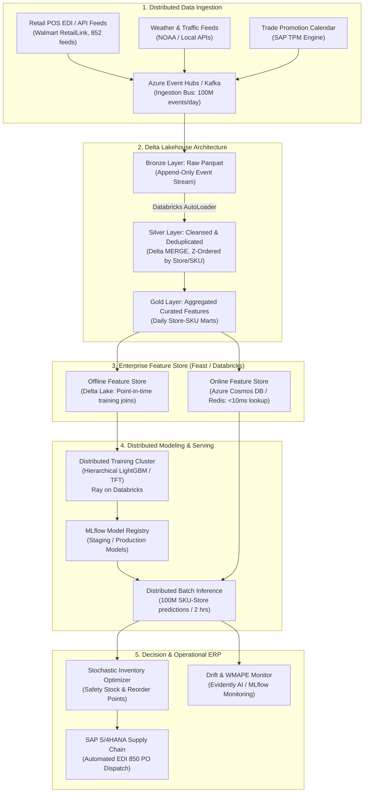
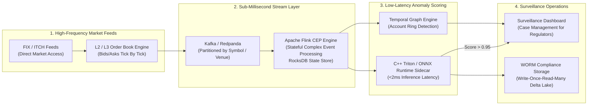
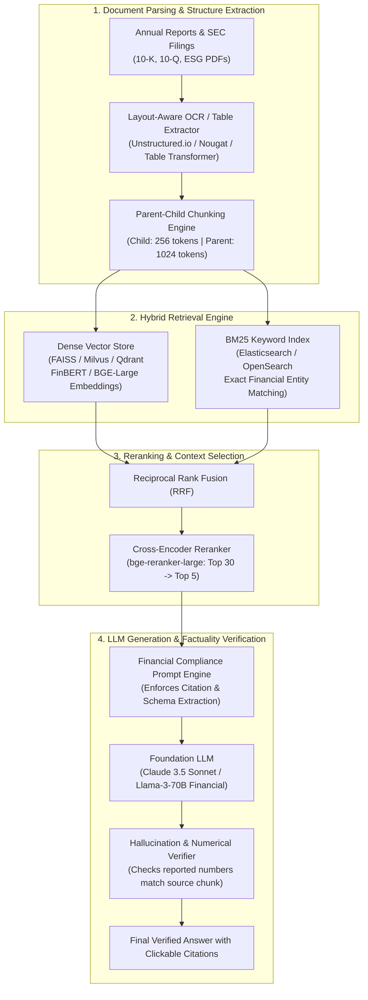

# ML System Design & Enterprise Architecture — Senior & Lead Data Scientist Interview Prep
### Target Companies: General Mills India (Global Analytics Center) | LSEG India (Refinitiv / Quantitative Platforms)
### Role Focus: Senior Data Scientist / Lead Data Scientist / Staff ML Architect
### Last Updated: November 2026

---

> [!IMPORTANT]
> **The Senior / Lead Differentiator: System Design & Production Architecture**
> Mid-level data scientists are asked *how an algorithm works*. Senior and Lead Data Scientists are asked **how to design an end-to-end distributed system that operates reliably under enterprise constraints**:
> 1. **Throughput & Latency SLAs:** Sub-millisecond tick scoring at LSEG vs 500,000 SKU-store batch forecasts at General Mills.
> 2. **Point-in-Time Correctness & Feature Stores:** Preventing future data leakage in training datasets (lookahead bias) using dual-tier feature stores (Online Redis vs Offline Delta Lake).
> 3. **Production Drift & Governance:** Tracking Population Stability Index (PSI), concept drift, automated shadow deployments, and regulatory auditability.
> 4. **Trade-Off Justification:** Defending architectural decisions (e.g., choosing a calibrated LightGBM over Deep Learning due to latency and explainability constraints).

---

## Table of Contents

1. [The 6-Step ML System Design Framework](#1-the-6-step-ml-system-design-framework)
2. [General Mills Case 1: Real-Time Demand Sensing & Automated Replenishment](#2-general-mills-case-1-real-time-demand-sensing--automated-replenishment)
3. [General Mills Case 2: Retail Media & Trade Promotion Optimization Engine](#3-general-mills-case-2-retail-media--trade-promotion-optimization-engine)
4. [General Mills Case 3: Supply Chain Phantom Inventory & Anomaly Detection](#4-general-mills-case-3-supply-chain-phantom-inventory--anomaly-detection)
5. [LSEG Case 1: Sub-Millisecond Trade Surveillance & Market Abuse Detection](#5-lseg-case-1-sub-millisecond-trade-surveillance--market-abuse-detection)
6. [LSEG Case 2: StarMine Quantitative Alpha Generation & Factor Backtesting Platform](#6-lseg-case-2-starmine-quantitative-alpha-generation--factor-backtesting-platform)
7. [LSEG Case 3: Real-Time Financial Regulatory Document Intelligence & RAG](#7-lseg-case-3-real-time-financial-regulatory-document-intelligence--rag)
8. [Cross-Cutting Architectural Deep Dives](#8-cross-cutting-architectural-deep-dives)
   - [Feature Store Architecture: Offline Delta Lake vs Online Redis](#feature-store-architecture-offline-delta-lake-vs-online-redis)
   - [Training-Serving Skew Prevention](#training-serving-skew-prevention)
   - [Model Serving Topology: Triton, ONNX, and FastAPI](#model-serving-topology-triton-onnx-and-fastapi)
   - [Automated Drift Monitoring & Canary Rollback Pipeline](#automated-drift-monitoring--canary-rollback-pipeline)

---

## 1. The 6-Step ML System Design Framework

When presented with an ambiguous problem like *"Design a real-time trade anomaly detection engine"* or *"Design a demand forecasting system for Cheerios across 100,000 stores"*, follow this disciplined 45-minute whiteboard structure:

```
┌─────────────────────────────────────────────────────────────────────────────┐
│                 6-STEP SENIOR / LEAD ML SYSTEM DESIGN TEMPLATE               │
└─────────────────────────────────────────────────────────────────────────────┘
  Step 1: Clarify Requirements, Scope & SLAs (5 mins)
          • Business Goal, Prediction Target, Scale (QPS/Throughput), Latency SLA.
  Step 2: High-Level Architecture & End-to-End Diagram (8 mins)
          • Ingestion → Storage → Feature Pipeline → Serving → Monitoring.
  Step 3: Data Engineering & Feature Store Strategy (8 mins)
          • Streaming vs Batch, Entity Keys, Point-in-Time Join, Storage Engines.
  Step 4: Modeling Methodology & Loss Formulation (8 mins)
          • Baseline vs Candidate Models, Feature Engineering, Metric & Business KPI.
  Step 5: Model Serving, Low-Latency Topology & Caching (8 mins)
          • Batch precompute vs Real-time RPC, Triton/ONNX, Fallbacks.
  Step 6: Evaluation, Drift Monitoring & Continuous Learning (8 mins)
          • A/B testing, Canary deployment, PSI drift detection, Feedback loops.
```

---

## 2. General Mills Case 1: Real-Time Demand Sensing & Automated Replenishment

### Problem Statement
General Mills supplies over 100 brands (Cheerios, Nature Valley, Häagen-Dazs, Pillsbury) to 100,000+ retail stores (Walmart, Target, Carrefour) globally. Traditional monthly statistical forecasts lag real-world demand shifts (weather spikes, competitor promotions, supply chain snarls).
**Objective:** Design an automated **Daily Demand Sensing & Replenishment Pipeline** that ingests daily Point-of-Sale (POS) scanner data and inventory levels, generates probabilistic SKU-Store demand forecasts (P10, P50, P90), and outputs automated Purchase Orders (POs) with zero manual intervention.

### Architectural Blueprint



### Deep Dive: Critical Architectural Decisions

1. **Prediction Strategy & Loss Function:**
   * Why not standard MSE/RMSE? Over-forecasting and under-forecasting have asymmetric business penalties. Under-forecasting results in retail stockouts (severe retailer fines and brand switching); over-forecasting perishable dairy (Yoplait) causes spoilage.
   * **Solution:** Pinball loss for **Quantile Regression (LightGBM)** generating $P_{10}$ (safety lower bound), $P_{50}$ (operational target), and $P_{90}$ (upper safety buffer for safety stock calculation):
   $$\mathcal{L}_{q}(y, \hat{y}) = \max(q(y - \hat{y}), (1 - q)(\hat{y} - y))$$
2. **Handling the Scale (500,000 SKU-Store Combinations):**
   * Training 500,000 individual models is an MLOps nightmare.
   * **Solution:** Train a single **Global Hierarchical Gradient Boosted Model** partitioned by Category (Cereals, Snacks, Pet). Incorporate categorical embeddings for Store and SKU, alongside cluster-level features (Urban vs Rural, Store Square Footage).
3. **Point-in-Time Correctness in Feature Engineering:**
   * Feature Store must execute `ASOF` joins to guarantee that training records for date $T$ only see features computed up to date $T-1$ at 23:59:59.

---

## 3. General Mills Case 2: Retail Media & Trade Promotion Optimization Engine

### Problem Statement
General Mills spends over $1.5 Billion annually on Trade Promotions (temporary price reductions, endcap displays, digital coupons on Instacart/Walmart.com).
**Objective:** Architect an end-to-end platform that:
1. Decomposes raw historical sales into **De-promoted Baseline Demand** vs **Incremental Promotional Lift**.
2. Simulates optimal promotion calendar schedules under a fixed quarterly marketing budget to maximize Gross Margin ROI.

### Architecture & Mathematical Pipeline

```
  Historical Sales Data ──┐
  (POS Daily Store-SKU)   │
                          ▼
             ┌─────────────────────────┐
             │ B-Spline De-promoter    │ ──► Establishes Counterfactual
             │ & Anomaly Smoother      │     Baseline Demand (Sales without Promo)
             └────────────┬────────────┘
                          │
                          ▼
             ┌─────────────────────────┐
             │ Uplift ML Engine        │
             │ (LightGBM CATE Model)   │ ──► Estimates Elasticity & Cannibalization
             └────────────┬────────────┘     Cross-SKU Interaction Coefficients
                          │
                          ▼
             ┌─────────────────────────┐
             │ Mixed-Integer Nonlinear │
             │ Optimizer (SLSQP / MIP) │ ──► Solves Optimal Discount Depth & Weeks
             └────────────┬────────────┘     Subject to Budget & Channel Guardrails
                          │
                          ▼
             ┌─────────────────────────┐
             │ Commercial Trade Portal │
             │ (React + FastAPI Engine)│ ──► Serves Interactive Scenario Planner
             └─────────────────────────┘
```

### Key Technical Challenges & Solutions
* **Halo Effect vs Cannibalization:** Promoting Cheerios 500g cannibalizes Cheerios 1kg, but creates a halo effect for Milk.
  * *Solution:* Cross-price elasticity matrix embedded into the objective function:
  $$\Delta \text{Revenue}_{i} = \beta_{ii} \Delta P_i + \sum_{j \ne i} \beta_{ij} \Delta P_j$$
* **Production Serving:** Commercial managers run what-if simulations on an interactive web UI. Latency requirement: $< 1.5$ seconds for a 52-week calendar simulation.
  * *Solution:* Pre-compute the elasticity response curves in Databricks; the serving layer only evaluates a pre-compiled second-order quadratic surface via C++ bindings.

---

## 4. General Mills Case 3: Supply Chain Phantom Inventory & Anomaly Detection

### Problem Statement
"Phantom Inventory" occurs when store inventory records show 15 units of Nature Valley bars in stock, but physical units were stolen, damaged, or misplaced in the backroom. Because the ERP system thinks stock exists, automated reordering never triggers, causing perpetual lost sales.
**Objective:** Design a real-time anomaly detection system to detect phantom inventory from Point-of-Sale transaction streams.

### Detection Engine Architecture
* **Data Features:** Expected daily sales distribution (Poisson parameter $\lambda_{s,k}$), consecutive zero-sales days, customer market basket scan velocity.
* **Algorithm:** **Conformalized Poisson Run-Length Scoring**. If a high-velocity SKU ($\lambda = 12 \text{ units/day}$) records zero sales for 4 consecutive days:
$$P(Y = 0 \text{ for 4 days}) = e^{-4 \times 12} = e^{-48} \approx 1.4 \times 10^{-21}$$
* **System Action:** Automatically triggers an inventory audit task to the retail store worker's handheld zebra device via an internal Store Operations API.

---

## 5. LSEG Case 1: Sub-Millisecond Trade Surveillance & Market Abuse Detection

### Problem Statement
As a primary global market infrastructure provider, LSEG must monitor hundreds of millions of order book events across global venues (London Stock Exchange, Turquoise MTF) to detect abusive practices like **Wash Trading**, **Layering/Spoofing**, and **Momentum Ignition** in real-time under strict MiFID II / MAR regulatory mandates.
**Latency SLA:** Alert generation $< 5 \text{ milliseconds}$ from order receipt.

### Architecture Diagram



### Technical Blueprint & SLAs

| Component | Technology | Latency / SLA | Role |
|---|---|---|---|
| **Stream Engine** | Apache Flink (Stateful CEP) | $< 1.5\text{ ms}$ | Maintains sliding 30-second order book depth and order-to-trade cancellation ratios. |
| **Model Format** | ONNX Runtime via C++ API | $< 0.8\text{ ms}$ | Evaluates pre-compiled LightGBM / Isolation Forest without JVM/Python garbage collection pauses. |
| **Graph Network** | Temporal Bipartite Graph (Neo4j / NetworkX) | Near real-time ($< 500\text{ ms}$) | Detects wash trading across colluding trader account rings. |
| **Auditability** | Delta Lake on AWS S3 / Glacier | Async batch | WORM-compliant immutable audit trail for SEC/FCA regulatory subpoena requests. |

---

## 6. LSEG Case 2: StarMine Quantitative Alpha Generation & Factor Backtesting Platform

### Problem Statement
LSEG's StarMine produces industry-standard quantitative stock-ranking models (Analyst Revisions, Smart Holdings, Credit Risk).
**Objective:** Design an enterprise-grade Quantitative Factor Backtesting Platform for buy-side hedge funds that handles 20 years of global equity data without **Lookahead Bias**, **Survivorship Bias**, or **Data Restatement Leakage**.

### Architectural Pillars

```
             ┌──────────────────────────────────────────────────────────┐
             │                POINT-IN-TIME (PIT) DATABASE              │
             │   Stores exact data timestamped as-known-at-the-time:    │
             │     effective_date (market date) vs release_date (filing) │
             └────────────────────────────┬─────────────────────────────┘
                                          │
                                          ▼
             ┌──────────────────────────────────────────────────────────┐
             │               UNIVERSE & SURVIVORSHIP FILTER             │
             │   Includes delisted, bankrupt, and merged companies      │
             │   to prevent artificial upward performance bias.         │
             └────────────────────────────┬─────────────────────────────┘
                                          │
                                          ▼
             ┌──────────────────────────────────────────────────────────┐
             │               CROSS-SECTIONAL FACTOR ENGINE              │
             │   1. Standardized Winsorization & Z-scoring per Sector   │
             │   2. Factor Orthogonalization via Gram-Schmidt           │
             │   3. Neutralization (Market Cap & Sector Beta = 0)       │
             └────────────────────────────┬─────────────────────────────┘
                                          │
                                          ▼
             ┌──────────────────────────────────────────────────────────┐
             │                PORTFOLIO SIMULATOR & METRICS             │
             │   Simulates long/short quantile portfolios with:         │
             │   • Almgren-Chriss Slippage Model                        │
             │   • Information Coefficient (Rank IC / IC IR)            │
             │   • Factor Turnover & Net Sharpe Ratio                   │
             └──────────────────────────────────────────────────────────┘
```

### Key Quantitative Formulations
1. **Information Coefficient (Rank IC):** Evaluates factor predictive power at each rebalancing period $t$:
$$\text{Rank IC}_t = \text{SpearmanCorr}(\text{FactorRank}_t, \text{ForwardReturn}_{t+1})$$
2. **Factor Orthogonalization:** When introducing a new NLP sentiment factor $F_{\text{sentiment}}$, it must be orthogonalized against known factors (Value, Momentum, Volatility) via linear regression residuals:
$$F_{\text{sentiment}} = \alpha + \sum_{k} \gamma_k F_k + \epsilon \implies F_{\text{pure}} = \epsilon$$

---

## 7. LSEG Case 3: Real-Time Financial Regulatory Document Intelligence & RAG

### Problem Statement
LSEG ingests millions of unstructured corporate documents (10-Ks, 10-Qs, ESG reports, earnings transcripts). Compliance officers and buy-side analysts need an accurate Retrieval-Augmented Generation (RAG) assistant that answers complex regulatory questions without hallucinations and with strict page-level citations.

### Advanced RAG Architecture



### Production Best Practices:
* **Parent-Child Chunking:** Child chunks (small 200-token snippets) are embedded for precise semantic retrieval, but the larger parent chunk (1,000 tokens) is passed to the LLM to preserve surrounding financial context.
* **Numerical Hallucination Guardrail:** A deterministic regex parser extracts all numbers from the LLM output and validates that every single figure exists verbatim in the retrieved source context chunks before delivering the response.

---

## 8. Cross-Cutting Architectural Deep Dives

### Feature Store Architecture: Offline Delta Lake vs Online Redis

```
┌─────────────────────────────────────────────────────────────────────────────┐
│                         DUAL-STORAGE FEATURE STORE                          │
└─────────────────────────────────────────────────────────────────────────────┘
                                  │
         ┌────────────────────────┴────────────────────────┐
         ▼                                                 ▼
OFFLINE STORE (Delta Lake / S3)               ONLINE STORE (Redis / DynamoDB)
• Batch historical training data              • Ultra-low latency (<5ms) lookups
• High throughput, TBs to PBs                 • Key-value point lookups by EntityID
• Point-in-time time-travel joins             • Houses only the latest feature state
• Backfill transformations via PySpark        • Fed via streaming Kafka ingestion
```

---

### Training-Serving Skew Prevention

Training-serving skew is the #1 silent killer of production ML models. It occurs when features used during training differ from features computed in production.

**Mitigation Checklist for Senior DS Rounds:**
1. **Single Feature Definition Codebase:** Feature transformation logic must be defined once (e.g., in a shared PySpark/Python package) and compiled into both offline batch pipelines and online streaming workers.
2. **Log Input Data at Inference Time:** Store the exact feature vector used at inference time alongside model predictions in a staging Delta table. Periodically compare distributions against training data.
3. **Immutability of Versioned Pipelines:** Freeze and version Scikit-learn pipelines / Arrow transformation graphs in MLflow artifacts.

---

### Model Serving Topology: Triton, ONNX, and FastAPI

```
                        ┌────────────────────────┐
                        │ API Gateway / Ingress  │
                        └───────────┬────────────┘
                                    │
                                    ▼
                        ┌────────────────────────┐
                        │ FastAPI Routing Layer  │
                        │ (Auth, Validation, Pyd)│
                        └───────────┬────────────┘
                                    │ gRPC
                                    ▼
                        ┌────────────────────────┐
                        │ Triton Inference Server│
                        │ • Dynamic Batching     │
                        │ • Multi-Model Pipeline │
                        │ • C++ ONNX Backend     │
                        └───────────┬────────────┘
                                    │
                       ┌────────────┴────────────┐
                       ▼                         ▼
                 [GPU Worker]              [CPU Worker]
                 Deep Learning             Tree Models
                 (PyTorch / TensorRT)      (ONNX LightGBM)
```

---

### Automated Drift Monitoring & Canary Rollback Pipeline

**Senior DS Interview Pitch:**
*"In production, we decouple monitoring into two distinct categories: **Data Drift (Input Space)** and **Concept Drift (Output Space)**."*

1. **Input Drift (Data Drift):** Monitored daily using **Population Stability Index (PSI)** and Kolmogorov-Smirnov (KS) tests on feature columns:
   $$\text{PSI} = \sum \left( \% \text{Actual} - \% \text{Expected} \right) \times \ln\left( \frac{\% \text{Actual}}{\% \text{Expected}} \right)$$
   * $\text{PSI} < 0.1$: Stable (No action).
   * $0.1 \le \text{PSI} \le 0.25$: Moderate drift (Warning logged, queue diagnostic run).
   * $\text{PSI} > 0.25$: Severe drift (Automatically trigger automated retraining pipeline).
2. **Canary Deployment & Rollback Strategy:**
   * Deploy new model v2.0 in **Shadow Mode** (receives 100% of live traffic, predictions logged, but v1.0 serves users).
   * If latency and prediction divergence stay within 2%, shift to **Canary Release** (5% traffic $\rightarrow$ 25% $\rightarrow$ 100% over 48 hours).
   * Automated rollback triggered if error rate exceeds 0.05% or inference p99 latency exceeds 50ms.

---

*Companion Modules:*
* [00_master_guide.md](file:///D:/Int/General_Mills/interview_prep/00_master_guide.md) — Master prep plan, company profiles, and salary benchmarks.
* [06_domain_case_studies.md](file:///D:/Int/General_Mills/interview_prep/06_domain_case_studies.md) — 22 End-to-end Python code case studies for FMCG and Finance.
* [07_deep_learning_nlp_advanced.md](file:///D:/Int/General_Mills/interview_prep/07_deep_learning_nlp_advanced.md) — PyTorch, Transformers, and MLOps code.
* [08_pythonic_programming_fundamentals.md](file:///D:/Int/General_Mills/interview_prep/08_pythonic_programming_fundamentals.md) — Advanced Python internals, dunder methods, and memory management.
* [09_pyspark_big_data_operations.md](file:///D:/Int/General_Mills/interview_prep/09_pyspark_big_data_operations.md) — Big data operations, Delta Lake, and PySpark optimizations.
