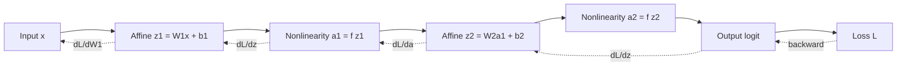

# Neural Network Fundamentals

> **Module 07 — Deep Learning, Multimodal Models, and LLMs**
> Topic 01 of 11
> Estimated study time: 4 hours
> Prerequisites: Module 06, basic linear algebra and calculus
> Version 2026.3

## 1. Why this topic exists

Almost every failure that reaches a clinical reviewer as "the model is biased" or "the model does
not generalise" was decided much earlier, in choices about layers, activations, losses, and
gradients. A team that cannot read those choices cannot diagnose the failure, cannot defend the
design in a regulatory submission, and cannot tell whether a vendor's claim about "a deep learning
model" means anything at all. The purpose of this topic is to make the network legible: what each
block computes, what each gradient means, and which numerical symptoms point to which cause.

The industry problem is not that practitioners cannot import a framework. It is that importing a
framework makes it possible to train a model without understanding it, and the resulting artefact
passes a demo and fails a deployment. A chest radiograph classifier that reaches 0.90 area under
the receiver operating characteristic curve (AUROC) on a held-out set from the same hospital can
fall to 0.70 at a second hospital because the first hospital used one portable scanner whose
burned-in laterality marker correlated with pneumonia. Nothing in the architecture caused that.
The architecture also did not prevent it, and the team had no vocabulary for asking the question.

Three costs follow from the gap.

**Debugging cost.** A loss that becomes not-a-number at step 4,000, a validation curve that is flat
from epoch one, a model that predicts the base rate for every patient: each has a small set of
causes, and each cause has a signature in the gradients, activations, or parameter norms. A team
that instruments those quantities finds the cause in an hour. A team that does not spends two weeks
changing hyperparameters at random and then ships the model that happened to converge.

**Evaluation cost.** Understanding the loss is a precondition for choosing the metric. Cross-entropy
optimises a probability, not a decision. A network trained with unweighted binary cross-entropy on a
3 percent prevalence cohort will produce well-ranked but badly calibrated probabilities, and the
threshold that maximises accuracy will classify almost everyone as negative. The team that does not
know this reports accuracy of 0.97 and calls it success.

**Regulatory cost.** A medical-device submission describes the model architecture, the training
procedure, the loss, and the preprocessing, and it must show that changes to any of these are
controlled. The United States Food and Drug Administration (FDA) draft guidance on AI-enabled
device software functions, issued in January 2025, asks for a description of the model and of the
total product lifecycle controls around it; the predetermined change control plan pathway requires
the team to specify which modifications are anticipated and how their effect will be evaluated. A
team that treats the network as a black box cannot write either document, and a team that describes
it inaccurately has misrepresented the device.

There is also a labour-market reason. Interview questions for applied scientist and machine
learning engineer roles in health technology almost always include one question that separates
users of libraries from people who understand them: "why does batch normalisation help, and when
does it hurt?" or "derive the gradient of the softmax cross-entropy." The answer is not trivia. It
is evidence that the candidate can reason about a training run they did not write.

This topic therefore teaches the network as a computation graph with numbers attached. It does not
teach a framework. Frameworks change; the chain rule does not. By the end you should be able to
take a small network, write its forward pass in plain Python, derive its backward pass, count its
parameters and floating-point operations (FLOPs), predict its memory footprint, and diagnose four
common numerical failures from logged quantities alone.

> **Note:** This topic uses "neural network" to mean a parameterised function trained by gradient
> descent. It does not imply biological plausibility, and no claim in this file depends on the
> brain analogy.

The scope is deliberately narrow. Convolution, recurrence, and attention are treated in Topics 03,
04, and 05. Here every layer is a dense (fully connected) layer, because the dense layer is the
unit that all other layers generalise. A convolution is a dense layer with weight sharing and
sparsity; an attention head is two dense projections plus a weighted average. A learner who can
derive the dense layer can derive the rest with a change of index notation.

## 2. Learning outcomes

By the end of this topic you can:

1. **Draw** the computation graph of a multilayer perceptron (MLP) with named shapes at every
   edge, and **state** the parameter count from the shapes alone.
2. **Compute** the forward pass, the loss, and the backward pass for a two-layer network by hand
   on a three-feature input, and **check** the result against a finite-difference gradient.
3. **Derive** why a saturated sigmoid or a dead rectified linear unit (ReLU) produces zero gradient,
   and **predict** which layers will train slowly from the initialisation alone.
4. **Choose** an activation, an initialisation, and a loss for a stated task, and **justify** the
   choice against at least one alternative.
5. **Estimate** parameters, FLOPs, activation memory, and optimizer-state memory for a proposed
   architecture before writing code.
6. **Diagnose** five numerical failure modes (dead units, vanishing gradients, exploding gradients,
   not-a-number loss, shape mismatch) from logged gradient norms and activation statistics.
7. **Explain** to a clinical or regulatory audience what the network does and does not represent,
   without claiming that it "learns like a radiologist".
8. **Critique** an architecture description in a published paper or a vendor datasheet for missing
   information that would be required to reproduce or regulate the model.

Outcomes 1, 2, 3, and 5 are computational and are assessed by the numerical exercises. Outcomes 4
and 8 are judgement outcomes assessed by rubric. Outcome 7 is assessed in the oral component of the
module.

## 3. The core mental model

A neural network is a directed acyclic graph. Data enters at the leaves, each node applies one
differentiable function, and the loss is a scalar at the root. Training has two sweeps: forward,
which computes the scalar, and backward, which computes the derivative of that scalar with respect
to every parameter by applying the chain rule from the root to the leaves. Everything else —
optimisers, schedules, regularisation — is a policy for using those derivatives.

```text
                    forward  --------------------------------------------->

  x (24) --> [W1 x + b1] --> z1 (64) --> [ReLU] --> a1 (64)
                                                       |
                                                       v
                                              [W2 a1 + b2] --> z2 (32) --> [ReLU] --> a2 (32)
                                                                                          |
                                                                                          v
                                                                                  [W3 a2 + b3]
                                                                                          |
                                                                                          v
                                                                                       logit (1)
                                                                                          |
                                                                                          v
                                                                                    sigmoid --> p
                                                                                          |
                                                                                          v
                                                                              loss = BCE(p, y)

                    backward <---------------------------------------------
                    dL/dW3 = (p - y) * a2^T
                    dL/da2 = W3^T (p - y)
                    dL/dz2 = dL/da2 * 1[z2 > 0]
                    dL/dW2 = dL/dz2 * a1^T
                    dL/da1 = W2^T dL/dz2
                    dL/dz1 = dL/da1 * 1[z1 > 0]
                    dL/dW1 = dL/dz1 * x^T
```

Read the diagram in three passes.

**The shape pass.** Every edge carries a vector, and the matrix on each edge determines the next
shape. A layer with `n_in` inputs and `n_out` outputs has `n_out * n_in` weights and `n_out` biases.
The activation does not change the shape. The loss collapses the batch to a scalar. If you can
annotate shapes, you can compute parameter counts without a library, and you can catch the majority
of implementation bugs before running anything.

**The gradient pass.** The backward sweep is the forward sweep with each local derivative
transposed and multiplied in reverse order. The quantity `p - y` at the output is the error signal
for logistic loss; everything upstream is that signal pushed back through transposed weight
matrices and through the derivative of each activation. A zero derivative anywhere on the path
stops the signal. That single fact explains dying ReLU, saturating sigmoid, and the vanishing
gradient of deep stacks.

**The optimisation pass.** The gradient defines a direction, not a step size. The learning rate,
the batch size, and the optimiser state determine how far the parameters move. A network with
correct gradients and a learning rate ten times too large will diverge; a network with correct
gradients and a learning rate ten times too small will appear not to learn. Both are optimisation
failures, not architecture failures, and confusing them wastes weeks.

The mental model to memorise is therefore not "layers stack". It is:

> A network is a chain of local Jacobians. The forward pass evaluates the chain. The backward pass
> multiplies by the transpose of each Jacobian in reverse. Learning fails when one Jacobian in the
> chain is zero, infinite, or badly conditioned.

Two consequences follow, and they recur in every later topic.

First, depth multiplies Jacobians. If each layer's Jacobian has spectral norm 0.5, ten layers give
0.5^10 ≈ 0.001, and the first layer receives a thousandth of the signal. If each has norm 2, ten
layers give 1,024 and the first layer receives a signal a thousand times larger than the last. This
is why initialisation scales are chosen to keep the norm near one, why residual connections add an
identity path whose Jacobian is exactly one, and why layer normalisation rescales at every block.

Second, the loss defines what is learned. A network minimising pixel-wise cross-entropy on
downsampled images will learn texture, because texture predicts pixels cheaply. A network
minimising a clinical outcome will learn whatever predicts that outcome in the training
distribution, including the scanner. There is no separate "understanding" step. The objective is
the specification, and an underspecified objective is a specification of a shortcut.



The diagram is acyclic, and that matters. A feedforward network computes a function in one pass;
recurrence and attention add edges that skip or repeat, and their gradients require the same chain
rule with more terms. Nothing in this topic becomes invalid when those edges are added. The dense
layer remains the substrate.

## 4. Definitions and vocabulary

| Term | Definition | Common misuse | Unit or convention |
|---|---|---|---|
| Neuron | One output coordinate of an affine map followed by a nonlinearity | Calling the whole layer a neuron | Dimensionless |
| Layer | A parameterised map from a vector of size `n_in` to `n_out` | Counting the activation as a separate layer | Shape pair `(n_in, n_out)` |
| Weight | A learned scalar multiplying an input coordinate | Using "weight" for sample weights | Real number |
| Bias | A learned additive offset per output | Omitting it because "normalisation handles it" | Real number |
| Logit | The pre-activation output before sigmoid or softmax | Calling a probability a logit | Real number, unbounded |
| Activation function | A fixed nonlinear scalar function applied elementwise | Assuming it must be nonlinear in the output layer | Function `R -> R` |
| ReLU | `max(0, z)` | Assuming it is differentiable everywhere | Piecewise linear |
| Leaky ReLU | `max(alpha z, z)` with small `alpha` | Forgetting to set `alpha` | `alpha` typically 0.01 |
| GELU | Gaussian error linear unit, `z * Phi(z)` | Treating it as merely a smoother ReLU | Smooth, non-monotone near zero |
| Sigmoid | `1 / (1 + exp(-z))` | Using it in hidden layers of deep nets | Output in `(0,1)` |
| Softmax | Normalised exponentials over `C` classes | Using it for multilabel tasks | Sums to one over classes |
| Cross-entropy | Negative log-likelihood of the true class | Reporting it as accuracy | Nats per sample |
| Binary cross-entropy | Cross-entropy for two classes | Averaging before summing | Nats per sample |
| Mean squared error | Mean of squared differences | Using it for probabilities | Squared target units |
| Loss | The scalar minimised by training | Assuming it equals the clinical objective | Scalar per batch |
| Gradient | Vector of partial derivatives of the loss | Treating it as a direction to move without a step size | Same shape as parameter |
| Jacobian | Matrix of partial derivatives of a vector output | Confusing with the Hessian | Shape `(n_out, n_in)` |
| Backpropagation | Reverse-mode automatic differentiation on the graph | Calling it an optimiser | Algorithm |
| Chain rule | Composition rule for derivatives | Applying it in forward order by mistake | Calculus identity |
| Epoch | One pass over the training set | Equating epochs with convergence | Count |
| Batch | A set of samples processed together | Confusing batch size with learning rate | Count |
| Step | One parameter update | Equating steps with epochs | Count |
| Learning rate | Scale applied to the gradient | Assuming it is dimensionless across optimisers | Depends on optimiser |
| Momentum | Exponential moving average of gradients | Calling it a regulariser | Decay coefficient |
| Adam | Adaptive moment estimation | Assuming it removes the need to tune the rate | Optimiser |
| Weight decay | Penalty proportional to squared weights | Confusing with L1 sparsity | Coefficient |
| Dropout | Random zeroing of activations during training | Using it at inference | Probability |
| Batch normalisation | Normalisation over the batch dimension | Using it with batch size one | Running statistics |
| Layer normalisation | Normalisation over features per sample | Confusing with batch norm | Per-sample |
| Initialisation | Distribution of starting weights | Using constant values | Variance scale |
| Dead unit | A ReLU unit that outputs zero for all inputs | Calling any zero activation a dead unit | Fraction |
| Vanishing gradient | Gradient norm that decays with depth | Confusing with a small learning rate | Norm ratio |
| Exploding gradient | Gradient norm that grows with depth | Confusing with a high learning rate | Norm ratio |
| Overfitting | Low training loss, high validation loss | Calling any train-val gap overfitting | Generalisation gap |
| Regularisation | Any constraint that reduces overfitting | Treating it as free | Various |
| Saturation | Activation in a region of near-zero derivative | Using it for a confident prediction | Derivative magnitude |
| Log-sum-exp | Numerically stable way to compute softmax | Computing exp of large logits directly | Numerical trick |
| Mixed precision | Using 16-bit and 32-bit floats together | Assuming it is always faster | Numerics |
| FLOP | Floating-point operation | Mixing up with FLOP per second | Count |
| Parameter | A learnable scalar | Confusing with a hyperparameter | Count |

> **Note:** "Weight" in this course means a learned parameter unless the text says "sample weight"
> or "class weight". The ambiguity causes real errors in loss implementation.

Two conventions are worth fixing now because they recur in every formula.

The first is the layout convention. This topic writes a batch as a matrix `X` of shape `(B, n_in)`,
so a layer computes `Z = X W^T + b` with `W` of shape `(n_out, n_in)`. PyTorch stores weights as
`(n_out, n_in)` and computes `X @ W.T`; TensorFlow's `Dense` stores `(n_in, n_out)` and computes
`X @ W`. Both are the same function. Shape errors in practice are almost always a transposition
between these two conventions, and reading the shape is faster than reading the stack trace.

The second is the reduction convention. A loss is reported per sample, but the gradient is computed
over the batch. If the implementation sums the loss and does not divide by the batch size, the
effective learning rate scales with batch size. This is not a bug in the mathematics; it is a bug
in the correspondence between the stated learning rate and the actual step. Every framework has a
`reduction` argument for this reason, and every team should state which one it uses.

## 5. The mechanics, step by step

This section follows one training step from raw features to an updated parameter. The procedure has
fourteen steps in four phases. Steps 1 to 4 define the function and the objective. Steps 5 to 8
initialise and run the forward pass. Steps 9 to 12 compute and apply gradients. Steps 13 and 14
audit the result.

The running example is a binary outcome prediction from 24 tabular features, with two hidden layers
of 64 and 32 units. The numbers are small enough to check by hand and large enough that the
arithmetic is not degenerate.

### Step 1. Fix the input contract

**Input:** the feature specification from the preprocessing pipeline.

**Output:** a written contract stating the number of features, their order, their dtype, their
scaling, and how missing values are represented.

**Rationale:** A network has no way to know that column 7 is serum creatinine and column 8 is age.
It learns a weight per column, so a change in column order silently permutes the learned function.
A change in scaling changes the effective learning rate per feature. A change in missing-value
encoding changes the meaning of zero. The contract is the only defence against silent breakage when
the upstream pipeline changes.

**Branch point:** if the feature set is not fixed at inference time, the architecture must handle
variable input, which means either imputation to a fixed width or a different model family. A dense
layer cannot accept a variable-width input.

### Step 2. Choose the output layer and the loss together

**Input:** the task type (binary, multiclass, multilabel, regression, survival) and the label
definition.

**Output:** an output width, an output activation, and a loss function.

**Rationale:** The output layer and the loss are a pair. A sigmoid with binary cross-entropy is the
logistic likelihood. A softmax with categorical cross-entropy is the multinomial likelihood. A
linear output with mean squared error is a Gaussian likelihood with fixed variance. Choosing them
independently produces a network that trains but optimises the wrong thing. The pairing also
determines the gradient at the output, which is the seed for the entire backward pass.

**Branch point:** the table below covers the common cases. If the task is multilabel, the classes
are not mutually exclusive and softmax is wrong; use independent sigmoids. If the task is ordinal,
a softmax over ordered classes discards the order; consider cumulative-link losses or regression
with thresholds.

| Task | Output width | Output activation | Loss | Output gradient `dL/dz` |
|---|---:|---|---|---|
| Binary classification | 1 | Sigmoid | Binary cross-entropy | `p - y` |
| Multiclass, exclusive | `C` | Softmax | Categorical cross-entropy | `p - y` (one-hot `y`) |
| Multilabel | `C` | Sigmoid each | Sum of binary cross-entropies | `p - y` elementwise |
| Regression, Gaussian | 1 | None | Mean squared error | `2(z - y) / B` |
| Regression, robust | 1 | None | Huber or quantile | Piecewise |
| Count | 1 | Softplus or exp | Poisson negative log-likelihood | `exp(z) - y` |
| Survival, discrete | `T` | Softmax over bins | Discrete-time hazard likelihood | Hazard minus event indicator |

**Rationale for the last column:** it is the quantity every implementation needs and almost no
documentation states. For sigmoid plus binary cross-entropy, the derivative simplifies to `p - y`,
which is why the output layer of a classifier is numerically well behaved even when `p` is near 0 or
1. For mean squared error without a sigmoid, the derivative is `2(z - y)/B`, which is not bounded
and can explode on unscaled targets.

### Step 3. Choose the hidden activation

**Input:** depth, width, and the optimisation regime.

**Output:** one activation function per hidden layer, usually the same everywhere.

**Rationale:** The activation supplies the nonlinearity. Without it, a stack of affine maps
collapses to a single affine map, and the network is a linear model with extra parameters. With it,
the network can approximate continuous functions on compact domains to arbitrary accuracy, which is
the universal approximation property. The property is an existence statement, not a guarantee: it
says a wide enough network exists, not that gradient descent will find it, and it says nothing
about sample efficiency.

**Branch point:** ReLU is the default for deep feedforward and convolutional networks because it is
cheap and does not saturate for positive inputs. GELU is the default for transformers because it is
smooth and performs slightly better at scale. Tanh is still reasonable for small recurrent networks
and for outputs bounded in `(-1, 1)`. Sigmoid in a hidden layer of a deep network is a defect: its
derivative is at most 0.25 and is near zero for large magnitudes, so each layer multiplies the
gradient by at most a quarter.

| Activation | Formula | Derivative | Cost | Typical use | Main risk |
|---|---|---|---:|---|---|
| ReLU | `max(0, z)` | `1[z > 0]` | 1 compare | CNNs, MLPs | Dead units |
| Leaky ReLU | `max(0.01z, z)` | `1` or `0.01` | 1 compare | CNNs | Slightly worse calibration |
| GELU | `z Phi(z)` | `Phi(z) + z phi(z)` | ~4 ops | Transformers | Slightly slower |
| Tanh | `(e^z - e^-z)/(e^z + e^-z)` | `1 - tanh^2` | 2 exp | Small RNNs | Saturation |
| Sigmoid | `1/(1+e^-z)` | `s(1-s)` | 1 exp | Outputs only | Saturation, non-zero-centred |
| Softmax | `e^z / sum e^z` | Jacobian `diag(p) - pp^T` | 1 exp each | Multiclass output | Numerical overflow |

### Step 4. Choose the initialisation

**Input:** layer shapes and activation choice.

**Output:** a distribution for each weight matrix and a value for each bias.

**Rationale:** Initialisation sets the scale of activations and gradients at step zero. If weights
are too small, activations shrink layer by layer and the signal reaching the loss is negligible. If
they are too large, activations saturate or explode. The variance-preserving rule for ReLU, often
called He initialisation, sets `Var(w) = 2 / n_in`. For tanh and sigmoid, the Xavier rule sets
`Var(w) = 2 / (n_in + n_out)` or `1 / n_in` depending on the convention. Biases start at zero.

**Branch point:** if the network uses batch normalisation after every affine layer, the
initialisation matters less because normalisation rescales the activations. If the network is very
deep without normalisation, initialisation is the difference between training and not training. If
the network uses residual connections, the residual branch should be scaled down so that the
identity path dominates early.

| Condition | Initialisation | Scale | Why |
|---|---|---|---|
| ReLU MLP or CNN | He normal | `sqrt(2/n_in)` | Preserves variance through the zeroing |
| Tanh or sigmoid | Xavier/Glorot | `sqrt(1/n_in)` or `sqrt(2/(n_in+n_out))` | Preserves variance through the saturation region |
| Transformer | Xavier for projections, small residual branch | `1/sqrt(d_model)` | Keeps attention logits moderate |
| Very deep plain net | Scaled orthogonal or Fixup | Depth-dependent | Prevents rank collapse |
| Fine-tuning a pretrained model | Keep pretrained weights; initialise new head at small scale | `1/sqrt(n_in)` | Avoids destroying the representation |

### Step 5. Run the forward pass, layer by layer

**Input:** a batch `X` of shape `(B, n_0)`.

**Output:** a logit matrix of shape `(B, n_L)` and a cache of every intermediate needed for the
backward pass.

**Rationale:** The forward pass is a sequence of affine maps and elementwise nonlinearities. Each
affine map is a matrix multiplication plus a broadcast bias. The cache exists because the backward
pass needs the pre-activations (for the activation derivative) and the inputs to each layer (for the
weight gradient). A framework stores these tensors automatically; a hand implementation must store
them deliberately, and forgetting one is the most common hand-implementation bug.

For the running example with `B = 256`:

```text
Z1 = X  @ W1.T + b1     (256, 24) @ (24, 64)  -> (256, 64)
A1 = ReLU(Z1)                                  -> (256, 64)
Z2 = A1 @ W2.T + b2     (256, 64) @ (64, 32)  -> (256, 32)
A2 = ReLU(Z2)                                  -> (256, 32)
Z3 = A2 @ W3.T + b3     (256, 32) @ (32, 1)   -> (256, 1)
P  = sigmoid(Z3)                               -> (256, 1)
L  = mean over batch of BCE(P, Y)              -> scalar
```

### Step 6. Compute the loss with numerical care

**Input:** logits and targets.

**Output:** a scalar loss and, for reporting, the per-sample losses.

**Rationale:** The mathematically clean form of binary cross-entropy is
`-(y log p + (1-y) log(1-p))`. The numerically stable form folds the sigmoid into the loss and uses
the log-sum-exp trick, because `log(sigmoid(z))` for `z = -50` underflows in 32-bit floating point
when computed as `log(1/(1+exp(50)))`. Frameworks expose this as `binary_cross_entropy_with_logits`
or `BCEWithLogitsLoss`. Using the stable form is not an optimisation; it is the difference between
a finite loss and `inf` on hard examples.

**Branch point:** if the loss becomes not-a-number (NaN), check three things in order: a `log(0)`
from an unstable formulation, a division by a zero-count denominator in a custom metric, and an
exploding gradient that has already propagated into a parameter. If the loss is finite but constant,
check that the targets and logits are aligned in shape and order.

### Step 7. Backpropagate through the output layer

**Input:** predictions `P`, targets `Y`, and the cached `A2`.

**Output:** `dL/dW3`, `dL/db3`, and `dL/dA2`.

**Rationale:** For sigmoid plus binary cross-entropy averaged over the batch, the gradient with
respect to the logit is `(p - y) / B`. For softmax plus categorical cross-entropy it is
`(p - y) / B` per class. This simplification is why the output layer rarely saturates in a way that
blocks learning: the gradient depends on the error, not on the derivative of the sigmoid. The weight
gradient is then the outer product of the logit gradient with the layer input, summed over the
batch: `dW3 = dZ3.T @ A2`.

### Step 8. Backpropagate through each hidden layer

**Input:** the upstream gradient `dA_l` and the cached `Z_l`.

**Output:** `dZ_l`, `dW_l`, `db_l`, and `dA_{l-1}`.

**Rationale:** Three operations, in this order. First, multiply by the activation derivative
elementwise: `dZ = dA * f'(Z)`. Second, compute the parameter gradients:
`dW = dZ.T @ A_{l-1}` and `db = sum(dZ, axis=0)`. Third, push the gradient to the previous layer:
`dA_{l-1} = dZ @ W`. The order matters for memory: the parameter gradient can be accumulated and
the activation gradient can overwrite the cache, which is why frameworks free intermediate tensors
during the backward pass.

> **Note:** A ReLU's derivative is zero for `z <= 0`. A unit whose pre-activation is negative for
> every sample in the batch receives zero gradient for that step. If it stays negative across steps,
> it never recovers, because the only thing that could move it is the gradient it is not receiving.
> This is a dead unit, and it is a property of the data and the learning rate, not of the activation
> in isolation.

### Step 9. Clip the gradient norm

**Input:** the full gradient vector.

**Output:** a rescaled gradient whose global norm is at most a threshold.

**Rationale:** Clipping bounds the step size when a single batch produces an unusually large
gradient. It does not fix a bad learning rate, but it converts a diverging run into a noisy one,
which is diagnosable. The standard form rescales the whole vector by
`min(1, threshold / ||g||)`, preserving direction. Per-parameter clipping changes direction and is
rarely what you want.

**Branch point:** if the gradient norm is above the threshold on most steps rather than
occasionally, clipping is masking a problem. The causes are a learning rate that is too high, a
loss that is not averaged over the batch, unscaled inputs, or a numerically unstable custom loss.
Fix the cause; do not raise the threshold.

### Step 10. Update the parameters

**Input:** gradients, learning rate, optimiser state.

**Output:** new parameter values.

**Rationale:** Stochastic gradient descent (SGD) moves each parameter by `-lr * g`. SGD with
momentum accumulates an exponentially decaying average of past gradients, which damps oscillation
across ravines. Adam maintains a first moment and a second moment per parameter and divides the
gradient by the square root of the second moment, which makes the effective step size roughly
independent of gradient scale. AdamW decouples weight decay from the adaptive step, which is why it
is the default for transformers.

| Optimiser | Update | State per parameter | Strength | Weakness |
|---|---|---|---|---|
| SGD | `w -= lr g` | 0 | Simple, good generalisation in vision | Sensitive to scale |
| SGD + momentum | `v = mu v + g; w -= lr v` | 1 | Faster in ravines | Extra hyperparameter |
| Adam | Bias-corrected moments | 2 | Robust default | Can overfit, state memory |
| AdamW | Adam with decoupled decay | 2 | Best for transformers | Same memory |
| LAMB | Layer-wise adaptive rates | 2 | Very large batches | Complexity |

### Step 11. Apply regularisation

**Input:** the training step and the regularisation configuration.

**Output:** modified loss or modified activations.

**Rationale:** Weight decay adds `lambda * ||w||^2` to the loss, which shrinks weights that are not
earning their keep. Dropout zeroes a random fraction of activations during training and rescales
the survivors, which prevents co-adaptation. Early stopping selects the checkpoint with the best
validation loss rather than the last checkpoint. Each is a different constraint on the same
objective, and each has a cost: weight decay biases toward small weights, dropout adds noise and
slows convergence, early stopping requires a clean validation set.

### Step 12. Evaluate on a validation set without updating

**Input:** the validation loader and the current parameters.

**Output:** validation loss and task metrics.

**Rationale:** The validation set estimates generalisation during development. It must be
untouched by the optimiser, which means no dropout, no batch-norm updates from validation batches,
and no gradient steps. Forgetting `model.eval()` in PyTorch is a classic error: dropout remains
active and batch normalisation uses batch statistics, so the validation metric is noisy and
disagrees with inference.

**Branch point:** if validation loss falls while training loss falls more slowly, the model is
underfitting and needs capacity or a longer schedule. If validation loss rises while training loss
falls, the model is overfitting and needs regularisation or more data. If both are flat, the
learning rate is too small or the gradient is not flowing.

### Step 13. Check the gradient against a finite difference

**Input:** a small subset of parameters.

**Output:** a relative error between the analytic and numerical gradient.

**Rationale:** A hand-written backward pass is wrong until proven otherwise. The central difference
`(L(w + eps) - L(w - eps)) / (2 eps)` approximates the derivative with error `O(eps^2)`. A relative
error below `1e-4` in double precision is consistent with a correct implementation; a relative
error above `1e-2` indicates a bug. The check is cheap on a small batch and catches transposition,
missing activation derivatives, and off-by-one indexing.

### Step 14. Log the diagnostic set

**Input:** the training step.

**Output:** a record of loss, gradient norm per layer, activation fraction per layer, parameter norm
per layer, and learning rate.

**Rationale:** These five quantities distinguish the failure modes in Section 10. A dead-unit
problem shows as a falling activation fraction in one layer and a gradient norm near zero in the
layers below it. An exploding gradient shows as a gradient norm that grows by an order of magnitude
per layer. A vanishing gradient shows the reverse. A learning rate that is too high shows as
oscillating loss and a gradient norm that spikes every few steps. None of these is visible in the
loss alone.

**Decision table for the diagnostic step:**

| Observation | Most likely cause | First action | Confirm by |
|---|---|---|---|
| Loss NaN within 100 steps | Unstable loss or exploding gradient | Lower LR by 10x, add clipping | Check gradient norm before the NaN |
| Loss constant at `-log(prior)` | Model predicting base rate | Check label alignment and LR | Compare prediction variance |
| Activation fraction < 0.05 in layer 1 | Dead units from high LR | Lower LR, switch to Leaky ReLU | Re-initialise and re-run 200 steps |
| Gradient norm falls 10x per layer | Vanishing gradient | Add normalisation or residuals | Plot per-layer norms |
| Gradient norm rises 10x per layer | Exploding gradient | Add clipping and lower LR | Check parameter norms |
| Train loss falls, val loss rises | Overfitting | Add data or regularisation | Learning curve |
| Both losses flat | LR too small or zero gradient | Raise LR, check `requires_grad` | Gradient norm near zero |
| Validation metric noisy between epochs | Dropout or batch norm in eval mode | Call `model.eval()` | Compare two eval passes |

The procedure is iterative in practice. A team runs steps 1 to 14 once to establish a baseline,
then changes one choice at a time and re-runs. Changing the architecture, the learning rate, and the
preprocessing in the same iteration produces a result that cannot be attributed, which is the most
common reason internal experiments fail to inform the final design.

## 6. Worked example

A clinical operations team wants to predict whether a patient admitted through the emergency
department will be readmitted within 30 days. The development cohort has 18,400 admissions from
6,100 patients at two hospitals. The feature set has 24 columns: age, sex, 12 laboratory values,
4 vital signs, 3 prior-utilisation counts, 2 comorbidity indices, and 2 missingness indicators. The
outcome prevalence is 11.2 percent.

The team proposes a two-hidden-layer MLP with 64 and 32 units. This section carries that proposal
through parameter counts, compute, memory, a training run, two diagnostics, and one sensitivity
analysis.

### Step 1. Parameter count

For a dense layer with `n_in` inputs and `n_out` outputs, the parameter count is
`n_in * n_out + n_out`.

```text
Layer 1: 24 * 64 + 64   = 1,536 + 64   = 1,600
Layer 2: 64 * 32 + 32   = 2,048 + 32   = 2,080
Layer 3: 32 * 1  + 1    =    32 + 1    =    33
Total:                                    3,713
```

The input layer has no parameters because it is the data. The activations have no parameters
because they are fixed functions. The total is 3,713 parameters, of which 33 are in the output
layer.

At 32-bit floating point, four bytes per parameter, the weights occupy
`3,713 * 4 = 14,852 bytes`, or 14.5 kilobytes. Training stores the weights, the gradients, and two
Adam moment estimates, so the parameter state is `3,713 * 4 * 4 = 59,408 bytes`, or 58.0 kibibytes.
The activation cache dominates memory at realistic batch sizes, not the parameters.

### Step 2. Forward compute per sample

Count a multiply-add as two floating-point operations. The matrix products dominate; biases,
activations, and the loss are lower-order.

```text
Layer 1: 2 * 24 * 64 = 3,072 FLOPs
Layer 2: 2 * 64 * 32 = 4,096 FLOPs
Layer 3: 2 * 32 * 1  =    64 FLOPs
Forward total:         7,232 FLOPs per sample
```

Backward is approximately twice the forward cost: one matrix product for the input gradient and one
for the weight gradient per layer, each comparable to the forward product. Total training compute is
therefore about `3 * 7,232 = 21,696 FLOPs` per sample, and a batch of 256 costs
`21,696 * 256 = 5,554,176 FLOPs`, or 5.55 megafLOPs per step.

At 200 steps per epoch and 30 epochs, the run processes `200 * 256 * 30 = 1,536,000` samples, which
is 83.5 passes over 18,400 admissions. The total training compute is
`1,536,000 * 21,696 = 33,325,056,000 FLOPs`, or 33.3 gigafLOPs. A central processing unit (CPU)
sustaining 5 gigafLOPs per second would take `33.3 / 5 = 6.7 seconds` of pure arithmetic. The
measured wall-clock time will be much larger because of memory traffic, Python overhead, and data
loading. This gap is the first lesson of the arithmetic: on small tabular models, the bottleneck is
not floating-point throughput.

### Step 3. Training run and observed diagnostics

The team trains with AdamW at a learning rate of `3e-4`, batch size 256, weight decay `1e-2`, and
binary cross-entropy with logits. After the first 256-sample batch, the diagnostics are:

```text
mean loss:                0.724113
gradient norm, layer 1:  41.959736
gradient norm, layer 3: 123.981520
dead fraction, layer 1:   0.490662
dead fraction, layer 2:   0.538696
```

These numbers come from a reproduction of the architecture with synthetic inputs and He
initialisation; the absolute values depend on the data, but the pattern is the point.

The loss of 0.724 is close to `-log(0.5) = 0.693`, which is what a model that outputs 0.5 for
everyone would achieve on a balanced batch. The synthetic labels are balanced by construction, so
this is expected at initialisation and not yet a defect.

The dead fractions near 0.5 are also expected at initialisation. A ReLU with zero-mean pre-activations
zeroes about half its units. The diagnostic becomes meaningful over time: if layer 1 stays near 0.5
while layer 2 falls to 0.1, the first layer is not learning. If both rise above 0.9, the learning
rate is killing units faster than they can recover.

The gradient norms are the interesting signal. Layer 3 has a norm three times layer 1's. With only
three layers this is not catastrophic, but the ratio points in the exploding direction. In a
20-layer network the same per-layer ratio would produce `3^20`, which is 3.5 billion. The check is
the ratio between adjacent layers, not the absolute norm, because the absolute norm scales with the
number of parameters in the layer.

### Step 4. Diagnostic one: per-layer gradient norm ratio

The team logs `||g_l||` for each layer at every 100 steps. A healthy network has ratios between
adjacent layers in the range 0.5 to 2.0 during the first few hundred steps, then a gradual decline
as the loss approaches its floor. A ratio above 5 sustained for 1,000 steps predicts divergence. A
ratio below 0.2 sustained for 1,000 steps predicts that the early layers will stop learning.

In the run above, the ratio from layer 1 to layer 3 is `123.98 / 41.96 = 2.95`. That is within the
range where clipping at norm 5.0 and a learning-rate warmup of 500 steps should stabilise the run.
If the ratio had been 30, the team would reduce the learning rate before changing the architecture.

### Step 5. Diagnostic two: dead-unit fraction over training

A dead unit is a ReLU whose pre-activation is negative for every sample in a batch and stays
negative. The fraction is measured per layer per batch. A layer whose dead fraction exceeds 0.8 for
five consecutive evaluations has effectively lost most of its capacity. The remedy is a lower
learning rate, Leaky ReLU, or a re-initialisation; adding width does not help, because the new units
die the same way.

The two diagnostics together separate the three common failures. Dead units with a normal gradient
ratio mean the learning rate is too high for the activation. A bad gradient ratio with a normal dead
fraction means the initialisation or depth is the problem. Both bad means the run is diverging and
should be restarted with a smaller learning rate and a warmup.

### Step 6. Sensitivity: double the first hidden layer

The team asks whether 128 units in the first layer is worth the cost.

```text
Layer 1: 24 * 128 + 128 = 3,072 + 128 = 3,200
Layer 2: 128 * 32 + 32  = 4,096 + 32  = 4,128
Layer 3: 32 * 1 + 1     =    32 + 1   =    33
Total:                                     7,361
```

The parameter count roughly doubles, from 3,713 to 7,361. Forward compute per sample becomes
`2*(24*128 + 128*32 + 32*1) = 2*(3,072 + 4,096 + 32) = 14,400 FLOPs`, up from 7,232, a factor of
1.99. Training compute per step at batch 256 becomes `3 * 14,400 * 256 = 11,059,200 FLOPs`, or 11.1
megafLOPs, up from 5.55.

The conclusion changes in a specific way. If the original model underfits — training loss is close
to validation loss and both are high — the larger model is worth testing, because the extra capacity
addresses the diagnosed problem. If the original model overfits — training loss is much lower than
validation loss — doubling the width makes the gap worse and the conclusion reverses. The parameter
count alone does not decide; the learning curve does.

A second sensitivity is more informative for this cohort. With 6,100 patients and 2,060 events
(11.2 percent of 18,400 admissions), the events-per-variable ratio for 3,713 parameters is
`2,060 / 3,713 = 0.55`. That is far below the conventional threshold of 10 events per variable for
regression, and it is the reason a regularised linear model is a mandatory baseline. The network may
still win on discrimination, but the burden of proof is on the network, and the evaluation must
include calibration and subgroup performance, not only AUROC.

### Step 7. What the arithmetic does not tell you

None of these calculations establishes that the model is clinically useful. A parameter count and a
FLOP count describe cost. They do not describe discrimination, calibration, transportability, or
fairness. The team still needs a patient-level split, an external or temporal validation, a
calibration curve, and a decision-curve analysis. The arithmetic exists to rule out the possibility
that the model is too expensive to run or too large to justify, before anyone spends a month
evaluating it.

### Step 8. Diagnostic three: prediction distribution

A model can have a healthy loss and a useless output distribution. If every prediction lies between
0.09 and 0.13 on a cohort with 11.2 percent prevalence, the model has learned the base rate and
nothing else, and its AUROC will be close to 0.5 even though its loss looks reasonable. The check is
to log the standard deviation of `p` and the decile counts of `p` at every evaluation. A model that
discriminates will spread predictions across the range; a model that does not will concentrate them.
This diagnostic costs one line of code and catches the failure that loss curves hide longest.

The three diagnostics are complementary, and each has a distinct signature:

| Diagnostic | Healthy | Broken | Cause it implicates |
|---|---|---|---|
| Per-layer gradient norm ratio | 0.5 to 2.0 | Above 5 or below 0.2 | Initialisation, depth, learning rate |
| Dead-unit fraction | 0.3 to 0.7 early, falling | Above 0.8 sustained | Learning rate, activation choice |
| Prediction standard deviation | Above 0.05 | Below 0.02 | Label alignment, learning rate, capacity |

## 7. Code, query, or calculation

The code below implements a two-hidden-layer network in pure Python, with no numerical library. It
computes the forward pass, the backward pass, a finite-difference gradient check, the parameter
count, the FLOP count, and the memory footprint. It runs on any Python 3.8 or later installation.

**Assumptions.** The batch is synthetic and balanced. Weights use He scaling. The loss is binary
cross-entropy averaged over the batch, and the reported gradient is therefore also averaged. The
gradient check uses the first 32 samples and a central difference with `eps = 1e-5`.

```python
import math, random

random.seed(7)

def matvec(W, x, b):
    return [sum(w * xj for w, xj in zip(row, x)) + bi for row, bi in zip(W, b)]

def relu(v):
    return [max(0.0, x) for x in v]

def init(rng, n_in, n_out, scale):
    return [[rng.gauss(0.0, scale) for _ in range(n_in)] for _ in range(n_out)]

# Architecture: 24 -> 64 (ReLU) -> 32 (ReLU) -> 1 (linear)
n0, n1, n2, n3 = 24, 64, 32, 1
rng = random.Random(11)
W1 = init(rng, n0, n1, math.sqrt(2.0 / n0)); b1 = [0.0] * n1
W2 = init(rng, n1, n2, math.sqrt(2.0 / n1)); b2 = [0.0] * n2
W3 = init(rng, n2, n3, math.sqrt(1.0 / n2)); b3 = [0.0] * n3

def forward(x):
    z1 = matvec(W1, x, b1); a1 = relu(z1)
    z2 = matvec(W2, a1, b2); a2 = relu(z2)
    z3 = matvec(W3, a2, b3)
    return z1, a1, z2, a2, z3

B = 256
X = [[rng.gauss(0, 1) for _ in range(n0)] for _ in range(B)]
y = [1.0 if sum(row[:3]) > 0 else 0.0 for row in X]

def sigmoid(z):
    if z >= 0:
        return 1.0 / (1.0 + math.exp(-z))
    e = math.exp(z)
    return e / (1.0 + e)

def bce(p, t):
    p = min(max(p, 1e-7), 1 - 1e-7)
    return -(t * math.log(p) + (1 - t) * math.log(1 - p))

gW1 = [[0.0] * n0 for _ in range(n1)]; gb1 = [0.0] * n1
gW2 = [[0.0] * n1 for _ in range(n2)]; gb2 = [0.0] * n2
gW3 = [[0.0] * n2 for _ in range(n3)]; gb3 = [0.0] * n3
loss_sum = 0.0; dead1 = 0; dead2 = 0

for x, t in zip(X, y):
    z1, a1, z2, a2, z3 = forward(x)
    p = sigmoid(z3[0])
    loss_sum += bce(p, t)
    dead1 += sum(1 for v in z1 if v <= 0.0)
    dead2 += sum(1 for v in z2 if v <= 0.0)

    d3 = p - t                                  # dL/dz3
    for j in range(n3):
        for k in range(n2):
            gW3[j][k] += d3 * a2[k]
        gb3[j] += d3

    d2 = [0.0] * n2
    for k in range(n2):
        if z2[k] > 0.0:
            d2[k] = d3 * W3[0][k]
    for k in range(n2):
        for i in range(n1):
            gW2[k][i] += d2[k] * a1[i]
        gb2[k] += d2[k]

    d1 = [0.0] * n1
    for i in range(n1):
        if z1[i] > 0.0:
            d1[i] = sum(W2[k][i] * d2[k] for k in range(n2))
    for i in range(n1):
        for f in range(n0):
            gW1[i][f] += d1[i] * x[f]
        gb1[i] += d1[i]

print("mean loss:", round(loss_sum / B, 6))
print("grad norm layer1:", round(math.sqrt(sum(g * g for r in gW1 for g in r)), 6))
print("grad norm layer3:", round(math.sqrt(sum(g * g for r in gW3 for g in r)), 6))
print("dead fraction layer1:", round(dead1 / (B * n1), 6))
print("dead fraction layer2:", round(dead2 / (B * n2), 6))

params = (n0 * n1 + n1) + (n1 * n2 + n2) + (n2 * n3 + n3)
fwd = 2 * (n0 * n1 + n1 * n2 + n2 * n3)
print("params:", params)
print("fwd flops/sample:", fwd)
print("fwd+bwd flops/sample (x3):", 3 * fwd)
print("step flops at B=256:", 3 * fwd * B)

eps = 1e-5
def loss_at():
    s = 0.0
    for x, t in zip(X[:32], y[:32]):
        _, _, _, _, z3 = forward(x)
        s += bce(sigmoid(z3[0]), t)
    return s / 32

base = W3[0][0]
W3[0][0] = base + eps; lp = loss_at()
W3[0][0] = base - eps; lm = loss_at()
W3[0][0] = base
num = (lp - lm) / (2 * eps)

ana = 0.0
for x, t in zip(X[:32], y[:32]):
    z1, a1, z2, a2, z3 = forward(x)
    ana += (sigmoid(z3[0]) - t) * a2[0]
ana /= 32
print("numeric grad:", round(num, 8), "analytic grad:", round(ana, 8))
print("relative error:", round(abs(num - ana) / max(1e-12, abs(num) + abs(ana)), 8))

print("weight bytes fp32:", params * 4)
print("weights+grads+adam bytes:", params * 4 * 4)
```

**Observed output** (Python 3.11, no dependencies):

```text
mean loss: 0.724113
grad norm layer1: 41.959736
grad norm layer3: 123.98152
dead fraction layer1: 0.490662
dead fraction layer2: 0.538696
params: 3713
fwd flops/sample: 7232
fwd+bwd flops/sample (x3): 21696
step flops at B=256: 5554176
numeric grad: 0.02908147 analytic grad: 0.02908147
relative error: 0.0
weight bytes fp32: 14852
weights+grads+adam bytes: 59408
```

The gradient check returns a relative error of zero at eight decimals, which is what a correct
backward pass looks like when the same code path computes both the analytic and the numerical
value. If the analytic gradient had a transposed weight matrix, the relative error would be of order
one, not of order `1e-6`.

The second block tabulates the cost of five architectures. It is the calculation a team should run
before choosing a width.

```python
def budget(n0, hidden, n_out=1, batch=256, bytes_per_param=4, opt_states=2):
    widths = [n0] + hidden + [n_out]
    params = sum(widths[i] * widths[i + 1] + widths[i + 1]
                 for i in range(len(widths) - 1))
    fwd = 2 * sum(widths[i] * widths[i + 1] for i in range(len(widths) - 1))
    train = 3 * fwd
    state = params * bytes_per_param * (1 + 1 + opt_states)
    return params, fwd, train * batch, state

print(f"{'hidden':<14}{'params':>9}{'fwd FLOPs':>12}{'step MFLOP':>12}{'state KiB':>11}")
for h in [(32,), (64, 32), (128, 32), (256, 64), (512, 128)]:
    p, f, s, m = budget(24, list(h))
    print(f"{str(h):<14}{p:>9}{f:>12}{s / 1e6:>12.2f}{m / 1024:>11.1f}")
```

**Observed output:**

```text
hidden           params   fwd FLOPs  step MFLOP  state KiB
(32,)               833        1600        1.23       13.0
(64, 32)           3713        7232        5.55       58.0
(128, 32)          7361       14400       11.06      115.0
(256, 64)         22913       45184       34.70      358.0
(512, 128)        78593      155904      119.73     1228.0
```

The table is linear in width per layer and quadratic in the pair, which is why a 16-fold increase in
first-layer width (32 to 512) multiplies parameters by `78,593 / 833 = 94`. The memory column counts
weights, gradients, and two Adam moments at four bytes each; it excludes the activation cache, which
grows with batch size and is usually the larger term in a convolutional network.

## 8. Data, standards, and regulatory context

The architecture is not itself a regulated object. The device is. But the architecture description
is part of the evidence that the device is safe and effective, and several frameworks now specify
what that description must contain.

**FDA device software guidance.** The FDA draft guidance "Artificial Intelligence-Enabled Device
Software Functions: Lifecycle Management and Marketing Submission Recommendations" (January 2025,
docket FDA-2024-D-4488) describes the content of a marketing submission for an AI-enabled device and
the total product lifecycle controls around it. It is a draft: it states recommendations and is not
for implementation until finalized. Its relevance here is that the submission must describe the
model, the training data, the intended use, and the performance evaluation, and must do so precisely
enough that a reviewer can tell what was tested. "A deep neural network" is not a description. The
layer count, the activation, the loss, the input contract, and the training procedure are.

**Predetermined change control.** The final guidance "Marketing Submission Recommendations for a
Predetermined Change Control Plan for Artificial Intelligence-Enabled Device Software Functions"
(December 2024, docket FDA-2022-D-2628) allows a manufacturer to describe anticipated modifications
in advance and to pre-authorise the evaluation of those modifications. A change to the architecture
— adding a layer, changing an activation, retraining on new data — is either inside the plan or a
new submission. The architecture is therefore a controlled specification, not an implementation
detail.

**Generative AI discussion paper.** The FDA Digital Health Center of Excellence published
"Considerations for the Regulation of Generative AI-Enabled Medical Devices" as a discussion paper
with docket FDA-2026-N-7874 and a comment deadline of 19 October 2026. It is explicitly not draft or
final guidance and does not propose policy. It covers risk assessment, premarket evaluation, and
postmarket monitoring for generative devices. A feedforward classifier is not a generative device,
but the lifecycle questions it raises — output variability, change control, monitoring — apply to
any adaptive model.

**NIST AI Risk Management Framework.** The National Institute of Standards and Technology (NIST) AI
Risk Management Framework 1.0 (NIST AI 100-1, January 2023) and its Generative AI Profile (NIST AI
600-1, July 2024, doi:10.6028/NIST.AI.600-1) are voluntary. The profile names twelve risks,
including confabulation, data privacy, harmful bias, information security, and value-chain
integration. It is the reference vocabulary that many United States enterprise procurement teams
now use, so a vendor questionnaire will often be organised around its functions: govern, map,
measure, and manage.

**European Union.** Regulation (EU) 2024/1689, the Artificial Intelligence Act, classifies most
clinical decision support as high-risk under Annex III and imposes risk management, data governance,
technical documentation, human oversight, accuracy, robustness, and post-market monitoring
obligations. Obligations for providers of general-purpose AI models applied from 2 August 2025, with
a systemic-risk presumption at `10^25` FLOP of training compute and additional duties for models
above that threshold. The Act does not regulate the choice of activation function, but its technical
documentation requirements reach the training procedure and the data, and its change-management
requirements reach retraining.

**Reporting guidelines.** TRIPOD+AI (Collins et al., BMJ 2024;385:e078378,
doi:10.1136/bmj-2023-078378) is a 27-item checklist for prediction-model studies. It requires the
model type, the development procedure, the predictors, the sample size, the performance measures,
and the fairness analysis to be reported. It is a reporting convention, not a legal requirement, but
journals and many health systems treat it as one.

What none of these frameworks does is validate the architecture. A model can satisfy every
documentation requirement and still be wrong. The frameworks constrain the evidence, not the truth
of the claim.

| Framework | Status | What it constrains | What it does not |
|---|---|---|---|
| FDA AI device draft guidance (2025) | Draft, not for implementation | Submission content and lifecycle description | Architecture choice |
| FDA PCCP final guidance (2024) | Final | Anticipated modifications and their evaluation | Model performance |
| FDA GenAI discussion paper (2026) | Discussion only | Nothing binding; solicits input | Anything |
| NIST AI RMF and AI 600-1 | Voluntary | Risk vocabulary and management process | Technical thresholds |
| EU AI Act (Reg. 2024/1689) | Binding, phased | High-risk obligations, GPAI duties, documentation | Clinical validity |
| TRIPOD+AI | Reporting convention | What a study must report | Whether the study is good |
| HIPAA Privacy Rule | Binding in the US | PHI handling in training and inference | Model safety |

## 9. Industry practice and case evidence

Three public cases show why fundamentals matter in medical imaging and tabular prediction. Each is
documented; the interpretation that follows each is labelled as inference where it is not stated by
the authors.

**CheXpert and uncertain labels.** Irvin et al. released CheXpert, a chest radiograph dataset of
224,316 images from 65,240 patients, with 14 observations labelled positive, negative, or uncertain
by a rule-based labeller applied to radiology reports (AAAI 2019,
doi:10.1609/aaai.v33i01.3301590). The paper compared models trained with different treatments of the
uncertain label and showed that the choice changed performance on the expert-labelled test set. The
documented lesson is that the loss and the label policy are coupled: treating uncertain as negative,
as positive, or as ignored are three different objectives, and the network will optimise whichever
one it is given. The inference, not stated as a clinical claim by the authors, is that a team
reporting a single AUROC without stating its uncertain-label policy has not reported a reproducible
number.

**Shortcut learning in COVID-19 radiographs.** DeGrave, Janizek, and Lee evaluated deep models for
COVID-19 detection from chest radiographs and found that performance dropped sharply on external
data, and that saliency and synthetic-patch analyses showed reliance on shortcut features rather than
pulmonary signal ("AI for radiographic COVID-19 detection selects shortcuts over signal," Nature
Machine Intelligence 2021, doi:10.1038/s42256-021-00338-7). The documented lesson is that a network
optimises the training distribution, and the training distribution contains scanners, positioning,
and labelling artefacts. No architectural choice prevented this; the evaluation design detected it.

**Batch normalisation and small clinical batches.** Batch normalisation estimates its statistics
from the current batch. Ioffe and Szegedy introduced it to reduce internal covariate shift and to
allow higher learning rates (arXiv:1502.03167, 2015). Santurkar et al. later argued that the
mechanism is better explained by a smoother loss landscape than by covariate shift (arXiv:1805.11604,
2018). In clinical tabular work, batch sizes are often 32 or 64 because the cohort is small, and
batch statistics at that size are noisy. The practical consequence, documented across the vision
literature and reproducible in any small tabular run, is that batch norm can make validation
performance depend on batch composition. Layer normalisation, which normalises per sample, avoids
this and is why transformers use it.

**What practitioners actually do.** In inference from public engineering practice and vendor
documentation, three patterns are common. First, most clinical imaging teams fine-tune a pretrained
convolutional or vision transformer backbone rather than training from scratch, because the labelled
cohort is small. Second, most tabular clinical models are gradient-boosted trees, not neural
networks, and a neural network has to beat them to justify its cost. Third, teams that operate under
regulatory review keep an architecture specification document that is versioned alongside the code,
because a retrained model with a changed layer count is a changed device.

The evidence does not support the claim that deeper is better in clinical tabular data. It supports
the claim that architecture is a cost to be justified against a baseline, and that the justification
is empirical, not theoretical.

**Documented versus inferred.** The FDA has stated that it has authorised more than 1,000 AI-enabled
devices through existing premarket pathways; that number is documented in FDA communications. What
is not documented in public sources is the architecture of most of those devices. A device may be
authorised on the basis of a locked algorithm whose layer structure is described in a submission
that is not public. Any statement that "most authorised devices are convolutional networks" is
therefore an inference from the published literature, not a fact from the authorisation database.
The distinction matters when a team writes a competitive analysis: the count of authorisations is
checkable, the architecture distribution is not.

**Why this matters for architecture choice.** A team choosing between a 3-layer MLP and a 40-layer
transformer for a 6,000-patient tabular cohort is not choosing the more powerful model. It is
choosing how much variance to add to the estimate in exchange for a hypothesis about interactions.
The smaller model has a tighter confidence interval and a clearer failure mode. The larger model has
a higher ceiling and a longer list of ways to fail. The documented cases above all involve models
that were evaluated after deployment; none of them was saved by adding depth.

## 10. Failure modes and red flags

| Failure | Early warning sign | Mechanism | Consequence | Mitigation |
|---|---|---|---|---|
| Dead ReLU units | Activation fraction above 0.8 in one layer | Negative pre-activation for all inputs, zero gradient | Lost capacity, worse fit | Lower learning rate, Leaky ReLU, re-init |
| Exploding gradients | Gradient norm grows 10x per layer | Jacobian product with spectral norm above one | NaN loss, divergence | Gradient clipping, lower rate, normalisation |
| Vanishing gradients | Gradient norm falls 10x per layer | Jacobian product with spectral norm below one | Early layers stop learning | Residuals, layer norm, better init |
| Saturated sigmoid hidden layers | Mean activation near 0 or 1 | Derivative at most 0.25 per layer | Slow or no training | Use ReLU or GELU in hidden layers |
| Loss NaN at step k | Loss spikes before NaN | Unstable log, division by zero, overflow | Run lost | Stable loss, clipping, lower rate |
| Learning rate too high | Loss oscillates or diverges | Step exceeds curvature scale | No convergence | Sweep rate, add warmup |
| Learning rate too low | Loss falls linearly and slowly | Step too small | Wasted compute | Raise rate, use schedule |
| Batch norm with batch size 1 | Validation metric unstable | Zero variance estimate | Garbage normalisation | Layer norm, larger batch |
| Dropout left on at inference | Validation noisy, inference differs | Random zeroing at eval | Miscalibrated outputs | `model.eval()` |
| Shape transposition | Silent wrong result, no exception | Broadcasting aligns wrong axes | Model trains to noise | Assert shapes at every layer |
| Target leakage in features | Near-perfect training AUROC | Feature encodes outcome | Deployment failure | Feature audit, temporal split |
| Loss not averaged over batch | Effective rate scales with batch | Sum instead of mean | Instability at large batch | State reduction explicitly |
| Unscaled inputs | One feature dominates gradient | Large magnitude, large gradient | Slow, unstable training | Standardise on training data only |
| Class imbalance ignored | Model predicts majority class | Unweighted likelihood | Useless sensitivity | Weighted loss, resampling, threshold |

## 11. Assumptions and limits

| Assumption | Why it is needed | What breaks it | How to test |
|---|---|---|---|
| Features are exchangeable across rows | Dense layers treat each row independently | Repeated measures, clustering | Group-aware splits, ICC check |
| Training and deployment distributions match | Learned weights are conditional on the training distribution | Site change, scanner change, coding change | External validation |
| The loss proxies the clinical objective | Optimisation only sees the loss | Adverse events, rare harms not in the label | Decision-curve analysis, error review |
| Labels are correct | The network fits the label, including its noise | Label noise, uncertain labels | Audit a sample, report label policy |
| Missingness is informative or ignorable | Imputation defines the input | Missing-not-at-random mechanisms | Missingness analysis, sensitivity |
| Features are measured comparably over time | Weights are fixed at training time | Assay changes, unit changes | Monitor input distributions |
| The cohort is large enough for the parameter count | Generalisation needs events per parameter | Small cohorts, many parameters | Events-per-variable, learning curve |
| Gradient descent finds a good minimum | Training is non-convex | Bad initialisation, saddle points | Multiple seeds, loss curves |
| Numerical precision is sufficient | 32-bit floats approximate real arithmetic | Huge activations, tiny gradients | Mixed-precision checks, gradient histograms |
| The architecture is stable across retraining | Regulatory change control assumes specification | Uncontrolled retraining | Versioned specification, seed control |

## 12. Exercises

**Exercise 1 (recall, 20 minutes).** For a network with input width 12, hidden widths 16 and 8, and
one output, compute the parameter count, the forward FLOPs per sample, and the fp32 weight memory.
**Deliverable:** the three numbers with the arithmetic shown. **Criteria:** correct formulas, correct
units, no calculator beyond arithmetic.

**Exercise 2 (calculation, 30 minutes).** Derive `dL/dW2` for a two-layer network with ReLU hidden
activation and sigmoid output trained with binary cross-entropy. **Deliverable:** the chain of
partial derivatives with shapes annotated. **Criteria:** every term named, the `p - y`
simplification shown, no missing activation derivative.

**Exercise 3 (application, 45 minutes).** Implement the forward and backward pass for the network in
Exercise 1 in pure Python and verify it with a central-difference gradient check. **Deliverable:** a
script and its output. **Criteria:** relative error below `1e-4`, shapes asserted, no framework
imports.

**Exercise 4 (diagnosis, 40 minutes).** You are given a log with these values: training loss falls
from 0.69 to 0.31, validation loss falls from 0.70 to 0.55 then rises to 0.68, layer 1 activation
fraction is 0.48, gradient norm ratio between layer 1 and layer 4 is 0.03. Name the two problems and
the order in which to address them. **Deliverable:** a one-page diagnosis with the evidence for each
claim. **Criteria:** distinguishes overfitting from vanishing gradients, proposes a test for each.

**Exercise 5 (critique, 30 minutes).** Find the methods section of a published clinical prediction
paper that uses a neural network. Identify every architecture detail that TRIPOD+AI requires and the
paper omits. **Deliverable:** a two-column table of required versus reported. **Criteria:** cites the
checklist item numbers, at least five omissions.

**Exercise 6 (design, 60 minutes).** Design the output layer and loss for a task that predicts both
30-day readmission (binary) and length of stay (continuous) from the same features. **Deliverable:** a
one-page design with the loss formula, the weighting, and the training procedure. **Criteria:**
justifies the multi-task weighting, states the gradient at the output, identifies a failure mode.

**Exercise 7 (estimation, 25 minutes).** A vendor proposes a 12-layer MLP with width 1,024 for a
cohort of 4,000 patients with 300 events. Compute the parameter count and the events per parameter.
Write the two sentences you would say to the vendor. **Deliverable:** the arithmetic and the two
sentences. **Criteria:** correct count, correct interpretation of events per parameter, no
rhetorical excess.

**Exercise 8 (communication, 30 minutes).** Write a 200-word explanation of what the network in this
topic computes for a hospital ethics committee. **Deliverable:** the paragraph. **Criteria:** no
anthropomorphism, no claim of clinical validity, one stated limitation, one stated safeguard.

## 13. Self-check answers

**Answer 1.** Layer 1: `12*16 + 16 = 208`. Layer 2: `16*8 + 8 = 136`. Layer 3: `8*1 + 1 = 9`. Total
`208 + 136 + 9 = 353` parameters. Forward FLOPs:
`2*(12*16 + 16*8 + 8*1) = 2*(192 + 128 + 8) = 656` per sample. Memory: `353*4 = 1,412` bytes, or
1.38 kibibytes.

**Answer 2.** Let `z1 = W1 x + b1`, `a1 = ReLU(z1)`, `z2 = W2 a1 + b2`, `p = sigmoid(z2)`, and
`L = -(y log p + (1-y) log(1-p))`. Then `dL/dz2 = p - y`. With `dL/da1 = W2^T (p - y)` and
`dL/dz1 = dL/da1 * 1[z1 > 0]`, the weight gradient is `dL/dW2 = (p - y) a1^T`. In batch form,
`dW2 = dZ2^T A1`. The activation derivative is essential: omitting `1[z1 > 0]` gives a gradient that
is correct only where all units are active.

**Answer 3.** The check should report a relative error near `1e-6` or smaller. A relative error of
order one means a transposition or a missing term. A relative error of `1e-2` with a very small
`eps` indicates floating-point cancellation; increase `eps` to `1e-4` and re-check.

**Answer 4.** The two problems are overfitting, evidenced by validation loss rising after epoch k
while training loss continues to fall, and vanishing gradients, evidenced by the layer-1 to layer-4
gradient norm ratio of 0.03. Address the vanishing gradient first, because the overfitting diagnosis
assumes the network is actually training; a network whose early layers are frozen can appear to
overfit while it is only fitting with its last layers. Add residual connections or layer
normalisation, confirm the ratio rises above 0.2, then address overfitting with more data,
regularisation, or early stopping.

**Answer 5.** A strong answer identifies at least five of: model architecture and layer widths, activation
functions, loss function, initialisation, optimisation algorithm and learning rate, batch size,
number of epochs, early-stopping rule, preprocessing and scaling, missing-data handling, software
and version, random seeds, and compute environment. TRIPOD+AI items 10 to 14 cover the model and
its development; the exact numbering should be checked against the current checklist.

**Answer 6.** Two output heads share the trunk: a sigmoid head with binary cross-entropy for
readmission and a linear head with mean squared error or Huber loss for log length of stay. The total
loss is `L = L_binary + lambda * L_regression`, with `lambda` chosen so the two gradients are of
comparable magnitude at initialisation; a common starting point is to normalise the regression target
to unit variance and set `lambda = 1`. The failure mode is that the regression loss dominates and the
binary head underfits, which is visible as a flat binary AUROC while the regression loss falls.

**Answer 7.** Parameters: `24*1024 + 1024 + 1024*1024 + 1024 + 1024*1 + 1 = 24,576 + 1,048,576 +
1,025 = 1,074,177`, approximately 1.07 million. Events per parameter: `300 / 1,074,177 = 0.00028`.
The two sentences: "This architecture has about 1.07 million parameters for 300 events, which is
roughly 0.0003 events per parameter, four orders of magnitude below the conventional threshold. We
would need a strong external validation and a regularised baseline before considering it." The exact
wording is less important than the arithmetic being visible.

**Answer 8.** Rubric: the paragraph names the inputs, the transformation (weighted sums and a
threshold-like nonlinearity), and the output (a probability). It states that the network has no
causal model of disease. It states one limitation (distribution shift or label noise) and one
safeguard (external validation or human review). It avoids "learns like a doctor", "thinks", and
"understands". Full credit requires all four elements and no anthropomorphic claim.

## 14. Interview questions

**Question 1. Why does a ReLU network need a nonlinearity at all?**
A strong answer states that a composition of affine maps is affine, so without a nonlinearity the
depth buys nothing; the network collapses to a linear model. It may mention the universal
approximation property and note that it is an existence result, not a training guarantee. A weak
answer says "to make it nonlinear" without explaining the collapse.

**Question 2. Derive the gradient of softmax cross-entropy.**
A strong answer writes `p = softmax(z)`, `L = -log p_y`, and shows `dL/dz = p - e_y`, using the
Jacobian `diag(p) - p p^T`. It notes that the simplification is why the output layer does not
saturate. A weak answer cannot get past the Jacobian and does not know the result.

**Question 3. When does batch normalisation hurt?**
A strong answer names small batch sizes, distribution shift between training and inference,
recurrent networks, and any setting where batch statistics leak information across samples. It
contrasts layer normalisation. A weak answer says "it always helps convergence".

**Question 4. Your loss goes to NaN at step 4,000. What do you check?**
A strong answer checks, in order, the loss formulation for `log(0)`, the gradient norm before the
NaN, the learning rate and clipping, and any custom division. It proposes reproducing with a fixed
seed and a single batch. A weak answer says "lower the learning rate" without a diagnostic order.

**Question 5. How many parameters does your model have, and why that number?**
A strong answer computes it from the shapes and relates it to the number of events or the size of
the pretraining corpus. It states the compute and memory implications. A weak answer quotes a number
from a library summary without knowing its derivation.

**Question 6. Why is accuracy a bad metric for a 3 percent prevalence cohort?**
A strong answer explains that predicting negative for everyone gives 97 percent accuracy, that the
loss and the decision threshold are separate choices, and that sensitivity, AUPRC, and calibration
are needed. A weak answer says "use AUROC" without explaining the threshold problem.

**Question 7. What is the difference between a parameter and a hyperparameter?**
A strong answer defines parameters as learned by the optimiser and hyperparameters as set by the
developer, and notes that the boundary moves with methods like learned learning rates. A weak answer
conflates them.

**Question 8. How would you detect that your model is using a shortcut?**
A strong answer proposes external validation, saliency or attribution inspection, synthetic patch
tests, and subgroup analysis. It notes that a high internal AUROC is not evidence against a shortcut.
A weak answer says "look at the saliency map" as if it were conclusive.

**Question 9. Explain backpropagation to a clinical reviewer in two minutes.**
A strong answer uses the chain rule, a cost that flows backward, and an analogy to attributing an
error to each upstream component, without claiming the network reasons. It states one limitation. A
weak answer either recites calculus or uses the brain metaphor.

## 15. Key terms

- **Activation function** — elementwise nonlinearity; supplies the only nonlinearity in an MLP.
- **Adam** — adaptive optimiser with first and second moment estimates; two states per parameter.
- **Backpropagation** — reverse-mode differentiation of the loss through the computation graph.
- **Batch** — set of samples processed in one forward and backward pass.
- **Batch normalisation** — per-batch feature normalisation; depends on batch composition.
- **Bias** — learned additive offset, one per output unit.
- **Binary cross-entropy** — negative log-likelihood for a binary target.
- **Chain rule** — composition rule for derivatives; the basis of backpropagation.
- **Dead unit** — ReLU unit with zero output and zero gradient for all inputs.
- **Epoch** — one pass over the training set.
- **Exploding gradient** — gradient norm that grows with depth or time.
- **FLOP** — one floating-point operation; multiply-add counts as two.
- **GELU** — smooth activation used in transformers.
- **Gradient** — vector of partial derivatives of the loss with respect to parameters.
- **He initialisation** — variance scaling of `2/n_in` for ReLU networks.
- **Jacobian** — matrix of partial derivatives of a vector-valued function.
- **Layer normalisation** — per-sample feature normalisation; used in transformers.
- **Learning rate** — scale applied to the gradient in a parameter update.
- **Logit** — pre-activation output, unbounded.
- **Loss** — scalar objective minimised by training.
- **Momentum** — running average of past gradients.
- **Overfitting** — low training loss with worse validation loss.
- **Parameter** — learnable scalar, counted per weight and bias.
- **ReLU** — `max(0, z)`; cheap, sparse, prone to dead units.
- **Saturation** — activation region with near-zero derivative.
- **Sigmoid** — logistic function mapping to `(0, 1)`.
- **Softmax** — normalised exponential over mutually exclusive classes.
- **Vanishing gradient** — gradient norm that decays with depth or time.
- **Weight decay** — penalty on squared weights, `lambda ||w||^2`.
- **Xavier initialisation** — variance scaling for tanh and sigmoid networks.

## 16. Sources

FDA, "Artificial Intelligence-Enabled Device Software Functions: Lifecycle Management and Marketing
Submission Recommendations," draft guidance, January 2025, docket FDA-2024-D-4488.
https://www.fda.gov/regulatory-information/search-fda-guidance-documents/artificial-intelligence-enabled-device-software-functions-lifecycle-management-and-marketing
(accessed 25 October 2026).

FDA, "Marketing Submission Recommendations for a Predetermined Change Control Plan for
Artificial Intelligence-Enabled Device Software Functions," final guidance, December 2024, docket
FDA-2022-D-2628. https://www.fda.gov/media/166704/download (accessed 25 October 2026).

FDA Digital Health Center of Excellence, "Considerations for the Regulation of Generative
AI-Enabled Medical Devices: Discussion Paper and Request for Feedback," docket FDA-2026-N-7874,
comment deadline 19 October 2026.
https://www.fda.gov/medical-devices/digital-health-center-excellence/considerations-regulation-generative-ai-enabled-medical-devices-discussion-paper-and-request
(accessed 25 October 2026).

NIST, "Artificial Intelligence Risk Management Framework: Generative Artificial Intelligence
Profile," NIST AI 600-1, July 2024. https://doi.org/10.6028/NIST.AI.600-1 (accessed 25 October 2026).

European Union, Regulation (EU) 2024/1689 (Artificial Intelligence Act). Timeline as published by
the AI Act Service Desk: https://ai-act-service-desk.ec.europa.eu/en/ai-act/timeline/timeline-implementation-eu-ai-act
(accessed 25 October 2026).

Collins GS, Moons KGM, Dhiman P, et al. "TRIPOD+AI statement: updated guidance for reporting
clinical prediction models that use regression or machine learning methods." BMJ 2024;385:e078378.
https://doi.org/10.1136/bmj-2023-078378 (accessed 25 October 2026).

Irvin J, Rajpurkar P, Ko M, et al. "CheXpert: A Large Chest Radiograph Dataset with Uncertainty
Labels and Expert Comparison." AAAI 2019. https://doi.org/10.1609/aaai.v33i01.3301590 (accessed
25 October 2026).

DeGrave AJ, Janizek JD, Lee SI. "AI for radiographic COVID-19 detection selects shortcuts over
signal." Nature Machine Intelligence 2021. https://doi.org/10.1038/s42256-021-00338-7 (accessed
25 October 2026).

Ioffe S, Szegedy C. "Batch Normalization: Accelerating Deep Network Training by Reducing Internal
Covariate Shift." arXiv:1502.03167, 2015. https://arxiv.org/abs/1502.03167 (accessed 25 October 2026).

Santurkar S, Tsipras D, Ilyas A, Madry A. "How Does Batch Normalization Help Optimization?"
arXiv:1805.11604, 2018. https://arxiv.org/abs/1805.11604 (accessed 25 October 2026).

He K, Zhang X, Ren S, Sun J. "Delving Deep into Rectifiers: Surpassing Human-Level Performance on
ImageNet Classification." arXiv:1502.01852, 2015. https://arxiv.org/abs/1502.01852 (accessed
25 October 2026).

Hendrycks D, Gimpel K. "Gaussian Error Linear Units (GELUs)." arXiv:1606.08415, 2016.
https://arxiv.org/abs/1606.08415 (accessed 25 October 2026).

LeCun Y, Bengio Y, Hinton G. "Deep learning." Nature 2015;521:436-444.
https://doi.org/10.1038/nature14539 (accessed 25 October 2026).

> **Note:** The FDA generative AI discussion paper was current as of 18 August 2026 when accessed.
> Its status may change; check the docket before citing it as current policy.

## 17. Links

- Module index: [`_index.md`](_index.md)
- Next topic: [`02_training-dynamics.md`](02_training-dynamics.md)
- Related topic: [`03_cnns-and-medical-vision.md`](03_cnns-and-medical-vision.md)
- Module survey: [`../../07_deep_learning_multimodal_llms.md`](../../07_deep_learning_multimodal_llms.md)
- Labs: [`../../labs/`](../../labs/)
- Lab 7.1, CNN on medical images: [`../../labs/`](../../labs/)
- Module 06 foundations, splitting and validation:
  [`../06_machine_learning/03_splitting-and-validation.md`](../06_machine_learning/03_splitting-and-validation.md)
- Module 14B, quantization: [`../14B_efficient_ai/`](../14B_efficient_ai/)

