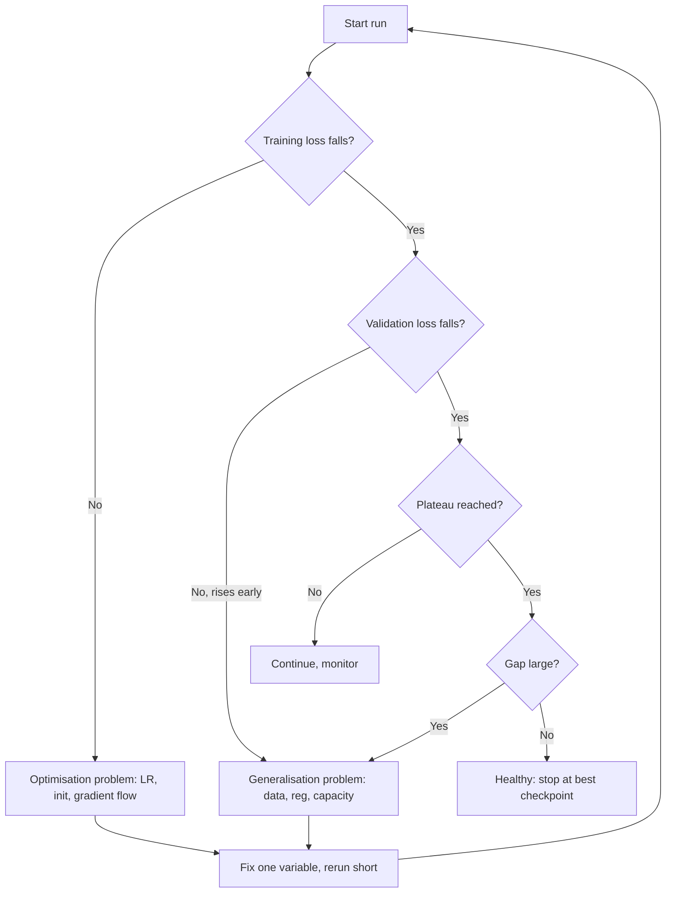

# Training Dynamics

> **Module 07 — Deep Learning, Multimodal Models, and LLMs**
> Topic 02 of 11
> Estimated study time: 4 hours
> Prerequisites: Topic 01
> Version 2026.3

## 1. Why this topic exists

Two teams train the same architecture on the same data and report area under the receiver operating
characteristic curve (AUROC) values of 0.81 and 0.76. Neither is lying. The difference is the
training protocol: the learning-rate schedule, the batch size, the number of epochs, the seed, and
the point at which each team stopped. Training dynamics is the study of that gap. It is the part of
deep learning where most clinical performance is actually won or lost, and it is the part least
often reported.

The industry problem has three faces.

**Silent failure.** A training run rarely crashes. It converges to a worse place than it should, and
the loss curve looks plausible. A learning rate that is three times too high produces a model that
trains, reaches 0.74 AUROC, and is reported as "the model's performance". A missing warmup produces
a loss spike in the first twenty steps that the model never fully recovers from. A validation set
that is evaluated with dropout still active produces a noisy curve that a team interprets as
overfitting. None of these raises an exception. Andrej Karpathy's widely cited observation is that
neural network training is a leaky abstraction and fails silently; the practical consequence is that
the protocol, not the architecture, determines whether a failure is visible.

**Unstable estimates.** A single training run is one sample from a distribution over runs. Different
seeds change weight initialisation, data order, dropout masks, and augmentation. The resulting
AUROC varies. If the standard deviation across seeds is 0.015 and a team reports the best of five
runs, the reported number is biased upward by roughly `1.17 * 0.015 = 0.018` relative to the mean,
because the expected maximum of five standard normal draws is about 1.17. That is larger than many
of the improvements teams claim from architecture changes. A result that does not report seed
variation cannot distinguish a real improvement from a lucky draw.

**Regulatory cost of change.** A trained model is a frozen artefact with a specification. The FDA's
predetermined change control plan (PCCP) guidance, finalised in December 2024, requires a
manufacturer to describe anticipated modifications and the evaluation that will accompany them. A
change to the learning rate, the schedule, or the training data is a change to the device if it
changes the output. A team that cannot reproduce its own training run cannot demonstrate that a
retrained model is equivalent, and a team that cannot demonstrate equivalence faces a new
submission rather than a pre-authorized change.

There is a fourth, quieter cost: compute. Training dynamics is where compute is spent or wasted. A
run that trains for ten epochs when validation loss bottomed at epoch three spends 3.3 times the
necessary compute, and in a fine-tuning workflow with a paid accelerator that is a direct budget
line. The arithmetic in Section 6 makes the waste visible.

This topic treats training as a controlled experiment. The control variables are the data order, the
batch size, the learning rate and its schedule, the initialisation, the regularisation, and the
stopping rule. The response variables are the training loss, the validation loss, the gradient norm,
the activation statistics, and the task metric. A run is interpretable only when the controls are
recorded and only one of them changes at a time.

> **Note:** "Training dynamics" here means the behaviour of optimisation and generalisation over the
> course of a run. It does not mean the physics of gradient flow in a continuous-time limit, which
> is a different literature and is not needed to run a clinical model.

## 2. Learning outcomes

By the end of this topic you can:

1. **Design** a training protocol that specifies data order, batch size, learning rate, schedule,
   warmup, regularisation, stopping rule, and seed policy before the first run.
2. **Compute** optimizer steps, warmup steps, tokens seen, and training floating-point operations
   (FLOPs) from a cohort size, sequence length, batch size, and epoch count.
3. **Apply** the linear scaling rule and explain when it fails, including the warmup requirement for
   large batches.
4. **Diagnose** overfitting, underfitting, unstable optimisation, and catastrophic forgetting from
   learning curves and gradient statistics, and **choose** the intervention that matches the
   diagnosis.
5. **Quantify** seed variance and **report** a result as a mean and interval across seeds rather
   than a best run.
6. **Set** an early-stopping rule with a stated patience and metric, and **justify** it against the
   cost of additional epochs.
7. **Detect** silent protocol defects: dropout at evaluation, batch-normalisation statistics drift,
   unshuffled data, and a validation set used for tuning.
8. **Write** a training-protocol section that another team could reproduce and a regulator could
   audit.

Outcomes 2, 3, and 5 are computational. Outcomes 1, 4, and 6 are design outcomes assessed by rubric.
Outcome 8 is assessed in the evaluation dossier.

## 3. The core mental model

Training is a search under a budget. Three quantities are in tension: the capacity of the model, the
optimisation procedure that finds a solution, and the regularisation that keeps the solution from
memorising. The budget is measured in accelerator-hours and in human attention. Every choice in the
protocol moves one of the three, and most bad runs move two at once without recording which.

```text
                       capacity
                      /        \
                     /          \
          underfit  /            \  overfit
                   /              \
              optimisation ---- regularisation
                   \              /
                    \            /
                     \          /
                      time budget

  A run is a trajectory through this triangle:
    - too little optimisation  -> both losses high (underfit)
    - too much capacity        -> train low, val high (overfit)
    - too little regularisation-> train low, val high, gap grows late
    - too much regularisation  -> both losses high, slow convergence
```

The second mental model is the effective learning rate. For stochastic gradient descent, the
quantity that governs the step is approximately `lr / batch_size` per sample, because the gradient
is an average over the batch. Multiplying the batch by `k` and the learning rate by `k` keeps the
expected step roughly constant, which is the linear scaling rule. The rule holds up to a point; beyond
that point the gradient noise reduction changes the optimisation trajectory and the rule breaks. The
practical version is: scale the rate with the batch, add warmup for large batches, and verify on a
short run rather than assuming.

The third mental model is the loss curve as a diagnostic instrument. A loss curve has a shape, not
just a final value.

```text
  loss
   |\
   | \            train
   |  \________
   |   \       \________
   |    \               \______
   |     \    val
   |      \  ___-----
   |       \/        \____ rising = overfit
   |        \             \____
   +------------------------------ epoch
       1  2  3  4  5  6  7  8

  Shapes:
    both flat high            -> underfit or no gradient
    train falls, val flat     -> no signal in features, or leakage-free but weak
    train falls, val falls    -> healthy
    train falls, val rises    -> overfit
    both oscillate            -> learning rate too high
    train falls then jumps    -> schedule or data order problem
```

The fourth mental model is the distinction between optimisation failure and generalisation failure.
Optimisation failure means the model did not find a good solution on the training data. Generalisation
failure means it found one that does not transfer. The interventions are disjoint: optimisation
failures are fixed with learning rate, schedule, initialisation, and capacity; generalisation
failures are fixed with data, augmentation, regularisation, and early stopping. Applying a
generalisation fix to an optimisation failure makes the run worse, and vice versa. Most wasted weeks
come from misclassifying one as the other.



The loop is the discipline: one variable, one short run, one comparison. A run that changes the
learning rate, the augmentation, and the batch size at once produces a result that cannot be
attributed to any of them, which is the same as no result.

The fifth mental model is the cost of information. Each run buys one bit of information about one
choice. A short run on a subset costs minutes; a full run costs hours; a seed study costs a multiple
of the full run. The efficient protocol spends short runs on choices with large expected effects
(rate, schedule, whether the model learns at all) and full runs only on the final configuration. A
team that runs the full schedule for every configuration is buying the same information at ten times
the price.

The protocol is therefore an experimental design, and the same rules apply as in a clinical study:
pre-specify the comparison, hold the confounders fixed, report the variability, and do not select on
the test set. The analogy is not decorative. The statistical failure modes are identical, and the
regulatory expectation of a documented, reproducible method is the same.

## 4. Definitions and vocabulary

| Term | Definition | Common misuse | Unit or convention |
|---|---|---|---|
| Epoch | One pass over the training set | Assuming epochs equal steps | Count |
| Step | One optimizer update | Confusing with a micro-batch | Count |
| Micro-batch | Samples in one forward/backward pass | Calling it the batch size when accumulation is used | Count |
| Effective batch | Micro-batch times accumulation times data-parallel replicas | Reporting only the micro-batch | Count |
| Learning rate | Scale applied to the gradient | Assuming it transfers across batch sizes | Depends on optimiser |
| Schedule | Function mapping step to learning rate | Using a constant rate by default | Function |
| Warmup | Initial ramp from a small rate to the peak | Omitting it for large batches | Steps or fraction |
| Cosine decay | Schedule that follows a half cosine to a floor | Assuming it always beats linear | Function |
| Linear scaling rule | Multiply the rate by the batch multiplier | Applying it without warmup | Heuristic |
| Gradient accumulation | Summing gradients over micro-batches before a step | Forgetting to divide by accumulation | Count |
| Gradient clipping | Rescaling the gradient to a norm bound | Setting the bound from the loss scale | Norm |
| Weight decay | Penalty on squared weights | Confusing with L1 | Coefficient |
| Dropout | Random zeroing during training | Leaving it on at evaluation | Probability |
| Label smoothing | Soft targets with a small uniform mass | Using it when exact probabilities are needed | Epsilon |
| Early stopping | Selecting the checkpoint with the best validation metric | Stopping on training loss | Patience |
| Patience | Evaluations without improvement before stopping | Setting it to zero on noisy metrics | Count |
| Learning-rate finder | Short sweep to locate a stable rate range | Treating the minimum as optimal | Procedure |
| Seed variance | Variation in results across random seeds | Reporting the best seed | Standard deviation |
| Data order | Sequence in which samples are presented | Assuming shuffling is automatic | Policy |
| Curriculum | Ordering samples by difficulty | Confusing with shuffling | Policy |
| Catastrophic forgetting | Loss of pretrained capability during fine-tuning | Calling any performance drop forgetting | Phenomenon |
| Discriminative fine-tuning | Smaller rates for earlier layers | Applying one rate everywhere | Policy |
| Layer-wise rate decay | Rate multiplier per layer depth | Confusing with weight decay | Multiplier |
| Mixed precision | 16-bit compute with 32-bit master weights | Assuming it is always faster or safe | Numerics |
| Loss scale | Multiplier to keep 16-bit gradients representable | Forgetting dynamic scaling | Factor |
| Gradient noise scale | Batch size at which gradient noise is balanced | Confusing with critical batch size | Estimate |
| Critical batch size | Batch beyond which more data does not speed training | Assuming it is universal | Count |
| Double descent | Test error that falls, rises, then falls with capacity | Using it to justify oversized models | Phenomenon |
| Grokking | Delayed generalisation after apparent convergence | Assuming it applies to clinical tasks | Phenomenon |
| Hyperparameter | A setting not learned by the optimiser | Tuning it on the test set | Various |
| Random search | Sampling hyperparameters from distributions | Preferring grid search by habit | Procedure |
| Successive halving | Early-stopping poor configurations in a sweep | Confusing with early stopping of one run | Procedure |
| Reproducibility | Same protocol and seed gives same result | Confusing with replicability across seeds | Property |
| Determinism | Bitwise identical results on the same hardware | Assuming it holds across hardware | Property |
| Checkpoint | Saved parameter state at a step | Saving only the last epoch | Artefact |
| Model soup | Averaging weights from several runs | Confusing with ensembling | Technique |

> **Note:** "Batch size" in this file means the effective batch unless stated otherwise. A paper that
> reports micro-batch 8 with 8-way accumulation and 4 data-parallel replicas has an effective batch
> of 256, and its learning rate is only interpretable in that context.

## 5. The mechanics, step by step

This section is an eighteen-step protocol for a reproducible training run. Steps 1 to 6 are decided
before any code runs. Steps 7 to 12 are the run itself. Steps 13 to 16 are the stopping and selection
decisions. Steps 17 and 18 are the audit.

The running example is the fine-tuning of a pretrained language model on 12,000 de-identified
discharge summaries for a 30-day readmission task. The same procedure applies to a convolutional
network on images, with the augmentation step changed.

### Step 1. Write the run's claim and success criterion

**Input:** the task specification and the evaluation plan.

**Output:** one sentence stating what the run must achieve and on which metric, plus a minimum
acceptable value.

**Rationale:** Without a success criterion, every curve can be rationalised. "The AUROC is 0.78"
means nothing without the baseline, the population, and the interval. Writing the criterion first
also prevents the common failure of choosing the metric after seeing which one looks best.

**Branch point:** if the claim is about a decision (who gets a follow-up call), the criterion must be
a decision-relevant quantity such as sensitivity at a fixed alert budget, not AUROC. If the claim is
about ranking, AUROC or area under the precision-recall curve is appropriate. If the claim is about
calibration, the criterion is a calibration slope or expected calibration error.

### Step 2. Fix the data order and the split

**Input:** the cohort and the patient identifier.

**Output:** a split file with patient-level assignment, and a shuffling policy for training.

**Rationale:** The split must be by patient, not by note, because a patient with three admissions
contributes three notes that share vocabulary and outcome. Shuffling must be seeded and recorded.
The validation set must never be shuffled into training, and the test set must not be touched until
the protocol is frozen.

**Branch point:** if the deployment claim is temporal or multi-site, the split must be temporal or
site-held-out. A random split with a temporal claim is a category error, not a tuning issue.

### Step 3. Choose the effective batch size

**Input:** accelerator memory, cohort size, and the gradient noise of the task.

**Output:** a micro-batch, an accumulation count, and an effective batch.

**Rationale:** The effective batch controls the variance of the gradient estimate. A larger batch
gives a lower-variance gradient and permits a larger learning rate, but it also reduces the number of
updates per epoch and can generalise slightly worse at very large sizes. Memory limits the
micro-batch; accumulation recovers the effective batch without more memory, at the cost of time.

**Branch point:** if the cohort has fewer than about 20 effective batches per epoch, the run will
take many epochs to converge and the batch should be reduced. If the accelerator can hold a batch of
64 at the chosen sequence length, use it; accumulation is a memory workaround, not a goal.

| Constraint | Micro-batch | Accumulation | Effective batch | Consequence |
|---|---:|---:|---:|---|
| 16 GB accelerator, 256-token sequences | 8 | 4 | 32 | Standard fine-tuning |
| 16 GB accelerator, 512-token sequences | 4 | 8 | 32 | Same effective batch, half the speed |
| 40 GB accelerator, 256-token sequences | 32 | 1 | 32 | Faster, same optimisation |
| 40 GB accelerator, 256-token sequences | 64 | 1 | 64 | Fewer steps, requires rate scaling |
| Cohort of 600 notes | 16 | 1 | 16 | 37 steps per epoch; many epochs needed |

### Step 4. Select the peak learning rate

**Input:** the optimiser, the effective batch, and whether the model is pretrained.

**Output:** a peak rate and a justification.

**Rationale:** For fine-tuning a pretrained transformer, rates between `1e-5` and `5e-5` are the
documented range; for training from scratch, rates near `1e-3` with AdamW or `0.1` with SGD are
common. The rate is not a universal constant: it depends on the batch, the optimiser, the
normalisation, and the depth. A short sweep on a subset is cheaper than guessing.

**Branch point:** if the loss diverges in the first 50 steps, the rate is too high; if the loss falls
almost linearly for an epoch, it is too low. If the model is pretrained and the rate is above `1e-4`,
expect catastrophic forgetting: the model will lose capability it had before fine-tuning, which is
visible as a collapse on a held-out general task.

### Step 5. Choose the schedule and the warmup

**Input:** total steps, peak rate, and final rate.

**Output:** a schedule function and a warmup length.

**Rationale:** A schedule that decays the rate over training reduces the final gradient noise and
usually improves the final metric. Warmup prevents the large early updates that destabilise
pretrained models and large batches. The fraction of warmup is typically 5 to 10 percent of steps
for fine-tuning and 1 to 5 percent for from-scratch training.

**Branch point:** if the total steps are fewer than 200, warmup should be at least 10 percent or the
run spends most of its budget ramping. If the run is resumed after interruption, the schedule must be
resumed by step index, not restarted, or the model receives a second warmup in the middle of
training.

| Schedule | Shape | Best for | Risk |
|---|---|---|---|
| Constant | Flat | Short runs, debugging | Final noise |
| Step decay | Drops at milestones | Classic vision training | Milestones are arbitrary |
| Linear decay | Straight line to zero | Fine-tuning, simple | Sensitive to total steps |
| Cosine decay | Half cosine to a floor | Transformers, long runs | Needs known horizon |
| One-cycle | Rise then fall | Fast convergence | Aggressive, unstable |
| Reduce on plateau | Drops when metric stalls | Unknown horizon | Reactive, noisy |

### Step 6. Set regularisation and precision

**Input:** cohort size, pretraining, and hardware.

**Output:** weight decay, dropout, label smoothing, augmentation, and precision policy.

**Rationale:** Regularisation must match the failure being prevented. Weight decay shrinks weights
that do not earn their keep; dropout adds noise to activations; label smoothing prevents overconfidence
when labels are noisy, which clinical labels usually are. Mixed precision halves memory and can
double throughput, but requires a loss scale to keep small gradients representable.

**Branch point:** if the cohort is small and the model is pretrained, the dominant regulariser is
early stopping, not weight decay. If labels come from a rule-based labeller on reports, label
smoothing of 0.05 to 0.1 is defensible; if labels are adjudicated, smoothing may be unnecessary.

### Step 7. Verify the loss at initialisation

**Input:** the untrained model and one batch.

**Output:** an initial loss and a comparison with the expected value.

**Rationale:** For `C` balanced classes with a randomly initialised head, the expected
cross-entropy is `log C`. For binary classification with prevalence `p`, the expected loss of a
model that outputs the base rate is the entropy `-(p log p + (1-p) log(1-p))`. A loss far from that
value indicates a bug in the head initialisation, the label encoding, or the loss reduction.

**Branch point:** if the initial loss is near zero, the labels are leaking into the input or the
output layer is not random. If it is much higher than expected, the head is initialised at too large
a scale or the labels are misaligned.

### Step 8. Overfit a single batch

**Input:** one batch of 8 to 32 samples.

**Output:** training loss near zero after a few hundred steps.

**Rationale:** A correct model and optimiser can drive the loss to near zero on a single batch. If
they cannot, the bug is in the gradient path, the loss, or the label alignment, and no amount of
full-dataset training will fix it. This is the cheapest end-to-end test in deep learning.

### Step 9. Run a short learning-rate sweep

**Input:** a subset of the training data and a range of rates.

**Output:** a curve of loss against rate and a chosen peak.

**Rationale:** The sweep reveals the rate at which the loss begins to diverge and the rate at which
it falls too slowly. The chosen rate is typically one order of magnitude below the divergence point,
not at the minimum of the sweep, because the minimum on a short run is noisy.

### Step 10. Launch the full run with logging

**Input:** the protocol from steps 1 to 9.

**Output:** a run directory with config, checkpoints, and logs.

**Rationale:** The log must include the loss, the learning rate, the gradient norm before clipping,
the parameter norm, the activation statistics, and the validation metric at every evaluation. A run
without these cannot be diagnosed after the fact, and a run that cannot be diagnosed must be
repeated.

### Step 11. Monitor the gradient norm

**Input:** the logged gradient norm per step.

**Output:** a decision to continue, clip harder, or stop.

**Rationale:** The gradient norm is the earliest signal of instability. A spike above ten times the
running median is a warning; a spike above one hundred times is a divergence in progress. Clipping
converts the spike into a bounded step, but the cause remains: a single hard batch, a label error, or
a rate that is too high.

**Branch point:** if spikes cluster at a specific step, inspect the batch at that step for a corrupt
sample. If spikes occur throughout, lower the rate or increase warmup.

### Step 12. Evaluate on validation at a fixed cadence

**Input:** the validation loader and the current checkpoint.

**Output:** validation loss and task metrics at each evaluation.

**Rationale:** Evaluation cadence must be fixed before the run, because evaluating more often and
picking the best evaluation inflates the metric. Once per epoch is standard for small cohorts; every
`n` steps for large ones. The model must be in evaluation mode, with dropout off and batch
normalisation using running statistics.

### Step 13. Classify the curve

**Input:** the training and validation curves.

**Output:** a diagnosis from the table below.

| Pattern | Diagnosis | First intervention | Do not do |
|---|---|---|---|
| Both losses high and flat | Underfit or no gradient | Raise capacity or rate; check gradient flow | Add regularisation |
| Train falls, validation flat | Weak signal or label noise | Check features and labels | Add capacity |
| Train falls, validation falls then rises | Overfit | Early stop, add data or regularisation | Train longer |
| Both oscillate | Rate too high | Lower rate, add warmup | Add capacity |
| Train falls then jumps | Data order or schedule defect | Check shuffle and resume logic | Restart blindly |
| Validation much better than train | Dropout or augmentation asymmetry | Check train/eval modes | Report the gap as a gain |
| Loss falls, metric flat | Threshold or metric bug | Inspect predictions | Change architecture |

### Step 14. Apply the matching intervention

**Input:** the diagnosis.

**Output:** exactly one changed variable and a new short run.

**Rationale:** One variable at a time is the only way to attribute an effect. The short run uses the
same seed and a subset, so the comparison is paired. If the intervention is a regularisation change,
the short run may not reveal its effect, because regularisation acts late; in that case run the full
schedule but on a reduced cohort.

### Step 15. Set the stopping rule

**Input:** the validation metric, a patience, and a minimum improvement.

**Output:** a selected checkpoint and a stop decision.

**Rationale:** Early stopping is a regulariser and a budget control. Patience must exceed the noise
in the validation metric; if the metric moves by 0.01 between evaluations, a patience of one
evaluation will stop on noise. A minimum improvement threshold, often 0.001, prevents stopping on
irrelevant gains.

**Branch point:** if the validation set is small (fewer than 200 events), the metric is noisy and
patience should be at least three evaluations, or the selection should use a smoothed metric.

### Step 16. Select and freeze the checkpoint

**Input:** all checkpoints and their validation metrics.

**Output:** one checkpoint, its metric, and a record of why it was chosen.

**Rationale:** Selecting the best checkpoint on validation is legitimate. Selecting it on test is
not. The frozen checkpoint is the artefact that goes to evaluation, and its hash should be recorded
so that the evaluated model is provably the trained model.

### Step 17. Re-run with at least three seeds

**Input:** the frozen protocol.

**Output:** a mean, a standard deviation, and a range across seeds.

**Rationale:** A single run cannot distinguish an effect from seed noise. Three seeds give a crude
standard deviation; five give a usable one. The reported metric is the mean with the interval, not
the best run. If the best run must be reported for a leaderboard, the mean must be reported beside
it.

### Step 18. Archive the protocol and the diagnostics

**Input:** the config, the logs, the checkpoints, and the seed list.

**Output:** a run record that another team can reproduce.

**Rationale:** Reproducibility is a regulatory and scientific requirement. The record must include
the library versions, the hardware, the determinism settings, and the exact data split hash. Without
it, a retrained model cannot be shown to be equivalent, and a failed run cannot be diagnosed.

The four failure modes specific to this topic are worth naming explicitly because each has a
different signature and a different fix.

**Exploding gradients.** The gradient norm grows by an order of magnitude per layer or per step, the
loss spikes, and eventually becomes not-a-number. The cause is a Jacobian product with spectral norm
above one, often compounded by a high rate. The fix is clipping, a lower rate, and normalisation.
Clipping alone masks the cause.

**Dead units.** A rectified linear unit whose pre-activation is negative for all inputs receives no
gradient and never recovers. The signature is a falling activation fraction in one layer and a
gradient norm near zero in the layers below it. The fix is a lower rate, Leaky ReLU, or
re-initialisation; adding width does not help.

**Catastrophic forgetting.** Fine-tuning a pretrained model at a high rate overwrites the pretrained
representation. The signature is a rapid drop in performance on a held-out general task, or a
collapse in the diversity of the model's outputs, while the target metric improves. The fix is a
lower rate, discriminative fine-tuning, or parameter-efficient adapters that leave the base weights
frozen.

**Overfitting with a rising validation loss.** The signature is a widening gap between training and
validation loss after the validation minimum. The fix is early stopping, more data, augmentation, or
a smaller model, in that order of cost-effectiveness. Training longer never fixes it.

### Protocol interactions that invalidate a single-variable comparison

Four interactions are common enough to name, because each makes a one-variable experiment
misleading.

**Batch size and learning rate.** Changing the batch without changing the rate changes the effective
step size. A comparison of batch 32 and batch 64 at the same rate is a comparison of two step sizes,
not two batch sizes. Either scale the rate with the linear rule and say so, or hold the effective
step constant by construction.

**Warmup and total steps.** Warmup is defined as a fraction of the run in most implementations. A
ten-epoch run therefore has a longer warmup in absolute steps than a three-epoch run, and the two
runs are not comparable at the same epoch index. The schedule should be reported as a function of
step, not as a fraction, when runs of different lengths are compared.

**Weight decay and the optimiser.** AdamW decouples weight decay from the adaptive step; Adam with an
L2 penalty does not. The same coefficient produces different effective regularisation under the two,
so a sweep that changes both the optimiser and the coefficient confounds them.

**Augmentation and epochs.** Stronger augmentation slows convergence, so a run with more
augmentation needs more epochs to reach the same training loss. A comparison at a fixed epoch count
will favour the weaker augmentation, and a comparison at a fixed training loss will favour the
stronger. The fair comparison is at the selected checkpoint on validation, with the selection rule
held fixed.

The practical rule is that a protocol change is a change to the experiment, and the write-up must
state which quantities were held fixed. A reader who cannot reconstruct the held-fixed set cannot
reproduce the result.

## 6. Worked example

A hospital innovation group fine-tunes a pretrained 66-million-parameter language model on 12,000
de-identified discharge summaries to predict 30-day readmission. The model is a distilled transformer
with six layers and a hidden width of 768. Sequences are truncated to 256 tokens. The outcome
prevalence is 10.4 percent. The group has one accelerator that sustains 109 effective teraflops
(TFLOPS) in mixed precision under their workload; that figure is an assumption, measured from a
benchmark run, not a hardware peak.

This section computes the run's cost, inspects two diagnostics, and varies one assumption.

### Step 1. Steps and schedule

With micro-batch 16 and gradient accumulation 2, the effective batch is 32. The number of optimizer
steps per epoch is:

```text
12,000 notes / (16 * 2) = 12,000 / 32 = 375 steps per epoch
3 epochs                = 1,125 total steps
warmup at 10 percent    = 112 steps
```

The learning rate ramps linearly from `2e-7` at step 0 to `2e-5` at step 111, holds at `2e-5` for one
step, then follows a cosine decay to zero at step 1,124. At the halfway point, step 562:

```text
progress = (562 - 112) / (1125 - 112) = 450 / 1013 = 0.444
lr = 0 + 0.5 * (2e-5 - 0) * (1 + cos(pi * 0.444))
   = 1e-5 * (1 + cos(1.395))
   = 1e-5 * (1 + 0.174)
   = 1.17e-5
```

The schedule spends 10 percent of its steps warming up, 45 percent above `1e-5`, and the last 10
percent below `2e-6`. The final steps are the ones that settle the weights, which is why the decay
matters more than the peak for the final metric.

### Step 2. Tokens and compute

Each epoch presents `12,000 * 256 = 3,072,000` tokens. Three epochs present `9,216,000` tokens.

Training compute for a transformer is approximately `6 * N * D`, where `N` is the parameter count
and `D` is the number of tokens. The factor six counts two FLOPs per parameter per token in the
forward pass and four in the backward pass.

```text
6 * 66,000,000 * 9,216,000
= 6 * 66e6 * 9.216e6
= 3.965e8 * 9.216e6
= 3.65e15 FLOPs
= 3.65 petafLOPs
```

At 109 effective TFLOPS, the pure arithmetic time is:

```text
3.65e15 / 109e12 = 33.5 seconds
```

The measured wall-clock time will be several times larger. Data loading, tokenisation if not
pre-tokenised, optimizer overhead, evaluation, and checkpoint writing typically add a factor of four
to ten. A realistic estimate is 2.5 to 6 minutes for the three epochs. The arithmetic establishes
the floor, not the schedule.

### Step 3. Memory

The parameter state in 32-bit precision is:

```text
weights:   66e6 * 4 bytes = 264 MB
gradients: 66e6 * 4 bytes = 264 MB
Adam m:    66e6 * 4 bytes = 264 MB
Adam v:    66e6 * 4 bytes = 264 MB
total:                    1,056 MB = 1.03 GiB
```

A 16-bit copy of the weights for mixed-precision compute adds `66e6 * 2 = 132 MB`. The activation
cache is the remaining term. For a transformer, a rough estimate is
`batch * seq * hidden * layers * bytes * k`, where `k` counts the stored tensors per layer and is
typically between 10 and 20 depending on whether attention is recomputed:

```text
16 * 256 * 768 * 6 * 4 bytes * 12 = 906 MB
```

The estimate is explicitly an inference, not a measurement; the constant 12 is a planning
assumption. The point is that activations are comparable to the parameter state at this batch size,
which is why the micro-batch is 16 and not 64.

### Step 4. Diagnostic one: gradient norm spikes

The run logs the gradient norm before clipping at every step. For the first 300 steps the median is
0.8 with occasional values near 2.0. At step 341 the norm jumps to 14.6, and at step 342 to 9.1. The
loss rises from 0.31 to 0.48 over the next twenty steps and then recovers.

The diagnosis is a single hard batch, not a global instability, because the norm returns to its
median. The action is to inspect the batch at step 341. In this case it contains a discharge summary
with a copy-pasted laboratory table of 180 lines, which after truncation leaves almost no clinical
narrative and a label that is inconsistent with the visible text. The label is corrected, the batch
is retained, and the run is restarted from the checkpoint at step 300.

If the norm had stayed above 5 for 100 consecutive steps, the diagnosis would be a rate that is too
high, and the action would be to halve the peak rate and extend warmup, not to clip harder.

### Step 5. Diagnostic two: validation loss divergence

Validation loss is evaluated at the end of each epoch.

```text
epoch 1: train 0.412, validation 0.398
epoch 2: train 0.301, validation 0.372
epoch 3: train 0.244, validation 0.389
```

The validation minimum is at epoch 2, and epoch 3 is worse by 0.017. The gap between train and
validation at epoch 3 is `0.389 - 0.244 = 0.145`, up from 0.071 at epoch 2. This is overfitting with
a clear minimum. The action is to select the epoch-2 checkpoint, which is legitimate because the
selection used validation data only.

A team that trained for three epochs and reported the final checkpoint would report a worse model
than the one it trained. That is the most common form of self-inflicted harm in fine-tuning: the
best checkpoint existed and was discarded because the loop saved only the last one.

### Step 6. Vary one assumption: ten epochs instead of three

Suppose the group extends the run to ten epochs to "give the model more time". The steps become
`375 * 10 = 3,750`, and the tokens become `12,000 * 256 * 10 = 30,720,000`. Compute becomes:

```text
6 * 66e6 * 30.72e6 = 1.216e16 FLOPs = 12.16 petafLOPs
12.16e15 / 109e12 = 112 seconds
```

The pure compute triples, from 33.5 to 112 seconds, and the wall-clock time triples to roughly 8 to
20 minutes. The validation curve from the baseline run shows a minimum at epoch 2 and a rise after
it. Unless the schedule is changed, the additional seven epochs move the model further along the
overfitting trajectory, and the selected checkpoint is still the one from epoch 2. The conclusion
changes in a specific way: more epochs do not buy accuracy when the validation curve has already
turned; they buy a larger search of the same trajectory and a higher chance that the best checkpoint
is a noise artefact.

The sensitivity also exposes a schedule interaction. A ten-epoch cosine schedule decays more slowly,
so the model at epoch 2 has a higher learning rate than it did under the three-epoch schedule. That
can change the location of the minimum. The correct experiment is to change the epoch count and the
schedule together, and to compare the selected checkpoints, not the final ones.

### Step 7. What the run does not establish

The run establishes that the model can be trained and that a checkpoint can be selected on
validation. It does not establish transportability, calibration, subgroup performance, or clinical
utility. The AUROC on a held-out test set from the same hospitals is an internal estimate. The
group still needs a temporal or external validation, a calibration curve, and a decision-curve
analysis before the model can be described as useful. Training dynamics determines whether the model
is worth evaluating; it does not determine whether it should be deployed.

### Step 8. The seed question the group did not ask

The baseline run used seed 13. A reviewer asks whether the result depends on it. The group reruns
the frozen protocol with seeds 13, 14, and 15 and obtains test AUROC values of 0.782, 0.769, and
0.791. The mean is `(0.782 + 0.769 + 0.791) / 3 = 0.781`, the sample standard deviation is 0.011,
and the range is 0.022. The originally reported 0.782 is close to the mean in this case, which is
fortunate rather than guaranteed. With five seeds and a standard deviation of 0.011, the expected
maximum would be about `0.781 + 1.17 * 0.011 = 0.794`, a value 0.013 above the mean. A team that
reported only the best of five would overstate the model by more than a point of AUROC, which is
often larger than the effect being claimed.

The reporting rule that follows is simple: report the mean, the standard deviation, and the seed
list. Report the best run only as an additional line, clearly labelled.

## 7. Code, query, or calculation

The code below computes the schedule and the compute budget for the worked example, then estimates
the upward bias of reporting the best of `k` seeds. It uses only the standard library.

**Assumptions.** The schedule is linear warmup followed by cosine decay to zero. The compute formula
is `6ND` for a transformer, which is an approximation that ignores attention's quadratic term and is
accurate when the sequence length is much smaller than the hidden width. The expected-maximum values
are estimated by Monte Carlo with 20,000 draws, so they carry sampling error of roughly 0.01.

```python
import math, random

def schedule(step, total, warmup, peak, final):
    if step < warmup:
        return peak * (step + 1) / warmup
    progress = (step - warmup) / max(1, total - warmup)
    return final + 0.5 * (peak - final) * (1 + math.cos(math.pi * progress))

notes, seq, batch, accum, epochs = 12000, 256, 16, 2, 3
steps_per_epoch = notes // (batch * accum)
total = steps_per_epoch * epochs
warmup = int(0.10 * total)

print("micro-batches/epoch:", notes // batch)
print("optimizer steps/epoch:", steps_per_epoch)
print("total steps:", total)
print("warmup steps:", warmup)
for s in [0, warmup - 1, warmup, total // 2, total - 1]:
    print(f"step {s:>4}: lr {schedule(s, total, warmup, 2e-5, 0.0):.3e}")

tokens = notes * seq * epochs
N = 66_000_000
flops = 6 * N * tokens
print("tokens seen:", tokens)
print("train FLOPs (6ND):", f"{flops:.3e}")
print("seconds at 109 TFLOPS:", round(flops / 109e12, 1))

rng = random.Random(3)

def expected_max(k, draws=20000):
    total = 0.0
    for _ in range(draws):
        total += max(rng.gauss(0, 1) for _ in range(k))
    return total / draws

print("k  E[max Z]")
for k in range(1, 9):
    print(k, round(expected_max(k), 3))
```

**Observed output:**

```text
micro-batches/epoch: 750
optimizer steps/epoch: 375
total steps: 1125
warmup steps: 112
step    0: lr 1.786e-07
step  111: lr 2.000e-05
step  112: lr 2.000e-05
step  562: lr 1.174e-05
step 1124: lr 4.809e-11
tokens seen: 9216000
train FLOPs (6ND): 3.650e+15
seconds at 109 TFLOPS: 33.5
k  E[max Z]
1 -0.007
2 0.57
3 0.838
4 1.032
5 1.168
6 1.259
7 1.353
8 1.423
```

The `k = 1` row should be exactly zero in expectation; the `-0.007` is Monte Carlo error and is a
useful reminder that even a twenty-thousand-draw estimate has visible noise at the third decimal.
The values for `k >= 2` match the known expected maxima of the standard normal to within about
0.005.

The second block computes how much a reported best-of-`k` result overstates the mean, given a
standard deviation. It is the calculation behind the reporting rule.

```python
def inflation(sigma, k, e_max):
    return sigma * e_max[k]

sigma = 0.011
e_max = {1: 0.0, 2: 0.564, 3: 0.846, 4: 1.029, 5: 1.163, 6: 1.267}
print(f"{'k':>2}{'inflation':>12}{'reported':>10}")
for k in range(1, 7):
    gain = inflation(sigma, k, e_max)
    print(f"{k:>2}{gain:>12.3f}{0.781 + gain:>10.3f}")
```

**Observed output:**

```text
 k   inflation  reported
 1       0.000     0.781
 2       0.006     0.787
 3       0.009     0.790
 4       0.011     0.792
 5       0.013     0.794
 6       0.014     0.795
```

The inflation is small in absolute terms, 0.013 at five seeds, but the comparison that matters is
against the effect size. If a new architecture improves AUROC by 0.008, a best-of-five protocol can
manufacture that improvement from seed noise alone. This is the arithmetic behind the requirement to
compare mean to mean with the same number of seeds.

## 8. Data, standards, and regulatory context

Training dynamics is usually treated as an engineering detail. In a regulated device it is part of
the specification, because the trained weights are a function of the protocol.

**FDA predetermined change control.** The final guidance "Marketing Submission Recommendations for a
Predetermined Change Control Plan for Artificial Intelligence-Enabled Device Software Functions"
(December 2024, docket FDA-2022-D-2628) allows a manufacturer to pre-specify modifications such as
retraining on new data, and to describe the verification and validation that will accompany them. A
change to the learning rate or the schedule is not automatically a new device, but it is a change to
the development process that must be inside the plan if the manufacturer intends to make it. The
practical consequence is that the protocol must be documented before the change, not reconstructed
after it.

**FDA AI device draft guidance.** The January 2025 draft "Artificial Intelligence-Enabled Device
Software Functions: Lifecycle Management and Marketing Submission Recommendations" (docket
FDA-2024-D-4488) asks for a description of the model, the training data, and the performance
evaluation, and for total product lifecycle risk management. It is a draft and not for
implementation, but it indicates the level of detail a reviewer will expect: not "the model was
fine-tuned" but the architecture, the data, the optimisation, the stopping rule, and the evaluation
population.

**TRIPOD+AI.** The TRIPOD+AI statement (Collins et al., BMJ 2024;385:e078378) requires reporting of
how the model was developed, including the tuning procedure and the handling of hyperparameters. It
does not prescribe a schedule, but it does require that a reader can tell whether the reported
performance was selected on the same data used for tuning. A paper that reports the best of many
configurations without saying so is non-compliant in substance even if every item is ticked.

**NIST AI RMF.** The measure function of the NIST AI Risk Management Framework asks organisations to
track deployed performance and to test for robustness. Training dynamics enters through the
"valid and reliable" characteristic: a model whose performance varies by more than the claimed
tolerance across seeds or retraining runs is not reliably meeting its specification. NIST AI 600-1
adds that generative systems require evaluation across the lifecycle, which includes retraining.

**EU AI Act.** Regulation (EU) 2024/1689 requires high-risk systems to achieve an appropriate level
of accuracy, robustness, and cybersecurity, and to be tested against reasonably foreseeable
conditions. Article 15 is the relevant provision. The Act does not specify a learning rate, but its
requirement that testing cover the conditions of use implies that seed variance and retraining
stability are in scope for a system that is retrained.

**Model cards and datasheets.** Mitchell et al. proposed model cards as a short document reporting
intended use, factors, metrics, evaluation data, training data, and ethical considerations
(arXiv:1810.03993, 2019). A model card that omits the training protocol and the seed variance is
incomplete for a regulated context, even though the format is voluntary.

| Requirement source | Binding? | What it reaches | What it leaves to the team |
|---|---|---|---|
| FDA PCCP guidance (2024) | Yes, for devices using PCCP | Pre-specified changes and their validation | Which changes to pre-specify |
| FDA AI device draft (2025) | No, draft | Submission content | Level of protocol detail |
| TRIPOD+AI | No, reporting convention | Tuning and development reporting | Whether to follow it |
| NIST AI RMF | No, voluntary | Measurement and monitoring | Metrics and tolerances |
| EU AI Act Art. 15 | Yes, for high-risk systems | Accuracy, robustness, testing | Test design and thresholds |
| HIPAA | Yes, in the US | PHI in training data | De-identification method |

The gap between "the protocol is documented" and "the protocol is good" is not closed by any of
these. A submission can describe a badly designed run accurately. The frameworks constrain honesty,
not quality.

**HIPAA and the training data.** The Health Insurance Portability and Accountability Act (HIPAA)
Privacy Rule governs the use and disclosure of protected health information (PHI). Training a model
on PHI is a use, and sending notes to a third-party training service is a disclosure. The two lawful
paths are a business associate agreement (BAA) with the vendor, or de-identification under the Safe
Harbor or Expert Determination method. What HIPAA constrains is the data path, not the learning rate.
A team can run a perfectly lawful training job and still produce a model that is unsafe, and a team
can run an unlawful one and produce a model that is accurate. Compliance and quality are separate
axes, and both need evidence.

De-identification also changes the data in ways that affect training. Safe Harbor removes 18
categories of identifiers, including all elements of dates more specific than year and all ages
above 89. A readmission model trained on Safe Harbor data cannot use the exact discharge date, and
a model that relied on date-derived seasonality during development will not have that feature in
deployment. The protocol must record which de-identification method was applied, because the
feature set and therefore the model depend on it.

**Data provenance and versioning.** A training run is not reproducible if the data can change under
it. Three artefacts are needed: a content hash of the training file, a versioned split file with
patient identifiers, and a record of any filtering applied after the split. In a hospital, the
extract is often regenerated quarterly, and a note that was corrected in the source system will
appear differently in the next extract. Without a hash, the second run is not the same experiment.

**What a reviewer will ask.** A regulatory reviewer or an internal model-risk reviewer typically
asks six questions about training dynamics, and a protocol document should answer them in advance.

| Question | Evidence that answers it | Common gap |
|---|---|---|
| What data trained the model, and how was it split? | Data hash, split file, patient counts | Split described but not versioned |
| How were hyperparameters chosen? | Sweep log, search space, selection metric | "We tuned the learning rate" with no record |
| Was the test set used for any decision? | Access log, frozen evaluation script | Test set evaluated repeatedly |
| How stable is the result? | Multi-seed mean and standard deviation | Single run reported |
| Can the run be reproduced? | Config, seeds, library versions, hardware | Notebook without versions |
| What changes on retraining? | PCCP or change protocol | No pre-specified change process |

**Documentation artefacts.** Four documents carry the protocol. The run configuration is the
machine-readable record of every hyperparameter and seed. The data datasheet records provenance,
collection, and known biases. The model card records intended use, metrics, and evaluation data. The
change-control plan records which modifications are anticipated and how they will be validated. None
of the four is sufficient alone, and a submission that has only the model card has no reproducible
protocol behind it.

The binding requirement in a regulated context is not that the protocol be optimal. It is that the
protocol be the one that was actually run, that it be stable enough to reproduce, and that any change
to it be evaluated before the changed model is used. Training dynamics is where those three
properties are either established or lost.

## 9. Industry practice and case evidence

**Karpathy's recipe.** The most widely used practitioner checklist is Karpathy's 2019 post "A Recipe
for Training Neural Networks". Its documented recommendations include inspecting the data before
modelling, establishing a dumb baseline, verifying the loss at initialisation, overfitting a single
batch, adding complexity one piece at a time, using random search rather than grid search, and not
trusting default learning-rate schedules. The post is a blog, not a peer-reviewed study, and its
authority is practical rather than experimental. Its central claim, that training fails silently, is
consistent with the failure table in this topic and with the experience reported across the applied
literature.

**Linear scaling and warmup.** Goyal et al. showed that multiplying the learning rate by the batch
multiplier, with a gradual warmup, preserved accuracy for ImageNet training up to batch 8,192
(arXiv:1706.02677, 2017). The documented result is specific: ResNet-50 at batch 8,192 on 256 GPUs
trained in about one hour with no accuracy loss relative to a batch-256 baseline, and the paper
reports that the rule degrades at 16k and diverges beyond 64k. The inference for clinical teams,
which the paper does not make, is that a batch-size increase without a rate change is a different
experiment, and a rate change without warmup is a third.

**Batch size and generalization.** Smith et al. argued that instead of decaying the learning rate,
one can increase the batch size on the same schedule, obtaining similar results with fewer updates
(arXiv:1711.00489, 2017). Keskar et al. had earlier reported that very large batches generalise
worse without careful scaling (arXiv:1609.04836, 2016). The two results are not contradictory: they
concern different regimes and different scaling rules. The practical lesson is that the
batch-rate-schedule triple is one design choice with three coordinates, not three independent
choices.

**Cosine schedules.** Loshchilov and Hutter introduced stochastic gradient descent with warm
restarts, using a cosine-shaped decay and periodic restarts (arXiv:1608.03983, 2016). The same
authors later introduced decoupled weight decay, AdamW, which is the default for transformer
fine-tuning (arXiv:1711.05101, 2017). The documented evidence is that cosine decay improves final
accuracy on standard vision benchmarks relative to step decay at the same budget; the inference for
small clinical cohorts is weaker, because the schedule's benefit depends on a long enough horizon
for the decay to matter.

**What clinical teams actually do.** In inference from public model cards, vendor documentation, and
the applied literature, three patterns recur. First, most clinical fine-tuning uses a pretrained
backbone, a peak rate between `1e-5` and `5e-5`, a warmup of 5 to 10 percent, and three to five
epochs. Second, most teams select the best checkpoint on a validation set and report it without seed
variation; this is the most common reporting gap. Third, teams under regulatory review increasingly
freeze the protocol in a versioned configuration file, because a protocol change is a change to the
evidence.

**Diabetic retinopathy and the ensemble.** Gulshan et al. developed a deep convolutional network for
referable diabetic retinopathy and evaluated it against ophthalmologists on two datasets (JAMA
2016;316(22):2402-2410, doi:10.1001/jama.2016.17216). The published system used an ensemble of 54
convolutional networks, each trained on a different patch of the fundus image. The documented result
is a high sensitivity and specificity on the evaluation sets; the documented method is an ensemble,
not a single run. The inference for training dynamics, which the paper does not state as a general
claim, is that the reported performance belongs to the ensemble, and reproducing it requires
reproducing all 54 members. An ensemble of 54 also multiplies inference cost by 54, which is a
serving decision treated in Topic 11.

**CheXpert and the label policy.** The CheXpert study compared three treatments of uncertain labels —
ignore, positive, and negative — and found that the choice changed performance on the expert-labelled
test set (AAAI 2019, doi:10.1609/aaai.v33i01.3301590). That is a training-dynamics result: the loss
and the label policy are part of the protocol, and a reported AUROC is not interpretable without
them. A team that changes its uncertain-label policy between development and retraining has changed
the objective, not just the data.

**Site shift after training.** Zech et al. reported that a deep learning model for pneumonia
detection on chest radiographs had variable generalization performance across sites, and that
performance dropped when the model was applied to a site whose images differed in acquisition and
population (PLOS Medicine 2018;15(11):e1002683, doi:10.1371/journal.pmed.1002683). The result is
about generalisation, not optimisation, but it constrains what training dynamics can claim: a
well-tuned run on one site's data produces a model that is well tuned for that site. The protocol
cannot substitute for external validation.

**What the cases have in common.** Each documents a model whose reported performance depended on a
protocol choice that a reader would not guess from the architecture: the ensemble size, the
uncertain-label policy, or the development site. In each case the choice is legitimate. The defect is
reporting the performance without the choice. The remedy is the protocol record described in this
topic, and it is cheap relative to the cost of a failed deployment.

The evidence does not support a single best protocol. It supports the claim that the protocol must be
stated, that changes must be one at a time, and that the reported number must carry an interval.

## 10. Failure modes and red flags

Training failures are silent by construction. The table below pairs each failure with the earliest
observable signal, the mechanism that produces it, and the mitigation that addresses the mechanism
rather than the symptom. The first column is the diagnosis; the second is what a dashboard should
show before the run is abandoned.

The distinction between a symptom and a cause matters most for the first four rows. Clipping a
gradient, lowering a rate, and adding warmup all change the same trajectory, and applying all three
at once makes the eventual result unattributable. A team should change one, rerun a short schedule
with the same seed, and compare the gradient norm at the same step.

| Failure | Early warning sign | Mechanism | Consequence | Mitigation |
|---|---|---|---|---|
| Learning rate too high | Loss oscillates, gradient spikes | Step exceeds curvature scale | Divergence or poor minimum | Lower rate, warmup, clipping |
| Learning rate too low | Near-linear loss decline | Step too small | Wasted compute, underfit | Raise rate, sweep |
| Missing warmup | Loss spike in first 20 steps | Large early updates on pretrained weights | Slow recovery, worse final | Add 5-10 percent warmup |
| Schedule restarted on resume | Loss spike after resume | Warmup applied twice | Damaged weights | Resume by global step |
| Overfitting | Val loss rises after minimum | Memorisation of training set | Worse deployed model | Early stop, more data, regularise |
| Catastrophic forgetting | Drop on general held-out task | High-rate fine-tuning overwrites representation | Lost capability | Lower rate, freeze layers, LoRA |
| Dead units | Activation fraction above 0.8 | Zero gradient in ReLU | Lost capacity | Lower rate, Leaky ReLU |
| Exploding gradients | Norm grows 10x per step | Unstable Jacobian product | NaN, run lost | Clip, lower rate, normalise |
| Dropout at evaluation | Noisy validation, train/eval gap | Random zeroing at inference | Miscalibrated outputs | `model.eval()` |
| Batch norm drift | Validation depends on batch order | Running statistics wrong | Unstable deployment | Layer norm, recalibrate |
| Unshuffled data | Loss oscillates with class order | Correlated batches | Poor convergence | Shuffle with recorded seed |
| Test set used for tuning | Suspiciously stable test metric | Selection on test | Optimistic estimate | Lock test set, use validation |
| Best-of-k reporting | Reported metric above reruns | Max of noisy draws | Overstated performance | Report mean and sd |
| Gradient accumulation without division | Effective rate scales with accumulation | Summed not averaged gradients | Instability | Divide by accumulation |

## 11. Assumptions and limits

The protocol rests on assumptions that are rarely written down. Each one is a condition under which
the reported metric means what the team thinks it means. The ledger below states the condition, why
the protocol needs it, what violates it, and the cheapest test.

Two of the assumptions deserve emphasis because they are almost always violated in small clinical
cohorts. The first is that seed variance is small relative to the effect. With 12,000 notes and 1,200
events, a standard deviation of 0.01 to 0.02 AUROC is typical in the published literature, and an
effect of 0.01 is therefore inside the noise. The second is that the validation set is exchangeable
with deployment. A random split within one hospital satisfies this only for the same hospital, same
period, and same case mix. Neither assumption can be established by the training run alone.

| Assumption | Why it is needed | What breaks it | How to test |
|---|---|---|---|
| The validation set is exchangeable with deployment | Early stopping selects for deployment | Temporal or site shift | Temporal validation |
| Seed variance is small relative to the effect | One run is interpretable | Small cohorts, unstable training | Multi-seed reruns |
| The schedule horizon is known | Cosine decay needs total steps | Streaming or continual training | Use a horizon-free schedule |
| The batch is representative | Gradient noise is unbiased | Class-ordered data, site blocks | Shuffle and audit batches |
| Pretrained weights are a good prior | Fine-tuning assumes transfer | Domain mismatch, tokenizer mismatch | Probe before fine-tuning |
| Labels are stable across epochs | The target does not move | Label correction during training | Freeze labels, version them |
| The metric is stable at the evaluation cadence | Early stopping depends on it | Few events, noisy metric | Smooth or increase cadence |
| Mixed precision is numerically safe | Speed and memory | Small gradients, large activations | Compare fp32 on a short run |
| Hyperparameters transfer across cohorts | Sweeps are expensive | Cohort size and prevalence change | Re-sweep the rate |
| The run is deterministic enough to resume | Checkpointing assumes state | Nondeterministic kernels | Fix seeds, record determinism flags |

## 12. Exercises

**Exercise 1 (calculation, 20 minutes).** A cohort has 9,000 notes, sequences of 512 tokens, a
micro-batch of 8, accumulation of 4, and 4 epochs. Compute the optimizer steps per epoch, total
steps, tokens seen, and training FLOPs for a 110-million-parameter model. **Deliverable:** the four
numbers with formulas. **Criteria:** correct arithmetic, units stated.

**Exercise 2 (application, 30 minutes).** Implement the warmup-plus-cosine schedule and plot, in
text, the learning rate at 0, 10, 50, and 100 percent of a 2,000-step run with peak `3e-5`.
**Deliverable:** the code and the four values. **Criteria:** warmup reaches the peak at the boundary,
the final value is near zero, values are monotone after warmup.

**Exercise 3 (diagnosis, 35 minutes).** Given: train loss 0.69 to 0.28, validation loss 0.70 to
0.41 to 0.44, gradient norm median 0.9 with one spike to 40 at step 220, activation fraction 0.55.
Name the primary and secondary issues and the order of intervention. **Deliverable:** a diagnosis
with evidence. **Criteria:** distinguishes overfitting from the spike, does not blame the
architecture.

**Exercise 4 (design, 40 minutes).** Design a protocol for fine-tuning a 7-billion-parameter model
on 3,000 clinical notes with one 24 GB accelerator. Specify micro-batch, accumulation, precision,
adapter method, rate, warmup, epochs, and stopping. **Deliverable:** a one-page protocol with the
memory arithmetic. **Criteria:** memory estimate below 24 GB, protocol reproducible, forgetting
addressed.

**Exercise 5 (critique, 30 minutes).** Find a clinical deep-learning paper and extract its training
protocol. Mark each of the eighteen steps in this topic as reported, partially reported, or absent.
**Deliverable:** a table with the paper's exact wording. **Criteria:** at least ten items classified,
quotations accurate.

**Exercise 6 (statistics, 30 minutes).** Five seeds give AUROC 0.79, 0.81, 0.77, 0.80, 0.82. Compute
the mean, sample standard deviation, and the expected inflation if the best is reported. State
whether a claimed improvement of 0.02 over a baseline of 0.78 is supported. **Deliverable:** the
arithmetic and a one-paragraph conclusion. **Criteria:** correct sample sd, correct interpretation of
overlap.

**Exercise 7 (debugging, 45 minutes).** A run's loss falls to 0.30 and then jumps to 1.10 at the
start of epoch 3, exactly when a new data shard is introduced. List three hypotheses and the test
for each. **Deliverable:** a hypothesis table. **Criteria:** hypotheses are distinguishable by a
stated test, not by opinion.

**Exercise 8 (communication, 25 minutes).** Write 150 words for a project manager explaining why the
team needs three seeds rather than one, and what it costs. **Deliverable:** the paragraph and a
cost estimate. **Criteria:** no jargon beyond "seed" and "run", a number for the cost, a decision
recommendation.

## 13. Self-check answers

**Answer 1.** Steps per epoch: `9,000 / (8 * 4) = 9,000 / 32 = 281.25`, so 281 full steps with a
partial batch, or 282 if the loader does not drop the remainder. Total: `281 * 4 = 1,124`. Tokens:
`9,000 * 512 * 4 = 18,432,000`. FLOPs: `6 * 110e6 * 18.432e6 = 1.216e16`, or 12.2 petafLOPs. The
rounding of steps per epoch must be stated, because the last partial batch changes the count.

**Answer 2.** At step 0 the rate is `peak * 1 / warmup`. With warmup at 10 percent of 2,000, that is
200 steps, so `3e-5 * 1/200 = 1.5e-7`. At step 200 the rate is the peak, `3e-5`. At step 1,000 the
progress is `(1000-200)/1800 = 0.444`, and the rate is
`0.5 * 3e-5 * (1 + cos(0.444 pi)) = 0.5 * 3e-5 * (1 + 0.174) = 1.76e-5`. At step 1,999 the rate is
near zero, approximately `3e-5 * 0.5 * (1 + cos(pi * 0.9994))`, which is below `1e-9`.

**Answer 3.** The primary issue is overfitting: validation loss reaches a minimum at 0.41 and rises
to 0.44 while training loss continues to fall. The secondary issue is a single gradient spike at step
220, which is a data or numerics event, not a global instability, because the median norm is 0.9.
Address the spike first by inspecting the batch, because a corrupt batch can also explain part of the
validation rise; then apply early stopping at the validation minimum. Do not reduce capacity, and do
not restart the run before inspecting step 220.

**Answer 4.** A 7-billion-parameter model in 16-bit precision needs about 14 GB for weights alone.
Full fine-tuning is impossible on 24 GB once gradients and optimizer state are added, so the protocol
must use a parameter-efficient method. A rank-16 low-rank adapter on the attention projections trains
perhaps 0.1 to 1 percent of the parameters. Micro-batch 1 with accumulation 16 gives an effective
batch of 16; gradient checkpointing trades compute for activation memory. Peak rate `1e-4` for the
adapter, warmup 5 percent, 3 epochs, early stopping on validation loss with patience 1. The memory
arithmetic must be shown, and the adapter configuration must be stated.

**Answer 5.** A strong answer classifies at least ten of: data order, batch size, peak rate, schedule,
warmup, regularisation, precision, initial loss check, single-batch overfit, gradient monitoring,
evaluation cadence, stopping rule, checkpoint selection, seed count, library versions, and hardware.
Most published clinical papers report the architecture, the optimizer, the rate, and the epochs, and
omit warmup, seeds, stopping, and evaluation cadence.

**Answer 6.** Mean `(0.79+0.81+0.77+0.80+0.82)/5 = 3.99/5 = 0.798`. Deviations: -0.008, 0.012,
-0.028, 0.002, 0.022; squares: 0.000064, 0.000144, 0.000784, 0.000004, 0.000484; sum 0.00148;
sample variance `0.00148/4 = 0.00037`; sd `0.0192`. Best-of-five inflation is `1.163 * 0.0192 =
0.0223`. A claimed improvement of 0.02 over 0.78 is `0.02`, which is smaller than the inflation and
well within one standard deviation of the mean. The claim is not supported by these five runs.

**Answer 7.** Hypothesis one: the new shard has a different label distribution or a different
preprocessing path. Test: compare label prevalence and token-length distributions by shard.
Hypothesis two: the shard contains corrupt or truncated records. Test: inspect the longest and
shortest records and the loss per sample in the first batch of the shard. Hypothesis three: the
shard is ordered by site or by outcome, so batches are correlated. Test: compute the label balance
per batch before and after shuffling. Each hypothesis has a distinct test, and the tests can be run
in an hour.

**Answer 8.** Rubric: the paragraph states that a single run is one draw from a distribution, that
three runs cost three times the compute but distinguish a real gain from noise, and that the
alternative is to report a number the team cannot defend. A cost estimate at the worked example's
rate is roughly 100 seconds of pure compute per run, or 5 to 20 minutes of wall-clock, so three runs
cost two additional runs. Full credit requires a number and a recommendation.

## 14. Interview questions

**Question 1. How do you choose a learning rate?**
A strong answer describes a short sweep, a peak one order of magnitude below divergence, warmup for
pretrained models, and validation of the choice across seeds. A weak answer names a constant such as
`3e-4` without reference to batch, optimiser, or model.

**Question 2. What does warmup do, and when is it necessary?**
A strong answer explains that early gradients are large and poorly conditioned, that pretrained
weights are easily damaged, and that large batches require warmup because the linear scaling rule
raises the rate. It notes that warmup costs steps. A weak answer says "it stabilises training"
without saying what is being stabilised.

**Question 3. Your batch doubles. What happens to the learning rate?**
A strong answer applies the linear rule, states the warmup requirement, and notes that the rule
breaks at very large batches. It may mention the square-root rule as an alternative. A weak answer
says "keep it the same" or "double it" with no condition.

**Question 4. How do you know your model is overfitting rather than underfitting?**
A strong answer reads both curves, defines the gap, and distinguishes a rising validation loss from
a flat one. It states the intervention that matches each. A weak answer looks only at the training
loss.

**Question 5. What is catastrophic forgetting, and how do you detect it?**
A strong answer defines the loss of pretrained capability during fine-tuning, proposes a held-out
general task or a probe, and names lower rates, frozen layers, and adapters as mitigations. A weak
answer confuses it with overfitting.

**Question 6. Why report mean and standard deviation across seeds?**
A strong answer explains that a run is a random draw, gives the expected-maximum argument, and notes
that the effect being claimed may be smaller than the seed noise. A weak answer says "it is more
rigorous" without the mechanism.

**Question 7. How do you set early-stopping patience?**
A strong answer ties patience to the noise of the validation metric and the number of events, and
notes that patience one stops on noise. A weak answer gives a fixed number with no justification.

**Question 8. A run resumes from a checkpoint and the loss spikes. What happened?**
A strong answer checks whether the schedule and optimizer state were restored, whether the data
loader order was restored, and whether warmup restarted. A weak answer blames the checkpoint.

**Question 9. What would you log to make a failed run diagnosable?**
A strong answer lists loss, learning rate, gradient norm before clipping, parameter norm,
activation statistics, validation metric, and the config hash. A weak answer lists only loss.

## 15. Key terms

- **Batch size** — samples per optimizer step, including accumulation and replicas.
- **Catastrophic forgetting** — loss of pretrained capability during fine-tuning.
- **Checkpoint** — saved parameter state at a step.
- **Cosine decay** — schedule following a half cosine to a floor.
- **Critical batch size** — batch beyond which more data yields diminishing speedup.
- **Determinism** — bitwise reproducibility on identical hardware and software.
- **Early stopping** — selecting the best validation checkpoint and stopping thereafter.
- **Effective batch** — micro-batch times accumulation times replicas.
- **Epoch** — one pass over the training set.
- **Gradient accumulation** — summing gradients over micro-batches before a step.
- **Gradient clipping** — rescaling a gradient to a norm bound.
- **Gradient noise scale** — estimate of the batch size at which gradient noise is balanced.
- **Hyperparameter** — a setting not learned by the optimiser.
- **Label smoothing** — soft targets with uniform mass.
- **Learning rate** — scale applied to the gradient.
- **Linear scaling rule** — rate proportional to batch size.
- **Micro-batch** — samples in one forward and backward pass.
- **Mixed precision** — 16-bit compute with 32-bit master weights.
- **Model soup** — averaging weights from several fine-tuning runs.
- **Overfitting** — low training loss, worse validation loss.
- **Patience** — evaluations without improvement before stopping.
- **Peak rate** — maximum learning rate in a schedule.
- **Random search** — sampling hyperparameters from distributions.
- **Reproducibility** — same protocol and seed gives the same result.
- **Schedule** — function mapping step to learning rate.
- **Seed variance** — variation in results across random seeds.
- **Step** — one optimizer update.
- **Successive halving** — early termination of poor configurations in a sweep.
- **Underfitting** — both losses high.
- **Warmup** — initial ramp to the peak rate.
- **Weight decay** — penalty on squared weights.

## 16. Sources

Karpathy A. "A Recipe for Training Neural Networks." Blog, 25 April 2019.
https://karpathy.github.io/2019/04/25/recipe/ (accessed 25 October 2026).

Goyal P, Dollár P, Girshick R, et al. "Accurate, Large Minibatch SGD: Training ImageNet in 1 Hour."
arXiv:1706.02677, 2017. https://arxiv.org/abs/1706.02677 (accessed 25 October 2026).

Smith SL, Kindermans PJ, Ying C, Le QV. "Don't Decay the Learning Rate, Increase the Batch Size."
arXiv:1711.00489, 2017. https://arxiv.org/abs/1711.00489 (accessed 25 October 2026).

Keskar NS, Mudigere D, Nocedal J, Smelyanskiy M, Tang PTP. "On Large-Batch Training for Deep
Learning: Generalization Gap and Sharp Minima." arXiv:1609.04836, 2016.
https://arxiv.org/abs/1609.04836 (accessed 25 October 2026).

Loshchilov I, Hutter F. "SGDR: Stochastic Gradient Descent with Warm Restarts." arXiv:1608.03983,
2016. https://arxiv.org/abs/1608.03983 (accessed 25 October 2026).

Loshchilov I, Hutter F. "Decoupled Weight Decay Regularization." arXiv:1711.05101, 2017.
https://arxiv.org/abs/1711.05101 (accessed 25 October 2026).

Sanh V, Debut L, Chaumond J, Wolf T. "DistilBERT, a distilled version of BERT: smaller, faster,
cheaper and lighter." arXiv:1910.01108, 2019. https://arxiv.org/abs/1910.01108 (accessed
25 October 2026).

Kaplan J, McCandlish S, Henighan T, et al. "Scaling Laws for Neural Language Models."
arXiv:2001.08361, 2020. https://arxiv.org/abs/2001.08361 (accessed 25 October 2026).

Mitchell M, Wu S, Zaldivar A, et al. "Model Cards for Model Reporting." arXiv:1810.03993, 2019.
https://arxiv.org/abs/1810.03993 (accessed 25 October 2026).

Collins GS, Moons KGM, Dhiman P, et al. "TRIPOD+AI statement." BMJ 2024;385:e078378.
https://doi.org/10.1136/bmj-2023-078378 (accessed 25 October 2026).

FDA. "Marketing Submission Recommendations for a Predetermined Change Control Plan for
Artificial Intelligence-Enabled Device Software Functions," final guidance, December 2024.
https://www.fda.gov/media/166704/download (accessed 25 October 2026).

FDA. "Artificial Intelligence-Enabled Device Software Functions: Lifecycle Management and Marketing
Submission Recommendations," draft guidance, January 2025, docket FDA-2024-D-4488.
https://www.fda.gov/regulatory-information/search-fda-guidance-documents/artificial-intelligence-enabled-device-software-functions-lifecycle-management-and-marketing
(accessed 25 October 2026).

European Union. Regulation (EU) 2024/1689, Article 15.
https://ai-act-service-desk.ec.europa.eu/en/ai-act/timeline/timeline-implementation-eu-ai-act
(accessed 25 October 2026).

NIST. "Artificial Intelligence Risk Management Framework: Generative Artificial Intelligence
Profile." NIST AI 600-1, July 2024. https://doi.org/10.6028/NIST.AI.600-1 (accessed 25 October 2026).

> **Note:** The `6ND` compute formula is an approximation. It ignores attention's quadratic term and
> assumes the backward pass costs twice the forward pass. For long sequences, use the measured
> throughput instead of the formula.

## 17. Links

- Module index: [`_index.md`](_index.md)
- Previous topic: [`01_neural-network-fundamentals.md`](01_neural-network-fundamentals.md)
- Next topic: [`03_cnns-and-medical-vision.md`](03_cnns-and-medical-vision.md)
- Module survey: [`../../07_deep_learning_multimodal_llms.md`](../../course/07_deep_learning_multimodal_llms.md)
- Labs: [`../../labs/`](../../labs/)
- Lab 7.2, fine-tune a clinical language model: [`../../labs/`](../../labs/)
- Module 06, calibration: [`../06_machine_learning/08_calibration.md`](../06_machine_learning/08_calibration.md)

