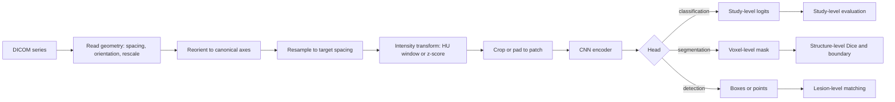

# CNNs and Medical Vision

> **Module 07 — Deep Learning, Multimodal Models, and LLMs**
> Topic 03 of 11
> Estimated study time: 4 hours
> Prerequisites: Topics 01 and 02
> Version 2026.3

## 1. Why this topic exists

Medical imaging is the largest regulated category of AI in health care, and the convolutional neural
network (CNN) remains its workhorse. The architecture is not fashionable; it is appropriate. Images
have local structure, the same feature detector is useful at every position, and the objects of
interest have a characteristic scale. A convolution encodes all three properties as inductive bias,
which is why a CNN can learn from a few thousand labelled studies where a transformer needs far
more. Understanding the bias is the difference between using the architecture well and using it
because a tutorial did.

The industry problem is that imaging models fail for reasons that have nothing to do with the
architecture and everything to do with geometry and preprocessing. A model trained on images
resampled to 1 millimetre isotropic spacing will fail on a scanner that produces 0.7 millimetre
slices if the inference pipeline forgets to resample. A chest radiograph classifier will learn the
burned-in laterality marker if the marker correlates with the label in the training set. A computed
tomography (CT) segmentation model will report a Dice score of 0.91 and still miss a 4 millimetre
lesion, because Dice is dominated by the large organ and insensitive to small structures. Each of
these failures is invisible in the loss curve and visible in a properly designed evaluation.

Four costs follow.

**Geometry cost.** A digital imaging and communications in medicine (DICOM) series is not an array
of pixels. It carries a spacing, an orientation, an origin, a rescale slope and intercept, and a
photometric interpretation. Two series that look identical on a screen can have different voxel
sizes, different orientations, and different intensity ranges. A pipeline that reads the pixel data
and discards the header produces a model that works on the development scanner and fails elsewhere.

**Resolution cost.** A 512 by 512 chest radiograph downsampled to 224 by 224 loses the fine texture
that distinguishes a pneumothorax from a skin fold. A CT volume at full resolution does not fit in
accelerator memory. Every imaging model is therefore a compromise between field of view and
resolution, and the compromise must be chosen against the size of the finding, not against the
input size that a pretrained network expects.

**Evaluation cost.** Pixel-level metrics do not answer clinical questions. A segmentation that is
one voxel dilated everywhere has a high Dice and a poor boundary. A classifier with a high AUROC can
have a threshold that alarms on 40 percent of the ward. Evaluation must be at the level of the
lesion, the study, and the patient, and it must include calibration, subgroup performance, and
failure analysis on the cases that matter.

**Regulatory cost.** Imaging devices are reviewed with a stated intended use, a claimed performance,
and a specified population. The FDA has authorised more than 1,000 AI-enabled devices, a large share
of them in radiology. A submission must describe the preprocessing, the architecture, the training
data, and the evaluation, and it must show that the device performs as claimed on the population it
will see. A model whose preprocessing is not part of the device description is not a reproducible
device.

This topic teaches the CNN as a geometry-aware feature extractor. It covers the convolution
arithmetic, the receptive field, the transfer-learning workflow, the medical-specific preprocessing
chain, and the evaluation that a clinical reviewer will ask for. It does not teach every architecture
in the literature. It teaches the four families that account for most deployed imaging models:
classification networks, U-Net segmentation networks, detection networks, and the vision transformer
that increasingly competes with them.

> **Note:** This topic uses "medical vision" to mean still images and volumetric scans. Video,
> ultrasound cine loops, and whole-slide pathology have additional constraints treated only briefly
> here.

## 2. Learning outcomes

By the end of this topic you can:

1. **Compute** the output shape, parameter count, and floating-point operations (FLOPs) of a
   convolutional layer and a small convolutional network from its specification.
2. **Compute** the receptive field of a stack of convolutions and poolings, and **explain** why it
   bounds the largest structure the network can integrate.
3. **Build** a preprocessing chain from DICOM that fixes orientation, spacing, intensity window, and
   normalisation, and **state** the order of operations and why it matters.
4. **Choose** between 2D and 3D processing, and between classification, segmentation, and detection
   heads, for a stated clinical task.
5. **Apply** transfer learning from a natural-image or medical pretrained backbone, and **justify**
   the layers that are frozen.
6. **Select** a loss for segmentation that behaves correctly on empty masks and class imbalance.
7. **Evaluate** an imaging model at the lesion, study, and patient level, including Dice, Hausdorff
   distance, AUROC, calibration, and subgroup performance.
8. **Critique** an imaging model description for missing geometry, preprocessing, and evaluation
   information that would prevent reproduction.

Outcomes 1, 2, and 6 are computational. Outcomes 3, 4, and 5 are design outcomes assessed by rubric.
Outcome 8 is assessed in the evaluation dossier.

## 3. The core mental model

A convolution is a small dense layer applied at every position with shared weights. That sentence
contains the whole inductive bias. Locality comes from the kernel size; translation equivariance
comes from sharing the kernel across positions; hierarchy comes from stacking and downsampling. The
network learns a filter bank, and the filters at early layers respond to edges and gradients while
later layers respond to textures and shapes.

```text
  Input            Conv 3x3, 16       ReLU          MaxPool 2      Conv 3x3, 32
  (1,128,128) --> (16,128,128) --> (16,128,128) --> (16,64,64) --> (32,64,64) --> ...
       |                                                                          |
       |  one channel, 128x128 pixels                                             |
       |                                                                          v
       +--------------------------------------------------------------> global average pool
                                                                                  |
                                                                                  v
                                                                             logits (C)

  Weight sharing: the same 3x3x16x16 kernel is applied at all 128*128 positions.
  Parameter count for that layer: 3*3*16*16 + 16 = 2,320, independent of image size.
  FLOPs for that layer: 2 * 3*3*16*16 * 128*128 = 75,497,472 at this resolution.
```

The second mental model is the receptive field. Each output unit sees a patch of the input, and the
patch grows with depth. For a stack of 3 by 3 convolutions with stride 1, each convolution adds 2 to
the receptive field; a 2 by 2 max pool with stride 2 adds 1 and doubles the jump. After two
convolutions, a pool, two more convolutions, a pool, and two more convolutions, the receptive field
is 32 input pixels. A structure larger than that cannot be integrated by a single unit at that depth,
which is why segmentation networks downsample and then upsample: the bottleneck has a receptive field
large enough to see the organ, and the skip connections restore the boundary detail.

```text
  receptive field growth (k=3, s=1 conv; k=2, s=2 pool)

  layer        rf    jump
  input         1      1
  conv1         3      1
  conv2         5      1
  pool1         6      2
  conv3        10      2
  conv4        14      2
  pool2        16      4
  conv5        24      4
  conv6        32      4
```

The third mental model is the resolution budget. A voxel is a physical measurement, not a pixel. A CT
at 0.7 by 0.7 by 1.0 millimetres has anisotropic voxels; resampling to 1 millimetre isotropic changes
the array shape and the apparent sharpness. A model trained at one spacing and applied at another
sees objects of a different pixel size. The budget is: choose a target spacing, resample every study
to it, crop or pad to a fixed patch, and record the transform so that predictions can be mapped back
to the original geometry.

The fourth mental model is the difference between classification and segmentation evidence. A
classification model outputs one score per study, and its evaluation is a ranking and calibration
problem over studies. A segmentation model outputs a mask per voxel, and its evaluation is an
overlap and boundary problem per structure. A detection model outputs boxes or points, and its
evaluation is a matching problem per lesion. The three require different metrics, different splits,
and different failure analyses. Using a segmentation metric to justify a detection claim is a
category error.



The diagram is the pipeline that must be reproduced at inference. Every box that changes the array is
part of the model, even if it is implemented in a preprocessing script. A regulatory submission that
describes only the CNN has described half the device.

## 4. Definitions and vocabulary

| Term | Definition | Common misuse | Unit or convention |
|---|---|---|---|
| Convolution | Weight-shared local dot product over a window | Calling cross-correlation convolution | Kernel size in pixels |
| Kernel | The learned filter, shape `(C_out, C_in, kH, kW)` | Confusing with the receptive field | Pixels |
| Stride | Step between kernel positions | Assuming stride 1 by default | Pixels |
| Padding | Border added before convolution | Forgetting it changes output size | Pixels |
| Dilation | Spacing between kernel taps | Confusing with stride | Factor |
| Feature map | Output tensor of a convolution | Calling it an image | `(C, H, W)` |
| Channel | One feature dimension of a tensor | Confusing with a colour channel | Count |
| Receptive field | Input region that affects one output unit | Confusing with kernel size | Pixels or millimetres |
| Pooling | Downsampling by max or average | Assuming it is required | Factor |
| Global average pooling | Mean over spatial dimensions | Confusing with flatten | Per channel |
| Batch normalisation | Per-batch channel normalisation | Using batch size one | Running statistics |
| Residual connection | Identity path added to a block output | Calling any skip a residual | Tensor sum |
| U-Net | Encoder-decoder with skip connections | Calling any segmentation net a U-Net | Architecture |
| Encoder | Downsampling feature extractor | Confusing with the whole model | Architecture |
| Decoder | Upsampling path to full resolution | Assuming it restores information | Architecture |
| Skip connection | Concatenation or sum across scales | Confusing with residual | Tensor op |
| Dice coefficient | `2|A∩B| / (|A|+|B|)` | Using it on empty masks without a rule | Ratio 0 to 1 |
| Intersection over union | `|A∩B| / |A∪B|` | Confusing with Dice | Ratio 0 to 1 |
| Hausdorff distance | Maximum surface distance between masks | Reporting mean distance instead | Millimetres |
| Average surface distance | Mean distance between boundaries | Confusing with Hausdorff | Millimetres |
| Hounsfield unit | Calibrated CT attenuation scale | Applying without rescale slope | HU |
| Windowing | Mapping HU range to display range | Applying twice | Level and width |
| Rescale slope/intercept | DICOM linear mapping to HU | Ignoring it | DICOM tags |
| Pixel spacing | Physical size of a pixel | Confusing with slice thickness | Millimetres |
| Slice thickness | Physical distance between slices | Assuming isotropic | Millimetres |
| Orientation | Patient-axis mapping of the array | Assuming axial | DICOM tags |
| Photometric interpretation | MONOCHROME2 or MONOCHROME1 | Assuming white is high | DICOM tag |
| VOI LUT | Value-of-interest lookup table | Confusing with windowing | DICOM |
| Anisotropy | Different spacing along axes | Ignoring in resampling | Ratio |
| Patch | Sub-volume used as a training sample | Confusing with the whole volume | Voxels |
| Field of view | Physical extent covered | Confusing with resolution | Millimetres |
| Class imbalance | Unequal voxel or study counts | Reporting accuracy under it | Ratio |
| Detection | Localising lesions with boxes or points | Confusing with segmentation | Task |
| Sensitivity | True positive rate at a threshold | Reporting without a threshold | Proportion |
| Specificity | True negative rate at a threshold | Reporting without a threshold | Proportion |
| Calibration | Agreement between predicted probability and observed frequency | Confusing with discrimination | Curve |
| Domain shift | Difference between development and deployment distributions | Treating as a bug | Phenomenon |

> **Note:** Dice and intersection over union are monotone transforms of each other for a fixed pair
> of masks, but they are not interchangeable across datasets. A Dice of 0.90 corresponds to an
> intersection over union of 0.82, which is why the two numbers in a paper can look far apart.

## 5. The mechanics, step by step

This section is a sixteen-step procedure from a DICOM series to an evaluated imaging model. Steps 1
to 4 define the task and the geometry. Steps 5 to 9 build the input pipeline. Steps 10 to 13 train.
Steps 14 to 16 evaluate and package.

### Step 1. Define the unit of analysis

**Input:** the clinical question and the data model.

**Output:** a statement of whether the prediction is per image, per study, per lesion, or per
patient.

**Rationale:** The unit determines the split, the label, and the metric. A study may contain several
series; a patient may have several studies; a lesion may appear in several slices. If the unit is the
patient but the split is by image, the same patient appears in training and test. If the unit is the
lesion but the label is per study, a study with two lesions contributes one label and the model
cannot be evaluated on the second.

**Branch point:** if the clinical action is per patient (screening invitation), use a patient-level
label and split. If the action is per lesion (biopsy decision), the label must be per lesion and the
evaluation must match lesions across time.

### Step 2. Read and record the geometry

**Input:** the DICOM series.

**Output:** a record of rows, columns, number of slices, pixel spacing, slice thickness, image
orientation patient, image position patient, rescale slope, rescale intercept, and photometric
interpretation.

**Rationale:** These fields define the mapping from array indices to patient space. Without them, a
resampled volume cannot be aligned with an annotation, and a prediction cannot be mapped back to the
scanner geometry. The rescale slope and intercept convert stored pixel values to Hounsfield units;
ignoring them makes the window settings meaningless.

**Branch point:** if the series is a single frame (a radiograph), slice thickness is absent and the
geometry is two-dimensional. If the series has inconsistent spacing across slices, the series is
non-uniform and must be resampled slice by slice or rejected.

### Step 3. Reorient to a canonical axis order

**Input:** the array and the orientation tag.

**Output:** an array in a fixed orientation, usually axial, coronal, sagittal in a stated order.

**Rationale:** Two CT series may store the same anatomy with different axis orders or flipped
directions. A model trained on one order will see a mirrored or rotated organ in the other. The
canonical orientation is a convention, not a clinical truth, but it must be applied consistently at
training and inference.

### Step 4. Resample to a target spacing

**Input:** the oriented array and the target spacing.

**Output:** a resampled array and the affine transform that maps it to the original.

**Rationale:** Convolution learns features at a scale measured in pixels. If the physical size of a
pixel changes, the same kernel covers a different physical distance. Resampling to a fixed spacing
makes the kernel's physical scale constant across scanners. The transform must be stored so that
masks and predictions can be returned to the original grid.

**Branch point:** isotropic resampling is standard for 3D segmentation but triples memory for
anisotropic scans. If memory is binding, resample in-plane and keep the slice thickness, and state
the anisotropy in the model description.

### Step 5. Apply the intensity transform

**Input:** the resampled array and the modality.

**Output:** an array in a fixed intensity range.

**Rationale:** CT is calibrated in Hounsfield units, so a window (level and width) is a physically
meaningful transform. Magnetic resonance imaging (MRI) is not calibrated, so per-study z-scoring or
histogram normalisation is used. Mammography and radiography use vendor-specific value-of-interest
lookup tables. Applying the wrong transform compresses the contrast that distinguishes the finding.

**Branch point:** if the model is trained on CT with a soft-tissue window and deployed with a bone
window, the input distribution changes and the model fails. The window is part of the model
specification.

The common CT windows are conventions, not standards, and their exact bounds vary by vendor and by
protocol. The table states the usual values so that a team can see why the choice changes what the
network can see.

| Window | Level (HU) | Width (HU) | Displayed range (HU) | Shows |
|---|---:|---:|---|---|
| Soft tissue | 40 | 400 | -160 to 240 | Liver, spleen, vessels |
| Lung | -600 | 1,500 | -1,350 to 150 | Parenchyma, nodules |
| Bone | 400 | 1,800 | -500 to 1,300 | Cortex, fracture |
| Brain | 40 | 80 | 0 to 80 | Grey-white differentiation |
| Mediastinum | 50 | 350 | -125 to 225 | Lymph nodes, aorta |
| Liver | 60 | 160 | -20 to 140 | Hepatic lesions |

A model trained on one window and evaluated on another is a different model, even if the weights are
identical. The window must be recorded in the model card and implemented in the inference package,
not left to the viewing application.

### Step 6. Normalise using training statistics only

**Input:** the intensity-transformed array.

**Output:** a normalised array.

**Rationale:** Normalisation constants must be computed from the training set and frozen. Computing
them per study at inference makes the input depend on the study's own content, which can hide
pathology and makes the transform non-reproducible. Computing them from the full dataset before the
split leaks information.

### Step 7. Choose 2D or 3D processing

**Input:** the modality, the finding size, and the memory budget.

**Output:** a decision and a justification.

**Rationale:** 2D processing treats each slice as an image and is cheaper, but it cannot use
through-plane context. 3D processing uses the volume but costs memory cubically. Many findings are
visible in 2D; many are not. The choice is empirical and must be stated.

| Condition | 2D slices | 2.5D stacks | 3D patches | Whole volume |
|---|---|---|---|---|
| Finding visible on one slice | Preferred | Works | Works | Unnecessary |
| Through-plane context needed | Fails | Partial | Preferred | Preferred |
| Memory limited | Preferred | Works | Works | Rarely possible |
| Small dataset | Preferred | Works | Data hungry | Data hungry |
| Anisotropic spacing | Works | Works | Careful | Careful |
| Deployment latency tight | Preferred | Works | Slower | Slowest |

### Step 8. Choose the head and the loss

**Input:** the task type.

**Output:** an output shape and a loss.

**Rationale:** A classification head produces one logit per class and uses cross-entropy. A
segmentation head produces one logit per voxel per class and usually combines cross-entropy with
Dice. Dice alone is unstable when the mask is empty, because the denominator is zero; the usual
convention is to return 1 for an empty prediction on an empty mask and 0 otherwise, which rewards
correct emptiness but can dominate a small structure's contribution.

**Branch point:** if the structures are small and the background dominates, use a weighted sum of
cross-entropy and Dice, or a Tversky loss with a beta that penalises false negatives. If the task is
detection, use a matching-based loss and evaluate with lesion-level sensitivity.

The combined loss is usually written as `L = L_CE + lambda * L_Dice`, with `lambda` between 0.5 and
1.0. The cross-entropy term supplies a stable gradient on every voxel, including the background; the
Dice term supplies a gradient that is sensitive to the overlap of the structure. Dice alone has a
gradient that vanishes when the prediction and the reference do not overlap, which is common early
in training on small structures. Cross-entropy alone is dominated by the background when the
foreground is a small fraction of the volume.

| Loss | Stable early | Sensitive to small structures | Handles empty mask | Typical weight |
|---|---|---|---|---|
| Cross-entropy | Yes | No, background dominates | Yes | 1.0 |
| Dice | No | Yes | Needs a convention | 0.5 to 1.0 |
| Dice + CE | Yes | Yes | Yes | 1.0 + 0.5 |
| Tversky | No | Yes, tunable | Needs a convention | beta 0.7 |
| Focal | Yes | Yes, for hard voxels | Yes | gamma 2 |

### Step 9. Build patient-level, site-aware splits

**Input:** the cohort with patient and site identifiers.

**Output:** train, validation, and test splits with no patient overlap and, where possible, a
held-out site.

**Rationale:** Images from the same patient share anatomy, pathology, and acquisition. A random
image split leaks the patient. A site-held-out split tests transport. The test set is locked until
the protocol is frozen.

### Step 10. Design augmentation that respects anatomy

**Input:** the training set and the acquisition geometry.

**Output:** an augmentation policy.

**Rationale:** Flips, rotations, and intensity jitter are standard for natural images. In medical
images, a left-right flip changes anatomy: the liver moves to the wrong side and a laterality marker
becomes inconsistent. Small rotations and elastic deformations are usually safe; large rotations and
flips are not, unless the label is invariant to them. The policy must be stated per task.

### Step 11. Initialise from a pretrained backbone

**Input:** the architecture and the available pretrained weights.

**Output:** an initialisation and a freezing policy.

**Rationale:** Natural-image pretraining transfers edges and textures; medical pretraining transfers
modality-specific features. With a few thousand studies, pretraining is usually the difference
between a model that generalises and one that memorises. Freezing early layers reduces overfitting
and compute; fine-tuning all layers can adapt better when the domain is far from the pretraining
domain.

The freezing decision is a trade between adaptation and overfitting risk. It should be made before
the run and recorded, because a model that freezes the first two blocks has a different parameter
count and a different compute profile from one that fine-tunes everything.

| Cohort size | Domain distance from pretraining | Freeze | Rationale |
|---|---:|---|---|
| Under 1,000 studies | Close (chest X-ray to chest X-ray) | Encoder frozen, head trained | Prevents memorisation |
| Under 1,000 studies | Far (natural images to CT) | First two blocks frozen | Adapts mid-level features |
| 1,000 to 10,000 | Close | Last block plus head trained | Standard fine-tune |
| 1,000 to 10,000 | Far | All layers, low rate | Adaptation needed |
| Over 10,000 | Any | All layers, schedule | Enough data to adapt |
| Any, with labels for segmentation only | Any | Encoder frozen, decoder trained | Decoder is task-specific |

**Branch point:** if the pretrained model expects 224 by 224 RGB inputs and the task needs 512 by
512 single-channel inputs, the first layer must be adapted and the positional or pooling behaviour
checked. A silent resize is a common source of degraded transfer.

### Step 12. Train with mixed precision and checkpointing

**Input:** the protocol from Topic 02.

**Output:** a trained model and a run record.

**Rationale:** 3D networks exceed memory in 32-bit precision at useful batch sizes. Mixed precision
halves activation memory and can double throughput. Checkpointing every epoch allows selection and
recovery. The training protocol follows the eighteen steps in Topic 02.

### Step 13. Monitor geometry and label invariants during training

**Input:** batches as loaded.

**Output:** assertions that spacing, orientation, and intensity range match the specification.

**Rationale:** A preprocessing bug that affects one percent of studies is invisible in the average
loss. Assertions on the batch metadata catch it at load time. The checks are cheap and catch the
failures that are most expensive to diagnose later.

### Step 14. Evaluate at the clinical unit

**Input:** the test set and the predictions.

**Output:** study-level or lesion-level metrics with confidence intervals.

**Rationale:** Pixel Dice is not a clinical metric. A segmentation model should be evaluated on
whether it detects the lesion, how far its boundary is from the reference, and whether the volume
estimate is biased. A classification model should be evaluated on sensitivity at a fixed alert
budget, calibration, and subgroup performance. The metric must match the claim.

### Step 15. Test calibration and subgroups

**Input:** predictions and group labels.

**Output:** calibration curves and subgroup metrics.

**Rationale:** A model can discriminate well and be miscalibrated, which matters when the score is
used as a probability. Subgroup performance can differ by sex, age, scanner, and site. A model that
is accurate on average and poor in a subgroup is not equitable and may not be safe.

### Step 16. Package preprocessing with the model

**Input:** the trained weights and the preprocessing code.

**Output:** a container or library that reproduces the exact input transform.

**Rationale:** The device is the model plus its preprocessing. If the preprocessing lives in a
notebook and the model in a serving container, the two will drift. The package must include the
resampling, windowing, normalisation constants, and orientation convention, and it must be versioned
with the weights.

### The inference contract

The sixteen steps produce a model, and the model is only useful if the inference path reproduces the
training path. The contract below is the minimum that a deploying team should write and test.

| Element | Training value | Inference requirement | Failure if mismatched |
|---|---|---|---|
| Orientation | Axial, LPS | Same axis order | Mirrored anatomy |
| Spacing | 1.0 mm isotropic | Same resampling | Scale mismatch |
| Rescale | Slope and intercept applied | Same conversion to HU | Wrong intensity range |
| Window | Soft tissue, level 40, width 400 | Same level and width | Contrast loss |
| Normalisation | Mean and sd from training | Frozen constants | Per-study distortion |
| Channel order | Single channel | Same order | Wrong features |
| Patch size | 128 cubed | Same size or documented tiling | Boundary artefacts |
| Stride | Not applicable at training | Tiling overlap stated | Seams |
| Device | Weights hash | Same hash | Untested model |

Two tests are worth automating. The first is a golden-case test: a single study with a known
prediction, run through the inference package, must reproduce the stored output within a numerical
tolerance. The second is a geometry test: the package must reject a study whose spacing or
orientation falls outside the validated range, rather than silently resampling it to something the
model has never seen.

The golden case catches packaging drift. The geometry test catches the more dangerous failure, which
is a model that produces a plausible output on an input it was never validated for. A rejection is a
better outcome than a confident wrong mask.

### What the procedure costs

The sixteen steps take longer than the training run. In a typical project, the geometry audit, the
label audit, and the evaluation design consume more person-hours than the model fitting, and they
consume them earlier. That ordering is deliberate. A geometry bug found after training costs a
retrain; a geometry bug found after deployment costs a recall. The procedure is written so that the
cheap checks happen before the expensive compute.

The one step that teams most often skip is Step 14, evaluation at the clinical unit. It is also the
step that most often changes the conclusion. A model with a good average Dice and a bad boundary
distribution is not a good model for planning, and a classifier with a good AUROC and a bad
calibration is not a good model for triage. The metric is part of the design, not a report card
added at the end.

## 6. Worked example

A radiology department wants to segment the liver on portal-venous phase CT for radiation therapy
planning. The development set has 240 contrast-enhanced CT series from two scanners. A typical series
is 512 by 512 pixels by 250 slices, with in-plane spacing 0.7 by 0.7 millimetres and slice thickness
1.0 millimetre. The reference masks were drawn by one reader and checked by a second.

The team proposes a 3D U-Net with four resolution levels, a base width of 16 channels, and 128-cubed
patches. This section carries the proposal through geometry, memory, compute, a Dice calculation, two
diagnostics, and one sensitivity.

### Step 1. Geometry and voxel count

The original volume has `512 * 512 * 250 = 65,536,000` voxels. The physical extent is
`512 * 0.7 = 358.4` millimetres in plane and `250 * 1.0 = 250` millimetres through plane.

Resampling to 1 millimetre isotropic changes the array to:

```text
rows:    512 * 0.7 / 1.0 = 358.4 -> 358
columns: 512 * 0.7 / 1.0 = 358.4 -> 358
slices:  250 * 1.0 / 1.0 = 250
voxels:  358 * 358 * 250 = 32,041,000
```

The resampled volume has about half the voxels of the original, because the in-plane resolution is
reduced from 0.7 to 1.0 millimetres. That is a real loss of detail. The team accepts it because the
liver boundary is a large structure and the memory saving is substantial; a lesion segmentation task
would not accept it.

### Step 2. Patch sampling

A 128-cubed patch contains `128^3 = 2,097,152` voxels, which is 6.5 percent of the resampled volume.
At two patches per volume per epoch, the model sees `240 * 2 = 480` patches per epoch, or 4 percent
of the available voxels per volume per epoch. Fifty epochs present `480 * 50 = 24,000` patches.

The patch must be sampled to include the liver. A uniform sampler would draw mostly background,
because the liver occupies a minority of the volume. The standard approach samples patches with a
probability proportional to the fraction of foreground, with a minimum of one foreground voxel.

### Step 3. Parameter count

The network has two 3 by 3 by 3 convolutions per level, four levels, and a decoder that mirrors the
encoder. The parameter count per convolution is `k^3 * C_in * C_out + C_out`.

```text
enc1: 1*16*27 + 16 = 448;   16*16*27 + 16 = 6,928        ->   7,376
enc2: 16*32*27 + 32 = 13,856; 32*32*27 + 32 = 27,680     ->  41,536
enc3: 32*64*27 + 64 = 55,360; 64*64*27 + 64 = 110,656    -> 166,016
bott: 64*128*27 + 128 = 221,312; 128*128*27 + 128 = 442,496 -> 663,808
dec3: 128*64*8 + 64 = 65,600; 64*64*27 + 64 = 110,656 x2 -> 286,976
dec2: 64*32*8 + 32 = 16,416; 32*32*27 + 32 = 27,680 x2   ->  71,776
dec1: 32*16*8 + 16 = 4,112; 16*16*27 + 16 = 6,928 x2     ->  17,968
out:  16*2*1 + 2 = 34                                    ->      34
total:                                                     1,255,426
```

The transposed convolutions use a 2 by 2 by 2 kernel and contribute 8 weights per input-output
pair, which is why they are cheaper than a 3 by 3 by 3 convolution despite the larger spatial
output. The total is about 1.26 million parameters, small enough that the model is not
parameter-bound; the binding constraint is activation memory.

At four bytes per parameter, the weights occupy `1,255,426 * 4 = 5,021,704` bytes, or 4.8 mebibytes.
Adam adds two moment estimates and a gradient, so the parameter state is `1,255,426 * 4 * 4 =
20,086,816` bytes, or 19.2 mebibytes. The parameters are not the problem.

### Step 4. Forward compute

The compute per convolution is `2 * k^3 * C_in * C_out * V_out`, where `V_out` is the number of
output voxels. At 128-cubed input:

```text
enc1a: 2*27*1*16*2,097,152   =  1.81 GFLOPs
enc1b: 2*27*16*16*2,097,152  = 28.99 GFLOPs
enc2a: 2*27*16*32*262,144    =  7.25 GFLOPs
enc2b: 2*27*32*32*262,144    = 14.50 GFLOPs
enc3a: 2*27*32*64*32,768     =  3.62 GFLOPs
enc3b: 2*27*64*64*32,768     =  7.25 GFLOPs
bott1: 2*27*64*128*4,096     =  1.81 GFLOPs
bott2: 2*27*128*128*4,096    =  3.62 GFLOPs
decoder and output:          = 131.64 GFLOPs
forward total:                 200.5 GFLOPs per patch
```

Training costs approximately three times the forward pass, or `3 * 200.5 = 601.6 GFLOPs` per patch.
For 24,000 patches, the total is `24,000 * 601.6e9 = 1.44e16` FLOPs, or 14.4 petafLOPs. At an
effective 100 teraflops, the arithmetic time is `1.44e16 / 1e14 = 144 seconds`. The wall-clock time
will be several times larger because of patch loading, resampling on the fly, and checkpointing.

The compute is dominated by the decoder, because the decoder operates at the highest resolutions with
moderate channel counts. A network that halves the decoder width would save roughly a third of the
compute at a cost in boundary accuracy. That is the trade a team should measure, not assume.

### Step 5. Activation memory

At batch 2, a single feature map at 128 cubed with 16 channels occupies:

```text
2 * 16 * 2,097,152 * 4 bytes = 268,435,456 bytes = 256 MiB
```

The encoder stores at least two such maps per level for the backward pass, plus the decoder's
higher-resolution maps and the skip concatenations. A planning estimate is 1.5 to 2.5 gibibytes for
activations at batch 2, before the parameter state and the cuDNN workspace. The estimate is an
inference from the tensor shapes, not a measurement; the constant depends on whether gradient
checkpointing is used.

The memory arithmetic explains the patch size. Doubling the patch to 256 cubed multiplies the voxel
count by eight, and the 128-cubed batch of 2 would no longer fit. Halving to 96 cubed multiplies by
`(96/128)^3 = 0.422`, which frees memory for a batch of 4 but reduces the context available to the
bottleneck.

### Step 6. Dice arithmetic

On one test volume, the reference liver mask contains 1,850,000 voxels, the predicted mask contains
1,720,000 voxels, and their intersection contains 1,610,000 voxels.

```text
Dice = 2 * 1,610,000 / (1,850,000 + 1,720,000)
     = 3,220,000 / 3,570,000
     = 0.902
IoU  = 1,610,000 / (1,850,000 + 1,720,000 - 1,610,000)
     = 1,610,000 / 1,960,000
     = 0.821
```

The predicted mask is smaller than the reference by 130,000 voxels, which is a systematic
under-segmentation of about 7 percent of the reference volume. Dice alone does not reveal the
direction of the error. A signed volume difference does, and a boundary distance does.

### Step 7. Diagnostic one: boundary distance versus overlap

The team computes the 95th percentile Hausdorff distance in millimetres on the test set. The mean
Dice is 0.902, which looks acceptable. The 95th percentile Hausdorff distance is 14.8 millimetres,
which is not: a 14.8 millimetre excursion is a boundary error large enough to matter for a radiation
field.

Inspecting the worst volumes shows that the error is concentrated at the liver dome, where the
diaphragm boundary is low contrast and the reference includes a sliver of tissue that the model
omits. The Dice is dominated by the 1.8 million true-positive voxels; the 240,000 mismatched voxels
are 6.7 percent of the reference and cost only 0.098 Dice. A metric that is a ratio of volumes will
always underweight a thin boundary error. The diagnostic that reveals it is the surface distance
distribution, not the mean Dice.

### Step 8. Diagnostic two: empty patches and the Dice denominator

The training sampler includes patches with no liver, because the model must learn to output an empty
mask. For an empty reference and an empty prediction, the Dice denominator is zero. The convention
`Dice = 1` for this case rewards correct emptiness. For an empty reference and a non-empty
prediction, the convention `Dice = 0` penalises the false positive.

The diagnostic is the distribution of per-patch loss by foreground fraction. If empty patches
contribute a loss of exactly zero, the model is not being trained on them and will produce false
positives in the background. If empty patches dominate the loss, the model will learn to predict
empty everywhere and the foreground Dice will collapse late in training. The healthy pattern is a
foreground-weighted sampler with a small fraction of empty patches and a loss that is finite on
both.

### Step 9. Vary one assumption: patch 128 to 96

Suppose the team reduces the patch to 96 cubed to fit a batch of 4.

```text
voxels per patch: 96^3 = 884,736, versus 128^3 = 2,097,152
ratio: 884,736 / 2,097,152 = 0.422
forward compute: 200.5 * 0.422 = 84.6 GFLOPs per patch
activation memory at the first level: 268 MiB * 0.422 = 113 MiB per map
```

The compute per patch falls by 58 percent, and four patches cost `4 * 84.6 = 338` GFLOPs versus
`2 * 200.5 = 401` GFLOPs for two large patches. The team gets more samples per step for less
compute. The conclusion changes in a specific way: the smaller patch is cheaper and gives a larger
effective batch, but the bottleneck's receptive field is now 24 voxels instead of 32, and the
largest structure the deepest unit can integrate is smaller. For a liver, which spans more than 100
millimetres, the network still sees only a fraction of the organ at the bottleneck; the skip
connections carry the boundary detail, and the global shape is inferred from the patch context. If
the validation Dice is unchanged, the smaller patch is the better choice. If it falls, the loss is
evidence that context mattered, and the team should test a third size rather than assume.

### Step 10. What the numbers do not establish

The Dice and the boundary distance are internal estimates on two scanners. They do not establish
performance at a third scanner, on a different contrast protocol, or in a patient population with
different anatomy. They do not establish that the segmentation improves the radiation plan, which
requires a planning study. And they do not establish that the model is safe for autonomous use; the
intended use in this example is assistance with human review, and the evaluation must match that
claim.

## 7. Code, query, or calculation

The code below computes the three quantities that a team should be able to produce before reading a
paper: the output shape of a convolution, the receptive field of a stack, and the Dice score of a
pair of masks. A second block tabulates the parameters and FLOPs of the 3D U-Net used in the worked
example.

**Assumptions.** Convolutions use square kernels with the same stride and padding on each axis. The
receptive field calculation assumes a single path through the encoder, not the skip connections.
Dice uses the convention that two empty masks score 1.0.

```python
def out_size(n, k, s=1, p=0, d=1):
    return (n + 2 * p - d * (k - 1) - 1) // s + 1

print("conv 128, k3 s1 p1 ->", out_size(128, 3, 1, 1))
print("conv 128, k3 s2 p1 ->", out_size(128, 3, 2, 1))
print("conv 128, k3 s1 p0 ->", out_size(128, 3, 1, 0))

def conv_step(rf, jump, k=3, s=1):
    return rf + (k - 1) * jump, jump * s

def pool_step(rf, jump, k=2, s=2):
    return rf + (k - 1) * jump, jump * s

rf, jump = 1, 1
for op in ["c", "c", "p", "c", "c", "p", "c", "c"]:
    rf, jump = conv_step(rf, jump) if op == "c" else pool_step(rf, jump)
    print(op, "rf", rf, "jump", jump)

A, B, inter = 1_850_000, 1_720_000, 1_610_000
print("dice:", round(2 * inter / (A + B), 4))
print("iou:", round(inter / (A + B - inter), 4))

for a, b, i in [(0, 0, 0), (100, 0, 0), (100, 50, 0)]:
    val = 2 * i / (a + b) if (a + b) > 0 else 1.0
    print(f"A={a} B={b} inter={i} dice={val}")
```

**Observed output:**

```text
conv 128, k3 s1 p1 -> 128
conv 128, k3 s2 p1 -> 64
conv 128, k3 s1 p0 -> 126
c rf 3 jump 1
c rf 5 jump 1
p rf 6 jump 2
c rf 10 jump 2
c rf 14 jump 2
p rf 16 jump 4
c rf 24 jump 4
c rf 32 jump 4
dice: 0.902
iou: 0.8214
A=0 B=0 inter=0 dice=1.0
A=100 B=0 inter=0 dice=0.0
A=100 B=50 inter=0 dice=0.0
```

The first three lines show the shape rules that cause most implementation bugs: a stride-1
convolution with padding preserves the size, a stride-2 convolution halves it, and a convolution
without padding loses `k - 1` pixels. The receptive field reaches 32 pixels after eight layers, with
a jump of 4, which means one output unit at that depth aggregates a 32-pixel window but only every
fourth pixel's worth of detail.

The second block computes the parameter and FLOP table for the 3D U-Net.

```python
def conv_params(cin, cout, k=3):
    return cin * cout * (k ** 3) + cout

def conv_flops(cin, cout, vout, k=3):
    return 2 * (k ** 3) * cin * cout * vout

def tconv_params(cin, cout, k=2):
    return cin * cout * (k ** 3) + cout

def tconv_flops(cin, cout, vout, k=2):
    return 2 * (k ** 3) * cin * cout * vout

def volume(s):
    return s ** 3

blocks = [
    ("enc1a", 1, 16, 3, 128), ("enc1b", 16, 16, 3, 128),
    ("enc2a", 16, 32, 3, 64), ("enc2b", 32, 32, 3, 64),
    ("enc3a", 32, 64, 3, 32), ("enc3b", 64, 64, 3, 32),
    ("bott1", 64, 128, 3, 16), ("bott2", 128, 128, 3, 16),
    ("up3t", 128, 64, 2, 32), ("up3a", 64, 64, 3, 32), ("up3b", 64, 64, 3, 32),
    ("up2t", 64, 32, 2, 64), ("up2a", 32, 32, 3, 64), ("up2b", 32, 32, 3, 64),
    ("up1t", 32, 16, 2, 128), ("up1a", 16, 16, 3, 128), ("up1b", 16, 16, 3, 128),
    ("out", 16, 2, 1, 128),
]

tp = tf = 0
print(f"{'block':<7}{'cin':>5}{'cout':>5}{'k':>3}{'res':>5}{'params':>10}{'MFLOPs':>10}")
for name, ci, co, k, res in blocks:
    if k == 2:
        p, f = tconv_params(ci, co, k), tconv_flops(ci, co, volume(res), k)
    else:
        p, f = conv_params(ci, co, k), conv_flops(ci, co, volume(res), k)
    tp += p
    tf += f
    print(f"{name:<7}{ci:>5}{co:>5}{k:>3}{res:>5}{p:>10}{f / 1e9:>10.2f}")

print("total params:", tp)
print("forward GFLOPs at 128^3:", round(tf / 1e9, 1))
print("train GFLOPs (x3):", round(3 * tf / 1e9, 1))
```

**Observed output (abridged to the totals):**

```text
block    cin cout   k  res    params   MFLOPs
enc1a      1   16   3  128       448      1.81
enc1b     16   16   3  128      6928     28.99
...
out       16    2   1  128        34      0.13
total params: 1255426
forward GFLOPs at 128^3: 200.5
train GFLOPs (x3): 601.6
```

The table shows where the compute is: the two highest-resolution convolutions in the encoder and the
three highest-resolution blocks in the decoder. The bottleneck has 128 channels but operates on
16-cubed volumes, so its FLOPs are small. A team that wants a faster model should reduce the
high-resolution channel counts or the decoder width, not the bottleneck depth.

## 8. Data, standards, and regulatory context

Imaging is the most standardised part of clinical data, and the standards constrain the pipeline more
than they constrain the architecture.

**DICOM.** Digital Imaging and Communications in Medicine (DICOM, published as PS3 by the National
Electrical Manufacturers Association) defines the file format, the metadata, and the network
protocol. The tags that matter for modelling are `Rows`, `Columns`, `PixelSpacing`,
`SliceThickness`, `ImageOrientationPatient`, `ImagePositionPatient`, `RescaleSlope`,
`RescaleIntercept`, `PhotometricInterpretation`, and `VOILUTFunction`. DICOM is a standard, not a
regulation: conformance is a manufacturer claim, and real files vary in which optional tags are
present. A pipeline that requires a tag must handle its absence explicitly.

**Hounsfield units.** CT pixel values are stored as integers and converted to Hounsfield units by
`HU = stored * slope + intercept`. The conversion is defined by the DICOM tags, not by a fixed
formula. A pipeline that assumes slope 1 and intercept -1024 will be correct for some scanners and
wrong for others. The values are calibrated to water and air, which is why a window is physically
meaningful in CT and not in MRI.

**IHE and workflow.** Integrating the Healthcare Enterprise (IHE) profiles define how imaging studies
move between modalities, archives, and viewers. A deployed model that reads from a picture archiving
and communication system (PACS) must fit the profile, including study status and prior retrieval.
The workflow constraint is often the binding one: a model that takes ten minutes per study cannot be
used in a reading queue that expects a result before the next case.

**FDA device regulation.** The FDA regulates imaging AI as device software. The January 2025 draft
guidance on AI-enabled device software functions (docket FDA-2024-D-4488) describes the submission
content, and the December 2024 final guidance on predetermined change control plans (docket
FDA-2022-D-2628) describes how anticipated modifications are pre-authorised. A change to the
resampling, the window, or the model weights is a change that must be inside the plan. The FDA has
stated that it has authorised more than 1,000 AI-enabled devices; the count is documented, the
distribution across specialties is not.

**Reporting guidelines.** TRIPOD+AI (BMJ 2024;385:e078378) covers prediction models, including
imaging-based ones, and requires the predictors, the model, the sample size, and the performance to
be reported. For imaging specifically, the CLAIM checklist (Metrics for Evaluation of AI in Medical
Imaging) is a reporting guideline for AI in medical imaging; it is a checklist, not a regulation. A
paper that reports only Dice and omits the boundary metric is incomplete under either.

**European Union.** Regulation (EU) 2024/1689 classifies most clinical AI as high-risk and requires
technical documentation, data governance, human oversight, and post-market monitoring. For imaging,
the data-governance requirement reaches the training data's provenance and representativeness, and
the human-oversight requirement reaches whether the output is advisory or autonomous.

| Standard or framework | Status | What it constrains | What it does not |
|---|---|---|---|
| DICOM PS3 | Industry standard | File format and metadata | Model architecture |
| Hounsfield unit convention | Physics convention | CT intensity meaning | Window choice |
| IHE profiles | Industry profile | Workflow integration | Model accuracy |
| FDA device guidance | Binding for devices | Submission and change control | Architecture choice |
| TRIPOD+AI | Reporting convention | Study reporting | Study quality |
| CLAIM | Reporting checklist | Imaging AI reporting | Clinical validity |
| EU AI Act | Binding, phased | High-risk obligations | Technical thresholds |
| HIPAA | Binding in the US | PHI handling | Model safety |

**What DICOM does not tell you.** The header describes the acquisition geometry, not the clinical
content. It does not say whether the study is contrast-enhanced, whether the patient is supine or
prone, whether the image has been post-processed by the vendor, or whether the series is complete.
Those facts are in the series description, the protocol name, or the report, and they are often
inconsistent. A model that needs contrast-enhanced portal-venous phase images must select them by
protocol name or by an intensity heuristic, and the selection is part of the device.

**Public datasets and their limits.** The most used public chest radiograph datasets are
report-labelled, not adjudicated. ChestX-ray14 contains 112,120 frontal images from 30,805 patients
with 14 labels mined from reports by natural language processing; CheXpert contains 224,316 images
with rule-based labels and an expert-labelled test set. The labels are noisy, the populations are
not representative of a current screening programme, and the images are de-identified in ways that
remove some of the metadata a deployed system would use. A model trained and tested only on these
datasets has not been tested on a modern scanner fleet.

**The regulatory boundary.** The FDA regulates the device, not the dataset. A public dataset can be
used to develop a device, and the submission must describe its provenance and its limitations. The
agency's guidance on AI-enabled device software functions asks for the training data's
characteristics, including the population and the acquisition settings, because a reviewer needs to
judge whether the evaluation population matches the intended-use population.

| Question a reviewer asks | Where the answer lives | What a weak answer looks like |
|---|---|---|
| What is the intended use and population? | Device description | "For clinicians" |
| What data trained and tested the model? | Data section, datasheet | "A large public dataset" |
| How was the geometry standardised? | Preprocessing description | "Images were resized" |
| How were uncertain labels handled? | Label policy | Not mentioned |
| What is the unit of evaluation? | Results section | "Per image" for a patient claim |
| How does performance vary by subgroup? | Subgroup analysis | Overall AUROC only |
| What changes on retraining? | PCCP | No plan |

The gap between conformance and validity is the same as in every other topic: a device can be
DICOM-conformant, FDA-authorised, and still fail on a scanner it was not trained on. The standards
constrain the description and the process, not the truth of the performance claim.

**Why the standards still matter.** A team that ignores DICOM geometry will produce a model that
cannot be reproduced, and a model that cannot be reproduced cannot be regulated, published, or
maintained. The standards are the minimum vocabulary for describing what the model consumes. They
are not a substitute for validation, but they are a precondition for it.

**The audit trail.** For a deployed imaging device, the audit trail should record the study UID, the
series UID, the preprocessing version, the model version, and the output hash for every inference.
The record supports incident investigation, drift detection, and the post-market monitoring that the
EU AI Act and the FDA guidance both expect. It also makes the golden-case test possible, because the
stored output can be compared with a re-run.

## 9. Industry practice and case evidence

**ResNet and the residual connection.** He et al. introduced residual learning to address the
degradation problem, where deeper plain networks had higher training error (arXiv:1512.03385, CVPR
2016). The documented result is a 152-layer network with lower complexity than VGG and a 3.57
percent top-5 error in an ensemble, winning the 2015 ImageNet challenge. The mechanism is an
identity path whose Jacobian is one, which lets gradients reach early layers. Almost every deployed
medical imaging backbone is a residual network or a descendant, and the reason is the optimisation
property, not the benchmark score.

**CheXpert and label uncertainty.** CheXpert released 224,316 chest radiographs from 65,240 patients
with 14 observations labelled positive, negative, or uncertain by a rule-based labeller applied to
reports (AAAI 2019, doi:10.1609/aaai.v33i01.3301590). The documented comparison shows that the
treatment of uncertain labels changes performance on the expert-labelled test set. The inference for
practice is that an imaging model's reported performance is not reproducible without its label
policy, and a vendor datasheet that omits the policy has omitted a model parameter.

**MedSAM and promptable segmentation.** Ma et al. fine-tuned the Segment Anything Model on 1,570,263
medical image-mask pairs across 10 imaging modalities and evaluated on 86 internal and 60 external
validation tasks (Nature Communications 2024;15:654, doi:10.1038/s41467-024-44824-z). The documented
result is that the adapted model outperformed the original SAM and was competitive with
modality-specific specialists. The inference, which the authors frame as a foundation-model
argument, is that a promptable model can reduce annotation burden, but the evaluation is still
per-modality and per-task; a good average across 146 tasks does not establish performance on the one
task a clinic needs.

**MONAI and the engineering stack.** MONAI is an open-source framework for medical imaging AI that
provides dataset loaders, transforms, network definitions, and metrics. Its existence is evidence
that the preprocessing chain is a first-class engineering problem, not a script. A team that builds
its own loader usually rediscovers the same geometry bugs that MONAI's transforms were written to
prevent.

**What practitioners actually do.** In inference from public model cards and vendor documentation,
three patterns recur. First, most deployed classification models are 2D or 2.5D residual networks
fine-tuned from ImageNet or a medical pretrained backbone. Second, most segmentation models are
U-Net variants, often 3D for CT and MRI and 2D for radiography and pathology. Third, the
preprocessing is usually implemented twice, once in the training pipeline and once in the serving
container, and the two drift. The teams that avoid the drift package the transform with the weights.

**ChestX-ray14 and the weak-label problem.** Wang et al. released ChestX-ray14, 112,120 frontal chest
radiographs from 30,805 patients with 14 disease labels extracted from reports by natural language
processing (CVPR 2017, arXiv:1705.02315). The documented benchmark results showed that deep models
could predict the labels better than chance, and subsequent work documented that the labels and the
patient splits had limitations. The inference for practice is not that the benchmark is invalid; it
is that a benchmark measures agreement with report-derived labels, which is not the same as
agreement with a radiologist's diagnosis, and neither is the same as a clinical outcome.

**Two benchmarks, two claims.** CheXpert reports expert comparison on a test set; ChestX-ray14
reports AUROC against report labels. A vendor that cites "state-of-the-art on chest X-ray" without
naming the benchmark and the label source has not made a checkable claim. A buyer should ask which
dataset, which label policy, and which split. The answers determine whether the number is comparable
to anything.

**Deployment pattern and drift.** The documented cases and the inference from vendor documentation
converge on a pattern: the model is developed on a curated retrospective set, validated on a
held-out set from the same institution, and then monitored after go-live. The monitoring is where
most teams are weakest. A model whose input distribution shifts because a scanner is replaced will
degrade without any change to its weights, and a team that does not monitor the input distribution
will attribute the degradation to the clinical team.

**What the evidence supports.** It supports three claims. Geometry standardisation is a precondition
for transport. Label policy is part of the model definition. Evaluation at the clinical unit is the
only evaluation that answers a clinical question. It does not support a claim that any particular
architecture is best, and it does not support a claim that a high Dice or AUROC establishes clinical
utility.

The evidence does not support the claim that a larger backbone is better for a small imaging cohort.
It supports the claim that geometry, label policy, and evaluation design dominate the architecture
choice in the range of cohort sizes that most hospitals have.

**Procurement questions that separate evidence from marketing.** A buyer evaluating an imaging
product should ask five questions. Which scanner models and sites were in the test set? What was the
unit of evaluation, and was the split by patient? What is the performance at the operating threshold,
not only the AUROC? What happens when the input spacing or window differs from the validated range?
What is the change-control process for a model update? A vendor that can answer all five has a
maturity that a vendor with a conference paper may not. The questions are deliberately answerable
without disclosing proprietary weights.

## 10. Failure modes and red flags

Imaging failures cluster around geometry and evaluation, not around architecture. The table below is
ordered by how often the failure survives to deployment: the first rows are the ones that pass a
development test and fail in a hospital.

| Failure | Early warning sign | Mechanism | Consequence | Mitigation |
|---|---|---|---|---|
| Spacing mismatch | Predictions scale with scanner | Kernel covers different physical size | Silent accuracy loss | Resample and assert spacing |
| Orientation flip | Left-right errors | Axis order differs | Wrong side, unsafe | Reorient and test |
| Rescale ignored | CT values outside HU range | Slope and intercept not applied | Wrong window | Apply and assert range |
| Wrong window | Contrast looks flat | Level and width mismatch | Missed findings | Record window in model card |
| Patient leakage | Near-perfect test AUROC | Same patient in train and test | Inflated estimate | Split by patient |
| Laterality marker shortcut | High AUROC, odd saliency | Marker correlates with label | Site-specific failure | Crop markers, external test |
| Empty-mask Dice instability | Loss NaN or zero on empty patches | Zero denominator | Failed training | Convention plus CE term |
| Dice ignores small lesions | High Dice, missed lesion | Volume-weighted ratio | Clinically unacceptable | Boundary and lesion metrics |
| Anisotropic resampling error | Blurred through-plane | Wrong target spacing | Boundary error | State target spacing |
| Augmentation changes anatomy | Model fails on normal cases | Horizontal flip of lateralised organ | Wrong predictions | Task-specific policy |
| Batch norm at batch one | Unstable validation | Zero variance | Garbage outputs | Layer norm or larger batch |
| Tiling seams | Grid pattern in output | Non-overlapping patches | Boundary artefacts | Overlap and blend |
| Preprocessing drift | Serving differs from training | Two implementations | Silent degradation | Golden-case test |
| Overfitting a small cohort | Train Dice 0.98, test 0.71 | Too many parameters | Poor transport | Pretraining, augmentation, early stop |

## 11. Assumptions and limits

Every imaging metric is conditional on an annotation, a geometry, and a population. The ledger makes
those conditions explicit so that a reader can tell which of them the study tested and which it
assumed.

The most consequential assumption is the first: that the annotation defines the truth. Inter-reader
variability for a liver boundary can be several millimetres, which is the same order as the model's
error. A Dice of 0.90 against one reader may be a Dice of 0.86 against another, and a model that
matches one reader's style is not necessarily more correct. A study that reports a single-reader
reference without a reader-variability estimate has reported a number whose uncertainty it does not
know.

| Assumption | Why it is needed | What breaks it | How to test |
|---|---|---|---|
| The annotation defines the truth | Dice is computed against it | Inter-reader variability | Multi-reader study |
| Spacing is consistent within a series | Resampling uses one transform | Non-uniform slices | Check slice positions |
| The finding is visible at the chosen resolution | Downsampling preserves signal | Small lesions, thin slices | Resolution sensitivity test |
| The training scanners represent deployment | The model learns their physics | New vendor, new protocol | Site-held-out validation |
| The label is available at the unit of analysis | Supervision needs a target | Study label for a lesion task | Re-label at the correct unit |
| The preprocessing is reproducible | Inference must match training | Version drift | Golden-case test |
| Augmentation preserves the label | Invariance is assumed | Flips change anatomy | Visual audit |
| The test set is independent | The estimate is honest | Same patient or site | Split audit |
| The metric matches the claim | Evaluation justifies use | Dice for a detection claim | Metric-claim mapping |
| The model is used as intended | Human review is assumed | Autonomous use | Use-case audit |

## 12. Exercises

The exercises are ordered by the skill they build: arithmetic first, then pipeline construction, then
diagnosis, then design. The arithmetic exercises are checkable against the formulas in Section 5. The
design exercises are assessed by the criteria stated with each one, and a deliverable that does not
state its geometry and its evaluation unit is incomplete regardless of the model described.

For exercises that ask for a pipeline, use a public DICOM series rather than a synthetic array. The
geometry bugs that matter only appear in real headers.

**Exercise 1 (calculation, 20 minutes).** A 3 by 3 convolution with 32 input channels and 64 output
channels is applied to a 256 by 256 feature map with stride 1 and padding 1. Compute the parameter
count, the output shape, and the FLOPs. **Deliverable:** the three values with formulas. **Criteria:**
correct bias count, correct output shape, FLOPs counted as two per multiply-add.

**Exercise 2 (calculation, 25 minutes).** Compute the receptive field after three 3 by 3
convolutions, a 2 by 2 max pool, and two more 3 by 3 convolutions. **Deliverable:** a table of
receptive field and jump per layer. **Criteria:** correct recurrence, correct jump.

**Exercise 3 (application, 40 minutes).** Write a preprocessing function that takes a DICOM series
and returns an array at 1 millimetre isotropic spacing with a soft-tissue window, and record the
affine transform. **Deliverable:** the function and a test on one public series. **Criteria:**
orientation handled, spacing asserted, transform invertible.

**Exercise 4 (diagnosis, 35 minutes).** A liver segmentation model has mean Dice 0.90 and 95th
percentile Hausdorff 18 millimetres. A second model has Dice 0.87 and Hausdorff 6 millimetres. Which
would you deploy for radiation planning, and what else do you need to know? **Deliverable:** a
one-page recommendation. **Criteria:** prioritises boundary for the use case, names the missing
information.

**Exercise 5 (critique, 30 minutes).** Find an imaging AI paper and identify whether it reports
spacing, orientation, window, label policy, patient-level split, and boundary metrics. **Deliverable:**
a six-row table with quotations. **Criteria:** accurate quotations, at least four items assessed.

**Exercise 6 (design, 50 minutes).** Design a training pipeline for detecting pneumothorax on chest
radiographs at 512 by 512, with 4,000 studies from one site. Specify resolution, augmentation, loss,
pretraining, split, and evaluation. **Deliverable:** a two-page protocol. **Criteria:** resolution
justified against finding size, augmentation anatomically valid, evaluation includes sensitivity at
a fixed alert rate.

**Exercise 7 (estimation, 30 minutes).** A 3D U-Net at 128 cubed costs 200 GFLOPs forward. Estimate
the training cost for 300 volumes, 3 patches per volume, 40 epochs, and state the assumptions.
**Deliverable:** the arithmetic. **Criteria:** FLOPs per patch, total FLOPs, time at a stated
throughput.

**Exercise 8 (communication, 25 minutes).** Write 200 words for a radiology chair explaining why the
model needs a site-held-out test and what it would cost. **Deliverable:** the paragraph. **Criteria:**
no jargon, one number, one recommendation.

## 13. Self-check answers

The calculation answers show the arithmetic, not only the result, because the arithmetic is the part
that transfers to a new problem. The design answers are rubrics: a design has more than one
defensible answer, and the rubric states what a defensible answer must contain.

A common error in the calculation answers is to count a multiply-add as one floating-point
operation. This course counts it as two, following the convention used in the compute literature. The
convention must be stated whenever a FLOP count is compared with another count, because a factor of
two is otherwise indistinguishable from a different architecture.

**Answer 1.** Parameters: `3*3*32*64 + 64 = 18,432 + 64 = 18,496`. Output shape with padding 1 and
stride 1 is 256 by 256. FLOPs: `2 * 3*3*32*64 * 256*256 = 2 * 18,432 * 65,536 = 2,415,919,104`, or
about 2.42 gigafLOPs.

**Answer 2.** Start with receptive field 1 and jump 1. Three convolutions: 3, 5, 7, jump 1. Max pool:
8, jump 2. Two convolutions: 12, jump 2, then 16, jump 2. The receptive field is 16 pixels.

**Answer 3.** The function should read `PixelSpacing`, `SliceThickness`, `ImageOrientationPatient`,
and `ImagePositionPatient`, reorient the array to a canonical axis order, compute the new shape as
`round(old_shape * old_spacing / target_spacing)`, resample with an interpolator appropriate to the
modality (linear for CT, nearest for masks), apply `HU = stored * slope + intercept`, then clip to
the window. The affine maps new indices to old millimetre coordinates and must be stored with the
output. A correct test asserts the output shape, the spacing, and the HU range at a known voxel.

**Answer 4.** For radiation planning, the boundary matters more than the average overlap, so the
second model (Dice 0.87, Hausdorff 6 mm) is the better candidate despite the lower Dice. The missing
information includes the direction of the error (under- or over-segmentation), the volume bias, the
performance at the diaphragm, the number of cases in the tail, and whether the 95th percentile is
driven by a few outliers. The decision should not be made on two summary numbers.

**Answer 5.** A strong answer reports whether the paper states the acquisition spacing, the
resampling target, the orientation convention, the intensity window, the label policy for uncertain
cases, whether the split is by patient, and whether any boundary metric is reported. Most papers
report the image size and the split, and omit the spacing, the window, and the boundary metric.

**Answer 6.** A strong protocol uses 512 by 512 or a modest downsample to 384, because a
pneumothorax can be a thin apical line; horizontal flips are acceptable only if the label is
side-invariant, which it is for pneumothorax but not for a side-specific task; pretraining from a
chest radiograph corpus is preferred over ImageNet; the split is by patient and the test set is
site-held-out if a second site exists; the evaluation reports sensitivity at a fixed alert rate,
AUROC, calibration, and subgroup performance by sex and age.

**Answer 7.** FLOPs per patch forward 200e9, training 600e9. Patches: `300 * 3 * 40 = 36,000`.
Total: `36,000 * 600e9 = 2.16e16` FLOPs, or 21.6 petafLOPs. At 100 effective teraflops, 216 seconds
of arithmetic; at 30 percent efficiency, about 12 minutes. Assumptions: three times forward for
training, no recomputation, and a throughput that excludes data loading.

**Answer 8.** Rubric: the paragraph states that a model tested only on the development site cannot
show transport, that a second site's test set is the only evidence for it, and that the cost is the
data-transfer and annotation time for a few hundred studies. It gives one number, such as the
expected drop in Dice or the number of studies needed, and one recommendation. Full credit requires
a number and no claim that the test guarantees safety.

## 14. Interview questions

The questions below are the ones that distinguish a candidate who has trained an imaging model from
one who has deployed one. Each answer should include a number where a number is available, and each
weak answer is described by what it reveals rather than by what it omits.

**Question 1. Why does a convolution use fewer parameters than a dense layer on the same input?**
A strong answer explains weight sharing and locality, computes both counts, and notes the
translation-equivariance consequence. A weak answer says "it is efficient" without the mechanism.

**Question 2. What is the receptive field, and why does it matter for a 4 millimetre nodule?**
A strong answer defines it, computes it for a stack, and relates it to the physical size of the
finding at the chosen spacing. A weak answer confuses it with the kernel size.

**Question 3. How do you handle anisotropic voxels in CT?**
A strong answer describes resampling to a target spacing, the memory cost, the interpolation choice,
and the need to map predictions back. A weak answer says "resize the image".

**Question 4. Why is Dice a poor sole metric for small structures?**
A strong answer explains the volume weighting, gives an example where a missed small lesion barely
changes Dice, and proposes boundary and lesion-level metrics. A weak answer says "Dice is standard".

**Question 5. When would you use a 3D network over 2D?**
A strong answer ties the choice to through-plane context, finding size, data volume, and memory, and
notes that 2.5D is a compromise. A weak answer says "3D is more accurate".

**Question 6. How do you prevent patient leakage in an imaging study?**
A strong answer splits by patient, checks for duplicate studies, and considers site and time. A weak
answer splits by image.

**Question 7. What does batch normalisation do in a CNN, and when does it fail?**
A strong answer describes per-channel statistics, the train/eval difference, and the small-batch
failure. A weak answer says "it speeds up training".

**Question 8. A model works at one hospital and fails at another. What do you check first?**
A strong answer checks spacing, orientation, window, and intensity distribution before blaming the
population. A weak answer retrains immediately.

**Question 9. How would you evaluate a segmentation model for a clinical claim?**
A strong answer names overlap, boundary, lesion detection, volume bias, calibration if probabilistic,
and subgroup performance, and matches the metric to the claim. A weak answer names Dice only.

## 15. Key terms

- **Anisotropy** — different voxel spacing along different axes.
- **Average surface distance** — mean boundary-to-boundary distance.
- **Batch normalisation** — per-batch channel normalisation.
- **Channel** — one feature dimension of a tensor.
- **CLAIM** — reporting checklist for AI in medical imaging.
- **Convolution** — weight-shared local dot product.
- **Dice coefficient** — overlap ratio `2|A∩B|/(|A|+|B|)`.
- **DICOM** — imaging file and metadata standard.
- **Dilation** — spacing between kernel taps.
- **Domain shift** — difference between development and deployment data.
- **Encoder** — downsampling feature extractor.
- **Field of view** — physical extent covered by an image.
- **Hausdorff distance** — maximum surface distance between masks.
- **Hounsfield unit** — calibrated CT attenuation scale.
- **IHE** — workflow integration profiles for health IT.
- **Intersection over union** — overlap ratio `|A∩B|/|A∪B|`.
- **Kernel** — a learned convolution filter.
- **MONAI** — open-source medical imaging AI framework.
- **PACS** — picture archiving and communication system.
- **Patch** — sub-volume used as a training sample.
- **Photometric interpretation** — DICOM tag for pixel polarity.
- **Pixel spacing** — physical size of a pixel.
- **Pooling** — spatial downsampling operation.
- **Receptive field** — input region affecting one output unit.
- **Residual connection** — identity path added to a block.
- **Resampling** — changing the voxel grid of an image.
- **Skip connection** — cross-scale tensor connection in a U-Net.
- **Slice thickness** — physical distance between slices.
- **Stride** — step between kernel positions.
- **Tversky loss** — tunable overlap loss weighting false positives and negatives.
- **U-Net** — encoder-decoder segmentation architecture.
- **VOI LUT** — value-of-interest lookup table.
- **Windowing** — mapping a HU range to a display range.

Three of these terms carry more weight than their one-line definitions suggest. "Receptive field"
determines what the network can see at each depth and is the first thing to check when a model misses
a large structure. "Pixel spacing" is the bridge between pixels and millimetres and is the most
common source of silent failure. "Dice" is a ratio of volumes and therefore underweights thin
structures, which is why a segmentation model can score well and still be unusable for a task where
the boundary matters.

A reader who can define these three without notes, and compute the first two, can follow the rest of
the topic.

## 16. Sources

He K, Zhang X, Ren S, Sun J. "Deep Residual Learning for Image Recognition." arXiv:1512.03385,
CVPR 2016. https://arxiv.org/abs/1512.03385 (accessed 25 October 2026).

Irvin J, Rajpurkar P, Ko M, et al. "CheXpert: A Large Chest Radiograph Dataset with Uncertainty
Labels and Expert Comparison." AAAI 2019. https://doi.org/10.1609/aaai.v33i01.3301590 (accessed
25 October 2026).

Ma J, He Y, Li F, Han L, You C, Wang B. "Segment anything in medical images." Nature Communications
2024;15:654. https://doi.org/10.1038/s41467-024-44824-z (accessed 25 October 2026).

Zech JR, Badgeley MA, Liu M, Costa AB, Titano JJ, Oermann EK. "Variable generalization performance
of a deep learning model to detect pneumonia in chest radiographs: A cross-sectional study." PLOS
Medicine 2018;15(11):e1002683. https://doi.org/10.1371/journal.pmed.1002683 (accessed 25 October 2026).

Collins GS, Moons KGM, Dhiman P, et al. "TRIPOD+AI statement." BMJ 2024;385:e078378.
https://doi.org/10.1136/bmj-2023-078378 (accessed 25 October 2026).

Mongan J, Moy L, Kahn CE Jr. "Checklist for Artificial Intelligence in Medical Imaging (CLAIM): A
Guide for Authors and Reviewers." Radiology: Artificial Intelligence 2020;2(2):e200029.
https://doi.org/10.1148/ryai.2020200029 (accessed 25 October 2026).

FDA. "Artificial Intelligence-Enabled Device Software Functions: Lifecycle Management and Marketing
Submission Recommendations," draft guidance, January 2025, docket FDA-2024-D-4488.
https://www.fda.gov/regulatory-information/search-fda-guidance-documents/artificial-intelligence-enabled-device-software-functions-lifecycle-management-and-marketing
(accessed 25 October 2026).

FDA. "Marketing Submission Recommendations for a Predetermined Change Control Plan for
Artificial Intelligence-Enabled Device Software Functions," final guidance, December 2024.
https://www.fda.gov/media/166704/download (accessed 25 October 2026).

NEMA. DICOM PS3.3, Information Object Definitions.
https://www.dicomstandard.org/ (accessed 25 October 2026).

MONAI. Medical Open Network for AI, documentation. https://monai.io/ (accessed 25 October 2026).

European Union. Regulation (EU) 2024/1689.
https://ai-act-service-desk.ec.europa.eu/en/ai-act/timeline/timeline-implementation-eu-ai-act
(accessed 25 October 2026).

> **Note:** Window level and width values vary by protocol and vendor. The table in Section 5 states
> common values for teaching; a clinical pipeline must use the values specified by its own protocol.

## 17. Links

- Module index: [`_index.md`](_index.md)
- Previous topic: [`02_training-dynamics.md`](02_training-dynamics.md)
- Next topic: [`04_sequence-models.md`](04_sequence-models.md)
- Module survey: [`../../07_deep_learning_multimodal_llms.md`](../../07_deep_learning_multimodal_llms.md)
- Labs: [`../../labs/`](../../labs/)
- Lab 7.1, CNN on medical images: [`../../labs/`](../../labs/)
- Module 06, metrics: [`../06_machine_learning/07_metrics.md`](../06_machine_learning/07_metrics.md)

