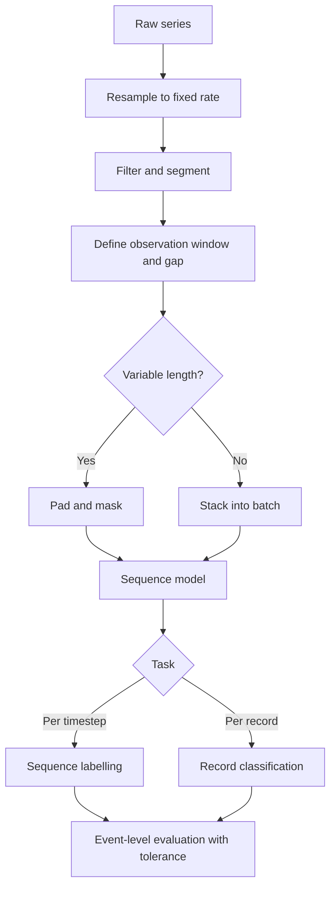

# Sequence Models

> **Module 07 — Deep Learning, Multimodal Models, and LLMs**
> Topic 04 of 11
> Estimated study time: 4 hours
> Prerequisites: Topics 01 to 03
> Version 2026.3

## 1. Why this topic exists

Most clinical data arrives in order. An electrocardiogram (ECG) is a voltage sampled hundreds of
times per second; a vital-sign monitor produces a value every minute; a discharge summary is a
sequence of words; a claims history is a sequence of encounters. The order carries information that
a bag-of-features model discards. A heart rate that rises over six hours means something different
from the same average heart rate that is flat. A note that says "no chest pain" means the opposite of
one that says "chest pain", and the difference is order.

Sequence models are the architectures that consume order explicitly. Three families matter in
practice: recurrent neural networks (RNNs), which carry a hidden state from step to step; temporal
convolutional networks (TCNs), which apply causal convolutions over time; and attention-based models,
which relate every position to every other and are treated in Topic 05. Each makes a different
trade among memory, parallelism, receptive field, and latency.

The industry problem has four faces.

**Temporal leakage.** A model that predicts deterioration at hour 6 must not see data from hour 7. In
a retrospective table, the features are often aggregated over the whole admission, which means the
label window and the feature window overlap. The model learns from the future and reports an area
under the receiver operating characteristic curve (AUROC) of 0.92 that collapses at deployment. The
leak is not in the architecture; it is in the window definition, and it is the most common failure in
clinical sequence work.

**Irregular sampling.** A monitor samples every minute when the patient is stable and every fifteen
seconds when alarms fire. A laboratory test is ordered when the clinician is worried, which means the
test's presence is itself informative. A model that assumes a regular grid must impute, and the
imputation policy becomes part of the model.

**Scale mismatch.** An ECG at 200 hertz and an ECG at 250 hertz describe the same physiology at
different sample counts. A convolution kernel of width 5 covers 25 milliseconds at 200 hertz and 20
milliseconds at 250 hertz. A model trained at one rate and applied at the other sees a different
signal unless the input is resampled. This is the sequence analogue of the imaging spacing problem,
and it fails the same silent way.

**Streaming latency.** A batch model can see the whole record. A deployed monitor must produce an
answer within a fixed delay, using only past samples. A model with a receptive field of 40 seconds
cannot answer a question about the last 5 seconds without a 40-second delay, and a bidirectional
model cannot answer at all until the record ends. The latency budget constrains the architecture
before any accuracy comparison.

This topic teaches the sequence pipeline from window definition to streaming evaluation. It treats
RNNs as the historical baseline and the conceptual model for state, TCNs as the parallelisable
alternative with an explicit receptive field, and attention as a preview of Topic 05. It emphasizes
the three failure modes that are specific to sequences: leakage across the prediction time,
receptive field that is shorter than the clinical event, and train-serving skew in resampling.

> **Note:** "Sequence" here means an ordered series with a time or position index. It includes
> text, but tokenization is treated in Topic 07; this topic covers the sequence mechanics that text
> and signals share.

## 2. Learning outcomes

By the end of this topic you can:

1. **Define** an observation window and a prediction time for a clinical sequence task, and **prove**
   that no feature crosses the prediction time.
2. **Compute** the receptive field of a stack of dilated causal convolutions and **compare** it with
   the duration of the clinical event.
3. **Compute** the parameter count and floating-point operations (FLOPs) of an RNN, a gated recurrent
   unit (GRU), a long short-term memory (LSTM) layer, and a TCN block.
4. **Choose** among RNN, TCN, and attention for a stated latency, length, and data-size regime.
5. **Handle** variable-length sequences with padding and masking, and **detect** the bugs that
   padding introduces in the loss and in batch normalisation.
6. **Resample** a signal to a fixed rate and **state** the interpolation, anti-aliasing, and
   normalisation choices.
7. **Evaluate** an event-detection model with a tolerance window, and **distinguish** event-level
   sensitivity from sample-level accuracy.
8. **Test** streaming and batch inference for parity, and **diagnose** train-serving skew.

Outcomes 2, 3, and 5 are computational. Outcomes 1, 4, and 6 are design outcomes assessed by rubric.
Outcome 8 is assessed in the deployment exercise.

The order is deliberate. A learner who cannot state the prediction time cannot design the window,
and a learner who cannot compute the receptive field cannot choose the depth. The architecture
comparison in outcome 4 comes last because it is the least consequential decision and the easiest to
make once the temporal constraints are fixed.

That ordering is also the order of the interview questions at the end of the topic.

## 3. The core mental model

A sequence model is a function from a variable-length series to a fixed-size output. The three
families differ in how they summarise the series.

```text
  Recurrent: state carries forward, one step at a time

    x1 -> [h1] -> x2 -> [h2] -> x3 -> [h3] -> ... -> [hT] -> output
           |          |          |                  |
           +----------+----------+------------------+   (state is the memory)

  Temporal convolution: each output sees a fixed window, computed in parallel

    x1 x2 x3 x4 x5 x6 x7 x8
     \___|___/
        \_______|_______/
                \_______________|_______________/
        dilation 1     dilation 2      dilation 4

  Attention: each output sees all positions, weighted by similarity

    x1 x2 x3 x4
     \  \  \  \
      [ weighted sum over all positions ] -> output at each position
```

The recurrent model has a theoretical memory of arbitrary length and a practical memory limited by
the gradient. The convolutional model has an explicit receptive field that grows with depth and
dilation, and it computes all positions in parallel. The attention model has a receptive field equal
to the whole context and a cost that grows quadratically with length.

The second mental model is the receptive field over time. For a causal convolution with kernel size
`k` and dilation `d`, one layer adds `(k-1) * d` samples to the receptive field. A stack with
dilations `1, 2, 4, ..., 2^(n-1)` and two convolutions per level has receptive field
`1 + 2 * (k-1) * (2^n - 1)`. The exponent is why dilation is efficient: ten levels of kernel 3 cover
4,093 samples, which is 20.5 seconds at 200 hertz, with only 20 convolutional layers.

```text
  receptive field of a dilated TCN (k=3, two convs per level, base 200 Hz)

  levels   dilations        rf (samples)   rf (seconds)
    4      1..8                  61            0.30
    6      1..32                253            1.26
    8      1..128             1,021            5.11
   10      1..512             4,093           20.46
   11      1..1024            8,189           40.95
```

The table is the design tool. A model that must see a 30-second ECG needs a receptive field of at
least 6,000 samples at 200 hertz, which requires 11 levels, not 8. A model that must see a 5-second
window needs 8 levels. Choosing the depth before choosing the receptive field is backwards.

The third mental model is the distinction between the observation window and the prediction time.

```text
  time --->

  [-------- observation window --------][ gap ][-- prediction window --]
   t0                              t_pred     t_pred+30d

  Features may use only samples before t_pred.
  The label is defined by events in the prediction window.
  A gap prevents tests ordered near t_pred from leaking the outcome.
```

The gap is not optional. A laboratory test ordered at `t_pred - 1 hour` may already reflect the
deterioration that the label records at `t_pred + 6 hours`. The model then learns from a proxy of
the outcome, and the reported performance is optimistic. A gap of one to six hours is common in
deterioration models; the correct gap is the time it takes for the outcome to become detectable,
which is a clinical judgement that must be documented.

The fourth mental model is batching with masks. A batch of variable-length sequences is padded to the
longest sequence, and the padding must be excluded from the loss, from the state update, and from any
normalisation. A model that averages a masked loss over the padded length instead of the true length
learns to predict the padding token, and a model that lets the state update on padding carries
fictitious information forward.



The diagram shows where the two most common bugs live: box D, where leakage is introduced, and box F,
where masking is forgotten. Neither is visible in the loss curve, and both produce a model that looks
good and fails.

The fifth mental model is the latency budget, which is a property of the deployment rather than the
model. A monitor that must alarm within 5 seconds can use at most 5 seconds of context, whatever the
architecture. A model with a 40-second receptive field can produce an output every second, but that
output describes the last 40 seconds, not the last 5. The distinction between update rate and
context length is the one that clinicians notice first: an alarm that fires 40 seconds after the
event is a different product from one that fires 5 seconds after it, even if both are accurate.

The latency budget therefore constrains the architecture in a way that accuracy comparisons do not
capture. A bidirectional model cannot meet any streaming budget. A TCN with a long receptive field
meets the budget only if the application tolerates the delay. An RNN meets it with a small state but
may not learn the long dependency. The choice is a joint decision over accuracy, delay, and memory,
and a report that gives only the first is incomplete.

## 4. Definitions and vocabulary

| Term | Definition | Common misuse | Unit or convention |
|---|---|---|---|
| Sequence | Ordered series indexed by time or position | Treating order as irrelevant | Index |
| Timestep | One position in the sequence | Confusing with a wall-clock second | Index |
| Sampling rate | Samples per second | Assuming a common rate | Hertz |
| Nyquist frequency | Half the sampling rate | Ignoring aliasing | Hertz |
| Aliasing | High frequencies appearing as low ones after downsampling | Downsampling without a filter | Phenomenon |
| Resampling | Changing the sampling rate | Confusing with rescaling amplitude | Operation |
| Anti-aliasing filter | Low-pass filter before downsampling | Omitting it | Filter |
| Observation window | Period from which features are taken | Including the prediction time | Duration |
| Prediction time | The moment the prediction is made | Confusing with the outcome time | Timestamp |
| Prediction window | Period in which the outcome is observed | Overlapping with features | Duration |
| Gap | Buffer between features and outcome | Omitting it | Duration |
| Leakage | Information about the outcome in the features | Calling any correlation leakage | Defect |
| Hidden state | Vector carried between recurrent steps | Confusing with the output | Vector |
| Cell state | LSTM memory vector | Confusing with hidden state | Vector |
| Gate | Learned sigmoid that controls information flow | Assuming it is interpretable | Vector |
| LSTM | Long short-term memory recurrent layer | Assuming it solves all long-range problems | Architecture |
| GRU | Gated recurrent unit | Assuming it is strictly worse than LSTM | Architecture |
| BPTT | Backpropagation through time | Assuming it is unlimited | Algorithm |
| Truncated BPTT | BPTT over a fixed window | Forgetting to carry state | Algorithm |
| Vanishing gradient through time | Gradient decays over long sequences | Confusing with a small rate | Phenomenon |
| Exploding gradient through time | Gradient grows over long sequences | Fixed by clipping alone | Phenomenon |
| Causal convolution | Convolution that uses only past samples | Using a symmetric kernel | Operation |
| Dilated convolution | Convolution with gaps between taps | Confusing with stride | Operation |
| Receptive field | Number of input samples affecting one output | Confusing with kernel size | Samples |
| Temporal convolutional network | Causal dilated convolutional stack | Calling any 1D CNN a TCN | Architecture |
| Padding | Zeros added to reach a fixed length | Ignoring it in the loss | Operation |
| Mask | Boolean selecting real positions | Applying after the loss | Tensor |
| Packed sequence | Variable-length batch without padding | Assuming all frameworks support it | Representation |
| Sequence labelling | Prediction at every timestep | Confusing with record classification | Task |
| Event-level evaluation | Scoring events with a tolerance window | Scoring samples only | Evaluation |
| Tolerance window | Allowed time offset for a match | Setting it without clinical input | Duration |
| Streaming | Inference on arriving samples | Confusing with batch | Mode |
| Bidirectional | Model that reads forward and backward | Using it in streaming | Architecture |
| Stateful inference | Carrying hidden state across chunks | Resetting state per chunk | Mode |
| Train-serving skew | Different preprocessing in training and serving | Treating as a bug in the model | Defect |
| Class imbalance over time | Positive events rare in time | Reporting accuracy | Ratio |

> **Note:** A "sequence model" in this topic always has a defined prediction time. A model without
> one cannot be deployed, because it cannot say when its output is valid.

## 5. The mechanics, step by step

This section is a fifteen-step procedure from a raw series to a streaming-evaluated model. Steps 1 to
5 define the temporal problem. Steps 6 to 10 build the architecture and the batch. Steps 11 to 13
train. Steps 14 and 15 evaluate and deploy.

### Step 1. Define the prediction time and the observation window

**Input:** the clinical action and the data timestamps.

**Output:** a written definition of `t_pred`, the observation window, the gap, and the prediction
window.

**Rationale:** Every downstream choice depends on this definition. A model that predicts sepsis at
admission uses a different window from one that predicts deterioration during an admission. The
definition must be in clock time, not in row index, and it must be applied to every record
identically.

**Branch point:** if the clinical action is continuous (a monitor alarm), the prediction time is
every timestep and the model is a sequence labeller. If the action is discrete (a discharge
planning decision), the prediction time is a single moment per admission and the model is a record
classifier.

### Step 2. Fix the sampling rate and resample

**Input:** the raw series with its native rate.

**Output:** a series on a fixed grid, with the interpolation method recorded.

**Rationale:** Convolution and recurrence learn dynamics at a time scale measured in samples. A
change in rate changes that scale. Resampling to a common rate makes the model's temporal filters
comparable across devices. Downsampling requires a low-pass filter first, or high-frequency content
aliases into the passband and appears as a slow oscillation that was not in the signal.

**Branch point:** if the native rates differ by less than a factor of two and the signal is
narrowband, linear interpolation is adequate. If the signal has sharp features (ECG QRS complexes),
use a polyphase filter or a spline, and validate on a held-out device.

### Step 3. Filter and segment

**Input:** the resampled series.

**Output:** cleaned segments with a defined start and end.

**Rationale:** Baseline wander, powerline interference, and motion artefact dominate raw signals. A
high-pass filter at 0.5 hertz removes wander; a notch at 50 or 60 hertz removes powerline noise. The
filter is part of the model, and its cutoff must be recorded. Segmentation defines the unit that the
model sees, and the segment boundaries must not cut an event in half without a rule.

The filter has a phase. A causal filter delays the signal by a group delay that depends on its order;
a zero-phase filter applied offline cannot be applied causally in streaming. If the training pipeline
uses a zero-phase filter and the serving pipeline uses a causal one, the two see different signals.
The parity test in Step 15 is designed to catch this, and it is the most common source of
train-serving skew in signal models.

| Filter | Removes | Phase | Streaming | Risk |
|---|---|---|---|---|
| High-pass 0.5 Hz, Butterworth order 2 | Baseline wander | Non-linear, causal | Yes | Group delay |
| High-pass 0.5 Hz, zero-phase | Baseline wander | Zero | No | Cannot stream |
| Notch 50 or 60 Hz | Powerline | Non-linear | Yes | Ringing at edges |
| Low-pass 40 Hz | Muscle noise | Non-linear | Yes | Blunts QRS |
| Median filter, 5 samples | Impulse noise | Zero | Yes with buffer | Distorts sharp peaks |

The segmentation rule must also define what happens at the boundary. An event that starts at second
29 of a 30-second window is either included with a partial window or excluded. The two choices
produce different labels, and the rule must be identical at training and at evaluation.

### Step 4. Handle missingness and irregular sampling

**Input:** the series with gaps.

**Output:** a representation with an explicit missingness policy.

**Rationale:** A monitor that drops a lead for ten minutes produces a gap, not a zero. A laboratory
value that is absent because it was not ordered is missing not at random, and its absence is
informative. The policy choices are forward-fill with a decay, last-observation-carried-forward with
a missing indicator, interpolation with a mask, or a model that accepts time deltas. Each produces a
different input distribution, and the choice must be stated.

### Step 5. Define the label alignment

**Input:** the outcome definition and the event timestamps.

**Output:** a label per prediction time, with the tolerance and the censoring rule.

**Rationale:** An event that occurs at `t_pred + 2 hours` is a positive for a six-hour prediction
window and a negative for a one-hour window. The label is a function of the window, not a property
of the patient. Censoring matters: a patient discharged before the window ends has an unknown
outcome, and treating the discharge as a negative biases the model.

### Step 6. Choose the architecture family

**Input:** sequence length, latency budget, data size, and whether the model must stream.

**Output:** a family and a justification.

**Rationale:** The families have different strengths. RNNs are parameter-efficient and natural for
streaming, but they are sequential and slow to train. TCNs are parallel and have an explicit receptive
field, but their memory is bounded. Attention has the largest receptive field and the best transfer
from pretraining, but its cost is quadratic and its data appetite is large.

| Condition | RNN or LSTM | TCN | Attention |
|---|---|---|---|
| Must stream with low latency | Preferred | Works with a cache | Possible with a cache |
| Sequence length under 1,000 | Works | Preferred | Works |
| Sequence length over 10,000 | Slow | Preferred with dilation | Expensive |
| Small dataset (under 5,000 records) | Works | Preferred | Data hungry |
| Needs long-range dependencies | Limited | Explicit field | Preferred |
| Must run on a microcontroller | Possible | Possible | Unlikely |
| Needs bidirectional context | Works offline | Works offline | Preferred |
| Transfer from a pretrained model | Rare | Rare | Preferred |

### Step 7. Set the receptive field to the clinical event

**Input:** the duration of the event and the sampling rate.

**Output:** a depth and dilation schedule whose receptive field covers the event.

**Rationale:** A model whose receptive field is shorter than the event cannot see the whole event.
For an ECG rhythm that lasts 20 seconds at 200 hertz, the receptive field must exceed 4,000 samples.
A stack of eight dilated levels covers 1,021 samples, which is 5.1 seconds and insufficient. The
depth is determined by the event, not by the compute budget, and the budget is then checked against
the depth.

### Step 8. Handle variable length with padding and masking

**Input:** a batch of sequences of different lengths.

**Output:** a padded tensor and a boolean mask.

**Rationale:** Padding is a convenience for the hardware, not information for the model. Every
operation that aggregates over time must respect the mask: the loss, the pooling, the attention
weights, and any normalisation. A recurrent model must not update its state on padding, and a
convolutional model must not let padding bleed into real positions through a symmetric kernel.

**Branch point:** if the framework supports packed sequences, use them; they avoid the mask entirely
for recurrent models. If the model uses batch normalisation over time, padding biases the statistics,
and layer normalisation is safer.

### Step 9. Choose the loss and the aggregation

**Input:** the task type and the label distribution.

**Output:** a loss and a reduction rule.

**Rationale:** Record classification uses cross-entropy over records. Sequence labelling uses
cross-entropy over timesteps, and the reduction must be over real timesteps, not padded ones. Event
detection often uses a weighted loss because positives are rare in time; a focal loss or a
class-weighted cross-entropy is common. The aggregation from timestep scores to an event decision is
a separate choice, usually a threshold on a smoothed score with a minimum duration.

### Step 10. Decide the training regime for long sequences

**Input:** the sequence length and the memory budget.

**Output:** full backpropagation, truncated backpropagation, or windowed training.

**Rationale:** Backpropagation through time stores every intermediate state, so memory grows with
sequence length. Truncated backpropagation limits the window and carries the state forward, which
reduces memory at the cost of a biased gradient. Windowed training samples fixed-length windows and
treats each as an independent example, which is simple but loses long-range state.

### Step 11. Monitor gradient flow through time

**Input:** the gradient norm at each timestep or layer.

**Output:** a diagnosis of vanishing or exploding gradients.

**Rationale:** A recurrent network multiplies the same Jacobian at every step. If its spectral radius
is below one, the gradient decays exponentially with the number of steps; if above one, it grows.
The signature is a gradient norm that falls or rises with sequence position. Clipping bounds the
explosion but does not fix the decay; gating, layer normalisation, or a shorter window addresses the
decay.

**Branch point:** if the gradient norm at the first timestep is below one percent of the norm at the
last, the model cannot learn long-range dependencies. Shorten the window, add a gated architecture,
or switch to a convolutional or attention model with an explicit long-range path.

### Step 12. Train and select on event-level validation

**Input:** the training protocol from Topic 02.

**Output:** a selected checkpoint and a validation curve.

**Rationale:** The validation metric must match the deployment decision. A model selected on
sample-level accuracy will favour a model that is correct on the majority class at every timestep,
which is not the same as detecting events. Select on event-level sensitivity at a fixed false-alarm
rate, or on a metric that combines both.

### Step 13. Calibrate the score

**Input:** the validation scores and outcomes.

**Output:** a calibration curve and, if needed, a recalibration map.

**Rationale:** A score used as a probability must be calibrated. A recurrent model trained with
class weighting is often miscalibrated because the weights change the prior. The calibration must be
fit on validation data and tested on test data, not fit on test.

### Step 14. Evaluate at the event level with a tolerance

**Input:** the predictions and the reference events.

**Output:** sensitivity, false alarms per record, and time-to-detection.

**Rationale:** A sample-level metric credits a model that detects the event one sample late and
penalises one that detects it one sample early. A tolerance window, usually a few seconds for a
rhythm and a few hours for deterioration, matches the clinical use. The false-alarm rate must be
reported per unit time, because a monitor that alarms once per record is usable and one that alarms
once per minute is not.

### Step 15. Test streaming and batch parity

**Input:** the batch model and the streaming implementation.

**Output:** a parity report on the same records.

**Rationale:** Streaming inference carries state across chunks, applies the filter incrementally, and
may use a different resampling path. Each difference is a source of skew. The test is to run the same
record through both paths and compare the outputs within tolerance. A mismatch above tolerance means
the deployed model is not the validated model.

The failure modes specific to sequences are worth naming.

**Vanishing gradient through time.** The gradient at early timesteps decays to zero, so the model
cannot learn dependencies longer than a few dozen steps. The signature is a per-timestep gradient
norm that falls exponentially. Gating helps; a shorter window helps more.

**Exploding gradient through time.** The gradient grows with sequence length and the loss becomes
not-a-number. Clipping is necessary but not sufficient; the cause is a Jacobian with spectral radius
above one, often from an unscaled input or a high rate.

**Receptive field shortfall.** The model's field is shorter than the event, so it cannot see the
whole pattern. The signature is a model that detects short events and misses long ones, with no
error in the loss. The fix is depth or dilation, not more data.

**Label window leakage.** Features include information from after the prediction time. The signature
is an AUROC far above the clinical literature and a sharp drop at deployment. The test is to rebuild
the features with a hard cutoff and compare.

**Train-serving skew.** The training pipeline resamples with one library and the serving pipeline
with another, or applies a filter with a different phase. The signature is a model that performs on
curated records and not on live ones. The test is streaming-batch parity.

**Tokenization drift.** For text sequences, a change in the tokenizer vocabulary or the
normalisation rules changes the token sequence for the same string. The signature is a model that
performs differently after a library upgrade. The test is a golden set of strings with expected
token ids.

**Context overflow.** For attention models, a sequence longer than the context window is truncated or
chunked, and the truncation removes the evidence. The signature is a model that fails on long records
only. The fix is chunking with aggregation or a longer-context model, and the choice must be
evaluated.

The seven modes are not equally likely. Label window leakage and patient-level leakage account for
most of the inflated results in the clinical sequence literature, because both are invisible in the
loss and easy to introduce in a feature-engineering step. Receptive field shortfall is the most
common architectural error. Train-serving skew is the most common deployment error. A team that
tests for these three before reporting a result avoids the majority of the failures.

### Sequence length, memory, and the training window

The length of the sequence determines the memory of the training step, and the memory determines the
batch size, which in turn determines the optimisation. The relationship is not linear for recurrent
models and is linear for convolutional ones.

| Model | Activation memory scales with | Batch size at fixed memory | Consequence |
|---|---|---|---|
| LSTM, full BPTT | Sequence length times hidden width | Falls linearly with length | Long records force batch 1 |
| LSTM, truncated | Window length times hidden width | Constant in record length | State must be carried |
| TCN, full record | Sequence length times channels times layers | Falls linearly with length | Long records force small batch |
| TCN, windowed | Window length | Constant in record length | Boundary effects |
| Attention | Length squared times heads | Falls quadratically with length | Long records infeasible |

For a 48-hour record at 200 hertz, full BPTT is impossible: the record has 34.56 million samples.
The practical choices are windowed training, truncated BPTT with a state carry, or a convolutional
model on windows. Each changes what the model can learn, and the choice must be reported with the
architecture.

### Text as a sequence

A clinical note is a sequence of tokens, and the mechanics are the same: a fixed maximum length, a
padding and mask policy, and a defined unit of prediction. The differences are the tokenizer and the
length distribution. A note may be 200 tokens or 20,000; a discharge summary is longer than a
radiology report; a pathology report is longer than both. The truncation policy is a modelling
decision, not a preprocessing detail, because the information that determines the label is often at
the end of the note.

| Text problem | Typical length | Truncation risk | Mitigation |
|---|---|---|---|
| Radiology report | 100 to 600 tokens | Low | Head plus tail |
| Discharge summary | 1,000 to 6,000 tokens | Moderate | Section-aware chunking |
| Nursing note stream | 10,000+ tokens per admission | High | Daily windows with aggregation |
| Pathology report | 500 to 3,000 tokens | Moderate | Section-aware chunking |
| Claims sequence | Hundreds of events | Low | Event-level embedding |

The rule is that the truncation must preserve the section that contains the evidence. A model that
truncates the impression section of a radiology report has removed the sentence that states the
diagnosis, and no amount of architecture will recover it.

## 6. Worked example

A cardiology group is building a detector for atrial fibrillation (AF) on a single-lead ambulatory
ECG. The device records at 200 hertz. Each record is 30 seconds, which is 6,000 samples. The training
set has 18,000 records from 9,400 patients; the prevalence of AF is 12 percent. The group proposes a
temporal convolutional network with eight residual blocks, kernel size 3, dilations 1 to 128, and 64
channels.

This section computes the receptive field, the parameter count, the compute, the inference budget,
two diagnostics, and one sensitivity.

### Step 1. Receptive field

With two causal convolutions per block, kernel size `k = 3`, and dilations `1, 2, 4, ..., 128`, the
receptive field is:

```text
rf = 1 + 2 * (k - 1) * (1 + 2 + 4 + ... + 128)
   = 1 + 2 * 2 * 255
   = 1 + 1,020
   = 1,021 samples
```

At 200 hertz, 1,021 samples is `1,021 / 200 = 5.1 seconds`. The record is 30 seconds. The proposed
network cannot see the whole record; it can see 5.1 seconds at the deepest layer. For a rhythm that
persists for 30 seconds, that is enough to detect the rhythm locally, because the pattern repeats.
For a paroxysmal event that occupies only the first 5 seconds of a 30-second record, the model's
global pooling can still see it through the early layers at the record edges, but the deepest
features at the centre of the record cannot.

The distinction matters. A TCN with global average pooling over time can detect a local event
anywhere in the record, because the pooled representation includes every position. It cannot
integrate a pattern that spans more than 5.1 seconds at the deepest level. If the clinical question
is "is there any AF in this 30-second strip", 5.1 seconds is adequate. If the question is "what
fraction of the 30 seconds is AF", the model needs a field closer to the record length, which
requires 11 levels and a receptive field of 8,189 samples, or 40.9 seconds.

### Step 2. Parameter count

Each block has two 1D convolutions with 64 input and 64 output channels and kernel 3. The parameter
count per convolution is `3 * 64 * 64 + 64 = 12,288 + 64 = 12,352`. Two per block gives 24,704, and
eight blocks give:

```text
8 * 24,704 = 197,632 parameters
```

The input projection from one channel to 64 adds `3 * 1 * 64 + 64 = 256`. Each residual block needs a
1 by 1 convolution when the channel count changes; with a constant 64 channels, the identity path is
parameter-free. The output layer for 12 classes adds `64 * 12 + 12 = 780`.

```text
input projection:      256
8 residual blocks: 197,632
output layer:          780
total:             198,668 parameters
```

At four bytes per parameter, the weights are `198,668 * 4 = 794,672` bytes, or 776 kibibytes. The
model is small enough to run on a wearable device, which is the design goal.

### Step 3. Compute per record

Each 64-to-64 convolution over 6,000 samples costs:

```text
2 * 3 * 64 * 64 * 6,000 = 147,456,000 FLOPs = 147.5 MFLOPs
```

Eight blocks with two convolutions each:

```text
8 * 2 * 147.5 = 2,359 MFLOPs = 2.36 GFLOPs
```

The input projection and output layer add `2 * 3 * 1 * 64 * 6,000 = 2.3 MFLOPs` and
`2 * 64 * 12 * 6,000 = 9.2 MFLOPs`, both negligible. A forward pass is about 2.37 GFLOPs per record.

A 48-hour Holter at 200 hertz contains `48 * 3,600 * 200 = 34,560,000` samples, or 5,760
non-overlapping 30-second windows. Inference over the whole recording costs
`5,760 * 2.37 = 13,651 GFLOPs`, or 13.7 terafLOPs. On a device sustaining 10 teraflops, that is 1.4
seconds of arithmetic; on a microcontroller at 1 gigaflop, it is 3.8 hours. The same model is
feasible on one device and impossible on another, and the arithmetic makes the difference explicit.

### Step 4. Training compute

Training costs about three times the forward pass, or `3 * 2.37 = 7.1 GFLOPs` per record. For 18,000
records and 30 epochs:

```text
18,000 * 30 * 7.1e9 = 3.83e15 FLOPs = 3.83 petafLOPs
```

At 100 effective teraflops, 38 seconds of arithmetic. The wall-clock time is dominated by signal
loading, filtering, and augmentation, not by the convolutions. This is the opposite of the 3D
segmentation case in Topic 03, and it is why sequence models are often trained on central processing
units for small cohorts.

### Step 5. Diagnostic one: temporal leakage from overlapping windows

The group first builds the dataset by extracting every 30-second window with a 15-second stride,
which gives two windows per record with 50 percent overlap. The label for each window is whether AF
is present anywhere in the record. The validation AUROC is 0.97, which is higher than the published
range for single-lead AF detection.

The leak is that overlapping windows from the same record appear in both training and validation,
and the label is record-level. A model can memorise the record's noise pattern and retrieve the
label from the overlapping segment. The diagnostic is to rebuild the split by patient and by record,
with no window from a record in more than one split, and to recompute the AUROC. In this case the
AUROC falls to 0.91, which is plausible.

The general rule: the unit of the split must be the unit of independence, and the unit of
independence for a windowed record is the record, not the window.

### Step 6. Diagnostic two: sampling-rate mismatch

The device firmware is updated and a subset of devices now record at 250 hertz. The model expects
200 hertz. If the signal is fed without resampling, the model sees a record that is 20 percent
longer in samples for the same wall-clock duration, and every temporal filter is compressed by a
factor of 1.25. The signature is a drop in sensitivity on the affected devices with no change in the
signal quality metrics.

The diagnostic is to check the header sampling rate on every record and to resample to 200 hertz
before the model. A golden test with a synthetic 5-hertz sine wave should produce the same predicted
spectrum at both input rates after resampling. A model that fails this test has a train-serving skew
that will not appear in any retrospective evaluation.

### Step 7. Vary one assumption: 30 seconds to 60 seconds

Suppose the clinical team wants 60-second records to improve the detection of paroxysmal events.

```text
samples per record: 60 * 200 = 12,000, up from 6,000
forward compute per record: 2.37 * 2 = 4.74 GFLOPs
receptive field needed for the whole record: 12,000 samples
levels needed at k=3, two convs per level: 1 + 4*(2^n - 1) >= 12,000
  4*(2^n - 1) >= 11,999
  2^n >= 3,000.75
  n = 12, rf = 1 + 4*4,095 = 16,381 samples = 81.9 seconds
```

Doubling the record doubles the compute and requires one more dilation level to cover the full
duration. The conclusion changes in a specific way: the 8-level model that was adequate for a
30-second strip is no longer adequate for a 60-second strip if the question requires integration
over the whole record. The team must either add levels, which increases parameters and compute, or
keep the 30-second model and aggregate its outputs over the longer record. The second option is
cheaper and preserves the validated receptive field, and it is the one to test first.

### Step 8. The false-alarm arithmetic

Sensitivity alone does not determine usability. A detector that alarms at least once in every
30-second window has a sensitivity of 1.0 and is useless. If the model produces a false alarm in 5
percent of negative windows, and a 48-hour recording contains 5,760 windows, the expected number of
false alarms is `0.05 * 5,760 * (1 - 0.12) = 253` per recording. At one alarm per 11 minutes, the
clinician will disable the device. The design target is usually a fixed false-alarm rate per hour,
and the sensitivity is reported at that rate. The arithmetic belongs in the protocol, not in the
post-hoc discussion.

### Step 9. What the arithmetic does not establish

The parameter count, the FLOPs, and the receptive field describe the model's capacity and cost. They
do not establish that the model detects AF better than a cardiologist, that it generalises to a
different patch, or that it is safe for a wearable. Those claims require a prospective or
independent evaluation with adjudicated labels, a per-device analysis, and a false-alarm rate
measured in the intended population. The arithmetic is the precondition for spending money on that
evaluation, not a substitute for it.

## 7. Code, query, or calculation

The code below implements an LSTM cell forward pass in pure Python, computes the parameter counts of
an LSTM and a GRU layer, and tabulates the receptive field of a dilated TCN. It is the arithmetic
that a team needs before choosing a sequence architecture.

**Assumptions.** The LSTM uses the gate order input, forget, cell candidate, output, which is the
PyTorch convention. The input dimension is 12 and the hidden width is 16, matching a small vital-sign
model. The TCN has kernel 3, two convolutions per dilation level, and a sampling rate of 200 hertz.

```python
import math

def sigmoid(x):
    if x >= 0:
        return 1 / (1 + math.exp(-x))
    return math.exp(x) / (1 + math.exp(x))

def lstm_cell(x, h, c, W, b, H):
    D = len(x)
    z = []
    for j in range(4 * H):
        s = b[j]
        row = W[j]
        for k in range(D):
            s += row[k] * x[k]
        for k in range(H):
            s += row[D + k] * h[k]
        z.append(s)
    i = [sigmoid(v) for v in z[:H]]
    f = [sigmoid(v) for v in z[H:2 * H]]
    g = [math.tanh(v) for v in z[2 * H:3 * H]]
    o = [sigmoid(v) for v in z[3 * H:4 * H]]
    c2 = [f[k] * c[k] + i[k] * g[k] for k in range(H)]
    h2 = [o[k] * math.tanh(c2[k]) for k in range(H)]
    return h2, c2

D, H = 12, 16
W = [[0.01 * (((j * 7 + k * 3) % 11) - 5) for k in range(D + H)] for j in range(4 * H)]
b = [0.0] * (4 * H)
h, c = [0.0] * H, [0.0] * H
x = [0.1 * (k + 1) for k in range(D)]

for t in range(3):
    h, c = lstm_cell(x, h, c, W, b, H)

print("h[0:3] after 3 steps:", [round(v, 6) for v in h[:3]])
print("c[0:3] after 3 steps:", [round(v, 6) for v in c[:3]])

print("LSTM params one layer:", 4 * (H * (D + H) + H))
print("GRU params one layer:", 3 * (H * (D + H) + H))

for n in [4, 6, 8, 10, 11]:
    rf = 1 + 2 * (3 - 1) * (2 ** n - 1)
    print(f"blocks {n}: rf {rf} samples, {rf / 200:.2f} s at 200 Hz")
```

**Observed output:**

```text
h[0:3] after 3 steps: [-0.014292, -0.007267, -0.004812]
c[0:3] after 3 steps: [-0.028872, -0.014481, -0.009507]
LSTM params one layer: 1856
GRU params one layer: 1392
blocks 4: rf 61 samples, 0.30 s at 200 Hz
blocks 6: rf 253 samples, 1.26 s at 200 Hz
blocks 8: rf 1021 samples, 5.11 s at 200 Hz
blocks 10: rf 4093 samples, 20.46 s at 200 Hz
blocks 11: rf 8189 samples, 40.95 s at 200 Hz
```

The LSTM cell has `4 * (H * (D + H) + H)` parameters: four gates, each with a `D` by `H` input
matrix, an `H` by `H` recurrent matrix, and an `H`-vector bias. For `D = 12` and `H = 16`, that is
`4 * (16 * 28 + 16) = 4 * 464 = 1,856`. The GRU has three gates and therefore
`3 * 464 = 1,392`, which is 25 percent fewer parameters for a similar capability. At this scale the
difference is trivial; at `H = 512` it is the difference between 1.05 million and 0.79 million
parameters per layer.

The receptive field table is the design constraint. A 30-second record at 200 hertz needs 6,000
samples of coverage. Eight blocks give 1,021, which is 17 percent of the record; ten blocks give
4,093, which is 68 percent; eleven give 8,189, which covers the record with margin. The table makes
the choice explicit rather than a matter of taste.

The second block computes the inference budget for a 48-hour recording.

```python
windows = 48 * 3600 // 30
flops_per_window = 2.37e9
total = windows * flops_per_window
print("windows:", windows)
print("TFLOPs:", round(total / 1e12, 1))
print("seconds at 10 TFLOPS:", round(total / 10e12, 1))
print("hours at 1 GFLOPS:", round(total / 1e9 / 3600, 2))
```

**Observed output:**

```text
windows: 5760
TFLOPs: 13.7
seconds at 10 TFLOPS: 1.4
hours at 1 GFLOPS: 3.8
```

The same model is a 1.4-second job on a small accelerator and a 3.8-hour job on a microcontroller.
The arithmetic does not say which device is appropriate; it says that the device choice is a
first-order design decision, not an implementation detail.

The third block demonstrates masked mean pooling, which is the operation most often implemented
incorrectly in a padded batch.

```python
def masked_mean(batch, mask):
    out = []
    for row, m in zip(batch, mask):
        s = sum(v * mi for v, mi in zip(row, m))
        n = sum(m)
        out.append(s / n if n else 0.0)
    return out

batch = [[1.0, 2.0, 3.0, 0.0, 0.0],
         [4.0, 0.0, 0.0, 0.0, 0.0],
         [5.0, 6.0, 7.0, 8.0, 9.0]]
mask = [[1, 1, 1, 0, 0], [1, 0, 0, 0, 0], [1, 1, 1, 1, 1]]

print("masked:", masked_mean(batch, mask))
print("unmasked:", [sum(r) / len(r) for r in batch])
print("per-sequence:", [sum(r[:sum(m)]) / sum(m) for r, m in zip(batch, mask)])

for mean_len, max_len in [(24, 64), (40, 64), (60, 64)]:
    print(f"mean {mean_len} max {max_len}: waste {(1 - mean_len / max_len) * 100:.1f}%")
```

**Observed output:**

```text
masked: [2.0, 4.0, 7.0]
unmasked: [1.2, 0.8, 7.0]
per-sequence: [2.0, 4.0, 7.0]
mean 24 max 64: waste 62.5%
mean 40 max 64: waste 37.5%
mean 60 max 64: waste 6.2%
```

The unmasked mean is wrong for the first two sequences because it divides by the padded length. The
error is largest for the shortest sequence, which is the general pattern: a model trained with an
unmasked pooled representation learns that short records have systematically lower pooled values, and
it can use record length as a feature. If record length correlates with the outcome, the model learns
a shortcut that is not in the clinical signal.

The last three lines quantify padding waste. Sorting batches by length or using packed sequences
reduces the waste, and the arithmetic shows when it is worth the engineering effort: at a mean length
of 24 against a maximum of 64, 62.5 percent of the compute is spent on padding.

## 8. Data, standards, and regulatory context

**ECG standards.** The Association for the Advancement of Medical Instrumentation (AAMI) publishes
EC57, "Testing and reporting performance results of cardiac rhythm and ST segment measurement
algorithms", which defines the test databases, the annotation conventions, and the reporting
requirements for arrhythmia detectors. A model evaluated without the EC57 conventions is difficult to
compare with a regulated device. The standard is not a law; it is the vocabulary that a reviewer and
a competitor both use.

**Device regulation.** An ECG analysis algorithm that informs a diagnosis is device software. In the
United States, the FDA's premarket pathways apply, and the January 2025 draft guidance on AI-enabled
device software functions (docket FDA-2024-D-4488) describes the submission content. A change to the
sampling-rate handling or the model weights is a change that must be inside a predetermined change
control plan if the manufacturer intends to make it without a new submission. In the European Union,
Regulation (EU) 2024/1689 classifies clinical decision support as high-risk and requires technical
documentation, data governance, and post-market monitoring.

**Electrical safety and EMC.** IEC 60601 governs the safety of medical electrical equipment, and
IEC 60601-2-25 and 60601-2-27 cover electrocardiographs and monitoring equipment. A model embedded in
a device must not compromise the device's safety certification. This constrains the compute budget
and the failure behaviour: a model that blocks the real-time thread or exhausts memory is a safety
issue, not only a performance issue.

**Data protection.** An ECG with a timestamp and a device identifier is identifiable health data. In
the United States, HIPAA applies; in the European Union, the General Data Protection Regulation
(GDPR) applies. De-identification removes direct identifiers but not the signal itself, which can be
biometric. A model trained on a public ECG corpus has been trained on data whose consent and
licensing terms differ from a hospital's, and the terms must be recorded.

**Reporting.** TRIPOD+AI (BMJ 2024;385:e078378) applies to prediction models, including those built
on sequences. It requires the predictors, the outcome, the sample size, the model, and the
performance to be reported, and it asks for the handling of missing data and the fairness analysis.
A sequence paper that reports AUROC without the window definition, the sampling rate, and the
tolerance for event matching has omitted the information that makes the number interpretable.

| Standard or framework | Status | What it constrains | What it does not |
|---|---|---|---|
| AAMI EC57 | Industry standard | ECG algorithm testing and reporting | Model architecture |
| IEC 60601 | Binding for devices | Electrical safety and EMC | Accuracy |
| FDA device guidance | Binding for devices | Submission and change control | Sampling rate choice |
| EU AI Act | Binding, phased | High-risk obligations | Technical thresholds |
| HIPAA / GDPR | Binding | Identifiable data handling | Model safety |
| TRIPOD+AI | Reporting convention | Study reporting | Study quality |

**Annotation and adjudication.** An algorithm is only as good as the reference it is scored against.
For arrhythmia, the reference is usually a consensus of cardiologists who review each record, because
inter-reader agreement on single-lead rhythm strips is imperfect. The number of readers, their
specialty, the adjudication rule for disagreements, and the blinding procedure are part of the
evaluation, not an appendix. A model compared with one reader is compared with one reader's errors.

**Public ECG corpora.** Several public datasets are used for development: the MIT-BIH Arrhythmia
Database, the PhysioNet/Computing in Cardiology Challenge datasets, and the PTB-XL corpus. Each has
its own annotation conventions, sampling rates, lead configurations, and patient populations. A model
trained on MIT-BIH and evaluated on PTB-XL is a cross-dataset experiment, and the drop in performance
is a measure of domain shift, not of model quality. The dataset choice must be reported with the same
care as the architecture.

| Dataset | Records | Leads | Rate | Annotation source | Known limitation |
|---|---|---:|---:|---|---|
| MIT-BIH Arrhythmia | 48 half-hour | 2 | 360 Hz | Expert beat annotations | Small, old, selected |
| PTB-XL | 21,837 | 12 | 500 Hz | Cardiologist reports | Report-derived labels |
| PhysioNet Challenge 2017 | 8,528 | 1 | 300 Hz | Expert rhythm labels | Short single-lead strips |
| MIMIC-IV-ECG | Large | 12 | 500 Hz | Report-derived | De-identification effects |

The table is a planning aid, not a recommendation. The right dataset is the one whose population,
device, and annotation convention match the intended use. A model for a consumer wearable should be
developed and tested on wearable data, not on a hospital 12-lead corpus.

**Why the window definition is a regulatory object.** A device's intended use states what it detects
and in what population. The window is part of that statement: a detector that reports AF "within a
30-second strip" is a different device from one that reports AF "within a 7-day monitoring period",
even if the model weights are identical. A change to the window changes the sensitivity and the
false-alarm rate, and it is therefore a change to the device.

**The limits of the analogy with images.** An image has a fixed grid and a known geometry. A signal
has a sampling rate, a filter, and a clock that may drift. The extra degrees of freedom are where the
bugs live, and the standards that govern signals are correspondingly more concerned with acquisition
and annotation than with architecture.

The standards constrain the description and the safety envelope. They do not establish that the
model detects the rhythm. That requires an evaluation against adjudicated annotations on a
representative population, with the false-alarm rate reported per unit time.

## 9. Industry practice and case evidence

**Hannun et al. and the 34-layer ECG network.** Hannun, Rajpurkar, and colleagues trained a 34-layer
convolutional network on 91,232 single-lead 30-second ECGs from 53,549 patients recorded by an
ambulatory patch, to classify 12 rhythm classes (Nature Medicine 2019;25:65-69,
doi:10.1038/s41591-018-0268-3). The model was validated against a consensus committee of
board-certified cardiologists on 328 records. The documented result is an average area under the
curve of about 0.97, and a class-weighted set-level F1 of 0.837 against 0.780 for averaged individual
cardiologists. The paper reports that at matched specificity the network's sensitivity exceeded the
average cardiologist's for all 12 classes.

The documented method is a convolutional network, not a recurrent one. The inference for this topic,
which the authors do not state as a general architectural claim, is that a sufficiently deep
one-dimensional convolution can model the temporal structure of a 30-second ECG without recurrence.
The explicit receptive field and the parallelism were sufficient; the sequential state was not
necessary. That is the strongest empirical argument for TCNs over RNNs in signal work.

**Bai, Kolter, and Koltun and the TCN comparison.** Bai et al. compared a generic temporal
convolutional network with LSTMs and GRUs at roughly equal model sizes across several sequence
benchmarks (arXiv:1803.01271, 2018). The documented results include a large advantage on sequential
MNIST and on copy-memory tasks, and a disadvantage on word-level Penn Treebank perplexity, where a
tuned LSTM performed better. The honest reading is that the comparison is benchmark-dependent, not
that one family dominates. The paper's own conclusion is that convolutional architectures should be a
natural starting point, which is a claim about default choice, not about universal superiority.

**The recurrent baseline.** The LSTM was introduced by Hochreiter and Schmidhuber in 1997 to address
the vanishing gradient problem through gating. The GRU was introduced by Cho et al. in 2014 as a
simpler alternative. The documented mechanism is a gated state that can preserve information across
many steps. The practical limitation, documented across the sequence literature, is that the
sequential dependency prevents parallel training and that very long dependencies remain difficult.
The theoretical infinite memory is not achieved in practice, which is the point Bai et al. make with
the copy-memory experiment.

**What practitioners actually do.** In inference from public model cards, regulatory summaries, and
vendor documentation, three patterns recur. First, ambulatory ECG and wearable arrhythmia detectors
are predominantly convolutional, because the signal is short, the compute budget is tight, and the
patterns are local. Second, deterioration and sepsis models on electronic health record time series
are predominantly gradient-boosted trees or recurrent networks on hourly aggregates, because the data
are irregular and the cohort is small. Third, text sequence models have largely moved to
transformer architectures, which are treated in Topics 05 and 07.

**Deterioration models and the leakage record.** The clinical literature on early warning systems
contains several well-documented cases of optimistic performance that did not transport. The common
thread, reported across systematic reviews of the field, is not the architecture but the evaluation:
features aggregated over windows that overlap the outcome, labels defined after the fact, and
single-site development. A model built on hourly aggregates with a six-hour gap and a patient-level
split usually reports a lower AUROC than one built without those controls, and the lower number is
the credible one. This is an inference from the pattern across studies, not a finding from a single
named trial.

**Why signals and text diverge.** Text sequence models have moved to transformers because pretrained
token representations transfer across tasks and the quadratic cost is affordable for notes of a few
thousand tokens. Signal models have not moved as quickly, because the signal is continuous, the
labelled data are smaller, and the compute is often on a device with a tight power budget. The
architectural divergence is a consequence of the constraints, not of fashion.

**What a buyer should ask.** Four questions separate a validated signal model from a demonstration.
What is the sampling rate and how is a different rate handled? What is the observation window and the
gap to the outcome? What is the false-alarm rate per hour at the stated operating point? Was the
evaluation on a device and population different from the training set? A vendor that answers all four
has done the work; a vendor that answers only the first has built a model, not a device.

The evidence does not support the claim that recurrence is obsolete. It supports the claim that
recurrence is one option among three, and that the choice should be made on latency, length, data
size, and the need for long-range integration.

## 10. Failure modes and red flags

Sequence failures are temporal, and temporal failures are hard to see in an aggregate metric. The
table is ordered by the stage at which the failure enters: window definition, data handling,
architecture, training, and deployment. The earliest failures are the most expensive, because they
invalidate the evaluation rather than only the model.

| Failure | Early warning sign | Mechanism | Consequence | Mitigation |
|---|---|---|---|---|
| Prediction-time leakage | AUROC far above literature | Features aggregate past the prediction time | Collapse at deployment | Hard cutoff and gap |
| Overlapping-window leakage | Validation much better than new records | Same record in train and validation | Inflated estimate | Split by record and patient |
| Sampling-rate mismatch | Performance drops on one device | Temporal filters compressed or stretched | Silent error | Resample and assert rate |
| Receptive field shortfall | Detects short events, misses long | Field shorter than the event | Missed events | Add depth or dilation |
| Vanishing gradient through time | Early-timestep norm near zero | Jacobian product below one | No long-range learning | Gating, norm, shorter window |
| Exploding gradient through time | Loss NaN, norm spikes | Jacobian product above one | Run lost | Clipping, lower rate |
| Padding in the loss | Loss falls, predictions odd at edges | Padded positions counted | Biased model | Mask the loss |
| Padding in recurrent state | State drifts on short records | Updates on zeros | Record-length bias | Packed sequences |
| Filter phase mismatch | Streaming differs from batch | Zero-phase versus causal filter | Train-serving skew | Parity test |
| Truncation removes evidence | Long notes fail | Fixed length cuts the impression | Missed diagnoses | Section-aware chunking |
| Event metric without tolerance | Sensitivity looks low | Exact-sample matching | Wrong conclusion | Tolerance window |
| Class imbalance ignored | Model predicts no event | Unweighted loss | Zero sensitivity | Weighted loss, threshold |
| Alarm rate not reported | Sensitivity only | No false-alarm count | Unusable device | Report per hour |
| Tokenizer drift | Output changes after upgrade | Vocabulary or normalisation change | Silent regression | Golden token set |

## 11. Assumptions and limits

The assumptions below are the ones that a sequence model makes about time. Most of them are
invisible in a static dataset and obvious in a deployed stream, which is why they are listed
separately from the general assumptions in Topic 02.

The most consequential is the first: that the sampling rate is constant. A device that changes its
rate mid-record produces a signal that is non-uniformly sampled, and a model trained on a uniform
grid sees a different temporal scale in part of the record. The failure is rare and severe, and the
test is cheap: assert the rate on every record and reject the ones that differ.

| Assumption | Why it is needed | What breaks it | How to test |
|---|---|---|---|
| The sampling rate is constant within a record | Filters and windows assume a grid | Device firmware change | Check headers |
| The event duration is known | Receptive field is sized to it | Variable-duration events | Duration sensitivity analysis |
| The label window matches the clinical claim | The label defines the target | Window chosen for convenience | Clinical review |
| Missingness is not informative | Imputation is ignorable | Tests ordered because of concern | Missingness analysis |
| The record is an independent unit | Splits assume independence | Multiple records per patient | Split by patient |
| The filter is causal at serving | Streaming must match training | Zero-phase filter offline | Parity test |
| The tolerance window is clinically valid | Event matching uses it | Tolerance set arbitrarily | Clinician review |
| The prevalence is stable | Thresholds and calibration depend on it | Referral changes | Monitor prevalence |
| Text truncation preserves evidence | Fixed length is a compromise | Evidence at the end | Section-aware audit |
| The device population matches training | Transport is assumed | New device or firmware | Device-stratified validation |

## 12. Exercises

The exercises move from arithmetic to design to diagnosis. The arithmetic exercises are checkable
against the formulas in Sections 5 and 7. The design exercises are assessed by the criteria stated
with each one, and a design that does not state its prediction time is incomplete regardless of the
architecture.

For the implementation exercise, use a small public signal rather than a synthetic array, because the
padding and masking bugs only appear with real variable-length records.

**Exercise 1 (calculation, 20 minutes).** A signal is sampled at 250 hertz for 20 seconds. Compute
the sample count, the Nyquist frequency, and the receptive field in seconds of a TCN with kernel 3,
two convolutions per level, and six levels. **Deliverable:** the three values. **Criteria:** correct
units, correct formula.

**Exercise 2 (calculation, 25 minutes).** An LSTM layer has input width 20 and hidden width 64.
Compute the parameter count. Compare it with a GRU of the same widths. **Deliverable:** both counts
and the ratio. **Criteria:** correct gate count, correct bias count.

**Exercise 3 (design, 40 minutes).** Design the observation window, gap, and prediction window for a
model that predicts unplanned ICU transfer within 12 hours, using hourly vitals and labs.
**Deliverable:** a timeline diagram and a one-paragraph justification. **Criteria:** no feature
crosses the prediction time, the gap is justified clinically, censoring is addressed.

**Exercise 4 (diagnosis, 35 minutes).** A sepsis model reports AUROC 0.94 in development and 0.71 at
deployment. The features include "lactate max in first 24 hours". Name the most likely cause and the
test that would confirm it. **Deliverable:** a diagnosis and a test plan. **Criteria:** identifies
temporal leakage, proposes a hard-cutoff rebuild.

**Exercise 5 (implementation, 45 minutes).** Implement masked mean pooling over a padded batch and
show that it gives the same result as pooling each sequence separately. **Deliverable:** code and a
numerical check. **Criteria:** padding excluded, result matches within tolerance.

**Exercise 6 (critique, 30 minutes).** Find a clinical sequence-model paper and identify its
sampling rate, window definition, gap, split unit, and event-matching rule. **Deliverable:** a
five-row table with quotations. **Criteria:** accurate quotations, at least one omission identified.

**Exercise 7 (estimation, 30 minutes).** A 48-hour ECG at 200 hertz is analysed with a model costing
2.4 GFLOPs per 30-second window. Compute the windows, the total FLOPs, and the time on a 5-terraflop
device. **Deliverable:** the arithmetic. **Criteria:** correct window count, correct unit conversion.

**Exercise 8 (communication, 25 minutes).** Write 180 words for a cardiologist explaining why the
model needs a false-alarm rate reported per hour, not only a sensitivity. **Deliverable:** the
paragraph. **Criteria:** one worked number, no jargon beyond "sensitivity" and "false alarm".

## 13. Self-check answers

**Answer 1.** Samples: `250 * 20 = 5,000`. Nyquist: `250 / 2 = 125` hertz. Receptive field with six
levels: `1 + 2 * (3-1) * (2^6 - 1) = 1 + 4 * 63 = 253` samples, or `253 / 250 = 1.01` seconds. The
field is much shorter than the 20-second record, which is a design finding, not an arithmetic
detail.

**Answer 2.** LSTM: `4 * (64 * (20 + 64) + 64) = 4 * (5,376 + 64) = 4 * 5,440 = 21,760`. GRU:
`3 * 5,440 = 16,320`. The ratio is `21,760 / 16,320 = 1.33`, so the LSTM has a third more parameters
for the same widths.

**Answer 3.** A strong design uses an observation window ending at `t_pred`, a gap of one to two
hours to avoid tests ordered because of early deterioration, and a 12-hour prediction window starting
at `t_pred`. Features are computed only from timestamps before `t_pred`. Patients discharged or
transferred before the window ends are censored, not labelled negative. The justification names the
clinical action (ICU transfer) and the time needed for the care team to act.

**Answer 4.** The most likely cause is temporal leakage: "lactate max in first 24 hours" includes
measurements after the prediction time for predictions made early in the admission, and lactate is
ordered when the patient is already deteriorating. The confirming test is to rebuild the feature with
a hard cutoff at each prediction time and compare the AUROC. A drop toward the deployment value
confirms the diagnosis.

**Answer 5.** The masked mean is `sum(x * mask) / sum(mask)`, with the denominator clamped to at
least one. For a batch with lengths 3 and 5 padded to 5, the first sequence's pooled value must equal
the mean of its first three positions. A correct check computes both and asserts equality within
`1e-6`. Using `mean(x)` without the mask gives a different value and is the bug the exercise is
designed to expose.

**Answer 6.** A strong answer reports the sampling rate, the window and gap, the split unit, and the
event-matching rule. Most papers report the sampling rate and the window, and omit the gap and the
matching rule, which are the two that determine whether the reported sensitivity is comparable.

**Answer 7.** Windows: `48 * 3600 / 30 = 5,760`. FLOPs: `5,760 * 2.4e9 = 1.382e13`, or 13.8
terafLOPs. At 5 teraflops: `1.382e13 / 5e12 = 2.76` seconds.

**Answer 8.** Rubric: the paragraph explains that a sensitivity of 0.95 with an alarm every 11
minutes is unusable, that the false-alarm rate per hour determines whether the clinician keeps the
device on, and that the two numbers must be reported together at a stated operating point. It
includes one worked number, such as 253 false alarms in 48 hours at a 5 percent rate. Full credit
requires the number and a recommendation.

## 14. Interview questions

The questions below test whether a candidate has deployed a sequence model, not only trained one.
Each strong answer names a constraint and a number; each weak answer reveals a missing concept rather
than a missing fact.

**Question 1. When would you use an RNN rather than a TCN?**
A strong answer names streaming with a small state, very long sequences with limited memory, and
small data, and acknowledges that TCNs usually win on parallelism. A weak answer says "RNNs are
older".

**Question 2. How do you compute the receptive field of a dilated convolution stack?**
A strong answer gives the recurrence and the closed form, and converts samples to seconds using the
sampling rate. A weak answer confuses receptive field with kernel size.

**Question 3. What is the difference between sample-level and event-level evaluation?**
A strong answer defines the tolerance window, explains why exact matching penalises near-misses, and
notes that the false-alarm rate must be reported. A weak answer says "event-level is stricter".

**Question 4. How do you prevent temporal leakage?**
A strong answer defines the prediction time, applies a hard cutoff, adds a gap, and audits the
features for post-prediction information. A weak answer says "use a temporal split", which is
necessary but not sufficient.

**Question 5. Why does padding break a recurrent model?**
A strong answer explains that the state updates on zeros, that the loss averages over padded
positions, and that packed sequences or masks fix it. A weak answer says "padding is fine because it
is zeros".

**Question 6. A model works in batch but not in streaming. What do you check?**
A strong answer checks filter causality and phase, resampling, state carry, and chunk boundaries. A
weak answer retrains the model.

**Question 7. How do you handle irregular sampling in vitals?**
A strong answer describes forward-fill with missing indicators, time-delta features, or a model that
accepts irregular intervals, and states the missingness assumption. A weak answer says "interpolate".

**Question 8. What does a bidirectional model prevent in deployment?**
A strong answer explains that it needs the future, so it cannot stream, and that it is only valid
for offline record-level tasks. A weak answer says "it is more accurate".

**Question 9. How would you evaluate an AF detector for a wearable?**
A strong answer reports event-level sensitivity and false alarms per hour at a fixed operating point,
stratified by device and subgroup, against adjudicated annotations. A weak answer reports AUROC only.

## 15. Key terms

- **Aliasing** — high frequencies appearing as low after downsampling.
- **Anti-aliasing filter** — low-pass filter applied before downsampling.
- **BPTT** — backpropagation through time.
- **Causal convolution** — convolution using only past samples.
- **Cell state** — LSTM memory vector carried across steps.
- **Context overflow** — truncation of a sequence longer than the model's context.
- **Dilated convolution** — convolution with gaps between kernel taps.
- **Event-level evaluation** — scoring events with a tolerance window.
- **Exploding gradient through time** — gradient growth over long sequences.
- **Gap** — buffer between the observation window and the prediction window.
- **GRU** — gated recurrent unit with three gates.
- **Hidden state** — vector carried between recurrent steps.
- **Leakage** — outcome information present in the features.
- **LSTM** — long short-term memory recurrent layer.
- **Mask** — boolean tensor selecting real positions.
- **Observation window** — period from which features are taken.
- **Padding** — zeros added to reach a fixed length.
- **Prediction time** — the moment a prediction is made.
- **Prediction window** — period in which the outcome is observed.
- **Receptive field** — number of input samples affecting one output.
- **Resampling** — changing the sampling rate.
- **Sampling rate** — samples per second, in hertz.
- **Sequence labelling** — prediction at every timestep.
- **Stateful inference** — carrying hidden state across chunks.
- **Streaming** — inference on arriving samples.
- **TCN** — temporal convolutional network.
- **Temporal leakage** — use of information from after the prediction time.
- **Tolerance window** — allowed time offset for an event match.
- **Train-serving skew** — preprocessing difference between training and serving.
- **Truncated BPTT** — backpropagation over a fixed window with state carried.
- **Vanishing gradient through time** — gradient decay over long sequences.

Four terms in this list are the ones a team must agree on before writing code: prediction time,
observation window, gap, and tolerance window. They are not technical synonyms for "the time
period". Each maps to a different part of the pipeline, and a team that uses them loosely will build
a leak without noticing. The first three are defined once, in the protocol, and referenced
everywhere else. The fourth is defined with the clinical reviewer, because it encodes what counts as
a timely detection.

The architecture terms, by contrast, are less consequential than they appear. Whether a model is
called an LSTM or a GRU matters less than whether its receptive field covers the event and whether
its state is handled correctly in a padded batch.

## 16. Sources

Hannun AY, Rajpurkar P, Haghpanahi M, et al. "Cardiologist-level arrhythmia detection and
classification in ambulatory electrocardiograms using a deep neural network." Nature Medicine
2019;25:65-69. https://doi.org/10.1038/s41591-018-0268-3 (accessed 25 October 2026).

Bai S, Kolter JZ, Koltun V. "An Empirical Evaluation of Generic Convolutional and Recurrent Networks
for Sequence Modeling." arXiv:1803.01271, 2018. https://arxiv.org/abs/1803.01271 (accessed
25 October 2026).

Hochreiter S, Schmidhuber J. "Long Short-Term Memory." Neural Computation 1997;9(8):1735-1780.
https://doi.org/10.1162/neco.1997.9.8.1735 (accessed 25 October 2026).

Cho K, van Merriënboer B, Gulcehre C, et al. "Learning Phrase Representations using RNN
Encoder-Decoder for Statistical Machine Translation." arXiv:1406.1078, 2014.
https://arxiv.org/abs/1406.1078 (accessed 25 October 2026).

Bengio Y, Simard P, Frasconi P. "Learning long-term dependencies with gradient descent is difficult."
IEEE Transactions on Neural Networks 1994;5(2):157-166. https://doi.org/10.1109/72.279181 (accessed
25 October 2026).

AAMI. EC57:2012, "Testing and reporting performance results of cardiac rhythm and ST segment
measurement algorithms." https://www.aami.org/ (accessed 25 October 2026).

Collins GS, Moons KGM, Dhiman P, et al. "TRIPOD+AI statement." BMJ 2024;385:e078378.
https://doi.org/10.1136/bmj-2023-078378 (accessed 25 October 2026).

FDA. "Artificial Intelligence-Enabled Device Software Functions: Lifecycle Management and Marketing
Submission Recommendations," draft guidance, January 2025, docket FDA-2024-D-4488.
https://www.fda.gov/regulatory-information/search-fda-guidance-documents/artificial-intelligence-enabled-device-software-functions-lifecycle-management-and-marketing
(accessed 25 October 2026).

European Union. Regulation (EU) 2024/1689.
https://ai-act-service-desk.ec.europa.eu/en/ai-act/timeline/timeline-implementation-eu-ai-act
(accessed 25 October 2026).

> **Note:** The Hannun et al. result is a retrospective evaluation against a cardiologist consensus
> panel on 328 records. It is not a prospective study of clinical outcomes, and the authors do not
> claim that it is one.

The sources are of three kinds, and the distinction matters when a claim is reused. The peer-reviewed
papers establish the empirical results cited in Section 9. The standards establish the vocabulary and
the test conventions. The regulatory documents establish the obligations, and their status changes:
the FDA guidance cited here is a draft, and the EU timeline has been amended since the Act entered
into force. A citation to a draft guidance is a citation to a proposal, not to a requirement.

A reader who wants to check a number should start with the paper, not with this file. The arithmetic
in Sections 6 and 7 is reproducible from the stated formulas, and the observed outputs were produced
by the code shown. The clinical claims are attributed, and where a claim is an inference from the
evidence rather than a statement by the authors, the text says so.

## 17. Links

- Module index: [`_index.md`](_index.md)
- Previous topic: [`03_cnns-and-medical-vision.md`](03_cnns-and-medical-vision.md)
- Next topic: [`05_transformers.md`](05_transformers.md)
- Module survey: [`../../07_deep_learning_multimodal_llms.md`](../../course/07_deep_learning_multimodal_llms.md)
- Labs: [`../../labs/`](../../labs/)
- Lab 11, ECG quality: [`../../labs/11_ecg_quality.ipynb`](../../labs/11_ecg_quality.ipynb)
- Module 06, splitting and validation:
  [`../06_machine_learning/03_splitting-and-validation.md`](../06_machine_learning/03_splitting-and-validation.md)

