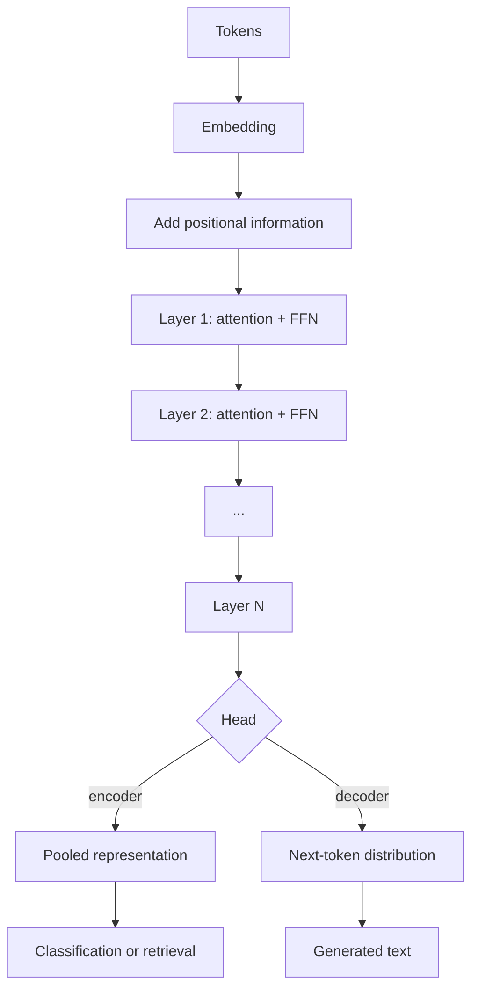

# Transformers

> **Module 07 — Deep Learning, Multimodal Models, and LLMs**
> Topic 05 of 11
> Estimated study time: 4 hours
> Prerequisites: Topics 01 to 04
> Version 2026.3

## 1. Why this topic exists

The transformer is the architecture behind every large language model, every modern vision
foundation model, and most of the multimodal systems that a hospital is now asked to evaluate. It
replaced recurrence not because attention is a better metaphor for cognition but because attention is
parallelisable across positions, and parallelisability is what makes training on accelerators
economical. Understanding the transformer is therefore a prerequisite for understanding the cost,
the context limit, and the failure modes of the products that use it.

The industry problem is that the architecture's cost is quadratic in sequence length and its memory
is dominated by a matrix that most practitioners never see. A team that treats the context window as
a free parameter will build a system that is slow, expensive, and quietly wrong at the edges. A team
that understands the quadratic term can predict the cost before running the job, choose the context
length against the task, and recognise when a retrieval system is cheaper than a longer window.

Four costs follow.

**Compute cost.** Attention compares every position with every other position. For a sequence of
length `L`, that is `L^2` comparisons per head per layer. At 512 tokens the quadratic term is a
few percent of the total; at 32,768 tokens it is 85 percent. The crossover is the single most
important number in serving economics, and it is computable from the layer count and the model width.

**Memory cost.** The attention score matrix for a batch of one, 12 heads, and 32,768 tokens is
`12 * 32,768^2 = 1.29e10` elements. At four bytes each that is 51.5 gigabytes, before the model
weights. This is why FlashAttention exists: it computes attention in tiles without ever
materialising the matrix, and it is why long-context inference is possible at all.

**Context cost.** A model trained with a 512-token context does not reliably generalise to an
8,000-token input, even though the architecture accepts it. The positional encoding, the attention
patterns, and the training distribution all change. A clinical note that is truncated to fit the
window loses the section that contains the answer, and a note that is fed beyond the trained length
may be attended to incorrectly. The context window is a validated property, not a buffer size.

**Evaluation cost.** Attention weights are not explanations. A high weight on a token does not mean
the model used that token causally, and a low weight does not mean it ignored it. A team that
presents an attention heat map to a clinician as a justification is making a claim the method cannot
support. The evaluation of a transformer for a clinical task requires the same external validation as
any other model, plus attention-specific checks for degeneracy.

This topic teaches the transformer block from the matrix operations up. It derives the shapes,
computes the cost, explains positional encoding and masking, and treats the deployment concerns of
context length and key-value caching. It does not teach training at scale, which is Topic 06, or
tokenization, which is Topic 07. It teaches enough to read a model card, predict its cost, and
recognise when its attention has collapsed.

> **Note:** This topic describes the encoder-decoder transformer of Vaswani et al. and the
> encoder-only and decoder-only variants that followed. The block structure is shared; the masking
> and the output head differ.

## 2. Learning outcomes

By the end of this topic you can:

1. **Compute** the shapes and parameter counts of a multi-head self-attention layer and a feedforward
   block from the model width, head count, and layer count.
2. **Implement** scaled dot-product attention for a small case by hand, including the scaling, the
   softmax, and the weighted sum, and **verify** that the weights sum to one.
3. **Compute** the attention score memory and the key-value cache size for a stated sequence length,
   batch, and precision.
4. **Derive** the sequence length at which the quadratic attention term exceeds the linear term for a
   given model.
5. **Explain** absolute, relative, and rotary positional encodings, and **predict** what happens when
   a model is evaluated beyond its trained context.
6. **Choose** a masking scheme for causal, bidirectional, and padded inputs, and **detect** a mask
   applied to the wrong axis.
7. **Diagnose** attention degeneracy from entropy and rank statistics, and **distinguish** it from a
   data problem.
8. **Estimate** the serving cost of a long-context clinical application and **compare** it with a
   retrieval-based alternative.

Outcomes 1, 2, 3, and 4 are computational. Outcomes 5, 6, and 8 are design outcomes assessed by
rubric. Outcome 7 is assessed in the debugging exercise.

The computational outcomes are the ones that transfer across model generations. A practitioner who
can derive the `(L, L)` memory and the parameter count can evaluate a new architecture in an hour,
because the block structure has not changed since 2017 even as the scale has. The design outcomes are
the ones that transfer across organisations, because the cost and validation constraints differ by
deployment.

The topic deliberately does not ask the learner to train a large model. Training at scale is an
engineering discipline with its own literature, and the clinical question is almost always about
adapting or evaluating a model that someone else trained.

## 3. The core mental model

Attention is a soft lookup. Each position asks a question (the query), each position advertises what
it contains (the key), and each position carries a payload (the value). The output at a position is
a weighted average of all payloads, weighted by how well the query matches each key. The weights are
produced by a dot product, scaled, and normalised with a softmax.

```text
  Input X  (L, d_model)
     |
     +--> W_Q --> Q (L, d_k)
     +--> W_K --> K (L, d_k)
     +--> W_V --> V (L, d_v)
                    |
  scores = Q K^T / sqrt(d_k)      (L, L)
                    |
  scores = mask(scores)            causal or padding
                    |
  A = softmax(scores, dim=-1)      rows sum to 1
                    |
  head = A V                       (L, d_v)
                    |
  concat heads --> W_O --> output  (L, d_model)
```

The shape `(L, L)` is the whole story. Every cost, every memory problem, and most of the
implementation bugs come from that matrix. It is computed once per head per layer, and its size grows
with the square of the sequence length while everything else grows linearly.

The second mental model is the residual stream. Each block reads from a shared vector per position,
computes an update, and adds the update back. The stream is not overwritten; it accumulates. Layer
normalisation keeps the scale stable, and the feedforward block transforms each position
independently after attention has mixed information across positions.

```text
  x --> LayerNorm --> Attention --> + x --> LayerNorm --> FeedForward --> + x --> ...
       (pre-norm residual block, the modern default)
```

The residual stream explains why deep transformers train at all: the identity path has a Jacobian of
one, so gradients reach early layers without decaying through the block. It also explains why
attention can be ablated without destroying the model: the stream carries information around the
block.

The third mental model is the distinction between the three context costs.

| Cost | Grows as | Dominant at | Mitigation |
|---|---|---|---|
| Attention scores | `heads * L^2` | Long sequences | FlashAttention, sparsity |
| Key-value cache | `layers * heads * d_head * L` | Generation | Quantised cache, eviction |
| Linear projections | `params * L` | Short sequences | Quantisation, distillation |

At 512 tokens the linear term dominates. At 8,192 tokens attention is 58 percent of the compute. At
32,768 it is 85 percent. The crossover is not a fixed number; it depends on the model width, but the
order of magnitude is a few thousand tokens for models of about 100 million parameters, and it moves
later for wider models because the linear term grows with width.

The fourth mental model is positional information. Attention is permutation-invariant: without a
position signal, the model cannot tell "the patient improved after the dose" from "the dose after the
patient improved". Absolute encodings add a vector per position; relative encodings add a bias that
depends on the distance; rotary encodings rotate the query and key by an angle proportional to
position, so that the dot product depends on the relative offset. Each has a different extrapolation
behaviour, and none guarantees performance beyond the trained length.



The diagram is deliberately shallow. The depth is a hyperparameter, and the block is the same at
every layer. A reader who can draw one block can draw the model.

The fifth mental model is the difference between a model's architectural maximum and its validated
maximum. The architecture accepts any sequence that fits in memory; the validated maximum is the
length at which performance was measured. The two are often far apart, and the gap is where
deployments fail. A model card that states a 128,000-token maximum has stated an architectural limit;
it has not stated that the model performs at that length on the task. The distinction is the same as
the difference between a device's physical measurement range and its validated range, and it should
be treated with the same seriousness.

A corollary is that context length should be chosen from the evaluation, not from the vendor's
maximum. The right question is not "how long can the model accept" but "at what length does the task
metric stop improving, and what does the extra length cost". A team that answers that question has a
defensible design; a team that quotes the maximum has a specification.

## 4. Definitions and vocabulary

| Term | Definition | Common misuse | Unit or convention |
|---|---|---|---|
| Token | Unit of text or signal after tokenization | Confusing with a word | Integer id |
| Embedding | Learned vector per token | Confusing with positional encoding | `d_model` |
| Query | Projection used to score against keys | Assuming it is interpretable | `d_k` |
| Key | Projection compared with queries | Confusing with the cache | `d_k` |
| Value | Payload averaged by the weights | Confusing with the key | `d_v` |
| Head | One attention operation with its own projections | Confusing with a layer | Count |
| Head dimension | Width of one head, usually `d_model / heads` | Assuming it equals `d_model` | Dimension |
| Scaled dot-product attention | `softmax(QK^T / sqrt(d_k)) V` | Omitting the scaling | Operation |
| Softmax | Normalisation over the key axis | Applying over the wrong axis | Function |
| Attention weight | Normalised score per key | Treating as a causal explanation | Probability |
| Attention mask | Boolean that removes positions | Applying to the wrong axis | Tensor |
| Causal mask | Prevents attending to future positions | Using it in an encoder | Mask |
| Padding mask | Removes padded positions | Forgetting it in the loss | Mask |
| Multi-head attention | Concatenation of several heads | Assuming heads are independent | Operation |
| Residual stream | Accumulating vector per position | Confusing with a skip connection in a CNN | Vector |
| Layer normalisation | Per-position normalisation over features | Confusing with batch norm | Per token |
| Pre-norm | Normalisation before the block | Assuming it is equivalent to post-norm | Architecture |
| Post-norm | Normalisation after the residual add | The original transformer convention | Architecture |
| Feedforward network | Two linear layers with a nonlinearity | Calling it a layer of the model | Block |
| Activation | GELU or ReLU inside the feedforward | Confusing with the output activation | Function |
| Positional encoding | Signal that encodes position | Assuming attention has order | Vector |
| Absolute encoding | Learned or sinusoidal vector per position | Assuming it extrapolates | Vector |
| Relative encoding | Bias depending on distance | Confusing with rotary | Bias |
| Rotary encoding | Rotation of Q and K by position angle | Assuming it solves extrapolation | Operation |
| Context window | Maximum length the model was trained on | Confusing with the architecture limit | Tokens |
| Sequence length | Actual number of tokens | Confusing with the context window | Tokens |
| Key-value cache | Stored keys and values for generation | Confusing with the attention matrix | Bytes |
| FlashAttention | Tiled attention that avoids the full matrix | Assuming it changes the result | Implementation |
| Attention entropy | Uncertainty of the weight distribution | Assuming low entropy is good | Nats |
| Attention sink | A position that absorbs weight | Treating as a bug | Phenomenon |
| Quadratic cost | Compute proportional to `L^2` | Assuming it is linear | FLOPs |
| Prefix | Cached context reused across calls | Confusing with the prompt | Tokens |
| Truncation | Cutting a sequence to the window | Assuming the cut is harmless | Operation |
| Chunking | Splitting a long sequence with aggregation | Confusing with truncation | Strategy |

> **Note:** "Attention is not explanation" is a well-established caution in the interpretability
> literature. A weight of 0.4 on a token means the model averaged that token's value with weight 0.4
> at that head; it does not mean the token caused the output. Causal attribution requires an
> intervention, not a heat map.

## 5. The mechanics, step by step

This section is a fifteen-step procedure from a token sequence to a deployed transformer. Steps 1 to
4 build the input representation. Steps 5 to 11 are the block. Steps 12 to 15 are the budget, the
training checks, and the deployment checks.

### Step 1. Tokenize and embed

**Input:** a string or a signal window.

**Output:** a sequence of integer token ids and a matrix of embeddings of shape `(L, d_model)`.

**Rationale:** The embedding table maps each token id to a vector. Its size is
`vocab_size * d_model`, which for a 50,000-token vocabulary and a width of 768 is 38.4 million
parameters, about a third of a 110-million-parameter model. The tokenizer is part of the model; a
change in vocabulary changes the meaning of every embedding row.

### Step 2. Add positional information

**Input:** the embedding matrix.

**Output:** an embedding matrix with position encoded.

**Rationale:** Self-attention is permutation-equivariant. Without a position signal, shuffling the
tokens produces the same set of outputs, permuted. The three families differ in how they encode
position and in how they behave beyond the training length.

| Encoding | Mechanism | Extrapolation | Used by |
|---|---|---|---|
| Sinusoidal absolute | Fixed sinusoids added to embeddings | Weak | Original transformer |
| Learned absolute | Embedding per position | None beyond trained length | BERT, GPT-2 |
| Relative bias | Learned bias per distance bucket | Moderate | T5 |
| Rotary (RoPE) | Rotate Q and K by position angle | Moderate, tunable | Llama, Qwen, many LLMs |
| ALiBi | Linear bias on distance | Good on some tasks | BLOOM-family models |

**Branch point:** if the application needs a context longer than the pretrained window, the
positional scheme determines whether extension is cheap (RoPE with scaling, ALiBi) or requires
retraining (learned absolute). The choice is architectural and cannot be fixed at inference.

### Step 3. Project to queries, keys, and values

**Input:** the normalised hidden state of shape `(L, d_model)`.

**Output:** three matrices of shape `(L, d_k)`, `(L, d_k)`, `(L, d_v)` per head.

**Rationale:** Each projection is a learned linear map. For multi-head attention with `h` heads and
`d_model = 768`, the usual choice is `d_k = d_v = 768 / 12 = 64`. The projections are the parameters
that let different heads specialise: one head can attend to the previous token, another to a section
header, another to a negation.

### Step 4. Compute the scaled scores

**Input:** `Q` and `K`.

**Output:** a score matrix of shape `(L, L)` per head.

**Rationale:** The dot product `q . k` measures similarity. Without scaling, its variance grows with
`d_k`, which pushes the softmax into saturation and kills the gradient. Dividing by `sqrt(d_k)`
keeps the variance near one. The scaling is not cosmetic; removing it is a common implementation bug
that produces a model that trains slowly and attends almost uniformly.

### Step 5. Apply the mask

**Input:** the score matrix.

**Output:** a score matrix with forbidden positions set to a large negative value.

**Rationale:** A causal decoder must not see future tokens; a padded batch must not attend to
padding. The mask is added before the softmax, and the forbidden entries become zero after
normalisation. Applying the mask after the softmax changes the normalisation and leaks information.

**Branch point:** if the mask has the wrong shape, broadcasting can silently apply it to the wrong
axis. A causal mask of shape `(L, L)` applied to a batch of shape `(B, h, L, L)` must broadcast over
the first two axes, not over the last two. Shape assertions on the mask are cheap and catch the bug.

### Step 6. Apply the softmax

**Input:** the masked scores.

**Output:** attention weights of shape `(L, L)` whose rows sum to one.

**Rationale:** The softmax converts scores into a convex combination. It is applied over the key
axis, so each query distributes one unit of weight across the keys. Applying it over the query axis
normalises each key's weights instead, which is a different and usually wrong operation.

### Step 7. Compute the weighted sum

**Input:** the weights and `V`.

**Output:** a head output of shape `(L, d_v)`.

**Rationale:** Each output position is a weighted average of all value vectors. If the weights are
uniform, the output is the mean of the values and the head carries no position-specific information.
If one weight is one and the rest are zero, the output is a copy and the head is a lookup. The
distribution of weights is the head's behaviour, and it is diagnosable.

### Step 8. Concatenate heads and project

**Input:** `h` head outputs of shape `(L, d_v)`.

**Output:** one output of shape `(L, d_model)`.

**Rationale:** Concatenation along the feature axis gives `(L, h * d_v)`, which equals `(L, d_model)`
when `d_v = d_model / h`. The output projection `W_O` mixes the heads. Without it, the heads would be
independent channels with no interaction.

### Step 9. Add the residual and normalise

**Input:** the block input and the attention output.

**Output:** the updated residual stream.

**Rationale:** The residual add preserves the identity path. The normalisation stabilises the scale.
In a pre-norm block, the normalisation is applied to the input of the sublayer, and the residual add
is unnormalised. In a post-norm block, the normalisation follows the add. Pre-norm is the modern
default because it trains more stably at depth, at a small cost in final performance that is usually
recovered by tuning.

### Step 10. Apply the feedforward block

**Input:** the normalised stream.

**Output:** a transformed stream of the same shape.

**Rationale:** The feedforward block is two linear layers with a nonlinearity, applied identically to
each position. Its hidden width is usually four times the model width, so for `d_model = 768` the
hidden width is 3,072. The block holds two-thirds of the model's parameters and does most of the
per-position computation. Attention mixes information across positions; the feedforward transforms
it.

**Parameter count for the block:**

```text
attention:     4 * d_model^2 + 4 * d_model          (Q, K, V, O projections and biases)
feedforward:   2 * d_model * 4 * d_model + 5 * d_model  (two layers, biases)
layer norms:   4 * d_model                           (two norms, scale and shift)
total:        12 * d_model^2 + 13 * d_model
```

For `d_model = 768`, that is `12 * 589,824 + 9,984 = 7,087,872` parameters per block, of which the
feedforward is about 4.7 million.

### Step 11. Stack the blocks

**Input:** the block definition and a depth.

**Output:** a model with `N` blocks.

**Rationale:** Depth increases the receptive field and the abstraction level. The parameter count is
linear in depth, and the compute is linear in depth at fixed sequence length. The choice of depth is
a capacity decision constrained by data and latency, not a universal optimum.

### Step 12. Choose the attention implementation

**Input:** the sequence length and the memory budget.

**Output:** a standard, memory-efficient, or sparse attention implementation.

**Rationale:** The standard implementation materialises the `(L, L)` score matrix. FlashAttention
computes the same result in tiles, keeping the matrix in on-chip memory and recomputing the softmax
statistics during the backward pass. The result is numerically equivalent up to floating-point
rounding, and the memory is linear rather than quadratic in `L`.

**Branch point:** if the sequence is shorter than about 1,024 tokens, the standard implementation is
fine and the kernel may be faster. If the sequence is longer, the memory saving is decisive. If the
model is a decoder used for generation, the key-value cache is the binding constraint, not the score
matrix.

### Step 13. Compute the budget before training

**Input:** the model configuration and the sequence length.

**Output:** the score memory, the cache size, the FLOPs, and the wall-clock estimate.

**Rationale:** The budget is computable in a few lines and prevents the most expensive class of
mistake, which is discovering at hour six that the job does not fit. The formulas are:

```text
score elements per layer   = heads * batch * L^2
score bytes                = 4 * heads * batch * L^2        (fp32)
kv cache bytes per token   = 2 * layers * heads * d_head * bytes
linear FLOPs               = 2 * params * L
attention FLOPs            = layers * 4 * L^2 * d_model
```

### Step 14. Monitor attention entropy and rank

**Input:** attention weights from a validation batch.

**Output:** per-head entropy and the effective rank of the weight matrix.

**Rationale:** A healthy head has entropy between uniform (`log L`) and degenerate (near zero). A
head whose entropy collapses to near zero on most inputs has become a constant lookup, often because
of a training instability or a positional encoding failure. A head whose entropy is exactly `log L`
is uniform and carries no information. Both are diagnosable without labels.

**Branch point:** if entropy collapses after a learning-rate change, the change is the cause. If it
collapses from the first step, the initialisation or the mask is wrong. If only one head collapses,
the model can often compensate with the others, which is why the diagnostic is per head rather than
averaged.

### Step 15. Test the context boundary

**Input:** the trained model and inputs of increasing length.

**Output:** a curve of task metric against sequence length, with the trained window marked.

**Rationale:** A model trained at 512 tokens may degrade gradually or sharply beyond 512. The curve
shows where. A deployment that feeds 2,000-token notes to a 512-token model is an untested
configuration, and the degradation may be silent because the output remains fluent.

The failure modes specific to transformers are worth naming.

**Attention entropy collapse.** One position dominates every query, so the model ignores the rest of
the context. The signature is entropy near zero across heads and a task metric that does not improve
with more context. The causes include a saturated softmax, a positional encoding that dominates the
content, and a training instability.

**Mask on the wrong axis.** A causal mask broadcast over the wrong dimension permits future
information. The model reports an excellent loss and fails at generation. The signature is a
language-model loss far below the entropy of the data.

**Positional extrapolation failure.** The model was trained at one length and evaluated at another.
The signature is a sharp drop at the boundary, often with fluent but irrelevant output. The fix is
retraining with the target length or a positional scheme designed to extend.

**Context overflow.** The input exceeds the window and is truncated. The signature is a model that
fails on long records only, with the failure concentrated in the part that was cut. The fix is
chunking with aggregation or a longer window, and the choice must be evaluated.

**Key-value cache exhaustion.** Generation with a long context exhausts memory because the cache
grows linearly with length and batch. The signature is an out-of-memory error late in a long
conversation. The fix is a smaller batch, a quantised cache, or context eviction.

**Quadratic cost surprise.** A prototype at 512 tokens is cheap, and the production input is 8,000.
The signature is a cost that is 50 times the estimate. The fix is to compute the budget at the
production length before the pilot.

### Parameter accounting for the full model

The block formula is the unit, and the full model adds the embedding and the head. The accounting is
worth doing once, because it shows where a model's parameters actually live and therefore what
fine-tuning will change.

```text
embedding:        vocab * d_model
N blocks:         N * (12 * d_model^2 + 13 * d_model)
final norm:       2 * d_model
output head:      d_model * vocab            (tied to the embedding in many models)

total ≈ N * 12 * d_model^2 + 2 * vocab * d_model
```

For a 12-layer model with `d_model = 768` and a 50,000-token vocabulary:

```text
blocks:      12 * 7,087,872 = 85,054,464
embedding:   50,000 * 768   = 38,400,000
head (tied):                 = 0
other:                       ≈ 100,000
total:                       ≈ 123.6 million
```

The blocks dominate at depth, and the embedding dominates at width. A model with a large vocabulary
and a small width spends most of its parameters on the embedding table, which is why vocabulary size
is a design decision with a direct parameter cost.

### Pre-norm and post-norm

The placement of layer normalisation changes how the residual stream behaves at depth. Post-norm,
the original convention, applies the norm after the residual add. Pre-norm applies it before the
sublayer and leaves the residual path clean.

| Property | Post-norm | Pre-norm |
|---|---|---|
| Gradient path through the residual | Scaled by the norm | Identity |
| Training stability at depth | Requires warmup | More forgiving |
| Final performance at small depth | Slightly better | Slightly worse |
| Behaviour at very large depth | Diverges without care | Trains |
| Used by | Original transformer, BERT | GPT-2 onward, most LLMs |

The practical consequence is that a pre-norm model can be trained with a higher learning rate and
less warmup, which is why it became the default. A team reproducing an older architecture should
expect the post-norm training to be more sensitive to the schedule.

### Masking schemes

The mask is a small tensor with an outsized effect. The table states the three schemes and the
failure each prevents.

| Mask | Shape | Applied to | Prevents | Failure if omitted |
|---|---|---|---|---|
| Causal | `(L, L)` | Decoder self-attention | Attending to future tokens | Loss far below data entropy |
| Padding | `(B, L)` broadcast | All attention and loss | Attending to padding | Length-dependent bias |
| Document | `(B, L, L)` | Packed sequences | Cross-document attention | Leakage between documents |
| Prefix | `(L, L)` | Prefix-tuning | Attending to the prefix as content | Weak adaptation |

A causal mask applied to an encoder removes half the context and halves the effective training
signal. A padding mask omitted from the loss makes the model learn to predict padding. Both are
silent: the loss falls, and the model looks healthy.

### Attention variants and when they matter

The quadratic cost has produced a family of variants. Each trades some expressiveness or some exactness
for a different cost curve, and the trade must be evaluated on the task rather than assumed.

| Variant | Mechanism | Cost | Risk |
|---|---|---|---|
| Full attention | All pairs | `O(L^2)` | Memory at long length |
| Sliding-window | Attend to a local window | `O(L * w)` | No global context |
| Sparse block | Attend to selected blocks | `O(L sqrt(L))` to `O(L)` | Implementation complexity |
| Multi-query | Share keys and values across heads | Smaller cache | Slight quality loss |
| Grouped-query | Share within groups of heads | Middle ground | Configuration complexity |
| Linear attention | Kernel approximation | `O(L)` | Different model, not equivalent |
| FlashAttention | Exact, tiled | `O(L^2)` compute, `O(L)` memory | None to the result |

The distinction between an approximation and an implementation is important. FlashAttention is an
exact implementation of full attention with better memory behaviour. Multi-query attention changes the
model by sharing keys and values, which reduces the cache and slightly changes what the heads can
represent. Linear attention changes the function being computed. A team that replaces full attention
with an approximation and reports the same accuracy has either validated the approximation or made an
error; the two cannot be distinguished without an ablation.

For clinical text at 512 to 8,000 tokens, full attention with a memory-efficient kernel is usually
adequate. The variants matter at 32,000 tokens and beyond, or when serving many concurrent
conversations where the cache dominates. The decision should be made on the measured memory and
latency at the production length, not on the asymptotic complexity alone.

## 6. Worked example

A hospital wants to classify an 8,000-token discharge summary into whether it documents a follow-up
plan. The team proposes a 12-layer encoder with a model width of 768, 12 heads, and a feedforward
width of 3,072, totalling about 110 million parameters. The summary is truncated to 8,000 tokens,
which covers 94 percent of the corpus.

This section computes the attention memory, the cache, the compute split, the cost, two diagnostics,
and one sensitivity.

### Step 1. Attention score memory

For one layer, one head, and `L = 8,000`, the score matrix has `8,000^2 = 64,000,000` elements. With
12 heads:

```text
elements per layer = 12 * 64,000,000 = 768,000,000
bytes at fp32      = 768,000,000 * 4 = 3,072,000,000 bytes = 3.07 GB
bytes at fp16      = 768,000,000 * 2 = 1,536,000,000 bytes = 1.54 GB
```

The score matrix is per layer, but it is not stored for all layers simultaneously in a standard
implementation if the backward pass frees it. The peak is one layer's matrix plus the saved
activations for the other layers, so the planning number is several gigabytes at this length. With
batch 8, the peak is eight times larger, which is why long-context training uses small batches or
FlashAttention.

### Step 2. Key-value cache for generation

If the model is used to generate rather than classify, it caches the keys and values for every
previous token. The size per token is:

```text
2 * layers * heads * d_head * bytes = 2 * 12 * 12 * 64 * 2 = 36,864 bytes
```

That is 36 kibibytes per token at 16-bit precision. For 8,000 tokens:

```text
36,864 * 8,000 = 294,912,000 bytes = 281 MiB
```

For a batch of 16 conversations, the cache is `16 * 281 = 4.5` gibibytes, which is comparable to the
model itself. For 32,768 tokens, it is `36,864 * 32,768 = 1.21` gigabytes per sequence, and a batch
of 16 would need 19.3 gigabytes. The cache, not the weights, is what limits long-context serving.

The cache also grows during a conversation, so the memory profile of a request is not known when it
arrives. A serving system that admits requests based on their initial length will admit too many
long conversations and fail partway through generation. The admission policy must reserve for the
maximum length, or evict, and the eviction policy is a product decision because it changes what the
model can remember.

### Step 3. Compute split

The linear part of the forward pass is approximately `2 * params * L`:

```text
2 * 110,000,000 * 8,000 = 1.76e12 FLOPs = 1.76 TFLOPs
```

The attention part is `layers * 4 * L^2 * d_model`:

```text
12 * 4 * 64,000,000 * 768 = 2.36e12 FLOPs = 2.36 TFLOPs
```

The total forward pass is `1.76 + 2.36 = 4.12 TFLOPs`, and attention is
`2.36 / 4.12 = 57.3` percent. Training costs about three times the forward pass, or 12.4 TFLOPs per
summary.

For 20,000 summaries and three epochs:

```text
20,000 * 3 * 12.4e12 = 7.44e17 FLOPs = 744 petafLOPs
```

At 100 effective teraflops, `7.44e17 / 1e14 = 7,440 seconds`, or 2.1 hours of pure arithmetic. The
wall-clock time will be longer because attention at this length is memory-bound, not compute-bound,
which is exactly the problem FlashAttention addresses.

### Step 4. Diagnostic one: attention entropy

The team computes the mean entropy of each head's attention distribution on 200 validation summaries.
A uniform distribution over 8,000 keys has entropy `log(8,000) = 8.99` nats. A degenerate
distribution has entropy near zero.

```text
head  1: 8.94 nats   (nearly uniform, carries little)
head  2: 5.12 nats   (diffuse)
head  3: 0.04 nats   (collapsed onto one token)
head  4: 0.21 nats   (concentrated)
...
mean:   6.87 nats
```

Head 3 has collapsed. Inspecting the token it attends to shows that it is the first token, which acts
as an attention sink: a position that absorbs weight when a query has no strong match. A sink is
normal and is documented in the long-context literature; a head that does nothing else is wasted
capacity. The diagnostic is not "collapse is always bad" but "a head with near-zero entropy on every
input is not using the context".

The team prunes nothing at this stage. It records the per-head entropy and checks that the task
metric does not depend on the collapsed head by ablating it on validation. If the metric is
unchanged, the head is redundant; if it falls, the head is a lookup that matters, and the collapse is
functional rather than pathological.

### Step 5. Diagnostic two: the context boundary

The model is trained on summaries truncated to 8,000 tokens. The team evaluates on summaries of
increasing length by truncating the test set at 1,000, 2,000, 4,000, and 8,000 tokens.

```text
truncation   AUROC
1,000        0.81
2,000        0.86
4,000        0.89
8,000        0.91
```

The metric rises with length, which is expected: more of the note is available. The diagnostic is
the shape at the boundary. If the metric had fallen at 8,000 relative to 4,000, the model would be
degrading at its trained limit, which would indicate that the longest training examples were
under-represented or that the positional encoding was saturating. The team also evaluates at 12,000
tokens by concatenating two notes; a sharp drop there marks the extrapolation boundary and tells the
team that 8,000 is a real limit, not an arbitrary truncation.

### Step 6. Vary one assumption: 8,000 to 32,000 tokens

Suppose the team wants to remove truncation entirely and use the full note, up to 32,000 tokens.

```text
score elements per layer: 12 * 32,768^2 = 1.288e10
score bytes at fp32:      1.288e10 * 4 = 51.5 GB
linear FLOPs:             2 * 110e6 * 32,768 = 7.21e12 = 7.21 TFLOPs
attention FLOPs:          12 * 4 * 1.0737e9 * 768 = 3.96e13 = 39.6 TFLOPs
attention share:          39.6 / (39.6 + 7.21) = 84.6%
kv cache per sequence:    36,864 * 32,768 = 1.21 GB
```

The conclusion changes in three ways. First, the attention score matrix at 51.5 gigabytes does not
fit on any single accelerator, so the standard implementation is impossible and FlashAttention or a
sparse method is mandatory. Second, attention becomes 85 percent of the compute, so the linear
optimisations that dominated at 512 tokens are no longer the lever. Third, the key-value cache at
1.21 gigabytes per sequence limits the batch to a handful of sequences per device. The full-context
model is feasible, but its economics are different from the truncated model's, and the team should
compare it with a chunking-plus-aggregation design before committing.

### Step 7. What the arithmetic does not establish

The memory and FLOPs say what the model costs. They do not say whether the extra context improves
the classification, whether the model attends to the right sentences, or whether the output is
calibrated. Those require an evaluation on held-out summaries, an attribution check that is causal
rather than a heat map, and a calibration curve. The arithmetic narrows the design space; it does not
choose within it.

The batching decision is the one remaining lever. At 8,000 tokens, the activation memory per summary
is a few gigabytes, so the batch is small and the accelerator is underutilised. At 2,000 tokens, the
same memory holds four times as many summaries, and the throughput per unit of compute is higher. A
team that needs to process 20,000 summaries once can afford the long context; a team that must
process 20,000 summaries every night should test whether a 2,000-token chunk with aggregation
preserves the metric, because the throughput difference is large and the accuracy difference may be
small. That experiment is cheaper than optimising the long-context kernel.

## 7. Code, query, or calculation

The code below implements scaled dot-product attention for a three-token, four-dimensional case,
then computes the memory and compute split for a 110-million-parameter model at four sequence
lengths. It uses only the standard library.

**Assumptions.** The attention example uses a single head, no mask, and a scaling of `sqrt(d_k)`.
The cost table assumes 12 layers, 12 heads, a model width of 768, and 16-bit key-value cache.

```python
import math

def matmul(A, B):
    return [[sum(a * b for a, b in zip(row, col)) for col in zip(*B)] for row in A]

def transpose(A):
    return [list(r) for r in zip(*A)]

def softmax(v):
    m = max(v)
    e = [math.exp(x - m) for x in v]
    s = sum(e)
    return [x / s for x in e]

Q = [[1.0, 0.0, 1.0, 0.0],
     [0.0, 1.0, 0.0, 1.0],
     [1.0, 1.0, 0.0, 0.0]]
K = [[1.0, 0.0, 0.0, 0.0],
     [0.0, 1.0, 1.0, 0.0],
     [1.0, 0.0, 1.0, 0.0]]
V = [[1.0, 2.0, 3.0, 4.0],
     [5.0, 6.0, 7.0, 8.0],
     [9.0, 10.0, 11.0, 12.0]]

d = 4
scores = matmul(Q, transpose(K))
scaled = [[s / math.sqrt(d) for s in row] for row in scores]
W = [softmax(row) for row in scaled]
out = matmul(W, V)

print("scores:", [[round(x, 4) for x in r] for r in scores])
print("scaled:", [[round(x, 4) for x in r] for r in scaled])
print("weights:", [[round(x, 4) for x in r] for r in W])
print("row sums:", [round(sum(r), 6) for r in W])
print("output:", [[round(x, 4) for x in r] for r in out])

N = 110_000_000
layers, heads, dmodel = 12, 12, 768
dhead = dmodel // heads
print(f"{'L':>6}{'score GB':>10}{'KV MB':>9}{'lin TF':>9}{'attn TF':>9}{'attn %':>8}")
for L in [512, 2048, 8192, 32768]:
    gb = heads * L * L * 4 / 1e9
    kv = 2 * layers * heads * dhead * L * 2 / 1e6
    lin = 2 * N * L / 1e12
    att = layers * 4 * L * L * dmodel / 1e12
    print(f"{L:>6}{gb:>10.2f}{kv:>9.1f}{lin:>9.2f}{att:>9.2f}{100 * att / (lin + att):>8.1f}")
```

**Observed output:**

```text
scores: [[1.0, 1.0, 2.0], [0.0, 1.0, 0.0], [1.0, 1.0, 1.0]]
scaled: [[0.5, 0.5, 1.0], [0.0, 0.5, 0.0], [0.5, 0.5, 0.5]]
weights: [[0.2741, 0.2741, 0.4519], [0.2741, 0.4519, 0.2741], [0.3333, 0.3333, 0.3333]]
row sums: [1.0, 1.0, 1.0]
output: [[5.7112, 6.7112, 7.7112, 8.7112], [5.0, 6.0, 7.0, 8.0], [5.0, 6.0, 7.0, 8.0]]
     L  score GB    KV MB   lin TF  attn TF  attn %
   512      0.01     18.9     0.11     0.01     7.9
  2048      0.20     75.5     0.45     0.15    25.5
  8192      3.22    302.0     1.80     2.47    57.9
 32768     51.54   1208.0     7.21    39.58    84.6
```

The first row of weights is `[0.2741, 0.2741, 0.4519]` because the first query's scaled scores are
`[0.5, 0.5, 1.0]`, and the softmax of those values is that distribution. The rows sum to one to six
decimals, which is the invariant that a softmax over the key axis must satisfy. If a row sums to
something else, the softmax was applied over the wrong axis or the mask was added after the
normalisation.

The cost table is the argument for computing the budget early. At 512 tokens, attention is 8 percent
of the compute and the score matrix is 10 megabytes. At 32,768, attention is 85 percent and the score
matrix is 51.5 gigabytes. The same architecture moves from a cheap classifier to an expensive
long-context system without any change to its definition.

The second block computes the key-value cache for a generation workload.

```python
def kv_bytes(layers, heads, dhead, length, batch, bytes_per_value=2):
    per_token = 2 * layers * heads * dhead * bytes_per_value
    return per_token, per_token * length * batch

per_token, total = kv_bytes(12, 12, 64, 8192, 1)
print("bytes per token:", per_token)
print("MB for 8192 tokens, batch 1:", round(total / 1e6, 1))
print("GB for 32768 tokens, batch 16:", round(kv_bytes(12, 12, 64, 32768, 16)[1] / 1e9, 2))
```

**Observed output:**

```text
bytes per token: 36864
MB for 8192 tokens, batch 1: 302.0
GB for 32768 tokens, batch 16: 19.33
```

The cache is linear in length and batch, so it does not have the quadratic cliff of the score matrix.
It still dominates memory at long context: 19.3 gigabytes for 16 conversations of 32,768 tokens is
more than the weights of many models. A serving design that ignores the cache will pass a
single-request test and fail under concurrency.

## 8. Data, standards, and regulatory context

A transformer is rarely regulated as an architecture. It is regulated as a component of a device or
as a general-purpose model, and the obligations differ sharply between the two roles. A hospital that
uses a hosted model is a deployer; a hospital that fine-tunes and distributes one may be a provider.
The distinction determines which of the frameworks below applies, and it is the first question to
settle before a procurement or a build.

**The model is the device, and the context window is part of the model.** In a regulated submission,
the intended use states the input the device accepts. If the device accepts a 512-token note and the
manufacturer deploys it on 8,000-token notes, the deployed device is not the validated one. The FDA
draft guidance on AI-enabled device software functions (January 2025, docket FDA-2024-D-4488) asks
for a description of the inputs and the intended use, and the predetermined change control guidance
(December 2024, docket FDA-2022-D-2628) asks which input changes are anticipated. A context-length
increase is an input change.

**General-purpose AI obligations in the European Union.** Regulation (EU) 2024/1689 imposes
documentation, copyright-policy, and training-content-summary obligations on providers of
general-purpose AI models from 2 August 2025. Models with training compute above `10^25` FLOP are
presumed to carry systemic risk and face additional evaluation, incident-reporting, and cybersecurity
duties. A hospital that fine-tunes a general-purpose model may become a provider if it uses more than
one third of the original training compute, a threshold stated in the Commission's guidance. The
threshold is a legal test, not a technical one, and it should be checked with counsel.

**NIST AI 600-1.** The Generative AI Profile names information integrity, confabulation, data
privacy, and value-chain integration among its twelve risks. For a transformer used on clinical text,
the data-privacy risk includes memorisation of training text and inference of sensitive attributes.
The profile's suggested actions include red-teaming for training-data extraction, which is a
different test from task accuracy.

**HIPAA and text.** A discharge summary is protected health information. Sending it to a hosted
inference endpoint is a disclosure that requires a business associate agreement or a de-identification
step. The context length affects the risk: a longer window means more text leaves the boundary, and
a truncation policy that keeps the identifying header while dropping the clinical impression is the
worst of both.

**Reporting.** TRIPOD+AI (BMJ 2024;385:e078378) requires the model, the predictors, the sample size,
and the performance to be reported. For a transformer, the model description should include the
tokenizer, the context length, the positional encoding, and the precision, because each affects
reproduction. A paper that reports "a BERT-based model" without the context length and the
tokenizer has not described the model.

| Framework | Status | What it constrains | What it does not |
|---|---|---|---|
| FDA AI device draft (2025) | Draft | Input description and intended use | Architecture choice |
| FDA PCCP (2024) | Final | Anticipated input changes | Context length choice |
| EU AI Act GPAI rules | Binding from Aug 2025 | Documentation, copyright, systemic risk | Model accuracy |
| NIST AI 600-1 | Voluntary | Risk identification and testing | Technical thresholds |
| HIPAA | Binding in the US | PHI in prompts and training | Model safety |
| TRIPOD+AI | Reporting convention | Model and evaluation reporting | Study quality |

**What the general-purpose AI rules mean for a hospital.** A hospital that uses a hosted model
through an API is a deployer, not a provider, and its obligations are those of a deployer: use the
model as intended, monitor, and keep human oversight. A hospital that fine-tunes an open-weight model
and distributes it to other hospitals may become a provider, and the provider obligations apply. The
Commission's guidance states that a fine-tuner becomes a provider if it uses more than one third of
the original model's training compute. That threshold is not something a clinical team can compute
from a model card, because the original compute is often undisclosed. The practical response is to
treat any distribution of a fine-tuned model as a provider activity and to obtain legal review.

**Data provenance for text.** A transformer's training corpus is part of its regulatory description.
For a general-purpose model, the provider publishes a summary of training content; for a
domain-specific model, the developer documents the corpus. The questions that matter for a clinical
deployment are whether the corpus contains the institution's own data, whether it contains copyrighted
material, and whether it contains text from the population the model will serve. A model trained
mostly on United States English clinical text may underperform on a different documentation culture,
and the failure is stylistic as well as lexical.

**Audit expectations.** An audit of a deployed transformer typically asks for four artefacts: the
model version and weights hash, the tokenizer version, the context length and truncation policy, and
the evaluation set with its length distribution. Without the fourth, the first three cannot be
interpreted, because a model evaluated only on short notes has not been evaluated on the notes that
will be truncated in production.

| Audit question | Artefact | Consequence if missing |
|---|---|---|
| Which model produced this output? | Version and weights hash | Output cannot be reproduced |
| How was the text tokenized? | Tokenizer version and vocabulary | Token ids differ after upgrade |
| What input length was validated? | Evaluation length distribution | Untested inputs in production |
| What was truncated? | Truncation policy | Evidence removed silently |
| What precision was used? | Serving configuration | Numerical differences |
| What was the fallback? | Error-handling policy | Silent failure on overflow |

**The limits of the regulatory analogy.** Device regulation was written for software whose behaviour
is specified by rules. A transformer's behaviour is specified by weights and a training distribution,
and the specification is statistical. The frameworks have adapted by requiring process evidence
rather than code review, which is why documentation, change control, and monitoring carry so much
weight. A team that treats documentation as paperwork has misread what the regulator is asking for.

The regulatory frameworks treat the context window as an input specification. The technical
frameworks treat it as a hyperparameter. The two views are compatible only if the hyperparameter is
frozen before validation and changed only through the change-control process.

## 9. Industry practice and case evidence

The public evidence about transformers is overwhelmingly about capability benchmarks on general text
and images. The clinical evidence is thinner, and the gap between the two is where overclaiming
happens. This section separates what the papers establish from what a clinical team may reasonably
infer from them.

**The original transformer.** Vaswani et al. introduced the transformer in "Attention Is All You
Need" (NeurIPS 2017, arXiv:1706.03762). The base model used six encoder layers, six decoder layers,
a model width of 512, eight heads, and a feedforward width of 2,048. The paper's documented results
include a BLEU of 27.3 on WMT 2014 English-to-German and 41.8 on English-to-French, trained in about
3.5 days on eight GPUs for the base model. The architectural contribution is the removal of
recurrence in favour of attention, which allows all positions to be processed in parallel during
training.

**Vision transformer.** Dosovitskiy et al. showed that an image can be split into patches, each patch
embedded as a token, and a standard transformer applied (ICLR 2021, arXiv:2010.11929). The documented
result is that a vision transformer pretrained on a large corpus matches or exceeds convolutional
networks, but that it underperforms on small datasets without pretraining. The inference for medical
imaging, which the paper does not make, is that a vision transformer is a poor choice for a
few-thousand-image cohort unless a large pretrained model is adapted; the convolutional inductive
bias is doing real work when data are scarce.

**FlashAttention.** Dao et al. introduced an IO-aware attention algorithm that tiles the computation
and avoids materialising the `(L, L)` matrix (NeurIPS 2022, arXiv:2205.14135). The documented results
include up to 3x speedup on GPT-2 training, 15 percent faster BERT-large training, and memory that
grows linearly rather than quadratically with sequence length. The algorithm computes the same
mathematical result; the gain is in memory traffic, not in a changed model. This is why it is the
default for long-context work.

**Rotary position embeddings.** Su et al. introduced RoPE, which rotates queries and keys by an angle
proportional to position so that the dot product depends on relative offset (arXiv:2104.09864, 2021).
The documented results include competitive translation quality and faster convergence in pretraining.
The practical significance is that RoPE is used by most current open-weight language models, and its
scaling behaviour is the basis for context-extension techniques.

**Clinical text models and the context limit.** Clinical language models derived from BERT-family
architectures typically use a 512-token context, because that is the context of the pretrained
backbone. A discharge summary often exceeds 512 tokens, so the model truncates. The documented
practice in the clinical NLP literature is to truncate from the start, from the end, or by section,
and the choice changes performance. The inference for a buyer is to ask which truncation policy was
validated, because a model validated on truncated notes may not perform on full notes.

**What practitioners actually do.** In inference from public model cards and vendor documentation,
three patterns recur. First, classification of clinical text is usually done with an encoder model
fine-tuned at 512 tokens, with truncation, because it is cheap and well understood. Second,
long-context generation is usually done with a decoder model and a retrieval layer, because the
context is expensive and the evidence is in a document store. Third, the production context length
is usually shorter than the vendor's maximum, because latency and cost bind before the architecture
does.

**ClinicalBERT and the 512-token default.** ClinicalBERT and its relatives adapt BERT-family
architectures to clinical text (Alsentzer et al., "Publicly Available Clinical BERT Embeddings",
2019, arXiv:1904.03323). The documented architecture inherits the 512-token context of the base
model. A discharge summary or a nursing note stream routinely exceeds that, so the model truncates.
The clinical NLP literature documents several truncation strategies — first 512 tokens, last 512
tokens, section-aware selection — and the choice changes downstream performance. The inference for a
buyer is that the truncation policy is part of the model, even when the model card does not mention
it.

**The cost of long context in practice.** The published long-context work reports large memory
savings from tiled attention, and the vendor documentation for long-context models reports context
lengths in the hundreds of thousands of tokens. Neither source reports the cost per query at those
lengths, because the cost depends on the deployment. The arithmetic in Section 6 is the tool a team
should use: at 32,768 tokens, the key-value cache alone is 1.21 gigabytes per sequence at 16-bit
precision, and a batch of 16 needs 19.3 gigabytes. A serving configuration that ignores this will
pass a single-request test and fail under load.

**What the benchmark measures.** The long-context benchmarks measure whether a model can retrieve or
reason over information placed in a long input. They do not measure whether a clinical note's
evidence survives truncation, whether the model's output is calibrated, or whether a clinician can
act on it. A high long-context score is evidence of a capability, not of a clinical utility. The two
must be evaluated separately, and the second requires clinical data and clinical readers.

**Where the architecture is not the bottleneck.** For most clinical text classification, the
bottleneck is label quality, cohort size, and truncation policy, not the attention mechanism. A
well-tuned encoder at 512 tokens with a good label policy often matches a long-context model on a
classification task, at a fraction of the cost. The architecture becomes the bottleneck when the task
requires synthesis across a document that exceeds the window, which is a smaller set of tasks than
the marketing suggests.

**Why the cases are about engineering, not intelligence.** Every documented result in this section
is a statement about a computation: parallelism, memory traffic, positional encoding, or parameter
count. None is a statement about clinical reasoning. That is the correct level at which to read the
literature, because the architecture is a substrate. A team that expects the substrate to supply
clinical judgement will be disappointed, and a team that treats it as an engineering component can
predict its behaviour, its cost, and its failure modes.

The evidence does not support the claim that a longer context is better. It supports the claim that
the context length is a validated input property, and that the cheapest adequate context is usually
the right one.

## 10. Failure modes and red flags

Transformer failures divide into three groups: shape and mask errors, which are silent and produce
implausible losses; cost errors, which appear as budget overruns; and interpretation errors, which
appear as unjustified claims. The first group is prevented by unit tests, the second by arithmetic
before the run, and the third by discipline in what the evaluation claims.

| Failure | Early warning sign | Mechanism | Consequence | Mitigation |
|---|---|---|---|---|
| Attention entropy collapse | One head near zero entropy | Saturated softmax or bad position signal | Lost context use | Check scaling and init |
| Mask on wrong axis | Loss far below data entropy | Broadcasting over features | Future leakage | Assert mask shape |
| Missing padding mask | Length-dependent predictions | Attention over zeros | Bias by length | Mask scores and loss |
| Positional extrapolation | Sharp drop beyond trained length | Encoding not designed to extend | Silent failure at edges | Test length curve |
| Context overflow | Long notes fail | Truncation removes evidence | Missed findings | Chunk with aggregation |
| KV cache exhaustion | Out of memory late in generation | Cache grows with length and batch | Serving outage | Smaller batch, quantised cache |
| Quadratic cost surprise | Cost 50x the pilot estimate | Prototype at short length | Budget overrun | Compute budget at production length |
| Wrong softmax axis | Weights do not sum to one | Normalising over queries | Degenerate attention | Unit test row sums |
| Missing scaling | Slow training, uniform attention | Variance grows with `d_k` | Underfit | Divide by `sqrt(d_k)` |
| Tied vs untied head confusion | Parameter count mismatch | Head shares embedding or not | Reproduction failure | State the convention |
| Tokenizer mismatch | Garbage outputs after upgrade | Different vocabulary | Silent regression | Golden token test |
| Layer norm in wrong place | Training instability at depth | Post-norm without warmup | Divergence | Pre-norm or warmup |
| Over-long fine-tuning | Catastrophic forgetting | High rate on all weights | Lost capability | Adapters, lower rate |
| Attention heat map as evidence | Clinician trusts a highlight | Weights are not causal | False justification | Causal attribution instead |

## 11. Assumptions and limits

The transformer's assumptions are mostly assumptions about the input: its length, its tokenization,
its position encoding, and its similarity to the training text. Each is a condition under which the
model's output means what the team thinks it means, and each is testable before deployment.

The first two assumptions are the ones that fail silently. A longer note at go-live is not an error;
it is an untested input, and the model will produce a fluent output for it. A tokenizer upgrade after
a library update is not an error either; it changes the token ids, and the model will produce a
different output for the same text.

| Assumption | Why it is needed | What breaks it | How to test |
|---|---|---|---|
| The context window matches the deployment input | Validation is at a fixed length | Longer notes at go-live | Length-stratified evaluation |
| The tokenizer is frozen | Token ids must be stable | Library upgrade | Golden token set |
| Positional encoding covers the input | Attention needs order | Length beyond training | Length curve |
| Attention weights are not explanations | Interpretation needs causality | Heat-map claims | Intervention test |
| The model was trained on comparable text | Transfer assumes similarity | New specialty or language | Domain validation |
| The KV cache fits the concurrency | Serving needs memory | Batch growth | Load test |
| The softmax is over keys | Weights must sum to one | Axis bug | Row-sum unit test |
| The precision is sufficient | fp16 is faster | Long sums, small differences | Compare with fp32 |
| The attention implementation is equivalent | FlashAttention is an optimisation | Numerical differences | Output parity test |
| The context length is a device property | Regulation assumes a fixed input | Uncontrolled change | Change-control plan |

## 12. Exercises

The exercises are ordered by the quantity they test: shapes and memory first, then behaviour, then
design under a cost constraint. The arithmetic is checkable against Section 7. The design exercise
has no single answer, and the rubric states what a defensible answer must contain.

Where an exercise asks for a measurement, state the sequence length and the precision. A result
without both is not comparable to any other result.

**Exercise 1 (calculation, 20 minutes).** A model has 16 layers, 16 heads, a width of 1,024, and a
sequence length of 4,096. Compute the attention score memory at fp16 and the key-value cache per
sequence. **Deliverable:** the two values with formulas. **Criteria:** correct head dimension,
correct factor of two for keys and values.

**Exercise 2 (calculation, 25 minutes).** For the model in Exercise 1, compute the sequence length at
which attention FLOPs equal linear FLOPs, assuming 300 million parameters. **Deliverable:** the
equation and the length. **Criteria:** correct algebra, correct units.

**Exercise 3 (implementation, 40 minutes).** Implement masked softmax attention and verify that a
causal mask makes the output at position `t` independent of positions after `t`. **Deliverable:** code
and a perturbation test. **Criteria:** perturbing a future token changes no earlier output.

**Exercise 4 (diagnosis, 35 minutes).** A decoder's training loss falls to 0.4 nats per token, below
the entropy of the corpus. Name the most likely cause and the test. **Deliverable:** a diagnosis and
a test plan. **Criteria:** identifies mask leakage, proposes a causality check.

**Exercise 5 (critique, 30 minutes).** Find a clinical transformer paper and identify its tokenizer,
context length, positional encoding, truncation policy, and precision. **Deliverable:** a five-row
table with quotations. **Criteria:** accurate quotations, at least two omissions.

**Exercise 6 (design, 45 minutes).** Design a system to answer questions over 200-page guideline
documents. Compare a 128,000-token context with retrieval plus a 4,000-token context on cost,
latency, and evidence coverage. **Deliverable:** a two-page comparison with arithmetic. **Criteria:**
quantified cost, stated assumptions, a recommendation.

**Exercise 7 (estimation, 25 minutes).** A nightly job classifies 50,000 notes of 6,000 tokens with a
12-layer, 768-width model. Estimate the training-free inference FLOPs and the time at 50 effective
teraflops. **Deliverable:** the arithmetic. **Criteria:** linear plus attention terms, correct
conversion.

**Exercise 8 (communication, 25 minutes).** Write 180 words for a product manager explaining why the
context window is not a free parameter. **Deliverable:** the paragraph. **Criteria:** one number, one
consequence, one recommendation.

## 13. Self-check answers

**Answer 1.** Head dimension `1024 / 16 = 64`. Score elements per layer: `16 * 4,096^2 =
16 * 16,777,216 = 268,435,456`. At two bytes: `536,870,912` bytes, or 0.54 gigabytes per layer. The
key-value cache per token: `2 * 16 * 16 * 64 * 2 = 65,536` bytes. At 4,096 tokens:
`65,536 * 4,096 = 268,435,456` bytes, or 268 megabytes per sequence.

**Answer 2.** Linear FLOPs `2 * N * L`; attention FLOPs `layers * 4 * L^2 * d`. Setting them equal:
`2 * 300e6 * L = 16 * 4 * L^2 * 1024`, so `6e8 = 65,536 L`, and `L = 9,155` tokens. Above about
9,000 tokens the quadratic term dominates for this configuration.

**Answer 3.** With a causal mask, the score at position `t` for key `j > t` is `-inf`, so the softmax
weight is zero and the output is unchanged by any perturbation of `x_j` for `j > t`. A correct test
perturbs one future token, recomputes the output, and asserts that positions `0..t-1` are unchanged
within floating-point tolerance. A failure indicates that the mask was applied after the softmax or
broadcast over the wrong axis.

**Answer 4.** The most likely cause is a mask that does not prevent attending to future tokens, or a
label that is present in the input. A loss of 0.4 nats per token is below the entropy of natural text,
which is a strong signal of leakage. The test is a causality check: perturb a future token and verify
that the prediction at an earlier position does not change. A secondary test is to compare the loss
with a shifted-label baseline.

**Answer 5.** A strong answer reports the tokenizer vocabulary and version, the context length, the
positional encoding, the truncation policy, and the precision. Most papers report the base model and
the context length, and omit the tokenizer version, the truncation policy, and the precision, which
are the three that most often prevent reproduction.

**Answer 6.** A strong comparison computes the attention cost at 128,000 tokens, which is
`4 * L^2 * d * layers` and is enormous, versus retrieval at 4,000 tokens, and notes that retrieval
adds a recall failure mode that the long context does not have. It states the cost per query, the
latency, and the evidence coverage, and recommends retrieval when the corpus is large and the
questions are local, and long context when the questions require synthesis across the whole document.
The recommendation must be conditional on a measured recall for the retriever.

**Answer 7.** Linear: `2 * 110e6 * 6,000 = 1.32e12` FLOPs. Attention:
`12 * 4 * 36e6 * 768 = 1.327e12` FLOPs. Total `2.65e12` per note. For 50,000 notes:
`1.32e17` FLOPs, or 132 petafLOPs. At 50 teraflops: `1.32e17 / 5e13 = 2,640` seconds, or 44 minutes.

**Answer 8.** Rubric: the paragraph explains that attention cost grows with the square of the input
length, that a longer window is both slower and more expensive, and that a model trained at one length
is not validated at another. It gives one number, such as the 57 percent attention share at 8,000
tokens, and one recommendation, such as fixing the context length before validation. Full credit
requires the number and the recommendation.

## 14. Interview questions

The questions below test whether a candidate can reason about a transformer as a computation with
shapes and costs, not only as a library call. Each strong answer contains a number or a derivation,
and each weak answer is described by the concept it is missing.

**Question 1. Why does attention scale quadratically, and where does the cost appear?**
A strong answer names the `(L, L)` score matrix per head per layer, gives the memory and FLOPs, and
notes the crossover with the linear term. A weak answer says "because it compares every token".

**Question 2. Why divide by `sqrt(d_k)`?**
A strong answer explains the variance of the dot product, the softmax saturation, and the gradient
consequence. A weak answer says "to normalise".

**Question 3. What is the difference between a causal mask and a padding mask?**
A strong answer describes the shapes, what each prevents, and the failure if omitted. A weak answer
conflates them.

**Question 4. How does FlashAttention change the result?**
A strong answer says it does not change the mathematical result, only the memory traffic, and
explains tiling and recomputation. A weak answer thinks it is an approximation.

**Question 5. What happens when you exceed the context window?**
A strong answer distinguishes truncation, chunking, and positional extrapolation, and notes that
behaviour beyond training is untested. A weak answer says "the model handles it".

**Question 6. Are attention weights explanations?**
A strong answer says no, explains the difference between a weight and a causal effect, and proposes
an intervention. A weak answer says yes and points at a heat map.

**Question 7. How would you choose between a long context and retrieval?**
A strong answer compares cost, latency, recall, and the locality of the evidence. A weak answer
chooses the larger context by default.

**Question 8. Why is the key-value cache a serving problem?**
A strong answer gives the per-token size and shows how it scales with batch and length. A weak
answer confuses it with the attention matrix.

**Question 9. How do you detect a broken mask?**
A strong answer proposes a causality perturbation test and a loss-versus-entropy check. A weak
answer says "look at the attention map".

## 15. Key terms

- **Absolute positional encoding** — fixed or learned vector per position.
- **Attention entropy** — uncertainty of an attention distribution.
- **Attention mask** — tensor that removes positions from attention.
- **Attention sink** — position that absorbs weight when no key matches.
- **Attention weight** — normalised score, not a causal explanation.
- **Causal mask** — prevents attending to future tokens.
- **Context window** — maximum length the model was trained on.
- **Decoder** — model that generates tokens autoregressively.
- **Embedding** — learned vector per token.
- **Encoder** — model that produces contextual representations.
- **Feedforward network** — per-position two-layer transform in a block.
- **FlashAttention** — tiled, IO-aware exact attention.
- **Head** — one attention operation with its own projections.
- **Key** — projection compared against queries.
- **Key-value cache** — stored keys and values for generation.
- **Layer normalisation** — per-position feature normalisation.
- **Multi-head attention** — concatenation of several attention heads.
- **Padding mask** — removes padded positions.
- **Positional encoding** — signal that encodes position.
- **Post-norm** — normalisation after the residual add.
- **Pre-norm** — normalisation before the sublayer.
- **Query** — projection used to score against keys.
- **Residual stream** — accumulating vector per position.
- **Rotary position embedding** — rotation of Q and K by position.
- **Scaled dot-product attention** — `softmax(QK^T/sqrt(d_k))V`.
- **Self-attention** — attention within one sequence.
- **Softmax** — normalisation over the key axis.
- **Token** — unit of text or signal after tokenization.
- **Truncation** — cutting a sequence to the context window.
- **Value** — payload averaged by the attention weights.
- **Grouped-query attention** — key-value sharing within groups of heads.
- **Multi-query attention** — key-value sharing across all heads.
- **Sliding-window attention** — attention restricted to a local window.
- **Linear attention** — attention with a kernel approximation and linear cost.
- **Prefix cache** — reused keys and values for a shared prompt.

Three terms carry the topic's practical content. "Context window" is the validated input length, not
the architectural maximum. "Key-value cache" is the memory that limits long-context serving, and its
size is linear in length and batch. "Scaled dot-product attention" is the operation whose `(L, L)`
matrix produces the quadratic cost. A reader who can state these three, and compute the second, can
size a deployment without running it.

## 16. Sources

Vaswani A, Shazeer N, Parmar N, et al. "Attention Is All You Need." NeurIPS 2017.
https://arxiv.org/abs/1706.03762 (accessed 25 October 2026).

Dosovitskiy A, Beyer L, Kolesnikov A, et al. "An Image is Worth 16x16 Words: Transformers for Image
Recognition at Scale." ICLR 2021. https://arxiv.org/abs/2010.11929 (accessed 25 October 2026).

Dao T, Fu DY, Ermon S, Rudra A, Ré C. "FlashAttention: Fast and Memory-Efficient Exact Attention
with IO-Awareness." NeurIPS 2022. https://arxiv.org/abs/2205.14135 (accessed 25 October 2026).

Su J, Lu Y, Pan S, Murtadha A, Wen B, Liu Y. "RoFormer: Enhanced Transformer with Rotary Position
Embedding." arXiv:2104.09864, 2021. https://arxiv.org/abs/2104.09864 (accessed 25 October 2026).

Radford A, Kim JW, Hallacy C, et al. "Learning Transferable Visual Models From Natural Language
Supervision." ICML 2021. https://arxiv.org/abs/2103.00020 (accessed 25 October 2026).

NIST. "Artificial Intelligence Risk Management Framework: Generative Artificial Intelligence
Profile." NIST AI 600-1, July 2024. https://doi.org/10.6028/NIST.AI.600-1 (accessed 25 October 2026).

European Commission. "Guidelines on obligations for General-Purpose AI providers."
https://digital-strategy.ec.europa.eu/en/faqs/guidelines-obligations-general-purpose-ai-providers
(accessed 25 October 2026).

FDA. "Artificial Intelligence-Enabled Device Software Functions: Lifecycle Management and Marketing
Submission Recommendations," draft guidance, January 2025, docket FDA-2024-D-4488.
https://www.fda.gov/regulatory-information/search-fda-guidance-documents/artificial-intelligence-enabled-device-software-functions-lifecycle-management-and-marketing
(accessed 25 October 2026).

FDA. "Marketing Submission Recommendations for a Predetermined Change Control Plan for
Artificial Intelligence-Enabled Device Software Functions," final guidance, December 2024.
https://www.fda.gov/media/166704/download (accessed 25 October 2026).

Collins GS, Moons KGM, Dhiman P, et al. "TRIPOD+AI statement." BMJ 2024;385:e078378.
https://doi.org/10.1136/bmj-2023-078378 (accessed 25 October 2026).

> **Note:** The transformer's base configuration and BLEU scores are reported in the original paper.
> They are not evidence about clinical performance, and no claim in this topic depends on them.

The sources mix peer-reviewed papers, technical reports, and regulatory documents. The technical
reports, including the arXiv preprints, are cited for mechanisms and reported results, not for
clinical claims. The regulatory documents are cited for obligations, and their status is stated at
each citation. A reader who needs a current view of the EU rules should consult the AI Act Service
Desk rather than this file, because the implementation timeline has been amended since the
regulation entered into force.

The arithmetic in Sections 6 and 7 was produced by the code shown and can be reproduced from the
stated formulas. The numbers are for a 12-layer, 768-width model; a different configuration changes
the coefficients but not the scaling.

That invariance is the reason the arithmetic is worth learning.

## 17. Links

- Module index: [`_index.md`](_index.md)
- Previous topic: [`04_sequence-models.md`](04_sequence-models.md)
- Next topic: [`06_medical-foundation-models.md`](06_medical-foundation-models.md)
- Module survey: [`../../07_deep_learning_multimodal_llms.md`](../../course/07_deep_learning_multimodal_llms.md)
- Labs: [`../../labs/`](../../labs/)
- Module 14B, quantization: [`../14B_efficient_ai/`](../14B_efficient_ai/)
- Module 06, metrics: [`../06_machine_learning/07_metrics.md`](../06_machine_learning/07_metrics.md)

