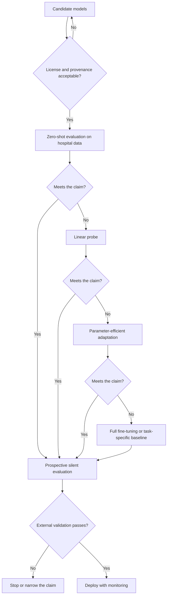

# Medical Foundation Models

> **Module 07 — Deep Learning, Multimodal Models, and LLMs**
> Topic 06 of 11
> Estimated study time: 4 hours
> Prerequisites: Topics 01 to 05
> Version 2026.3

## 1. Why this topic exists

A foundation model is a large model pretrained on broad data that can be adapted to many downstream
tasks. The economic promise is that a hospital does not need to train from scratch; it needs to
adapt, evaluate, and monitor. The clinical risk is that the adaptation looks cheap, the evaluation
looks familiar, and the evidence that supported the pretrained model does not transfer to the task at
hand.

The industry problem is a mismatch of evidence. A foundation model's model card reports performance
on benchmarks that were chosen by its developer. A hospital's question is about its own population,
its own documentation style, its own scanners, and its own workflow. The gap between the two is not
closed by a higher benchmark score. It is closed by external validation on the hospital's data, and
that validation is the expensive part of the project, not the adaptation.

Four costs follow.

**Provenance cost.** A model pretrained on a corpus that includes the hospital's region, language, and
documentation culture is more likely to transfer than one trained elsewhere, but the corpus is often
undisclosed in detail. A vendor may state the number of tokens and the source categories without
stating the dates, the licenses, or the filtering. A team that cannot establish provenance cannot
establish that the model was not trained on its test set, and cannot answer a regulator's question
about data governance.

**Adaptation cost.** Full fine-tuning of a large model requires memory for weights, gradients,
optimizer state, and activations. For a 7-billion-parameter model in mixed precision, the parameter
state alone is 112 gigabytes, which exceeds a single accelerator. Parameter-efficient methods reduce
the trainable state to a fraction of a percent, but they change what the model can learn. The choice
between full fine-tuning, adapters, and prompting is a capacity decision, not a convenience.

**Evaluation cost.** A foundation model can be evaluated zero-shot, with a linear probe, with a
parameter-efficient adapter, or with full fine-tuning. Each is a different model, and each needs its
own validation. A team that compares a fine-tuned foundation model with a task-specific baseline is
comparing two systems, not two architectures, and the comparison must hold the data and the
evaluation fixed.

**Lock-in cost.** A hosted foundation model can be deprecated, repriced, or changed without notice. A
model that is fine-tuned locally can be frozen, but it carries the maintenance cost of the base
model's license and the security cost of hosting it. The total cost of ownership includes the
migration path, which is rarely in the business case.

This topic teaches the foundation-model lifecycle as an evidence problem. It covers the pretraining
corpora, the adaptation methods and their arithmetic, the evaluation that a clinical claim requires,
and the regulatory treatment of a model that someone else trained. It does not teach how to pretrain
a foundation model, which is a datacenter activity outside the scope of a hospital team. It teaches
how to decide whether to use one, how to adapt it, and how to know when the adaptation has failed.

> **Note:** "Foundation model" in this topic includes large language models, medical vision-language
> models, and single-modality models pretrained on large unlabelled corpora. The adaptation and
> evaluation mechanics are shared; the pretraining data differ.

## 2. Learning outcomes

By the end of this topic you can:

1. **Distinguish** pretraining, adaptation, and evaluation, and **state** which evidence each stage
   contributes to a clinical claim.
2. **Compute** the memory and compute cost of full fine-tuning, LoRA, and a linear probe for a stated
   model size, and **choose** among them for a stated data and hardware budget.
3. **Design** an adaptation study that compares a foundation model with a task-specific baseline on
   the same split and the same metric.
4. **Evaluate** the risk of catastrophic forgetting with a held-out general task, and **interpret** a
   drop in capability.
5. **Audit** a model card for provenance, license, evaluation population, and known limitations, and
   **identify** the claims that cannot be checked.
6. **Interpret** a benchmark result for a medical foundation model and **distinguish** what the
   benchmark measures from what a clinician needs.
7. **Design** a monitoring plan that detects degradation after a base-model update or a population
   shift.
8. **Write** an adaptation report that a regulator, a clinical reviewer, and an executive can each
   read for their own purpose.

Outcomes 2 and 4 are computational. Outcomes 1, 3, and 7 are design outcomes assessed by rubric.
Outcome 5 and 6 are assessed in the evaluation dossier.

The outcomes are ordered by the lifecycle: the claim, the cost, the study, the failure, the audit.
A learner who can compute the adaptation cost but cannot audit a model card is equipped to run an
experiment but not to advise a procurement. Both are part of the role, and the topic assesses both.
The evaluation dossier is where the two meet: it requires the arithmetic and the judgement in one
document.

## 3. The core mental model

A foundation model is a prior. Pretraining produces a broad representation; adaptation specialises
it; evaluation determines whether the specialisation is adequate for the claim. The three stages have
different data, different costs, and different failure modes, and conflating them is the source of
most overclaiming.

```text
  Pretraining                 Adaptation                 Evaluation
  ------------                -----------                ----------
  broad, unlabelled           narrow, labelled           held-out, external
  huge compute                small compute              small compute
  general capability          task specialisation        claim-specific evidence
  vendor's benchmark          hospital's validation      clinical decision

  Failure:                    Failure:                   Failure:
  contamination               forgetting                 optimistic split
  opaque corpus               overfitting                missing subgroup
  benchmark gaming            wrong adaptation           wrong metric
```

The second mental model is the adaptation ladder. Each rung adds capacity and cost, and each answers
a different question. The ladder should be climbed from the bottom, and the team should stop at the
first rung that meets the claim.

```text
  rung 5  full fine-tuning        highest capacity, highest cost, forgetting risk
  rung 4  parameter-efficient     high capacity, low cost, adapter capacity limit
  rung 3  linear probe            tests the representation, cheap, no forgetting
  rung 2  few-shot prompting      tests the interface, no training, unstable
  rung 1  zero-shot prompting     tests whether the model knows the task at all
```

The ladder is a diagnostic as well as a cost model. If a linear probe on the frozen representation
matches full fine-tuning, the representation already contains the task and the extra capacity is
wasted. If zero-shot is close to the probe, the task is one the model has seen. If every rung fails,
the problem is the data or the label, not the adaptation.

The third mental model is the data pyramid. A foundation model's pretraining corpus is broad and
unlabelled; the adaptation set is narrow and labelled; the evaluation set is smaller still and must
be independent. The sizes are not interchangeable, and a large pretraining corpus does not
compensate for a small, biased adaptation set.

```text
  pretraining      billions of tokens, unlabelled, broad
  adaptation       thousands to millions of examples, labelled, narrow
  validation       hundreds to thousands, labelled, independent
  test             hundreds to thousands, labelled, locked
  external         a different site or period, labelled
```

The fourth mental model is the distinction between capability and calibration. A foundation model can
have the capability to answer a question and still be badly calibrated on the population it serves.
Capability is measured by discrimination or accuracy; calibration is measured by the agreement between
predicted probability and observed frequency. A model that is accurate on average and overconfident in
a subgroup is a safety problem, and the benchmark that established its capability did not measure it.



The diagram encodes a discipline: each rung is evaluated before the next is tried, and the claim is
narrowed if external validation fails. The alternative, which is common, is to fine-tune first and
evaluate last, by which point the team has spent its budget and is motivated to find a result.

The fifth mental model is the difference between the model's capability and its validated scope. A
foundation model has a broad capability distribution, and a deployment selects a slice of it. The
slice is defined by the intended use, the population, the input format, and the workflow. The
validated scope is the part of the slice that was tested. A model can be capable across the slice and
validated on a fraction of it, and the fraction is what the deployment may rely on.

A corollary is that the same base model can support several devices with different validated scopes.
A summarisation device and a triage device built on the same weights are different devices, with
different evaluations and different change-control plans. The shared base model reduces the
engineering cost, not the evidence cost.

## 4. Definitions and vocabulary

| Term | Definition | Common misuse | Unit or convention |
|---|---|---|---|
| Foundation model | Large model pretrained on broad data, adaptable to many tasks | Any pretrained model | Model class |
| Pretraining | Training on broad data with a general objective | Confusing with fine-tuning | Stage |
| Adaptation | Specialising a pretrained model to a task | Assuming it is always fine-tuning | Stage |
| Fine-tuning | Updating weights on task data | Confusing with prompting | Stage |
| Linear probe | Classifier trained on frozen features | Confusing with fine-tuning | Method |
| Parameter-efficient fine-tuning | Updating a small subset of parameters | Assuming it matches full fine-tuning | Method |
| LoRA | Low-rank adaptation with trainable matrices | Assuming it adds inference latency | Method |
| Adapter | Small module inserted into a frozen model | Confusing with LoRA | Method |
| Prompt tuning | Learned soft prompt with frozen weights | Confusing with prompt engineering | Method |
| Full fine-tuning | Updating all weights | Assuming it is always better | Method |
| Catastrophic forgetting | Loss of pretrained capability during adaptation | Calling any drop forgetting | Phenomenon |
| Zero-shot | Evaluation without task-specific examples | Assuming it implies generalisation | Setting |
| Few-shot | Evaluation with a small number of examples in context | Confusing with fine-tuning | Setting |
| Benchmark | Fixed evaluation set with a metric | Assuming it measures clinical utility | Artefact |
| Contamination | Test data present in pretraining | Assuming it is rare | Defect |
| Canary string | Marker to detect benchmark contamination | Assuming it prevents contamination | Technique |
| Model card | Document describing intended use and performance | Assuming it is validated | Artefact |
| Datasheet | Document describing a dataset | Confusing with a model card | Artefact |
| Provenance | Origin and history of data or a model | Confusing with license | Property |
| License | Legal terms of use | Assuming it permits clinical use | Legal term |
| Open weights | Model weights distributed for use | Confusing with open source | Licensing |
| Distillation | Training a smaller model from a larger one | Confusing with compression | Method |
| Quantisation | Reducing numerical precision | Confusing with distillation | Method |
| Context window | Maximum input length | Confusing with the architecture limit | Tokens |
| Emergent capability | Ability appearing at scale | Assuming it is reliable | Phenomenon |
| Scaling law | Relationship between compute, data, and loss | Assuming it predicts clinical utility | Empirical relation |
| Compute-optimal | Allocation of a fixed compute budget | Assuming it is data-optimal | Design principle |
| Instruct tuning | Training a model to follow instructions | Confusing with alignment | Method |
| RLHF | Reinforcement learning from human feedback | Assuming it guarantees safety | Method |
| Hallucination | Fluent but unsupported output | Confusing with a factual error | Failure |
| Grounding | Tying output to retrieved evidence | Confusing with accuracy | Property |
| Benchmark saturation | Scores near the ceiling | Assuming the task is solved | Phenomenon |
| External validation | Evaluation on a different site or period | Confusing with a random split | Design |
| Prospective evaluation | Evaluation in the deployment workflow | Confusing with retrospective | Design |
| Silent mode | Running a model without affecting care | Confusing with deployment | Design |
| Total cost of ownership | All costs of running a system | Counting only inference | Accounting |

> **Note:** "Open weights" is not "open source". A model can publish weights under a license that
> restricts commercial use, requires attribution, or prohibits clinical deployment. The license must
> be read before the model is used, not after.

## 5. The mechanics, step by step

This section is a sixteen-step procedure from a clinical claim to a monitored deployment. Steps 1 to
4 define the claim and screen the candidates. Steps 5 to 8 evaluate the representation. Steps 9 to 12
adapt. Steps 13 to 16 validate, monitor, and document.

### Step 1. Write the claim and the baseline

**Input:** the clinical decision and the current practice.

**Output:** a claim sentence, a baseline, and a minimum acceptable effect.

**Rationale:** A foundation model is justified by beating a baseline, not by being large. The baseline
is usually a task-specific model, a rule, or current practice. The claim must state the population,
the setting, the time frame, and the metric. Without a baseline, any result is an improvement on
nothing.

**Branch point:** if the baseline is a rule that clinicians already trust, the foundation model must
beat it on the same cases and must not increase the workload. If the baseline is a task-specific
model, the comparison must use the same split and the same preprocessing.

### Step 2. Screen the candidates on license and provenance

**Input:** a list of candidate models.

**Output:** a shortlist with license terms, training-data summary, intended use, and known
limitations.

**Rationale:** A model that cannot be used in the intended setting is not a candidate, regardless of
its benchmark score. The license may restrict commercial use, clinical use, or redistribution. The
provenance determines whether the model could have seen the hospital's data, and whether the
population it was trained on resembles the population it will serve.

**Branch point:** if the license is unclear, treat the model as unusable until counsel advises. If
the training-data summary is absent, the model cannot be assessed for contamination and should be
ranked below a model with a documented corpus.

### Step 3. Define the adaptation budget

**Input:** the available labelled data, the hardware, and the timeline.

**Output:** a maximum adaptation method and a maximum compute budget.

**Rationale:** The method follows from the budget, not the reverse. A team with 2,000 labelled notes
and one 24-gigabyte accelerator cannot full-fine-tune a 7-billion-parameter model. A team with
200,000 notes and eight accelerators can. Writing the budget first prevents the common failure of
choosing a method that cannot be run.

### Step 4. Build the evaluation harness before adapting

**Input:** the split, the metrics, and the baseline.

**Output:** a harness that any candidate model can be run through.

**Rationale:** The harness must exist before the first adaptation, or the evaluation will be shaped
by the result. It must fix the split, the preprocessing, the metric, and the reporting format. A
harness built after the fact is a description of what was run, not a test of the claim.

### Step 5. Evaluate zero-shot

**Input:** the candidate model and the harness.

**Output:** a zero-shot score and a sample of errors.

**Rationale:** Zero-shot establishes whether the model knows the task at all. It is cheap, it
requires no training, and it often reveals that the task is framed in a way the model does not
understand. The error sample is more informative than the score: it shows whether the model is
failing on the task or on the interface.

### Step 6. Evaluate a linear probe

**Input:** frozen representations and a labelled training set.

**Output:** a probe score and a comparison with zero-shot.

**Rationale:** A linear probe tests whether the representation contains the information needed for
the task. If a probe on frozen features matches full fine-tuning, the representation is sufficient
and the extra capacity is unnecessary. If the probe fails while fine-tuning succeeds, the task
requires adapting the representation, not only reading it.

### Step 7. Choose the adaptation method

**Input:** the probe result, the budget, and the data size.

**Output:** a method and a justification.

**Rationale:** The methods differ in capacity, cost, and forgetting risk. The choice should be the
cheapest method that meets the claim, and it should be stated with the evidence that the cheaper
methods were tried.

| Method | Trainable parameters (7B example) | Memory | Capacity | Forgetting risk |
|---|---:|---|---|---|
| Zero-shot | 0 | Inference only | Interface only | None |
| Linear probe | ~4k to ~1M | Small | Read-out only | None |
| Prompt tuning | ~10k to ~1M | Small | Interface plus soft prompt | Low |
| LoRA, rank 16, q+v | ~8.4M | ~14 GB | Moderate | Low |
| LoRA, rank 64, all linear | ~160M | ~16 GB | High | Moderate |
| Full fine-tuning | 7B | ~112 GB | Highest | High |

### Step 8. Establish the compute-optimal check

**Input:** the model size and the token budget.

**Output:** a statement of whether the adaptation data are sufficient for the method.

**Rationale:** A large model adapted on a tiny dataset will overfit, and a small model adapted on a
huge dataset will underfit. The scaling literature relates loss to model size and data, but the
clinical constraint is usually the number of labelled examples, not the compute. A model with
billions of parameters and a few thousand examples is a high-variance estimator, and the variance
shows up as seed instability.

### Step 9. Configure LoRA

**Input:** the model architecture, the target modules, and the rank.

**Output:** an adapter configuration and a parameter count.

**Rationale:** LoRA freezes the base weights and learns a low-rank update `B A` for selected
matrices. The trainable parameter count for one module is `r * (d_in + d_out)`. The rank controls
capacity; the target modules control where the adaptation acts. Attention projections are the common
choice; adapting all linear layers increases capacity and cost.

**Branch point:** if the task is a style or format adaptation, a low rank on the attention
projections is usually sufficient. If the task requires new knowledge, LoRA may be insufficient and
retrieval or full fine-tuning is needed.

### Step 10. Train with a low rate and early stopping

**Input:** the adapter configuration and the protocol from Topic 02.

**Output:** a trained adapter and a validation curve.

**Rationale:** Adapters are trained with a higher rate than full fine-tuning because the trainable
parameters are few and randomly initialised. The base weights are frozen, so the forgetting risk is
low, but the adapter can still overfit the adaptation set. Early stopping on a held-out set is the
primary control.

### Step 11. Test for catastrophic forgetting

**Input:** a held-out general task that the base model could perform.

**Output:** a before-and-after score and a decision.

**Rationale:** Fine-tuning can overwrite the representation. The test is a task the base model was
good at and the adaptation data do not cover, such as a general language task or a different clinical
task. A large drop is evidence of forgetting; a small drop is acceptable if the target metric
improves. The test must be run before and after with the same harness.

### Step 12. Compare with the baseline on the same split

**Input:** the adapted model, the baseline, and the harness.

**Output:** a paired comparison with confidence intervals.

**Rationale:** The comparison must be paired: the same patients, the same notes, the same threshold.
An unpaired comparison confounds the model with the population. The confidence interval must reflect
the clustering by patient, not the number of notes.

### Step 13. Run external validation

**Input:** a different site or a later period.

**Output:** an external metric and a transport statement.

**Rationale:** Internal validation establishes that the model works where it was developed. External
validation establishes whether it transports. A foundation model's broad pretraining is often cited
as evidence of transport, but the pretraining distribution is not the deployment distribution, and
the claim must be tested.

### Step 14. Test subgroups and calibration

**Input:** the external set with group labels.

**Output:** subgroup metrics and calibration curves.

**Rationale:** A model can improve on average and worsen for a subgroup. The subgroups must be
defined before the analysis, not chosen after looking at the results. Calibration matters whenever
the score is used as a probability or a threshold.

### Step 15. Build the monitoring plan

**Input:** the deployment population and the model's known limits.

**Output:** a monitoring specification with metrics, thresholds, and actions.

**Rationale:** A foundation model can change when the base model is updated, when the population
shifts, or when the input pipeline changes. The monitoring must detect each. Input drift is detected
by distribution checks on features or embeddings; output drift by changes in the score distribution;
outcome drift by periodic revalidation.

### Step 16. Document the adaptation

**Input:** all of the above.

**Output:** a model card, a datasheet, and an adaptation report.

**Rationale:** The documentation is the evidence that the model was evaluated, and it is the artefact
a regulator, a clinical reviewer, and a successor team will use. It must state the base model, the
adaptation data, the method, the evaluation, the limitations, and the monitoring.

The failure modes specific to foundation models are worth naming.

**Contamination.** The benchmark was in the pretraining corpus. The signature is a score far above
the published range and a sharp drop on a private set. The fix is a private test set and a canary
string, not a better model.

**Catastrophic forgetting.** The adaptation overwrote the representation. The signature is a drop on
a held-out general task while the target metric improves. The fix is a lower rate, an adapter, or
rehearsal with a mixture of data.

**Benchmark overfitting.** The model was selected because it scored well on the benchmark, and the
selection is the overfitting. The signature is a smaller effect on the hospital's data than on the
benchmark. The fix is to select on the hospital's validation set, not on the leaderboard.

**Adaptation-set leakage.** The adaptation and evaluation sets share patients or documents. The
signature is an evaluation score that does not reproduce on a new sample. The fix is a patient-level
split fixed before adaptation.

**Distribution mismatch.** The pretraining population differs from the deployment population. The
signature is a subgroup gap or an external drop. The fix is external validation and, if needed,
domain adaptation.

**License violation.** The model's license prohibits clinical use or redistribution. The signature is
a legal review that arrives late. The fix is to read the license at screening.

**Silent base-model update.** The hosted model changes version. The signature is a change in output
distribution with no change in inputs. The fix is version pinning and regression testing.

### The evidence hierarchy for a foundation-model claim

Not all evaluations support the same claim. The table states what each design can and cannot
establish, and it is the basis for the report in Step 16.

| Design | Supports | Does not support | Typical cost |
|---|---|---|---|
| Benchmark score | Capability on the benchmark | Performance on the hospital's population | Low |
| Internal holdout | Discrimination in a similar population | Transport, workflow effect | Low |
| Temporal holdout | Performance in a later period | A new site or a changed workflow | Medium |
| Site-held-out | Transport across the included sites | A site unlike any included | Medium |
| Prospective silent | Performance on live data without action | Outcome benefit | High |
| Prospective with action | Outcome benefit in the workflow | Generality beyond the trial | Very high |

A foundation model's marketing often cites the first row and implies the last. The gap between them
is the entire evaluation programme, and a buyer who does not ask which row a claim comes from will
overpay for capability and underpay for evidence.

### What a linear probe actually tests

A linear probe trains a classifier on the frozen representation and evaluates it on held-out data.
It answers a specific question: is the information needed for the task linearly decodable from the
representation? If yes, the representation contains the task and the adaptation is a read-out
problem. If no, the representation does not contain the task at the required level of abstraction,
and the adaptation must change the representation.

The probe has two failure modes that are easy to miss. The first is an under-powered probe: a linear
classifier on 200 examples may fail because of sample size, not because the representation is
inadequate. The second is a probe that is tuned on the test set: the regularisation strength and the
feature normalisation must be selected on validation, or the probe score is optimistic. A probe
reported without its sample size and its tuning procedure is not evidence.

The probe is also a cheap falsification test for the whole project. If a probe on the frozen
representation is at chance for a task that clinicians perform well, the representation does not
encode the relevant structure, and no amount of adapter capacity will create it from the same
pretraining. The team should look for a different base model or a different task framing.

### Curating the adaptation set

The adaptation set is the smallest and most consequential dataset in the project. Four properties
determine whether it can support the claim.

**Label quality.** A foundation model will learn the label policy, including its noise. If the
follow-up plan labels were extracted by a rule from the note, the model learns the rule and reports a
high score for reproducing it. The label policy must be documented, and a sample must be adjudicated
by a clinician.

**Representativeness.** The adaptation set must cover the population and the documentation styles
that the model will see. A set drawn from one site and one year will produce a model that is tuned to
that site and year. Stratified sampling by site, period, and note type is cheap and improves the
external result.

**Size relative to the method.** A full fine-tune of a 7-billion-parameter model on 2,000 examples
will overfit, regardless of the regularisation. A linear probe or a low-rank adapter is more
appropriate at that size, and the choice should be made on the learning curve, not on the method's
reputation.

**De-duplication.** Near-duplicate notes are common: a discharge summary copied into a clinic note,
a template with a few fields changed. Duplicates inflate the effective sample size and leak between
splits. A near-duplicate detection pass before splitting is a necessary step, and its threshold must
be recorded.

| Property | Test | Failure if ignored |
|---|---|---|
| Label quality | Clinician adjudication of a sample | Model reproduces the labeller, not the concept |
| Representativeness | Stratified counts by site and period | Poor external performance |
| Size | Learning curve against data fraction | Overfitting or underfitting |
| Duplication | Near-duplicate clustering | Leakage between splits |
| Consent and license | Data-use agreement review | Unlawful training |
| Version | Content hash | Irreproducible run |

## 6. Worked example

A hospital wants to summarise discharge summaries into a structured follow-up plan. The candidate is
a 7-billion-parameter open-weight language model. The hospital has 12,000 discharge summaries with
1,400 labelled follow-up plans, one accelerator with 24 gigabytes of memory, and a six-week window.
The baseline is a task-specific encoder classifier that achieves a micro-averaged F1 of 0.61.

This section computes the adaptation options, the memory, the compute, two diagnostics, and one
sensitivity.

### Step 1. Full fine-tuning does not fit

For a 7-billion-parameter model in mixed precision with Adam:

```text
weights, fp16:        7e9 * 2 bytes = 14.0 GB
gradients, fp16:      7e9 * 2 bytes = 14.0 GB
Adam first moment:    7e9 * 4 bytes = 28.0 GB
Adam second moment:   7e9 * 4 bytes = 28.0 GB
fp32 master weights:  7e9 * 4 bytes = 28.0 GB
total:                               112.0 GB
```

The parameter state alone is 112 gigabytes, before activations. A 24-gigabyte accelerator cannot hold
it. Full fine-tuning is not a candidate, and the decision is arithmetic, not preference.

### Step 2. LoRA fits

LoRA freezes the base weights and trains two small matrices per target module. For a rank of 16 on
the query and value projections, with a model width of 4,096 and 32 layers:

```text
per module:      r * (d_in + d_out) = 16 * (4,096 + 4,096) = 131,072
per layer:       2 modules * 131,072 = 262,144
32 layers:       32 * 262,144 = 8,388,608
fraction of 7B:  8,388,608 / 7e9 = 0.0012, or 0.12 percent
```

The adapter state, counting weights, gradients, and two Adam moments at four bytes each, is
`8,388,608 * 4 * 4 = 134,217,728` bytes, or 128 mebibytes. The frozen weights in 16-bit precision are
14 gigabytes. The total is about 14.1 gigabytes, which fits on the 24-gigabyte accelerator with room
for activations at a small batch.

The trainable parameter count is 0.12 percent of the model. That is the economic argument for LoRA,
and it is also the capacity limit: the adapter can change how the model uses its representation, but
it cannot add knowledge the representation does not contain.

### Step 3. Compute

The adaptation set has 12,000 summaries at 1,024 tokens, which is `12,288,000` tokens per epoch. For
three epochs, `36,864,000` tokens.

Full fine-tuning would cost approximately `6 * N * D`:

```text
6 * 7e9 * 36.864e6 = 1.548e18 FLOPs = 1.55 exafLOPs
```

At 100 effective teraflops, that is `1.548e18 / 1e14 = 15,480` seconds, or 4.3 hours. The compute is
not the obstacle; the memory is.

LoRA reduces the backward cost because the frozen weights do not need weight gradients, but the
forward pass and the activation gradients remain. A planning estimate is two-thirds of the full
cost, or about 2.9 hours. The difference is smaller than the memory difference, which is why LoRA is
described as a memory method more than a compute method.

### Step 4. Diagnostic one: forgetting on a general task

The team evaluates the base model and the adapted model on a held-out clinical summarisation task
that was not in the adaptation data. The metric is a factual consistency score from a validated
evaluator, not a fluency score.

```text
base model:     0.78
adapted model:  0.74
target task:    F1 0.61 -> 0.72
```

The adapted model loses 0.04 on the general task and gains 0.11 on the target. The trade is
acceptable if the general task is not part of the intended use. If the intended use includes
general summarisation, the loss is a regression and the adaptation must be narrowed. The diagnostic
is not the absolute drop; it is the drop relative to the intended use.

A full fine-tune at a high rate would typically show a larger drop, and the team should compare the
LoRA adapter with a full fine-tune on a small subset if the hardware allows, because the comparison
is the evidence that the adapter is sufficient.

### Step 5. Diagnostic two: subgroup performance

The team stratifies the target F1 by language of the note, site, and note length.

```text
subgroup            n      base F1   adapted F1
English             10,400   0.62      0.73
Spanish              1,100   0.51      0.58
Other                  500   0.44      0.49
Site A               7,200   0.63      0.74
Site B               4,800   0.58      0.68
Notes under 500 t    2,300   0.66      0.75
Notes over 2,000 t   1,900   0.55      0.64
```

The adapted model improves every subgroup, but the gap between English and other languages widens
from 0.18 to 0.24. The model is better everywhere and more unequal. Whether that is acceptable is a
clinical and ethical judgement, not a statistical one, and it must be made explicitly. A report that
gives only the overall F1 has hidden the widening gap.

### Step 6. Vary one assumption: rank 16 to rank 64

Suppose the team increases the rank to 64 to improve the Spanish performance.

```text
per module:     64 * 8,192 = 524,288
per layer:      2 * 524,288 = 1,048,576
32 layers:      33,554,432
fraction:       33,554,432 / 7e9 = 0.0048, or 0.48 percent
adapter state:  33,554,432 * 4 * 4 = 536,870,912 bytes = 512 MiB
total memory:   about 14.5 GB
```

The parameter count quadruples, from 8.4 million to 33.6 million, and the adapter state grows from
128 mebibytes to 512 mebibytes. The memory still fits. The conclusion changes in a specific way: if
the Spanish gap is due to the adapter's capacity, the higher rank should narrow it; if the gap is due
to the pretraining corpus's language mix, the higher rank will not help and the team needs
language-specific data or a different base model. The experiment distinguishes the two hypotheses,
and it is cheap relative to a full fine-tune.

### Step 7. The statistical power of the comparison

The adapted model improves F1 from 0.61 to 0.72 on a test set of 1,800 summaries. The improvement is
large, but its confidence interval depends on the clustering. If the 1,800 summaries come from 1,200
patients, the effective sample size is closer to 1,200, and the interval is wider than a naive
calculation suggests. A paired bootstrap that resamples patients, not summaries, gives the interval
that the claim requires.

The same arithmetic applies to the subgroup analysis. The Spanish subgroup has 1,100 summaries from
perhaps 700 patients, and the improvement from 0.51 to 0.58 has an interval that may include zero.
Reporting the point estimate without the interval invites a claim of improvement that the data do not
support. The correct statement is that the point estimate improved and the interval is reported.

### Step 8. What the arithmetic does not establish

The memory and compute establish that the adaptation can be run. They do not establish that it
improves care, that the summary is factually correct, or that the model is safe for the intended use.
Those require a clinical evaluation with adjudicated outputs, a factual-consistency assessment, and a
prospective silent deployment. The arithmetic is the entry ticket, not the evidence.

A note on the F1 values: micro-averaged F1 on a structured extraction task is sensitive to the most
common field, so a model that improves the common field and ignores the rare one can show a large
aggregate gain. The team should report per-field F1 alongside the aggregate, and the follow-up plan's
rare fields, such as a specialist referral, are often the clinically important ones. The aggregate is
a summary, not a substitute for the field-level table.

The six-week window is the binding constraint, not the accelerator. The adaptation run takes hours;
the adjudication of 400 summaries by two clinicians takes two weeks; the external validation and the
subgroup analysis take another two; and the write-up takes the rest. A plan that allocates five weeks
to modelling and one to evaluation has misallocated the schedule, because the evaluation is the part
that determines whether the model can be used.

The adaptation itself is the shortest task in the plan. That is the practical meaning of the
foundation-model economics: the model is the cheap part, and the evidence is the product.

## 7. Code, query, or calculation

The code below computes the parameter state for full fine-tuning and for LoRA at several ranks, and
the compute for a pretraining run. It is the arithmetic that decides which adaptation method is
feasible before any data are touched.

**Assumptions.** The model has 7 billion parameters, 32 layers, and a width of 4,096. Full
fine-tuning uses mixed precision with fp16 weights and gradients and fp32 optimizer state plus an
fp32 master copy. LoRA targets the query and value projections only. Memory is reported in decimal
gigabytes.

```python
P = 7_000_000_000
GB = 1e9

def full_state(params):
    w = params * 2
    g = params * 2
    m = params * 4
    v = params * 4
    master = params * 4
    return {
        "weights": w / GB,
        "grads": g / GB,
        "adam_m": m / GB,
        "adam_v": v / GB,
        "master": master / GB,
        "total": (w + g + m + v + master) / GB,
    }

state = full_state(P)
print("full fine-tune:")
for k, val in state.items():
    print(f"  {k:>8}: {val:7.1f} GB")

d, layers = 4096, 32
print(f"{'rank':>5}{'params':>12}{'fraction':>10}{'adapter MB':>12}{'total GB':>10}")
for r in [4, 8, 16, 32, 64, 128]:
    per_module = r * (d + d)
    total = layers * 2 * per_module
    adapter_bytes = total * 4 * 4
    total_gb = P * 2 / GB + adapter_bytes / GB
    print(f"{r:>5}{total:>12}{total / P:>10.4f}{adapter_bytes / 1e6:>12.1f}{total_gb:>10.2f}")

for N, D in [(300e6, 20e9), (7e9, 2e12)]:
    flops = 6 * N * D
    print(f"N={N:.0e} D={D:.0e}: {flops:.2e} FLOPs, "
          f"{flops / 400e12 / 86400:.1f} days at 400 TFLOPS")
```

**Observed output:**

```text
full fine-tune:
   weights:    14.0 GB
     grads:    14.0 GB
    adam_m:    28.0 GB
    adam_v:    28.0 GB
    master:    28.0 GB
     total:   112.0 GB
 rank      params  fraction  adapter MB  total GB
    4     1048576    0.0001        16.8     14.02
    8     2097152    0.0003        33.6     14.03
   16     8388608    0.0012       134.2     14.13
   32    16777216    0.0024       268.4     14.27
   64    33554432    0.0048       536.9     14.54
  128    67108864    0.0096      1073.7     15.07
N=3e+08 D=2e+10: 3.60e+19 FLOPs, 1.0 days at 400 TFLOPS
N=7e+09 D=2e+12: 8.40e+22 FLOPs, 2431.0 days at 400 TFLOPS
```

The full fine-tune state is 112 gigabytes, which is 4.7 times the capacity of a 24-gigabyte
accelerator. The LoRA table shows that even rank 128, which is a large adapter, adds only 1.07
gigabytes of state and keeps the total at 15.07 gigabytes. The memory argument for LoRA is decisive
in this configuration, and it is arithmetic rather than a rule of thumb.

The pretraining lines are a scale check. A 300-million-parameter model trained on 20 billion tokens
costs 3.6e19 FLOPs, about one day on a single 400-teraflop accelerator under perfect utilisation. A
7-billion-parameter model trained on 2 trillion tokens costs 8.4e22 FLOPs, about 2,431 days on one
accelerator. The second is a datacenter job; the first is a departmental job. This is why hospitals
adapt rather than pretrain.

The second block computes the evaluation arithmetic that a claim requires: the number of patients,
the number of notes, and the width of a confidence interval for a proportion.

```python
import math

def wilson(k, n, z=1.96):
    p = k / n
    denom = 1 + z * z / n
    centre = (p + z * z / (2 * n)) / denom
    half = z * math.sqrt(p * (1 - p) / n + z * z / (4 * n * n)) / denom
    return centre - half, centre + half

for k, n in [(216, 1800), (63, 700)]:
    lo, hi = wilson(k, n)
    print(f"{k}/{n}: p={k/n:.3f}, 95% CI [{lo:.3f}, {hi:.3f}], width {hi-lo:.3f}")
```

**Observed output:**

```text
216/1800: p=0.120, 95% CI [0.106, 0.136], width 0.030
63/700: p=0.090, 95% CI [0.071, 0.113], width 0.042
```

The first line is the overall error rate and the second is the Spanish subgroup. The subgroup
interval is 40 percent wider because the sample is smaller. A claim that the subgroup improved needs
an interval that excludes the null, and the width of the interval is the first thing to check.

The interval above treats each note as independent. If the notes cluster within patients, the true
interval is wider, and the Wilson formula understates it. The correct procedure is a cluster bootstrap
that resamples patients, which is a few lines of code and a material change to the conclusion when the
cluster size is large. A report that quotes a note-level interval for a patient-level claim has
overstated its precision, and the overstatement is usually larger than the effect being claimed.

The same caution applies to the F1 estimates in the worked example. F1 is a ratio of counts, not a
proportion, and its interval is best obtained by bootstrapping the evaluation set rather than by a
closed-form formula. The arithmetic in this section is a planning tool, not a substitute for the
resampling that the final report requires.

## 8. Data, standards, and regulatory context

The regulatory treatment of a foundation model depends on the role the organisation plays, not on the
model's size. The same weights can be a research artefact, a general-purpose model with documentation
duties, or a component of a high-risk device, and the obligations differ in each case. The sections
below state which role each framework addresses.

**Two regulatory roles.** A hospital that uses a foundation model through a hosted interface is a
deployer. A hospital that fine-tunes an open-weight model and distributes it, or places it on the
market under its own name, may be a provider. The distinction determines the obligations, and it is
a legal question that should be settled before the build.

**FDA.** A foundation model that informs a clinical decision is device software if it meets the
definition of a device and is intended for a medical purpose. The FDA draft guidance on AI-enabled
device software functions (January 2025, docket FDA-2024-D-4488) describes the submission content,
and the final predetermined change control guidance (December 2024, docket FDA-2022-D-2628) describes
how anticipated changes, including retraining and base-model updates, are pre-authorised. A device
built on a hosted model must also address what happens if the host changes the model, which is a
supply-chain risk that the guidance's lifecycle framing reaches but does not resolve.

**European Union.** Regulation (EU) 2024/1689 imposes provider obligations on general-purpose AI
models from 2 August 2025: technical documentation, information for downstream providers, a copyright
policy, and a public summary of training content. Models with training compute above `10^25` FLOP are
presumed to carry systemic risk and face additional evaluation and incident-reporting duties. A
clinical system built on a general-purpose model is high-risk under Annex III if it is a safety
component or informs a decision with a significant effect on health. The obligations include risk
management, data governance, technical documentation, human oversight, accuracy, robustness, and
post-market monitoring.

**NIST.** The AI Risk Management Framework and its Generative AI Profile (NIST AI 600-1, July 2024)
are voluntary. The profile's twelve risks include confabulation, data privacy, harmful bias,
information integrity, and value-chain integration. For a foundation model, the value-chain risk is
central: the deploying hospital depends on a provider whose training data, evaluation, and update
schedule it does not control.

**HIPAA.** Training on protected health information, or sending it to a hosted model, requires a
business associate agreement or de-identification. A foundation model that was pretrained on data
that included the hospital's patients raises a question that the hospital may not be able to answer
from the model card, and the contract should require disclosure of whether the hospital's data were
used.

**Licensing.** Open weights are not open source. Licenses vary from permissive to research-only, and
some restrict clinical use, redistribution, or output use. A license review is part of candidate
screening, not a legal afterthought.

| Framework | Status | What it constrains | What it does not |
|---|---|---|---|
| FDA AI device draft (2025) | Draft | Submission content | Architecture choice |
| FDA PCCP (2024) | Final | Base-model and retraining changes | Model quality |
| EU AI Act GPAI rules | Binding from Aug 2025 | Provider documentation and safety | Clinical validity |
| EU AI Act high-risk rules | Binding, phased | Risk management and oversight | Technical thresholds |
| NIST AI 600-1 | Voluntary | Risk identification | Compliance |
| HIPAA | Binding in the US | PHI use and disclosure | Model safety |
| Model license | Contractual | Use, redistribution, clinical deployment | Performance |

**Data governance for a high-risk system.** The EU Act's data-governance requirements reach the
training, validation, and test data: they must be relevant, sufficiently representative, and free of
biases that would affect health or safety. For a hospital that adapts a foundation model, the
adaptation data are in scope even though the pretraining data are not under its control. The
practical consequence is that the hospital must document its adaptation data with the same care as a
device manufacturer documents a training set, and it must be able to state what it could not verify
about the base model's data.

**Contract terms for a hosted model.** A hosted model introduces obligations that a locally hosted
one does not. The contract should address six points: whether the hospital's data are used for
training, the retention period, the model version and notification of changes, the availability and
latency commitments, the audit rights, and the exit path including export of any fine-tuned
artefacts. A contract that addresses only price and uptime has left the technical risks unallocated.

| Contract term | Why it matters | Weak version |
|---|---|---|
| Training use of hospital data | Confidentiality and provenance | "May use aggregated data" |
| Retention | Privacy and audit | Unspecified |
| Version notification | Reproducibility | "Latest version" |
| Change notice period | Evaluation time | None |
| Audit rights | Regulatory access | Annual summary only |
| Exit and export | Lock-in | No export right |

**The audit file.** A foundation-model deployment should maintain an audit file with the base model
card, the license, the adaptation data datasheet, the adaptation report, the evaluation results, the
monitoring plan, and the change log. The file is the evidence that the device was evaluated, and it
is the first thing a regulator or an internal model-risk reviewer will ask for.

**What cannot be verified.** Some properties of a hosted foundation model cannot be verified by the
deploying hospital at any reasonable cost: the contents of the pretraining corpus, the absence of the
hospital's data from that corpus, the details of the safety tuning, and the behaviour of the model on
inputs outside the evaluated distribution. The correct response is not to pretend they are verified.
It is to state them as assumptions, to cover them with contractual representations, and to monitor
the consequences.

| Property | Verifiable by the hospital? | Response |
|---|---|---|
| Training corpus contents | No | Contractual representation |
| Hospital data excluded | No | Contractual representation, audit right |
| Safety tuning details | Partially | Vendor documentation |
| Behaviour on new population | Yes, slowly | Prospective silent evaluation |
| Version stability | Yes | Version pinning and regression tests |
| License scope | Yes | Legal review |

**Why documentation is not bureaucracy.** A foundation model's behaviour is specified by weights and
a training distribution, not by code that a reviewer can read. The documentation is the only artefact
that connects the behaviour to an intended use and an evaluation. A team that treats it as paperwork
has removed the only mechanism by which the model can be reviewed.

The frameworks converge on three requirements that a foundation-model project must meet: documented
provenance, a change-control process for the base model, and post-market monitoring. None of them
establishes that the model works. That is the job of the evaluation in Sections 5 and 6.

## 9. Industry practice and case evidence

**Med-PaLM and the encoding of clinical knowledge.** Singhal et al. evaluated a 540-billion-parameter
language model, Med-PaLM, on medical question answering and long-form responses (Nature
2023;620:172-180, doi:10.1038/s41586-023-06291-2). The paper reports 67.6 percent on the MedQA
(USMLE-style) question set, an improvement over the prior state of the art at the time, and a
clinician evaluation of long-form answers on axes including factuality, consensus, and harm. The
authors describe the long-form answers as falling short of clinician-generated answers on several
axes. The documented lesson is that benchmark accuracy and expert-judged quality are different
measurements, and the paper reports both.

**AMIE and the diagnostic dialogue.** Tu et al. evaluated a conversational diagnostic system, AMIE,
against primary care physicians in a randomised, double-blind, counterbalanced remote objective
structured clinical examination (OSCE) using text-chat consultations with validated patient actors
(Nature 2025, doi:10.1038/s41586-025-08866-7; preprint arXiv:2401.05654). The peer-reviewed version
reports 159 scenarios from India, Canada, and the United Kingdom, and finds the system superior on 30
of 32 specialist-rated axes and 25 of 26 patient-actor axes. The authors state the limitations
explicitly: the setting is text chat, the patient actors are simulated, and the results do not
establish real-world clinical effectiveness. The documented lesson is that a well-designed
simulation can produce a strong comparative result and still not be a deployment study.

**BiomedCLIP and multimodal pretraining.** Zhang et al. pretrained a biomedical vision-language model
on 15 million scientific image-text pairs (arXiv:2303.00915, 2023). The documented result is that the
model supports zero-shot and few-shot tasks and outperforms general-domain CLIP on several biomedical
benchmarks. The inference for a hospital, which the paper does not make, is that domain-specific
pretraining improves data efficiency but does not remove the need for evaluation on the hospital's
images and labels.

**MedSAM and promptable segmentation.** Ma et al. fine-tuned the Segment Anything Model on 1,570,263
medical image-mask pairs across 10 modalities and evaluated on 86 internal and 60 external tasks
(Nature Communications 2024;15:654, doi:10.1038/s41467-024-44824-z). The documented result is that the
adapted model outperformed the original and was competitive with modality-specific specialists. The
inference is that a foundation model can reduce annotation burden, but the evaluation remains
per-modality, and a strong average across 146 tasks does not establish performance on the one task a
clinic needs.

**How to read a foundation-model paper.** Four questions extract most of the evidence. What was the
evaluation population, and how does it differ from the intended-use population? What was the
reference standard, and who produced it? Was the evaluation blinded, and were the raters the same
people who developed the model? What was the unit of analysis, and was the split by patient or by
example? A paper that answers all four can be assessed; a paper that answers none is a demonstration,
not evidence.

A fifth question is specific to foundation models: what did the base model see during pretraining?
The answer is rarely available in detail, and its absence is itself information. A vendor that
publishes a data summary has accepted a level of scrutiny that a vendor that does not has avoided.

**What practitioners actually do.** In inference from public model cards and procurement documents,
three patterns recur. First, most hospitals do not pretrain; they adapt a hosted or open-weight model
and evaluate it on their own data. Second, the adaptation is increasingly parameter-efficient,
because the memory arithmetic makes full fine-tuning impractical on available hardware. Third, the
evaluation is the schedule bottleneck, not the training, and teams that plan for it finish; teams
that do not, ship a model with a benchmark slide and no local evidence.

**Geneformer and single-cell pretraining.** Theodoris et al. pretrained a transformer on a large
corpus of single-cell transcriptomes and reported improved performance on gene-network and
perturbation tasks relative to training from scratch (Nature 2023;618:616-624,
doi:10.1038/s41586-023-06139-9). The documented claim is about transfer within the transcriptomic
domain, and the paper's evaluations are computational. The inference for a translational team is that
a foundation model can compress a large unlabelled corpus into a reusable representation, but a
computational benchmark does not establish a biological or clinical effect; that requires wet-lab or
trial evidence.

**The evidence gap across the field.** A recurring pattern in the medical foundation-model literature
is that the headline evaluation is a benchmark or a reader study, and the clinical claim is stated in
the discussion. The pattern is not a defect of any one paper; it reflects the cost of prospective
studies. It is a defect when a procurement document cites the discussion as if it were the results.
A buyer should read the results section and the limitations section, and should treat any claim that
appears only in the discussion as a hypothesis.

**What the cases have in common.** Each documents a real capability improvement on a defined
evaluation, and each states a limitation that the headline number does not convey: short-form versus
long-form quality, simulated versus real patients, benchmark versus clinical task, or average versus
subgroup. The common lesson is that the evaluation design, not the model size, determines what the
result means.

The evidence does not support the claim that a medical foundation model is ready for autonomous use.
It supports the claim that foundation models are useful priors, that adaptation is cheap relative to
pretraining, and that the evidence for a clinical claim must be generated locally.

## 10. Failure modes and red flags

Foundation-model failures divide into three groups: evidence failures, where the reported performance
does not mean what it appears to mean; adaptation failures, where the model is changed in a way that
damages it; and operational failures, where the model or its supply chain changes after deployment.
The first group is the most expensive because it is discovered after procurement, and the third is
the most common because it is invisible until an incident.

| Failure | Early warning sign | Mechanism | Consequence | Mitigation |
|---|---|---|---|---|
| Benchmark contamination | Score far above published range | Test data in pretraining | Inflated capability | Private test set, canary |
| Catastrophic forgetting | Drop on a general held-out task | High-rate adaptation overwrites weights | Lost capability | Adapters, lower rate, rehearsal |
| Benchmark overfitting | Selection on a leaderboard | Many models compared on one set | Optimistic choice | Select on local validation |
| Adaptation leakage | Score does not reproduce | Shared patients across splits | Inflated estimate | Patient-level split |
| Distribution mismatch | Subgroup gap | Pretraining population differs | Unequal performance | External validation |
| License violation | Late legal review | Restricted clinical use | Project blocked | Screen licenses first |
| Silent base update | Output changes without input change | Hosted model version change | Untested behaviour | Version pinning, regression tests |
| Opaque provenance | No training-data summary | Undisclosed corpus | Cannot assess contamination | Rank documented models higher |
| Over-large model for data | Seed instability | High variance on small data | Unreliable result | Smaller model or adapter |
| Prompt sensitivity | Large swings across paraphrases | Interface not robust | Unstable deployment | Prompt regression suite |
| Evaluation on the wrong unit | Per-note metric for a patient claim | Unit mismatch | Wrong conclusion | Match unit to claim |
| Missing calibration | Good AUROC, bad probabilities | Unweighted or shifted prior | Unsafe thresholds | Calibration curve |
| Cost underestimation | Inference bill above forecast | Long prompts, retries | Budget overrun | Token accounting |
| Vendor lock-in | No exit plan | Proprietary interface | Renegotiation risk | Portability requirement |

The evidence failures in the top half of the table are the ones that pass a procurement review. A
high benchmark score, a model card, and a published paper are all consistent with contamination,
overfitting to the benchmark, and a license that forbids clinical use. A diligence process that
checks only the headline score will approve the model, and the failure will appear after deployment
or in legal review, when the cost of reversal is highest.

The operational failures in the bottom half are the ones that appear after a successful pilot. A
base-model update, a price change, or a population shift can degrade a system that was validated six
months earlier, and the degradation is invisible without monitoring. The monitoring plan in Step 15
is the control, and it must be funded as part of the deployment rather than as an optional extra.

## 11. Assumptions and limits

A foundation-model project rests on assumptions that the vendor supplies and the hospital inherits.
The ledger below separates the ones the hospital can test from the ones it can only contract for. The
distinction is practical: a testable assumption can be validated in a week, and an untestable one
must be covered by a contract term or a monitoring plan.

| Assumption | Why it is needed | What breaks it | How to test |
|---|---|---|---|
| The base model's pretraining is relevant | Transfer is the premise | Domain or language mismatch | Probe and external validation |
| The adaptation set represents deployment | The adapter learns its distribution | Single site or period | Stratified sampling |
| The license permits the use | Legal use is a precondition | Clinical-use restriction | License review |
| The benchmark is uncontaminated | Scores are comparable | Test data in pretraining | Private set, canary |
| The base model is stable | The device is reproducible | Hosted version change | Version pinning |
| The adapter capacity is sufficient | The method can learn the task | Task needs new knowledge | Compare ranks |
| The evaluation unit matches the claim | Metrics are interpretable | Note-level metric for patient claim | Unit audit |
| The population is stable | Thresholds remain valid | Referral or coding change | Monitoring |
| Clinicians will use the output as intended | Human oversight is assumed | Automation bias | Workflow study |
| The cost model includes retries and review | TCO is realistic | Hidden human review | Cost audit |

## 12. Exercises

The exercises are ordered by the artefact they produce: an arithmetic result, an audit, a protocol,
and a communication. The arithmetic is checkable against Section 7. The audit and protocol exercises
are assessed by the criteria stated with each one, and a deliverable that does not name the intended
use and the evaluation population is incomplete.

For the audit exercise, use a real model card. The point is to practise recognising what is absent,
which is a skill that transfers across vendors.

**Exercise 1 (calculation, 25 minutes).** A 13-billion-parameter model is fine-tuned with LoRA rank 8
on the query and value projections, 40 layers, width 5,120. Compute the trainable parameter count and
the adapter state in megabytes. **Deliverable:** the arithmetic. **Criteria:** correct per-module
formula, correct factor of four for weights, gradients, and moments.

**Exercise 2 (calculation, 20 minutes).** Compute the full fine-tuning parameter state for the model
in Exercise 1 at mixed precision with an fp32 master copy, and state whether it fits on an 80-gigabyte
accelerator. **Deliverable:** the total and the decision. **Criteria:** all five components counted.

**Exercise 3 (design, 45 minutes).** Design an adaptation study comparing a foundation model with a
task-specific baseline for radiology report classification, with 6,000 reports from two sites.
**Deliverable:** a two-page protocol. **Criteria:** paired comparison, patient-level split, external
validation, subgroup plan.

**Exercise 4 (diagnosis, 35 minutes).** A fine-tuned model improves target F1 by 0.10 and drops 0.09
on a general summarisation task. Diagnose and recommend. **Deliverable:** a one-page memo. **Criteria:**
distinguishes forgetting from overfitting, recommends a specific mitigation.

**Exercise 5 (critique, 30 minutes).** Take a model card for a medical foundation model and list every
claim that cannot be checked from the card. **Deliverable:** a table of claims and missing evidence.
**Criteria:** at least six claims, each with the missing artefact named.

**Exercise 6 (audit, 30 minutes).** For a proposed deployment, write the five questions you would ask
the vendor about provenance, change control, and monitoring. **Deliverable:** the questions with the
answer you would accept. **Criteria:** each question is answerable and each acceptance criterion is
specific.

**Exercise 7 (estimation, 25 minutes).** A 7-billion-parameter model is pretrained on 1.5 trillion
tokens. Compute the FLOPs and the time on 1,000 accelerators at 400 teraflops each, assuming 40
percent utilisation. **Deliverable:** the arithmetic. **Criteria:** correct `6ND`, correct
utilisation factor.

**Exercise 8 (communication, 25 minutes).** Write 200 words for a hospital board explaining why a
high benchmark score is not evidence of local performance. **Deliverable:** the paragraph. **Criteria:**
one concrete example, one number, one recommendation.

## 13. Self-check answers

The calculation answers show the arithmetic, and the audit answers are rubrics. An audit answer that
lists a missing artefact without saying why it matters is incomplete, because the purpose of the audit
is to decide what the hospital can rely on.

**Answer 1.** Per module: `8 * (5,120 + 5,120) = 81,920`. Per layer: two modules, `163,840`. For 40
layers: `6,553,600` parameters, which is 0.05 percent of 13 billion. Adapter state:
`6,553,600 * 4 * 4 = 104,857,600` bytes, or 104.9 megabytes.

**Answer 2.** Weights fp16 `13e9 * 2 = 26 GB`; gradients fp16 26 GB; Adam moments `13e9 * 4 * 2 = 104
GB`; master weights fp32 52 GB. Total `26 + 26 + 104 + 52 = 208 GB`. It does not fit on 80
gigabytes, and it does not fit on four of them without sharding.

**Answer 3.** A strong protocol uses a patient-level split, a paired comparison on the same reports, a
site-held-out test, a pre-specified primary metric, subgroup analyses by site and report type, and a
calibration assessment if the output is a probability. It states the baseline and the minimum
acceptable effect. It does not select the model on the test set.

**Answer 4.** The pattern is consistent with catastrophic forgetting: the target improves while a
capability the base model had degrades. The recommendation is to reduce the learning rate, switch to
an adapter that leaves the base weights frozen, or add a rehearsal set of general summarisation data.
If the general capability is part of the intended use, the adaptation must be narrowed or the model
rejected.

**Answer 5.** A strong answer lists claims such as "state of the art on benchmark X" without the
benchmark version or the split, "trained on curated medical data" without dates or sources, "safe for
clinical use" without an evaluation, "generalises across specialties" without a subgroup table, and
"HIPAA compliant" without a BAA or a data-flow description. Each is paired with the artefact that
would make it checkable.

**Answer 6.** Questions: Which data sources and dates were in the pretraining corpus, and were our
institution's data included? What is the model version and how will we be notified of changes? What
evaluation was done on a population like ours, and can we see the subgroup results? What is the
license for clinical use and for redistribution of outputs? What monitoring data will you provide,
and on what schedule? Acceptance: a documented answer with an artefact, not a verbal assurance.

**Answer 7.** `6 * 7e9 * 1.5e12 = 6.3e22` FLOPs. Aggregate throughput:
`1,000 * 400e12 * 0.4 = 1.6e17` FLOPs per second. Time: `6.3e22 / 1.6e17 = 393,750` seconds, or 4.6
days.

**Answer 8.** Rubric: the paragraph explains that a benchmark is a fixed sample from a developer's
chosen population, that the hospital's population differs in documentation, language, and case mix,
and that only a local evaluation can establish local performance. It gives one number, such as the
subgroup gap in the worked example, and one recommendation, such as a site-held-out validation before
procurement. Full credit requires the number and the recommendation.

## 14. Interview questions

The questions below test whether a candidate can separate a model's capability from the evidence for
its use. The strongest answers cite an arithmetic result or a named evaluation design; the weakest
answer a benchmark with no population.

**Question 1. What is a foundation model, and what makes it different from a pretrained model?**
A strong answer names scale, breadth of pretraining, and adaptability, and notes that the boundary is
conventional. A weak answer says "a big model".

**Question 2. When would you full-fine-tune rather than use LoRA?**
A strong answer compares capacity, memory, data size, and forgetting risk, and gives the arithmetic.
A weak answer says "when accuracy matters".

**Question 3. How do you detect catastrophic forgetting?**
A strong answer proposes a held-out task the base model could perform, a before-and-after comparison,
and a threshold tied to the intended use. A weak answer looks only at the target metric.

**Question 4. Why is benchmark performance weak evidence for a clinical claim?**
A strong answer discusses population, contamination, label policy, and the difference between
capability and utility. A weak answer says "benchmarks are biased" without specifics.

**Question 5. How do you audit a model card?**
A strong answer lists provenance, license, evaluation population, subgroup results, and known
limitations, and identifies which claims are unverifiable. A weak answer reads only the headline
score.

**Question 6. What changes when the base model is updated?**
A strong answer names the weights, the tokenizer, the context length, the safety behaviour, and the
evaluation, and proposes version pinning and regression tests. A weak answer says "nothing, it is the
same API".

**Question 7. How would you choose between a hosted model and an open-weight model?**
A strong answer compares cost, latency, control, provenance, license, and exit risk. A weak answer
picks on benchmark score.

**Question 8. What is the smallest evaluation that would convince you to deploy?**
A strong answer proposes an external or temporal validation with calibration and subgroup analysis,
and a prospective silent run. A weak answer accepts a held-out score.

**Question 9. How do you estimate the total cost of ownership?**
A strong answer includes inference, retries, retrieval, human review, monitoring, integration, and
migration. A weak answer counts only tokens.

## 15. Key terms

- **Adaptation** — specialising a pretrained model to a task.
- **Adapter** — small trainable module inserted into a frozen model.
- **Benchmark** — fixed evaluation set with a metric.
- **Benchmark contamination** — test data present in pretraining.
- **Calibration** — agreement between predicted probability and observed frequency.
- **Canary string** — marker used to detect benchmark contamination.
- **Catastrophic forgetting** — loss of pretrained capability during adaptation.
- **Compute-optimal** — allocation of a compute budget between model size and data.
- **Context window** — maximum input length.
- **Datasheet** — document describing a dataset.
- **Deployer** — organisation that uses an AI system in practice.
- **Distillation** — training a smaller model from a larger one.
- **External validation** — evaluation on a different site or period.
- **Fine-tuning** — updating weights on task data.
- **Foundation model** — large model pretrained on broad data.
- **Full fine-tuning** — updating all weights.
- **Grounding** — tying output to retrieved evidence.
- **Hallucination** — fluent but unsupported output.
- **Instruct tuning** — training a model to follow instructions.
- **Linear probe** — classifier trained on frozen features.
- **LoRA** — low-rank adaptation of frozen weights.
- **Model card** — document describing intended use and performance.
- **Open weights** — distributed weights, not necessarily open source.
- **Parameter-efficient fine-tuning** — updating a small subset of parameters.
- **Pretraining** — training on broad data with a general objective.
- **Prompt tuning** — learned soft prompt with frozen weights.
- **Provenance** — origin and history of data or a model.
- **Provider** — organisation that places an AI model on the market.
- **Quantisation** — reducing numerical precision.
- **RLHF** — reinforcement learning from human feedback.
- **Scaling law** — relationship between compute, data, and loss.
- **Silent mode** — running a model without affecting care.
- **Total cost of ownership** — all costs of running a system.
- **Zero-shot** — evaluation without task-specific examples.

Four terms carry the regulatory weight: provider, deployer, open weights, and provenance. The first
two determine which obligations apply, the third determines what the license permits, and the fourth
determines what can be verified about the training data. A team that uses them loosely will discover
the distinction during legal review, which is the most expensive time to discover it.

The adaptation terms, by contrast, are engineering vocabulary. LoRA, adapter, linear probe, and full
fine-tuning describe methods whose costs and capacities can be computed, and the arithmetic in
Section 7 is the tool for choosing among them.

## 16. Sources

Singhal K, Azizi S, Tu T, et al. "Large language models encode clinical knowledge." Nature
2023;620:172-180. https://doi.org/10.1038/s41586-023-06291-2 (accessed 25 October 2026).

Tu T, Schaekermann M, Palepu A, et al. "Towards conversational diagnostic artificial intelligence."
Nature 2025. https://doi.org/10.1038/s41586-025-08866-7 (accessed 25 October 2026). Preprint:
https://arxiv.org/abs/2401.05654.

Zhang S, Xu Y, Usuyama N, et al. "BiomedCLIP: a multimodal biomedical foundation model pretrained
from fifteen million scientific image-text pairs." arXiv:2303.00915, 2023.
https://arxiv.org/abs/2303.00915 (accessed 25 October 2026).

Ma J, He Y, Li F, Han L, You C, Wang B. "Segment anything in medical images." Nature Communications
2024;15:654. https://doi.org/10.1038/s41467-024-44824-z (accessed 25 October 2026).

Hu EJ, Shen Y, Wallis P, et al. "LoRA: Low-Rank Adaptation of Large Language Models." ICLR 2022.
https://arxiv.org/abs/2106.09685 (accessed 25 October 2026).

Kaplan J, McCandlish S, Henighan T, et al. "Scaling Laws for Neural Language Models."
arXiv:2001.08361, 2020. https://arxiv.org/abs/2001.08361 (accessed 25 October 2026).

Hoffmann J, Borgeaud S, Mensch A, et al. "Training Compute-Optimal Large Language Models."
arXiv:2203.15556, 2022. https://arxiv.org/abs/2203.15556 (accessed 25 October 2026).

Mitchell M, Wu S, Zaldivar A, et al. "Model Cards for Model Reporting." arXiv:1810.03993, 2019.
https://arxiv.org/abs/1810.03993 (accessed 25 October 2026).

Collins GS, Moons KGM, Dhiman P, et al. "TRIPOD+AI statement." BMJ 2024;385:e078378.
https://doi.org/10.1136/bmj-2023-078378 (accessed 25 October 2026).

FDA. "Artificial Intelligence-Enabled Device Software Functions: Lifecycle Management and Marketing
Submission Recommendations," draft guidance, January 2025, docket FDA-2024-D-4488.
https://www.fda.gov/regulatory-information/search-fda-guidance-documents/artificial-intelligence-enabled-device-software-functions-lifecycle-management-and-marketing
(accessed 25 October 2026).

FDA. "Marketing Submission Recommendations for a Predetermined Change Control Plan for
Artificial Intelligence-Enabled Device Software Functions," final guidance, December 2024.
https://www.fda.gov/media/166704/download (accessed 25 October 2026).

NIST. "Artificial Intelligence Risk Management Framework: Generative Artificial Intelligence
Profile." NIST AI 600-1, July 2024. https://doi.org/10.6028/NIST.AI.600-1 (accessed 25 October 2026).

European Commission. "Guidelines on obligations for General-Purpose AI providers."
https://digital-strategy.ec.europa.eu/en/faqs/guidelines-obligations-general-purpose-ai-providers
(accessed 25 October 2026).

> **Note:** The AMIE results are from a simulated consultation setting with patient actors, not from
> live clinical care. The authors state this limitation, and no claim in this topic treats the result
> as evidence of clinical effectiveness.

The citations mix peer-reviewed papers, preprints, and regulatory documents. Preprints are cited for
methods and reported results, with the venue stated where a peer-reviewed version exists. Regulatory
documents are cited for obligations, and their status is stated at each citation: a draft guidance is
a proposal, not a requirement.

Where a number in this topic comes from an inference rather than a source, the text says so. The
memory arithmetic and the confidence intervals are computations from stated assumptions, not
measurements, and they should be treated as planning estimates.

## 17. Links

- Module index: [`_index.md`](_index.md)
- Previous topic: [`05_transformers.md`](05_transformers.md)
- Next topic: [`07_llm-basics.md`](07_llm-basics.md)
- Module survey: [`../../07_deep_learning_multimodal_llms.md`](../../course/07_deep_learning_multimodal_llms.md)
- Labs: [`../../labs/`](../../labs/)
- Lab 7.2, fine-tune a clinical language model: [`../../labs/`](../../labs/)
- Module 06, model families: [`../06_machine_learning/05_model-families.md`](../06_machine_learning/05_model-families.md)

