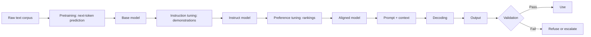

# LLM Basics

> **Module 07 — Deep Learning, Multimodal Models, and LLMs**
> Topic 07 of 11
> Estimated study time: 4 hours
> Prerequisites: Topics 05 and 06
> Version 2026.3

## 1. Why this topic exists

A large language model (LLM) is a next-token predictor. It is trained to assign a probability to the
next token given the tokens before it, and it generates text by sampling or selecting from that
distribution one token at a time. Everything else — instruction following, summarisation, question
answering, apparent reasoning — is a behaviour that emerges from that objective at scale and from the
post-training that shapes it. A practitioner who forgets the objective will misread the output, and a
practitioner who remembers it can predict most of the failure modes.

The industry problem is that the LLM is the first model most clinical teams can use without writing
code, and the ease of use hides three things: what the model is optimising, what a token is, and what
the output does not contain.

**The objective is not truth.** The model minimises the negative log-likelihood of text. A fluent,
plausible continuation is what the objective rewards. A correct continuation is one way to be
plausible; a confident fabrication is another, and in domains where the training text is sparse, the
fabrication can be cheaper. This is why hallucination is not a bug that a larger model removes; it is
a consequence of the objective, mitigated by retrieval, constraints, and verification.

**The token is the unit of cost.** Every price, latency estimate, and context limit is denominated in
tokens. A token is not a word. Clinical text tokenizes at a different ratio from general text because
of abbreviations, dosages, and identifiers, and a team that estimates cost from word counts will be
wrong by a factor that depends on the corpus. The error compounds with volume.

**The output is a sample.** A model that samples at a temperature above zero will produce different
outputs for the same input. A model at temperature zero is deterministic only in the sense that it
picks the most likely token; the underlying computation can still vary with batching and hardware.
A clinical system that assumes a fixed output is assuming something the model does not provide.

Three costs follow.

**Cost of a wrong summary.** A discharge summary generated by an LLM can omit an allergy, invert a
negation, or invent a follow-up interval. The omission is harder to detect than a fabrication because
there is nothing to check. A team that evaluates only for fabrication will miss the omissions, and
the omissions are the more common failure in clinical summarisation.

**Cost of a token budget.** A retrieval-augmented system that inserts ten documents into every prompt
pays for those tokens on every request. At 50,000 requests per day, a 1,000-token increase in the
prompt is 50 million additional tokens per day, and the annual cost is a budget line. The arithmetic
is simple and is almost never done before the pilot.

**Cost of an uncontrolled interface.** A prompt is code. A change to the system message, the
few-shot examples, or the output format changes the behaviour, and without versioning the change
cannot be attributed. A clinical deployment that treats prompts as configuration rather than as
artefacts cannot reproduce its own outputs.

This topic teaches the LLM as a probabilistic text function. It covers tokenization, the training
objective, instruction tuning, decoding, and the interface between the model and a clinical workflow.
It does not teach retrieval, which is Topic 08, or evaluation at depth, which is Topic 10. It teaches
enough to estimate cost, predict failure, and design an interface that can be validated.

> **Note:** This topic uses "LLM" for decoder-only and encoder-decoder language models alike. The
> tokenization and decoding mechanics are shared; the training objectives differ in detail.

## 2. Learning outcomes

By the end of this topic you can:

1. **Explain** next-token prediction as a training objective and **derive** why it produces fluent but
   not necessarily true output.
2. **Tokenize** a clinical string with a subword tokenizer, **compute** the tokens-per-word ratio, and
   **estimate** the cost of a workload from it.
3. **Implement** byte pair encoding merges on a small corpus and **explain** why the vocabulary is a
   model artefact.
4. **Compute** the inference floating-point operations and accelerator time for a stated model,
   prompt length, output length, and request volume.
5. **Compare** greedy, beam, temperature, top-k, and nucleus sampling, and **choose** a decoding
   configuration for a stated clinical task.
6. **Design** an instruction format with a system message, a task specification, an output schema,
   and a refusal path.
7. **Diagnose** token inflation, stop-sequence failure, truncation, and prompt drift from logs.
8. **State** what an LLM output does and does not establish for a clinical claim, and **write** the
   limitation in a form a reviewer can check.

Outcomes 2, 3, and 4 are computational. Outcomes 5, 6, and 7 are design outcomes assessed by rubric.
Outcome 8 is assessed in the evaluation dossier.

The computational outcomes are deliberately about tokens and arithmetic rather than about model
internals. A practitioner cannot change the weights of a hosted model, but can measure its token
ratio, compute its cost, and choose its decoding policy. Those are the levers available, and the
topic is organised around them.

The design outcomes are about the interface. The interface is where most clinical LLM failures
originate, and it is the part a team controls completely.

That asymmetry, controllable interface and uncontrollable weights, is the organising principle of
the topic and of the deployment advice in Section 5. It is also why the exercises focus on prompts
and parsers rather than on training.

## 3. The core mental model

An LLM is a function from a sequence of token ids to a probability distribution over the next token.
Generation is a loop: encode the prompt, compute the distribution, select a token, append it, repeat.
The loop stops at a special token, a maximum length, or a stop string.

```text
  "Patient has"  -->  tokenizer  -->  [15496, 673,  ...]
                                            |
                                            v
                                   transformer (N layers)
                                            |
                                            v
                                 logits over vocabulary (V)
                                            |
                                      softmax / temperature
                                            |
                                            v
                                  probability of next token
                                            |
                              sample or argmax, append, repeat
                                            |
                                            v
  "Patient has no" <-- detokenizer <-- [15496, 673, 645, ...]
```

The loop explains three properties at once. The context grows with every generated token, so the cost
per token rises during generation. The distribution depends on everything before it, so a small change
early in the prompt can change the whole continuation. The selection rule determines whether the output
is reproducible, and the rule is a choice the application makes, not a property of the model.

A fourth property is less obvious: the model has no memory between calls. Every request must carry
its own context, which is why a conversation is re-sent in full on each turn, and why the token cost
of a long conversation grows quadratically with the number of turns if the whole history is included.
A system that appears to remember is a system that re-sends, and the bill reflects it.

The second mental model is the token. A tokenizer converts text into subword units using a vocabulary
learned from a corpus. Common words are one token; rare words are several; numbers, abbreviations, and
identifiers can be many. The same string can tokenize differently under different tokenizers, and the
token count is what the model and the bill see.

```text
  "pneumonectomy"     -> ["pneum", "on", "ectomy"]        3 tokens
  "BP 120/80 mmHg"    -> ["BP", " 120", "/", "80", " mmHg"] 5 tokens
  "eGFR 28"           -> ["e", "GFR", " 28"]              3 tokens
  "patient"           -> ["patient"]                      1 token
```

The third mental model is the difference between pretraining and post-training. Pretraining teaches
the distribution of text. Instruction tuning teaches the format of a request and a response.
Preference tuning teaches which responses people prefer. The three stages produce different
behaviours, and a failure can originate in any of them. A model that ignores an instruction may have
been poorly instruction-tuned; a model that gives a plausible but wrong answer may be well
instruction-tuned and poorly grounded.



The diagram's last two boxes are the part most deployments omit. A model that always produces an
output is a model that cannot refuse, and a clinical interface needs a refusal path for
out-of-scope, ambiguous, or unsafe requests.

The fifth mental model is the difference between the model and the system. The model is a function
from tokens to a distribution. The system is the model plus the prompt, the retrieved context, the
decoding policy, the parser, the validator, and the review step. A failure attributed to "the model"
is often a failure of the parser or the prompt, and a fix applied to the model may not address it.
The distinction is practical: the system is what gets versioned, evaluated, and regulated, and the
model is one dependency within it.

A corollary is that swapping the model does not necessarily change the system's performance, and
changing the prompt can change it more than upgrading the model. The evaluation must be run on the
system, with all components frozen except the one being tested.

The fourth mental model is the cost equation. Inference cost is approximately proportional to the
number of parameters and the number of tokens processed:

```text
  FLOPs per request ≈ 2 * N * (input_tokens + output_tokens)
```

The factor two counts a multiply and an add per parameter per token. The approximation ignores
attention's quadratic term, which is small at short context and dominant at long context, as Topic 05
showed. For a 70-billion-parameter model with 4,000 input and 300 output tokens, the request costs
`2 * 70e9 * 4,300 = 6.02e14` FLOPs, or 0.6 petafLOPs. That number, multiplied by the request volume
and divided by the effective throughput, is the compute budget.

## 4. Definitions and vocabulary

| Term | Definition | Common misuse | Unit or convention |
|---|---|---|---|
| Token | Unit of text produced by a tokenizer | Confusing with a word or a character | Integer id |
| Tokenizer | Function mapping text to token ids | Assuming it is part of the application | Artefact |
| Vocabulary | Set of tokens the model knows | Confusing with the dictionary | Size |
| Byte pair encoding | Merge-based subword tokenization | Assuming it is language-aware | Algorithm |
| WordPiece | Likelihood-based subword tokenization | Confusing with BPE | Algorithm |
| SentencePiece | Tokenizer that treats text as a byte stream | Confusing with a model | Library |
| Special token | Control token such as end-of-sequence | Assuming it is text | Id |
| Context window | Maximum tokens the model accepts | Confusing with the architecture limit | Tokens |
| Prompt | Input text and instructions | Confusing with the system message | Text |
| System message | High-level instruction that frames the task | Assuming it cannot be overridden | Text |
| Completion | Generated output | Assuming it is verified | Text |
| Logit | Unnormalised score per vocabulary item | Confusing with a probability | Real number |
| Softmax | Normalisation of logits to probabilities | Applying over the wrong axis | Function |
| Temperature | Divisor applied to logits before softmax | Assuming zero means deterministic | Scalar |
| Greedy decoding | Selecting the most likely token | Assuming it is optimal | Policy |
| Beam search | Keeping several partial sequences | Assuming it improves factuality | Policy |
| Top-k sampling | Sampling from the k most likely tokens | Confusing with top-p | Policy |
| Nucleus sampling | Sampling from the smallest set with cumulative probability p | Confusing with top-k | Policy |
| Repetition penalty | Down-weighting recently used tokens | Assuming it fixes loops | Scalar |
| Stop sequence | String that ends generation | Confusing with end-of-sequence | String |
| Max tokens | Hard cap on output length | Assuming the model stops naturally | Count |
| Next-token prediction | Training objective | Confusing with instruction following | Objective |
| Pretraining | Training on a broad corpus | Confusing with fine-tuning | Stage |
| Instruction tuning | Training on demonstrations of tasks | Confusing with alignment | Stage |
| RLHF | Reinforcement learning from human feedback | Assuming it guarantees truthfulness | Stage |
| DPO | Direct preference optimisation | Confusing with RLHF | Method |
| Base model | Model after pretraining only | Assuming it follows instructions | Artefact |
| Instruct model | Model after instruction tuning | Assuming it is safe | Artefact |
| Hallucination | Fluent but unsupported output | Confusing with a deliberate lie | Failure |
| Omission | Missing information that should be present | Assuming it is safer than fabrication | Failure |
| Grounding | Tying output to retrieved evidence | Confusing with accuracy | Property |
| Refusal | Declining to answer | Assuming it is a failure | Behaviour |
| Prompt injection | Input that hijacks the instruction | Confusing with a jailbreak | Attack |
| Jailbreak | Input that bypasses safety training | Confusing with prompt injection | Attack |
| Token budget | Maximum tokens for a request | Confusing with context window | Tokens |
| Throughput | Tokens generated per second | Confusing with latency | Tokens/s |
| Time to first token | Latency before the first output token | Confusing with total latency | Seconds |
| Perplexity | Exponentiated mean negative log-likelihood | Confusing with accuracy | Scalar |

> **Note:** "Hallucination" in this course means output that is fluent and unsupported by the
> evidence available to the model. It does not imply intent, and it is not cured by asking the model
> to be accurate.

## 5. The mechanics, step by step

This section is a sixteen-step procedure from a clinical string to a validated generation. Steps 1 to
5 prepare the input. Steps 6 to 9 build the prompt and generate. Steps 10 to 13 validate the output.
Steps 14 to 16 handle cost, monitoring, and versioning.

### Step 1. Normalise the input text

**Input:** raw clinical text.

**Output:** text with consistent encoding, whitespace, and Unicode form.

**Rationale:** Tokenizers are sensitive to whitespace, Unicode normalization, and control characters.
A non-breaking space, a smart quote, or a stray carriage return can change the token sequence. The
normalisation must be identical at training, evaluation, and serving, and it must be recorded.

### Step 2. Tokenize and count

**Input:** the normalised text.

**Output:** a token id sequence and its length.

**Rationale:** The token count determines whether the input fits the context, how much it costs, and
how it will be truncated. The count must be computed with the exact tokenizer version that the model
uses, not with a word count or a different library.

**Branch point:** if the token count exceeds the budget, the options are truncation, chunking with
aggregation, or retrieval. The choice changes the evidence available to the model and must be
evaluated, not assumed.

### Step 3. Compute the tokens-per-word ratio for the corpus

**Input:** a sample of the corpus and the tokenizer.

**Output:** a ratio and a distribution.

**Rationale:** General English text is often around 1.3 tokens per word. Clinical text with
abbreviations, dosages, and identifiers is often higher. The ratio is the conversion factor for every
cost estimate, and it is corpus-specific. A team that uses a general ratio for clinical text will
underestimate cost.

### Step 4. Decide the truncation policy

**Input:** the length distribution and the task.

**Output:** a policy and its justification.

**Rationale:** Truncation removes evidence. Head truncation keeps the admission history and loses the
discharge plan; tail truncation does the reverse; section-aware selection keeps the clinically
relevant section. The policy must match the task, and it must be applied identically in evaluation.

### Step 5. Select the context to include

**Input:** the task and the available documents.

**Output:** a context block with a stated selection rule.

**Rationale:** The context is not free. Every token in it costs money and adds latency, and irrelevant
context can distract the model. The selection rule should be explicit: the current note, the last
three notes, the relevant guideline sections, or the retrieved passages. A context assembled
ad hoc cannot be evaluated.

### Step 6. Write the system message

**Input:** the task specification and the safety requirements.

**Output:** a system message that states the role, the scope, the output format, and the refusal
condition.

**Rationale:** The system message is the closest thing to a specification the model receives. It
should state what the model is, what it must not do, what it must output, and when it must refuse.
Vague instructions produce variable behaviour, and variable behaviour cannot be validated.

### Step 7. Specify the output schema

**Input:** the downstream consumer.

**Output:** a schema, a parser, and a failure path.

**Rationale:** A structured output is checkable; free text is not. A schema with required fields,
types, and allowed values lets the application reject malformed output and lets the evaluation count
missing fields. The parser must have a failure path that does not silently pass the raw text through.

### Step 8. Choose the decoding configuration

**Input:** the task and the tolerance for variation.

**Output:** a decoding policy with a temperature, a sampling method, a maximum length, and stop
sequences.

**Rationale:** Greedy decoding is reproducible and tends to repeat; sampling is varied and can
drift; beam search explores more sequences and does not improve factuality. A clinical extraction
task usually wants low temperature and a schema; a drafting task may want moderate temperature. The
policy must be fixed before evaluation.

| Task | Decoding | Temperature | Rationale |
|---|---|---|---|
| Structured extraction | Greedy or top-p 0.9 | 0.0 to 0.2 | Reproducibility |
| Summarisation | Top-p 0.9 | 0.2 to 0.5 | Some paraphrase tolerance |
| Patient-facing drafting | Top-p 0.95 | 0.5 to 0.7 | Natural variation |
| Code generation | Greedy or low temperature | 0.0 to 0.2 | Syntax correctness |
| Brainstorming | Top-p 0.95 | 0.8 to 1.0 | Diversity |

### Step 9. Generate with a token budget

**Input:** the prompt and the decoding policy.

**Output:** an output sequence and a stop reason.

**Rationale:** The token budget bounds latency and cost. The stop reason must be recorded: natural
end-of-sequence, stop sequence, maximum length, or error. A response that hit the maximum length is
truncated, and a truncated response can be syntactically valid and semantically incomplete.

### Step 10. Validate the structure

**Input:** the raw output.

**Output:** a parsed object or a rejection.

**Rationale:** Schema validation catches malformed output before it reaches a clinician. The
validation must be strict: a missing required field is a failure, not a default. A default value
invented by the parser is a fabricated clinical fact.

### Step 11. Validate the content

**Input:** the parsed object and the source text.

**Output:** a grounded object or a rejection.

**Rationale:** Structural validity does not imply factual validity. Content validation checks that
each extracted fact appears in the source, that numbers match, that negations are preserved, and that
the output does not contain information absent from the input. This is the step that catches
hallucination, and it requires the source, not only the output.

### Step 12. Apply the refusal path

**Input:** the validation result.

**Output:** an output, a refusal, or an escalation.

**Rationale:** A model that cannot refuse will answer out-of-scope questions. The refusal path must
be designed, not left to the model's judgement: if the input is outside the validated scope, if the
evidence is insufficient, or if the content validation fails, the system refuses or escalates. The
refusal must be visible to the user, not a silent empty output.

### Step 13. Evaluate on a held-out set

**Input:** the system and the evaluation set.

**Output:** task metrics, groundedness, omission rate, and calibration.

**Rationale:** The evaluation must measure what the system is for. For extraction, field-level
precision and recall. For summarisation, factual consistency and omission. For question answering,
correctness and grounding. A single aggregate score hides the failure that matters.

### Step 14. Compute the cost per request and per day

**Input:** token counts and request volume.

**Output:** FLOPs, accelerator time, and a cost estimate.

**Rationale:** The cost is computable before the pilot. The formula is
`2 * N * tokens` for compute, plus the overhead of batching and serving. A team that does not compute
it will discover the cost in the first invoice, when the design is hardest to change.

### Step 15. Monitor the interface

**Input:** production logs.

**Output:** token distribution, refusal rate, validation failure rate, and latency.

**Rationale:** A change in the input distribution, the tokenizer, or the model version shows up first
in the logs. The monitoring must track the token count distribution, because an increase is a cost
and truncation signal; the refusal rate, because a change is a scope or safety signal; and the
validation failure rate, because a change is a quality signal.

### Step 16. Version the prompt, the model, and the tokenizer

**Input:** all artefacts.

**Output:** a versioned bundle with a hash.

**Rationale:** A prompt is code, a model version is a dependency, and a tokenizer is a data artefact.
The three must be versioned together, because a change in any one changes the output. A deployment
that cannot name its bundle cannot reproduce its behaviour.

The failure modes specific to LLMs are worth naming.

**Token inflation.** The corpus tokenizes at a higher ratio than estimated, so the prompt exceeds the
budget and is truncated, or the cost exceeds the forecast. The signature is a token count per request
above the planning value. The fix is to measure the ratio on the actual corpus.

**Stop-sequence failure.** The model does not stop at the intended boundary, so the output contains
the next section or a repeated instruction. The signature is output length at the maximum or a
schema violation. The fix is a stop sequence plus a post-hoc parser, not a longer prompt.

**Context overflow.** The input exceeds the window and is silently truncated. The signature is a
model that performs well on short notes and poorly on long ones. The fix is chunking with aggregation
or a longer window, evaluated against the task.

**Prompt drift.** A prompt edit changes the behaviour and the evaluation baseline is not rerun. The
signature is a metric change without a model change. The fix is prompt versioning and a regression
suite.

**Schema drift.** The model starts returning a slightly different JSON shape after a version update.
The signature is a rise in parse failures. The fix is strict validation and a pinned model version.

**Decoding instability.** The same input produces materially different outputs across runs at a
nonzero temperature. The signature is a variance across repeated calls. The fix is a lower
temperature for extraction tasks and a stability report for generation tasks. The stability report
should state the number of repeats and the metric's variance, because "mostly the same" is not a
specification.

**Omission.** The output is fluent and contains no fabrication, but it leaves out a critical fact.
The signature is a low recall on a field-level evaluation. The fix is a checklist prompt, a
structured schema, and an omission-specific evaluation.

Of these, omission is the least visible and the most clinically consequential. A fabrication can be
checked against the source; an omission requires a checklist of what should have been present, and
the checklist is the evaluation artefact that most projects lack. Building it before the system is
built is the cheapest way to avoid a deployment that is fluent and incomplete.

### Tokenizer families and why the choice matters

Three tokenizer families dominate. Byte pair encoding starts from characters or bytes and repeatedly
merges the most frequent adjacent pair, so the vocabulary is a learned list of frequent substrings.
WordPiece starts from a similar place but chooses merges by a likelihood criterion, and marks
continuation pieces with a prefix. SentencePiece treats the input as a raw byte stream and can
therefore handle any language without a pre-tokenization step.

| Tokenizer | Starting unit | Merge criterion | Unknown token | Typical use |
|---|---|---|---|---|
| BPE | Characters or bytes | Most frequent pair | Byte fallback | GPT-family, many LLMs |
| WordPiece | Characters | Likelihood gain | `[UNK]` | BERT-family |
| SentencePiece unigram | Characters | Likelihood pruning | Byte fallback | Multilingual models |
| Byte-level BPE | Bytes | Most frequent pair | None | GPT-2 onward |

The choice matters for clinical text in three ways. First, a tokenizer trained on general English
will split clinical terms into more pieces than a domain-trained tokenizer, which raises the token
count and the cost. Second, a tokenizer with an unknown-token fallback will represent an unusual
identifier as a single unknown symbol, which loses information; a byte-level tokenizer will represent
it as several byte tokens, which preserves it at a higher token cost. Third, the vocabulary is
fixed at training time, so a new drug name or a new coding system will tokenize into pieces the model
has never seen as a unit.

The practical rule is to measure the tokens-per-word ratio on the corpus and to test a sample of
identifiers, dosages, and abbreviations. A ratio measured on general text is not a planning number
for clinical text.

### Instruction formats and the contract with the model

An instruction-tuned model was trained on a particular format: a system message, a user message, and
an assistant message, with special tokens separating them. The format is part of the model. A prompt
that does not follow it may still work, but it is operating outside the distribution the model was
tuned on, and its behaviour is less predictable.

| Element | Purpose | Failure if missing |
|---|---|---|
| System message | Role, scope, safety rules | Model adopts a different role |
| User message | The task and the input | Task ambiguity |
| Output schema | Structure the consumer can parse | Free text, unparseable |
| Refusal condition | When to decline | Confident answer out of scope |
| Examples | Format demonstration | Variable structure |
| Stop sequence | Where the answer ends | Continuation into the next section |

The contract is not a guarantee. A model can ignore the system message, especially under prompt
injection, and a schema can be violated. The contract is a specification that the application
enforces with validation, not a promise the model keeps.

### Structured output and the parser contract

Most clinical uses of an LLM require structured output: a list of problems, a set of instructions, a
JSON object with fields. There are three ways to get it, and they differ in reliability.

**Prompt-only schema.** The prompt describes the schema and asks for JSON. It is cheap and works
often, but the model can omit fields, add prose, or produce invalid JSON. A parser is required, and
the parser must reject rather than repair.

**Constrained decoding.** The serving layer restricts the next-token distribution to tokens that keep
the output valid against a grammar. It guarantees syntactic validity but not semantic correctness: a
valid object can contain a fabricated value.

**Function or tool calling.** The model emits a structured call that the application executes. It is
the most reliable for structured actions, and it moves the correctness problem to the tool, which is
where it belongs.

| Method | Syntax guarantee | Semantic guarantee | Failure mode |
|---|---|---|---|
| Prompt-only | None | None | Invalid JSON, omitted fields |
| Constrained decoding | Yes | None | Valid but wrong values |
| Tool calling | Yes | Depends on the tool | Wrong arguments, wrong tool |
| Post-hoc validation | Yes, by rejection | Partial | Rejected outputs need a path |

The parser contract should be explicit: which fields are required, which types are allowed, what
happens on a missing field, and what the caller receives on failure. A parser that fills a missing
field with a default has created a clinical fact that the model did not produce. That is a
fabrication introduced by the application, and it is worse than a model fabrication because it is
deterministic and invisible.

### The six artefacts a deployment must version

The procedure produces six artefacts, and a deployment that cannot name all six cannot reproduce its
behaviour: the normalisation code, the tokenizer version, the prompt template, the context selection
rule, the decoding configuration, and the model version. The first two determine what the model sees;
the next two determine what it is asked; the last two determine how it answers.

A regression suite should exercise all six. The suite stores a set of inputs, the expected outputs or
their key properties, and the bundle hash. When any artefact changes, the suite runs and the diff is
reviewed. This is ordinary software engineering applied to a probabilistic component, and it is the
difference between a maintained system and a demonstration.

## 6. Worked example

A hospital wants to generate a draft discharge instruction sheet from a discharge summary. The model
is a 70-billion-parameter instruction-tuned LLM. The average input is 4,000 tokens and the average
output is 300 tokens. The service handles 50,000 requests per day at peak. The team plans a
temperature of 0.3 and a maximum output of 400 tokens.

This section computes the token economics, the compute, the decoding behaviour, two diagnostics, and
one sensitivity.

### Step 1. Token economics

The input is 4,000 tokens and the output is 300, so each request processes 4,300 tokens. At 50,000
requests per day:

```text
input tokens per day:  50,000 * 4,000 = 200,000,000
output tokens per day: 50,000 * 300   =  15,000,000
total tokens per day:                  215,000,000
total tokens per year: 215,000,000 * 365 = 78,475,000,000
```

The output is 7 percent of the tokens but is generated sequentially, so it dominates latency. A
serving system that reports throughput in total tokens hides this asymmetry; the relevant number for
a clinician is time to first token and time per output token.

If the discharge summary averages 3,000 words and tokenizes to 4,000 tokens, the ratio is
`4,000 / 3,000 = 1.33` tokens per word. If the corpus is more abbreviation-heavy and the true ratio is
1.6, the input becomes `3,000 * 1.6 = 4,800` tokens, a 20 percent increase in cost and a 20 percent
increase in context pressure. The ratio must be measured on the corpus, not assumed.

### Step 2. Compute

The inference compute per request is approximately:

```text
2 * N * (input + output) = 2 * 70e9 * 4,300 = 6.02e14 FLOPs
```

At 50,000 requests per day:

```text
6.02e14 * 50,000 = 3.01e19 FLOPs per day
```

At an effective 100 teraflops per accelerator, the arithmetic time is:

```text
3.01e19 / 1e14 = 301,000 seconds per day = 83.6 accelerator-hours per day
```

That is 3.5 accelerator-days per calendar day, so at least four accelerators are needed for
steady-state capacity, before redundancy and peak headroom. The number is an inference from the
formula and the assumed throughput; the measured throughput will be lower because attention,
batching, and memory traffic are not free.

### Step 3. Decoding behaviour

Suppose the model's next-token distribution over five candidate tokens has logits
`[2.0, 1.0, 0.5, 0.0, -1.0]`. At temperature 1.0, the probabilities are
`[0.563, 0.207, 0.126, 0.076, 0.028]`, and the entropy is 1.206 nats. At temperature 0.2, the
probabilities are `[0.993, 0.007, 0.001, 0.000, 0.000]`, and the entropy is 0.045 nats. The low
temperature makes the model nearly deterministic, which is appropriate for extraction and
inappropriate for drafting, where it produces repetitive text.

At temperature 1.0 with nucleus sampling at `p = 0.9`, the smallest set whose cumulative probability
exceeds 0.9 contains four of the five tokens, because the first four sum to
`0.563 + 0.207 + 0.126 + 0.076 = 0.972`. The fifth token is excluded. The set size changes with the
distribution, which is the point of nucleus sampling: it adapts to the model's confidence.

### Step 4. Diagnostic one: token inflation on real notes

The team measures the token count on 500 real discharge summaries and finds a mean of 5,850 tokens,
not 4,000. The ratio to words is 1.95, not 1.33, because the notes contain medication tables,
laboratory values, and identifiers.

```text
new input tokens per request: 5,850
new total per request:        6,150
new FLOPs per request:        2 * 70e9 * 6,150 = 8.61e14
new daily FLOPs:              4.31e19
new accelerator-hours/day:    119.7
```

The cost rises by 43 percent, and 1,850 tokens of every prompt are above the planning assumption. If
the context window is 6,000 tokens, the note now consumes 97.5 percent of it, leaving no room for the
instruction or the output. The team must either truncate, chunk, or use a longer-context model. The
diagnostic is the token count distribution, not the mean alone, because the tail is what overflows.

### Step 5. Diagnostic two: omission rate

The team evaluates 200 generated instruction sheets against the source summaries with a
clinician-adjudicated checklist. Fabrication is rare: 3 of 200 outputs contain a fact not in the
source. Omission is common: 41 of 200 omit at least one required element, most often the follow-up
interval or the activity restriction.

```text
fabrication rate: 3 / 200 = 1.5%
omission rate:    41 / 200 = 20.5%
```

A system evaluated only for fabrication would look excellent. The omission rate is the clinically
important number, and it is invisible to a fluency check. The fix is a structured schema with
required fields, a checklist in the prompt, and a validation step that flags missing fields rather
than filling them with defaults.

### Step 6. Vary one assumption: output length 300 to 600

Suppose the team allows a longer output to reduce omissions.

```text
tokens per request: 4,000 + 600 = 4,600
FLOPs per request:  2 * 70e9 * 4,600 = 6.44e14
daily FLOPs:        3.22e19
accelerator-hours:  89.4 per day
```

The compute rises by 7 percent, because the input dominates. The latency rises more than the compute,
because output tokens are generated sequentially: doubling the output roughly doubles the generation
time after the first token. The conclusion changes in a specific way: a longer output is cheap in
compute and expensive in latency, so the decision depends on whether the clinician is waiting for the
full sheet or reading it after the fact. If the sheet is reviewed asynchronously, the longer output
is affordable; if it is shown in the encounter, it is not.

### Step 7. Latency

Compute is not latency. For a single request, the time to first token is dominated by the prefill of
4,000 input tokens, and the time per output token is dominated by the sequential decode. A planning
estimate uses two measured quantities: prefill throughput in tokens per second, and decode throughput
in output tokens per second.

Suppose prefill runs at 8,000 tokens per second and decode at 50 tokens per second on the served
hardware. The request time is:

```text
prefill: 4,000 / 8,000 = 0.50 seconds
decode:  300 / 50     = 6.00 seconds
total:                  6.50 seconds
```

The decode accounts for 92 percent of the latency. Doubling the output to 600 tokens adds six
seconds and only 7 percent compute. A clinician waiting at the encounter notices the decode, not the
FLOPs, and the design decision follows from the latency, not from the cost. A system that generates
asynchronously can afford a longer output; a system that displays inline cannot.

### Step 8. What the arithmetic does not establish

The token counts and the FLOPs say what the system costs. They do not say whether the instruction
sheet is correct, complete, or safe. The omission rate is a start, but it is measured on 200 notes
from one site, with one checklist. A clinical claim requires a larger adjudicated sample, a
comparison with the current process, and a prospective evaluation in the workflow. The arithmetic is
the budget, not the evidence.

There is one further number the team should compute before the pilot: the human review time. If a
nurse spends 90 seconds reviewing each sheet, 50,000 requests per day require
`50,000 * 90 / 3,600 = 1,250` nurse-hours per day, which is roughly 156 full-time equivalents. That
cost dwarfs the accelerator cost, and it is the number that determines whether the system is viable.
A business case that counts only inference has counted the smallest term.

The review arithmetic is also the safety argument: a system that cannot afford the review cannot
deliver the safety control it depends on.

## 7. Code, query, or calculation

The code below implements byte pair encoding on a small corpus, computes temperature and nucleus
sampling from a set of logits, and estimates the inference cost of a workload. It uses only the
standard library.

**Assumptions.** The BPE corpus is a toy with three word families. The sampling example uses five
logits. The cost example assumes a 70-billion-parameter model, 4,000 input tokens, 300 output
tokens, and 50,000 requests per day, with an effective throughput of 100 teraflops.

```python
import math
from collections import Counter

corpus = ["low lower lowest", "new newer newest", "wide wider widest"]
words = [list(w) + ["</w>"] for line in corpus for w in line.split()]

def symbols(words):
    return set(s for w in words for s in w)

def merge(words, pair):
    a, b = pair
    out = []
    for w in words:
        i, new = 0, []
        while i < len(w):
            if i < len(w) - 1 and w[i] == a and w[i + 1] == b:
                new.append(a + b)
                i += 2
            else:
                new.append(w[i])
                i += 1
        out.append(new)
    return out

for step in range(6):
    pairs = Counter()
    for w in words:
        for i in range(len(w) - 1):
            pairs[(w[i], w[i + 1])] += 1
    pair, freq = pairs.most_common(1)[0]
    words = merge(words, pair)
    print(step + 1, pair, freq, "vocab", len(symbols(words)))
print("first three words:", ["".join(w) for w in words[:3]])

logits = [2.0, 1.0, 0.5, 0.0, -1.0]

def probs(logits, T=1.0):
    z = [x / T for x in logits]
    m = max(z)
    e = [math.exp(v - m) for v in z]
    s = sum(e)
    return [v / s for v in e]

for T in [0.2, 1.0, 1.5]:
    p = probs(logits, T)
    ent = -sum(x * math.log(x) for x in p if x > 0)
    print(f"T={T}:", [round(x, 3) for x in p], "entropy", round(ent, 3))

p = probs(logits, 1.0)
cum, keep = 0.0, 0
for x in sorted(p, reverse=True):
    cum += x
    keep += 1
    if cum >= 0.9:
        break
print("top-p 0.9 keeps", keep, "of", len(p))

N, tin, tout = 70e9, 4000, 300
per_req = 2 * N * (tin + tout)
day = per_req * 50000
print("FLOPs/request:", f"{per_req:.3e}")
print("FLOPs/day:", f"{day:.3e}")
print("accelerator-hours/day at 100 TFLOPS:", round(day / 1e14 / 3600, 1))
```

**Observed output:**

```text
1 ('w', 'e') 4 vocab 12
2 ('l', 'o') 3 vocab 11
3 ('r', '</w>') 3 vocab 11
4 ('s', 't') 3 vocab 10
5 ('st', '</w>') 3 vocab 10
6 ('n', 'e') 3 vocab 10
first three words: ['low</w>', 'lower</w>', 'lowest</w>']
T=0.2: [0.993, 0.007, 0.001, 0.0, 0.0] entropy 0.045
T=1.0: [0.563, 0.207, 0.126, 0.076, 0.028] entropy 1.206
T=1.5: [0.439, 0.225, 0.161, 0.116, 0.059] entropy 1.409
top-p 0.9 keeps 4 of 5
FLOPs/request: 6.020e+14
FLOPs/day: 3.010e+19
accelerator-hours/day at 100 TFLOPS: 83.6
```

The BPE trace shows the mechanism and one counter-intuitive fact: the vocabulary size does not fall
monotonically, because a merge creates a new symbol while the merged pair may still occur elsewhere.
The first merge produces `we`, but `w` and `e` survive in other words, so the symbol set grows from 11
to 12. After six merges the frequent sequences are single symbols and the vocabulary is 10. The
tokenizer's vocabulary is therefore a function of the corpus and the number of merges, not of the
language.

The sampling table shows the effect of temperature on entropy. At 0.2 the distribution is nearly a
point mass, which is appropriate for extraction and produces repetition in drafting. At 1.5 the
distribution is flatter and the output is more varied and less reliable. The nucleus set at `p = 0.9`
contains four of five tokens, which means the least likely token is excluded even though its
probability is not negligible.

The cost lines are the arithmetic from Section 6: 0.602 petafLOPs per request, 30.1 exafLOPs per day,
and 83.6 accelerator-hours per day. The cost estimate is a floor, not a forecast, because it ignores
batching inefficiency, attention at long context, and retries.

The second block computes the tokens-per-word ratio and the resulting context pressure.

```python
words_per_note = 3000
for ratio in [1.33, 1.60, 1.95]:
    tokens = words_per_note * ratio
    print(f"ratio {ratio}: {tokens:.0f} tokens, "
          f"share of 6000-token window {100 * tokens / 6000:.1f}%")
```

**Observed output:**

```text
ratio 1.33: 3990 tokens, share of 6000-token window 66.5%
ratio 1.60: 4800 tokens, share of 6000-token window 80.0%
ratio 1.95: 5850 tokens, share of 6000-token window 97.5%
```

The difference between the planning ratio and the measured ratio is the difference between a prompt
that leaves room for instructions and one that consumes the entire window. The ratio is the single
most useful number to measure before a pilot, and it takes an hour.

## 8. Data, standards, and regulatory context

**Device regulation.** An LLM that generates clinical text for a patient or a clinician is device
software if it is intended for a medical purpose. The FDA draft guidance on AI-enabled device
software functions (January 2025, docket FDA-2024-D-4488) describes the submission content, and the
predetermined change control guidance (December 2024, docket FDA-2022-D-2628) describes how model and
prompt changes are pre-authorised. A prompt change that alters the output is a change to the device,
which is why prompts must be versioned and controlled.

**Transparency obligations in the European Union.** Regulation (EU) 2024/1689 requires that users be
informed when they are interacting with an AI system, subject to exceptions for obvious cases and for
law-enforcement uses. Article 50 is the transparency provision. For a clinical drafting tool, the
practical consequence is that the clinician must know which text was machine-generated, and the
patient-facing material must not present generated text as clinician-authored without disclosure.

**General-purpose model obligations.** Providers of general-purpose AI models have documentation,
copyright-policy, and training-content-summary duties from 2 August 2025, with additional duties
above `10^25` FLOP of training compute. A hospital that uses a hosted model is a deployer; a hospital
that fine-tunes and distributes one may be a provider. The distinction determines the obligations and
should be settled before the build.

**NIST.** The Generative AI Profile (NIST AI 600-1, July 2024) names confabulation, data privacy,
information integrity, and human-AI configuration among its twelve risks. For an LLM interface, the
human-AI configuration risk is the relevant one: automation bias, over-reliance, and the erosion of
the clinician's own judgement when a fluent draft is presented first.

**HIPAA and text.** A prompt containing a discharge summary is protected health information. Sending
it to a hosted model requires a business associate agreement or de-identification. The de-identification
must be applied before the text leaves the boundary, and the replacement must preserve the clinical
meaning. A naive identifier scrubber that removes dates also removes the temporal information the
task depends on.

**Reporting.** TRIPOD+AI (BMJ 2024;385:e078378) applies to prediction models; a generative system
that produces a prediction or a recommendation is within its scope. The checklist requires the model,
the predictors, the evaluation, and the fairness analysis to be reported. For an LLM, the model
description should include the tokenizer, the version, the prompt, the decoding configuration, and
the context policy, because each affects reproduction.

| Framework | Status | What it constrains | What it does not |
|---|---|---|---|
| FDA AI device draft (2025) | Draft | Submission content | Prompt design |
| FDA PCCP (2024) | Final | Model and prompt changes | Output quality |
| EU AI Act Art. 50 | Binding, phased | Disclosure of AI interaction | Clinical validity |
| EU AI Act GPAI rules | Binding from Aug 2025 | Provider documentation | Deployment design |
| NIST AI 600-1 | Voluntary | Risk identification | Compliance |
| HIPAA | Binding in the US | PHI in prompts | Model safety |
| TRIPOD+AI | Reporting convention | Model and evaluation reporting | Study quality |

**De-identification and the prompt boundary.** Clinical text sent to a model is a disclosure. The
two lawful paths are a business associate agreement with the host, or de-identification before the
text leaves the boundary. De-identification under the Safe Harbor method removes 18 categories of
identifiers, including dates more specific than the year and ages above 89. Removing dates changes
the temporal reasoning the task may depend on, and removing names can remove the family history that
makes a note interpretable.

The practical approach is a two-step: remove direct identifiers, then replace them with consistent
surrogates that preserve the task-relevant structure. A date can become a relative offset; a name can
become a role label. The surrogate mapping must not be stored with the prompt, and the model must not
be able to re-identify from context. This is a data-engineering problem with a clinical consequence,
and it should be tested on a sample of notes, not assumed.

| Identifier | Task-relevant? | Safe replacement | Risk if removed |
|---|---|---|---|
| Exact date | Often | Relative day offset | Loses temporal reasoning |
| Patient name | No | Role label | Low |
| Provider name | Sometimes | Role label | Loses author context |
| Institution | Sometimes | Site code | Loses site effects |
| Age above 89 | Sometimes | "90+" | Loses very-old subgroup |
| Room number | No | Remove | Low |
| Phone number | No | Remove | Low |
| Medical record number | No | Stable pseudonym | Low, if consistent |

**Audit logging.** A deployed LLM should log the request identifier, the model and prompt version,
the token counts, the decoding configuration, the validation result, and the final disposition. It
should not log the raw prompt unless the log is protected to the same standard as the clinical data.
The log is the evidence for incident investigation and for the monitoring in Step 15, and it is the
first thing an auditor will ask for after an adverse event.

**Cross-border transfer.** A hosted model may process the request in another jurisdiction. Under the
GDPR, a transfer outside the European Economic Area requires a lawful mechanism, such as an adequacy
decision or standard contractual clauses, and health data are a special category with additional
conditions. The hospital's data-protection officer must be involved before the pilot, not after the
contract is signed. The technical team can help by documenting the data flow: what text leaves, where
it goes, how long it is retained, and whether it is used for training.

**What the frameworks do not cover.** None of the frameworks specifies a decoding temperature, a
prompt format, or an omission threshold. Those are engineering choices that the team must justify
from the evaluation, and the justification is the evidence that the choice was deliberate. A
submission that describes the model but not the interface has described the engine and not the
vehicle.

The frameworks constrain disclosure and change control. They do not establish that the generated text
is correct. That requires the content validation in Step 11 and the evaluation in Step 13.

## 9. Industry practice and case evidence

**GPT-3 and the scaling result.** Brown et al. introduced GPT-3, a 175-billion-parameter
autoregressive language model, and documented strong few-shot performance across many tasks without
gradient updates (NeurIPS 2020, arXiv:2005.14165). The documented result is that scale plus in-context
examples produces usable task behaviour. The inference for clinical practice, which the paper does not
make, is that a general model can be adapted to a task through the prompt, but the prompt is part of
the system and must be evaluated like any other component.

**InstructGPT and the alignment result.** Ouyang et al. fine-tuned GPT-3 on human demonstrations and
then on human rankings, producing InstructGPT (NeurIPS 2022, arXiv:2203.02155). The documented result
is that a 1.3-billion-parameter InstructGPT was preferred by human raters over the 175-billion-parameter
GPT-3, with improved truthfulness and reduced toxicity on their evaluations. The lesson is that
post-training changes behaviour more efficiently than scale alone, and that "preferred by raters" is a
different measurement from "correct".

**Chinchilla and the compute-optimal result.** Hoffmann et al. trained models under a fixed compute
budget and reported that many large models were undertrained relative to their size; a 70-billion-parameter
model trained on 1.4 trillion tokens matched a much larger model on their benchmarks (arXiv:2203.15556,
2022). The documented lesson is that parameter count alone is not a measure of capability, and a model
card that reports only the parameter count has omitted the data side of the scaling relationship.

**Chain-of-thought prompting.** Wei et al. showed that prompting a model to produce intermediate
reasoning steps improved performance on arithmetic and commonsense reasoning benchmarks (NeurIPS 2022,
arXiv:2201.11903). The documented result is a benchmark improvement; the inference that the generated
steps are a faithful account of the model's computation is not supported by the paper. A clinical
application that displays the reasoning steps as a justification is making a claim the method does not
establish.

**What practitioners actually do.** In inference from public deployment descriptions and vendor
documentation, three patterns recur. First, most clinical LLM systems are retrieval-augmented and
schema-constrained, because free generation is too variable for a workflow. Second, most use a
low temperature for extraction and a moderate temperature for drafting, with the configuration
recorded. Third, the evaluation that matters is a task-specific adjudicated set, not a public
benchmark, and the teams that finish are the ones that built the set first.

**Clinical drafting and the review burden.** The documented deployments of LLM drafting in clinical
settings consistently report that the model produces a usable first draft and that the clinician
edits it. The reported benefit is time saved on drafting, not accuracy, and the reported risk is
automation bias, where the clinician accepts an unedited draft. The inference for a deployment is
that the review is the safety control, and the review must be designed, timed, and audited. A system
that measures only drafting time has measured the benefit and not the risk.

**What the benchmark measures.** A general medical question-answering benchmark measures accuracy on
a fixed set of questions with a known answer. A clinical drafting task requires completeness,
negation preservation, numeric fidelity, and appropriate hedging, none of which a question-answering
benchmark measures. A model that scores well on the benchmark may still omit the follow-up interval.
The two measurements are not substitutes, and a procurement that accepts one for the other has
confused capability with task performance.

**The asymmetry of harm.** A fabrication is visible if someone checks the source; an omission is
visible only if someone knows what should have been there. In a discharge instruction sheet, the
omitted activity restriction is the one that causes a fall, and no amount of reading the generated
text reveals that it is missing. The documented pattern across clinical summarisation evaluations is
that omission rates are higher than fabrication rates, and the evaluations that report only
fabrication report a misleadingly good result. This is an inference from the pattern, not a claim
about any one study.

**The economics of review.** A drafting system that saves ten minutes of writing and costs six
minutes of review has a net benefit of four minutes. A system that saves eight minutes and costs
twelve has a net cost. The arithmetic is simple and is rarely done, because the writing time is
easier to measure than the review time. A pilot that instruments both is the only way to know, and
the instrumented review is also the safety control.

**The interface is part of the model.** A documented pattern across deployments is that the same
base model performs differently under different prompts, schemas, and context policies. The
difference is large enough that the interface, not the model, is often the variable that determines
success. This is why the prompt is versioned with the model in Step 16: the two together are the
system that was evaluated.

**What practitioners actually do.** In inference from public deployment descriptions, three patterns
recur. First, extraction tasks use low temperature and a schema. Second, drafting tasks use a
moderate temperature and a human review step. Third, the systems that are maintained have a
regression suite of prompts and expected outputs, run on every model or prompt change. The suite is
the operational control that keeps the system from drifting.

The evidence does not support the claim that a model which is preferred by raters is safe for
clinical use. It supports the claim that post-training changes behaviour, that scale changes
capability, and that both must be evaluated on the task.

## 10. Failure modes and red flags

The failures below are ordered by where they enter the system: generation, interface, data path, and
operations. The generation failures are the ones the model produces; the interface failures are the
ones the application produces; and the operational failures are the ones the supply chain produces.
Only the first group is usually called hallucination, and it is not the largest group.

| Failure | Early warning sign | Mechanism | Consequence | Mitigation |
|---|---|---|---|---|
| Hallucinated fact | Output contains a detail absent from source | Next-token plausibility, not truth | Wrong clinical statement | Content validation |
| Omission | Fluent output missing a required element | No checklist, no schema | Missed instruction | Required fields, checklist |
| Token inflation | Cost above forecast | Clinical text tokenizes higher | Truncation, overrun | Measure ratio |
| Context overflow | Long notes fail | Silent truncation | Lost evidence | Chunk or longer window |
| Stop-sequence failure | Output runs into next section | No stop token | Unparseable output | Stop sequence, parser |
| Schema drift | Parse failure rate rises | Model version change | Broken downstream | Strict validation |
| Prompt drift | Metric changes without model change | Prompt edited | Unattributed regression | Version and regression test |
| Decoding instability | Variance across repeats | Nonzero temperature | Inconsistent output | Lower temperature, stability report |
| Negation error | "No allergy" becomes "allergy" | Token-level rewrite | Safety event | Negation check |
| Numeric error | Dose or interval changed | Generation, not copy | Safety event | Copy exact spans |
| Prompt injection | Retrieved text changes behaviour | Instruction in data | Scope violation | Delimit and sanitise |
| Automation bias | Clinician accepts drafts unread | Fluent presentation | Error propagation | Review design, audit |
| Over-long output | Latency above budget | Sequential decode | Poor usability | Token cap, async |
| Vendor model update | Output distribution shifts | Hosted version change | Untested behaviour | Pin version, regression suite |

## 11. Assumptions and limits

The assumptions below are the conditions under which the token counts, the cost estimates, and the
safety claims hold. Most are checkable in a day, and the ones that are not checkable must be covered
by a contract or a monitoring plan.

The most consequential is the last: that human review is real. A review step that is timed at four
seconds per note is not a review, and a system that depends on it has a safety control that exists
only on paper. The test is to observe the review, not to ask whether it happens.

| Assumption | Why it is needed | What breaks it | How to test |
|---|---|---|---|
| The tokenizer matches the model | Token ids must be valid | Version mismatch | Golden token test |
| The prompt fits the context | The model must see the evidence | Long notes | Token distribution |
| The source contains the answer | Generation must be grounded | Missing document | Retrieval recall |
| The schema is enforceable | Downstream needs structure | Free-text output | Parse failure rate |
| The temperature is fixed | Reproducibility | Configuration drift | Config audit |
| The model version is pinned | Behaviour is stable | Hosted update | Version check |
| Raters represent clinicians | Evaluation is valid | Convenience sample | Rater qualifications |
| The task is in scope | The system is intended for it | Out-of-scope requests | Refusal testing |
| PHI is handled lawfully | Data protection | Prompt leaves boundary | Data-flow audit |
| Human review is real | Safety depends on it | Rubber-stamping | Review-time audit |

## 12. Exercises

The exercises produce artefacts that a team would actually use: a token budget, a cost estimate, a
BPE trace, a prompt and schema, and a diagnosis. The arithmetic is checkable against Section 7. The
design exercises are assessed by the criteria stated with each one, and a design that does not state
its refusal condition is incomplete.

For the prompt design exercise, test the prompt on at least one note that should be refused. A prompt
that has never been tested on an out-of-scope input has not been tested.

**Exercise 1 (calculation, 20 minutes).** A note of 2,400 words tokenizes at 1.8 tokens per word. A
model has a 4,096-token context and the prompt template uses 300 tokens. How many tokens remain for
the output, and what happens if the output limit is 800? **Deliverable:** the arithmetic and the
consequence. **Criteria:** correct multiplication, explicit statement of the overflow.

**Exercise 2 (calculation, 25 minutes).** A 13-billion-parameter model serves 20,000 requests per day
with 1,500 input and 200 output tokens. Compute the daily FLOPs and the accelerator-hours at 80
effective teraflops. **Deliverable:** the arithmetic. **Criteria:** correct formula, correct units.

**Exercise 3 (implementation, 40 minutes).** Implement BPE for 20 merges on a small clinical corpus
and report the ten most frequent tokens. **Deliverable:** code and output. **Criteria:** merges are
deterministic, vocabulary size reported.

**Exercise 4 (design, 40 minutes).** Design a prompt and output schema for extracting medication
changes from a discharge summary, including a refusal path. **Deliverable:** the prompt, the schema,
and three test cases. **Criteria:** required fields, explicit refusal condition, no default filling.

**Exercise 5 (diagnosis, 30 minutes).** A system's parse failure rate rises from 1 to 12 percent
after an unrelated deployment. List three hypotheses and the test for each. **Deliverable:** a
hypothesis table. **Criteria:** hypotheses distinguishable by logs, not opinion.

**Exercise 6 (critique, 30 minutes).** Find a clinical LLM paper and identify its tokenizer, prompt,
decoding configuration, model version, and evaluation unit. **Deliverable:** a five-row table with
quotations. **Criteria:** accurate quotations, at least two omissions.

**Exercise 7 (estimation, 25 minutes).** A team proposes a 4,000-token prompt with ten retrieved
documents. Compute the annual token volume for 30,000 requests per day and compare it with a
1,500-token prompt. **Deliverable:** the two volumes and the ratio. **Criteria:** correct
multiplication, explicit assumption about operating days.

**Exercise 8 (communication, 25 minutes).** Write 180 words for a clinical lead explaining why a
fluent summary can still be unsafe. **Deliverable:** the paragraph. **Criteria:** distinguishes
fabrication from omission, gives one number, one recommendation.

## 13. Self-check answers

The calculation answers show the arithmetic and the consequence. A token-budget answer that stops at
the number, without saying what happens when the budget is exceeded, has answered half the question.

**Answer 1.** Input tokens `2,400 * 1.8 = 4,320`. With a 300-token template, the prompt is 4,620,
which already exceeds the 4,096-token context. There is no room for output, and the prompt itself is
truncated. The consequence is that the model sees a truncated note and the output limit of 800 is
irrelevant. The team must shorten the template, chunk the note, or use a longer-context model.

**Answer 2.** Per request: `2 * 13e9 * 1,700 = 4.42e13` FLOPs. Daily: `4.42e13 * 20,000 = 8.84e17`
FLOPs. At 80 teraflops: `8.84e17 / 8e13 = 11,050` seconds, or 3.07 accelerator-hours.

**Answer 3.** A correct implementation merges the most frequent adjacent pair at each step, applies
the merge across all words, and records the merge list. The ten most frequent resulting tokens are
corpus-specific; the acceptance criterion is that re-applying the merge list reproduces the
tokenization deterministically, not that a particular token tops the list.

**Answer 4.** A strong design has a system message stating the task and scope, a user message with
the note, a JSON schema with fields for drug, action, dose, and reason, a requirement that every
field be copied from the note, a refusal condition for notes without a medication section, and three
test cases including one out-of-scope note. It does not fill missing fields with defaults.

**Answer 5.** Hypothesis one: the model version changed and the output format changed with it. Test:
compare the version hash before and after. Hypothesis two: the input distribution changed, for
example a new note template. Test: compare token counts and note types by day. Hypothesis three: the
parser changed, not the model. Test: replay stored outputs through the old and new parsers. The three
are distinguished by logs, not by retraining.

**Answer 6.** A strong answer reports the tokenizer family and version, the prompt structure, the
decoding configuration, the model version, and the unit of evaluation. Most papers report the model
and the prompt, and omit the tokenizer version, the decoding configuration, and the unit, which are
the three that prevent reproduction.

**Answer 7.** Long prompt: `30,000 * 4,000 = 120,000,000` tokens per day. Short prompt:
`30,000 * 1,500 = 45,000,000` per day. Ratio `120 / 45 = 2.67`. At 365 days, the long prompt is
43.8 billion tokens per year and the short prompt is 16.4 billion.

**Answer 8.** Rubric: the paragraph distinguishes fabrication, which can be checked, from omission,
which cannot be checked without a list of what should be present. It gives one number, such as the
20.5 percent omission rate in the worked example, and one recommendation, such as a required-field
schema and a checklist-based review. Full credit requires the distinction, the number, and the
recommendation.

## 14. Interview questions

The questions test whether a candidate can reason about an LLM as a system with a token budget, a
decoding policy, and a validation step. Each strong answer includes a number or a named failure; each
weak answer is described by the concept it is missing.

**Question 1. What is an LLM actually trained to do?**
A strong answer says next-token prediction, explains the likelihood objective, and derives why
fluency is not truth. A weak answer says "understand language".

**Question 2. Why is a token not a word?**
A strong answer explains subword tokenization, gives a clinical example, and connects it to cost and
context. A weak answer says "tokens are pieces of words" without consequence.

**Question 3. How do you choose a temperature?**
A strong answer ties it to the task's tolerance for variation and to the evaluation, and notes that
zero is not a guarantee of determinism across hardware. A weak answer gives a default.

**Question 4. What is the difference between top-k and nucleus sampling?**
A strong answer explains the fixed versus adaptive candidate set and the effect on the tail. A weak
answer confuses the two.

**Question 5. How do you estimate the cost of a deployment?**
A strong answer uses tokens per request, requests per day, parameters, and effective throughput, and
includes human review. A weak answer counts only API calls.

**Question 6. Why does a fluent summary still need validation?**
A strong answer distinguishes fabrication from omission and proposes source-grounded checks. A weak
answer says "the model is usually right".

**Question 7. How do you make an LLM output parseable?**
A strong answer describes schema prompting, constrained decoding, tool calling, and strict
validation with a failure path. A weak answer says "ask for JSON".

**Question 8. What is prompt injection, and how does it differ from a jailbreak?**
A strong answer distinguishes untrusted data that hijacks the instruction from a user bypassing
safety, and describes delimiting and privilege separation. A weak answer treats them as synonyms.

**Question 9. What does a benchmark score tell a clinician?**
A strong answer says it measures capability on a fixed sample, not local performance or safety, and
names the missing evidence. A weak answer treats it as validation.

## 15. Key terms

- **Base model** — model after pretraining, before instruction tuning.
- **Beam search** — decoding that keeps several partial sequences.
- **Byte pair encoding** — merge-based subword tokenization.
- **Completion** — generated output.
- **Context window** — maximum tokens the model accepts.
- **Decoding** — the process of selecting tokens during generation.
- **DPO** — direct preference optimisation.
- **Greedy decoding** — selecting the most likely token each step.
- **Grounding** — tying output to retrieved evidence.
- **Hallucination** — fluent but unsupported output.
- **Instruct model** — model after instruction tuning.
- **Instruction tuning** — training on demonstrations of tasks.
- **Jailbreak** — input that bypasses safety training.
- **Logit** — unnormalised score per vocabulary item.
- **Max tokens** — hard cap on output length.
- **Next-token prediction** — the pretraining objective.
- **Nucleus sampling** — sampling from a cumulative-probability set.
- **Omission** — missing information that should be present.
- **Perplexity** — exponentiated mean negative log-likelihood.
- **Pretraining** — training on a broad corpus.
- **Prompt** — input text and instructions.
- **Prompt injection** — untrusted input that hijacks the instruction.
- **Refusal** — declining to answer.
- **Repetition penalty** — down-weighting recently used tokens.
- **RLHF** — reinforcement learning from human feedback.
- **SentencePiece** — byte-stream tokenizer library.
- **Softmax** — normalisation of logits to probabilities.
- **Special token** — control token such as end-of-sequence.
- **Stop sequence** — string that ends generation.
- **System message** — high-level instruction framing the task.
- **Temperature** — divisor applied to logits before softmax.
- **Time to first token** — latency before the first output token.
- **Token** — unit of text produced by a tokenizer.
- **Token budget** — maximum tokens for a request.
- **Tokenizer** — function mapping text to token ids.
- **Top-k sampling** — sampling from the k most likely tokens.
- **Vocabulary** — set of tokens the model knows.
- **WordPiece** — likelihood-based subword tokenization.

Three terms carry the operational content. "Token" is the unit of cost, context, and truncation.
"Temperature" is the decoding choice that determines reproducibility. "Omission" is the failure that
a fluency check cannot detect. A reader who can compute the first, justify the second, and measure
the third can run a clinical LLM pilot without the two most common surprises: a budget that triples
and an evaluation that passes while the output is incomplete.

## 16. Sources

Brown TB, Mann B, Ryder N, et al. "Language Models are Few-Shot Learners." NeurIPS 2020.
https://arxiv.org/abs/2005.14165 (accessed 25 October 2026).

Ouyang L, Wu J, Jiang X, et al. "Training language models to follow instructions with human
feedback." NeurIPS 2022. https://arxiv.org/abs/2203.02155 (accessed 25 October 2026).

Hoffmann J, Borgeaud S, Mensch A, et al. "Training Compute-Optimal Large Language Models."
arXiv:2203.15556, 2022. https://arxiv.org/abs/2203.15556 (accessed 25 October 2026).

Wei J, Wang X, Schuurmans D, et al. "Chain-of-Thought Prompting Elicits Reasoning in Large Language
Models." NeurIPS 2022. https://arxiv.org/abs/2201.11903 (accessed 25 October 2026).

Sennrich R, Haddow B, Birch A. "Neural Machine Translation of Rare Words with Subword Units."
ACL 2016. https://doi.org/10.18653/v1/P16-1162 (accessed 25 October 2026).

Vaswani A, Shazeer N, Parmar N, et al. "Attention Is All You Need." NeurIPS 2017.
https://arxiv.org/abs/1706.03762 (accessed 25 October 2026).

NIST. "Artificial Intelligence Risk Management Framework: Generative Artificial Intelligence
Profile." NIST AI 600-1, July 2024. https://doi.org/10.6028/NIST.AI.600-1 (accessed 25 October 2026).

European Union. Regulation (EU) 2024/1689, Article 50.
https://ai-act-service-desk.ec.europa.eu/en/ai-act/timeline/timeline-implementation-eu-ai-act
(accessed 25 October 2026).

FDA. "Artificial Intelligence-Enabled Device Software Functions: Lifecycle Management and Marketing
Submission Recommendations," draft guidance, January 2025, docket FDA-2024-D-4488.
https://www.fda.gov/regulatory-information/search-fda-guidance-documents/artificial-intelligence-enabled-device-software-functions-lifecycle-management-and-marketing
(accessed 25 October 2026).

FDA. "Marketing Submission Recommendations for a Predetermined Change Control Plan for
Artificial Intelligence-Enabled Device Software Functions," final guidance, December 2024.
https://www.fda.gov/media/166704/download (accessed 25 October 2026).

Collins GS, Moons KGM, Dhiman P, et al. "TRIPOD+AI statement." BMJ 2024;385:e078378.
https://doi.org/10.1136/bmj-2023-078378 (accessed 25 October 2026).

> **Note:** The `2 * N * tokens` cost formula is a planning approximation. It is accurate to within a
> factor of about two at short context and becomes optimistic at long context, where attention
> dominates. It ignores attention's
> quadratic term, batching inefficiency, and the difference between prefill and decode throughput.
> Use measured throughput for a production estimate.

## 17. Links

- Module index: [`_index.md`](_index.md)
- Previous topic: [`06_medical-foundation-models.md`](06_medical-foundation-models.md)
- Next topic: [`08_prompting-and-rag.md`](08_prompting-and-rag.md)
- Module survey: [`../../07_deep_learning_multimodal_llms.md`](../../07_deep_learning_multimodal_llms.md)
- Labs: [`../../labs/`](../../labs/)
- Lab 7.3, build a RAG system: [`../../labs/`](../../labs/)
- Module 06, metrics: [`../06_machine_learning/07_metrics.md`](../06_machine_learning/07_metrics.md)

