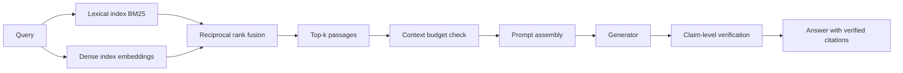

# Prompting and Retrieval-Augmented Generation

> **Module 07 — Deep Learning, Multimodal Models, and LLMs**
> Topic 08 of 11
> Estimated study time: 4 hours
> Prerequisites: Topics 05 to 07
> Version 2026.3

## 1. Why this topic exists

A language model's weights contain a compressed, undated, unverifiable summary of its training text.
A clinical question needs the current guideline, the patient's own note, and a citation the reader can
check. Retrieval-augmented generation (RAG) is the architecture that supplies the first two and makes
the third possible: it retrieves passages from an external corpus, inserts them into the prompt, and
asks the model to answer using them.

The industry appeal is obvious. RAG updates knowledge without retraining, attributes claims to
sources, and keeps sensitive documents inside the institution's boundary. The industry failure is
equally obvious in retrospect: the model can only use what the retriever supplies, and the retriever
is a separate system with its own failure modes. A RAG system that retrieves the wrong guideline, or
the right guideline from the wrong year, or another patient's note, will produce a fluent, cited,
confident, and wrong answer.

Four costs follow.

**Chunking cost.** Clinical documents are not web pages. A discharge summary has sections with
different evidence value; a guideline has recommendation tables whose meaning depends on the table
header; a nursing note has repeated templated text. A fixed-size chunker cuts across these
boundaries, producing chunks that are individually uninterpretable. The retrieval then fails for a
reason that no amount of embedding quality can fix.

**Retrieval cost.** Dense embeddings capture paraphrase and fail on exact identifiers; lexical
retrieval captures identifiers and fails on paraphrase. Clinical queries contain both: "sepsis
bundle" is a concept, and "eGFR 28" is a string. A single retrieval method will miss one of them, and
the hybrid that covers both requires fusion logic and two indexes.

**Grounding cost.** A citation is not proof. A model can cite a passage that does not support the
claim, or support a different claim, or exist. Verification requires comparing each claim with the
cited text, and that comparison is a separate model or a human reviewer. A system that displays
citations without verifying them has moved the trust problem, not solved it.

**Budget cost.** Every retrieved chunk consumes context and money. At eight chunks of 500 tokens, the
context is 4,000 tokens before the question or the instructions. The budget determines how many
chunks can be included, which determines recall, which determines the answer quality. The trade is
computable and is usually made by intuition.

This topic teaches RAG as a retrieval system first and a generation system second. It covers chunking
for clinical documents, lexical and dense retrieval, hybrid fusion, recall evaluation, grounding and
citation verification, and context budgeting. It does not teach agentic retrieval, which is Topic 09,
or evaluation design at depth, which is Topic 10.

> **Note:** "RAG" in this topic means retrieve-then-generate in a single pass. Iterative and agentic
> retrieval are treated in Topic 09, where the failure modes are different.

## 2. Learning outcomes

By the end of this topic you can:

1. **Design** a chunking strategy for a clinical document type and **justify** it against the
   document's section structure and evidence distribution.
2. **Compute** the chunk count, token volume, index size, and embedding compute for a corpus.
3. **Compare** lexical, dense, and hybrid retrieval on a clinical query set and **choose** a method
   from measured recall, not from a vendor claim.
4. **Compute** recall@k with a confidence interval and **interpret** the interval for a go/no-go
   decision.
5. **Design** a context budget that fits the window and **state** what is excluded when the budget
   binds.
6. **Verify** a citation against its source, and **distinguish** a supported claim from a
   plausible-looking misattribution.
7. **Diagnose** the wrong-patient retrieval failure and **design** the metadata filter and test that
   prevent it.
8. **Write** a RAG evaluation report that separates retrieval quality from generation quality.

Outcomes 2, 3, and 4 are computational. Outcomes 1, 5, and 6 are design outcomes assessed by rubric.
Outcome 7 is assessed in the red-team exercise.

The computational outcomes are about the corpus and the retriever, because those are the parts a team
can measure without a generator. A team that can compute the chunk arithmetic and measure recall can
size a system and locate a failure before writing a prompt. That ordering, corpus then retriever then
generator, is the topic. The design outcomes are about the interface and the governance,
because those are the parts a team controls completely. The split mirrors the two systems in series
that the topic describes.

## 3. The core mental model

RAG is two systems in series. The retriever maps a query to a ranked list of passages from a fixed
corpus. The generator maps the query and the passages to an answer. The generator cannot recover a
passage the retriever missed, and the retriever cannot correct a passage the generator misread. The
two failures are independent, and they must be measured separately.

```text
  Documents --> parse --> chunk --> embed --> index
                                              |
  Query --> normalize --> embed -----------> search --> top-k chunks
                                                          |
                                     +--------------------+
                                     v
                          prompt = instructions + chunks + question
                                     |
                                     v
                                   LLM --> answer + citations
                                     |
                                     v
                          verification: does each claim match a source?
```

The first mental model is the recall ceiling. If the retriever puts the relevant passage in the top
`k` for 70 percent of queries, the end-to-end system cannot exceed 70 percent on those queries,
whatever the generator does. Retrieval recall is therefore the first metric, and it is measured
before any generation quality is discussed.

The second mental model is the chunk as the unit of meaning. A chunk must be interpretable on its
own: it must contain the claim, the population, the condition, and the source. A 300-word window
that starts mid-sentence and ends mid-recommendation is not interpretable, even if it contains the
keywords. Chunking is a semantic design decision, not a preprocessing parameter.

```text
  Bad chunk (fixed 300 words, mid-section):
    "...should be administered within one hour. In patients with
     suspected neutropenic sepsis, the dose is..."

  Good chunk (section-aware):
    "Recommendation 4.2: In adults with suspected sepsis, obtain
     blood cultures and administer broad-spectrum antibiotics within
     one hour of recognition. (Strong recommendation, moderate certainty.)
     Source: Guideline X, 2024, Section 4."
```

The third mental model is the two retrieval signals. Lexical retrieval scores exact term overlap,
weighted by rarity. Dense retrieval scores similarity in an embedding space, weighted by learned
semantics. They fail differently: lexical misses paraphrase, dense misses identifiers. Hybrid fusion
combines the rankings, usually with reciprocal rank fusion, and recovers both.



The fourth mental model is the budget. The context window is shared by the system instructions, the
retrieved passages, the conversation history, and the output. A budget that allocates 80 percent to
passages leaves little room for the answer, and a budget that allocates too little to passages
reduces recall. The allocation is a design decision with a measurable consequence.

```text
  8,192-token context
  ├── system instructions        400
  ├── retrieved chunks (8 x 500) 4,000
  ├── conversation history       800
  ├── question                   200
  └── reserved for answer        800
  total                          6,200  (leaves 1,992 unallocated)
```

The fifth mental model is the separation of retrieval failure from generation failure. A wrong answer
has at least three possible causes: the right passage was not retrieved, the right passage was
retrieved but the model misread it, or the passage itself was wrong. The three have different fixes
and different metrics. A team that evaluates only the end-to-end answer cannot tell them apart, and
will often "fix" the model when the retriever was at fault.

The separation is operationalised by evaluating retrieval with a labelled query set, evaluating
faithfulness with the retrieved passages fixed, and evaluating the corpus separately by sampling
documents. Each measurement is cheap relative to an end-to-end study, and together they locate the
failure before any money is spent on model changes.

The sixth mental model is the retrieval contract: the retriever promises a ranked list, and the
generator promises to use it. Neither promise is enforceable by the other. The application enforces
the contract by showing the source id with each passage, requiring a citation for each claim, and
rejecting an answer whose citations are not in the retrieved set. The enforcement is code, not a
prompt, because a prompt is a suggestion and the contract is a requirement.

## 4. Definitions and vocabulary

| Term | Definition | Common misuse | Unit or convention |
|---|---|---|---|
| Retrieval | Selecting passages relevant to a query | Confusing with ranking | Stage |
| Augmentation | Inserting retrieved text into a prompt | Confusing with fine-tuning | Stage |
| Chunk | Unit of indexed text | Assuming any split is fine | Passages |
| Chunk overlap | Shared text between adjacent chunks | Assuming it fixes boundary loss | Tokens |
| Chunking strategy | Rule for splitting documents | Confusing with tokenization | Design |
| Section-aware chunking | Splitting along document structure | Assuming all documents have sections | Strategy |
| Embedding | Dense vector representation of text | Confusing with token ids | Vector |
| Bi-encoder | Separate encoders for query and document | Confusing with a cross-encoder | Architecture |
| Cross-encoder | Joint encoder that scores a pair | Assuming it scales to a corpus | Architecture |
| Vector index | Data structure for nearest-neighbour search | Confusing with a database | Index |
| Approximate nearest neighbour | Fast search with small recall loss | Assuming exact results | Algorithm |
| BM25 | Lexical ranking function with term weighting | Assuming it is obsolete | Algorithm |
| TF-IDF | Term frequency times inverse document frequency | Confusing with BM25 | Weighting |
| Sparse retrieval | Retrieval over term weights | Confusing with dense | Family |
| Dense retrieval | Retrieval over embeddings | Confusing with sparse | Family |
| Hybrid retrieval | Fusion of lexical and dense results | Assuming it always wins | Family |
| Reciprocal rank fusion | Rank-based combination of result lists | Confusing with score fusion | Method |
| Recall@k | Fraction of queries with a relevant passage in top k | Confusing with precision | Metric |
| Precision@k | Fraction of top-k passages that are relevant | Confusing with recall | Metric |
| Mean reciprocal rank | Mean of inverse rank of first relevant passage | Confusing with recall | Metric |
| nDCG | Rank-weighted gain | Confusing with recall | Metric |
| Grounding | Tying a claim to a source passage | Confusing with accuracy | Property |
| Citation | Reference to a source passage | Assuming it is verified | Artefact |
| Attribution | Matching a claim to its source | Confusing with citation display | Process |
| Faithfulness | Whether the answer follows from the sources | Confusing with correctness | Property |
| Answer relevance | Whether the answer addresses the question | Confusing with faithfulness | Property |
| Context budget | Tokens allocated to retrieved text | Confusing with context window | Tokens |
| Context overflow | Input exceeding the window | Assuming silent truncation is harmless | Failure |
| Metadata filter | Restriction of the search space | Assuming it is optional | Query |
| Access control | Permission-aware retrieval | Confusing with metadata filtering | Security |
| Document version | The edition or date of a source | Assuming latest is retrieved | Metadata |
| Stale index | Index not updated after document change | Assuming freshness | Defect |
| Injection via retrieval | Malicious text in a retrieved document | Confusing with prompt injection by user | Attack |
| Grounded refusal | Declining when sources are insufficient | Confusing with failure | Behaviour |

> **Note:** "Recall@k" in this topic means the fraction of queries for which at least one relevant
> passage appears in the top k. A system can have high recall@5 and low nDCG@5 if the relevant
> passage is ranked fifth. Both are reported when ranking matters.

## 5. The mechanics, step by step

This section is a fifteen-step procedure from a document corpus to a verified answer. Steps 1 to 5
build the corpus. Steps 6 to 9 build retrieval. Steps 10 to 13 assemble and generate. Steps 14 and 15
verify and monitor.

### Step 1. Inventory the corpus and its structure

**Input:** the document set.

**Output:** a list of document types, their section structure, their length distribution, and their
version metadata.

**Rationale:** The chunking strategy depends on the document type. A guideline has recommendations
with grades; a discharge summary has sections with different evidence value; a policy has numbered
clauses. A chunker that does not know the structure will cut across it.

### Step 2. Parse to text with structure preserved

**Input:** PDFs, word-processing files, or scanned documents.

**Output:** text with headings, tables, and page numbers marked.

**Rationale:** A PDF is a layout, not a document. Extracting text without headings loses the section
that gives a recommendation its scope. Tables are worse: a naive extractor interleaves columns and
produces numbers without labels. The parser is part of the retrieval system, and its errors propagate.

### Step 3. Choose a chunking strategy

**Input:** the document structure and the query type.

**Output:** a strategy, a chunk size, an overlap, and a rule for tables.

**Rationale:** A chunk must be interpretable alone. Section-aware chunking keeps recommendations
whole; a size cap splits sections that exceed the model's useful context. Overlap preserves
cross-boundary sentences at the cost of duplicate tokens and duplicate retrieval hits.

| Strategy | Unit | Strength | Weakness | Use for |
|---|---|---|---|---|
| Fixed tokens | Window of N tokens | Simple, uniform | Cuts semantics | Homogeneous text |
| Sentence | Sentence boundaries | Clean units | Too small alone | Sentence search |
| Paragraph | Paragraph | Coherent | Variable size | Notes, reports |
| Section-aware | Heading plus body | Interpretable | Parser-dependent | Guidelines, policies |
| Semantic | Embedding change points | Coherent | Expensive, unstable | Long narratives |
| Table-aware | Table plus caption | Preserves meaning | Complex parsing | Guidelines, labs |

**Branch point:** if the document has recommendations, chunk at the recommendation, not at the
section. A section with twelve recommendations is too coarse; a 300-token window is too fine. The
recommendation is the unit that a clinician cites.

### Step 4. Attach metadata to every chunk

**Input:** the chunks.

**Output:** each chunk with source id, title, section, version date, page, and access scope.

**Rationale:** Metadata supports filtering, citation, version selection, and access control. A chunk
without a source cannot be cited; a chunk without a version cannot be dated; a chunk without an
access scope cannot be safely retrieved in a multi-tenant system.

### Step 5. Compute the corpus arithmetic

**Input:** the corpus and the chunking parameters.

**Output:** chunk count, token volume, index size, and embedding compute.

**Rationale:** The arithmetic determines feasibility and cost. A corpus of 200 guidelines at 120
pages each is 12 million words; at 1.33 tokens per word, 16 million tokens. Chunking at 500 tokens
with 100 overlap produces a predictable number of chunks, and the index size follows from the
embedding dimension.

### Step 6. Choose the retrieval methods

**Input:** the query distribution and the corpus.

**Output:** a lexical index, a dense index, or both.

**Rationale:** Lexical retrieval is strong on identifiers, codes, and rare terms. Dense retrieval is
strong on paraphrase and concept matching. Clinical queries often contain both, so a hybrid is the
default for a general clinical corpus, and a single method is justified only by a measured comparison.

### Step 7. Build the dense index

**Input:** chunks and an embedding model.

**Output:** vectors and an approximate nearest-neighbour index.

**Rationale:** The embedding model determines what similarity means. A general-purpose embedder
captures topical similarity; a biomedical embedder captures domain terms. The index must be built
with the same model and the same normalisation as the query encoder, or the similarity scores are
not comparable.

### Step 8. Build the lexical index

**Input:** chunks and an analyzer.

**Output:** an inverted index with term statistics.

**Rationale:** The analyzer determines what a term is. Lowercasing, stemming, and stop-word removal
change the match. In clinical text, stemming can conflate terms that matter ("hypoglycemia" and
"hyperglycemia" do not stem together, but "dosing" and "dose" should), and stop-word removal can
delete "no", which inverts a negation.

### Step 9. Fuse the rankings

**Input:** the two ranked lists.

**Output:** one ranked list.

**Rationale:** Reciprocal rank fusion combines ranks, not scores, because the two score scales are
not comparable. The formula is `score(d) = sum over lists of 1 / (k + rank(d))`, with `k` usually 60.
It is robust and requires no score calibration.

### Step 10. Evaluate retrieval before generation

**Input:** a query set with labelled relevant passages.

**Output:** recall@k, nDCG@k, and per-query failures.

**Rationale:** Retrieval quality is measurable without a generator. The measurement must come first,
because a generator evaluated on poor retrieval measures the retriever's failures as generation
errors. The query set must be drawn from real clinical questions, not from the documents' titles.

### Step 11. Apply metadata and access filters

**Input:** the query, the user, and the patient context.

**Output:** a filtered search space.

**Rationale:** A retrieval system that searches all patients' notes will return another patient's
note when the query terms match. The filter must be applied before the search, not after, and it must
be enforced at the index level, not by the prompt. A prompt instruction to ignore other patients is
not an access control.

### Step 12. Assemble the context within the budget

**Input:** the ranked passages, the budget, and the instructions.

**Output:** a prompt with passages, citations, and the question.

**Rationale:** The budget determines how many passages fit. The assembly must preserve the source id
next to each passage, or the model cannot cite it. The passages should be ordered by relevance or by
source order, and the choice should be consistent.

### Step 13. Generate with a grounded instruction

**Input:** the assembled prompt.

**Output:** an answer with citations or a refusal.

**Rationale:** The instruction must state that the answer must come from the passages, that each
claim must cite a passage, and that the system must refuse if the passages do not contain the
answer. The refusal path is what prevents a plausible answer from being fabricated when retrieval
fails.

### Step 14. Verify each claim against its citation

**Input:** the answer and the passages.

**Output:** a support label per claim.

**Rationale:** Verification is a separate step, performed by a model or a reviewer, that checks
whether the cited passage entails the claim. A citation that points to a real passage which does not
support the claim is a misattribution, and it is more dangerous than a missing citation because it
looks verifiable.

### Step 15. Monitor retrieval and grounding in production

**Input:** logs.

**Output:** retrieval recall proxies, refusal rate, citation verification rate, and query drift.

**Rationale:** Retrieval degrades when the corpus changes, when the query distribution changes, and
when the index is stale. The monitoring must track the retrieval score distribution, the rate of
queries with no result above a threshold, and the verification failure rate.

The failure modes specific to RAG are worth naming.

**Wrong-patient retrieval.** The query matches another patient's note because the search space is not
filtered by patient. The signature is a retrieved passage with a different patient identifier, or an
answer containing a detail the patient's record does not contain. The fix is an index-level filter
and a test that queries for a term unique to one patient and asserts that no other patient's note is
returned.

**Chunk boundary loss.** The answer spans two chunks and neither contains the whole claim. The
signature is a retrieval hit adjacent to the correct chunk, and an answer that is almost right. The
fix is overlap or section-aware chunking.

**Stale index.** The guideline was updated and the index was not. The signature is a citation to a
superseded version. The fix is version metadata, re-indexing, and a freshness monitor.

**Lexical-only miss.** The query uses a synonym the document does not contain. The signature is zero
results for a reasonable question. The fix is dense retrieval or query expansion.

**Dense-only miss.** The query contains an identifier or code that the embedder does not represent
distinctly. The signature is a result about a similar concept with a different code. The fix is
lexical retrieval or hybrid fusion.

**Citation misattribution.** The answer cites a real passage that does not support the claim. The
signature is a verification failure on a claim that reads correctly. The fix is claim-level
verification, not citation display.

**Context overflow.** Too many chunks are inserted and the input is truncated. The signature is a
system instruction that is cut off, or a question that is cut off, and an answer that ignores the
constraint. The fix is budgeting and truncation by rank.

**Injection through retrieval.** A retrieved document contains instructions that the model follows.
The signature is an answer that changes behaviour based on document text. The fix is delimiting,
instruction hierarchy, and treating retrieved text as data.

### Why clinical notes break naive chunkers

A fixed-window chunker assumes that text is homogeneous and that meaning is local. Clinical notes
violate both assumptions in five specific ways.

**Section structure carries meaning.** A discharge summary's "medications" section and "follow-up"
section are different evidence. A chunk that begins in one and ends in the other is a blend that the
model may attribute to the wrong heading. Section-aware chunking keeps the heading with the body, so
the retrieved passage is interpretable and citable.

**Negation scope crosses boundaries.** "No evidence of pneumonia. Continue current antibiotics."
A chunk that ends after "pneumonia" and a chunk that begins with "Continue" both lose the connection.
The first looks like a positive finding, the second looks like an instruction without a reason. The
retrieval can return the first and the model can invert the meaning.

**Templated text repeats across notes.** Many notes contain the same boilerplate: a review-of-systems
template, a standard discharge paragraph, a copy-forward medication list. A chunk of boilerplate
matches many queries and ranks highly while carrying no patient-specific information. The index
becomes dominated by duplicates, and the retrieval returns the template instead of the finding.

**Tables lose their headers.** A laboratory table with a header row and twenty result rows becomes,
under naive extraction, a stream of numbers. A chunk that contains the numbers but not the header, or
the header but not the numbers, cannot be interpreted. Table-aware chunking keeps the caption, the
header, and the rows together, even if the result exceeds the nominal chunk size.

**Copy-forward creates stale duplicates.** An electronic health record that copies the previous note
forward produces several versions of the same text, with small edits. The index contains all of them,
and the retrieval may return an older version with a superseded plan. The metadata must include the
note date and the version, and the ranking must prefer the current one for questions about the
current plan.

| Note problem | Naive chunker result | Mitigation |
|---|---|---|
| Section structure | Blended sections | Section-aware splitting |
| Negation scope | Inverted meaning | Sentence or paragraph boundaries |
| Templated text | Boilerplate dominates | Deduplication, template detection |
| Tables | Numbers without headers | Table-aware extraction |
| Copy-forward | Stale duplicate | Date metadata, recency ranking |
| Abbreviations | Tokenizer splits | Domain tokenizer or query expansion |

The design rule is that a chunk must be interpretable without its neighbours. If a reader cannot tell
what population, condition, and source a chunk refers to, the retrieval cannot either.

### Query construction and expansion

The query is part of the retrieval system. A raw clinician question contains conversational framing,
pronouns, and implicit context that a retriever did not see. Three transformations are common.

**Query rewriting.** A model rewrites the question into a search-oriented form, resolving pronouns
and adding the implicit population. "When should they get antibiotics?" becomes "adults with
suspected sepsis timing of antibiotic administration". The rewrite must be evaluated, because a bad
rewrite can remove the term that made the retrieval work.

**Hyde-style expansion.** A model generates a hypothetical answer, and the answer is embedded instead
of the question. The method can improve recall when the question and the document use different
vocabulary; it can also introduce the model's errors into the query.

**Term expansion.** A dictionary maps abbreviations and synonyms: "AKI" to "acute kidney injury",
"SOB" to "shortness of breath". The dictionary is domain-specific and must be maintained. Expansion
increases recall and can decrease precision if the terms are ambiguous.

| Method | Improves | Risks | When to use |
|---|---|---|---|
| Raw query | Nothing | Conversational noise | Baseline |
| Rewrite | Pronoun resolution | Removes key terms | Multi-turn queries |
| Hypothetical answer | Vocabulary mismatch | Introduces errors | Sparse corpus |
| Synonym expansion | Abbreviations | Ambiguity | Clinical jargon |
| Code expansion | Identifiers | Wrong code family | Billing or coding queries |

The evaluation must compare the transformed query with the raw query on the same labelled set. A
transformation that improves the average but harms a subgroup is a trade that must be stated.

### Index freshness and version selection

A guideline corpus changes. A new edition supersedes an old one, a correction notice changes a
recommendation, and a local policy replaces a national one. The index must represent the change, and
the retrieval must prefer the current version for questions about current practice.

Three designs are common. The simplest replaces the old document and rebuilds the index, which loses
the history but avoids duplicates. The second retains both versions with date metadata and filters by
date at query time, which supports historical questions but requires the filter to be correct. The
third retains versions and lets the ranker prefer recent documents, which is fragile because recency
and relevance are different signals.

The choice depends on the question distribution. A system that answers "what is the current
recommendation" should filter to the current version before ranking. A system that answers "what did
the 2019 guideline say" needs both versions and an explicit way for the user to select. Mixing the
two without a filter is the failure mode: the retriever returns the older, more similar passage, and
the answer cites a superseded recommendation.

## 6. Worked example

A hospital builds a RAG system over 200 clinical guideline PDFs. Each PDF has 120 pages, and each page
has about 500 words. The system must answer questions such as "in adults with suspected sepsis, when
should antibiotics be given" with a citation to the recommending section.

This section computes the corpus arithmetic, compares chunking strategies, evaluates recall,
assembles a context budget, diagnoses a wrong-patient failure, and varies `k`.

### Step 1. Corpus arithmetic

The corpus has `200 * 120 * 500 = 12,000,000` words. At 1.33 tokens per word, that is 15.96 million
tokens.

Three chunking strategies produce different chunk counts. For a 500-word page with 100-token overlap,
the stride is 400 tokens, or about 300 words, so each page yields two chunks at 500 tokens. Across
200 documents:

```text
chunks per document = 120 pages * 2 = 240
total chunks        = 200 * 240 = 48,000
tokens indexed      = 48,000 * 500 = 24,000,000
```

The overlap duplicates 20 percent of the text, so the indexed token count exceeds the corpus token
count. That duplication is a cost paid for boundary preservation.

At 768 dimensions and four bytes per value, the index is:

```text
48,000 * 768 * 4 = 147,456,000 bytes = 147.5 MB
```

At two bytes per value, it is 73.7 megabytes. The index is small; the embedding compute is the larger
cost.

### Step 2. Embedding compute

Embedding 24 million tokens with a 110-million-parameter encoder costs approximately
`2 * N * tokens`:

```text
2 * 110e6 * 24e6 = 5.28e15 FLOPs = 5.28 petafLOPs
```

At 100 effective teraflops, `5.28e15 / 1e14 = 52.8` seconds of arithmetic. The one-off indexing cost
is trivial; the recurring cost is query embedding, which is one short sequence per query.

The choice of chunk size changes the indexed tokens and therefore the cost. At 800 tokens with no
overlap, 200 documents produce `200 * 75 = 15,000` chunks and 12 million indexed tokens, less than
half the 500/100 strategy. The trade is boundary preservation against index size, and it is decided
by the evaluation, not by the cost alone.

### Step 3. Chunking strategy comparison

The team builds three indexes and evaluates each on 100 clinician-written queries with labelled
relevant passages.

```text
strategy            chunks   recall@5   nDCG@5
fixed 300/50        48,000     0.64      0.51
fixed 500/100       24,000     0.70      0.58
section-aware       18,400     0.79      0.67
```

The section-aware strategy wins on both metrics with fewer chunks. The reason is visible in the
failures: the fixed-size chunks that missed contained a recommendation split across a boundary, or a
table whose header was in a different chunk. The section-aware chunker kept the recommendation and
its grade together.

The result is not universal. A corpus of nursing notes has no section structure, and a paragraph
chunker may win. The lesson is that the strategy is chosen by evaluation on the document type, not by
a default.

### Step 4. Recall with a confidence interval

The section-aware index retrieves a relevant passage in the top five for 79 of 100 queries, so
recall@5 is 0.79. The Wilson 95 percent interval is approximately `[0.70, 0.86]`.

```text
p = 0.79, n = 100
interval width ≈ 0.16
```

The interval is wide because the query set is small. A go/no-go decision that depends on whether
recall exceeds 0.75 is not resolved by this sample: the lower bound is below the threshold. The team
needs either more queries or a decision rule that accounts for the uncertainty. A claim that "recall
is 0.79" without the interval overstates the precision of a 100-query evaluation.

### Step 5. Context budget

The generation model has an 8,192-token context. The allocation is:

```text
system instructions            400
retrieved chunks (8 x 500)   4,000
conversation history           800
question                       200
reserved for answer            800
total                        6,200
unallocated                  1,992
```

Eight chunks at 500 tokens fit. Twelve chunks would consume 6,000 tokens and leave 1,992 for
everything else, which is enough only if the history is short and the answer is capped. The budget
must be computed with the worst-case history, not the average, because a long conversation will
otherwise overflow silently.

### Step 6. Diagnostic one: wrong-patient retrieval

The team tests the system with a query containing a term unique to one patient's note, in a
de-identified test set where each note has a patient pseudonym. The system returns a passage from a
different patient's note, and the generated answer contains a medication that the queried patient
does not take.

The cause is that the index contains all patients' notes and the query is not filtered by patient.
The retrieval score is high because the term matches, and the model has no way to know that the
passage belongs to someone else. A prompt instruction to "use only this patient's records" does not
help, because the model cannot verify the pseudonym unless it is shown.

The fix has three parts. The index is partitioned or filtered by patient at query time. The chunk
metadata includes the patient pseudonym, and the prompt displays it next to each passage. A
regression test queries for a term unique to patient A and asserts that no passage from patient B is
returned. The test is run on every index rebuild, because a filter that is correct at build time can
be lost in a configuration change.

### Step 7. Diagnostic two: citation verification

The team samples 100 generated claims with citations and asks a reviewer to label each as supported,
partially supported, or unsupported by the cited passage.

```text
supported              82
partially supported    11
unsupported             7
```

Seven percent of citations point to a passage that does not support the claim. The failures cluster
in two patterns: a claim that combines two passages and cites only one, and a claim that cites the
section heading rather than the recommendation body. Neither is a fabrication of the source; both are
misattribution, and both look verifiable to a reader who does not open the source.

The fix is claim-level verification: split the answer into claims, retrieve the cited passage for
each, and check entailment. The check can be a model with a strict prompt or a human reviewer for
high-stakes output. The verification rate becomes a monitored metric, and a fall below the threshold
triggers a review of the retrieval or the prompt.

### Step 8. Vary one assumption: k from 5 to 10

Suppose the team increases the number of retrieved chunks from five to ten.

```text
context for passages: 10 * 500 = 5,000 tokens, up from 2,500
recall@5:  0.79
recall@10: 0.88 (measured on the same 100 queries)
```

Recall rises by 9 points, but the context grows by 2,500 tokens, and the generator must now ignore
five additional passages. The conclusion changes in a specific way: if the generator is good at
ignoring irrelevant passages, the larger `k` improves the end-to-end answer; if it is distracted by
them, the larger `k` can reduce answer quality even as recall rises. The team must measure the
end-to-end metric, not only recall, and the measurement is the reason to keep a labelled answer set.

### Step 9. The cost of a query

Indexing is a one-off cost; query embedding is recurring. A query of 20 tokens embedded by the same
110-million-parameter encoder costs `2 * 110e6 * 20 = 4.4e9` FLOPs. At 10,000 queries per day, that is
`4.4e13` FLOPs per day, or 0.44 terafLOPs, which is negligible relative to the generation. The
retrieval infrastructure cost is dominated by the vector search and the network, not by the encoder.

The generation is the cost centre. A 4,000-token context and a 300-token answer at 70 billion
parameters costs `2 * 70e9 * 4,300 = 6.02e14` FLOPs per query, which is 137,000 times the query
embedding. A team that optimises the retriever's compute while ignoring the context length has
optimised the wrong term, and the arithmetic makes that visible in a minute.

### Step 10. What the arithmetic does not establish

The chunk counts and the recall values describe the retrieval system. They do not establish that the
answers are correct, complete, or safe. A system with 0.88 recall can still give a wrong answer on
the 12 percent of queries where the passage is missing, and a system with 0.79 recall can give a
right answer from a passage the annotator did not label. The end-to-end evaluation in Topic 10 is
what connects retrieval quality to the clinical claim.

## 7. Code, query, or calculation

The code below computes the chunk arithmetic for the guideline corpus, implements BM25 scoring on a
three-document toy, and computes recall@5 with a Wilson interval. It uses only the standard library.

**Assumptions.** The corpus has 200 documents of 120 pages at 500 words per page. The BM25 example
uses `k1 = 1.5` and `b = 0.75`, with no stemming and no stop-word removal. The recall interval is a
Wilson score interval at 95 percent.

```python
import math
from collections import Counter

docs_n, pages_per_doc, words_per_page = 200, 120, 500
words_per_doc = pages_per_doc * words_per_page
print("total words:", docs_n * words_per_doc)

for size, overlap in [(300, 50), (500, 100), (800, 0)]:
    stride = size - overlap
    per_doc = math.ceil((words_per_doc - overlap) / stride)
    n = docs_n * per_doc
    tokens = n * int(size * 1.33)
    print(f"chunk {size}/{overlap}: {per_doc} chunks/doc, {n} chunks, "
          f"~{tokens} tokens, index MB fp32 {n * 768 * 4 / 1e6:.1f}")

n = 48000
tokens = n * 500
print("embedding FLOPs:", f"{2 * 110e6 * tokens:.3e}")

docs = {
    "d1": "sepsis antibiotic within one hour",
    "d2": "antibiotic prophylaxis before surgery",
    "d3": "sepsis fluid resuscitation and lactate",
}
q = "sepsis antibiotic"
N = len(docs)
df = Counter()
for d in docs.values():
    for t in set(d.split()):
        df[t] += 1
avgdl = sum(len(d.split()) for d in docs.values()) / N
k1, b = 1.5, 0.75
scores = {}
for name, d in docs.items():
    toks = d.split()
    dl = len(toks)
    tf = Counter(toks)
    s = 0.0
    for t in q.split():
        if t not in tf:
            continue
        idf = math.log((N - df[t] + 0.5) / (df[t] + 0.5) + 1)
        s += idf * tf[t] * (k1 + 1) / (tf[t] + k1 * (1 - b + b * dl / avgdl))
    scores[name] = s
print("bm25:", {k: round(v, 4) for k, v in scores.items()})

def wilson(k, n, z=1.96):
    p = k / n
    den = 1 + z * z / n
    centre = (p + z * z / (2 * n)) / den
    half = z * math.sqrt(p * (1 - p) / n + z * z / (4 * n * n)) / den
    return centre - half, centre + half

for hits, n_q in [(70, 100), (79, 100), (88, 100)]:
    lo, hi = wilson(hits, n_q)
    print(f"recall {hits}/{n_q}: {hits / n_q:.2f} CI [{lo:.3f}, {hi:.3f}]")
```

**Observed output:**

```text
total words: 12000000
chunk 300/50: 240 chunks/doc, 48000 chunks, ~19152000 tokens, index MB fp32 147.5
chunk 500/100: 150 chunks/doc, 30000 chunks, ~19950000 tokens, index MB fp32 92.2
chunk 800/0: 75 chunks/doc, 15000 chunks, ~15960000 tokens, index MB fp32 46.1
embedding FLOPs: 5.280e+15
bm25: {'d1': 0.9107, 'd2': 0.5023, 'd3': 0.4554}
recall 70/100: 0.70 CI [0.604, 0.781]
recall 79/100: 0.79 CI [0.703, 0.860]
recall 88/100: 0.88 CI [0.801, 0.932]
```

The chunk table shows the trade directly. A 300-token window with 50 overlap produces 48,000 chunks
and 19.2 million indexed tokens; an 800-token window with no overlap produces 15,000 chunks and 16.0
million tokens. The smaller window is more than three times the index size for a 20 percent increase
in tokens, because the overlap duplicates text. Whether the smaller window retrieves better is an
empirical question, and the answer in the worked example was yes for section-aware chunking and no
for fixed windows on a guideline corpus.

The BM25 output shows the ranking: the document containing both query terms and the shorter length
scores 0.91, the document with both terms but a longer context scores 0.50, and the document with only
"sepsis" scores 0.46. The length normalisation is why `d2` does not outrank `d1` despite containing
both terms: its length penalty is larger.

The recall intervals show why a 100-query evaluation is weak evidence for a threshold near the
observed value. At 79 hits, the interval spans 0.703 to 0.860. A decision rule that requires recall
above 0.75 is not resolved by this sample.

The second block computes the context budget and the cost of increasing `k`.

```python
def budget(context, system, history, question, answer, chunk_tokens):
    fixed = system + history + question + answer
    available = context - fixed
    return fixed, available, available // chunk_tokens

for k in [5, 8, 10, 12]:
    fixed, avail, fit = budget(8192, 400, 800, 200, 800, 500)
    print(f"k={k}: needed {k * 500}, available {avail}, fits {fit}")
```

**Observed output:**

```text
k=5: needed 2500, available 5992, fits 11
k=8: needed 4000, available 5992, fits 11
k=10: needed 5000, available 5992, fits 11
k=12: needed 6000, available 5992, fits 11
```

The budget can fit eleven chunks at this history length, so `k = 10` is feasible and `k = 12` is not.
The result is sensitive to the history assumption: a 2,000-token history reduces the available budget
to 4,792 tokens, which fits nine chunks. The worst-case history, not the average, is the number that
determines whether the system overflows.

## 8. Data, standards, and regulatory context

A RAG system has two data assets, the corpus and the index, and both are governed. The corpus carries
copyright, licensing, and clinical-currency obligations. The index carries access-control and
retention obligations, because it is a copy of the corpus in another form. A governance review that
covers only the model has covered the smallest part of the system.

**Documents are regulated artefacts.** A clinical guideline has a publisher, a version, a date, and
a scope. A retrieved passage is only citable if those attributes are preserved, and the system must
display them. A citation to "the guideline" without a version is not a citation a clinician can
check.

**Copyright and licensing.** Guidelines and journal articles are copyrighted. Indexing them for
internal use may be permitted under a license or a fair-use doctrine, but redistributing retrieved
text to a hosted model is a separate act. The license must be reviewed before the corpus is built,
and the review should cover storage, embedding, retrieval, and display.

**HIPAA and patient notes.** A note corpus is protected health information. Indexing it inside the
institution's boundary is a use; sending retrieved passages to a hosted model is a disclosure. The
architecture must keep the retrieval index inside the boundary and send only the passages needed for
the answer, under a business associate agreement or after de-identification.

**Access control.** Retrieval must respect the same access rules as the source system. A clinician
who cannot open a patient's record in the electronic health record must not receive that patient's
note through the RAG system. The control must be enforced at the index or query layer, not by a
prompt instruction, because a prompt can be overridden and cannot be audited as a permission.

**FDA.** A RAG system that informs a clinical decision is device software if it meets the device
definition and is intended for a medical purpose. The FDA draft guidance on AI-enabled device
software functions (January 2025, docket FDA-2024-D-4488) asks for a description of the inputs,
including the retrieval corpus, and the predetermined change control guidance (December 2024, docket
FDA-2022-D-2628) asks which changes are anticipated. A corpus update is a change to the device's
input distribution, and it must be inside the change-control plan.

**EU AI Act.** Regulation (EU) 2024/1689 requires high-risk systems to have risk management, data
governance, technical documentation, human oversight, and post-market monitoring. For RAG, the
data-governance requirement reaches the retrieval corpus: its provenance, its representativeness, and
its currency. The transparency requirement reaches the citation: the user must be able to see which
source supported which claim.

**NIST.** The Generative AI Profile (NIST AI 600-1, July 2024) names information integrity and data
privacy among its risks. For RAG, information integrity includes the provenance of retrieved content
and the possibility that a retrieved document is outdated or malicious. The profile's suggested
actions include content provenance and source verification, which map directly to the citation
verification step.

| Framework | Status | What it constrains | What it does not |
|---|---|---|---|
| FDA AI device draft (2025) | Draft | Input and corpus description | Chunk size |
| FDA PCCP (2024) | Final | Corpus and model changes | Retrieval quality |
| EU AI Act | Binding, phased | Data governance and transparency | Technical metric |
| NIST AI 600-1 | Voluntary | Provenance and integrity | Compliance |
| HIPAA | Binding in the US | PHI in index and prompts | Access design |
| Copyright law | Binding | Indexing and display | Model behaviour |

**Corpus documentation.** The retrieval corpus is a data asset and should be documented like one: the
source, the license, the date range, the languages, the versioning policy, the update frequency, and
the known gaps. A corpus that covers national guidelines but not local policy will answer national
questions and miss local ones, and the gap is invisible unless it is documented.

| Corpus property | Documented where | Consequence if missing |
|---|---|---|
| Source and publisher | Datasheet | Citation cannot be checked |
| License | Datasheet | Unlawful indexing or display |
| Date range | Metadata | Stale answers |
| Languages | Datasheet | Silent coverage gap |
| Update policy | Operations runbook | Stale index |
| Access scope | Security model | Privacy breach |
| Known gaps | Datasheet | Overconfident answers |

**Retention and audit.** A RAG system should log the query, the retrieved chunk ids, the model and
prompt version, the answer, and the verification result. The log supports incident investigation and
the monitoring in Step 15. It also creates a retention obligation: the log contains clinical queries
and possibly patient identifiers, and it must be protected and retained under the same policy as the
source data.

**Quality of the source text.** A guideline PDF that was scanned and OCR'd contains character errors
that propagate into the index. A table that was extracted with interleaved columns produces numbers
without labels. The corpus quality is a retrieval quality issue, and a sample of chunks should be
read by a clinician before the index is built. The check is cheap and catches the errors that no
metric will.

**What the frameworks do not cover.** None of the frameworks specifies a chunk size, a retrieval
method, or a recall threshold. Those are engineering choices that the team must justify from the
evaluation, and the justification is the evidence that the choice was deliberate rather than
inherited from a tutorial.

The frameworks constrain provenance, access, and change control. They do not establish that the
retrieval is good. That requires the recall evaluation and the end-to-end assessment.

## 9. Industry practice and case evidence

The public evidence on RAG is largely from open-domain question answering and general retrieval
benchmarks. Clinical evidence is thinner and is mostly published as system descriptions rather than
comparative trials. This section separates what the retrieval literature establishes from what a
clinical team may infer.

**The RAG paper.** Lewis et al. introduced retrieval-augmented generation with a dense retriever over
a Wikipedia index and a sequence-to-sequence generator, and reported state-of-the-art results on three
open-domain question-answering tasks (NeurIPS 2020, arXiv:2005.11401). The documented design used a
FAISS index over 21 million 100-word chunks and a 400-million-parameter generator. The paper also
demonstrated that swapping the index updates world knowledge without retraining. The inference for a
clinical team is that the corpus, not the weights, is the part that can be kept current, and
therefore the part that must be governed.

**BEIR and the limits of dense retrieval.** Thakur et al. evaluated ten retrieval systems across 18
datasets and reported that no single method wins everywhere, that BM25 is a robust zero-shot baseline,
and that dense retrievers often underperform BM25 out of domain (NeurIPS 2021 Datasets and Benchmarks,
arXiv:2104.08663). The documented result is the empirical basis for hybrid retrieval in a
heterogeneous corpus. The inference for clinical guidelines, which the paper does not make, is that a
dense-only system should be justified by a measured comparison on the clinical query set.

**Clinical search behaviour.** Studies of clinical question answering document that clinicians ask
questions that mix concepts and identifiers, and that the evidence is distributed across guidelines,
systematic reviews, and local policy. The retrieval system must therefore cover both vocabulary
regimes, and the query set used for evaluation must reflect the real distribution of questions, not
the document titles. This is an inference from the information-retrieval literature and clinical
search studies, not a result from a single trial.

**What practitioners actually do.** In inference from public system descriptions and vendor
documentation, three patterns recur. First, most clinical RAG systems use hybrid retrieval, because
the corpus mixes narrative and structured content. Second, most use section-aware or paragraph
chunking for guidelines and notes, because fixed windows fail on the document structure. Third, the
systems that are maintained have a labelled query set that is re-run after every corpus or model
change, and the recall metric is reported alongside the answer quality.

**What the benchmarks measure.** A retrieval benchmark measures whether a system ranks a labelled
relevant passage above others on a fixed query set. It does not measure whether the passage is
current, whether it is the local policy, whether it is accessible to this user, or whether the
generator will use it correctly. A vendor that reports a benchmark score has reported one component
of a system, and the component is not the one that determines clinical safety.

**The citation display pattern.** A recurring pattern in deployed systems is that the citation is
rendered as a link or a snippet next to the claim. The pattern improves trust and does not verify the
claim. The documented risk is that a reader interprets the presence of a citation as evidence of
support, which is the automation-bias failure applied to provenance. The control is claim-level
verification and an interface that distinguishes a verified citation from an unverified one.

**What a buyer should ask.** Five questions separate a retrieval system from a demonstration. What
documents are indexed, with what date range and version policy? How are chunks formed, and can a
chunk be interpreted alone? What retrieval methods are used, and what is the recall@k on a
clinician-written query set? How is access control enforced at the index? How are citations verified
before display? A vendor that answers all five has built a system; a vendor that answers only the
first has built a search box.

**Where retrieval is not the bottleneck.** For a small, stable corpus of a few dozen local policies,
a well-organized keyword search with good metadata can outperform a vector index, because the corpus
is small and the terms are known. The architecture should follow the corpus, not the fashion. A
hybrid system over 200 guidelines is justified; a vector database over 12 local documents is
engineering for its own sake.

The evidence does not support the claim that a larger embedding model solves retrieval. It supports
the claim that the chunking, the retrieval method, and the query set determine recall, and that all
three must be evaluated on the clinical corpus.

## 10. Failure modes and red flags

RAG failures are distributed across the pipeline, and the earliest ones are the most dangerous
because they look like model errors. The table is ordered from corpus to generation, so that a team
can ask which stage the failure entered rather than which component to replace.

| Failure | Early warning sign | Mechanism | Consequence | Mitigation |
|---|---|---|---|---|
| Wrong-patient retrieval | Passage with another pseudonym | No index-level filter | Privacy breach, wrong answer | Filter and regression test |
| Chunk boundary loss | Near-miss retrieval | Claim split across chunks | Almost-right answer | Section-aware chunking |
| Stale index | Citation to superseded version | Corpus updated, index not | Outdated advice | Version metadata, re-index |
| Lexical-only miss | Zero results for a synonym | No semantic matching | Unanswered question | Dense or hybrid |
| Dense-only miss | Similar concept, wrong code | Identifier not represented | Wrong code cited | Lexical or hybrid |
| Citation misattribution | Verification failure | Claim combines passages | False confidence | Claim-level verification |
| Context overflow | Instructions truncated | Budget exceeded | Ignores constraints | Budget and rank truncation |
| Injection via document | Behaviour changes by document | Instructions in retrieved text | Scope violation | Delimit, treat as data |
| Boilerplate domination | Same passage for many queries | Templated duplicate text | No patient-specific evidence | Deduplication |
| Table header loss | Numbers without labels | Naive extraction | Misread values | Table-aware parsing |
| Query drift | Recall falls over time | New question distribution | Degraded answers | Monitor and re-label |
| Over-stuffed context | Answer ignores passages | Too many chunks | Lower quality | Tune k on end-to-end metric |
| Unverified citation display | Readers trust the link | No verification step | Undetected misattribution | Verification and audit |
| Silent refusal absence | Answers out-of-scope questions | No grounded refusal | Fabrication | Refusal path and test |

Two rows are worth more attention than the rest. Wrong-patient retrieval is the only failure in the
table that becomes a privacy incident, and it is the only one that a prompt cannot mitigate. Chunk
boundary loss is the most common cause of an answer that is almost right, and it is invisible to a
recall metric, because the adjacent chunk is often retrieved and annotated as relevant. Both require
a test rather than a metric: a filter test for the first, and a manual chunk audit for the second.

## 11. Assumptions and limits

A RAG system assumes that the corpus is complete, current, accessible, and well-formed, and that the
model will use what it is given. Each assumption corresponds to a stage, and each can be tested
before an end-to-end evaluation.

The first is the one that limits the whole system. If the corpus does not contain the answer, no
retrieval and no generation can produce it, and the system should refuse. A corpus gap is not a model
failure, but it presents as one, which is why the refusal path and the corpus documentation matter.

| Assumption | Why it is needed | What breaks it | How to test |
|---|---|---|---|
| The corpus contains the answer | Retrieval is the ceiling | Missing document | Query-set recall |
| The chunks are interpretable alone | The model reads them out of context | Bad chunking | Manual chunk audit |
| The embedding model matches the domain | Similarity is meaningful | General embedder on clinical text | Recall comparison |
| The index is current | Answers reflect current practice | Stale corpus | Freshness monitor |
| The filter enforces access | Privacy depends on it | Filter in prompt only | Adversarial query test |
| The query set represents users | Recall is generalisable | Queries written by developers | Clinician-written queries |
| The generator follows the sources | Grounding is assumed | Model ignores passages | Faithfulness evaluation |
| Citations are verified | Trust depends on it | Display without check | Claim-level audit |
| The budget covers the worst case | Overflow is silent | Long history | Worst-case test |
| The corpus license permits use | Legal use is a precondition | Restricted redistribution | License review |

The assumptions are testable in the order listed. A recall evaluation on a labelled query set tests
the first, the second, and the seventh together. A chunk audit tests the second alone. An adversarial
query tests the fifth. A freshness check tests the fourth. The order matters because the cheapest
test, the chunk audit, catches the failure that is hardest to diagnose later.

## 12. Exercises

The exercises move from corpus arithmetic to retrieval implementation to security testing. The
arithmetic is checkable against Section 7. The design exercises are assessed by the criteria stated
with each one, and a chunking design that does not state its metadata is incomplete.

For the security exercise, the test must fail closed: an unexpected result is a failure, not a
warning. A test that logs a violation and continues is not a control.

The exercises assume a corpus of public guidelines and a de-identified note set. Do not use
identifiable patient data for the implementation exercises, and do not send a corpus to a hosted
service without a data-use review.

Each exercise produces a small artefact that can go into a project file: a corpus model, a retrieval
report, a chunking design, or a security test. The artefacts are deliberately small, because the
skill being built is the measurement, not the volume.

The final exercise is the one to keep. A retrieval system without an access-control test is a system
that has not been tested for the failure that ends projects.

That is the through-line of the topic: the retrieval system is the part that can breach
confidentiality, and the generator is the part that can be fluent about it. The two must be built,
tested, and governed separately, even when they are deployed together.

A reader who remembers that sentence will ask the right question first when an answer is wrong:
which system produced the error?

The answer is usually available from the logs: the retrieved chunk ids and the verification labels
distinguish a retrieval miss from a generation error in minutes.

That is why Step 15 exists before the first deployment, and why the monitoring is part of the
system rather than an afterthought.

**Exercise 1 (calculation, 20 minutes).** A corpus has 80 documents of 60 pages at 450 words per
page. Chunking at 400 tokens with 80 overlap, compute chunks per document, total chunks, indexed
tokens, and index size at 768 dimensions in fp32. **Deliverable:** the four numbers. **Criteria:**
correct stride, correct rounding.

**Exercise 2 (calculation, 25 minutes).** Compute the embedding FLOPs for Exercise 1 with a
110-million-parameter encoder, and the time at 80 effective teraflops. **Deliverable:** the
arithmetic. **Criteria:** correct formula, correct units.

**Exercise 3 (implementation, 40 minutes).** Implement BM25 and reciprocal rank fusion over a
ten-document toy corpus, and show a query where fusion beats both individual methods. **Deliverable:**
code and output. **Criteria:** correct IDF, fusion by rank not score.

**Exercise 4 (design, 40 minutes).** Design a chunking strategy for discharge summaries and one for
guidelines, with metadata for each. **Deliverable:** a two-page design. **Criteria:** chunks are
interpretable alone, metadata supports citation and access.

**Exercise 5 (diagnosis, 35 minutes).** A RAG system answers a question with a citation to a passage
that does not contain the claim. List three causes and the test for each. **Deliverable:** a
hypothesis table. **Criteria:** distinguishes retrieval, generation, and verification causes.

**Exercise 6 (critique, 30 minutes).** Find a RAG evaluation paper or vendor report and identify its
query set, corpus, retrieval method, and recall metric. **Deliverable:** a four-row table with
quotations. **Criteria:** accurate quotations, at least one missing item.

**Exercise 7 (security, 30 minutes).** Design a test that would detect wrong-patient retrieval in a
multi-tenant index. **Deliverable:** the test and its expected result. **Criteria:** uses a unique
term per patient, asserts absence, runs on every rebuild.

**Exercise 8 (communication, 25 minutes).** Write 180 words for a clinical governance committee
explaining why a citation does not guarantee a correct answer. **Deliverable:** the paragraph.
**Criteria:** distinguishes citation from verification, one number, one control.

## 13. Self-check answers

The calculation answers show the arithmetic and its consequence. A chunk-count answer that stops at
the number, without saying what the count implies for index size or retrieval, has answered half the
question.

**Answer 1.** Stride `400 - 80 = 320` tokens, about 240 words. Words per document
`60 * 450 = 27,000`. Chunks per document `ceil((27,000 - 60) / 240) = ceil(112.25) = 113`. Total
`80 * 113 = 9,040` chunks. Indexed tokens `9,040 * 400 = 3,616,000`. Index size
`9,040 * 768 * 4 = 27,770,880` bytes, or 27.8 megabytes.

**Answer 2.** `2 * 110e6 * 3.616e6 = 7.955e14` FLOPs. At 80 teraflops:
`7.955e14 / 8e13 = 9.9` seconds.

**Answer 3.** A correct implementation computes IDF as
`log((N - df + 0.5) / (df + 0.5) + 1)`, applies the length-normalised term frequency, and fuses by
`1 / (60 + rank)`. The demonstration query should contain one exact identifier that BM25 finds and
one paraphrase that the dense method finds, so that fusion ranks the correct document first while
each individual method ranks it second or lower.

**Answer 4.** A strong discharge-summary design chunks by section (medications, follow-up, activity,
diet), keeps the heading with the body, and attaches patient pseudonym, note date, author role, and
section. A strong guideline design chunks at the recommendation, keeps the recommendation grade and
the population, and attaches document version, section, and page. Both preserve enough context to be
interpretable alone.

**Answer 5.** Cause one: the retriever returned a passage that is topically related but does not
contain the claim. Test: inspect the ranked list and the labelled relevance. Cause two: the generator
combined two passages and cited one. Test: claim-level entailment against each cited passage. Cause
three: the citation index is off by one, so the displayed source is adjacent to the used source.
Test: compare the citation id in the prompt with the id in the output.

**Answer 6.** A strong answer reports the query set's size and source, the corpus and its date, the
retrieval method and `k`, and the recall or nDCG metric with its interval. Most reports give the
corpus and the method and omit the query set's provenance and the interval.

**Answer 7.** The test inserts two synthetic patients with disjoint unique terms, queries for patient
A's term with patient A's context, and asserts that no chunk from patient B appears in the top 20 and
that the answer contains no patient B term. It runs on every index rebuild and on every configuration
change, and it fails closed.

**Answer 8.** Rubric: the paragraph explains that a citation identifies a source, while verification
establishes that the source supports the claim, and that a system can display a real citation for an
unsupported claim. It gives one number, such as the 7 percent misattribution rate in the worked
example, and one control, such as claim-level verification. Full credit requires the distinction, the
number, and the control.

## 14. Interview questions

The questions test whether a candidate can separate retrieval quality from generation quality, which
is the distinction that determines whether a deployment can be debugged. Strong answers cite a
metric or a test; weak answers describe the architecture without its failure points.

**Question 1. Why does chunking matter more than the embedding model?**
A strong answer explains that a chunk is the unit of meaning and that a bad chunk cannot be retrieved
or interpreted, and gives a clinical example. A weak answer treats chunk size as a tuning parameter.

**Question 2. When would you use BM25 over a dense retriever?**
A strong answer names identifiers, codes, rare terms, and out-of-domain corpora, and cites the BEIR
finding that BM25 is a robust baseline. A weak answer says "BM25 is old".

**Question 3. How do you compute recall@k, and what does it miss?**
A strong answer defines it, gives the interval, and notes that it ignores ranking within the top k
and answer quality. A weak answer reports a single number without an interval.

**Question 4. What is reciprocal rank fusion, and why ranks rather than scores?**
A strong answer explains the incomparable score scales and the rank-based formula. A weak answer
says "combine the results".

**Question 5. How do you prevent retrieval from returning another patient's note?**
A strong answer requires an index-level filter, metadata in the prompt, and a regression test. A weak
answer relies on a prompt instruction.

**Question 6. What is the difference between grounding and correctness?**
A strong answer says grounding is support by the retrieved source, which can itself be wrong or
outdated. A weak answer treats them as synonyms.

**Question 7. How do you budget a context window?**
A strong answer allocates by component, uses the worst-case history, and states what is excluded. A
weak answer picks a chunk count by feel.

**Question 8. How do you verify a citation?**
A strong answer splits the answer into claims, checks entailment against the cited passage, and
monitors the failure rate. A weak answer opens the link and reads it.

**Question 9. What happens when the corpus is updated?**
A strong answer describes version metadata, re-indexing, regression tests, and a change-control plan.
A weak answer says "we re-index nightly".

## 15. Key terms

- **Access control** — permission-aware restriction of retrieval.
- **Approximate nearest neighbour** — fast vector search with small recall loss.
- **Attribution** — matching a claim to its source.
- **Augmentation** — inserting retrieved text into a prompt.
- **BEIR** — heterogeneous retrieval benchmark.
- **Bi-encoder** — separate query and document encoders.
- **BM25** — lexical ranking with term weighting and length normalisation.
- **Chunk** — unit of indexed text.
- **Chunk overlap** — shared text between adjacent chunks.
- **Citation** — reference to a source passage.
- **Context budget** — tokens allocated to retrieved text.
- **Cross-encoder** — joint encoder scoring a query-document pair.
- **Dense retrieval** — retrieval over embeddings.
- **Faithfulness** — whether an answer follows from its sources.
- **Grounded refusal** — declining when sources are insufficient.
- **Grounding** — tying a claim to a source.
- **Hybrid retrieval** — fusion of lexical and dense results.
- **Index freshness** — whether the index reflects the current corpus.
- **Metadata filter** — restriction of the search space by attributes.
- **nDCG** — rank-weighted retrieval gain.
- **Precision@k** — fraction of top-k results that are relevant.
- **Query expansion** — adding synonyms or codes to a query.
- **Query rewriting** — reformulating a question for retrieval.
- **RAG** — retrieval-augmented generation.
- **Recall@k** — fraction of queries with a relevant result in top k.
- **Reciprocal rank fusion** — rank-based combination of result lists.
- **Section-aware chunking** — splitting along document structure.
- **Sparse retrieval** — retrieval over term weights.
- **Stale index** — index not updated after a corpus change.
- **Vector index** — data structure for nearest-neighbour search.
- **Wrong-patient retrieval** — returning another patient's record.
- **HyDE** — embedding a hypothetical answer instead of the query.
- **Index partition** — splitting the index by tenant or patient.
- **Claim-level verification** — checking each answer claim against its citation.
- **Grounding contract** — the application rule that citations must come from retrieved passages.

Three terms carry the operational content. "Chunk" is the unit of meaning and the unit of retrieval,
and a chunk that cannot be read alone cannot be evaluated. "Recall@k" is the ceiling on the whole
system, and it must be measured before generation. "Wrong-patient retrieval" is the failure that
turns a quality problem into a privacy incident, and it is prevented by an index-level filter rather
than by a prompt.

A reader who can compute the first, measure the second, and test for the third can run a RAG pilot
without the two most common surprises: a system that cannot be debugged because retrieval and
generation are confounded, and a system that is accurate and breaches confidentiality.

## 16. Sources

Lewis P, Perez E, Piktus A, et al. "Retrieval-Augmented Generation for Knowledge-Intensive NLP
Tasks." NeurIPS 2020. https://arxiv.org/abs/2005.11401 (accessed 25 October 2026).

Thakur N, Reimers N, Rücklé A, Srivastava A, Gurevych I. "BEIR: A Heterogenous Benchmark for
Zero-shot Evaluation of Information Retrieval Models." NeurIPS 2021 Datasets and Benchmarks.
https://arxiv.org/abs/2104.08663 (accessed 25 October 2026).

Robertson S, Zaragoza H. "The Probabilistic Relevance Framework: BM25 and Beyond." Foundations and
Trends in Information Retrieval 2009;3(4):333-389. https://doi.org/10.1561/1500000019 (accessed
25 October 2026).

Karpukhin V, Oğuz B, Min S, et al. "Dense Passage Retrieval for Open-Domain Question Answering."
EMNLP 2020. https://arxiv.org/abs/2004.04906 (accessed 25 October 2026).

NIST. "Artificial Intelligence Risk Management Framework: Generative Artificial Intelligence
Profile." NIST AI 600-1, July 2024. https://doi.org/10.6028/NIST.AI.600-1 (accessed 25 October 2026).

FDA. "Artificial Intelligence-Enabled Device Software Functions: Lifecycle Management and Marketing
Submission Recommendations," draft guidance, January 2025, docket FDA-2024-D-4488.
https://www.fda.gov/regulatory-information/search-fda-guidance-documents/artificial-intelligence-enabled-device-software-functions-lifecycle-management-and-marketing
(accessed 25 October 2026).

FDA. "Marketing Submission Recommendations for a Predetermined Change Control Plan for
Artificial Intelligence-Enabled Device Software Functions," final guidance, December 2024.
https://www.fda.gov/media/166704/download (accessed 25 October 2026).

European Union. Regulation (EU) 2024/1689.
https://ai-act-service-desk.ec.europa.eu/en/ai-act/timeline/timeline-implementation-eu-ai-act
(accessed 25 October 2026).

> **Note:** The RAG paper's results are on open-domain question answering with a Wikipedia index. They
> are not evidence about clinical retrieval, and the clinical recall values in this topic are worked
> examples, not published benchmarks.

The sources mix peer-reviewed papers, a monograph, and regulatory documents. The retrieval papers
are cited for mechanisms and benchmark results, not for clinical claims. The regulatory documents are
cited for obligations, and their status is stated: the FDA guidance is a draft, and the EU timeline
has been amended.

The arithmetic in Sections 6 and 7 is reproducible from the formulas, and the observed outputs were
produced by the code shown. Where a number is an assumption, such as the 1.33 tokens per word or the
100 effective teraflops, the text says so.

## 17. Links

- Module index: [`_index.md`](_index.md)
- Previous topic: [`07_llm-basics.md`](07_llm-basics.md)
- Next topic: [`09_agents-and-tools.md`](09_agents-and-tools.md)
- Module survey: [`../../07_deep_learning_multimodal_llms.md`](../../07_deep_learning_multimodal_llms.md)
- Labs: [`../../labs/`](../../labs/)
- Lab 7.3, build a RAG system: [`../../labs/`](../../labs/)
- Module 06, metrics: [`../06_machine_learning/07_metrics.md`](../06_machine_learning/07_metrics.md)

