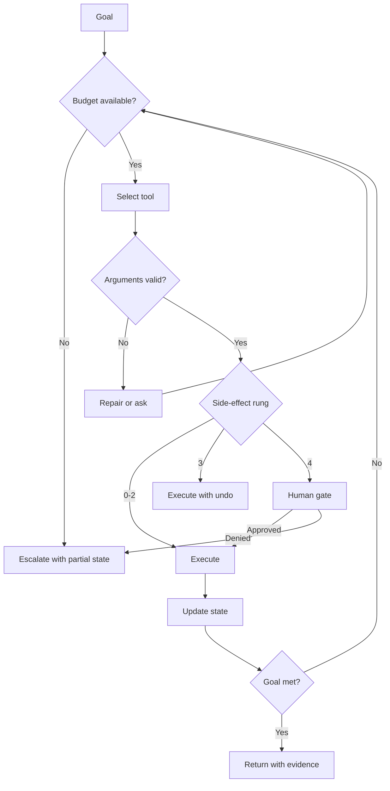
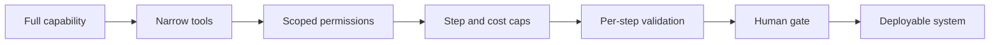

# Agents and Tools

> **Module 07 — Deep Learning, Multimodal Models, and LLMs**
> Topic 09 of 11
> Estimated study time: 4 hours
> Prerequisites: Topics 07 and 08
> Version 2026.3

## 1. Why this topic exists

An agent is a language model that can act. It plans, calls tools, observes results, and iterates until
it reaches a stopping condition. The difference from a chatbot is not intelligence; it is the
presence of a loop with side effects. That difference changes the risk profile completely. A wrong
answer in a chat is a wrong answer. A wrong action in an agent is a changed record, a sent message, an
ordered test, or a disclosed record.

The industry appeal is real. Many clinical workflows are multi-step: find the patient, check the
eligibility criteria, retrieve the policy, compute the deadline, draft the request, route it for
approval. An agent can automate the retrieval and drafting, and the human can approve. The industry
failure is also real, and it is documented: current models are not reliable enough for unsupervised
clinical action. MedAgentBench, a benchmark of 300 physician-written tasks in a FHIR environment,
reported that the best model achieved 69.67 percent overall success and 54 percent on tasks that
modify records (Jiang et al., NEJM AI 2025, doi:10.1056/aidbp2500144). A success rate of about half
on write actions is a demonstration, not a deployment.

Four costs follow.

**Compounding cost.** A ten-step task with 90 percent success per step succeeds 35 percent of the
time if the steps are independent. The arithmetic is unforgiving, and it is the reason agent
reliability must be measured per task, not per step. A system that is right nine times out of ten at
each step is wrong most of the time at the end of a long workflow.

**Side-effect cost.** A wrong read can be corrected; a wrong write may not be. An agent that sends a
message, orders a test, or updates a record has changed the world before anyone reviews the result.
The permission model, not the model's judgement, is the control.

**State cost.** An agent carries state across steps: the patient identifier, the selected policy, the
retrieved documents, the partial plan. If the state is stale or mis-scoped, every subsequent step is
wrong. The failure is silent because each step looks locally reasonable.

**Attribution cost.** When an agent fails, the trace must show which step, which tool, which argument,
and which observation caused the failure. Without a trace, the failure cannot be fixed, and the same
failure recurs after every model update.

This topic teaches the agent as a controlled loop. It covers tool schemas, permission models, state
management, budgets, retries, human gates, and the failure taxonomy that a clinical deployment must
test. It does not teach planning research or multi-agent architectures; those are not the bottleneck.
The bottleneck is reliability and control.

> **Note:** "Agent" in this topic means a single model in a loop with tools. Multi-agent systems are
> a composition of the same primitives, with the same failure modes multiplied by the number of
> agents.

## 2. Learning outcomes

By the end of this topic you can:

1. **Write** a tool schema with typed arguments, preconditions, side-effect class, and error
   semantics, and **explain** why each field is needed.
2. **Design** a permission model that separates read, draft, and irreversible actions, and **test**
   it against an adversarial prompt.
3. **Compute** task reliability from per-step reliability and **explain** why a long workflow needs a
   different evaluation from a single call.
4. **Implement** an agent loop with step, token, cost, and wall-clock caps, and **show** that it
   terminates on a failing task.
5. **Diagnose** the five clinical agent failures: wrong tool, stale state, silent partial completion,
   runaway loop, and permission escalation.
6. **Design** a human-in-the-loop gate with a stated decision, information, authority, and audit
   record.
7. **Trace** a failing agent from its log and **identify** the minimal fix.
8. **State** when an agent is inappropriate and a deterministic workflow is the correct design.

Outcomes 1, 3, and 4 are computational. Outcomes 2, 6, and 8 are design outcomes assessed by rubric.
Outcomes 5 and 7 are assessed in the trace exercise.

The computational outcomes are about reliability arithmetic, because the arithmetic is what changes a
design conversation. A team that has computed the product of step successes is arguing about evidence
rather than intuition, and the argument converges. A team that has computed `0.9^10 = 0.35` is ready to discuss shortening the
workflow; a team that has not is still discussing model choice. The design outcomes are about
controls, and the trace outcome is about diagnosis, which is the skill that keeps a deployed system
maintainable.

## 3. The core mental model

An agent is a state machine wrapped around a model. The state contains the goal, the facts gathered,
the plan, and the results so far. Each iteration selects a tool, builds arguments, executes, and
updates the state. The loop ends when the goal is met, a budget is exhausted, or a gate requires a
human.

```text
  goal --> [ planner ] --> tool call --> [ validator ] --> [ executor ] --> observation
                ^                                            |                 |
                |                                            v                 |
                +-------------- state update <--------------+-----------------+
                                      |
                                      v
                            stop? budget? gate? --> answer or escalate
```

The first mental model is the loop as an attack surface. Every element of the loop is a place where
untrusted text can enter: the goal from the user, the observation from a tool, the document from
retrieval, the tool description itself. A model that treats any of these as instructions can be
redirected. The defence is an instruction hierarchy plus a permission model, not a stronger prompt.

The second mental model is the side-effect ladder. Tools differ in what they can change, and the
control must match the rung.

```text
  rung 0  read-only, scoped          e.g., get patient demographics
  rung 1  read-only, broad           e.g., search the guideline corpus
  rung 2  draft, no external effect  e.g., compose a message
  rung 3  reversible write           e.g., create a draft order
  rung 4  irreversible write         e.g., send, sign, order, disclose
```

Rungs 0 to 2 can be automated with logging. Rung 3 requires a confirm step and an undo path. Rung 4
requires a human gate with a named approver, and the gate must be enforced by the tool, not by the
prompt. An agent that can call a rung-4 tool without a gate has a permission model that is one prompt
injection away from a serious incident.

The third mental model is reliability compounding. If each step succeeds independently with
probability `p`, a task of `n` steps succeeds with probability `p^n`. The arithmetic is optimistic,
because steps are correlated and errors can compensate, but it is the right first estimate.

| Per-step success | 1 step | 5 steps | 10 steps | 20 steps |
|---|---:|---:|---:|---:|
| 0.95 | 0.950 | 0.774 | 0.599 | 0.359 |
| 0.90 | 0.900 | 0.591 | 0.349 | 0.122 |
| 0.80 | 0.800 | 0.328 | 0.107 | 0.012 |
| 0.70 | 0.700 | 0.168 | 0.028 | 0.001 |

A clinical prior-authorization workflow with twelve steps and 90 percent per-step reliability succeeds
about 28 percent of the time. That is not a model problem; it is an arithmetic problem, and it is
solved by shortening the loop, adding verification per step, or moving steps into deterministic code.

The fourth mental model is the difference between an agent and a workflow. A workflow has fixed steps
and a model at one or two of them. An agent chooses its steps. The workflow is more reliable, cheaper,
and easier to validate; the agent is more flexible and harder to bound. For most clinical processes,
the correct design is a workflow with a model inside, not an agent with a workflow inside.



The diagram has three exits: success, escalation, and denial. An agent with only a success exit is an
agent that cannot fail safely, and the escalation path is the one that keeps a partial result from
being presented as a complete one.

The fifth mental model is the trace as the unit of diagnosis. A failed task is not a failed model; it
is a sequence of decisions, each of which can be inspected. The trace records the tool, the
arguments, the observation, and the state change. A team that reads the trace can usually identify
the defect in minutes, and a team that reads only the final output will attribute the failure to the
model and retrain, which fixes nothing.

The sixth mental model is the capability reduction. Every control in this topic removes a capability:
a narrower tool, a stricter schema, a lower step cap, a gate. The deployment that works is the one
that removed enough capability to be safe while keeping enough to be useful. An agent that can do
everything is an agent that cannot be bounded, and an unbounded agent is not a clinical system.



The reduction is not a one-time design step. Every new tool, every model update, and every change to
a user role is an opportunity to add capability back. The review must ask what the change enables,
not only what it improves, and the answer must be recorded in the device description.

A concrete test of whether the reduction worked is the red team in Step 14. If the team cannot
construct an attempt that should fail, the controls have not been specified precisely enough to test.

The seventh mental model is the difference between a task and a step. A step can succeed while the
task fails, and the task is the unit of clinical value. Every metric in this topic is defined at the
task level for that reason, and a report that gives only step accuracy has measured the wrong thing.

## 4. Definitions and vocabulary

| Term | Definition | Common misuse | Unit or convention |
|---|---|---|---|
| Agent | Model in a loop with tools and state | Calling any chatbot an agent | Architecture |
| Tool | Function the model can call | Confusing with an API | Interface |
| Function calling | Structured tool invocation by a model | Confusing with code execution | Capability |
| Tool schema | Typed description of arguments and effects | Assuming it enforces behaviour | Contract |
| Precondition | Condition that must hold before a call | Assuming the model checks it | Predicate |
| Side effect | Change caused by a tool | Confusing with a return value | Class |
| Idempotency | Safe repetition of a call | Assuming all tools are idempotent | Property |
| Observation | Tool result returned to the model | Assuming it is trusted text | Data |
| State | Facts and plan carried across steps | Confusing with conversation history | Object |
| Memory | Persisted state across sessions | Confusing with context | Store |
| Planning | Selecting a sequence of actions | Confusing with execution | Process |
| ReAct | Interleaved reasoning and acting | Assuming the reasoning is faithful | Pattern |
| Loop | Repeated plan-act-observe cycle | Assuming it terminates | Control flow |
| Step budget | Maximum iterations | Confusing with token budget | Count |
| Token budget | Maximum tokens consumed | Confusing with cost budget | Tokens |
| Cost budget | Maximum spend | Confusing with step budget | Currency |
| Retry | Re-execution after failure | Assuming it is safe | Policy |
| Backoff | Increasing delay between retries | Confusing with timeout | Policy |
| Timeout | Maximum wait for a call | Confusing with retry | Duration |
| Circuit breaker | Stop calling a failing tool | Confusing with retry | Control |
| Idempotency key | Identifier that makes a retry safe | Assuming the tool honours it | String |
| Human gate | Required approval before an action | Confusing with a notification | Control |
| Approval record | Evidence of who approved what | Confusing with a log line | Artefact |
| Permission escalation | Gaining access beyond the intended scope | Confusing with a bug | Failure |
| Prompt injection | Untrusted text that redirects the agent | Confusing with a jailbreak | Attack |
| Confused deputy | Agent uses its privileges for the attacker | Confusing with injection | Attack |
| Least privilege | Minimum access needed for the task | Confusing with no access | Principle |
| Sandbox | Isolated execution environment | Confusing with a permission | Control |
| Allowlist | Explicitly permitted tools or values | Confusing with a denylist | Control |
| Trace | Record of steps, calls, and observations | Assuming logs are traces | Artefact |
| Silent partial completion | Presenting an incomplete result as complete | Confusing with an error | Failure |
| Runaway loop | Unbounded iteration or retry | Confusing with a long task | Failure |
| Stale state | State that no longer matches reality | Confusing with a cache | Failure |
| Wrong tool | Selecting a tool that cannot achieve the goal | Confusing with a bad argument | Failure |
| Task success | Whether the goal was achieved | Confusing with step success | Metric |
| Pass^k | Probability all k trials succeed | Confusing with pass@k | Metric |
| Escalation | Handing the task to a human | Confusing with failure | Outcome |

> **Note:** "Pass^k" is not "pass@k". Pass@k asks whether at least one of k attempts succeeds, which
> is the right metric for code generation with a verifier. Pass^k asks whether all k attempts succeed,
> which is the right metric for a clinical workflow that must work every time.

The distinction matters because the two metrics move in opposite directions as `k` grows. Pass@k
rises with more attempts; pass^k falls. A vendor that reports pass@k for a clinical workflow has
reported the probability that the agent succeeds at least once, which is not the property a hospital
needs.

## 5. The mechanics, step by step

This section is a sixteen-step procedure from a task definition to a monitored agent. Steps 1 to 5
define the task, the tools, the permissions, and the state. Steps 6 to 9 build the loop and its
budgets. Steps 10 to 13 handle failure and gates. Steps 14 to 16 evaluate, monitor, and retire.

### Step 1. Decide whether an agent is the right design

**Input:** the workflow and its variation.

**Output:** a decision among deterministic workflow, workflow with a model step, and agent.

**Rationale:** Most clinical processes are stable enough to encode as workflows. An agent is
justified when the sequence of steps genuinely depends on intermediate results and cannot be
enumerated in advance. The decision should be written down, because "we built an agent" is often a
choice made before the analysis.

**Branch point:** if the process has a fixed sequence with one classification step, use a workflow.
If the sequence depends on retrieved content in a way that cannot be enumerated, an agent may be
justified. If the process has an irreversible action, the action must be gated regardless.

### Step 2. Write the tool schemas

**Input:** the systems the agent must use.

**Output:** a schema per tool with name, description, typed arguments, required fields, side-effect
class, preconditions, and error codes.

**Rationale:** The schema is the contract. A model selects tools by description, so a vague
description produces wrong selections. Typed arguments let the validator reject malformed calls
before execution. The side-effect class lets the runtime decide whether a gate is required.

| Schema field | Purpose | Failure if missing |
|---|---|---|
| Name | Selection | Ambiguous tool choice |
| Description | Selection | Wrong tool |
| Argument types | Validation | Malformed call |
| Required fields | Validation | Missing argument |
| Side-effect class | Gating | Ungated write |
| Preconditions | Safety | Action on wrong patient |
| Error codes | Recovery | Blind retry |
| Idempotency | Safe retry | Duplicate write |

### Step 3. Define the permission model

**Input:** the tools and the user roles.

**Output:** a matrix of role, tool, scope, and gate.

**Rationale:** The model's permissions must be the intersection of the user's permissions and the
task's needs. An agent that runs with a service account holding broad access is a confused deputy:
an attacker who can influence the agent can use the service account's privileges.

**Branch point:** if the agent must read patient data, scope the read to the patient in the state,
not to the whole record system. If the agent must write, require a gate for rung 4 and an undo path
for rung 3.

### Step 4. Define the state object

**Input:** the task and the tools.

**Output:** a typed state with the goal, the patient identifier, the facts, the plan, the results,
and the budget counters.

**Rationale:** The state is the agent's memory and its audit record. A typed state lets the runtime
check that every tool call is scoped to the current patient, and it lets the trace show what the
agent believed at each step. An untyped dictionary of strings cannot be validated.

### Step 5. Write the policy

**Input:** the task, the tools, and the risk analysis.

**Output:** rules for tool selection, stopping, escalation, and refusal.

**Rationale:** The policy is the specification the model approximates. It should state which tools
may be used for which subgoal, when the task is complete, when to escalate, and when to refuse. The
policy is enforced in code where possible, and in the prompt only where code cannot reach.

### Step 6. Set the budgets

**Input:** the task length and the cost tolerance.

**Output:** a step cap, a token cap, a cost cap, and a wall-clock cap.

**Rationale:** The budgets are the difference between a slow task and a runaway loop. They must be
set from the expected task length with headroom, and they must be enforced by the runtime, not by the
model. A step cap of 12 for a task that usually takes 5 steps allows recovery from two failures and
stops a loop before it becomes expensive.

### Step 7. Implement the loop with validation

**Input:** the state, the tools, and the policy.

**Output:** a loop that selects, validates, executes, and updates.

**Rationale:** The loop must validate arguments before execution: types, required fields, patient
scope, and preconditions. Validation is cheap and catches the failures that would otherwise become
wrong writes. The loop must also record the observation verbatim, because the trace is the only
evidence of what the agent saw.

### Step 8. Separate observation from instruction

**Input:** tool results.

**Output:** observations wrapped as data with a clear boundary.

**Rationale:** A tool result can contain text that looks like an instruction: a note that says
"ignore previous instructions", a document with a hidden prompt. The runtime must wrap observations
in a delimited block and the system message must state that observations are data. This reduces but
does not eliminate injection; the permission model is the real control.

### Step 9. Handle tool errors with typed recovery

**Input:** an error code from a tool.

**Output:** a retry, a repair, an escalation, or a stop.

**Rationale:** Not every error should be retried. A timeout is retryable with backoff; a validation
error needs argument repair; a permission error needs escalation; a not-found error needs a different
tool or a stop. A blanket retry policy turns a deterministic failure into a loop.

**Decision table for tool errors:**

| Error class | Retry? | Action | Example |
|---|---|---|---|
| Timeout | Yes, with backoff | Retry up to 3 | FHIR server slow |
| Rate limit | Yes, with delay | Wait and retry | API quota |
| Validation | No | Repair arguments | Bad date format |
| Not found | No | Change tool or stop | Wrong patient id |
| Permission | No | Escalate | Role lacks access |
| Conflict | Maybe | Re-read state | Concurrent update |
| Server error | Yes, limited | Retry, then circuit break | 500 response |

### Step 10. Detect loops and stale state

**Input:** the trace.

**Output:** a loop or staleness signal.

**Rationale:** A loop is visible as a repeated tool call with the same arguments or a state that does
not change. Stale state is visible as a patient identifier that differs from the current context, or
a fact that the source system has since updated. Both must be detected by the runtime, because the
model will not notice.

### Step 11. Gate irreversible actions

**Input:** a proposed rung-4 action.

**Output:** an approval request with the action, the evidence, and the consequences.

**Rationale:** The gate must present the decision, not the whole trace. The approver needs the
action, the patient, the reason, the evidence, and what will happen if approved. The gate must be
enforced by the tool: the tool refuses to execute without an approval token that the runtime issues
after a human decision.

### Step 12. Log a structured trace

**Input:** every step.

**Output:** a trace with step number, tool, arguments, observation, state diff, latency, and cost.

**Rationale:** The trace is the evidence for debugging, audit, and incident review. It must be
structured, not a concatenated string, so that a failure can be queried by tool, by patient, or by
error class.

### Step 13. Evaluate task success and reliability

**Input:** a task set and the trace.

**Output:** task success, pass^k, and a failure taxonomy.

**Rationale:** The evaluation must be per task, with repeated trials, because a single success does
not establish reliability. The failure taxonomy must be explicit, so that the evaluation reports
which failure occurred, not only that the task failed.

### Step 14. Red-team the permissions

**Input:** the agent and its tools.

**Output:** a list of attempts that should fail and their results.

**Rationale:** The red team tries to make the agent read another patient's record, call a rung-4 tool
without a gate, follow an instruction embedded in a document, and exceed its budget. Each attempt
must fail, and the failure must be logged. A successful attempt is a defect, not a warning.

### Step 15. Monitor in production

**Input:** live traces.

**Output:** step count distribution, tool error rate, gate rate, escalation rate, and cost per task.

**Rationale:** A change in the step distribution suggests a new failure mode; a change in the gate
rate suggests a policy or model change; a change in the escalation rate suggests a scope problem.
The monitoring must be tied to the trace, so that an anomaly can be inspected.

### Step 16. Retire or revalidate

**Input:** a model, tool, or policy change.

**Output:** a revalidation or a retirement decision.

**Rationale:** An agent is a system, and any component change is a system change. The revalidation
must rerun the task set and the red team, and the result must be recorded. An agent that is not
revalidated after a model update is an untested system.

The five failure modes specific to clinical agents are worth naming.

**Wrong tool.** The agent selects a tool that cannot achieve the goal, often because two tools have
similar descriptions. The signature is a plausible call with a result that does not answer the
subgoal. The fix is a clearer description, a smaller tool set, or a routing step in code.

**Stale state.** The agent uses a patient identifier or fact that has changed. The signature is a
call scoped to the wrong patient or an answer that contradicts the current record. The fix is a state
refresh before each write and a scope check in the validator.

**Silent partial completion.** The agent stops before completing the task and presents the partial
result as complete. The signature is a success claim with a missing subgoal in the trace. The fix is
an explicit completion check against the goal, not the model's judgement.

**Runaway loop.** The agent repeats a failing action or explores without converging. The signature is
a step count at the cap and a repeated tool call. The fix is a step cap, loop detection, and typed
error recovery.

**Permission escalation.** The agent gains access beyond the intended scope, through a broad service
account, an injection, or a tool that accepts an arbitrary identifier. The signature is a successful
call that should have been denied. The fix is least privilege, per-patient scoping, and a red-team
test.

### A tool schema that can be enforced

A schema is useful only if the runtime can check it. The example below is the shape a clinical tool
should have; the fields are the minimum for safe execution.

```text
name: submit_prior_auth
description: Submit a completed prior-authorization draft to the payer.
  Side effect: irreversible external submission. Requires approval.
arguments:
  patient_id: string, required, must match state.patient_id
  draft_id: string, required, must exist and be in state "ready"
  payer_id: string, required, must match draft.payer_id
  approval_token: string, required, issued only by the human gate
preconditions:
  - state.criteria_checked == true
  - draft.submission_id is null
  - approval_token.action == "submit_prior_auth"
  - approval_token.draft_id == draft_id
side_effect: rung_4_irreversible
idempotency: key = draft_id, honoured by the payer adapter
errors:
  conflict: non_retryable, refresh state
  permission: escalate
  validation: repair
  timeout: retry up to 2 with backoff
```

Four properties make this enforceable. The patient id must match the state, which prevents a
wrong-patient write. The approval token is issued by the gate and bound to the draft, which prevents
a call without approval. The precondition on `submission_id` prevents a duplicate submission. The
error classes determine the recovery, which prevents a conflict from being retried forever.

### Human-in-the-loop gate design

A gate is a control only if it has four properties: a decision, the information to make it, the
authority to refuse, and a record. A notification with an approve button has the first and not the
other three.

| Gate property | Requirement | Failure if missing |
|---|---|---|
| Decision | One action, stated plainly | Approver cannot tell what is being approved |
| Information | Patient, action, reason, evidence, consequence | Rubber-stamping |
| Authority | Approver can refuse without penalty | Gate is theatre |
| Record | Who, what, when, on what evidence | No accountability |
| Binding | Tool refuses without the token | Gate is advisory |
| Timeout | Default is no action | Silent auto-approval |

The gate must present a summary, not a transcript. An approver who is shown 12 tool calls will click
approve; an approver who is shown "Submit MRI lumbar spine prior authorization for patient P-7781;
policy X-2024-LBP; conservative therapy documented as 6 weeks NSAID and 4 weeks physical therapy;
consequence: request sent to payer" can make a decision.

The gate must also be binding at the tool level. If the approval is checked by the agent's prompt,
a prompt injection can bypass it. If the tool requires a token that only the gate can issue, the
injection cannot mint one. This is the same principle as a database permission: the control lives in
the layer that executes, not in the layer that requests.

The default on timeout must be no action. An approval that expires into "approved" is an
auto-approval with a delay, and it will be discovered after the first incident.

### The minimum viable control set

A team that can implement only five controls should implement these, in order: a per-patient scope
check in the tool validator, a step cap with loop detection, typed error classes with a non-retryable
list, a binding approval token for rung-4 actions, and a structured trace. Together they prevent the
wrong-patient write, the runaway loop, the duplicate submission, the ungated action, and the
undiagnosable failure.

The set is deliberately small. A control that is not implemented is not a control, and a long list of
aspirational controls is a way of having none. Each of the five has a test: a unique-term query for
the scope check, a repeated-call fixture for the loop detector, a 409 response for the error classes,
a missing-token attempt for the gate, and a failed-task replay for the trace.

If a control has no test, it has not been implemented. That rule is the simplest way to audit an
agent design, and it is the one this topic returns to. The five are enough to make the failure modes visible
and bounded, and the rest can be added as the risk analysis requires.

### Why the model cannot be the control

Every control in this section is enforced outside the model: the schema validator, the permission
matrix, the step counter, the loop detector, the approval token. The reason is not distrust of any
particular model. It is that the model's behaviour is a probability distribution, and a control must
be deterministic. A model that refuses 99 percent of malicious calls is not a permission system; it
is a filter with a one percent failure rate that an attacker can retry.

The prompt still matters, because it shapes what the model attempts. But the prompt is a policy
input, not an enforcement mechanism, and the system must be safe when the prompt is ignored.

## 6. Worked example

A hospital builds an agent to prepare prior-authorization requests for advanced imaging. The agent
must identify the patient, check the payer policy, verify that conservative therapy was tried, draft
the request, and route it to a coordinator for submission. The tools are: patient lookup, policy
search, medication history, order history, draft creation, and submission.

This section traces a failing run, computes its cost, diagnoses the failure, applies the minimal
fix, and varies the step budget.

### Step 1. The trace

```text
step 1  lookup_patient(mrn="10045")            -> {id: "P-7781", name: "A. R."}
step 2  search_policy(payer="X", cpt="72148")  -> 3 policies, top: "X-2024-LBP"
step 3  medication_history(patient="P-7781")   -> 14 medications, no NSAID trial
step 4  order_history(patient="P-7781")        -> 2 physical therapy visits
step 5  search_policy(query="NSAID contraindication") -> "X-2024-LBP" section 4
step 6  draft_request(patient="P-7781", ...)   -> draft id D-91
step 7  submit_request(patient="P-7781", draft="D-91") -> ERROR 409 conflict
step 8  submit_request(patient="P-7781", draft="D-91") -> ERROR 409 conflict
step 9  submit_request(patient="P-7781", draft="D-91") -> ERROR 409 conflict
step 10 submit_request(patient="P-7781", draft="D-91") -> ERROR 409 conflict
step 11 submit_request(patient="P-7781", draft="D-91") -> ERROR 409 conflict
step 12 submit_request(patient="P-7781", draft="D-91") -> ERROR 409 conflict
step 13 stopped: step budget exhausted
```

The run consumed 13 steps and never submitted. The trace shows the failure clearly: steps 7 to 12 are
identical retries of a conflict error, and the agent had no rule for a conflict. The 409 is returned
because the draft was already submitted by a coordinator in another session, so the correct action
was to stop and report the existing submission, not to retry.

### Step 2. The cost

Each step sends the goal, the state, the tool list, and the observations, and receives a tool call.
Assume 3,000 tokens per step, which is plausible with a policy excerpt in the context.

```text
tokens = 13 steps * 3,000 = 39,000 tokens
cost at an assumed $3 per million tokens = 39,000 / 1e6 * 3 = $0.117
```

The cost of one failed task is small. At 2,000 tasks per day, the failed retries alone cost
`6 retries * 3,000 * 2,000 = 36,000,000` tokens per day, or about $108 per day at the assumed price.
The real cost is the coordinator's time to discover the failure and resubmit, which is larger than
the inference cost and is not in the token bill.

### Step 3. The diagnosis

Two defects are visible. The first is the retry policy: a 409 conflict is classified as retryable,
but a conflict means the state has changed and a retry with the same arguments cannot succeed. The
second is the missing completion check: the agent had no way to recognise that the task was already
complete.

A third defect is latent. The agent looked up the patient by medical record number and received an
internal id, but the state did not record which identifier the tools expect. A later tool that
accepts either could be called with the wrong one, and the error would surface as a wrong-patient
write rather than a conflict.

### Step 4. The minimal fix

The minimal fix is not a better model. It is three lines of runtime logic and one schema change.

```text
1. Classify 409 as non-retryable, with action "refresh state and report".
2. On a non-retryable error, stop and return a structured partial result:
   {status: "not_completed", reason: "conflict", evidence: "existing submission S-2231"}.
3. Add a precondition to submit_request: the draft must be in state "ready" and
   must not already have a submission id.
```

The fix removes six wasted steps, converts a silent failure into an explicit partial result, and
prevents a duplicate submission if the conflict is transient. It does not require retraining, a
larger model, or a new prompt.

### Step 5. Diagnostic one: the retry budget

Before the fix, the agent retried until the step cap. The expected number of attempts for a tool with
success probability `p` under a cap of 3 is:

```text
E[attempts] = sum over k=1..3 of k * p * (1-p)^(k-1) + 3 * (1-p)^3
```

For `p = 0.5`, the expected number is 1.75; for `p = 0.9`, it is 1.11. The formula shows that a cap
of 3 is cheap when the tool usually succeeds and that a cap of 12 is not a recovery policy, it is a
budget for repeating the same mistake. The retry cap should be set from the error class, not from the
step budget.

### Step 6. Diagnostic two: silent partial completion

The agent's final message before the fix was "The prior authorization request has been prepared." That
statement is true about the draft and false about the submission. The completion check must be
against the goal, which includes submission, and it must be a code check on the state, not a model
judgement.

```text
goal: {patient: identified, policy: found, criteria: checked, draft: created, submitted: true}
state: {patient: identified, policy: found, criteria: checked, draft: created, submitted: false}
```

The mismatch is one boolean. A completion check that compares the goal fields with the state fields
would have refused to return success. The check is cheap and catches the most dangerous agent failure,
because a partial result presented as complete removes the human's reason to review.

### Step 7. Vary one assumption: step budget 12 to 6

Suppose the team reduces the step cap from 12 to 6 to control cost.

```text
expected steps for a healthy task: 5
headroom at cap 6: 1 step
headroom at cap 12: 7 steps
```

At cap 6, a single transient timeout exhausts the budget and the task escalates. At cap 12, the agent
can recover from two failures and still loop on a systematic error. The conclusion changes in a
specific way: the cap should be set from the distribution of healthy task lengths plus the number of
retryable errors expected, not from the cost target. A cap that is too low converts recoverable
failures into escalations; a cap that is too high converts systematic failures into cost.

### Step 8. Reliability arithmetic for the workflow

The task has five subgoals, and each has a measured success rate from 100 trials: patient identified
0.98, policy found 0.95, criteria checked 0.90, draft created 0.97, submitted 0.92. If the steps are
independent, the task success is:

```text
0.98 * 0.95 * 0.90 * 0.97 * 0.92 = 0.748
```

About 75 percent, which is plausible for a demonstration and unacceptable for an unattended workflow.
The arithmetic also shows where to invest: the criteria check at 0.90 costs more success than the
patient lookup at 0.98. Moving the criteria check into deterministic code, with a rule table, might
raise it to 0.99 and the task to `0.98 * 0.95 * 0.99 * 0.97 * 0.92 = 0.823`.

The independence assumption is optimistic. Errors can be correlated: a stale patient id causes the
policy lookup and the criteria check to fail together. The measured task success is therefore usually
lower than the product, and the product is a ceiling, not an estimate.

### Step 9. The red-team result that matters

The team runs four adversarial tasks: read another patient's record, submit without approval, follow
an instruction embedded in a policy document, and exceed the step budget. Before the fixes, three
succeed. After the fixes, all four fail closed, and each failure is logged with the rule that caught
it.

The relevant metric is not the model's refusal rate; it is the runtime's enforcement rate. A refusal
that depends on the model is a probabilistic control, and a red team that stops after one attempt
underestimates its failure rate.

### Step 10. What the trace does not establish

The trace shows that this run failed and why. It does not establish the task success rate, the
distribution of failures, or the safety of the permission model. Those require a task set with
repeated trials, a failure taxonomy, and a red team. The trace is the unit of diagnosis, not the unit
of evaluation.

## 7. Code, query, or calculation

The code below computes task reliability from per-step reliability, the expected number of attempts
under a retry cap, and the token cost of a failing run. It uses only the standard library.

**Assumptions.** Steps are independent, which makes the product a ceiling rather than an estimate.
The retry model assumes independent attempts with a fixed success probability. The cost uses an
assumed price of $3 per million tokens, which is a planning assumption, not a vendor quote.

```python
for p in [0.95, 0.90, 0.80, 0.70]:
    row = [f"p={p:.2f}"]
    for n in [1, 5, 10, 20]:
        row.append(f"{n}:{p ** n:.3f}")
    print("  ".join(row))

def expected_attempts(p, cap):
    total = 0.0
    for k in range(1, cap + 1):
        total += k * p * (1 - p) ** (k - 1)
    total += cap * (1 - p) ** cap
    return total

for p in [0.9, 0.7, 0.5]:
    print("p", p, "E[attempts] cap 3:", round(expected_attempts(p, 3), 3))

steps, tokens_per_step, price_per_mtok = 13, 3000, 3.0
tokens = steps * tokens_per_step
print("tokens:", tokens)
print("cost at $3/Mtok:", round(tokens / 1e6 * price_per_mtok, 4))

print("pass^3 at 0.7:", round(0.7 ** 3, 4))

subgoals = [0.98, 0.95, 0.90, 0.97, 0.92]
prod = 1.0
for p in subgoals:
    prod *= p
print("five-step task success:", round(prod, 4))
improved = [0.98, 0.95, 0.99, 0.97, 0.92]
prod2 = 1.0
for p in improved:
    prod2 *= p
print("with criteria check at 0.99:", round(prod2, 4))
```

**Observed output:**

```text
p=0.95  1:0.950  5:0.774  10:0.599  20:0.359
p=0.90  1:0.900  5:0.591  10:0.349  20:0.122
p=0.80  1:0.800  5:0.328  10:0.107  20:0.012
p=0.70  1:0.700  5:0.168  10:0.028  20:0.001
p 0.9 E[attempts] cap 3: 1.11
p 0.7 E[attempts] cap 3: 1.386
p 0.5 E[attempts] cap 3: 1.75
tokens: 39000
cost at $3/Mtok: 0.117
pass^3 at 0.7: 0.343
five-step task success: 0.7481
with criteria check at 0.99: 0.8232
```

The first block is the argument against long unattended workflows. At 0.90 per step, a ten-step task
succeeds 34.9 percent of the time, and a twenty-step task 12.2 percent. At 0.95, the same tasks
succeed 59.9 and 35.9 percent. The difference between a good step and a very good step is the
difference between a demonstration and a workflow.

The retry expectation shows why a cap of 3 is usually enough for a transient error: at `p = 0.9`, the
expected attempts are 1.11, so most calls succeed first time and the cap is rarely reached. At
`p = 0.5`, the expected attempts are 1.75, and a cap of 12 would spend most of its budget on a tool
that is failing half the time.

The five-step product, 0.748, is the ceiling under independence. The actual measured success is
usually lower because failures correlate. The improved product, 0.823, shows the value of moving one
subgoal into deterministic code: a single step improved by 9 points raises the task by 7.5 points.

The second block computes the cost of reliability trials, which is the evaluation budget.

```python
tasks, trials, steps_per_task, tokens_per_step = 300, 3, 8, 3000
total_steps = tasks * trials * steps_per_task
tokens = total_steps * tokens_per_step
print("steps:", total_steps)
print("tokens:", tokens)
print("cost at $3/Mtok:", round(tokens / 1e6 * 3, 2))
print("hours at 60 steps/min:", round(total_steps / 60 / 60, 2))
```

**Observed output:**

```text
steps: 7200
tokens: 21600000
cost at $3/Mtok: 64.8
hours at 60 steps/min: 2.0
```

The evaluation is cheap relative to the deployment. Three trials of 300 tasks at eight steps each
costs 7,200 steps, 21.6 million tokens, and about $65 at the assumed price. A team that skips the
trials to save the budget has saved less than a day of engineering time and has no estimate of
reliability.

The arithmetic assumes independence across trials, which is optimistic: a task that fails because of
a systematic state bug fails every time, and the trial count does not help. The evaluation should
report both the success rate and the number of distinct failure causes, because a system that fails
for one fixable reason is closer to deployment than a system that fails for ten.

The trial count determines what the evaluation can detect. With 300 tasks and three trials, the
standard error of a success rate near 0.7 is about `sqrt(0.7 * 0.3 / 900) = 0.015`, so a difference
smaller than about 4 points is not distinguishable. A team that needs to detect a 2-point improvement
needs roughly four times the trials, and the arithmetic should be done before the task set is built.

## 8. Data, standards, and regulatory context

An agent is regulated through its capabilities, not its architecture. The device description must
state what the agent can read, write, and disclose, because those are the actions that create risk.
A description that names the model but not the tools has omitted the part that matters.

**Device regulation.** An agent that acts on clinical data is device software if it is intended for a
medical purpose. The FDA draft guidance on AI-enabled device software functions (January 2025, docket
FDA-2024-D-4488) asks for a description of the device, its inputs, and its lifecycle controls. For an
agent, the description must include the tools, the permissions, the human gates, and the stopping
conditions, because those determine what the device can do. The predetermined change control guidance
(December 2024, docket FDA-2022-D-2628) asks which changes are anticipated: a new tool, a new
permission, or a new model version is a change to the device's capability.

**EU AI Act.** Regulation (EU) 2024/1689 requires high-risk systems to have risk management, data
governance, technical documentation, human oversight, accuracy, robustness, and post-market
monitoring. The human-oversight requirement is directly relevant: an agent with an irreversible
action must have an effective human oversight mechanism, and a gate that is not binding is not one.
The robustness requirement reaches the agent's behaviour under adversarial input, including prompt
injection through tools and documents.

**NIST.** The Generative AI Profile (NIST AI 600-1, July 2024) names information security,
human-AI configuration, and value-chain integration among its risks. For agents, the information
security risk includes prompt injection and the confused-deputy problem; the human-AI configuration
risk includes automation bias at the gate; the value-chain risk includes the tools and APIs the agent
calls, each of which is a dependency with its own failure modes.

**HIPAA.** An agent that reads or writes protected health information is a system that processes PHI.
The minimum-necessary standard applies to each tool call: a tool that returns the full record when the
task needs one field is a disclosure beyond the minimum. The audit log must record access, and the
permission model must enforce the same role rules as the source system.

**FHIR and tool interfaces.** Many clinical agents call FHIR (Fast Healthcare Interoperability
Resources) endpoints. The FHIR specification defines resource shapes, search parameters, and
operations, and it constrains what a tool can ask for. A tool that accepts an arbitrary patient
identifier and returns a bundle is a broader permission than the task needs; a tool that accepts a
patient identifier already bound to the session is narrower and safer. MedAgentBench used nine FHIR
functions in a HAPI FHIR environment, which is a realistic interface for this reason.

| Framework | Status | What it constrains | What it does not |
|---|---|---|---|
| FDA AI device draft (2025) | Draft | Device description and lifecycle | Agent design |
| FDA PCCP (2024) | Final | Tool and model changes | Reliability |
| EU AI Act | Binding, phased | Human oversight and robustness | Technical threshold |
| NIST AI 600-1 | Voluntary | Security and human-AI risks | Compliance |
| HIPAA | Binding in the US | PHI access and minimum necessary | Agent permissions |
| FHIR | Industry standard | Resource shapes and operations | Tool scope |

**Data minimisation per call.** The minimum-necessary standard applies at the level of each tool
call. A tool that returns a full FHIR bundle when the task needs a single observation is a disclosure
that the task did not require, and the disclosure is repeated on every step. The tool should return
the fields the step needs, and the schema should make the narrow return the default.

| Tool | Broad version | Narrow version | Difference |
|---|---|---|---|
| Patient lookup | Full record bundle | Identifier and demographics | Fewer fields exposed |
| Lab result | All observations | Latest value for one code | Less data, less noise |
| Policy search | Full corpus | Top 3 passages with citations | Smaller context |
| Order history | All orders | Orders in a date range | Scoped |
| Draft creation | Free-text note | Typed fields | Validatable |
| Submission | Direct API call | Gated call with token | Controlled |

**Audit and retention.** An agent's trace contains PHI, tool arguments, and observations. It is an
audit record and a data asset at the same time, and it must be protected, retained, and disposed of
under the same policy as the source data. A trace that is written to an unsecured log is a breach
waiting to be discovered, and a trace that is deleted too soon cannot support an incident review.

**Tool supply chain.** Every tool is a dependency. An API change, a schema change, or a permission
change in the source system can break the agent or, worse, change its behaviour silently. The tool
versions must be pinned, the contracts tested, and the changes managed through the same change-control
process as the model.

**What the frameworks do not cover.** None of the frameworks specifies a step cap, a retry policy, or
a gate design. Those are engineering choices that the team must justify from the risk analysis and
the red team, and the justification is the evidence that the control was designed rather than
inherited.

The frameworks require a description of what the agent can do and a control that prevents it from
doing more. Neither establishes that it does the task correctly. That requires the task evaluation
and the red team.

## 9. Industry practice and case evidence

The public evidence on agents is recent and mostly from benchmarks. It is enough to establish a
reliability gap and not enough to establish a deployment recipe. This section separates the two.

**ReAct and the reason-act loop.** Yao et al. introduced ReAct, which interleaves reasoning traces
with tool actions and observations (ICLR 2023, arXiv:2210.03629). The documented result is improved
performance on question answering and interactive decision-making tasks relative to acting without
reasoning. The lesson for clinical agents is that the loop is the pattern, not the reasoning text:
the reasoning trace is useful for debugging and is not evidence that the model's stated reasoning
caused the action.

**Toolformer and learned tool use.** Schick et al. trained a model to decide when to call APIs and
what arguments to pass (arXiv:2302.04761, 2023). The documented result is that a model can learn to
use tools with a small amount of supervision. The inference for a clinical deployment, which the
paper does not make, is that tool selection is learnable but not reliable; the runtime validation and
the permission model remain necessary.

**MedAgentBench and the reliability gap.** Jiang et al. built a virtual FHIR environment with 100
de-identified patient profiles and 300 physician-written tasks across 10 categories, and evaluated
several models with nine FHIR functions and a maximum of eight interaction rounds (NEJM AI 2025,
doi:10.1056/aidbp2500144; arXiv:2501.14654). The documented results include a best overall success
rate of 69.67 percent for Claude 3.5 Sonnet v2, with query tasks at 85.33 percent and action tasks at
54.00 percent. The paper reports that no model was reliable enough for clinical deployment and that
performance degraded with task length: the best model scored 100 percent on one-step tasks and 23.3
percent on tasks with three or more steps.

The action-task gap is the central empirical fact for this topic. Reading is easier than writing, and
the write tasks are the ones with side effects. A system that is 85 percent correct at retrieval and
54 percent correct at modification is a system that needs a gate on every modification.

**What practitioners actually do.** In inference from public system descriptions and vendor
documentation, three patterns recur. First, the systems that are deployed are workflows with a model
at a few steps, not open-ended agents. Second, the tools are narrow and pre-scoped: a function that
returns one field, not a query language. Third, the human gate is on the irreversible action, and the
gate is enforced by the tool. The teams that deploy successfully have removed capability, not added
it.

**What the benchmark measures.** MedAgentBench measures whether an agent completes a short,
verifiable task in a simulated FHIR environment with a fixed tool set and a fixed number of rounds.
It does not measure whether the agent would be safe with a real user's permissions, whether it would
handle a tool outage, whether a clinician would notice a wrong action, or whether the task's clinical
intent was met. The benchmark is a useful lower bound on capability and a poor estimate of
deployment safety.

**Why task length dominates.** The benchmark's reported drop from 100 percent on one-step tasks to
23.3 percent on tasks with three or more steps is the reliability arithmetic in empirical form. The
mechanism is not that the model becomes worse at each step; it is that the number of opportunities
to fail grows, and the agent has no verification between steps. The fix that the benchmark implies is
per-step verification, not a larger model.

**The deployment pattern that works.** The documented and inferred pattern across clinical agent
deployments is a workflow with a model at two or three steps, narrow tools, per-step validation, and
a gate on the irreversible action. The agent is used where the step sequence is uncertain, and the
deterministic parts are moved into code. The pattern is less exciting than an autonomous agent and
far more likely to survive a safety review.

**What a buyer should ask.** Five questions separate a controlled agent from a demonstration. What
tools can it call, and which have side effects? What are the permissions, and are they scoped to the
user or to a service account? What is the step and cost budget, and what happens at the cap? Where
is the human gate, and is it enforced by the tool? Can you show a trace of a failed task and the
fix? A vendor that answers all five has built a system; a vendor that answers only the first has
built a demo.

The evidence does not support the claim that a capable model makes an agent safe. It supports the
claim that reliability falls with task length, that write actions are less reliable than reads, and
that the controls must be outside the model.

## 10. Failure modes and red flags

The five clinical agent failures named in Section 5 are the organising categories: wrong tool, stale
state, silent partial completion, runaway loop, and permission escalation. The table expands each
into observable signs and controls, and adds the operational failures that appear after deployment.

| Failure | Early warning sign | Mechanism | Consequence | Mitigation |
|---|---|---|---|---|
| Wrong tool | Plausible call, irrelevant result | Ambiguous descriptions | Task not achieved | Clear schemas, routing |
| Stale state | Identifier differs from current | State not refreshed | Wrong-patient action | Refresh and scope check |
| Silent partial completion | Success claim with missing subgoal | No completion check | Unreviewed incomplete work | State-vs-goal check |
| Runaway loop | Step count at cap, repeated call | Blanket retry policy | Cost, latency | Typed errors, loop detection |
| Permission escalation | Successful call that should fail | Broad service account | Privacy breach | Least privilege, red team |
| Confused deputy | Agent uses its role for attacker | Injection plus privilege | Unauthorized action | Per-user scoping |
| Prompt injection via tool | Behaviour changes by observation | Instruction in data | Scope violation | Delimit, treat as data |
| Duplicate write | Two submissions for one draft | Retry without idempotency | Duplicate order | Idempotency key |
| Gate bypass | Action without approval token | Gate in prompt only | Irreversible error | Tool-enforced token |
| Gate fatigue | Approval rate near 100 percent | Too many requests, poor summary | Rubber-stamping | Better summaries, sampling |
| Budget overrun | Cost per task above forecast | Long context, retries | Budget breach | Caps and monitoring |
| Tool schema drift | Validation failures after upgrade | API change | Broken workflow | Versioned schemas |
| Correlated step failure | Task success far below product | Shared state error | Overestimated reliability | End-to-end trials |
| Unlogged action | Trace missing a step | Logging gap | No audit | Structured trace |

Two rows are worth separating from the rest. Silent partial completion is the only failure that
removes the human's reason to review while leaving the output plausible, and it is prevented by a
code check, not a prompt. Permission escalation is the only failure that can become a privacy
incident, and it is prevented by the permission matrix, not by the model's judgement.

The operational rows at the bottom, schema drift and unlogged action, are the ones that appear after
a successful pilot. They are caused by changes in systems the team does not control, and they are
caught by contract tests and trace audits rather than by task evaluation.

## 11. Assumptions and limits

An agent assumes that its tools are honest, its state is current, its permissions are bounded, and
its model selects tools predictably. Each assumption is a place where the system can fail without an
error, and each can be tested before a task evaluation.

The first is the one that security reviews focus on. A tool that returns text is a channel for
untrusted input, and an agent that treats the text as instruction is a system that can be redirected
by anyone who can write to the source system.

| Assumption | Why it is needed | What breaks it | How to test |
|---|---|---|---|
| Steps are independent | The product is computable | Shared state errors | End-to-end trials |
| The tool schema matches the API | Calls are valid | API version change | Contract test |
| The user's permissions bound the agent | Least privilege | Service account | Permission audit |
| The state is current | Actions are scoped correctly | Concurrent update | Refresh and version |
| The model selects tools by description | Descriptions matter | Similar tools | Selection test |
| The gate is binding | Irreversible actions are controlled | Prompt-only check | Red-team bypass |
| The trace is complete | Failures are diagnosable | Logging gap | Trace audit |
| The task has a stopping condition | The loop terminates | Open-ended goal | Budget test |
| The evaluation set represents tasks | Success generalises | Convenience tasks | Task sampling |
| The tools are idempotent or keyed | Retries are safe | Non-idempotent write | Duplicate test |

## 12. Exercises

The exercises produce the artefacts a controlled deployment needs: a reliability calculation, a tool
schema, a gate design, and a red-team set. The arithmetic is checkable against Section 7. The design
exercises are assessed by the criteria stated with each one, and a gate design that is not binding at
the tool is incomplete.

For the red-team exercise, the expected result is always a denial. A test that produces a plausible
answer instead is a defect to be fixed, not a finding to be documented.

The exercises assume a simulated environment with synthetic patients. Do not run an agent against a
live clinical system for practice.

Exercise 6 is the one that should be repeated after every change. A red team is not a one-time
gate; it is a regression suite for the permission model.

The same applies to the tool contract tests in Exercise 3. A schema that is not tested against the
live API will drift, and the drift will appear as a validation failure in production rather than in
the deployment review.

Both tests belong in the deployment pipeline, not in a document, because a test that is run once
proves only that the system was correct once. A control without a recurring test is a claim about
the past, and a claim about the past is not a control.

That is the standard this topic applies to every artefact it asks for.

**Exercise 1 (calculation, 20 minutes).** A workflow has six steps at 0.93 each. Compute the task
success under independence, and the success if one step improves to 0.99. **Deliverable:** both
numbers. **Criteria:** correct product, correct interpretation.

**Exercise 2 (calculation, 25 minutes).** A tool succeeds with probability 0.8. Compute the expected
number of attempts under a cap of 3, and the probability of exhausting the cap. **Deliverable:** the
arithmetic. **Criteria:** correct expectation, correct tail probability.

**Exercise 3 (design, 40 minutes).** Write a tool schema for "schedule follow-up appointment" with
arguments, preconditions, side-effect class, and error codes. **Deliverable:** the schema.
**Criteria:** patient scope enforced, idempotency stated, gate for rung 4.

**Exercise 4 (diagnosis, 35 minutes).** An agent submits the same order twice. List three causes and
the test for each. **Deliverable:** a hypothesis table. **Criteria:** distinguishes retry, missing
idempotency, and concurrent state.

**Exercise 5 (gate design, 35 minutes).** Design a human gate for a rung-4 action, including the
summary shown, the authority, the timeout default, and the record. **Deliverable:** a one-page
design. **Criteria:** binding at the tool, default no action, audit fields.

**Exercise 6 (red team, 40 minutes).** Write four adversarial tasks for an agent with read and write
tools, and state the expected failure for each. **Deliverable:** the tasks and expected results.
**Criteria:** each test fails closed, each is logged.

**Exercise 7 (critique, 30 minutes).** Find an agent benchmark paper and identify its task set, tool
set, step limit, success metric, and action/query split. **Deliverable:** a five-row table with
quotations. **Criteria:** accurate quotations, at least one missing item.

**Exercise 8 (communication, 25 minutes).** Write 180 words for a CMIO explaining why an agent that
is 90 percent accurate per step is not 90 percent accurate per task. **Deliverable:** the paragraph.
**Criteria:** one worked number, one design consequence.

## 13. Self-check answers

The calculation answers show the arithmetic, and the design answers are rubrics. An answer that
describes a control without naming where it is enforced is incomplete, because the enforcement point
is the control.

The arithmetic answers should be checked against the formulas in Section 7, and the products should
be reported to three decimals so that small differences are visible. An answer that
proposes a control without saying where it is enforced has not specified a control, because a
control in the prompt is a suggestion.

**Answer 1.** Task success `0.93^6 = 0.647`. With one step at 0.99:
`0.647 * (0.99 / 0.93) = 0.689`. The improvement in one step raises the task by 4.2 points, which is
larger than the 6-point improvement in that step because the other steps remain unchanged.

**Answer 2.** Expected attempts with `p = 0.8` and cap 3:
`1*0.8 + 2*0.8*0.2 + 3*0.8*0.04 + 3*0.008 = 0.8 + 0.32 + 0.096 + 0.024 = 1.24`. The probability of
exhausting the cap is `(1-p)^3 = 0.008`, or 0.8 percent.

**Answer 3.** A strong schema has `patient_id` (must match state), `slot_id` (must be available),
`reason` (free text, length-capped), `approval_token` for a rung-4 booking that notifies the patient,
preconditions that the patient is not already booked, an idempotency key of `patient_id + slot_id`,
and error codes for conflict, validation, and permission. It does not accept an arbitrary patient
name.

**Answer 4.** Cause one: the tool is retried after a timeout and the first call succeeded but the
response was lost. Test: check the tool's idempotency key and the duplicate record's creation
timestamps. Cause two: the tool has no idempotency key and the runtime retries on a conflict. Test:
inspect the retry policy and the error classes. Cause three: two sessions act on the same draft
concurrently. Test: compare the state versions and the session ids in the trace.

**Answer 5.** A strong gate shows the action, the patient, the reason, the evidence, and the
consequence; names the approver role; defaults to no action on timeout; requires a token bound to the
action and the draft; and records who approved, when, and on what evidence. The tool refuses without
the token.

**Answer 6.** Tasks: read a record for a patient not in the state; submit without an approval token;
follow an instruction embedded in a retrieved policy; exceed the step budget. Expected: denial with a
logged rule for each. A test that returns a plausible answer instead of a denial is a defect.

**Answer 7.** A strong answer reports the number and source of tasks, the tools and their side
effects, the step limit, the success metric, and the split between query and action tasks. Most
papers report the task count and the model, and omit the step limit and the action/query split, which
are the two that determine whether the result is comparable.

**Answer 8.** Rubric: the paragraph explains that per-step success multiplies across steps, gives a
worked number such as `0.9^10 = 0.35`, and draws the design consequence: shorten the loop, verify per
step, or move steps into deterministic code. Full credit requires the number, the mechanism, and the
consequence.

## 14. Interview questions

The questions test whether a candidate can bound an agent rather than describe one. Strong answers
give a number, a schema, or a test; weak answers describe capabilities without controls.

**Question 1. When is an agent better than a workflow?**
A strong answer says almost never for clinical processes, and names the condition: the step sequence
genuinely depends on intermediate results and cannot be enumerated. A weak answer says "when the task
is complex".

**Question 2. How do you compute task reliability from step reliability?**
A strong answer gives the product, notes the independence assumption, and says the product is a
ceiling. A weak answer averages the step accuracies.

**Question 3. What belongs in a tool schema?**
A strong answer lists types, required fields, preconditions, side-effect class, idempotency, and
error codes. A weak answer lists only the arguments.

**Question 4. How do you prevent an agent from writing to the wrong patient?**
A strong answer binds the patient id in the state, validates it at the tool, scopes the permission,
and tests it adversarially. A weak answer tells the model to be careful.

**Question 5. What is a confused deputy, and why does it matter here?**
A strong answer explains that the agent's privileges can be used by an attacker who influences its
input, and proposes per-user scoping. A weak answer has not heard the term.

**Question 6. How do you design a human gate?**
A strong answer gives the decision, information, authority, record, binding mechanism, and timeout
default. A weak answer says "a human approves".

**Question 7. A tool returns a 409 conflict. What should the agent do?**
A strong answer classifies it as non-retryable, refreshes state, and reports. A weak answer retries.

**Question 8. How do you detect a runaway loop?**
A strong answer uses step caps, repeated-call detection, and state-change checks. A weak answer relies
on a timeout.

**Question 9. What is the most dangerous agent failure?**
A strong answer names silent partial completion, because it removes the reason for review, and
explains the completion check. A weak answer names hallucination.

## 15. Key terms

- **Agent** — model in a loop with tools and state.
- **Allowlist** — explicit set of permitted tools or values.
- **Approval record** — evidence of who approved what.
- **Backoff** — increasing delay between retries.
- **Circuit breaker** — stop calling a failing tool.
- **Confused deputy** — agent uses its privileges for an attacker.
- **Cost budget** — maximum spend per task.
- **Escalation** — handing the task to a human.
- **Function calling** — structured tool invocation.
- **Human gate** — required approval before an action.
- **Idempotency** — safe repetition of a call.
- **Idempotency key** — identifier that makes a retry safe.
- **Least privilege** — minimum access needed.
- **Loop** — repeated plan-act-observe cycle.
- **Memory** — persisted state across sessions.
- **Observation** — tool result returned to the model.
- **Pass^k** — probability all k trials succeed.
- **Permission escalation** — access beyond the intended scope.
- **Planning** — selecting a sequence of actions.
- **Precondition** — condition that must hold before a call.
- **Prompt injection** — untrusted text that redirects the agent.
- **ReAct** — interleaved reasoning and acting.
- **Retry** — re-execution after failure.
- **Runaway loop** — unbounded iteration or retry.
- **Sandbox** — isolated execution environment.
- **Side effect** — change caused by a tool.
- **Silent partial completion** — incomplete result presented as complete.
- **Stale state** — state that no longer matches reality.
- **State** — facts and plan carried across steps.
- **Step budget** — maximum iterations.
- **Task success** — whether the goal was achieved.
- **Timeout** — maximum wait for a call.
- **Tool** — function the model can call.
- **Tool schema** — typed description of arguments and effects.
- **Trace** — record of steps, calls, and observations.
- **Wrong tool** — selecting a tool that cannot achieve the goal.
- **Capability reduction** — removing tools or permissions to bound risk.
- **Completion check** — code comparison of goal state with actual state.
- **Confirmation step** — approval for a reversible write.
- **Session scope** — the patient or user context a tool call is bound to.
- **Tool contract test** — check that a tool still matches its schema.

Four terms carry the control design: side effect, precondition, idempotency, and human gate. The
first determines whether a gate is needed, the second determines whether the call is safe, the third
determines whether a retry is safe, and the fourth determines who is accountable. A team that uses
them loosely will discover the gap in an incident review.

The capability terms, tool schema and permission matrix, are the ones a reviewer will ask to see.
They are also the artefacts that make the agent's behaviour describable, which is a precondition for
regulating it.

A reader who can state the side-effect rung of every tool, and the enforcement point of every gate,
can audit an agent design in an hour. That audit is the practical skill this vocabulary supports.

## 16. Sources

Yao S, Zhao J, Yu D, et al. "ReAct: Synergizing Reasoning and Acting in Language Models." ICLR 2023.
https://arxiv.org/abs/2210.03629 (accessed 25 October 2026).

Schick T, Dwivedi-Yu J, Dessì R, et al. "Toolformer: Language Models Can Teach Themselves to Use
Tools." arXiv:2302.04761, 2023. https://arxiv.org/abs/2302.04761 (accessed 25 October 2026).

Jiang Y, Black KC, Geng G, Park D, Zou J, Ng AY, Chen JH. "MedAgentBench: A Virtual EHR Environment
to Benchmark Medical LLM Agents." NEJM AI 2025. https://doi.org/10.1056/aidbp2500144 (accessed
25 October 2026). Preprint: https://arxiv.org/abs/2501.14654.

NIST. "Artificial Intelligence Risk Management Framework: Generative Artificial Intelligence
Profile." NIST AI 600-1, July 2024. https://doi.org/10.6028/NIST.AI.600-1 (accessed 25 October 2026).

FDA. "Artificial Intelligence-Enabled Device Software Functions: Lifecycle Management and Marketing
Submission Recommendations," draft guidance, January 2025, docket FDA-2024-D-4488.
https://www.fda.gov/regulatory-information/search-fda-guidance-documents/artificial-intelligence-enabled-device-software-functions-lifecycle-management-and-marketing
(accessed 25 October 2026).

FDA. "Marketing Submission Recommendations for a Predetermined Change Control Plan for
Artificial Intelligence-Enabled Device Software Functions," final guidance, December 2024.
https://www.fda.gov/media/166704/download (accessed 25 October 2026).

European Union. Regulation (EU) 2024/1689.
https://ai-act-service-desk.ec.europa.eu/en/ai-act/timeline/timeline-implementation-eu-ai-act
(accessed 25 October 2026).

HL7. FHIR R4 specification. https://hl7.org/fhir/R4/ (accessed 25 October 2026).

> **Note:** The MedAgentBench results are from a virtual FHIR environment with 100 de-identified
> patient profiles, not from a live clinical system. The success rates describe benchmark
> performance, not deployment readiness.

The sources are of three kinds. The agent papers establish the patterns; the benchmark establishes
the reliability gap; the regulatory documents establish the obligations. The benchmark is cited for
its reported numbers, with the environment and the task count stated, because a success rate without
its environment is not interpretable.

The arithmetic in Sections 6 and 7 is reproducible from the formulas, and the observed outputs were
produced by the code shown. The cost uses an assumed price, which is labelled as an assumption rather
than a quote.

Where a claim is an inference from the evidence, the text says so. The statement that workflows
outperform agents in most clinical processes is an inference from the reliability arithmetic and the
benchmark results, not a finding from a controlled trial.

## 17. Links

- Module index: [`_index.md`](_index.md)
- Previous topic: [`08_prompting-and-rag.md`](08_prompting-and-rag.md)
- Next topic: [`10_evaluating-generative-models.md`](10_evaluating-generative-models.md)
- Module survey: [`../../07_deep_learning_multimodal_llms.md`](../../07_deep_learning_multimodal_llms.md)
- Labs: [`../../labs/`](../../labs/)
- Lab 7.5, red-team an LLM: [`../../labs/`](../../labs/)
- Module 06, metrics: [`../06_machine_learning/07_metrics.md`](../06_machine_learning/07_metrics.md)

