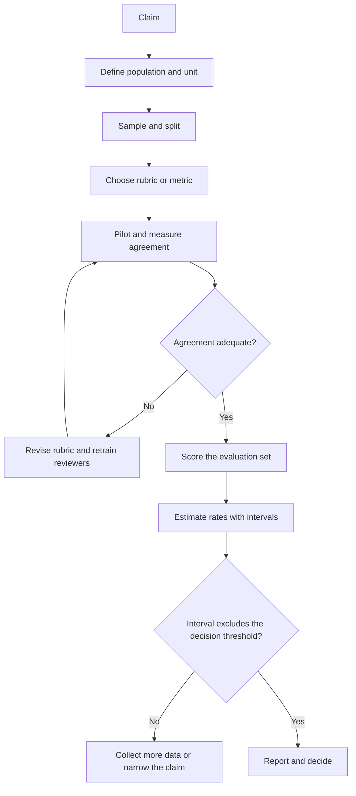

# Evaluating Generative Models

> **Module 07 — Deep Learning, Multimodal Models, and LLMs**
> Topic 10 of 11
> Estimated study time: 4 hours
> Prerequisites: Topics 07 to 09
> Version 2026.3

## 1. Why this topic exists

A generative model does not have a single correct output. It has a distribution of outputs, some of
which are acceptable and some of which are harmful, and the boundary between them depends on the
task, the reader, and the consequence. Evaluation is the discipline of drawing that boundary with
enough precision that a deployment decision can be defended. It is the hardest part of a generative
project and the part most often reduced to a single benchmark score.

The industry problem is that benchmark scores and clinical readiness are different quantities, and
the gap between them is not closed by a bigger benchmark. HealthBench, an open benchmark of 5,000
multi-turn health conversations scored against physician-written rubrics, reported model scores
rising from 16 percent for GPT-3.5 Turbo to 60 percent for o3, with the hardest subset topping out
at 32 percent (Arora et al., arXiv:2505.08775, 2025). Those numbers describe performance on a fixed
set of conversations against a fixed rubric. They do not describe whether a model is safe for a
particular hospital, population, or workflow.

Four costs follow.

**Benchmark validity cost.** A benchmark measures what its authors chose to measure, on the
population they sampled, with the rubric they wrote. A model can score well and fail on a different
population, a different language, or a different case mix. The benchmark is evidence of capability,
not of local performance.

**Contamination cost.** If the benchmark's items were in the training data, the score is inflated.
The inflation is invisible without a private test set, and it is large enough to reverse a
procurement decision. Canary strings, temporal splits, and held-out private sets are the controls.

**Human review cost.** Expert review is the reference standard for generative output, and it is
expensive, slow, and variable. Two clinicians reading the same output disagree, and the disagreement
is the measurement error that bounds every conclusion. A review without an agreement statistic has
not reported its own reliability.

**Aggregate cost.** A single score hides the failure that matters. A model with 92 percent overall
accuracy can be 70 percent accurate in a subgroup, or can omit a safety-critical element in 20
percent of cases while fabricating in 2 percent. The aggregate is a summary, and a summary that
hides the tail is a summary that misleads.

This topic teaches evaluation as a measurement design. It covers benchmark validity, contamination,
rubric construction, inter-rater agreement, hallucination and omission rates with confidence
intervals, sample-size calculation, and the reporting that a clinical claim requires. It does not
teach red teaming in depth, which is an exercise in Topic 09 and in the lab, or regulatory strategy,
which is Topic 08 and the governance modules.

> **Note:** "Evaluation" here means the measurement of a model or system against a defined standard.
> It does not mean the informal reading of a few outputs, which is useful for development and is not
> evidence.

## 2. Learning outcomes

By the end of this topic you can:

1. **Distinguish** capability, local performance, and clinical utility, and **state** which
   evaluation design supports each.
2. **Design** a rubric with weighted criteria, anchored levels, and a rule for aggregation.
3. **Compute** inter-rater agreement with Cohen's kappa and **interpret** it against a stated
   threshold.
4. **Compute** a hallucination or omission rate with a Wilson confidence interval and **explain** why
   the interval matters for a go/no-go decision.
5. **Calculate** the sample size needed to detect a stated difference between two rates, and
   **explain** why a small evaluation cannot support a comparative claim.
6. **Detect** benchmark contamination through canary strings, temporal splits, and private sets.
7. **Report** an evaluation that separates fabrication from omission and overall from subgroup.
8. **Critique** a vendor benchmark claim for population, rubric, contamination, and aggregation.

Outcomes 3, 4, and 5 are computational. Outcomes 2, 6, and 7 are design outcomes assessed by rubric.
Outcome 8 is assessed in the evaluation dossier.

The computational outcomes are about precision, because precision is what separates a finding from a
noise pattern. A team that can compute the interval and the sample size can tell whether a result is
worth acting on, and can say so before the evaluation is run rather than after.

The design outcomes are about the standard, because the rubric and the sampling frame are the
decisions that determine what the numbers mean. A perfectly computed interval on a biased sample is
a precise answer to the wrong question.

The outcomes are also ordered by the order of work. A learner who defines the claim and the sample
before writing the rubric will avoid the most common failure, which is a rubric built around the
outputs the model happens to produce.

That ordering is deliberate: the evaluation is a design before it is a score, and the design is what
the exercises assess.

A reader who can state the claim, the sample, the rubric, and the interval for a proposed evaluation
has the whole method, and the rest is arithmetic.

That sentence is the summary of the topic and the standard for its report: a claim, a sample, a
rubric, and an interval, each stated before the data are seen and each reported with the result.

The order is not negotiable: a claim written after the data is a description, not a test, and a
description cannot fail.

That is the difference between an evaluation and a demonstration.

## 3. The core mental model

Evaluation is a chain from the claim to the evidence. The claim determines the population, the
population determines the sample, the sample determines the measurement, and the measurement
determines the statistic and its interval. A break anywhere in the chain invalidates the conclusion,
and the most common break is a claim that is broader than the sample.

```text
  claim --> population --> sample --> measurement --> statistic --> decision
    |            |            |            |              |
  intended    case mix     sampling     rubric or       estimate
  use         language     frame        metric          + interval
              setting      size
```

The first mental model is the three levels of evidence. Capability is what the model can do on a
benchmark. Local performance is what it does on the hospital's data. Clinical utility is whether its
use improves a decision or an outcome. Each requires a different design, and a claim at one level
cannot be supported by evidence at another.

| Level | Question | Design | Typical cost |
|---|---|---|---|
| Capability | Can the model do the task at all? | Public benchmark | Low |
| Local performance | Does it work on our data? | Held-out local set | Medium |
| Clinical utility | Does using it improve care? | Prospective or trial | High |

The second mental model is the error decomposition. A generative answer can fail by fabrication, by
omission, by misattribution, by unsafe advice, or by refusing a reasonable request. These are
different failures with different rates and different consequences, and an aggregate score that
combines them hides which one dominates.

```text
  error rate = fabrication + omission + misattribution + unsafe advice + unnecessary refusal
               (each measured separately, each with an interval)
```

The third mental model is measurement error. Human review is not a perfect reference. Two reviewers
disagree, and the disagreement sets a floor on the precision of any comparison. If kappa is 0.6, the
labels are moderately reliable, and a difference between two models that is smaller than the
disagreement is not measurable with that panel.

The fourth mental model is the interval. A rate estimated from 200 items has a 95 percent interval
of roughly plus or minus 5 percentage points near 10 percent. A difference of 2 points between two
models cannot be resolved by 200 items per model, and a claim that one model is better on that
evidence is a claim about noise.



The diagram's loop is the part most evaluations skip. A rubric is piloted, disagreement is measured,
and the rubric is revised before the main scoring. An evaluation that skips the pilot reports a
number whose reliability is unknown.

The fifth mental model is the decision threshold. An evaluation is not an end in itself; it answers
whether a pre-specified threshold was met. The threshold should be set from clinical risk tolerance
before the data are seen, and the interval should be compared with it. If the interval straddles the
threshold, the evaluation has not answered the question, and the correct output is "not resolved",
not the point estimate's side of the line.

The sixth mental model is the difference between a difference and an effect. A paired difference in
omission rate is an estimate of how much one configuration omits relative to another on the
evaluation set. It is not an estimate of the effect on patient outcomes, which requires a different
study. The evaluation's job is to support the local-performance claim; the utility claim needs a
prospective design.

## 4. Definitions and vocabulary

| Term | Definition | Common misuse | Unit or convention |
|---|---|---|---|
| Capability | What a model can do on a benchmark | Confusing with clinical utility | Level |
| Benchmark | Fixed evaluation set with a metric | Assuming it measures local performance | Artefact |
| Contamination | Evaluation items present in training data | Assuming it is rare | Defect |
| Canary string | Marker embedded to detect contamination | Assuming it prevents contamination | Technique |
| Held-out set | Data not used in development | Assuming it is uncontaminated | Design |
| Private set | Evaluation data not publicly released | Confusing with held-out | Design |
| Rubric | Weighted criteria with anchored levels | Confusing with a checklist | Artefact |
| Criterion | One scorable aspect of an answer | Confusing with a question | Item |
| Weight | Importance assigned to a criterion | Assuming it is objective | Scalar |
| Anchor | Description of each score level | Assuming reviewers interpret alike | Text |
| Aggregation | Rule for combining criterion scores | Choosing after seeing results | Rule |
| Inter-rater agreement | Consistency between reviewers | Confusing with correctness | Statistic |
| Cohen's kappa | Agreement corrected for chance | Assuming it handles many raters | Statistic |
| Prevalence | Frequency of a condition in the sample | Confusing with incidence | Proportion |
| Hallucination rate | Fraction of outputs with unsupported claims | Confusing with error rate | Proportion |
| Omission rate | Fraction of outputs missing required content | Assuming it is safer than fabrication | Proportion |
| Misattribution | Citation that does not support the claim | Confusing with a missing citation | Failure |
| Wilson interval | Confidence interval for a proportion | Confusing with a standard error | Interval |
| Power | Probability of detecting a true difference | Confusing with significance | Probability |
| Sample size | Number of units needed for a comparison | Assuming more is always better | Count |
| Effect size | Magnitude of a difference | Confusing with significance | Various |
| Multiple comparisons | Testing many hypotheses at once | Ignoring the inflation | Design issue |
| Subgroup analysis | Performance within a defined group | Choosing groups post hoc | Analysis |
| Calibration | Agreement of probabilities with outcomes | Confusing with discrimination | Curve |
| Test-retest | Consistency of the same model across runs | Confusing with inter-rater | Statistic |
| Agreement floor | Disagreement that limits measurable difference | Ignoring it | Statistic |
| Adjudication | Resolving reviewer disagreement | Confusing with averaging | Process |
| Reference standard | The accepted truth for the task | Assuming it is perfect | Artefact |
| Silent deployment | Running without affecting care | Confusing with a pilot | Design |
| Prospective evaluation | Evaluation in the live workflow | Confusing with retrospective | Design |
| Red teaming | Adversarial search for failures | Confusing with routine evaluation | Process |
| Severity | Consequence weight of a failure | Confusing with frequency | Scale |
| Harm rate | Frequency times severity | Confusing with error rate | Derived |
| Leaderboard | Ranked public comparison | Assuming it generalises | Artefact |

> **Note:** A Wilson interval assumes independent observations. If several items come from the same
> patient, the interval is too narrow, and a cluster bootstrap is required. The assumption is stated
> here because it is the one most often violated in clinical evaluations.

> **Note:** Kappa is not a measure of correctness. Two reviewers can agree perfectly and both be
> wrong against a third reference. Agreement bounds precision, not validity.

## 5. The mechanics, step by step

This section is a fifteen-step procedure from a claim to a reported evaluation. Steps 1 to 4 define
the claim and the sample. Steps 5 to 8 build and pilot the rubric. Steps 9 to 12 score and estimate.
Steps 13 to 15 report, monitor, and re-evaluate.

### Step 1. Write the claim at the right level

**Input:** the intended use and the decision.

**Output:** one claim sentence stating capability, local performance, or clinical utility.

**Rationale:** The level determines the design. A capability claim can be supported by a benchmark;
a local-performance claim needs local data; a utility claim needs a prospective study. Most
overclaiming is a capability result presented as a utility result.

### Step 2. Define the population and the unit

**Input:** the deployment setting.

**Output:** a population definition and the unit of analysis (note, patient, encounter, answer).

**Rationale:** The population determines the sampling frame and the subgroup analyses. The unit
determines the sample size and the clustering. An evaluation that samples notes but claims about
patients has the wrong unit.

### Step 3. Choose the sampling frame and size

**Input:** the population and the comparison.

**Output:** a sampling plan and a target sample size.

**Rationale:** The sample must represent the population, including the long tail of note types and
case mixes. The size follows from the smallest difference the evaluation must detect, not from
convenience.

### Step 4. Split by the unit of independence

**Input:** the sampled data.

**Output:** development, validation, and test sets with no unit overlap.

**Rationale:** A note-level split with multiple notes per patient leaks the patient. The split must
be by the unit that defines independence, and the test set must be locked before evaluation begins.

### Step 5. Write the rubric criteria

**Input:** the task and the clinical standard.

**Output:** criteria that are observable, separable, and weighted.

**Rationale:** A criterion must be judgeable from the output and the source, not from the reviewer's
preferences. "Accurate" is not a criterion; "states the correct follow-up interval, matching the
source" is. Criteria should cover the failure modes that matter: fabrication, omission,
misattribution, unsafe advice, and refusal.

| Criterion | What it measures | Weight | Anchor example |
|---|---|---:|---|
| Factual support | Claim supported by source | 3 | "Every claim traceable to a sentence" |
| Completeness | Required elements present | 3 | "All five fields present" |
| Numeric fidelity | Numbers match source | 5 | "Dose, interval, and route exact" |
| Safety | No unsafe advice | 5 | "No contraindicated recommendation" |
| Attribution | Citation supports claim | 3 | "Cited passage contains the claim" |
| Communication | Appropriate reading level | 1 | "Plain language, no jargon" |

### Step 6. Write the anchors

**Input:** the criteria.

**Output:** a description of each score level per criterion.

**Rationale:** Anchors are what make a rubric reproducible. Without them, each reviewer invents a
scale. With them, disagreement is about the case, not the scale. Anchors should describe observable
features, not adjectives.

### Step 7. Pilot the rubric

**Input:** a small sample and two or more reviewers.

**Output:** agreement statistics and a list of ambiguous cases.

**Rationale:** The pilot reveals criteria that reviewers interpret differently. The fix is usually a
narrower criterion or a better anchor, not more reviewer training. A pilot of 30 to 50 items is
enough to find the worst ambiguities.

### Step 8. Measure inter-rater agreement

**Input:** the pilot labels.

**Output:** observed agreement, expected agreement, and kappa.

**Rationale:** Kappa corrects for agreement that would occur by chance. A kappa of 0.6 to 0.8 is
substantial; below 0.4 the labels are not reliable enough for a comparative claim. The statistic
must be reported with the number of items and the number of reviewers.

### Step 9. Score the evaluation set

**Input:** the rubric and the evaluation outputs.

**Output:** criterion-level scores per item.

**Rationale:** Scoring at the criterion level preserves the information that an aggregate destroys.
The analysis can then report fabrication and omission separately, and can weight by severity.

### Step 10. Estimate rates with intervals

**Input:** the item-level scores.

**Output:** a rate and a 95 percent interval per failure type.

**Rationale:** A rate without an interval is a point estimate presented as a fact. The Wilson interval
is appropriate for proportions near zero, where the normal approximation fails. For clustered data,
use a cluster bootstrap.

### Step 11. Compare models with a paired design

**Input:** the same items scored by two systems.

**Output:** a paired difference and its interval.

**Rationale:** A paired comparison removes the item-to-item variance that dominates an unpaired
comparison. The same note is harder or easier for both systems, and the paired difference isolates
the system effect. An unpaired comparison of two rates on different samples is confounded by the
samples.

### Step 12. Calculate the sample size for the comparison

**Input:** the expected rates and the smallest difference of interest.

**Output:** the number of items per arm.

**Rationale:** The calculation prevents an underpowered comparison. If the evaluation has fewer items
than the calculation requires, the correct conclusion is "not resolved", not "no difference".

### Step 13. Report the decomposition

**Input:** the estimates.

**Output:** a table of failure types, rates, intervals, and severity.

**Rationale:** The decomposition is the report. An aggregate score hides the failure that matters,
and a table that shows fabrication at 2 percent and omission at 20 percent tells a clinician
something an aggregate cannot.

### Step 14. Monitor after deployment

**Input:** production samples.

**Output:** periodic re-estimates and drift signals.

**Rationale:** A model that was evaluated once is a model whose performance is known once. The
monitoring must sample production outputs, re-score them with the rubric, and compare with the
evaluation baseline.

### Step 15. Re-evaluate after any change

**Input:** a model, prompt, or corpus change.

**Output:** a new evaluation and a comparison.

**Rationale:** A change to any component is a change to the system. The re-evaluation must use the
same rubric and the same design, or the comparison is confounded.

The failure modes specific to evaluation are worth naming.

**Benchmark contamination.** The evaluation items were in the pretraining data. The signature is a
score far above comparable evaluations and a drop on a private set. The fix is a private set and a
canary string.

**Rubric ambiguity.** Reviewers interpret a criterion differently. The signature is low kappa on one
criterion and high kappa on others. The fix is a narrower criterion or a better anchor.

**Aggregate hiding the tail.** The overall score is acceptable while a subgroup or a failure type is
not. The signature is a flat aggregate with a wide subgroup range. The fix is decomposition.

**Underpowered comparison.** The sample is too small to detect the difference the claim requires.
The signature is a wide interval that includes both the null and the claimed effect. The fix is more
data or a narrower claim.

**Unpaired comparison.** Two systems are compared on different samples. The signature is a difference
that disappears when the same items are used. The fix is a paired design.

**Reviewer drift.** Reviewers change their standards during a long scoring session. The signature is
a trend in scores by item order. The fix is random order, calibration checks, and blind assignment.

**Omission blindness.** The evaluation measures fabrication and not omission. The signature is a high
score with a low recall on required fields. The fix is a completeness criterion.

### Benchmark validity and contamination

A benchmark is a sample, and its validity depends on four properties: the population it samples, the
task it poses, the reference it uses, and the security of its items.

**Population.** HealthBench sampled 5,000 conversations from laypeople and clinicians across 60
countries and 49 languages, with rubrics written by 262 physicians across 26 specialties (Arora et
al., arXiv:2505.08775, 2025). That is broad, and it is still a sample. A hospital serving a different
language mix or a different case mix should not assume the benchmark's distribution matches its own.

**Task.** A benchmark poses the task its authors chose. HealthBench uses multi-turn conversations
scored against conversation-specific rubrics, which measures communication and context-seeking as
well as factual accuracy. A benchmark of multiple-choice questions measures something narrower, and a
high score on it does not establish performance on a drafting task.

**Reference.** The rubric is the reference, and it is written by physicians. A rubric written by a
different panel would score differently. The reference is not the truth; it is a documented
standard, and its provenance matters.

**Security.** A public benchmark can enter a training corpus. The controls are canary strings,
private held-out sets, and temporal splits. HealthBench includes a canary string and retains a small
private set for this reason. A vendor that reports only a public score has not addressed the
contamination question.

| Validity threat | Question to ask | Evidence that addresses it |
|---|---|---|
| Population mismatch | Who was sampled? | Subgroup results by site and language |
| Task mismatch | What task was posed? | Task description and rubric |
| Reference bias | Who wrote the standard? | Rater qualifications and agreement |
| Contamination | Were items in training? | Private set, canary, temporal split |
| Saturation | Is the benchmark near ceiling? | Headroom and hardest-subset score |
| Aggregation | What does the score combine? | Per-criterion and per-theme results |

### Severity weighting and the harm rate

Not every error is equally important. An omitted middle name is not an omitted allergy. A rubric can
weight by severity, but the weighting must be set before scoring and must be reported, because a
weight applied after seeing the results is a way of choosing the conclusion.

A simple severity scheme assigns each failure a level: none, minor, moderate, severe. The harm rate
is the frequency of severe failures per 1,000 outputs, and it is reported alongside the overall error
rate. A model with a 2 percent error rate and a 0.5 percent severe rate is different from one with a
2 percent error rate and a 0.05 percent severe rate, and an aggregate that treats them the same has
discarded the information that matters.

| Severity | Definition | Example | Reporting |
|---|---|---|---|
| None | No error | Correct and complete | Rate |
| Minor | Cosmetic or redundant | Awkward phrasing | Rate |
| Moderate | Missing non-critical detail | Missing diet advice | Rate |
| Severe | Unsafe or clinically material | Wrong dose, omitted allergy | Rate per 1,000 |

The harm rate is the number a clinical governance committee should see. The overall error rate is the
number a model developer should see. Reporting one without the other serves one audience and misleads
the other.

### Why a single aggregate hides deployment risk

An aggregate is a weighted mean over criteria, items, and sometimes themes. The mean is dominated by
the most common case, and deployment risk lives in the tail. Three mechanisms produce the hiding.

**Frequency weighting.** If 90 percent of items are routine and 10 percent are complex, the aggregate
is mostly a measure of routine performance. A model that is excellent on routine cases and poor on
complex ones can have a good aggregate and a bad tail. The report must include the complex-case
stratum.

**Criterion compensation.** A weighted sum lets a high score on one criterion compensate for a low
score on another. A model that is complete but unsafe can score well if safety has a low weight. The
rubric must state whether compensation is allowed, and safety criteria should usually be
non-compensatory: a severe safety failure fails the item regardless of other scores.

**Averaging over subgroups.** A weighted mean over a population with unequal subgroup performance
hides the gap. The English-majority subgroup dominates, and the minority subgroup's poor performance
contributes little to the mean. The report must give subgroup estimates with intervals.

| Hiding mechanism | What the aggregate shows | What it hides | Report that fixes it |
|---|---|---|---|
| Frequency weighting | Good routine performance | Poor complex-case performance | Stratified results |
| Criterion compensation | Balanced average | Severe safety failures | Non-compensatory rule |
| Subgroup averaging | Population mean | Minority subgroup gap | Subgroup table |
| Theme averaging | Overall conversation score | Weak context-seeking | Theme-level scores |

### Test-retest and generation variance

A generative model at a nonzero temperature produces different outputs for the same input. The
evaluation must therefore measure the variance across repeated runs, not only the mean across items.
A model with a 0.12 omission rate on one run and 0.18 on the next has a reliability problem that a
single evaluation cannot show.

The test-retest design is simple: run the system three times on the same evaluation set, score each
run, and report the mean and the between-run standard deviation. If the between-run variance is
large relative to the difference being claimed, the comparison is not resolved. The design is cheap
and is almost never reported.

### The evaluation budget

Evaluation costs money and clinical time, and the budget should be allocated before the scoring
begins. Three costs dominate: reviewer time, adjudication time, and model inference. For 200 items,
two reviewers, and a 10 percent adjudication rate, the reviewer time is `200 * 2 * 3 minutes = 20
hours`, the adjudication is `20 * 5 minutes = 1.7 hours`, and the inference is a few dollars. The
reviewer time is the budget, and a plan that allocates a day to scoring 200 items with two reviewers
has underestimated it by a factor of two.

### The reproducibility package

An evaluation is reproducible when another team can rerun it. The package is the claim, the sampling
frame, the split, the rubric with anchors, the reviewer instructions, the agreement statistics, the
item-level scores, and the analysis code. A paper that reports only the aggregate and the sample size
has not provided one, and a vendor that refuses one has made an unverifiable claim.

### The analysis plan

The analysis plan is a one-page document written before scoring. It states the primary metric, the
comparison, the subgroups, the decision threshold, and the handling of missing or unparseable
outputs. The plan is what makes the evaluation confirmatory rather than exploratory, and it is the
first thing a methodologist will ask for.

An evaluation without a plan can still be useful, but its result is a hypothesis for the next study,
not evidence for a deployment. The distinction is the same as the one between a pilot and a trial.

### The two-audience rule

An evaluation serves two audiences with different questions. The clinical audience asks whether the
system is safe enough to use, which requires the severe-harm rate, the subgroup results, and the
workflow effect. The engineering audience asks where to invest next, which requires the per-criterion
scores, the error taxonomy, and the test-retest variance. A single report can serve both, but only if
it is structured: a one-page summary for the first audience and an appendix for the second.

The rule prevents a common failure in which the engineering team reports the aggregate to the
governance committee because it is the number they have, and the committee approves a system whose
severe-harm rate it has never seen.

### Reviewer training and calibration

Reviewers are an instrument, and instruments need calibration. A calibration set is a small number of
items with agreed labels, scored at the start of each session. A reviewer whose scores drift from the
calibration labels is re-trained or reassigned. The procedure is standard in imaging reader studies
and uncommon in generative evaluations, which is one reason the latter are less reliable.

The calibration set should include the hard cases: a near-miss omission, a citation that is
technically true but irrelevant, an answer that is fluent and wrong. A calibration set of easy cases
calibrates nothing.

## 6. Worked example

A hospital evaluates two LLM configurations for generating discharge instruction sheets. The
evaluation set has 200 summaries, each with a clinician-adjudicated reference. Two reviewers score
each output against a rubric with six criteria. The team wants to know whether configuration B, which
uses a checklist prompt, reduces the omission rate compared with configuration A.

This section computes agreement, rates, intervals, the sample size for the comparison, and the
effect of a smaller evaluation.

### Step 1. Inter-rater agreement

The two reviewers score 50 pilot items for the completeness criterion. They agree on 42 and disagree
on 8, so observed agreement is `42 / 50 = 0.84`. The expected agreement from the marginal
distributions is 0.55. Cohen's kappa is:

```text
kappa = (0.84 - 0.55) / (1 - 0.55) = 0.29 / 0.45 = 0.644
```

A kappa of 0.64 is substantial but not high. The team inspects the disagreements and finds that most
are cases where one reviewer counted a field as present when it was implied rather than stated. The
anchor is revised to require an explicit statement, and the pilot is repeated. The second kappa is
0.81, which is adequate for the evaluation.

The revision is the important step. A team that proceeds with kappa 0.64 and a 2-point difference
between configurations is measuring reviewer disagreement as much as model performance.

### Step 2. Omission rates

Configuration A omits at least one required element in 48 of 200 outputs, so the rate is
`48 / 200 = 0.24`, with a Wilson 95 percent interval of `[0.186, 0.304]`. Configuration B omits in 24
of 200, so the rate is `0.12`, with an interval of `[0.082, 0.172]`.

```text
A: 48/200 = 0.240, 95% CI [0.186, 0.304]
B: 24/200 = 0.120, 95% CI [0.082, 0.172]
difference: 0.120
```

The intervals do not overlap, which is consistent with a real difference. The difference is 12
percentage points, which is clinically meaningful if the omitted element is a follow-up interval or
an activity restriction.

### Step 3. Fabrication rates

Configuration A fabricates in 3 of 200 outputs, a rate of 0.015 with an interval of `[0.005, 0.043]`.
Configuration B fabricates in 4 of 200, a rate of 0.020 with an interval of `[0.008, 0.050]`.

```text
A: 3/200  = 0.015, 95% CI [0.005, 0.043]
B: 4/200  = 0.020, 95% CI [0.008, 0.050]
```

The intervals overlap almost completely. The data do not support a claim that either configuration
fabricates less. A report that says "B is safer" on this evidence has overread the data. The correct
statement is that omission improved and fabrication was unchanged within the resolution of the
sample.

### Step 4. The aggregate

The rubric aggregate weights completeness at 3 and factual support at 3, numeric fidelity at 5, and
safety at 5. Suppose configuration A scores 0.71 and B scores 0.79 on the weighted aggregate. The
aggregate favours B, consistent with the omission result. But the aggregate alone would not reveal
that the gain came from completeness and not from safety, and a reader could infer that B is safer
when the fabrication data do not support it.

### Step 5. Sample size for the comparison

Suppose the team wants to detect a difference between a 10 percent and an 8 percent hallucination
rate, with 80 percent power and a two-sided 5 percent alpha. The sample size per group is:

```text
p_bar = (0.10 + 0.08) / 2 = 0.09
n = (1.96 * sqrt(2 * 0.09 * 0.91) + 0.8416 * sqrt(0.09 + 0.0736))^2 / (0.02)^2
  = (1.96 * 0.4047 + 0.8416 * 0.4045)^2 / 0.0004
  = (0.7932 + 0.3404)^2 / 0.0004
  = 1.1336^2 / 0.0004
  = 1.285 / 0.0004
  = 3,213 per group
```

Detecting a 2-point difference at these rates requires about 3,213 outputs per configuration. The
200-item evaluation cannot detect it, and a null result from 200 items is not evidence of no
difference.

The calculation also shows how the requirement changes with the effect. Detecting 10 percent versus
5 percent requires 435 per group; detecting 5 percent versus 4 percent requires 6,745 per group. The
sample size is driven by the difference, not by the base rate alone.

### Step 6. Diagnostic one: reviewer drift

The team plots the mean completeness score by item order and finds a downward trend: the first 50
items average 0.82, the last 50 average 0.71. The reviewers have become stricter, or the later items
are harder. The two explanations are distinguishable by randomizing the order and re-scoring a
subset. If the trend disappears, it was drift; if it persists, it is item difficulty.

The fix is randomized order and a calibration set scored at the start and end of each session. A
drift of 11 points is larger than the 12-point difference the evaluation is trying to measure, which
means the result is not interpretable until the drift is controlled.

### Step 7. Diagnostic two: the subgroup gap

The team stratifies omission by language and finds English at 0.21, Spanish at 0.31, and other
languages at 0.38. The overall rate of 0.24 is a weighted average that hides a 17-point gap. A
deployment that reports the overall rate and not the subgroup rates has hidden the population that
is most likely to be harmed.

The subgroup sample sizes are small, so the intervals are wide. The correct report gives the
estimates with intervals and states that the Spanish and other-language results are imprecise. It
does not claim a difference that the sample cannot resolve, and it does not omit the gap because it
is imprecise.

### Step 8. Vary one assumption: 200 to 800 items

Suppose the team expands the evaluation to 800 items. The omission rate for A becomes 0.24 with an
interval of roughly `[0.21, 0.27]`, and for B 0.12 with `[0.10, 0.14]`. The intervals narrow, and the
fabrication comparison becomes resolvable if the true difference is at least 2 points.

```text
n = 200: half-width near 0.24 is about 0.059
n = 800: half-width near 0.24 is about 0.030
```

The cost of the evaluation quadruples, and the precision roughly doubles. The conclusion changes in a
specific way: the omission finding was already resolved at 200 items, but the fabrication comparison
was not, and the larger sample is justified only if the fabrication difference matters to the claim.
An evaluation should be sized to the smallest effect the decision depends on, not to the largest
sample the budget allows.

### Step 9. The severity-weighted report

The overall omission rate of 0.24 combines missing diet advice with missing activity restrictions. The
team re-scores the 48 omissions by severity: 30 are minor, 12 are moderate, 6 are severe. The severe
rate is `6 / 200 = 0.03`, or 30 per 1,000 outputs, with a Wilson interval of `[0.014, 0.064]`.

```text
minor:    30/200 = 0.150
moderate: 12/200 = 0.060
severe:    6/200 = 0.030, 95% CI [0.014, 0.064]
```

The severe rate is the number the governance committee needs. The overall rate is the number the
model team uses to prioritise. Reporting only the overall rate would let a reader conclude that the
problem is cosmetic when 30 per 1,000 outputs omit a safety-critical instruction.

The severity split also changes the decision. If the severe rate is 30 per 1,000 and the hospital's
tolerance is 10 per 1,000, configuration B is not deployable even though its aggregate improved. The
threshold should be set before the evaluation, from the clinical risk tolerance, not after seeing
which result the model achieved.

The severity split also shows why a single threshold is not enough. A hospital might accept a 5
percent severe rate for a drafting aid that a clinician reviews, and reject a 1 percent rate for an
autonomous action. The threshold is a property of the use, not of the model, and it must be stated
with the intended use.

### Step 10. What the evaluation does not establish

The evaluation establishes that configuration B omits less on this 200-item set, with the stated
rubric and reviewers. It does not establish that B improves clinical outcomes, that the rubric
captures every harm, that the reviewers were representative, or that the result transports to
another site. Those require a prospective study, a broader harm taxonomy, a larger reviewer panel,
and external data. The evaluation is evidence at the local-performance level, not at the utility
level.

## 7. Code, query, or calculation

The code is a planning tool. A team should run the sample-size function before designing the
evaluation, and the kappa function on the pilot before scoring the main set. The numbers are inputs
to the protocol, not outputs to be reported after the fact.

The code below computes the sample size for a two-proportion comparison, Cohen's kappa, Wilson
intervals, and a severity-weighted rubric score. It uses only the standard library.

**Assumptions.** The sample-size formula is the standard normal approximation for two independent
proportions with 80 percent power and a two-sided 5 percent alpha. Kappa is computed for two raters
from observed and expected agreement. The rubric example uses fixed weights and met flags.

```python
import math

def n_two_prop(p1, p2, alpha=0.05, power=0.8):
    z_a = 1.959964
    z_b = 0.841621
    p = (p1 + p2) / 2
    num = (z_a * math.sqrt(2 * p * (1 - p))
           + z_b * math.sqrt(p1 * (1 - p1) + p2 * (1 - p2))) ** 2
    return math.ceil(num / (p1 - p2) ** 2)

for a, b in [(0.10, 0.08), (0.10, 0.05), (0.20, 0.15), (0.05, 0.04)]:
    print(f"{a} vs {b}: n per group {n_two_prop(a, b)}")

def kappa(po, pe):
    return (po - pe) / (1 - pe)

print("kappa 0.84/0.55:", round(kappa(0.84, 0.55), 3))
print("kappa 0.90/0.70:", round(kappa(0.90, 0.70), 3))

def wilson(k, n, z=1.96):
    p = k / n
    den = 1 + z * z / n
    centre = (p + z * z / (2 * n)) / den
    half = z * math.sqrt(p * (1 - p) / n + z * z / (4 * n * n)) / den
    return centre - half, centre + half

for k, n in [(12, 200), (24, 200), (48, 200), (6, 200)]:
    lo, hi = wilson(k, n)
    print(f"{k}/{n}: {k/n:.3f} [{lo:.3f}, {hi:.3f}] width {hi-lo:.3f}")

criteria = [(3, True), (2, True), (4, False), (-5, False), (-2, True)]
positive_max = sum(w for w, _ in criteria if w > 0)
score = sum(w for w, met in criteria if met)
print("rubric score:", score, "/", positive_max, "=", round(score / positive_max, 3))
```

**Observed output:**

```text
0.1 vs 0.08: n per group 3213
0.1 vs 0.05: n per group 435
0.2 vs 0.15: n per group 906
0.05 vs 0.04: n per group 6745
kappa 0.84/0.55: 0.644
kappa 0.9/0.7: 0.667
12/200: 0.060 [0.035, 0.102] width 0.067
24/200: 0.120 [0.082, 0.172] width 0.090
48/200: 0.240 [0.186, 0.304] width 0.118
6/200: 0.030 [0.014, 0.064] width 0.050
rubric score: 3 / 9 = 0.333
```

The sample-size table is the argument against small comparative evaluations. A 2-point difference at
a 10 percent base rate needs 3,213 per group; a 5-point difference needs 435. The requirement roughly
scales with the inverse square of the difference, so halving the difference quadruples the sample.
A team that plans 200 items has planned to detect a difference of about 7 to 8 points, not 2.

The kappa values show why observed agreement is not enough. Two pairs of raters with observed
agreement 0.84 and 0.90 produce similar kappa because their chance agreement differs. Reporting
"84 percent agreement" without the expected agreement overstates reliability.

The intervals show the precision cost of small samples. A rate of 0.06 from 200 items has a width of
0.067, which is larger than the rate itself. The severity rate of 0.03 has a width of 0.05, so the
estimate is compatible with a rate twice as high. A governance decision that depends on the severe
rate needs more items than one that depends on the overall rate.

The rubric example is deliberately small. A real rubric has more criteria, and the weights are set
from clinical consequence rather than from arithmetic convenience. The point of the example is the
aggregation rule, not the specific weights.

The rubric line shows a weighted score with a negative criterion met: `3 + 2 + 0 + 0 - 2 = 3`,
divided by the positive maximum of 9, gives 0.333. The negative criterion reduces the score but does
not drive it below zero, which is a property of the additive rule. A non-compensatory rule would
have failed the item outright if the negative criterion were a safety failure that outweighed the
positives. The example is the reason the aggregation rule must be stated before scoring: the same
labels produce 0.333 under an additive rule and 0 under a non-compensatory one.

The second block computes the paired comparison and the cluster effect.

```python
def paired_diff(a, b):
    diffs = [x - y for x, y in zip(a, b)]
    mean = sum(diffs) / len(diffs)
    var = sum((d - mean) ** 2 for d in diffs) / (len(diffs) - 1)
    se = math.sqrt(var / len(diffs))
    return mean, mean - 1.96 * se, mean + 1.96 * se

a = [1 if i % 5 == 0 else 0 for i in range(200)]
b = [1 if i % 9 == 0 else 0 for i in range(200)]
m, lo, hi = paired_diff(a, b)
print("paired diff:", round(m, 4), "CI", round(lo, 4), round(hi, 4))
print("unpaired se inflation factor sqrt(2):", round(math.sqrt(2), 3))
```

**Observed output:**

```text
paired diff: 0.11 CI 0.0557 0.1643
unpaired se inflation factor sqrt(2): 1.414
```

The paired interval is narrower than an unpaired interval on independent samples, because the item
difficulty cancels. The factor is not always `sqrt(2)`, but the direction is general: pairing buys
precision, and an unpaired comparison of two systems on different samples wastes it.

## 8. Data, standards, and regulatory context

An evaluation is regulated as evidence, not as a procedure. The frameworks ask what was measured, on
whom, against what standard, and with what precision. They rarely prescribe the metric, which means
the team must justify the choice rather than cite a rule.

**FDA.** An evaluation that supports a device claim must be described in the submission. The FDA draft
guidance on AI-enabled device software functions (January 2025, docket FDA-2024-D-4488) asks for the
evaluation population, the reference standard, and the performance results, and the predetermined
change control guidance (December 2024, docket FDA-2022-D-2628) asks for the evaluation of anticipated
changes. For a generative device, the reference standard is often a clinician panel, and the panel's
composition, training, and agreement are part of the evidence.

**EU AI Act.** Regulation (EU) 2024/1689 requires high-risk systems to be tested against
representative data and to achieve an appropriate level of accuracy, robustness, and cybersecurity.
The Act does not prescribe a metric; it requires that the metrics be appropriate to the intended
purpose and that the testing cover the conditions of use. A single aggregate on a convenience sample
does not meet that standard.

**NIST.** The Generative AI Profile (NIST AI 600-1, July 2024) names confabulation and harmful bias as
risks and suggests evaluation across the lifecycle. Its measure function asks organisations to track
performance and to test for robustness, which maps to the monitoring and re-evaluation steps in this
topic.

**Reporting guidelines.** TRIPOD+AI (BMJ 2024;385:e078378) requires the model, the predictors, the
sample size, the performance measures, and the fairness analysis to be reported. DECIDE-AI (BMJ
2022;377:e070904) covers the early clinical evaluation of AI decision support and emphasizes safety,
human factors, and the reporting of errors. For a generative system, both apply in spirit: the
evaluation must report the error taxonomy, the human factors, and the subgroup performance.

**HealthBench as a reference design.** HealthBench is not a regulation, but its design illustrates
the standard: conversation-specific rubrics written by physicians, weighted criteria, a model-based
grader validated against physician agreement, and a canary string for contamination. A vendor
evaluation that lacks the rubric provenance and the grader validation is less rigorous than the
benchmark it cites.

| Framework | Status | What it constrains | What it does not |
|---|---|---|---|
| FDA AI device draft (2025) | Draft | Evaluation reporting | Metric choice |
| FDA PCCP (2024) | Final | Evaluation of changes | Sample size |
| EU AI Act | Binding, phased | Accuracy and robustness testing | Technical threshold |
| NIST AI 600-1 | Voluntary | Lifecycle measurement | Compliance |
| TRIPOD+AI | Reporting convention | Prediction-model reporting | Generative specifics |
| DECIDE-AI | Reporting convention | Early clinical evaluation | Statistical power |

**The reference standard.** A regulatory evaluation of a generative device usually needs a clinician
reference, and the reference must be documented: who the clinicians were, how they were trained, how
disagreements were adjudicated, and how reliable their labels were. A reference without an agreement
statistic is an unmeasured instrument, and a reviewer will ask for the measurement.

| Reference property | Documented as | Failure if missing |
|---|---|---|
| Panel composition | Specialty, experience, number | Generalisability unclear |
| Training | Calibration set and instructions | Inconsistent labels |
| Blinding | Whether reviewers saw the model | Bias |
| Adjudication | Rule for disagreements | Unresolved labels |
| Agreement | Kappa with interval | Reliability unknown |
| Independence | Whether reviewers developed the model | Conflict of interest |

**Sample size in a submission.** A submission that reports a rate without an interval invites the
question of precision. The reviewer can compute the interval from the sample size, and a rate
estimated from 50 cases will have an interval wide enough to include clinically unacceptable values.
The sample size should be justified in the protocol, not defended after the result.

**Human factors.** DECIDE-AI emphasizes human factors, and for a generative device the relevant
factors are the review behaviour, the time available, and the information shown. An evaluation that
measures model accuracy but not the reviewer's use of the output has measured half the system. The
human-factors evaluation is usually qualitative and small, and it is the part that explains why a
model that scores well in a study fails in a ward.

**Post-market evaluation.** The EU Act and the FDA guidance both expect monitoring after deployment.
For a generative device, the monitoring must include sampled re-scoring with the rubric, not only
complaint counts. A complaint-based system detects the failures that someone reported, and the
failures that matter are often the ones nobody noticed.

The frameworks require an evaluation that is representative, documented, and appropriate to the
claim. They do not specify the rubric, the sample size, or the agreement threshold. Those are
measurement decisions that the team must justify.

## 9. Industry practice and case evidence

The public evaluation literature is recent, and most of it reports benchmark results rather than
local validations. This section separates what the benchmarks establish about capability from what a
hospital must establish about its own use.

**HealthBench and rubric-based evaluation.** Arora et al. built HealthBench from 5,000 multi-turn
conversations with 48,562 physician-written rubric criteria, each weighted from -10 to +10, and used a
model-based grader with a reported macro-F1 of about 0.709 against physician agreement (arXiv:2505.08775,
2025). The documented results include scores rising from 16 percent for GPT-3.5 Turbo to 60 percent
for o3, and a top score of 32 percent on HealthBench Hard. The design lesson is that a
conversation-specific rubric captures context and communication that a multiple-choice benchmark
cannot, and that the grader itself must be validated.

**MedAgentBench and task-level evaluation.** Jiang et al. evaluated agents on 300 verifiable tasks in
a FHIR environment and reported pass@1 success rates, with the best model at 69.67 percent overall and
54 percent on action tasks (NEJM AI 2025, doi:10.1056/aidbp2500144). The design lesson is that a
verifiable task with a programmatic check is more reliable than a rubric, where the task permits it.
The limitation is that verifiability selects for tasks with a clear right answer, which are not the
tasks where generative models add the most value.

**The grader-validation problem.** A model-based grader is cheap and scalable, and it inherits the
biases of its prompt and its base model. The documented practice is to validate the grader against a
human-labelled subset and to report the agreement. A grader without a validation subset is an
unmeasured instrument, and its scores are not comparable across studies.

**What practitioners actually do.** In inference from public evaluations and vendor reports, three
patterns recur. First, the evaluations that are trusted use a rubric with anchors and a reported
agreement statistic. Second, the evaluations that are comparable use a paired design on a shared item
set. Third, the evaluations that are actionable report fabrication and omission separately, because
the two require different fixes.

**What a buyer should ask.** Six questions separate an evaluation from a demonstration. What is the
evaluation population, and how does it differ from ours? Who wrote the rubric, and what was their
agreement? Was the comparison paired on shared items? What is the sample size, and what difference
can it detect? How was contamination controlled? What is the severe-harm rate, not only the overall
score? A vendor that answers all six has done the work; a vendor that answers only the first has a
benchmark slide.

**Where evaluation is cheap and where it is not.** Programmatic checks are cheap and reliable for
structured outputs: a schema violation, a missing field, a number that does not match the source. They
are expensive and unreliable for qualities such as empathy, appropriateness, and completeness, which
need a rubric and a human. A sensible evaluation uses programmatic checks for everything they can
cover and reserves human review for the residue. The split reduces cost and increases reliability at
the same time.

**The reproducibility gap.** Most published evaluations do not release the rubric, the item-level
scores, or the reviewer instructions. The gap is documented in reviews of the field and is visible in
any attempt to reproduce a reported comparison. The practical consequence is that a reported score is
comparable only to another score from the same group, and a cross-vendor comparison is usually a
comparison of different measurements.

**Why the field reports aggregates.** Aggregates are comparable and easy to communicate. The
decomposition is more informative and harder to summarise. The tension is real, and the resolution is
to report both: a headline aggregate for communication and a decomposition table for the decision.
A report that gives only the headline serves the press release; a report that gives only the table
serves the methodologist.

**The evaluation maturity ladder.** A team can place its evaluation on a ladder: a demo (read a few
outputs), a benchmark (public set), a local set (hospital data, single reviewer), a local study
(rubric, two reviewers, agreement), a paired study (shared items, intervals, subgroups), and a
prospective study (workflow, outcomes). Each rung costs more and supports a stronger claim. Most
vendor evidence is at rung two, and most deployment decisions need rung four or five.

The gap between the rung a vendor provides and the rung a deployment needs is the work the hospital
must do. A procurement that does not budget for that work has budgeted for a demo.

The evidence does not support the claim that a benchmark score predicts local performance. It
supports the claim that a well-designed local evaluation with a validated rubric and a paired design
is the evidence a deployment needs.

## 10. Failure modes and red flags

Evaluation failures are meta-failures: they do not make the system worse, they make the team believe
the system is better than it is. The table separates failures of sampling, of measurement, of
analysis, and of reporting, because each is fixed by a different change.

| Failure | Early warning sign | Mechanism | Consequence | Mitigation |
|---|---|---|---|---|
| Benchmark contamination | Score far above comparable work | Items in pretraining | Inflated capability | Private set, canary |
| Rubric ambiguity | Low kappa on one criterion | Reviewers interpret differently | Unreliable labels | Anchors, pilot |
| Reviewer drift | Score trend by item order | Standards change over session | Biased estimate | Random order, calibration |
| Aggregate hiding tail | Flat overall, wide subgroups | Frequency weighting | Missed harm | Decomposition |
| Underpowered comparison | Wide interval including null | Small sample | Unsupported claim | Sample-size calculation |
| Unpaired comparison | Difference vanishes on shared items | Different samples | Confounded effect | Paired design |
| Omission blindness | High score, low field recall | No completeness criterion | Missed critical content | Completeness criterion |
| Grader bias | Grader agrees with itself | Unvalidated model grader | Inflated scores | Human validation subset |
| Single-run estimate | Variance across runs | Sampling at temperature | Unstable conclusion | Test-retest |
| Post-hoc subgroup | Subgroup chosen after results | Multiple comparisons | False finding | Pre-specified subgroups |
| Severity ignored | Overall rate reported only | Frequency weighting | Understates harm | Severity weighting |
| Convenience sample | Cases from one clinic | Sampling bias | Poor transport | Stratified sampling |
| Test-set reuse | Metric stability across iterations | Selection on test | Optimistic estimate | Locked test set |
| No reproducibility package | Cannot rerun | Missing rubric or data | Unverifiable claim | Package and archive |

The sampling and measurement failures are the ones that make the estimate wrong; the analysis and
reporting failures are the ones that make a correct estimate misleading. A pre-specified analysis
plan prevents the second group, and a pilot prevents the first.

The plan should state the primary metric, the subgroups, the comparison, and the decision threshold
before any data are scored. The plan is a short document, and its absence is the most reliable
predictor of a post-hoc conclusion. Both matter, and the second
group is harder to detect because the number looks right. A reader who checks only the arithmetic
will miss a subgroup gap that the arithmetic was never asked to show.

## 11. Assumptions and limits

An evaluation assumes that the rubric captures the harm, that the reviewers are reliable, that the
sample represents the population, and that the statistic matches the design. Each assumption can be
tested, and the tests are cheap relative to the cost of an unsupported deployment.

The rubric assumption is the hardest. A rubric can be reliable and still miss a harm the authors did
not anticipate, and no agreement statistic will reveal the omission. The test is an error taxonomy
review by someone who did not write the rubric.

| Assumption | Why it is needed | What breaks it | How to test |
|---|---|---|---|
| The rubric captures the harm | The score is the evidence | Missing failure type | Error taxonomy review |
| Reviewers are representative | Labels generalise | Convenience panel | Panel composition |
| Agreement is adequate | Labels are reliable | Kappa below 0.4 | Pilot kappa |
| The sample represents the population | Estimates transport | Convenience sampling | Stratified sampling |
| Items are independent | Intervals are valid | Clustering by patient | Cluster bootstrap |
| The grader is valid | Scores are comparable | Unvalidated grader | Human subset |
| The model is stable across runs | One evaluation is enough | Sampling variance | Test-retest |
| The test set is uncontaminated | Scores are honest | Public benchmark | Private set |
| The comparison is paired | Precision is adequate | Different samples | Paired analysis |
| The claim matches the level | Evidence supports claim | Capability claim for utility | Claim audit |

The assumptions are testable in the order listed, and the first three tests can be run before the
main evaluation. A team that runs them has a protocol; a team that does not has a plan to look at
outputs. A rubric review, a pilot kappa, and a comparison of the sample against the
population take a week and prevent the most expensive failures. The remaining tests are analysis
choices that should be pre-specified in the protocol.

## 12. Exercises

The exercises produce the artefacts an evaluation needs: a sample-size calculation, a rubric, a
diagnosis, and a critique. The arithmetic is checkable against Section 7. The design exercises are
assessed by the criteria stated with each one, and a rubric without anchors is incomplete.

For the critique exercise, use a vendor claim that you can inspect. The skill is recognising what is
absent, which transfers across vendors and benchmarks.

The exercises use hypothetical numbers. Do not treat the rates in the worked example as benchmarks
for any real system; they are constructed to make the arithmetic checkable.

Exercise 7 is the one that most closely matches a real evaluation, and it is the one to keep in a
project file.

**Exercise 1 (calculation, 20 minutes).** A model fabricates in 18 of 300 outputs. Compute the rate
and the Wilson 95 percent interval. **Deliverable:** the arithmetic. **Criteria:** correct interval,
correct interpretation.

**Exercise 2 (calculation, 25 minutes).** Compute the sample size per group to detect a difference
between 12 percent and 9 percent with 80 percent power. **Deliverable:** the arithmetic. **Criteria:**
correct formula, correct rounding.

**Exercise 3 (calculation, 20 minutes).** Two reviewers agree on 76 of 100 items, with expected
agreement 0.50. Compute kappa and interpret it. **Deliverable:** the value and a one-paragraph
interpretation. **Criteria:** correct formula, threshold stated.

**Exercise 4 (design, 45 minutes).** Design a six-criterion rubric for a discharge instruction sheet,
with weights, anchors, and a non-compensatory safety rule. **Deliverable:** the rubric. **Criteria:**
observable criteria, anchored levels, aggregation rule stated.

**Exercise 5 (diagnosis, 35 minutes).** An evaluation reports 92 percent overall satisfaction and a
70 percent score for non-English speakers. Name the reporting failure and the fix. **Deliverable:** a
one-page diagnosis. **Criteria:** identifies aggregation, proposes subgroup reporting with intervals.

**Exercise 6 (critique, 30 minutes).** Find a vendor benchmark claim and identify its population,
rubric, contamination control, and aggregation. **Deliverable:** a four-row table with quotations.
**Criteria:** accurate quotations, at least two missing items.

**Exercise 7 (design, 40 minutes).** Design a paired evaluation of two prompts on 150 notes,
including the agreement pilot, the primary metric, and the analysis. **Deliverable:** a two-page
protocol. **Criteria:** paired design, pilot kappa, pre-specified subgroups.

**Exercise 8 (communication, 25 minutes).** Write 180 words for a governance committee explaining why
a 2-point difference cannot be detected with 200 items. **Deliverable:** the paragraph. **Criteria:**
one sample-size number, one consequence, one recommendation.

## 13. Self-check answers

The calculation answers show the arithmetic and its interpretation. A rate without an interval, or an
interval without a decision rule, is an incomplete answer.

The design answers are rubrics. A design that states a criterion without an anchor, or a sample
without a sampling frame, has described an intention rather than a measurement.

The arithmetic answers can be checked against Section 7, and the interval answers should be reported
to three decimals. A discrepancy in the second decimal usually indicates a different z-value or a
continuity correction, and the convention should be stated.

**Answer 1.** Rate `18/300 = 0.060`. Wilson interval approximately `[0.038, 0.093]`. The interval
width is about 5.5 points, which is larger than a 3-point difference, so the estimate cannot resolve
small comparisons.

**Answer 2.** `p_bar = 0.105`. `n = (1.96*sqrt(2*0.105*0.895) + 0.8416*sqrt(0.12*0.88 + 0.09*0.91))^2
/ 0.03^2`. The first term is `1.96*0.4336 = 0.850`; the second is `0.8416*sqrt(0.1056+0.0819) =
0.8416*0.433 = 0.364`; the sum is 1.214, squared 1.474, divided by 0.0009 gives 1,638 per group.

**Answer 3.** `kappa = (0.76 - 0.50) / (1 - 0.50) = 0.52`. This is moderate agreement, below the 0.6
threshold usually required for a comparative claim. The rubric should be revised before the main
evaluation.

**Answer 4.** A strong rubric has criteria for factual support, completeness, numeric fidelity,
safety, attribution, and communication, with weights reflecting clinical consequence, anchors that
describe observable features, and a rule that a severe safety failure fails the item regardless of
the other scores. The aggregation rule is stated before scoring.

**Answer 5.** The failure is aggregation over subgroups: the overall mean is dominated by the
English-speaking majority and hides a 22-point gap. The fix is to report subgroup estimates with
confidence intervals and to state whether the gap is clinically material.

**Answer 6.** A strong answer reports the benchmark's population and size, the rubric and who wrote
it, the contamination control, and the aggregation rule. Most vendor claims report the benchmark name
and the score, and omit the rubric provenance and the contamination control.

**Answer 7.** A strong protocol has a 30-item pilot with two reviewers and a kappa target, a paired
comparison on 150 notes, a pre-specified primary metric (for example, severe omission rate), subgroup
analyses by language and note length, and a paired bootstrap for the interval. It does not select the
prompt on the test set.

**Answer 8.** Rubric: the paragraph explains that a 2-point difference at a 10 percent base rate
requires about 3,200 items per group, that 200 items cannot resolve it, and that the correct
conclusion from a null result is "not resolved". It gives the number and a recommendation to either
increase the sample or narrow the claim. Full credit requires the number and the recommendation.

## 14. Interview questions

The questions test whether a candidate can design a measurement rather than quote one. Strong
answers name a sample size, an agreement statistic, or a design choice; weak answers quote a
benchmark or a percentage without its conditions.

**Question 1. What does a benchmark score tell you?**
A strong answer says it measures capability on a fixed sample against a fixed standard, and names
what it does not measure. A weak answer treats it as validation.

**Question 2. How do you detect benchmark contamination?**
A strong answer names canary strings, private sets, temporal splits, and memorisation probes. A weak
answer says "use a new benchmark".

**Question 3. Why report kappa alongside observed agreement?**
A strong answer explains chance correction and the interpretation thresholds. A weak answer reports
percent agreement only.

**Question 4. How large a sample do you need?**
A strong answer asks for the smallest difference of interest and computes the size, rather than
naming a number. A weak answer says "a few hundred".

**Question 5. Why separate fabrication from omission?**
A strong answer explains that they have different causes, different fixes, and different clinical
consequences, and that omission is invisible to a fluency check. A weak answer treats all errors as
one rate.

**Question 6. What does a single aggregate hide?**
A strong answer names frequency weighting, criterion compensation, and subgroup averaging. A weak
answer says "it hides detail".

**Question 7. How do you validate an LLM grader?**
A strong answer compares it with a human-labelled subset and reports agreement and disagreement
patterns. A weak answer trusts the grader because it is convenient.

**Question 8. How do you handle multiple subgroup comparisons?**
A strong answer pre-specifies subgroups, reports intervals, and avoids claiming a difference that the
sample cannot resolve. A weak answer reports the most interesting subgroup.

**Question 9. What makes an evaluation reproducible?**
A strong answer lists the claim, sample, split, rubric, instructions, agreement, item scores, and
analysis code. A weak answer says "share the data".

## 15. Key terms

- **Aggregation** — rule for combining criterion scores.
- **Agreement floor** — disagreement that limits measurable difference.
- **Anchor** — description of a score level.
- **Benchmark** — fixed evaluation set with a metric.
- **Calibration** — agreement of probabilities with outcomes.
- **Canary string** — marker used to detect contamination.
- **Capability** — what a model can do on a benchmark.
- **Cohen's kappa** — chance-corrected agreement for two raters.
- **Criterion** — one scorable aspect of an answer.
- **Effect size** — magnitude of a difference.
- **Harm rate** — frequency times severity.
- **Held-out set** — data not used in development.
- **Inter-rater agreement** — consistency between reviewers.
- **Local performance** — performance on the hospital's data.
- **Misattribution** — citation that does not support the claim.
- **Multiple comparisons** — testing many hypotheses at once.
- **Omission rate** — fraction of outputs missing required content.
- **Paired design** — same items scored by both systems.
- **Power** — probability of detecting a true difference.
- **Private set** — evaluation data not publicly released.
- **Reference standard** — accepted truth for the task.
- **Rubric** — weighted criteria with anchored levels.
- **Sample size** — number of units needed for a comparison.
- **Severity** — consequence weight of a failure.
- **Silent deployment** — running without affecting care.
- **Subgroup analysis** — performance within a defined group.
- **Test-retest** — consistency across repeated runs.
- **Underpowered** — sample too small for the claimed effect.
- **Wilson interval** — confidence interval for a proportion.
- **Weight** — importance assigned to a criterion.
- **Pre-specified subgroup** — group defined before the analysis.
- **Post-hoc subgroup** — group chosen after seeing results.
- **Non-compensatory criterion** — a failure that cannot be offset by other scores.
- **Programmatic check** — automated verification of structure or content.
- **Decision threshold** — pre-specified value the interval is compared with.
- **Analysis plan** — pre-specified metric, subgroups, and comparison.
- **Cluster bootstrap** — resampling by patient or site for clustered data.
- **Calibration set** — agreed labels used to calibrate reviewers.
- **Evaluation maturity** — the rung of evidence a study provides.

A reader who can distinguish a rate from an interval, and an aggregate from a decomposition, can read
an evaluation report critically. That is the minimum literacy for a procurement or a governance
decision.

Three terms carry the decision: severe-harm rate, agreement, and interval. The first is what the
clinical audience needs, the second bounds the reliability of the labels, and the third bounds the
precision of the estimate. A report that gives all three can be acted on; a report that gives only an
aggregate cannot.

The vocabulary also includes the failure types, because a report that cannot name a failure cannot
measure it. A taxonomy is not a list of synonyms; each entry should have a definition, an example,
and a consequence, so that two reviewers can apply it alike. Fabrication, omission, misattribution, and unsafe advice are the four that a clinical
evaluation must separate, and each has a different fix.

The evaluation vocabulary is deliberately statistical. The questions a governance committee asks —
"is it safe enough", "how sure are you" — are answered by a rate, an interval, and a severity split,
and the vocabulary is the bridge between the clinical question and the measurement.

## 16. Sources

Arora RK, Wei J, Soskin Hicks R, et al. "HealthBench: Evaluating Large Language Models Towards
Improved Human Health." arXiv:2505.08775, 2025. https://arxiv.org/abs/2505.08775 (accessed
25 October 2026).

Jiang Y, Black KC, Geng G, Park D, Zou J, Ng AY, Chen JH. "MedAgentBench: A Virtual EHR Environment
to Benchmark Medical LLM Agents." NEJM AI 2025. https://doi.org/10.1056/aidbp2500144 (accessed
25 October 2026).

Collins GS, Moons KGM, Dhiman P, et al. "TRIPOD+AI statement." BMJ 2024;385:e078378.
https://doi.org/10.1136/bmj-2023-078378 (accessed 25 October 2026).

Vasey B, Nagendran M, Campbell B, et al. "Reporting guideline for the early stage clinical evaluation
of decision support systems driven by artificial intelligence: DECIDE-AI." BMJ 2022;377:e070904.
https://doi.org/10.1136/bmj-2022-070904 (accessed 25 October 2026).

NIST. "Artificial Intelligence Risk Management Framework: Generative Artificial Intelligence
Profile." NIST AI 600-1, July 2024. https://doi.org/10.6028/NIST.AI.600-1 (accessed 25 October 2026).

FDA. "Artificial Intelligence-Enabled Device Software Functions: Lifecycle Management and Marketing
Submission Recommendations," draft guidance, January 2025, docket FDA-2024-D-4488.
https://www.fda.gov/regulatory-information/search-fda-guidance-documents/artificial-intelligence-enabled-device-software-functions-lifecycle-management-and-marketing
(accessed 25 October 2026).

European Union. Regulation (EU) 2024/1689.
https://ai-act-service-desk.ec.europa.eu/en/ai-act/timeline/timeline-implementation-eu-ai-act
(accessed 25 October 2026).

> **Note:** The HealthBench scores are benchmark results on a fixed conversation set with
> physician-written rubrics. They are not evidence of clinical utility, and the benchmark's own
> authors state that the results do not establish deployment readiness.

The sources include one large benchmark paper, one agent benchmark, two reporting guidelines, and
three regulatory documents. The benchmarks are cited for their designs and reported results, with
their populations and sample sizes stated. The reporting guidelines are cited for what a study must
report, not for what makes a study good.

The arithmetic in Sections 6 and 7 is reproducible from the formulas, and the observed outputs were
produced by the code shown. The sample-size calculations assume independent observations; a clustered
design needs a larger sample, and the text says so where it matters.

## 17. Links

- Module index: [`_index.md`](_index.md)
- Previous topic: [`09_agents-and-tools.md`](09_agents-and-tools.md)
- Next topic: [`11_compute-latency-and-cost.md`](11_compute-latency-and-cost.md)
- Module survey: [`../../07_deep_learning_multimodal_llms.md`](../../07_deep_learning_multimodal_llms.md)
- Labs: [`../../labs/`](../../labs/)
- Lab 7.5, red-team an LLM: [`../../labs/`](../../labs/)
- Module 06, calibration: [`../06_machine_learning/08_calibration.md`](../06_machine_learning/08_calibration.md)

