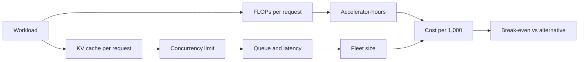

# Compute, Latency, and Cost

> **Module 07 — Deep Learning, Multimodal Models, and LLMs**
> Topic 11 of 11
> Estimated study time: 4 hours
> Prerequisites: Topics 05, 07, and 10
> Version 2026.3

## 1. Why this topic exists

Every generative system is a budget. The budget has four currencies — compute, memory, latency, and
money — and they trade against each other in ways that are computable before a line of serving code
is written. A team that cannot compute the budget will discover it in the first invoice, at the point
where the architecture is hardest to change. A team that can compute it will choose the model, the
context length, the batch size, and the hardware against a requirement rather than a hunch.

The industry problem is that the cost of a generative system is dominated by terms that are invisible
in a demo. A single request on a hosted API appears cheap. At 50,000 requests per day, with a
4,000-token prompt and a 300-token answer, the same request consumes 215 million tokens per day, and
the annual bill is a budget line that competes with clinical staff. The demo measured latency on an
unloaded system; the deployment must meet a p95 target under concurrent load. The model card reported
a context window; the serving system must hold the key-value cache for every concurrent request.

Four costs follow.

**Compute cost.** Training and inference are both approximately proportional to parameters times
tokens. The constant differs — training costs about three times the forward pass, inference costs one
forward pass plus the decode — but the scaling is the same. A 70-billion-parameter model costs about
ten times a 7-billion-parameter model per token, and the ratio is the first input to any build-versus-
buy decision.

**Memory cost.** The key-value cache grows linearly with context length, batch size, and layer count.
For a 70-billion-parameter model with multi-head attention, the cache is about 2.62 megabytes per
token, so a 4,000-token request holds 10.5 gigabytes. The cache, not the weights, limits concurrency.

**Latency cost.** Time to first token is dominated by the prefill of the input; time per output token
is dominated by the sequential decode. A system that reports throughput in total tokens hides the
distinction, and a clinician experiences the decode.

**Queueing cost.** A service at 83 percent utilisation has a mean wait of 0.42 seconds and a p95 wait
of 1.41 seconds. At 95 percent utilisation the same service has a p95 wait of 6.7 seconds. The
non-linearity is the reason capacity planning must target peak load, not average load.

This topic teaches the arithmetic of serving. It covers FLOPs, memory, batching, queueing, percentile
latency, cost per thousand inferences, and the break-even between a large model and a distilled one.
It is the last topic in the module because it depends on every previous one: the model size from
Topic 05, the token economics from Topic 07, the retrieval budget from Topic 08, and the evaluation
cost from Topic 10.

> **Note:** All prices in this topic are stated as assumptions, not quotes. A price is a variable
> that changes by vendor, contract, and region; the method is the durable part.

## 2. Learning outcomes

By the end of this topic you can:

1. **Compute** training and inference floating-point operations from parameters and tokens, and
   **convert** them to accelerator-hours at a stated effective throughput.
2. **Compute** key-value cache size from layers, heads, head dimension, context length, batch, and
   precision, and **explain** how grouped-query attention changes it.
3. **Model** a serving queue and **estimate** p50, p95, and p99 wait times at a stated utilisation.
4. **Distinguish** time to first token from time per output token, and **predict** which dominates
   for a stated workload.
5. **Calculate** cost per 1,000 inferences for hosted and self-hosted options, including idle
   capacity and human review.
6. **Determine** the break-even volume at which a distilled model repays its distillation cost.
7. **Size** a fleet for peak load with a stated headroom and **justify** the headroom.
8. **Critique** a vendor latency claim for load, batch, context length, and percentile.

Outcomes 1, 2, 3, and 6 are computational. Outcomes 4 and 7 are design outcomes assessed by rubric.
Outcome 8 is assessed in the evaluation dossier.

The computational outcomes are about the four formulas that determine every plan: FLOPs, cache,
queue, and cost. Each is a one-line calculation, and together they answer the question a build
committee actually asks: what will this cost, and will it be fast enough. A learner who can write those four can size a service on a whiteboard. The design
outcomes are about the assumptions that make the formulas valid, which is where the judgement lives.
A plan built on a measured throughput and a known peak is a plan; a plan built on a vendor's peak
number and a guessed peak is a scenario. The exercises and the worked example are written to make
that distinction visible.

## 3. The core mental model

Serving is a pipeline with two phases and four resources. The prefill phase processes the input
tokens in parallel and is compute-bound. The decode phase generates output tokens one at a time and
is memory-bandwidth-bound. The resources are compute, memory capacity, memory bandwidth, and
interconnect. Every performance number is a statement about which resource is binding.

```text
  request --> [ prefill: all input tokens in parallel ] --> first token
                     compute-bound
                          |
                          v
              [ decode: one token at a time, KV cache grows ]
                     memory-bandwidth-bound
                          |
                          v
                    output tokens
```

The first mental model is the roofline. A kernel is compute-bound when its arithmetic intensity
(FLOPs per byte moved) exceeds the hardware's ratio of compute to bandwidth, and memory-bound
otherwise. Decode has low arithmetic intensity: each generated token requires reading the weights and
the cache, and performs few FLOPs per byte. That is why batching improves decode throughput: the same
weight read serves several sequences.

```text
  arithmetic intensity = FLOPs / bytes moved

  prefill, long sequence:  high intensity  -> compute-bound
  decode, batch 1:         low intensity   -> memory-bound
  decode, large batch:     higher intensity -> closer to compute-bound
```

The second mental model is the memory budget. The weights, the key-value cache, the activations, and
the runtime overhead all compete for accelerator memory. The cache is the term that grows with
concurrency and context, and it is the term that limits how many requests can be in flight.

```text
  memory = weights + KV cache + activations + workspace

  weights:     parameters * bytes_per_parameter
  KV cache:    2 * layers * kv_heads * head_dim * tokens * batch * bytes
  activations: batch * tokens * hidden * layers * constant
```

The third mental model is the queue. Requests arrive at rate `lambda` and are served at rate `mu` per
worker. Utilisation is `rho = lambda / mu`. As `rho` approaches one, the wait grows without bound. The
relationship is not linear, and it is the reason a service that is comfortable at average load fails
at peak.

| Utilisation | Mean wait (units of service time) | p95 wait | Interpretation |
|---:|---:|---:|---|
| 0.50 | 1.00 | 3.00 | Comfortable |
| 0.70 | 2.33 | 5.99 | Workable |
| 0.83 | 5.00 | 16.9 | Tight |
| 0.90 | 9.00 | 30.0 | Fragile |
| 0.95 | 19.0 | 59.9 | Unstable |

The table is for a single-server queue with exponential service times. Real systems batch and
parallelise, so the constants differ, but the shape does not: latency rises sharply as utilisation
approaches one.

The fourth mental model is the cost equation. Cost per request is compute time times the cost of the
resource, plus idle capacity, plus the human review. The human review is often the largest term, and
it is the one most often omitted from a business case.



The fifth mental model is the difference between a cost and a rate. A rate is a price per token; a
cost is a rate applied to a workload, with capacity, idle, and human terms added. A lower rate can
produce a higher cost if it comes with a worse latency SLO, because the SLO determines the capacity
reserved.

The sixth mental model is the sensitivity. Most capacity plans are dominated by two or three
assumptions: the peak-to-average ratio, the effective throughput, and the human review time. A
sensitivity analysis varies each by a plausible range and reports whether the decision changes. If
the decision is robust to all three, the plan is sound; if it flips on one, that assumption needs
measurement before the decision.

The seventh mental model is the difference between peak capacity and average demand. A plan that
reports only the average has reported the demand, not the requirement, and the requirement is set by
the busiest hour and the SLO. A service must
be able to serve the busiest hour, and the busiest hour is often several times the average. The
capacity is therefore paid for all day and used for part of it, and the ratio is the efficiency that
determines whether self-hosting beats a hosted service.

The eighth mental model is the difference between a measurement and a model. The formulas in this
topic produce estimates. A load test produces measurements. The estimates choose the design; the
measurements confirm it. A team that skips the load test has a design, not a service.

The diagram shows the two loops that determine the answer. The compute loop sets the cost floor; the
memory loop sets the concurrency and therefore the latency and the fleet. A team that optimises only
the first will build a cheap system that cannot meet its latency target.

## 4. Definitions and vocabulary

The terms below mix performance vocabulary and accounting vocabulary. The first is needed to size
the service; the second is needed to defend the size. A plan that uses one without the other is
either technically correct and unfunded, or funded and infeasible.

| Term | Definition | Common misuse | Unit or convention |
|---|---|---|---|
| FLOP | One floating-point operation | Confusing with FLOPs per second | Count |
| Effective throughput | Achieved FLOPs per second under workload | Confusing with peak | FLOPs/s |
| MFU | Model FLOPs utilisation, achieved over peak | Confusing with hardware utilisation | Fraction |
| Prefill | Processing of input tokens | Confusing with prompt construction | Phase |
| Decode | Sequential generation of output tokens | Confusing with prefill | Phase |
| Time to first token | Latency before the first output token | Confusing with total latency | Seconds |
| Time per output token | Latency per generated token | Confusing with throughput | Seconds |
| Tokens per second | Generation rate | Confusing with requests per second | Tokens/s |
| KV cache | Stored keys and values for generated tokens | Confusing with weights | Bytes |
| Grouped-query attention | Key-value sharing across head groups | Confusing with multi-query | Architecture |
| Paged attention | Cache management in fixed-size blocks | Confusing with virtual memory | Technique |
| Continuous batching | Adding requests to a running batch | Confusing with static batching | Scheduling |
| Batch size | Requests processed together | Confusing with micro-batch | Count |
| Concurrency | Requests in flight | Confusing with batch size | Count |
| Utilisation | Arrival rate over service rate | Confusing with efficiency | Fraction |
| Queueing delay | Time waiting before service | Confusing with service time | Seconds |
| p50 | Median latency | Confusing with mean | Seconds |
| p95 | 95th percentile latency | Confusing with maximum | Seconds |
| p99 | 99th percentile latency | Confusing with p95 | Seconds |
| Tail latency | High-percentile latency | Confusing with average | Seconds |
| Throughput | Requests or tokens per unit time | Confusing with latency | Per second |
| Little's law | Concurrency equals arrival rate times time in system | Ignoring it | Relation |
| Headroom | Capacity above expected peak | Confusing with redundancy | Fraction |
| Autoscaling | Adding capacity with load | Confusing with batching | Control |
| Cold start | Delay when a new worker starts | Confusing with queueing | Seconds |
| Quantisation | Reducing numerical precision | Assuming it is free | Technique |
| Distillation | Training a smaller model from a larger | Confusing with pruning | Technique |
| Pruning | Removing weights or structure | Confusing with quantisation | Technique |
| Cost per token | Price per input or output token | Confusing with cost per request | Currency |
| Cost per inference | Total cost divided by requests | Omitting human review | Currency |
| Total cost of ownership | All costs of running a system | Counting only compute | Accounting |
| Break-even | Volume at which an option repays its fixed cost | Confusing with payback period | Count |
| Idle capacity | Capacity paid for but unused | Assuming it is free | Fraction |
| SLO | Service-level objective | Confusing with SLA | Target |
| SLA | Contractual service-level agreement | Confusing with SLO | Contract |
| Overcommit | Admitting more work than capacity | Confusing with batching | Risk |

> **Note:** The queue formulas in this topic assume exponential service times and a single server.
> Real services batch, parallelise, and have priorities, so the constants differ. The shape — a sharp
> rise in wait as utilisation approaches one — is the reliable part, and it is enough to size
> headroom.

> **Note:** Latency percentiles must be reported with the load at which they were measured. A p95 of
> 2 seconds at 10 percent utilisation says nothing about the p95 at peak.

## 5. The mechanics, step by step

This section is a fifteen-step procedure from a workload description to a costed, latency-bounded
service. Steps 1 to 4 characterise the workload and the model. Steps 5 to 8 compute compute, memory,
throughput, and queueing. Steps 9 to 11 cover scheduling, measurement, and cost. Steps 12 to 15 cover
comparison, break-even, monitoring, and re-costing.

### Step 1. Define the workload

**Input:** the product requirement.

**Output:** requests per day, peak requests per second, input and output token distributions, and a
latency SLO.

**Rationale:** Every later calculation depends on the workload. The peak-to-average ratio determines
the fleet; the token distribution determines the compute; the SLO determines whether the design is
feasible. A workload described as "50,000 requests per day" without a peak and a token distribution
cannot be sized.

**Branch point:** if the workload is interactive, the SLO is a latency target at p95. If it is batch,
the SLO is a completion deadline and throughput dominates.

### Step 2. Characterise the model

**Input:** the model card and the architecture.

**Output:** parameter count, layer count, attention head count, key-value head count, head dimension,
context window, and precision.

**Rationale:** These are the inputs to the compute and memory formulas. The key-value head count is
the one most often missing from a model card, and it is the one that determines the cache. A model
with grouped-query attention can have eight key-value heads for 64 query heads, which reduces the
cache by a factor of eight.

### Step 3. Compute FLOPs per request

**Input:** parameters, input tokens, output tokens.

**Output:** forward FLOPs and training FLOPs.

**Rationale:** Inference is approximately `2 * N * (input + output)` for a dense model, and training
is approximately `6 * N * tokens`. The factor two counts a multiply and an add per parameter per
token; the factor six counts the forward and backward passes. The approximation ignores attention's
quadratic term, which is small at short context and dominant at long context.

### Step 4. Compute the key-value cache

**Input:** layers, key-value heads, head dimension, context, batch, precision.

**Output:** bytes per token and bytes per request.

**Rationale:** The cache is `2 * layers * kv_heads * head_dim * tokens * batch * bytes`. The factor
two is for keys and values. The cache grows with every generated token, so the memory profile of a
request is not known when it arrives. A serving system that admits requests on their initial length
will over-admit long conversations.

### Step 5. Choose hardware and precision

**Input:** the model size and the budget.

**Output:** an accelerator type, a precision, and an effective throughput assumption.

**Rationale:** The effective throughput is not the peak. A dense model at batch one in decode achieves
a small fraction of peak because it is memory-bound. The planning number should come from a benchmark
on the actual workload, and it should be stated as an assumption.

**Branch point:** if the model fits in 16-bit precision with room for the cache, use it. If not,
quantise the weights to 8-bit or 4-bit, and measure the quality change with the evaluation in Topic
10 before accepting the saving.

### Step 6. Compute accelerator-hours

**Input:** FLOPs per request, request volume, effective throughput.

**Output:** accelerator-seconds per request, accelerator-hours per day, and the steady-state fleet.

**Rationale:** The arithmetic converts a workload into capacity. The fleet is the daily hours divided
by 24, plus headroom for peak and redundancy. A fleet sized to the average will fail at peak.

### Step 7. Size for peak, not average

**Input:** the peak-to-average ratio and the SLO.

**Output:** a fleet size with stated headroom.

**Rationale:** The queue is non-linear. A fleet sized to average load runs at high utilisation at
peak, and the p95 wait grows sharply. The headroom is a design choice with a cost, and it should be
stated as a percentage with its justification.

### Step 8. Model the queue

**Input:** arrival rate, service rate, fleet size.

**Output:** utilisation, mean wait, p95 wait, p99 wait.

**Rationale:** The queue model shows whether the SLO is achievable at the planned fleet. A service at
83 percent utilisation has a p95 wait of about 1.4 seconds for a 0.5-second service time; at 95
percent it is about 6.7 seconds. The model is approximate and the shape is reliable.

### Step 9. Schedule with continuous batching

**Input:** the request stream.

**Output:** a batching policy.

**Rationale:** Static batching waits for a full batch and wastes capacity when requests have different
lengths. Continuous batching admits new requests as slots free, which improves throughput and tail
latency. The policy must cap the batch by memory, not only by count, because the cache grows.

### Step 10. Measure at the SLO

**Input:** a load test.

**Output:** p50, p95, p99, throughput, and error rate at the target load.

**Rationale:** A latency number without its load is not a measurement. The load test must reproduce
the token distribution and the concurrency of production, and it must run long enough to include the
tail. A one-minute test at low load measures the easy case.

### Step 11. Compute cost per 1,000 inferences

**Input:** accelerator-hours, price per hour, request volume, and human review time.

**Output:** a cost per 1,000 with the components separated.

**Rationale:** The cost has a compute component, an idle component, and a human component. Separating
them shows which is worth optimising. In many clinical systems the human component dominates, and a
model optimisation that halves compute changes the total by a few percent.

### Step 12. Compare hosted and self-hosted

**Input:** the workload and the vendor terms.

**Output:** a comparison with the assumptions stated.

**Rationale:** Hosted pricing is per token and includes the provider's utilisation; self-hosted
pricing is per hour and includes idle capacity. The comparison depends on the utilisation the hospital
can achieve, and a hospital with a spiky workload may pay more for idle self-hosted capacity than for
hosted tokens.

### Step 13. Compute the break-even for distillation

**Input:** the cost difference and the one-off distillation cost.

**Output:** the volume at which the smaller model repays its fixed cost.

**Rationale:** Distillation has a fixed cost and a per-request saving. The break-even is the fixed
cost divided by the per-request saving. Below it, the larger model is cheaper; above it, the smaller
model is.

### Step 14. Monitor and re-cost

**Input:** production telemetry.

**Output:** monthly cost, latency percentiles, and utilisation.

**Rationale:** Token distributions drift, prompts grow, and prices change. A cost model built once is
a historical document. The monitoring must track cost per request and p95 latency, and it must alert
when either moves outside the planned range.

### Step 15. Decide and document

**Input:** all of the above.

**Output:** a decision record with the assumptions, the sensitivity, and the conditions for revisiting.

**Rationale:** The decision is only as good as its assumptions. Recording them makes the decision
auditable and makes a later change a revision rather than a surprise.

The failure modes specific to serving are worth naming.

**KV cache exhaustion.** The cache for concurrent long requests exceeds memory and the server rejects
or crashes. The signature is out-of-memory errors under concurrency, not in single-request tests. The
fix is admission control by token budget, cache quantisation, or grouped-query attention.

**Queue collapse.** Utilisation approaches one and the p95 wait grows without bound. The signature is
a p95 far above the mean and a rising error rate. The fix is headroom, admission control, or
autoscaling.

**Prefill starvation.** Long prompts monopolise compute and short requests wait. The signature is a
bimodal latency distribution by prompt length. The fix is chunked prefill, prioritisation, or separate
pools.

**Decode bottleneck.** Throughput is limited by memory bandwidth, and adding compute does not help.
The signature is low MFU at high batch. The fix is larger batches, quantisation, or a smaller model.

**Over-batching.** The batch is so large that the p99 wait exceeds the SLO. The signature is high
throughput with a bad tail. The fix is a batch cap by latency, not only by memory.

**Cost drift.** The token distribution grows and the bill rises without a workload change. The
signature is cost per request trending up. The fix is prompt budgeting and monitoring.

**Cold start.** A new worker takes minutes to load weights and warm the cache. The signature is
latency spikes during scaling. The fix is pre-warming, smaller weights, or reserved capacity.

### The roofline in practice

The roofline tells a team which optimisation will help. If a kernel is compute-bound, a faster matrix
multiply or a lower precision helps. If it is memory-bound, reducing bytes moved helps: quantisation,
cache compression, or batching.

For decode at batch one, the model reads all weights for each generated token. A 70-billion-parameter
model in 16-bit precision is 140 gigabytes of weights; reading them at 2 terabytes per second takes
70 milliseconds per token, which caps a single sequence at about 14 tokens per second regardless of
compute. That is the memory-bandwidth wall, and batching is the way around it: at batch 16, the same
weight read serves 16 sequences, and throughput rises toward the compute limit.

| Phase | Bound by | Lever | Effect of batching |
|---|---|---|---|
| Prefill | Compute | Faster matmul, lower precision | Small |
| Decode, batch 1 | Memory bandwidth | Quantisation, smaller model | Large |
| Decode, large batch | Compute | Faster matmul | Saturates |
| Long context | Attention compute | FlashAttention, sparsity | Moderate |

The table is the reason a serving team measures tokens per second at several batch sizes. The curve
rises steeply, then flattens, and the flattening point is the practical batch limit.

### Batching, scheduling, and admission

Batching is the main throughput lever and the main latency risk. Three policies matter.

**Static batching** collects a fixed number of requests, runs them together, and waits for the
slowest. It is simple and wastes capacity when request lengths vary.

**Continuous batching** admits a new request as soon as a slot frees, which keeps the accelerator
busy and reduces the tail. It requires a scheduler that tracks per-request progress and a cache
manager that can allocate and free blocks.

**Chunked prefill** splits a long prompt into chunks and interleaves them with decode steps, so a
long request does not block short ones. It trades a small increase in the long request's latency for
a large decrease in the short requests' latency.

Admission control is the complement. The scheduler must admit by a token budget, not only by a
request count, because a request's cache grows during generation. A server that admits 32 requests
of unknown output length is a server that can run out of memory at token 1,500.

| Policy | Throughput | Tail latency | Complexity | Use when |
|---|---|---|---|---|
| Static batching | Moderate | Poor with variable lengths | Low | Uniform batch jobs |
| Continuous batching | High | Good | Moderate | Interactive service |
| Chunked prefill | High | Good for short requests | High | Mixed prompt lengths |
| Priority queue | Moderate | Good for priority class | Moderate | Clinical triage |
| Admission by token budget | High | Bounded | Moderate | Long-context service |

### Measurement methodology

A latency claim is only interpretable with four pieces of information: the load, the token
distribution, the percentile, and the hardware. A vendor that reports "2 seconds" without them has
reported a number from an unknown experiment.

The load test should reproduce the production mix, run for at least an hour to include the tail, and
report p50, p95, and p99 separately for prefill-heavy and decode-heavy requests. The test should also
report the error rate, because a service that sheds load can look fast.

The measurement should be taken at the client, not only at the server, because network and queueing
outside the server are part of the user's experience. A server-side p95 of 2 seconds with a
client-side p95 of 6 seconds is a service with a queue in front of it.

| Measurement | What it captures | Common omission |
|---|---|---|
| Server-side latency | Time inside the service | Queue and network |
| Client-side latency | User experience | Nothing; preferred |
| Time to first token | Perceived responsiveness | Often unreported |
| Time per output token | Streaming smoothness | Often unreported |
| Throughput at SLO | Capacity | Reported without latency |
| Error rate under load | Shedding | Often unreported |

### Quantisation arithmetic

Quantisation reduces the bytes per parameter and therefore the memory traffic that limits decode. A
70-billion-parameter model at 16-bit precision is 140 gigabytes; at 8-bit it is 70; at 4-bit it is
35. The compute does not change much, but the memory read per token falls, which raises the decode
throughput at small batch.

The saving is not free. A 4-bit model may lose quality on rare terms, numeric values, and long
context. The evaluation in Topic 10 must be rerun on the quantised model, and the comparison must use
the same rubric and the same items. A quantisation that improves throughput by 2x and increases the
omission rate by 3 points is a trade that the clinical owner must approve, not a free optimisation.

| Precision | Bytes per parameter | 70B weights | Decode speed | Quality risk |
|---|---:|---:|---|---|
| 32-bit | 4 | 280 GB | Baseline | None |
| 16-bit | 2 | 140 GB | 2x | Very low |
| 8-bit | 1 | 70 GB | ~3x | Low |
| 4-bit | 0.5 | 35 GB | ~4x | Moderate |

The table is approximate and hardware-dependent. The quality column is the one that must be measured,
not assumed.

### The three numbers a buyer should ask for

A capacity plan can be summarised in three numbers: accelerator-hours per 1,000 inferences at a stated
precision and batch, the maximum concurrent requests that fit in memory, and the p95 latency at peak.
A vendor that provides all three has provided a plan; a vendor that provides only a price per token
has provided a rate, and a rate without a plan is a number that changes when the workload does.

The plan is the deliverable, not the price, because the plan is what the hospital can budget against
and what changes when the workload does.

### The decision record

The capacity decision should be recorded with its assumptions, its sensitivity, and its conditions
for revision. The record is what makes a later change a revision rather than a surprise, and it is
what an auditor will read when the service misses its SLO.

A minimal record has six fields: the workload (requests, tokens, peak), the model and precision, the
throughput assumption, the fleet and headroom, the cost per 1,000 and the idle ratio, and the
conditions that would trigger a re-cost. The last field is the one most often omitted, and it is the
one that keeps the plan alive.

## 6. Worked example

A hospital runs a discharge-summarisation service on a 70-billion-parameter model. The workload is
50,000 requests per day at peak, with 4,000 input tokens and 300 output tokens per request. The SLO
is a p95 end-to-end latency of 10 seconds. The model has 80 layers, 64 query heads, 8 key-value heads,
and a head dimension of 128.

This section computes the compute, the cache, the fleet, the queue, the cost, two diagnostics, and
the distillation break-even.

### Step 1. Compute per request

Inference FLOPs are approximately `2 * N * (input + output)`:

```text
2 * 70e9 * 4,300 = 6.02e14 FLOPs = 0.602 petafLOPs per request
```

At an effective throughput of 100 teraflops, the accelerator time is:

```text
6.02e14 / 1e14 = 6.02 accelerator-seconds per request
```

For 1,000 requests, that is 6,020 accelerator-seconds, or 1.67 accelerator-hours. For 50,000 requests
per day, it is `50,000 * 6.02 / 3,600 = 83.6` accelerator-hours per day. At 24 hours per accelerator-
day, the steady-state fleet is `83.6 / 24 = 3.5` accelerators. Rounding up gives 4, before headroom.

### Step 2. Key-value cache

With grouped-query attention, the cache per token is:

```text
2 * layers * kv_heads * head_dim * bytes = 2 * 80 * 8 * 128 * 2 = 327,680 bytes
```

That is 0.33 megabytes per token at 16-bit precision. For a 4,000-token request:

```text
327,680 * 4,000 = 1,310,720,000 bytes = 1.31 GB
```

With full multi-head attention (64 key-value heads), the same request would need
`2 * 80 * 64 * 128 * 2 * 4,000 = 10.49 GB`, which is eight times more and would limit concurrency to
a handful of requests per 80-gigabyte accelerator.

The cache is the reason grouped-query attention is standard in serving. It is not a quality
optimisation; it is a memory optimisation with a small quality cost that must be evaluated.

### Step 3. Fleet and queue

At 4 accelerators and 83.6 accelerator-hours per day, utilisation is
`83.6 / (4 * 24) = 0.871` on average. But the workload peaks at 50,000 requests per day, and the peak
hour may carry 15 percent of the daily volume, or 7,500 requests.

```text
peak service demand = 7,500 * 6.02 / 3,600 = 12.5 accelerator-hours in one hour
utilisation at peak = 12.5 / 4 = 3.1
```

A fleet of 4 cannot serve the peak hour at all: demand is 3.1 times capacity. The fleet must be sized
to the peak hour, which requires at least 13 accelerators, plus headroom. At 70 percent peak
utilisation, the fleet is `12.5 / 0.7 = 17.9`, or 18 accelerators.

The example is deliberately stark. A team that sized the fleet from the daily average would build a
service that fails every day at the busiest hour, and the failure would look like a software bug.

### Step 4. Latency decomposition

For a single request at low load, the prefill of 4,000 tokens and the decode of 300 tokens are
different phases. Suppose prefill runs at 8,000 tokens per second and decode at 50 tokens per second
per sequence:

```text
prefill: 4,000 / 8,000 = 0.50 s
decode:  300 / 50 = 6.00 s
total: 6.50 s
```

The decode is 92 percent of the latency. Doubling the output to 600 tokens adds 6 seconds and only 7
percent compute, which is the asymmetry that makes output length the dominant latency lever.

At high concurrency, the queue adds to both phases. With 18 accelerators and peak demand of 12.5
accelerator-hours per hour, utilisation is `12.5 / 18 = 0.694`. A single-server queue approximation
with service time 6.5 seconds gives a mean wait of `rho / (mu - lambda)` in units of service time:
`0.694 / (1 - 0.694) = 2.27` service times, or 14.8 seconds. The p95 wait is
`ln(rho / 0.05) / (1 - rho) = ln(13.9) / 0.306 = 8.6` service times, or 56 seconds.

The queue dominates the SLO. To meet a 10-second p95, the fleet must run at lower utilisation or the
service time must fall. This is the central tension of serving economics: latency is bought with
idle capacity.

### Step 5. Cost per 1,000

At an assumed $2 per accelerator-hour, the compute cost per 1,000 requests is:

```text
1.67 accelerator-hours * $2 = $3.34 per 1,000
```

At 50,000 requests per day, the daily compute cost is `50 * $3.34 = $167`, or about $5,000 per month,
before idle capacity and human review. If the fleet is 18 accelerators and average utilisation is
`83.6 / (18 * 24) = 0.194`, the hospital pays for 18 accelerator-hours every hour and uses 19 percent
of them. The idle cost is `18 * 24 * $2 = $864` per day, or about $26,000 per month, which is five
times the compute actually used.

The arithmetic changes the conversation. The cost is not the FLOPs; it is the capacity reserved to
meet the peak and the latency SLO. A team that optimises the model's FLOPs by 20 percent saves $33 a
day and may not change the fleet at all.

### Step 6. Diagnostic one: cache admission

The service admits requests based on their input length and does not reserve memory for the output.
A 4,000-token request with a 2,000-token output grows its cache from 1.31 to 1.97 gigabytes during
generation. At a batch of 32, the cache alone is `32 * 1.97 = 63` gigabytes, which exceeds the
accelerator's memory once the weights are loaded.

The diagnostic is the distribution of cache usage at admission versus at completion. If the
completion peak is materially above the admission estimate, the admission policy is overcommitting.
The fix is to reserve for the maximum output length or to evict, and the eviction policy is a
product decision because it changes what the model can remember.

### Step 7. Diagnostic two: the latency percentile by prompt length

The team plots p95 latency by input length and finds two modes: requests under 1,000 tokens at 4
seconds, and requests over 3,000 tokens at 14 seconds. The long requests are prefill-bound and
monopolise the batch. The fix is chunked prefill, which interleaves prefill and decode so that short
requests are not blocked, or a separate pool for long requests.

The diagnostic is the conditional percentile, not the overall one. An overall p95 of 10 seconds can
hide a subgroup at 14 seconds, and the subgroup is the one that matters for the clinicians who write
long notes.

### Step 8. Vary one assumption: 70B to a 7B distilled model

Suppose the team distils the 70-billion-parameter model into a 7-billion-parameter model. Compute per
request falls by a factor of ten:

```text
2 * 7e9 * 4,300 = 6.02e13 FLOPs per request
at 100 TFLOPS: 0.602 accelerator-seconds
per 1,000: 0.167 accelerator-hours, or $0.33 at $2/hour
```

The saving is `$3.34 - $0.33 = $3.01` per 1,000 requests. If distillation costs 500 accelerator-hours,
or `500 * $2 = $1,000`, the break-even volume is:

```text
$1,000 / $3.01 * 1,000 = 332,225 requests
```

At 50,000 requests per day, the break-even is reached in `332,225 / 50,000 = 6.6` days. The distilled
model pays back its fixed cost in a week, before the fleet savings. The conclusion changes if the
distilled model's quality is worse: the evaluation in Topic 10 must establish that the omission and
fabrication rates are acceptable, and a quality regression can make the saving irrelevant.

The fleet also shrinks. Peak demand falls from 12.5 to 1.25 accelerator-hours per peak hour, so the
peak-sized fleet falls from 18 to 2, and the idle cost falls with it. The total saving is larger than
the compute saving, which is the point: in a latency-bound service, the capacity reserved for peak is
the dominant cost, and a smaller model reduces it superlinearly.

### Step 9. Sensitivity to the peak assumption

The fleet depends on the peak-hour share. If the peak hour carries 10 percent of daily volume instead
of 15, peak demand is `5,000 * 6.02 / 3,600 = 8.36` accelerator-hours, and the fleet at 70 percent
utilisation is `8.36 / 0.7 = 11.9`, or 12 accelerators rather than 18. The difference is six
accelerators, or about $288 per day at the assumed price.

The conclusion changes in a specific way: the capacity decision is more sensitive to the peak share
than to the model's FLOPs, because the peak share multiplies the whole demand while a 10 percent FLOP
reduction changes it by 10 percent. A team that does not know its peak share should measure it before
choosing a fleet, and should plan for the higher value until it does.

### Step 10. What the arithmetic does not establish

The arithmetic establishes the cost and the capacity. It does not establish that the service is
clinically useful, that the distilled model preserves quality, or that the latency SLO is the right
one. Those require the evaluation in Topic 10 and a workflow study. The arithmetic is the budget, and
the budget is a constraint on the design, not evidence for it.

## 7. Code, query, or calculation

The code is a planning tool, not a benchmark. A team should run it with measured throughput and its
own token distribution, and then re-run it with the assumptions varied by plus or minus 30 percent.
The sensitivity is more informative than the point estimate, because the assumptions are estimates.

The code below computes accelerator time per request, key-value cache size, queue waits, and the
distillation break-even. It uses only the standard library.

**Assumptions.** The model has 70 billion parameters, 80 layers, 8 key-value heads, a head dimension
of 128, and 16-bit precision. Effective throughput is 100 teraflops. The queue is a single-server
M/M/1 approximation with exponential service times. The accelerator price is an assumed $2 per hour.

```python
import math

def gpu_seconds(params, tokens, throughput=1e14):
    return 2 * params * tokens / throughput

for name, n in [("70B", 70e9), ("7B", 7e9)]:
    s = gpu_seconds(n, 4000 + 300)
    print(name, "GPU-s/request", round(s, 3), "GPU-h/1000", round(s * 1000 / 3600, 2))

layers, kv_heads, head_dim, bytes_per = 80, 8, 128, 2
per_token = 2 * layers * kv_heads * head_dim * bytes_per
print("KV bytes/token:", per_token, "=", round(per_token / 1e6, 2), "MB")
print("4000 tokens GB:", round(per_token * 4000 / 1e9, 2))
print("MHA 64 heads, 4000 tokens GB:",
      round(2 * layers * 64 * head_dim * bytes_per * 4000 / 1e9, 2))

lam, mu = 10.0, 12.0
rho = lam / mu
print("rho:", round(rho, 3))
print("mean wait:", round(rho / (mu - lam), 3))
print("p95 wait:", round(math.log(rho / 0.05) / (mu - lam), 3))
print("p99 wait:", round(math.log(rho / 0.01) / (mu - lam), 3))

cost_hr = 2.0
c70 = gpu_seconds(70e9, 4300) * 1000 / 3600 * cost_hr
c7 = gpu_seconds(7e9, 4300) * 1000 / 3600 * cost_hr
print("cost/1000 70B:", round(c70, 2), "7B:", round(c7, 2), "saving:", round(c70 - c7, 2))
distill_hours = 500
print("break-even requests:", int(distill_hours * cost_hr / (c70 - c7) * 1000))
```

**Observed output:**

```text
70B GPU-s/request 6.02 GPU-h/1000 1.67
7B GPU-s/request 0.602 GPU-h/1000 0.17
KV bytes/token: 327680 = 0.33 MB
4000 tokens GB: 1.31
MHA 64 heads, 4000 tokens GB: 10.49
rho: 0.833
mean wait: 0.417
p95 wait: 1.407
p99 wait: 2.211
cost/1000 70B: 3.34 7B: 0.33 saving: 3.01
break-even requests: 332225
```

The first two lines show the tenfold ratio between the models. The cache lines show the eightfold
difference between grouped-query and full multi-head attention at the same context, which is the
single largest memory lever in serving.

The queue lines show the shape that matters. At utilisation 0.833, the mean wait is 0.42 seconds in
units where the service time is one second, and the p95 wait is 1.41. The ratio of p95 to mean is 3.4,
and it grows as utilisation rises. A service that meets its mean target can miss its p95 target by a
wide margin.

The cost lines show the saving per 1,000 and the break-even. The break-even of 332,225 requests is a
fixed-cost calculation; it does not include the evaluation cost of the distilled model, which is
real and must be added.

The second block computes the fleet and the idle cost from the peak hour.

```python
requests_peak_hour = 7500
demand_hours = requests_peak_hour * gpu_seconds(70e9, 4300) / 3600
print("peak demand accelerator-hours:", round(demand_hours, 2))
for target in [0.6, 0.7, 0.8]:
    fleet = math.ceil(demand_hours / target)
    print(f"target utilisation {target}: fleet {fleet}")
fleet = 18
idle = fleet * 24 * 2.0
used = 83.6 * 2.0
print("daily idle cost:", idle, "daily used cost:", used, "ratio:", round(idle / used, 2))
```

**Observed output:**

```text
peak demand accelerator-hours: 12.54
target utilisation 0.6: fleet 21
target utilisation 0.7: fleet 18
target utilisation 0.8: fleet 16
daily idle cost: 864.0 daily used cost: 167.2 ratio: 5.17
```

The fleet table shows the cost of headroom: 21 accelerators at 60 percent peak utilisation versus 16
at 80 percent. The difference is five accelerators, or $240 per day at the assumed price, and it buys
a lower p95. The choice is a product decision, and the arithmetic makes the trade explicit.

The idle ratio of 5.17 is the number that changes the build-versus-buy conversation. The hospital
pays for 18 accelerators around the clock and uses the equivalent of 3.5. The efficiency is 19
percent, and it is a property of the peak and the SLO, not of the model.

## 8. Data, standards, and regulatory context

Compute and latency are usually treated as engineering concerns, and they are regulated indirectly:
through availability, through change control, and through the requirement that a device perform as
claimed under expected conditions. A service that meets its accuracy claim at 10 percent utilisation
and fails at peak has not met the claim.

**Cost is a safety-relevant property.** A service that is sized to the average will fail at peak, and
a failure in a clinical workflow is an availability incident. The capacity plan is therefore part of
the safety case, not only the finance case. The EU AI Act's robustness requirement and the FDA's
lifecycle guidance both reach availability and performance under expected conditions.

**Change control.** A model, prompt, or hardware change that alters latency or cost is a change to
the service. The FDA predetermined change control guidance (December 2024, docket FDA-2022-D-2628)
asks which changes are anticipated and how they will be evaluated; a capacity change that alters the
p95 is a change that a reviewer may need to see.

**Procurement and contract.** A hosted service's terms determine the cost at scale: the price per
token, the rate limits, the latency commitments, the overage terms, and the notice period for model
changes. A contract that specifies only the price per token has left the capacity risk with the
hospital.

**Benchmark claims and procurement.** A vendor's throughput claim should be read with the hardware,
the batch, the sequence length, and the percentile. A claim of "10,000 tokens per second" without the
batch and the hardware is a number from an unknown experiment, and a procurement that accepts it has
accepted a measurement it cannot reproduce.

**Reliability and redundancy.** The capacity plan must include redundancy, and redundancy is a cost.
A service with a single accelerator has no failover; a service with two has 50 percent idle capacity
in the failure-free case. The availability target determines the redundancy, and the target should be
stated in the plan rather than assumed.

**Data protection.** Serving cost is not the only cost of a request. Sending PHI to a hosted service
requires a business associate agreement or de-identification, and the audit and retention obligations
apply to the request logs. Those obligations have a cost, and it belongs in the total.

**Sustainability.** Accelerator-hours are energy, and the energy has a cost and an environmental
report. A capacity plan that reports only dollars has omitted a reported obligation in many health
systems. The arithmetic is the same: hours times power times price per kilowatt-hour.

| Framework | Status | What it constrains | What it does not |
|---|---|---|---|
| FDA AI device guidance | Draft | Lifecycle and change description | Capacity plan |
| FDA PCCP | Final | Anticipated changes | Cost model |
| EU AI Act | Binding, phased | Robustness and availability | Technical threshold |
| HIPAA | Binding | PHI in logs and prompts | Serving cost |
| Contract terms | Contractual | Price, rate limits, latency | Model quality |
| Energy reporting | Organisational | Energy and emissions | Cost optimisation |

**The SLO as a clinical requirement.** A latency target is not an engineering preference. If a
clinician will not wait more than ten seconds at the point of care, the SLO is a workflow
requirement, and a service that misses it will be abandoned regardless of its accuracy. The SLO
should be derived from the workflow and stated in the intended use.

**The total cost of ownership.** The compute bill is one line. The others are integration, retrieval,
monitoring, human review, security, regulatory maintenance, and migration. A business case that
counts only compute has understated the total by a factor that depends on the workflow, and in
clinical settings the factor is often between three and ten.

| Cost line | Typical driver | Often omitted |
|---|---|---|
| Inference compute | Tokens, model size | No |
| Idle capacity | Peak, SLO | Yes |
| Retrieval infrastructure | Index, search | Sometimes |
| Human review | Time per output | Yes |
| Monitoring and evaluation | Re-scoring, drift | Yes |
| Security and audit | Logging, access | Yes |
| Regulatory maintenance | Change control | Yes |
| Integration | EHR interfaces | Yes |
| Migration | Vendor exit | Yes |

**The availability requirement.** A clinical service is often expected to be available during
working hours with a stated recovery time. That requirement changes the fleet: redundancy for a
single accelerator failure means at least two, and geographic redundancy means more. The capacity
plan must state the availability target and the redundancy it implies, because redundancy is a cost
that the compute arithmetic does not include.

**What the frameworks do not cover.** None of them specifies a headroom percentage, a p95 target, or
a cost model. Those are design decisions that the team must justify from the workload and the
clinical risk, and the justification is the capacity plan.

The frameworks do not prescribe a capacity model. They require that the service perform as claimed
under expected conditions, which is a requirement that the capacity plan must satisfy.

## 9. Industry practice and case evidence

The public evidence on serving is mostly from systems papers and engineering reports, not from
clinical deployments. It establishes the mechanisms and the order of magnitude; the hospital's own
workload determines its numbers.

**Chinchilla and the training cost.** Hoffmann et al. trained models under fixed compute budgets and
reported that a 70-billion-parameter model trained on 1.4 trillion tokens matched a much larger model
on their benchmarks (arXiv:2203.15556, 2022). The documented lesson for cost is that parameters and
tokens are both inputs, and a model card that reports only parameters has reported half the cost
equation.

**FlashAttention and the memory cost.** Dao et al. reported that tiled attention reduces memory from
quadratic to linear in sequence length while computing the same result (NeurIPS 2022,
arXiv:2205.14135). The documented result is a large speedup on long-context training and inference.
The lesson for serving is that the memory term can be engineered, and the engineering is what makes
long context affordable.

**PagedAttention and serving.** Kwon et al. introduced PagedAttention and vLLM, which manage the
key-value cache in fixed-size blocks and reduce fragmentation (SOSP 2023, arXiv:2309.06180). The
documented result is a substantial throughput improvement over naive cache allocation at the same
hardware. The lesson is that the cache manager, not only the model, determines serving economics.

**The systems-paper gap.** A serving paper reports throughput on a benchmark workload, often a fixed
prompt length and a fixed output length. A clinical workload has a long-tailed prompt distribution
and a short output, and the tail determines the p95. The paper's number is a ceiling for its
workload, not an estimate for the hospital's.

**What practitioners actually do.** In inference from public engineering reports and vendor
documentation, three patterns recur. First, interactive services are sized for peak with 30 to 50
percent headroom, because the queue is non-linear. Second, long-context services use grouped-query
attention and paged caches, because the cache is the binding constraint. Third, the teams that
control cost monitor tokens per request, because prompt growth is the most common cause of an
unexplained bill increase.

**The idle-capacity comparison.** A self-hosted service at 19 percent average utilisation and a
hosted service at 60 percent provider utilisation are not comparable. The hosted price embeds the
provider's efficiency; the self-hosted price embeds the hospital's peak. The comparison must be at
the hospital's load, and it must include the idle capacity the hospital pays for.

**The utilisation trap.** A hospital that self-hosts pays for capacity around the clock. If its
workload is concentrated in working hours, the overnight utilisation is near zero and the average
utilisation is low. The trap is comparing that average with a hosted provider's utilisation, which
is high because the provider aggregates many customers. The comparison is not like for like, and the
correct comparison is the hospital's cost per request at its own load, including idle.

**The provider's utilisation.** A hosted provider aggregates many customers and achieves a high
utilisation that no single hospital can. That is the economic basis of the hosted price, and it is
why a small hospital usually pays less for hosted tokens than for a dedicated fleet, even when the
per-token price looks high. The comparison flips only at a volume and a utilisation that the
hospital can sustain.

**What a benchmark measures.** A serving benchmark measures throughput and latency for a stated
model, hardware, batch, and sequence length. It does not measure the cost of the hospital's workload,
which has its own token distribution and peak. A benchmark is a component measurement, and the
capacity plan is the integration.

**The migration cost.** A hosted model can be deprecated or repriced. The migration cost is the
engineering time to move to another model, the evaluation to establish equivalence, and the clinical
revalidation. It is a real cost and it is usually omitted. A contract with a long notice period and a
portable interface reduces it; a proprietary interface increases it.

**What a buyer should ask.** Five questions separate a costed service from a price. What is the
measured throughput on our workload mix? What is the p95 latency at peak? What is the idle capacity
and who pays for it? What is the human review time per output? What is the exit cost if the vendor
changes the model or the price? A vendor that answers all five has provided a cost model; a vendor
that answers only the first has provided a rate.

The evidence does not support the claim that a lower price per token is a lower cost. It supports the
claim that cost is a function of the workload, the capacity reserved for peak, and the human review,
and that all three must be modelled.

## 10. Failure modes and red flags

Serving failures divide into capacity failures, memory failures, latency failures, and accounting
failures. The first three cause incidents; the fourth causes a budget breach that is discovered late.
The table is ordered by the stage at which the failure enters the plan.

| Failure | Early warning sign | Mechanism | Consequence | Mitigation |
|---|---|---|---|---|
| Fleet sized to average | Peak-hour errors | Queue collapse | Daily outage | Size for peak |
| KV cache exhaustion | OOM under concurrency | Admission by request count | Failed requests | Admit by token budget |
| Over-batching | p99 above SLO | Batch cap by memory only | Tail latency | Cap by latency |
| Prefill starvation | Bimodal latency | Long prompts monopolise | Short requests wait | Chunked prefill |
| Decode bottleneck | Low MFU at high batch | Memory bandwidth | Low throughput | Quantise, batch |
| Cost drift | Cost per request rising | Prompt growth | Budget overrun | Prompt budgeting |
| Cold start | Spikes during scaling | Weight loading | Latency spikes | Pre-warm |
| Hosted rate limit | 429 errors at peak | Provider quota | Outage | Contract quota |
| Wrong precision | Quality regression | 4-bit quantisation | Worse outputs | Evaluate before deploy |
| Idle cost ignored | Bill above forecast | Peak reservation | Budget breach | Model idle cost |
| Human review omitted | Understated cost | Review time not counted | False business case | Include review |
| Token estimate wrong | Truncation or overrun | Ratio assumed | Cost or quality loss | Measure ratio |
| Single-request test | Good demo, bad production | No concurrency | Production failure | Load test |
| No re-costing | Silent drift | Prices and workload change | Surprise | Monthly review |

Two rows are the ones that appear in every post-incident review. Fleet sized to average and KV cache
exhaustion are both failures of the capacity model, and both are visible in a load test that
reproduces the peak and the concurrency. A load test at low load is not a test of either.

The latency rows in the middle are the ones that appear in user complaints. Over-batching and prefill
starvation both produce a bimodal experience that an average latency hides, and both are visible only
in a conditional percentile by prompt length.

The accounting rows at the bottom are the ones that appear in the budget review. Cost drift and
omitted human review are both failures of the total-cost model, and both are prevented by monitoring
tokens per request and by a time study of the review step.

## 11. Assumptions and limits

A capacity plan is a set of assumptions about a workload that has not happened yet. The ledger
separates the assumptions that can be measured before deployment from the ones that can only be
monitored after, and it is the basis for the sensitivity analysis.

The first assumption is the one that most often fails. A peak-to-average ratio taken from a pilot is
a ratio from a pilot's population, and the deployment population may be larger, more seasonal, or
more concentrated.

| Assumption | Why it is needed | What breaks it | How to test |
|---|---|---|---|
| Effective throughput is known | Converts FLOPs to time | Workload differs from benchmark | Benchmark on production mix |
| The workload token distribution is stable | Sizing uses the mean | Prompt growth | Monitor tokens/request |
| The queue is approximately M/M/1 | Wait is computable | Batching, priorities | Load test |
| The cache formula matches the model | Memory is computable | Architecture variant | Measure at runtime |
| Peak-to-average ratio is known | Fleet is sized | Seasonal or clinical peaks | Historical load |
| The price is stable | Cost is computable | Vendor change | Contract terms |
| Human review time is counted | TCO is honest | Review omitted | Time study |
| Quantisation preserves quality | Saving is real | Rare-term degradation | Evaluation |
| Idle capacity is a cost | TCO is honest | Idle treated as free | Billing |
| Latency is measured at the client | SLO is meaningful | Server-only metric | Client instrumentation |

The assumptions are testable in the order listed. A production-mix benchmark tests the first and the
third; a load test tests the fourth and the fifth; a time study tests the seventh; a billing review
tests the sixth and the ninth. The tests are cheap relative to a failed launch.

The sensitivity analysis should vary the three assumptions that dominate: effective throughput,
peak-to-average ratio, and human review time. If the fleet or the total cost changes by more than the
decision margin under a plausible range, the assumption needs measurement before the decision.

## 12. Exercises

The exercises produce the numbers a capacity plan needs: FLOPs, cache, queue, cost, and break-even.
The arithmetic is checkable against Section 7. The design exercise is assessed by the criteria stated
with it, and a plan that sizes from the daily average is wrong regardless of its other detail.

For the design exercise, state the peak assumption and the headroom explicitly. Those two numbers
determine the fleet, and a plan that hides them cannot be reviewed.

The exercises use assumed prices and throughputs. Replace them with measured values before using any
answer in a real budget, and state the replacement in the deliverable.

Exercise 3 is the one that most often surprises a team: the wait is small at 0.8 utilisation and
large at 0.9, and the difference is one-tenth of an arrival per second. The exercise makes the
non-linearity concrete.

Exercise 6 is the one that mirrors a real capacity review, and it is the one to keep in a project
file as an example of a plan that states its assumptions rather than only its conclusion. It is also the one where a plan can be
wrong in a way that looks precise, so the acceptance criteria emphasize the peak assumption and the
headroom rather than the final fleet number.

**Exercise 1 (calculation, 20 minutes).** A 13-billion-parameter model serves 2,000 input and 400
output tokens. Compute FLOPs per request and accelerator-seconds at 80 effective teraflops.
**Deliverable:** the arithmetic. **Criteria:** correct formula, correct units.

**Exercise 2 (calculation, 25 minutes).** Compute the key-value cache per token for 40 layers, 8
key-value heads, head dimension 128, 16-bit precision, and the cache for 8,000 tokens. **Deliverable:**
the two values. **Criteria:** correct factor of two, correct units.

**Exercise 3 (queueing, 25 minutes).** A service has arrival rate 8 per second and service rate 10 per
second. Compute utilisation, mean wait, and p95 wait. **Deliverable:** the three values. **Criteria:**
correct M/M/1 formulas.

**Exercise 4 (cost, 30 minutes).** Compute cost per 1,000 inferences for a 70-billion-parameter model
at 4,000 input and 300 output tokens, 100 teraflops, and an assumed $2 per accelerator-hour.
**Deliverable:** the arithmetic. **Criteria:** FLOPs, hours, cost, units.

**Exercise 5 (break-even, 30 minutes).** A distilled model saves $3 per 1,000 and costs 400
accelerator-hours to produce. Compute the break-even volume. **Deliverable:** the arithmetic.
**Criteria:** correct fixed-cost division.

**Exercise 6 (design, 45 minutes).** Design a capacity plan for 20,000 requests per day with a peak
hour at 15 percent of daily volume, 3,000 input tokens, 200 output tokens, and a p95 SLO of 8 seconds.
**Deliverable:** a two-page plan. **Criteria:** peak sizing, headroom, queue estimate, idle cost.

**Exercise 7 (critique, 30 minutes).** Find a vendor latency claim and identify its load, token
distribution, percentile, and hardware. **Deliverable:** a four-row table with quotations.
**Criteria:** accurate quotations, at least two missing items.

**Exercise 8 (communication, 25 minutes).** Write 180 words for a CFO explaining why the accelerator
bill is five times the compute used. **Deliverable:** the paragraph. **Criteria:** one number, one
reason, one recommendation.

## 13. Self-check answers

The calculation answers show the formula and the unit. The queue answers should state the utilisation
before the wait, because the wait is a function of it.

The answers use the assumptions from Section 7. A different throughput or price changes the numbers
but not the method, and the method is the part worth checking. A capacity answer without a unit — hours,
seconds, gigabytes — cannot be checked against a plan.

The design answers are rubrics. A plan that states a fleet without a peak assumption and a headroom
has not shown its work, and the number cannot be reviewed.

**Answer 1.** FLOPs `2 * 13e9 * 2,400 = 6.24e13`. At 80 teraflops, `6.24e13 / 8e13 = 0.78`
accelerator-seconds per request.

**Answer 2.** Per token `2 * 40 * 8 * 128 * 2 = 163,840` bytes, or 0.164 megabytes. At 8,000 tokens,
`163,840 * 8,000 = 1,310,720,000` bytes, or 1.31 gigabytes.

**Answer 3.** `rho = 8/10 = 0.8`. Mean wait `0.8 / (10 - 8) = 0.4` seconds. p95 wait
`ln(0.8 / 0.05) / 2 = ln(16) / 2 = 1.386` seconds.

**Answer 4.** FLOPs `2 * 70e9 * 4,300 = 6.02e14`. Seconds `6.02`. Per 1,000 `6,020` seconds, or 1.67
hours. Cost `1.67 * $2 = $3.34`.

**Answer 5.** Break-even `400 * $2 / $3 * 1,000 = 266,667` requests, if the distillation cost is 400
accelerator-hours at $2 per hour.

**Answer 6.** A strong plan computes FLOPs per request, peak-hour demand, a fleet at 70 percent peak
utilisation, a queue estimate at that utilisation, and an idle-cost line. It states the peak
assumption and the headroom. It does not size from the daily average.

**Answer 7.** A strong answer reports the load, the input and output token distribution, the
percentile, and the hardware. Most vendor claims report a latency and a model, and omit the load and
the token distribution, which are the two that determine whether the number is comparable.

**Answer 8.** Rubric: the paragraph explains that capacity is reserved for peak and for the latency
SLO, that average utilisation is therefore low, and that the idle capacity is the price of the SLO.
It gives one number, such as the 5.17 idle-to-used ratio, and one recommendation, such as accepting a
higher p95 or reducing the peak. Full credit requires the number and the recommendation.

## 14. Interview questions

The questions test whether a candidate can size a service rather than quote a benchmark. Each strong
answer includes a formula or a number, and each weak answer is described by the concept it is missing.

The last question is the one that separates an engineer from a cost owner: the largest cost in a
clinical generative service is often the human review, and a candidate who has not considered it has
not costed the system. Strong
answers give a formula and a number; weak answers describe a model or a price.

**Question 1. Why is decode memory-bound and prefill compute-bound?**
A strong answer explains arithmetic intensity, weight reads per token, and the effect of batching. A
weak answer says "decode is slower".

**Question 2. How does grouped-query attention change the cost?**
A strong answer gives the cache formula and the factor, and notes the quality trade. A weak answer
says "it is faster".

**Question 3. Why does p95 latency rise so sharply near full utilisation?**
A strong answer gives the queue formula and the non-linearity, and relates it to headroom. A weak
answer says "the server is busy".

**Question 4. How do you size a fleet?**
A strong answer sizes from peak demand and target utilisation, not from the daily average, and
includes headroom and redundancy. A weak answer divides daily requests by a throughput number.

**Question 5. What is the cost per 1,000 inferences?**
A strong answer computes FLOPs, hours, price, and adds idle and human review. A weak answer quotes a
token price.

**Question 6. When does distillation pay back?**
A strong answer computes the fixed cost over the per-request saving and states the volume. A weak
answer says "when volume is high".

**Question 7. What does a latency percentile without load mean?**
A strong answer says nothing, and explains why. A weak answer accepts it.

**Question 8. How do you reduce the cost of a long-context service?**
A strong answer names cache quantisation, grouped-query attention, paged attention, chunking, and
retrieval instead of long context. A weak answer says "use a smaller model" only.

**Question 9. What is the largest cost in a clinical generative service?**
A strong answer says human review in many deployments, and gives an estimate. A weak answer says
compute.

## 15. Key terms

The vocabulary of this topic is deliberately economic. Throughput, utilisation, headroom, idle
capacity, and break-even are the terms a finance and operations team uses, and the clinical team
needs them to argue for a design that meets its SLO. The technical terms — prefill, decode, cache —
explain why the economics have the shape they do.

A reader who can compute the four formulas and state their assumptions can defend a capacity plan in
a review. The formulas are simple; the discipline is in the assumptions and the sensitivity.

That is why the topic ends with a decision record rather than a formula sheet: the record is what a
reviewer, a finance team, and a successor can use.

A plan that lives only in a slide deck is not a plan; it is a proposal, and a proposal cannot be
audited.

The difference is the record, and the record is the deliverable this topic asks for.

Everything else in this topic feeds that record. A reader who can only quote a price per token cannot answer the first question a CFO asks:
why the bill is not proportional to usage.

- **Accelerator-hour** — one accelerator for one hour.
- **Admission control** — limiting requests by a resource budget.
- **Arithmetic intensity** — FLOPs per byte moved.
- **Autoscaling** — adding capacity with load.
- **Batch size** — requests processed together.
- **Break-even** — volume at which a fixed cost is repaid.
- **Chunked prefill** — interleaving long prefill with decode.
- **Cold start** — delay when a worker starts.
- **Continuous batching** — admitting requests as slots free.
- **Concurrency** — requests in flight.
- **Cost per inference** — total cost divided by requests.
- **Decode** — sequential generation of output tokens.
- **Distillation** — training a smaller model from a larger.
- **Effective throughput** — achieved FLOPs per second.
- **FLOP** — one floating-point operation.
- **Grouped-query attention** — key-value sharing across head groups.
- **Headroom** — capacity above expected peak.
- **Idle capacity** — capacity paid for but unused.
- **KV cache** — stored keys and values for generated tokens.
- **Little's law** — concurrency equals arrival rate times time in system.
- **MFU** — model FLOPs utilisation.
- **Overcommit** — admitting more work than capacity.
- **p95** — 95th percentile latency.
- **Paged attention** — block-based cache management.
- **Prefill** — processing of input tokens.
- **Quantisation** — reducing numerical precision.
- **Queueing delay** — time waiting before service.
- **Roofline** — compute versus bandwidth bound analysis.
- **SLO** — service-level objective.
- **Tail latency** — high-percentile latency.
- **Time per output token** — latency per generated token.
- **Time to first token** — latency before the first output token.
- **Total cost of ownership** — all costs of running a system.
- **Throughput** — work per unit time.
- **Utilisation** — arrival rate over service rate.

## 16. Sources

Hoffmann J, Borgeaud S, Mensch A, et al. "Training Compute-Optimal Large Language Models."
arXiv:2203.15556, 2022. https://arxiv.org/abs/2203.15556 (accessed 25 October 2026).

Dao T, Fu DY, Ermon S, Rudra A, Ré C. "FlashAttention: Fast and Memory-Efficient Exact Attention
with IO-Awareness." NeurIPS 2022. https://arxiv.org/abs/2205.14135 (accessed 25 October 2026).

Kwon W, Li Z, Zhuang S, et al. "Efficient Memory Management for Large Language Model Serving with
PagedAttention." SOSP 2023. https://arxiv.org/abs/2309.06180 (accessed 25 October 2026).

Kaplan J, McCandlish S, Henighan T, et al. "Scaling Laws for Neural Language Models."
arXiv:2001.08361, 2020. https://arxiv.org/abs/2001.08361 (accessed 25 October 2026).

NIST. "Artificial Intelligence Risk Management Framework: Generative Artificial Intelligence
Profile." NIST AI 600-1, July 2024. https://doi.org/10.6028/NIST.AI.600-1 (accessed 25 October 2026).

FDA. "Marketing Submission Recommendations for a Predetermined Change Control Plan for
Artificial Intelligence-Enabled Device Software Functions," final guidance, December 2024.
https://www.fda.gov/media/166704/download (accessed 25 October 2026).

European Union. Regulation (EU) 2024/1689.
https://ai-act-service-desk.ec.europa.eu/en/ai-act/timeline/timeline-implementation-eu-ai-act
(accessed 25 October 2026).

> **Note:** The prices and throughputs in this topic are assumptions for teaching, not vendor quotes.
> A production cost model must use measured throughput on the deployed hardware and the contracted
> price.

The sources are systems papers and regulatory documents. The systems papers establish the mechanisms
— tiled attention, paged cache, compute-optimal training — and the reported speedups are on their
hardware, not on the hospital's. The regulatory documents establish the availability and change-
control obligations, not a capacity model.

The arithmetic in Sections 6 and 7 is reproducible from the formulas, and the observed outputs were
produced by the code shown. Every price and throughput is labelled as an assumption, and the
sensitivity in Step 9 shows why the label matters.

## 17. Links

- Module index: [`_index.md`](_index.md)
- Previous topic: [`10_evaluating-generative-models.md`](10_evaluating-generative-models.md)
- Module survey: [`../../07_deep_learning_multimodal_llms.md`](../../07_deep_learning_multimodal_llms.md)
- Labs: [`../../labs/`](../../labs/)
- Lab 7.6, cost and latency budget: [`../../labs/`](../../labs/)
- Module 14B, quantization: [`../14B_efficient_ai/`](../14B_efficient_ai/)
- Module 06, calibration: [`../06_machine_learning/08_calibration.md`](../06_machine_learning/08_calibration.md)

